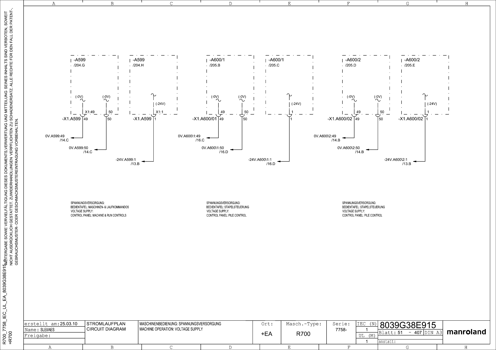

# +EA — Sheet 51 of 407 — MASCHINENBEDIENUNG: SPANNUNGSVERSORGUNG

**MACHINE OPERATION: VOLTAGE SUPPLY**

> Part of the manroland **R700** printing press IEC/UL circuit diagrams.
> Drawing class: **Stromlaufplan / Circuit diagram** (DIN A3).
> Document `+EA` covers the **Printing unit** machine section.

## At a glance

| Field | Value |
|---|---|
| Document | `+EA`  (8039G38E915) |
| Sheet | **51** of 407 |
| Section (DE) | MASCHINENBEDIENUNG: SPANNUNGSVERSORGUNG |
| Section (EN) | MACHINE OPERATION: VOLTAGE SUPPLY |
| Section type | POWER_SUPPLY — Voltage supply |
| Machine type | `R700` |
| Series | `7758` |
| Created | 25.03.10 |
| Replaces | — |
| Columns used | A, B, C, D, E, F, G |
| Path numbers | — |
| Labels on sheet | 74 |
| Cross-refs out | 15 |
| Cross-refs in | 24 |

**Previous:** [+EA sheet 50](SHEET_0050.md) · **Next:** [+EA sheet 52](SHEET_0052.md) · **Document TOC:** [_TOC.md](_TOC.md)  (+EA) · **Master TOC:** [all sheets](../_MASTER_TOC.md)

## Sheet image (300 DPI, exact vector render)



_Rendered directly from the PDF vector layer at 300 DPI (1-bit), no OCR and no resampling. Use it to confirm anything ambiguous in the text below._

## Cross-references on this sheet

Each entry is a wire leaving this sheet. The printed token is `/sheet.column`; the link resolves to that sheet inside the same document.

| Ref | Target sheet | Col | Path | Destination on target | Target section | From col |
|---|---|---|---|---|---|---|
| `/204.G` | [+EA sheet 204](SHEET_0204.md) | G | — | A599 | REFERENZMODUL | A |
| `/204.H` | [+EA sheet 204](SHEET_0204.md) | H | — | A599 | REFERENZMODUL | B |
| `/205.B` | [+EA sheet 205](SHEET_0205.md) | B | — | A600/1 | REFERENZMODUL | D |
| `/205.C` | [+EA sheet 205](SHEET_0205.md) | C | — | A600/1 | REFERENZMODUL | E |
| `/205.D` | [+EA sheet 205](SHEET_0205.md) | D | — | A600/2 | REFERENZMODUL | F |
| `/205.E` | [+EA sheet 205](SHEET_0205.md) | E | — | A600/2 | REFERENZMODUL | G |
| `/16.C` | [+EA sheet 16](SHEET_0016.md) | C | — | 0V.A600\1:49 | SPANNUNGSVERSORGUNG: 400V, 24V | C |
| `/14.B` | [+EA sheet 14](SHEET_0014.md) | B | — | 0V.A600\2:49 | SPANNUNGSVERSORGUNG: 400V, 24V | F |
| `/14.C` | [+EA sheet 14](SHEET_0014.md) | C | — | 0V.A599:49 | SPANNUNGSVERSORGUNG: 400V, 24V | A |
| `/14.B` | [+EA sheet 14](SHEET_0014.md) | B | — | 0V.A600\2:50 0V.A599:50 | SPANNUNGSVERSORGUNG: 400V, 24V | D |
| `/14.C` | [+EA sheet 14](SHEET_0014.md) | C | — | 0V.A600\2:50 0V.A599:50 | SPANNUNGSVERSORGUNG: 400V, 24V | D |
| `/16.D` | [+EA sheet 16](SHEET_0016.md) | D | — | 0V.A600\1:50 | SPANNUNGSVERSORGUNG: 400V, 24V | D |
| `/13.B` | [+EA sheet 13](SHEET_0013.md) | B | — | 24V.A600\1:1 24V.A600\2:1 | SPANNUNGSVERSORGUNG: 400V, 24V | F |
| `/16.D` | [+EA sheet 16](SHEET_0016.md) | D | — | 24V.A600\1:1 24V.A600\2:1 | SPANNUNGSVERSORGUNG: 400V, 24V | F |
| `/13.B` | [+EA sheet 13](SHEET_0013.md) | B | — | 24V.A599:1 | SPANNUNGSVERSORGUNG: 400V, 24V | B |

### Incoming references (sheets that point here)

Every other sheet that sends a wire to this one. `Back-ref` is the token printed on *that* sheet; `Path` is its line number.

| From sheet | Cols | Back-ref | Path | Refs | What continues there |
|---|---|---|---|---|---|
| [+EA#13](SHEET_0013.md) | B | `/13.B` | — | 2 | 24V.A599:1; 24V.A600\2:1 |
| [+EA#14](SHEET_0014.md) | B, C | `/14.B`, `/14.C` | — | 4 | 0V.A599:49; 0V.A599:50 0V.K445:A1; 0V.A600\2:49; 0V.A600\2:50 |
| [+EA#16](SHEET_0016.md) | C, D | `/16.C`, `/16.D` | — | 3 | 24V.A600\1:1 |
| [+EA#204](SHEET_0204.md) | G, H | `/204.G`, `/204.H` | — | 2 | — |
| [+EA#205](SHEET_0205.md) | B, C, E | `/205.B`, `/205.C`, `/205.E` | — | 4 | — |
| [+EA#212](SHEET_0212.md) | B, C, E, F, G, H | `/212.B`, `/212.C`, `/212.E`, `/212.F`, `/212.G`, `/212.H` | — | 9 | — |


## Devices on this sheet

| Tag | Class | Class meaning (IEC) | Col | Sub | Terminal | Sign |
|---|---|---|---|---|---|---|
| `X1:49` | X | Klemme / terminal, plug connector | B | — | 49 | — |
| `A599` | A | Baugruppe / assembly, module, PC board | A | — | — | — |
| `X1:1` | X | Klemme / terminal, plug connector | C | — | 1 | — |
| `A599` | A | Baugruppe / assembly, module, PC board | B | — | — | — |
| `A600/2` | A | Baugruppe / assembly, module, PC board | F | 2 | — | — |
| `A600/2` | A | Baugruppe / assembly, module, PC board | G | 2 | — | — |
| `A600/1` | A | Baugruppe / assembly, module, PC board | D | 1 | — | — |
| `A600/1` | A | Baugruppe / assembly, module, PC board | E | 1 | — | — |
| `X1.A599` | — | cross-device reference | A | — | — | — |
| `X1.A599` | — | cross-device reference | C | — | — | — |

## Potentials / nets

| Potential | Count | Columns | Attached devices | Terminals |
|---|---|---|---|---|
| `0V` | 6 | A, C, D, F | `A599`, `A600\1`, `A600\2` | `49`, `50` |
| `24V` | 3 | B, E, G | `A599`, `A600\1`, `A600\2` | `1` |


A potential such as `L24+/4` or `M24+` is a named supply/return rail; every place it appears on this sheet is electrically common.

## Wire-end annotations (grouped as printed)

A wire that continues elsewhere is annotated with a small cluster: the destination description, the path/line number `#NN`, and the `/sheet.column` cross reference. Each row below is one such cluster exactly as it is grouped on the drawing.

| Col | Y | Path | Cross-ref | Text on the wire |
|---|---|---|---|---|
| A | 139.2 | — | `/204.G` | `A599` |
| B | 139.2 | — | `/204.H` | `A599` |
| D | 139.2 | — | `/205.B` | `A600/1` |
| E | 139.2 | — | `/205.C` | `A600/1` |
| F | 139.2 | — | `/205.D` | `A600/2` |
| G | 139.2 | — | `/205.E` | `A600/2` |
| B | 228.9 | — | — | `( 0V) ( 0V)` |
| D | 228.9 | — | — | `( 0V) ( 0V)` |
| F | 228.9 | — | — | `( 0V) ( 0V)` |
| C | 245.9 | — | — | `( 24V)` |
| E | 245.9 | — | — | `( 24V)` |
| G | 245.9 | — | — | `( 24V)` |
| B | 265.3 | — | — | `X1:49 50` |
| C | 265.3 | — | — | `X1:1` |
| D | 265.4 | — | — | `49 50` |
| E | 265.4 | — | — | `1` |
| F | 265.4 | — | — | `49 50` |
| G | 265.4 | — | — | `1` |
| B | 280.9 | — | — | `X1.A599 49 50` |
| D | 280.9 | — | — | `X1.A599 1 X1.A600/02 49 50` |
| E | 280.9 | — | — | `X1.A600/01 49 50 X1.A600/02 1` |
| E | 282.4 | — | — | `1` |
| A | 323.4 | — | `/14.C` | `0V.A599:49` |
| C | 323.4 | — | `/16.C` | `0V.A600\1:49` |
| F | 323.4 | — | `/14.B` | `0V.A600\2:49` |
| D | 351.8 | — | `/14.B`, `/14.C` | `0V.A599:50 0V.A600\2:50` |
| D | 351.8 | — | `/16.D` | `0V.A600\1:50` |
| B | 380.1 | — | `/13.B` | `24V.A599:1` |
| F | 380.1 | — | `/13.B`, `/16.D` | `24V.A600\1:1 24V.A600\2:1` |
| B | 485.5 | — | — | `BEDIENTAFEL: MASCHINEN & LAUFKOMMANDOS SPANNUNGSVERSORGUNG:` |
| D | 485.5 | — | — | `BEDIENTAFEL: STAPELSTEUERUNG SPANNUNGSVERSORGUNG:` |
| F | 485.5 | — | — | `BEDIENTAFEL: STAPELSTEUERUNG SPANNUNGSVERSORGUNG:` |
| B | 505.4 | — | — | `CONTROL PANEL: MACHINE & RUN CONTROLS VOLTAGE SUPPLY:` |
| D | 505.4 | — | — | `CONTROL PANEL: PILE CONTROL VOLTAGE SUPPLY:` |
| F | 505.4 | — | — | `CONTROL PANEL: PILE CONTROL VOLTAGE SUPPLY:` |


## Reconstructed tables

This sheet carries tabular content (pin map / terminal assignment / index). The grid below was rebuilt from the drawing's own rule lines, so each row is exactly one physical row of the table.

### Table 1 — 5 data rows × 26 columns (at x=170.1, y=0.0) — **A599 /204.G ( 0V) X1:49 ( 0V) 50 A599 /204.H ( 24V) X1:1 A600/1 /205.B ( 0V) 49 A600/1 /205.C ( 24V) 1 A600/2 /205.D ( 0V) A600/2 /205.E X1.A599 0V.A599:50 BEDIENTAFEL: VOLTAGE CONTROL 49 /14.C SPANNUNGSVERSORGUNG: MASCHINEN & SUPPLY: PANEL: MACHINE & 50 LAUFKOMMANDOS RUN 24V.A599:1 CONTROLS /13.B X1.A599 1 X1.A600/01 0V.A600\1:49 /16.C 0V.A600\1:50 BEDIENTAFEL: VOLTAGE CONTROL 49 /16.D SPANNUNGSVERSORGUNG: STAPELSTEUERUNG SUPPLY: PANEL: PILE CONTROL 50 24V.A600\1:1 /16.D 0V.A600\2:49 X1.A600/02 /14.B 0V.A600\2:50 BEDIENTAFEL: VOLTAGE CONTROL 49 /14.B SPANNUNGSVERSORGUNG: STAPELSTEUERUNG SUPPLY: PANEL: PILE CONTROL 24V.A600\2:1 X1.A600/02 /13.B**

|  |  | STROMLAUFPLAN |  |  |  |  | MASCHINENBEDIENUNG: | SPANNUNGSVERSORGUNG |  |  |  |  | Ort: |  | Masch. Type: |  | Serie: |  |  | IEC (N) |  |  | 8039G38E915 |  |  |
|---|---|---|---|---|---|---|---|---|---|---|---|---|---|---|---|---|---|---|---|---|---|---|---|---|---|
|  |  | `CIRCUIT` | `DIAGRAM` |  |  |  |  |  |  |  |  |  |  |  |  |  |  |  |  |  |  |  |  |  |  |
|  |  |  |  |  |  | `MACHINE` | `OPERATION:` | `VOLTAGE SUPPLY` |  |  |  |  |  |  |  |  | `7758` |  |  | `1` |  |  |  |  |  |
|  |  |  |  |  |  |  |  |  |  |  |  |  | `+EA` |  | `R700` |  |  |  |  |  | `Blatt:` | `51` | `407` | `DIN A3` |  |
|  |  |  |  |  |  |  |  |  |  |  |  |  |  |  |  |  |  |  |  | `UL (M)` |  |  |  |  |  |
|  |  |  |  |  |  |  |  |  |  |  |  |  |  |  |  |  |  |  |  | `1` | `anstatt:` |  |  |  |  |


## Notes and free text on this sheet

| Text | Col | Y (pt) |
|---|---|---|
| `( 0V)` | A | 228.89 |
| `( 0V)` | B | 228.89 |
| `SPANNUNGSVERSORGUNG:` | B | 485.5 |
| `BEDIENTAFEL: MASCHINEN & LAUFKOMMANDOS` | B | 495.47 |
| `VOLTAGE SUPPLY:` | A | 505.4 |
| `CONTROL PANEL: MACHINE & RUN CONTROLS` | B | 515.34 |
| `( 24V)` | C | 245.9 |
| `X1.A600/02` | F | 280.94 |
| `( 0V)` | F | 228.89 |
| `( 0V)` | G | 228.89 |
| `SPANNUNGSVERSORGUNG:` | F | 485.5 |
| `BEDIENTAFEL: STAPELSTEUERUNG` | F | 495.45 |
| `VOLTAGE SUPPLY:` | F | 505.4 |
| `CONTROL PANEL: PILE CONTROL` | F | 515.33 |
| `( 24V)` | G | 245.9 |
| `X1.A600/02` | G | 280.94 |
| `X1.A600/01` | D | 280.94 |
| `( 0V)` | D | 228.89 |
| `SPANNUNGSVERSORGUNG:` | D | 485.5 |
| `BEDIENTAFEL: STAPELSTEUERUNG` | D | 495.45 |
| `VOLTAGE SUPPLY:` | D | 505.4 |
| `CONTROL PANEL: PILE CONTROL` | D | 515.33 |
| `( 24V)` | E | 245.9 |

## Complete label inventory (exact text from the drawing)

Every text object inside the drawing area of this sheet, in DIN reading order (column A→H, then top→bottom). This is the authoritative list: if a string is not here it is not printed on this sheet.

| Col | Y | X | Dir | Type | Text |
|---|---|---|---|---|---|
| A | 139.2 | 176.9 | → | device tag | `A599` |
| A | 153.0 | 177.2 | → | cross-reference | `/204.G` |
| A | 228.9 | 180.9 | → | text | `( 0V)` |
| A | 280.9 | 149.1 | → | device ref | `X1.A599` |
| A | 323.4 | 108.9 | → | potential | `0V.A599:49` |
| A | 333.4 | 143.7 | → | cross-reference | `/14.C` |
| A | 351.8 | 165.5 | → | potential | `0V.A599:50` |
| A | 505.4 | 170.1 | → | text | `VOLTAGE SUPPLY:` |
| B | 139.2 | 318.6 | → | device tag | `A599` |
| B | 153.0 | 318.9 | → | cross-reference | `/204.H` |
| B | 228.9 | 246.0 | → | text | `( 0V)` |
| B | 265.3 | 204.1 | → | device tag | `X1:49` |
| B | 265.4 | 260.5 | → | number | `50` |
| B | 282.4 | 201.0 | → | number | `49` |
| B | 282.4 | 257.7 | → | number | `50` |
| B | 361.7 | 200.4 | → | cross-reference | `/14.C` |
| B | 380.1 | 277.5 | → | potential | `24V.A599:1` |
| B | 390.0 | 314.1 | → | cross-reference | `/13.B` |
| B | 485.5 | 169.8 | → | text | `SPANNUNGSVERSORGUNG:` |
| B | 495.5 | 169.5 | → | text | `BEDIENTAFEL: MASCHINEN & LAUFKOMMANDOS` |
| B | 515.3 | 169.8 | → | text | `CONTROL PANEL: MACHINE & RUN CONTROLS` |
| C | 245.9 | 373.6 | → | text | `( 24V)` |
| C | 265.3 | 374.2 | → | device tag | `X1:1` |
| C | 280.9 | 319.2 | → | device ref | `X1.A599` |
| C | 282.4 | 370.5 | → | number | `1` |
| C | 323.4 | 427.5 | → | potential | `0V.A600\1:49` |
| C | 333.4 | 469.7 | → | cross-reference | `/16.C` |
| D | 139.2 | 502.9 | → | device tag | `A600/1` |
| D | 153.0 | 503.1 | → | cross-reference | `/205.B` |
| D | 228.9 | 506.8 | → | text | `( 0V)` |
| D | 228.9 | 572.0 | → | text | `( 0V)` |
| D | 265.4 | 529.8 | → | number | `49` |
| D | 265.4 | 586.5 | → | number | `50` |
| D | 280.9 | 461.8 | → | text | `X1.A600/01` |
| D | 282.4 | 527.0 | → | number | `49` |
| D | 282.4 | 583.7 | → | number | `50` |
| D | 351.8 | 484.2 | → | potential | `0V.A600\1:50` |
| D | 361.7 | 526.4 | → | cross-reference | `/16.D` |
| D | 485.5 | 495.8 | → | text | `SPANNUNGSVERSORGUNG:` |
| D | 495.4 | 495.5 | → | text | `BEDIENTAFEL: STAPELSTEUERUNG` |
| D | 505.4 | 496.1 | → | text | `VOLTAGE SUPPLY:` |
| D | 515.3 | 495.8 | → | text | `CONTROL PANEL: PILE CONTROL` |
| E | 139.2 | 644.6 | → | device tag | `A600/1` |
| E | 153.0 | 644.9 | → | cross-reference | `/205.C` |
| E | 245.9 | 699.6 | → | text | `( 24V)` |
| E | 265.4 | 699.3 | → | number | `1` |
| E | 282.4 | 696.5 | → | number | `1` |
| E | 380.1 | 596.1 | → | potential | `24V.A600\1:1` |
| E | 390.0 | 639.8 | → | cross-reference | `/16.D` |
| F | 139.2 | 828.9 | → | device tag | `A600/2` |
| F | 153.0 | 829.1 | → | cross-reference | `/205.D` |
| F | 228.9 | 832.8 | → | text | `( 0V)` |
| F | 265.4 | 855.8 | → | number | `49` |
| F | 280.9 | 786.3 | → | text | `X1.A600/02` |
| F | 282.4 | 852.9 | → | number | `49` |
| F | 323.4 | 753.4 | → | potential | `0V.A600\2:49` |
| F | 333.3 | 796.0 | → | cross-reference | `/14.B` |
| F | 351.8 | 810.1 | → | potential | `0V.A600\2:50` |
| F | 361.7 | 852.7 | → | cross-reference | `/14.B` |
| F | 485.5 | 821.8 | → | text | `SPANNUNGSVERSORGUNG:` |
| F | 495.4 | 821.5 | → | text | `BEDIENTAFEL: STAPELSTEUERUNG` |
| F | 505.4 | 822.0 | → | text | `VOLTAGE SUPPLY:` |
| F | 515.3 | 821.8 | → | text | `CONTROL PANEL: PILE CONTROL` |
| G | 139.2 | 970.6 | → | device tag | `A600/2` |
| G | 153.0 | 970.9 | → | cross-reference | `/205.E` |
| G | 228.9 | 898.0 | → | text | `( 0V)` |
| G | 245.9 | 1025.6 | → | text | `( 24V)` |
| G | 265.4 | 912.5 | → | number | `50` |
| G | 265.4 | 1025.3 | → | number | `1` |
| G | 280.9 | 956.4 | → | text | `X1.A600/02` |
| G | 282.4 | 909.6 | → | number | `50` |
| G | 282.4 | 1022.5 | → | number | `1` |
| G | 380.1 | 922.1 | → | potential | `24V.A600\2:1` |
| G | 390.0 | 966.0 | → | cross-reference | `/13.B` |

## Reading-order text block

The same content as a plain block, grouped by DIN column — convenient to paste or to match against a visual description.

```text
=== Column A ===
 139.2  176.9  devtag       A599
 153.0  177.2  xref         /204.G
 228.9  180.9  text         ( 0V)
 280.9  149.1  devref       X1.A599
 323.4  108.9  net          0V.A599:49
 333.4  143.7  xref         /14.C
 351.8  165.5  net          0V.A599:50
 505.4  170.1  text         VOLTAGE SUPPLY:
=== Column B ===
 139.2  318.6  devtag       A599
 153.0  318.9  xref         /204.H
 228.9  246.0  text         ( 0V)
 265.3  204.1  devtag       X1:49
 265.4  260.5  numeric      50
 282.4  201.0  numeric      49
 282.4  257.7  numeric      50
 361.7  200.4  xref         /14.C
 380.1  277.5  net          24V.A599:1
 390.0  314.1  xref         /13.B
 485.5  169.8  text         SPANNUNGSVERSORGUNG:
 495.5  169.5  text         BEDIENTAFEL: MASCHINEN & LAUFKOMMANDOS
 515.3  169.8  text         CONTROL PANEL: MACHINE & RUN CONTROLS
=== Column C ===
 245.9  373.6  text         ( 24V)
 265.3  374.2  devtag       X1:1
 280.9  319.2  devref       X1.A599
 282.4  370.5  numeric      1
 323.4  427.5  net          0V.A600\1:49
 333.4  469.7  xref         /16.C
=== Column D ===
 139.2  502.9  devtag       A600/1
 153.0  503.1  xref         /205.B
 228.9  506.8  text         ( 0V)
 228.9  572.0  text         ( 0V)
 265.4  529.8  numeric      49
 265.4  586.5  numeric      50
 280.9  461.8  text         X1.A600/01
 282.4  527.0  numeric      49
 282.4  583.7  numeric      50
 351.8  484.2  net          0V.A600\1:50
 361.7  526.4  xref         /16.D
 485.5  495.8  text         SPANNUNGSVERSORGUNG:
 495.4  495.5  text         BEDIENTAFEL: STAPELSTEUERUNG
 505.4  496.1  text         VOLTAGE SUPPLY:
 515.3  495.8  text         CONTROL PANEL: PILE CONTROL
=== Column E ===
 139.2  644.6  devtag       A600/1
 153.0  644.9  xref         /205.C
 245.9  699.6  text         ( 24V)
 265.4  699.3  numeric      1
 282.4  696.5  numeric      1
 380.1  596.1  net          24V.A600\1:1
 390.0  639.8  xref         /16.D
=== Column F ===
 139.2  828.9  devtag       A600/2
 153.0  829.1  xref         /205.D
 228.9  832.8  text         ( 0V)
 265.4  855.8  numeric      49
 280.9  786.3  text         X1.A600/02
 282.4  852.9  numeric      49
 323.4  753.4  net          0V.A600\2:49
 333.3  796.0  xref         /14.B
 351.8  810.1  net          0V.A600\2:50
 361.7  852.7  xref         /14.B
 485.5  821.8  text         SPANNUNGSVERSORGUNG:
 495.4  821.5  text         BEDIENTAFEL: STAPELSTEUERUNG
 505.4  822.0  text         VOLTAGE SUPPLY:
 515.3  821.8  text         CONTROL PANEL: PILE CONTROL
=== Column G ===
 139.2  970.6  devtag       A600/2
 153.0  970.9  xref         /205.E
 228.9  898.0  text         ( 0V)
 245.9 1025.6  text         ( 24V)
 265.4  912.5  numeric      50
 265.4 1025.3  numeric      1
 280.9  956.4  text         X1.A600/02
 282.4  909.6  numeric      50
 282.4 1022.5  numeric      1
 380.1  922.1  net          24V.A600\2:1
 390.0  966.0  xref         /13.B
```

---
_Generated from the PDF vector text layer; no OCR. Source: `R700_7758_IEC_UL_EA_8039G38E915_p`, sheet 51._
