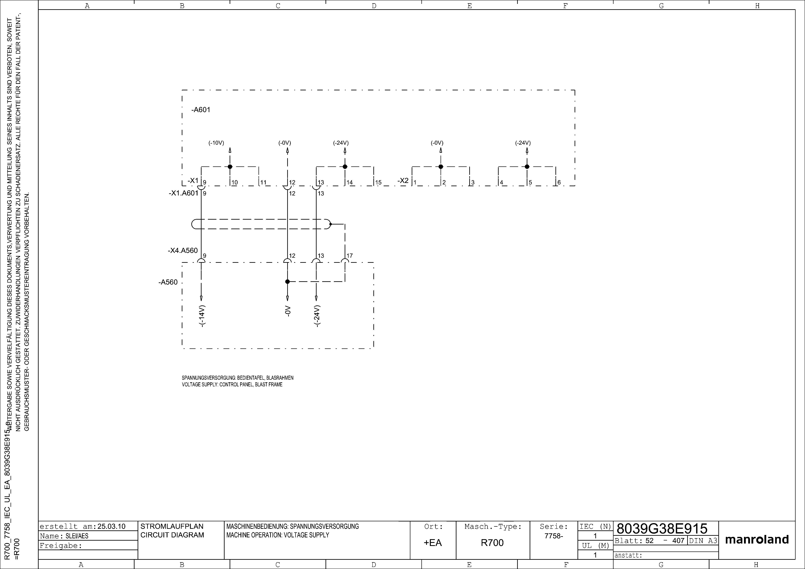

# +EA — Sheet 52 of 407 — MASCHINENBEDIENUNG: SPANNUNGSVERSORGUNG

**MACHINE OPERATION: VOLTAGE SUPPLY**

> Part of the manroland **R700** printing press IEC/UL circuit diagrams.
> Drawing class: **Stromlaufplan / Circuit diagram** (DIN A3).
> Document `+EA` covers the **Printing unit** machine section.

## At a glance

| Field | Value |
|---|---|
| Document | `+EA`  (8039G38E915) |
| Sheet | **52** of 407 |
| Section (DE) | MASCHINENBEDIENUNG: SPANNUNGSVERSORGUNG |
| Section (EN) | MACHINE OPERATION: VOLTAGE SUPPLY |
| Section type | POWER_SUPPLY — Voltage supply |
| Machine type | `R700` |
| Series | `7758` |
| Created | 25.03.10 |
| Replaces | — |
| Columns used | B, C, D, E, F |
| Path numbers | — |
| Labels on sheet | 36 |
| Cross-refs out | 0 |
| Cross-refs in | 17 |

**Previous:** [+EA sheet 51](SHEET_0051.md) · **Next:** [+EA sheet 53](SHEET_0053.md) · **Document TOC:** [_TOC.md](_TOC.md)  (+EA) · **Master TOC:** [all sheets](../_MASTER_TOC.md)

## Sheet image (300 DPI, exact vector render)



_Rendered directly from the PDF vector layer at 300 DPI (1-bit), no OCR and no resampling. Use it to confirm anything ambiguous in the text below._

## Cross-references on this sheet

Each entry is a wire leaving this sheet. The printed token is `/sheet.column`; the link resolves to that sheet inside the same document.

_No outgoing cross-references on this sheet._

### Incoming references (sheets that point here)

Every other sheet that sends a wire to this one. `Back-ref` is the token printed on *that* sheet; `Path` is its line number.

| From sheet | Cols | Back-ref | Path | Refs | What continues there |
|---|---|---|---|---|---|
| [+EA#213](SHEET_0213.md) | C | `/213.C` | — | 7 | — |
| [+EA#230](SHEET_0230.md) | F | `/230.F` | — | 6 | — |
| [+EA#238](SHEET_0238.md) | B | `/238.B` | — | 4 | — |


## Devices on this sheet

| Tag | Class | Class meaning (IEC) | Col | Sub | Terminal | Sign |
|---|---|---|---|---|---|---|
| `X1` | X | Klemme / terminal, plug connector | B | — | — | — |
| `X2` | X | Klemme / terminal, plug connector | D | — | — | — |
| `A601` | A | Baugruppe / assembly, module, PC board | B | — | — | — |
| `A560` | A | Baugruppe / assembly, module, PC board | B | — | — | — |
| `X1.A601` | — | cross-device reference | B | — | — | — |
| `X4.A560` | — | cross-device reference | B | — | — | — |

## Potentials / nets

| Potential | Count | Columns | Attached devices | Terminals |
|---|---|---|---|---|
| `0V` | 1 | C | — | — |


A potential such as `L24+/4` or `M24+` is a named supply/return rail; every place it appears on this sheet is electrically common.

## Wire-end annotations (grouped as printed)

A wire that continues elsewhere is annotated with a small cluster: the destination description, the path/line number `#NN`, and the `/sheet.column` cross reference. Each row below is one such cluster exactly as it is grouped on the drawing.

| Col | Y | Path | Cross-ref | Text on the wire |
|---|---|---|---|---|
| B | 157.6 | — | — | `A601` |
| B | 207.6 | — | — | `( 10V)` |
| C | 207.6 | — | — | `( 0V) ( 24V)` |
| E | 207.6 | — | — | `( 0V) ( 24V)` |
| B | 262.5 | — | — | `X1` |
| D | 262.5 | — | — | `X2` |
| D | 266.1 | — | — | `9 10 11 12 13 14 15 1 2 3 4 5 6` |
| C | 280.9 | — | — | `X1.A601 9 12 13` |
| B | 366.0 | — | — | `X4.A560 9` |
| C | 374.5 | — | — | `12 13 17` |
| B | 412.7 | — | — | `A560` |
| B | 451.6 | — | — | `( 14V)` |
| C | 451.6 | — | — | `( 24V)` |
| C | 452.1 | — | — | `0V` |
| C | 556.4 | — | — | `SPANNUNGSVERSORGUNG: BEDIENTAFEL, BLASRAHMEN VOLTAGE SUPPLY: CONTROL PANEL, BLAST FRAME` |


## Reconstructed tables

This sheet carries tabular content (pin map / terminal assignment / index). The grid below was rebuilt from the drawing's own rule lines, so each row is exactly one physical row of the table.

### Table 1 — 3 data rows × 5 columns (at x=269.3, y=133.2)

| A601 | ( 10V) | ( 0V) |  | ( 24V) |
|---|---|---|---|---|
| `X1` | `9` | `10 11` | `12` | `13` |
| `X1.A601` | `9` |  | `12` | `13` |
| `X4.A560` | `9` |  | `12` | `13` |


## Notes and free text on this sheet

| Text | Col | Y (pt) |
|---|---|---|
| `( 10V)` | B | 207.64 |
| `( 0V)` | C | 207.63 |
| `( 24V)` | D | 207.64 |
| `( 0V)` | E | 207.63 |
| `( 24V)` | F | 207.64 |
| `SPANNUNGSVERSORGUNG: BEDIENTAFEL, BLASRAHMEN` | C | 556.38 |
| `VOLTAGE SUPPLY: CONTROL PANEL, BLAST FRAME` | C | 566.32 |
| `( 14V)` | B | 451.56 |
| `( 24V)` | C | 451.56 |

## Complete label inventory (exact text from the drawing)

Every text object inside the drawing area of this sheet, in DIN reading order (column A→H, then top→bottom). This is the authoritative list: if a string is not here it is not printed on this sheet.

| Col | Y | X | Dir | Type | Text |
|---|---|---|---|---|---|
| B | 157.6 | 283.2 | → | device tag | `A601` |
| B | 207.6 | 308.4 | → | text | `( 10V)` |
| B | 262.5 | 277.5 | → | device tag | `X1` |
| B | 266.1 | 300.2 | → | number | `9` |
| B | 280.9 | 249.7 | → | device ref | `X1.A601` |
| B | 282.4 | 300.2 | → | number | `9` |
| B | 366.0 | 248.3 | → | device ref | `X4.A560` |
| B | 374.5 | 300.2 | → | number | `9` |
| B | 412.7 | 234.4 | → | device tag | `A560` |
| B | 451.6 | 293.7 | ↕ | text | `( 14V)` |
| C | 207.6 | 411.9 | → | text | `( 0V)` |
| C | 266.1 | 342.1 | → | number | `10` |
| C | 266.1 | 384.7 | → | number | `11` |
| C | 266.1 | 427.2 | → | number | `12` |
| C | 266.1 | 469.7 | → | number | `13` |
| C | 282.4 | 427.2 | → | number | `12` |
| C | 282.4 | 469.7 | → | number | `13` |
| C | 374.5 | 427.2 | → | number | `12` |
| C | 374.5 | 469.7 | → | number | `13` |
| C | 451.6 | 463.8 | ↕ | text | `( 24V)` |
| C | 452.1 | 421.3 | ↕ | potential | `0V` |
| C | 556.4 | 269.0 | → | text | `SPANNUNGSVERSORGUNG: BEDIENTAFEL, BLASRAHMEN` |
| C | 566.3 | 269.3 | → | text | `VOLTAGE SUPPLY: CONTROL PANEL, BLAST FRAME` |
| D | 207.6 | 492.7 | → | text | `( 24V)` |
| D | 262.5 | 587.9 | → | device tag | `X2` |
| D | 266.1 | 512.2 | → | number | `14` |
| D | 266.1 | 554.7 | → | number | `15` |
| D | 266.1 | 611.4 | → | number | `1` |
| D | 374.5 | 512.2 | → | number | `17` |
| E | 207.6 | 637.2 | → | text | `( 0V)` |
| E | 266.1 | 654.5 | → | number | `2` |
| E | 266.1 | 697.0 | → | number | `3` |
| E | 266.1 | 739.6 | → | number | `4` |
| F | 207.6 | 762.0 | → | text | `( 24V)` |
| F | 266.1 | 782.1 | → | number | `5` |
| F | 266.1 | 824.6 | → | number | `6` |

## Reading-order text block

The same content as a plain block, grouped by DIN column — convenient to paste or to match against a visual description.

```text
=== Column B ===
 157.6  283.2  devtag       A601
 207.6  308.4  text         ( 10V)
 262.5  277.5  devtag       X1
 266.1  300.2  numeric      9
 280.9  249.7  devref       X1.A601
 282.4  300.2  numeric      9
 366.0  248.3  devref       X4.A560
 374.5  300.2  numeric      9
 412.7  234.4  devtag       A560
 451.6  293.7  text         ( 14V)
=== Column C ===
 207.6  411.9  text         ( 0V)
 266.1  342.1  numeric      10
 266.1  384.7  numeric      11
 266.1  427.2  numeric      12
 266.1  469.7  numeric      13
 282.4  427.2  numeric      12
 282.4  469.7  numeric      13
 374.5  427.2  numeric      12
 374.5  469.7  numeric      13
 451.6  463.8  text         ( 24V)
 452.1  421.3  net          0V
 556.4  269.0  text         SPANNUNGSVERSORGUNG: BEDIENTAFEL, BLASRAHMEN
 566.3  269.3  text         VOLTAGE SUPPLY: CONTROL PANEL, BLAST FRAME
=== Column D ===
 207.6  492.7  text         ( 24V)
 262.5  587.9  devtag       X2
 266.1  512.2  numeric      14
 266.1  554.7  numeric      15
 266.1  611.4  numeric      1
 374.5  512.2  numeric      17
=== Column E ===
 207.6  637.2  text         ( 0V)
 266.1  654.5  numeric      2
 266.1  697.0  numeric      3
 266.1  739.6  numeric      4
=== Column F ===
 207.6  762.0  text         ( 24V)
 266.1  782.1  numeric      5
 266.1  824.6  numeric      6
```

---
_Generated from the PDF vector text layer; no OCR. Source: `R700_7758_IEC_UL_EA_8039G38E915_p`, sheet 52._
