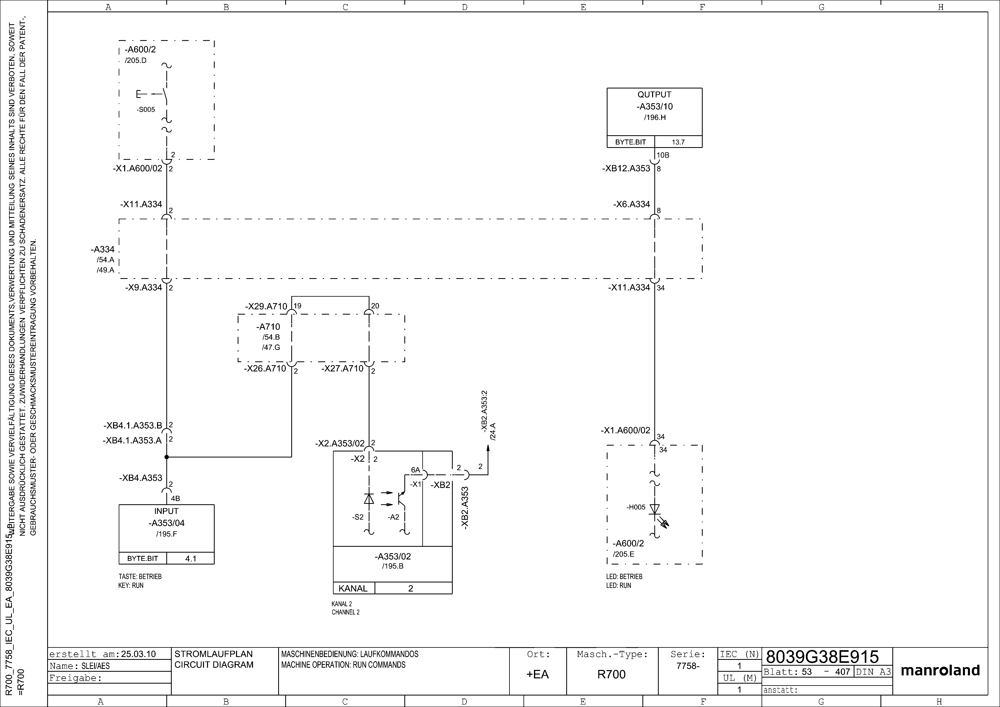

# +EA — Sheet 53 of 407 — MASCHINENBEDIENUNG: LAUFKOMMANDOS

**MACHINE OPERATION: RUN COMMANDS**

> Part of the manroland **R700** printing press IEC/UL circuit diagrams.
> Drawing class: **Stromlaufplan / Circuit diagram** (DIN A3).
> Document `+EA` covers the **Printing unit** machine section.

## At a glance

| Field | Value |
|---|---|
| Document | `+EA`  (8039G38E915) |
| Sheet | **53** of 407 |
| Section (DE) | MASCHINENBEDIENUNG: LAUFKOMMANDOS |
| Section (EN) | MACHINE OPERATION: RUN COMMANDS |
| Section type | CIRCUIT — Circuit diagram |
| Machine type | `R700` |
| Series | `7758` |
| Created | 25.03.10 |
| Replaces | — |
| Columns used | A, B, C, D, E, F |
| Path numbers | — |
| Labels on sheet | 77 |
| Cross-refs out | 10 |
| Cross-refs in | 26 |

**Previous:** [+EA sheet 52](SHEET_0052.md) · **Next:** [+EA sheet 54](SHEET_0054.md) · **Document TOC:** [_TOC.md](_TOC.md)  (+EA) · **Master TOC:** [all sheets](../_MASTER_TOC.md)

## Sheet image (300 DPI, exact vector render)



_Rendered directly from the PDF vector layer at 300 DPI (1-bit), no OCR and no resampling. Use it to confirm anything ambiguous in the text below._

## Cross-references on this sheet

Each entry is a wire leaving this sheet. The printed token is `/sheet.column`; the link resolves to that sheet inside the same document.

| Ref | Target sheet | Col | Path | Destination on target | Target section | From col |
|---|---|---|---|---|---|---|
| `/205.D` | [+EA sheet 205](SHEET_0205.md) | D | — | A600/2 | REFERENZMODUL | A |
| `/196.H` | [+EA sheet 196](SHEET_0196.md) | H | — | — | REFERENZMODUL | F |
| `/54.A` | [+EA sheet 54](SHEET_0054.md) | A | — | — | MASCHINENBEDIENUNG: LAUFKOMMANDOS | A |
| `/49.A` | [+EA sheet 49](SHEET_0049.md) | A | — | — | SCHUTZ | A |
| `/54.B` | [+EA sheet 54](SHEET_0054.md) | B | — | — | MASCHINENBEDIENUNG: LAUFKOMMANDOS | B |
| `/47.G` | [+EA sheet 47](SHEET_0047.md) | G | — | — | SCHUTZ | B |
| `/24.A` | [+EA sheet 24](SHEET_0024.md) | A | — | XB2.A353:2 | BUSVERBINDUNGEN: SICHERHEITSBUS | D |
| `/195.F` | [+EA sheet 195](SHEET_0195.md) | F | — | — | REFERENZMODUL | A |
| `/205.E` | [+EA sheet 205](SHEET_0205.md) | E | — | A600/2 | REFERENZMODUL | E |
| `/195.B` | [+EA sheet 195](SHEET_0195.md) | B | — | — | REFERENZMODUL | C |

### Incoming references (sheets that point here)

Every other sheet that sends a wire to this one. `Back-ref` is the token printed on *that* sheet; `Path` is its line number.

| From sheet | Cols | Back-ref | Path | Refs | What continues there |
|---|---|---|---|---|---|
| [+EA#24](SHEET_0024.md) | A | `/24.A` | — | 1 | XB2.A353:2 |
| [+EA#47](SHEET_0047.md) | F | `/47.F` | — | 1 | — |
| [+EA#49](SHEET_0049.md) | A | `/49.A` | — | 1 | — |
| [+EA#54](SHEET_0054.md) | A, B | `/54.A`, `/54.B` | — | 2 | — |
| [+EA#195](SHEET_0195.md) | B, F | `/195.B`, `/195.F` | — | 2 | — |
| [+EA#196](SHEET_0196.md) | H | `/196.H` | — | 1 | — |
| [+EA#205](SHEET_0205.md) | D, E | `/205.D`, `/205.E` | — | 2 | — |
| [+EA#212](SHEET_0212.md) | G, H | `/212.G`, `/212.H` | — | 2 | — |
| [+EA#224](SHEET_0224.md) | G | `/224.G` | — | 1 | — |
| [+EA#225](SHEET_0225.md) | C | `/225.C` | — | 1 | — |
| [+EA#237](SHEET_0237.md) | A, B, C | `/237.A`, `/237.B`, `/237.C` | — | 3 | — |
| [+EA#244](SHEET_0244.md) | F | `/244.F` | — | 1 | — |
| [+EA#252](SHEET_0252.md) | A | `/252.A` | — | 1 | — |
| [+EA#255](SHEET_0255.md) | G, H | `/255.G`, `/255.H` | — | 2 | — |
| [+EA#257](SHEET_0257.md) | C | `/257.C` | — | 1 | — |
| [+EA#270](SHEET_0270.md) | C | `/270.C` | — | 1 | — |
| [+EA#271](SHEET_0271.md) | B | `/271.B` | — | 1 | — |
| [+EA#274](SHEET_0274.md) | B | `/274.B` | — | 2 | — |


## Devices on this sheet

| Tag | Class | Class meaning (IEC) | Col | Sub | Terminal | Sign |
|---|---|---|---|---|---|---|
| `A353/04` | A | Baugruppe / assembly, module, PC board | A | 04 | — | — |
| `S005` | S | Schalter / switch | A | — | — | — |
| `A600/2` | A | Baugruppe / assembly, module, PC board | A | 2 | — | — |
| `A600/2` | A | Baugruppe / assembly, module, PC board | E | 2 | — | — |
| `A353/10` | A | Baugruppe / assembly, module, PC board | F | 10 | — | — |
| `A334` | A | Baugruppe / assembly, module, PC board | A | — | — | — |
| `S2` | S | Schalter / switch | C | — | — | — |
| `A2` | A | Baugruppe / assembly, module, PC board | C | — | — | — |
| `X1` | X | Klemme / terminal, plug connector | D | — | — | — |
| `X2` | X | Klemme / terminal, plug connector | C | — | — | — |
| `XB2` | XB |  | D | — | — | — |
| `A353/02` | A | Baugruppe / assembly, module, PC board | C | 02 | — | — |
| `A710` | A | Baugruppe / assembly, module, PC board | B | — | — | — |
| `4.1` | — | cross-device reference | B | — | — | — |
| `XB4.A353` | — | cross-device reference | A | — | — | — |
| `13.7` | — | cross-device reference | F | — | — | — |
| `XB12.A353` | — | cross-device reference | E | — | — | — |
| `XB4.1.A353.B` | — | cross-device reference | A | — | — | — |
| `XB4.1.A353.A` | — | cross-device reference | A | — | — | — |
| `X11.A334` | — | cross-device reference | A | — | — | — |
| `X9.A334` | — | cross-device reference | A | — | — | — |
| `X6.A334` | — | cross-device reference | E | — | — | — |
| `X11.A334` | — | cross-device reference | E | — | — | — |
| `XB2.A353` | — | cross-device reference | D | — | — | — |
| `X29.A710` | — | cross-device reference | B | — | — | — |
| `X27.A710` | — | cross-device reference | C | — | — | — |
| `X26.A710` | — | cross-device reference | B | — | — | — |
| `XB2.A353:2` | — | cross-device reference | D | — | 2 | — |

## Potentials / nets

| Potential | Count | Columns | Attached devices | Terminals |
|---|---|---|---|---|
| `H005` | 1 | E | — | — |


A potential such as `L24+/4` or `M24+` is a named supply/return rail; every place it appears on this sheet is electrically common.

## Wire-end annotations (grouped as printed)

A wire that continues elsewhere is annotated with a small cluster: the destination description, the path/line number `#NN`, and the `/sheet.column` cross reference. Each row below is one such cluster exactly as it is grouped on the drawing.

| Col | Y | Path | Cross-ref | Text on the wire |
|---|---|---|---|---|
| A | 54.2 | — | `/205.D` | `A600/2` |
| F | 108.3 | — | — | `QUTPUT` |
| F | 122.2 | — | — | `A353/10` |
| A | 126.9 | — | — | `S005` |
| F | 136.0 | — | `/196.H` | — |
| F | 165.6 | — | — | `BYTE.BIT 13.7` |
| B | 180.3 | — | — | `2` |
| F | 181.0 | — | — | `10B` |
| A | 195.9 | — | — | `X1.A600/02 2` |
| E | 195.9 | — | — | `XB12.A353 8` |
| A | 238.4 | — | — | `X11.A334 2` |
| E | 238.4 | — | — | `X6.A334 8` |
| A | 292.3 | — | — | `A334` |
| A | 305.3 | — | `/54.A`, `/49.A` | — |
| A | 337.6 | — | — | `X9.A334 2` |
| E | 337.6 | — | — | `X11.A334 34` |
| C | 360.3 | — | — | `X29.A710 19 20` |
| B | 384.4 | — | — | `A710` |
| B | 397.4 | — | `/54.B`, `/47.G` | — |
| C | 434.0 | — | — | `X26.A710 2 X27.A710 2` |
| D | 464.9 | — | `/24.A` | `XB2.A353:2` |
| A | 502.1 | — | — | `XB4.1.A353.B 2` |
| E | 507.7 | — | — | `X1.A600/02 34` |
| A | 519.1 | — | — | `XB4.1.A353.A 2` |
| C | 523.3 | — | — | `X2.A353/02 2` |
| F | 531.8 | — | — | `34` |
| C | 541.7 | — | — | `X2` |
| D | 543.2 | — | — | `2 2` |
| D | 551.7 | — | — | `2` |
| D | 555.9 | — | — | `6A` |
| A | 564.4 | — | — | `XB4.A353 2` |
| D | 572.9 | — | — | `X1` |
| D | 572.9 | — | — | `XB2` |
| D | 579.1 | — | — | `XB2.A353` |
| B | 589.9 | — | — | `4B` |
| E | 600.2 | — | — | `H005` |
| A | 604.4 | — | — | `INPUT` |
| C | 611.9 | — | — | `S2 A2` |
| A | 618.3 | — | — | `A353/04` |
| A | 632.0 | — | `/195.F` | — |
| E | 642.4 | — | `/205.E` | `A600/2` |
| C | 657.9 | — | — | `A353/02` |
| A | 661.1 | — | — | `BYTE.BIT 4.1` |
| C | 670.3 | — | `/195.B` | — |
| A | 683.7 | — | — | `KEY: RUN TASTE: BETRIEB` |
| E | 683.7 | — | — | `LED: BETRIEB LED: RUN` |
| C | 696.2 | — | — | `KANAL 2` |
| C | 716.5 | — | — | `KANAL 2 CHANNEL 2` |


## Reconstructed tables

This sheet carries tabular content (pin map / terminal assignment / index). The grid below was rebuilt from the drawing's own rule lines, so each row is exactly one physical row of the table.

### Table 1 — 7 data rows × 9 columns (at x=141.7, y=48.2)

| A600/2 /205.D S005 | 2 |  |  |  |  |  |  |  |
|---|---|---|---|---|---|---|---|---|
| `X1.A600/02 X11.A334 X9.A334` | `2 2 2` |  |  |  |  |  |  |  |
| `XB4.1.A353.B XB4.1.A353.A` | `2 2` | `X29.A710 A710 /54.B /47.G X26.A710` | `19 2` | `X27.A710 X2.A353/02` | `20 2 2` |  |  | `XB2.A353:2` |
| `XB4.A353` | `2 4B` |  |  | `X2` | `2` | `6A X1` | `XB2` | `2 2` |
| `INPUT` | `A353/04 /195.F` |  |  | `S2` | `A2` |  |  | `XB2.A353` |
| `BYTE.BIT` | `4.1` |  |  |  | `A353/02` |  |  |  |
| `TASTE: BETRIEB` |  |  |  |  | `/195.B` |  |  |  |
| `KEY: RUN` |  |  |  | `KANAL` |  | `2` |  |  |


### Table 2 — 3 data rows × 2 columns (at x=722.8, y=104.9)

| QUTPUT | A353/10 /196.H |
|---|---|
| `BYTE.BIT` | `13.7` |
| `XB12.A353 X6.A334 X11.A334 X1.A600/02` | `10B 8 8 34 34` |
| `H005 A600/2 /205.E` | `34` |


## Notes and free text on this sheet

| Text | Col | Y (pt) |
|---|---|---|
| `4B` | B | 589.88 |
| `INPUT` | A | 604.42 |
| `BYTE.BIT` | A | 661.67 |
| `TASTE: BETRIEB` | A | 683.74 |
| `KEY: RUN` | A | 694.36 |
| `X1.A600/02` | A | 195.9 |
| `LED: BETRIEB` | E | 683.74 |
| `LED: RUN` | E | 694.39 |
| `X1.A600/02` | E | 507.71 |
| `10B` | F | 181 |
| `QUTPUT` | F | 108.33 |
| `BYTE.BIT` | E | 165.6 |
| `KANAL 2` | C | 716.52 |
| `CHANNEL 2` | C | 726.47 |
| `6A` | D | 555.86 |
| `KANAL` | C | 696.2 |
| `X2.A353/02` | C | 523.3 |

## Complete label inventory (exact text from the drawing)

Every text object inside the drawing area of this sheet, in DIN reading order (column A→H, then top→bottom). This is the authoritative list: if a string is not here it is not printed on this sheet.

| Col | Y | X | Dir | Type | Text |
|---|---|---|---|---|---|
| A | 54.2 | 148.5 | → | device tag | `A600/2` |
| A | 68.0 | 148.8 | → | cross-reference | `/205.D` |
| A | 126.9 | 162.7 | → | device tag | `S005` |
| A | 195.9 | 134.4 | → | text | `X1.A600/02` |
| A | 238.4 | 143.1 | → | device ref | `X11.A334` |
| A | 292.3 | 108.3 | → | device tag | `A334` |
| A | 305.3 | 115.4 | → | cross-reference | `/54.A` |
| A | 317.7 | 115.4 | → | cross-reference | `/49.A` |
| A | 337.6 | 149.1 | → | device ref | `X9.A334` |
| A | 502.1 | 123.3 | → | device ref | `XB4.1.A353.B` |
| A | 519.8 | 122.5 | → | device ref | `XB4.1.A353.A` |
| A | 564.4 | 142.0 | → | device ref | `XB4.A353` |
| A | 604.4 | 183.5 | → | text | `INPUT` |
| A | 618.3 | 177.0 | → | device tag | `A353/04` |
| A | 632.0 | 186.1 | → | cross-reference | `/195.F` |
| A | 661.7 | 151.7 | → | text | `BYTE.BIT` |
| A | 683.7 | 141.4 | → | text | `TASTE: BETRIEB` |
| A | 694.4 | 140.9 | → | text | `KEY: RUN` |
| B | 180.3 | 203.8 | → | number | `2` |
| B | 197.3 | 201.0 | → | number | `2` |
| B | 246.9 | 201.0 | → | number | `2` |
| B | 339.1 | 201.0 | → | number | `2` |
| B | 360.3 | 292.0 | → | device ref | `X29.A710` |
| B | 384.4 | 305.3 | → | device tag | `A710` |
| B | 397.5 | 312.7 | → | cross-reference | `/54.B` |
| B | 409.9 | 312.1 | → | cross-reference | `/47.G` |
| B | 434.0 | 290.6 | → | device ref | `X26.A710` |
| B | 502.1 | 201.0 | → | number | `2` |
| B | 519.1 | 201.0 | → | number | `2` |
| B | 572.9 | 201.0 | → | number | `2` |
| B | 589.9 | 203.8 | → | text | `4B` |
| B | 661.1 | 220.8 | → | device ref | `4.1` |
| C | 360.3 | 349.2 | → | number | `19` |
| C | 360.3 | 441.9 | → | number | `20` |
| C | 434.0 | 382.7 | → | device ref | `X27.A710` |
| C | 438.3 | 349.8 | → | number | `2` |
| C | 438.3 | 441.9 | → | number | `2` |
| C | 523.3 | 375.3 | → | text | `X2.A353/02` |
| C | 523.3 | 441.9 | → | number | `2` |
| C | 541.7 | 417.8 | → | device tag | `X2` |
| C | 543.2 | 444.8 | → | number | `2` |
| C | 611.9 | 419.2 | → | device tag | `S2` |
| C | 611.9 | 461.8 | → | device tag | `A2` |
| C | 657.9 | 446.3 | → | device tag | `A353/02` |
| C | 670.3 | 455.1 | → | cross-reference | `/195.B` |
| C | 696.2 | 403.1 | → | text | `KANAL` |
| C | 716.5 | 394.9 | → | text | `KANAL 2` |
| C | 726.5 | 395.1 | → | text | `CHANNEL 2` |
| D | 464.9 | 572.9 | ↕ | device ref | `XB2.A353:2` |
| D | 503.7 | 582.8 | ↕ | cross-reference | `/24.A` |
| D | 551.7 | 569.8 | → | number | `2` |
| D | 553.1 | 544.0 | → | number | `2` |
| D | 555.9 | 489.5 | → | text | `6A` |
| D | 572.9 | 488.4 | → | device tag | `X1` |
| D | 572.9 | 512.8 | → | device tag | `XB2` |
| D | 579.1 | 548.8 | ↕ | device ref | `XB2.A353` |
| D | 696.2 | 486.1 | → | number | `2` |
| E | 165.6 | 732.8 | → | text | `BYTE.BIT` |
| E | 195.9 | 717.2 | → | device ref | `XB12.A353` |
| E | 238.4 | 730.2 | → | device ref | `X6.A334` |
| E | 337.6 | 724.3 | → | device ref | `X11.A334` |
| E | 507.7 | 715.5 | → | text | `X1.A600/02` |
| E | 600.3 | 746.1 | → | potential | `H005` |
| E | 642.4 | 729.6 | → | device tag | `A600/2` |
| E | 656.1 | 729.9 | → | cross-reference | `/205.E` |
| E | 683.7 | 722.0 | → | text | `LED: BETRIEB` |
| E | 694.4 | 722.0 | → | text | `LED: RUN` |
| F | 108.3 | 759.3 | → | text | `QUTPUT` |
| F | 122.2 | 758.1 | → | device tag | `A353/10` |
| F | 136.0 | 767.1 | → | cross-reference | `/196.H` |
| F | 165.6 | 799.7 | → | device ref | `13.7` |
| F | 181.0 | 781.5 | → | text | `10B` |
| F | 197.3 | 782.1 | → | number | `8` |
| F | 246.9 | 782.1 | → | number | `8` |
| F | 339.1 | 782.1 | → | number | `34` |
| F | 516.2 | 782.1 | → | number | `34` |
| F | 531.8 | 784.9 | → | number | `34` |

## Reading-order text block

The same content as a plain block, grouped by DIN column — convenient to paste or to match against a visual description.

```text
=== Column A ===
  54.2  148.5  devtag       A600/2
  68.0  148.8  xref         /205.D
 126.9  162.7  devtag       S005
 195.9  134.4  text         X1.A600/02
 238.4  143.1  devref       X11.A334
 292.3  108.3  devtag       A334
 305.3  115.4  xref         /54.A
 317.7  115.4  xref         /49.A
 337.6  149.1  devref       X9.A334
 502.1  123.3  devref       XB4.1.A353.B
 519.8  122.5  devref       XB4.1.A353.A
 564.4  142.0  devref       XB4.A353
 604.4  183.5  text         INPUT
 618.3  177.0  devtag       A353/04
 632.0  186.1  xref         /195.F
 661.7  151.7  text         BYTE.BIT
 683.7  141.4  text         TASTE: BETRIEB
 694.4  140.9  text         KEY: RUN
=== Column B ===
 180.3  203.8  numeric      2
 197.3  201.0  numeric      2
 246.9  201.0  numeric      2
 339.1  201.0  numeric      2
 360.3  292.0  devref       X29.A710
 384.4  305.3  devtag       A710
 397.5  312.7  xref         /54.B
 409.9  312.1  xref         /47.G
 434.0  290.6  devref       X26.A710
 502.1  201.0  numeric      2
 519.1  201.0  numeric      2
 572.9  201.0  numeric      2
 589.9  203.8  text         4B
 661.1  220.8  devref       4.1
=== Column C ===
 360.3  349.2  numeric      19
 360.3  441.9  numeric      20
 434.0  382.7  devref       X27.A710
 438.3  349.8  numeric      2
 438.3  441.9  numeric      2
 523.3  375.3  text         X2.A353/02
 523.3  441.9  numeric      2
 541.7  417.8  devtag       X2
 543.2  444.8  numeric      2
 611.9  419.2  devtag       S2
 611.9  461.8  devtag       A2
 657.9  446.3  devtag       A353/02
 670.3  455.1  xref         /195.B
 696.2  403.1  text         KANAL
 716.5  394.9  text         KANAL 2
 726.5  395.1  text         CHANNEL 2
=== Column D ===
 464.9  572.9  devref       XB2.A353:2
 503.7  582.8  xref         /24.A
 551.7  569.8  numeric      2
 553.1  544.0  numeric      2
 555.9  489.5  text         6A
 572.9  488.4  devtag       X1
 572.9  512.8  devtag       XB2
 579.1  548.8  devref       XB2.A353
 696.2  486.1  numeric      2
=== Column E ===
 165.6  732.8  text         BYTE.BIT
 195.9  717.2  devref       XB12.A353
 238.4  730.2  devref       X6.A334
 337.6  724.3  devref       X11.A334
 507.7  715.5  text         X1.A600/02
 600.3  746.1  net          H005
 642.4  729.6  devtag       A600/2
 656.1  729.9  xref         /205.E
 683.7  722.0  text         LED: BETRIEB
 694.4  722.0  text         LED: RUN
=== Column F ===
 108.3  759.3  text         QUTPUT
 122.2  758.1  devtag       A353/10
 136.0  767.1  xref         /196.H
 165.6  799.7  devref       13.7
 181.0  781.5  text         10B
 197.3  782.1  numeric      8
 246.9  782.1  numeric      8
 339.1  782.1  numeric      34
 516.2  782.1  numeric      34
 531.8  784.9  numeric      34
```

---
_Generated from the PDF vector text layer; no OCR. Source: `R700_7758_IEC_UL_EA_8039G38E915_p`, sheet 53._
