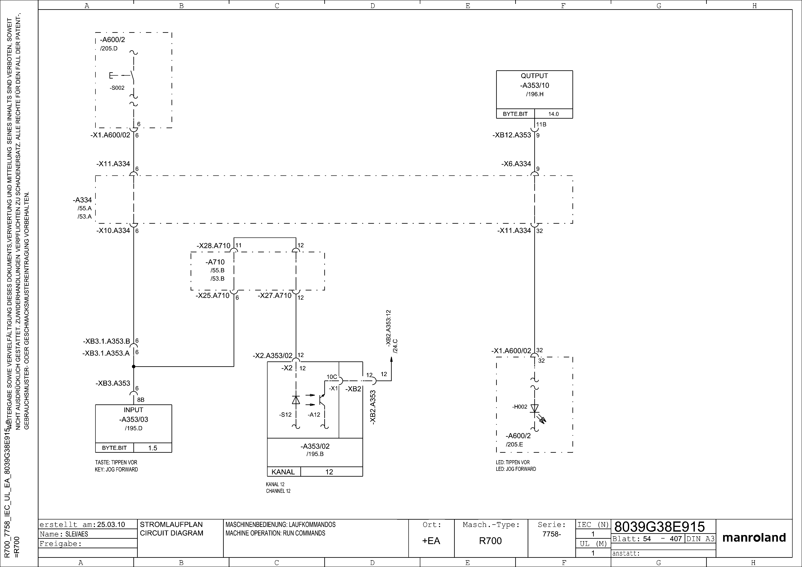

# +EA — Sheet 54 of 407 — MASCHINENBEDIENUNG: LAUFKOMMANDOS

**MACHINE OPERATION: RUN COMMANDS**

> Part of the manroland **R700** printing press IEC/UL circuit diagrams.
> Drawing class: **Stromlaufplan / Circuit diagram** (DIN A3).
> Document `+EA` covers the **Printing unit** machine section.

## At a glance

| Field | Value |
|---|---|
| Document | `+EA`  (8039G38E915) |
| Sheet | **54** of 407 |
| Section (DE) | MASCHINENBEDIENUNG: LAUFKOMMANDOS |
| Section (EN) | MACHINE OPERATION: RUN COMMANDS |
| Section type | CIRCUIT — Circuit diagram |
| Machine type | `R700` |
| Series | `7758` |
| Created | 25.03.10 |
| Replaces | — |
| Columns used | A, B, C, D, E, F |
| Path numbers | — |
| Labels on sheet | 77 |
| Cross-refs out | 10 |
| Cross-refs in | 26 |

**Previous:** [+EA sheet 53](SHEET_0053.md) · **Next:** [+EA sheet 55](SHEET_0055.md) · **Document TOC:** [_TOC.md](_TOC.md)  (+EA) · **Master TOC:** [all sheets](../_MASTER_TOC.md)

## Sheet image (300 DPI, exact vector render)



_Rendered directly from the PDF vector layer at 300 DPI (1-bit), no OCR and no resampling. Use it to confirm anything ambiguous in the text below._

## Cross-references on this sheet

Each entry is a wire leaving this sheet. The printed token is `/sheet.column`; the link resolves to that sheet inside the same document.

| Ref | Target sheet | Col | Path | Destination on target | Target section | From col |
|---|---|---|---|---|---|---|
| `/205.D` | [+EA sheet 205](SHEET_0205.md) | D | — | A600/2 | REFERENZMODUL | A |
| `/196.H` | [+EA sheet 196](SHEET_0196.md) | H | — | — | REFERENZMODUL | F |
| `/55.A` | [+EA sheet 55](SHEET_0055.md) | A | — | — | MASCHINENBEDIENUNG: LAUFKOMMANDOS | A |
| `/53.A` | [+EA sheet 53](SHEET_0053.md) | A | — | — | MASCHINENBEDIENUNG: LAUFKOMMANDOS | A |
| `/55.B` | [+EA sheet 55](SHEET_0055.md) | B | — | — | MASCHINENBEDIENUNG: LAUFKOMMANDOS | B |
| `/53.B` | [+EA sheet 53](SHEET_0053.md) | B | — | — | MASCHINENBEDIENUNG: LAUFKOMMANDOS | B |
| `/24.C` | [+EA sheet 24](SHEET_0024.md) | C | — | XB2.A353:12 | BUSVERBINDUNGEN: SICHERHEITSBUS | D |
| `/195.D` | [+EA sheet 195](SHEET_0195.md) | D | — | — | REFERENZMODUL | A |
| `/205.E` | [+EA sheet 205](SHEET_0205.md) | E | — | A600/2 | REFERENZMODUL | F |
| `/195.B` | [+EA sheet 195](SHEET_0195.md) | B | — | — | REFERENZMODUL | C |

### Incoming references (sheets that point here)

Every other sheet that sends a wire to this one. `Back-ref` is the token printed on *that* sheet; `Path` is its line number.

| From sheet | Cols | Back-ref | Path | Refs | What continues there |
|---|---|---|---|---|---|
| [+EA#24](SHEET_0024.md) | C | `/24.C` | — | 1 | XB2.A353:12 |
| [+EA#53](SHEET_0053.md) | A, B | `/53.A`, `/53.B` | — | 2 | — |
| [+EA#55](SHEET_0055.md) | A, B | `/55.A`, `/55.B` | — | 2 | — |
| [+EA#195](SHEET_0195.md) | B, D | `/195.B`, `/195.D` | — | 2 | — |
| [+EA#196](SHEET_0196.md) | H | `/196.H` | — | 1 | — |
| [+EA#205](SHEET_0205.md) | D, E | `/205.D`, `/205.E` | — | 2 | — |
| [+EA#212](SHEET_0212.md) | G, H | `/212.G`, `/212.H` | — | 2 | — |
| [+EA#224](SHEET_0224.md) | G | `/224.G` | — | 1 | — |
| [+EA#225](SHEET_0225.md) | C | `/225.C` | — | 1 | — |
| [+EA#234](SHEET_0234.md) | C, D, F | `/234.C`, `/234.D`, `/234.F` | — | 3 | — |
| [+EA#244](SHEET_0244.md) | F | `/244.F` | — | 1 | — |
| [+EA#253](SHEET_0253.md) | H | `/253.H` | — | 1 | — |
| [+EA#255](SHEET_0255.md) | G, H | `/255.G`, `/255.H` | — | 2 | — |
| [+EA#257](SHEET_0257.md) | C | `/257.C` | — | 1 | — |
| [+EA#268](SHEET_0268.md) | C | `/268.C` | — | 1 | — |
| [+EA#271](SHEET_0271.md) | B | `/271.B` | — | 1 | — |
| [+EA#272](SHEET_0272.md) | G | `/272.G` | — | 2 | — |


## Devices on this sheet

| Tag | Class | Class meaning (IEC) | Col | Sub | Terminal | Sign |
|---|---|---|---|---|---|---|
| `A353/03` | A | Baugruppe / assembly, module, PC board | A | 03 | — | — |
| `S002` | S | Schalter / switch | A | — | — | — |
| `A600/2` | A | Baugruppe / assembly, module, PC board | A | 2 | — | — |
| `A600/2` | A | Baugruppe / assembly, module, PC board | F | 2 | — | — |
| `A353/10` | A | Baugruppe / assembly, module, PC board | F | 10 | — | — |
| `A334` | A | Baugruppe / assembly, module, PC board | A | — | — | — |
| `S12` | S | Schalter / switch | C | — | — | — |
| `A12` | A | Baugruppe / assembly, module, PC board | C | — | — | — |
| `X1` | X | Klemme / terminal, plug connector | D | — | — | — |
| `X2` | X | Klemme / terminal, plug connector | C | — | — | — |
| `XB2` | XB |  | D | — | — | — |
| `A353/02` | A | Baugruppe / assembly, module, PC board | C | 02 | — | — |
| `A710` | A | Baugruppe / assembly, module, PC board | B | — | — | — |
| `1.5` | — | cross-device reference | B | — | — | — |
| `XB3.A353` | — | cross-device reference | A | — | — | — |
| `14.0` | — | cross-device reference | F | — | — | — |
| `XB12.A353` | — | cross-device reference | E | — | — | — |
| `X11.A334` | — | cross-device reference | A | — | — | — |
| `X10.A334` | — | cross-device reference | A | — | — | — |
| `X6.A334` | — | cross-device reference | F | — | — | — |
| `X11.A334` | — | cross-device reference | E | — | — | — |
| `XB2.A353` | — | cross-device reference | D | — | — | — |
| `X28.A710` | — | cross-device reference | B | — | — | — |
| `X27.A710` | — | cross-device reference | C | — | — | — |
| `X25.A710` | — | cross-device reference | B | — | — | — |
| `XB3.1.A353.B` | — | cross-device reference | A | — | — | — |
| `XB3.1.A353.A` | — | cross-device reference | A | — | — | — |
| `XB2.A353:12` | — | cross-device reference | D | — | 12 | — |

## Potentials / nets

| Potential | Count | Columns | Attached devices | Terminals |
|---|---|---|---|---|
| `H002` | 1 | F | — | — |


A potential such as `L24+/4` or `M24+` is a named supply/return rail; every place it appears on this sheet is electrically common.

## Wire-end annotations (grouped as printed)

A wire that continues elsewhere is annotated with a small cluster: the destination description, the path/line number `#NN`, and the `/sheet.column` cross reference. Each row below is one such cluster exactly as it is grouped on the drawing.

| Col | Y | Path | Cross-ref | Text on the wire |
|---|---|---|---|---|
| A | 54.2 | — | `/205.D` | `A600/2` |
| F | 108.3 | — | — | `QUTPUT` |
| F | 122.2 | — | — | `A353/10` |
| A | 126.9 | — | — | `S002` |
| F | 136.0 | — | `/196.H` | — |
| F | 165.6 | — | — | `BYTE.BIT 14.0` |
| B | 180.3 | — | — | `6` |
| F | 181.0 | — | — | `11B` |
| A | 195.9 | — | — | `X1.A600/02 6` |
| F | 195.9 | — | — | `XB12.A353 9` |
| A | 238.4 | — | — | `X11.A334 6` |
| F | 238.4 | — | — | `X6.A334 9` |
| A | 292.3 | — | — | `A334` |
| A | 305.3 | — | `/55.A`, `/53.A` | — |
| A | 337.6 | — | — | `X10.A334 6` |
| F | 337.6 | — | — | `X11.A334 32` |
| C | 360.3 | — | — | `X28.A710 11 12` |
| B | 384.4 | — | — | `A710` |
| B | 397.4 | — | `/55.B`, `/53.B` | — |
| C | 434.0 | — | — | `X25.A710 6 X27.A710 12` |
| D | 460.1 | — | `/24.C` | `XB2.A353:12` |
| A | 502.1 | — | — | `XB3.1.A353.B 6` |
| F | 516.2 | — | — | `X1.A600/02 32` |
| A | 519.1 | — | — | `XB3.1.A353.A 6` |
| C | 523.3 | — | — | `X2.A353/02 12` |
| F | 531.8 | — | — | `32` |
| C | 541.7 | — | — | `X2` |
| D | 543.2 | — | — | `12 12` |
| D | 551.7 | — | — | `12` |
| D | 555.9 | — | — | `10C` |
| A | 564.4 | — | — | `XB3.A353 6` |
| D | 572.9 | — | — | `X1` |
| D | 572.9 | — | — | `XB2` |
| D | 579.1 | — | — | `XB2.A353` |
| B | 589.9 | — | — | `8B` |
| F | 600.2 | — | — | `H002` |
| A | 604.4 | — | — | `INPUT` |
| C | 611.9 | — | — | `S12 A12` |
| A | 618.3 | — | — | `A353/03` |
| A | 632.1 | — | `/195.D` | — |
| F | 642.4 | — | `/205.E` | `A600/2` |
| C | 657.9 | — | — | `A353/02` |
| A | 661.1 | — | — | `BYTE.BIT 1.5` |
| C | 670.3 | — | `/195.B` | — |
| A | 683.8 | — | — | `KEY: JOG FORWARD TASTE: TIPPEN VOR` |
| F | 683.9 | — | — | `LED: TIPPEN VOR LED: JOG FORWARD` |
| C | 696.2 | — | — | `KANAL 12` |
| C | 716.5 | — | — | `KANAL 12 CHANNEL 12` |


## Reconstructed tables

This sheet carries tabular content (pin map / terminal assignment / index). The grid below was rebuilt from the drawing's own rule lines, so each row is exactly one physical row of the table.

### Table 1 — 7 data rows × 9 columns (at x=141.7, y=48.2)

| A600/2 /205.D S002 | 6 |  |  |  |  |  |  |  |
|---|---|---|---|---|---|---|---|---|
| `X1.A600/02 X11.A334 X10.A334` | `6 6 6` |  |  |  |  |  |  |  |
| `XB3.1.A353.B XB3.1.A353.A` | `6 6` | `X28.A710 A710 /55.B /53.B X25.A710` | `11 6` | `X27.A710 X2.A353/02` | `12 12 12` |  |  | `XB2.A353:12` |
| `XB3.A353` | `6 8B` |  |  | `X2` | `12` | `10C X1` | `XB2` | `12 12` |
| `INPUT` | `A353/03 /195.D` |  |  | `S12` | `A12` |  |  | `XB2.A353` |
| `BYTE.BIT` | `1.5` |  |  |  | `A353/02` |  |  |  |
| `TASTE: TIPPEN VOR` |  |  |  |  | `/195.B` |  |  |  |
| `KEY: JOG FORWARD` |  |  |  | `KANAL` |  | `12` |  |  |


### Table 2 — 3 data rows × 2 columns (at x=737.0, y=104.9)

| QUTPUT | A353/10 /196.H |
|---|---|
| `BYTE.BIT` | `14.0` |
| `XB12.A353 X6.A334 X11.A334 X1.A600/02` | `11B 9 9 32 32` |
| `H002 A600/2 /205.E` | `32` |


## Notes and free text on this sheet

| Text | Col | Y (pt) |
|---|---|---|
| `8B` | B | 589.88 |
| `INPUT` | A | 604.42 |
| `BYTE.BIT` | A | 661.67 |
| `TASTE: TIPPEN VOR` | A | 683.75 |
| `KEY: JOG FORWARD` | A | 694.37 |
| `X1.A600/02` | A | 195.9 |
| `LED: TIPPEN VOR` | E | 683.93 |
| `LED: JOG FORWARD` | F | 693.83 |
| `X1.A600/02` | E | 516.21 |
| `11B` | F | 181 |
| `QUTPUT` | F | 108.33 |
| `BYTE.BIT` | E | 165.6 |
| `KANAL 12` | C | 716.52 |
| `CHANNEL 12` | C | 726.47 |
| `10C` | D | 555.92 |
| `KANAL` | C | 696.2 |
| `X2.A353/02` | C | 523.3 |

## Complete label inventory (exact text from the drawing)

Every text object inside the drawing area of this sheet, in DIN reading order (column A→H, then top→bottom). This is the authoritative list: if a string is not here it is not printed on this sheet.

| Col | Y | X | Dir | Type | Text |
|---|---|---|---|---|---|
| A | 54.2 | 148.5 | → | device tag | `A600/2` |
| A | 68.0 | 148.8 | → | cross-reference | `/205.D` |
| A | 126.9 | 163.0 | → | device tag | `S002` |
| A | 195.9 | 134.4 | → | text | `X1.A600/02` |
| A | 238.4 | 143.1 | → | device ref | `X11.A334` |
| A | 292.3 | 108.3 | → | device tag | `A334` |
| A | 305.3 | 115.4 | → | cross-reference | `/55.A` |
| A | 317.7 | 115.4 | → | cross-reference | `/53.A` |
| A | 337.6 | 143.1 | → | device ref | `X10.A334` |
| A | 502.1 | 123.3 | → | device ref | `XB3.1.A353.B` |
| A | 519.8 | 122.5 | → | device ref | `XB3.1.A353.A` |
| A | 564.4 | 142.0 | → | device ref | `XB3.A353` |
| A | 604.4 | 183.5 | → | text | `INPUT` |
| A | 618.3 | 177.0 | → | device tag | `A353/03` |
| A | 632.1 | 185.7 | → | cross-reference | `/195.D` |
| A | 661.7 | 151.7 | → | text | `BYTE.BIT` |
| A | 683.8 | 141.4 | → | text | `TASTE: TIPPEN VOR` |
| A | 694.4 | 140.9 | → | text | `KEY: JOG FORWARD` |
| B | 180.3 | 203.8 | → | number | `6` |
| B | 197.3 | 201.0 | → | number | `6` |
| B | 246.9 | 201.0 | → | number | `6` |
| B | 339.1 | 201.0 | → | number | `6` |
| B | 360.3 | 292.0 | → | device ref | `X28.A710` |
| B | 384.4 | 305.3 | → | device tag | `A710` |
| B | 397.5 | 312.7 | → | cross-reference | `/55.B` |
| B | 409.9 | 312.7 | → | cross-reference | `/53.B` |
| B | 434.0 | 290.6 | → | device ref | `X25.A710` |
| B | 502.1 | 201.0 | → | number | `6` |
| B | 519.1 | 201.0 | → | number | `6` |
| B | 572.9 | 201.0 | → | number | `6` |
| B | 589.9 | 203.8 | → | text | `8B` |
| B | 661.1 | 219.7 | → | device ref | `1.5` |
| C | 360.3 | 349.2 | → | number | `11` |
| C | 360.3 | 441.4 | → | number | `12` |
| C | 434.0 | 382.7 | → | device ref | `X27.A710` |
| C | 438.3 | 349.8 | → | number | `6` |
| C | 438.3 | 441.4 | → | number | `12` |
| C | 523.3 | 375.3 | → | text | `X2.A353/02` |
| C | 523.3 | 441.4 | → | number | `12` |
| C | 541.7 | 417.8 | → | device tag | `X2` |
| C | 543.2 | 444.2 | → | number | `12` |
| C | 611.9 | 414.4 | → | device tag | `S12` |
| C | 611.9 | 456.9 | → | device tag | `A12` |
| C | 657.9 | 446.3 | → | device tag | `A353/02` |
| C | 670.3 | 455.1 | → | cross-reference | `/195.B` |
| C | 696.2 | 403.1 | → | text | `KANAL` |
| C | 716.5 | 394.9 | → | text | `KANAL 12` |
| C | 726.5 | 395.1 | → | text | `CHANNEL 12` |
| D | 460.1 | 572.9 | ↕ | device ref | `XB2.A353:12` |
| D | 503.4 | 582.8 | ↕ | cross-reference | `/24.C` |
| D | 551.7 | 564.9 | → | number | `12` |
| D | 553.1 | 543.4 | → | number | `12` |
| D | 555.9 | 484.7 | → | text | `10C` |
| D | 572.9 | 488.4 | → | device tag | `X1` |
| D | 572.9 | 512.8 | → | device tag | `XB2` |
| D | 579.1 | 548.8 | ↕ | device ref | `XB2.A353` |
| D | 696.2 | 482.7 | → | number | `12` |
| E | 165.6 | 746.9 | → | text | `BYTE.BIT` |
| E | 195.9 | 731.3 | → | device ref | `XB12.A353` |
| E | 337.6 | 738.4 | → | device ref | `X11.A334` |
| E | 516.2 | 729.6 | → | text | `X1.A600/02` |
| E | 656.1 | 751.2 | → | cross-reference | `/205.E` |
| E | 683.9 | 736.4 | → | text | `LED: TIPPEN VOR` |
| F | 108.3 | 773.4 | → | text | `QUTPUT` |
| F | 122.2 | 772.3 | → | device tag | `A353/10` |
| F | 136.0 | 781.2 | → | cross-reference | `/196.H` |
| F | 165.6 | 813.8 | → | device ref | `14.0` |
| F | 181.0 | 795.7 | → | text | `11B` |
| F | 197.3 | 796.3 | → | number | `9` |
| F | 238.4 | 744.4 | → | device ref | `X6.A334` |
| F | 246.9 | 796.3 | → | number | `9` |
| F | 339.1 | 796.3 | → | number | `32` |
| F | 516.2 | 796.3 | → | number | `32` |
| F | 531.8 | 799.1 | → | number | `32` |
| F | 600.3 | 760.5 | → | potential | `H002` |
| F | 642.4 | 750.9 | → | device tag | `A600/2` |
| F | 693.8 | 736.4 | → | text | `LED: JOG FORWARD` |

## Reading-order text block

The same content as a plain block, grouped by DIN column — convenient to paste or to match against a visual description.

```text
=== Column A ===
  54.2  148.5  devtag       A600/2
  68.0  148.8  xref         /205.D
 126.9  163.0  devtag       S002
 195.9  134.4  text         X1.A600/02
 238.4  143.1  devref       X11.A334
 292.3  108.3  devtag       A334
 305.3  115.4  xref         /55.A
 317.7  115.4  xref         /53.A
 337.6  143.1  devref       X10.A334
 502.1  123.3  devref       XB3.1.A353.B
 519.8  122.5  devref       XB3.1.A353.A
 564.4  142.0  devref       XB3.A353
 604.4  183.5  text         INPUT
 618.3  177.0  devtag       A353/03
 632.1  185.7  xref         /195.D
 661.7  151.7  text         BYTE.BIT
 683.8  141.4  text         TASTE: TIPPEN VOR
 694.4  140.9  text         KEY: JOG FORWARD
=== Column B ===
 180.3  203.8  numeric      6
 197.3  201.0  numeric      6
 246.9  201.0  numeric      6
 339.1  201.0  numeric      6
 360.3  292.0  devref       X28.A710
 384.4  305.3  devtag       A710
 397.5  312.7  xref         /55.B
 409.9  312.7  xref         /53.B
 434.0  290.6  devref       X25.A710
 502.1  201.0  numeric      6
 519.1  201.0  numeric      6
 572.9  201.0  numeric      6
 589.9  203.8  text         8B
 661.1  219.7  devref       1.5
=== Column C ===
 360.3  349.2  numeric      11
 360.3  441.4  numeric      12
 434.0  382.7  devref       X27.A710
 438.3  349.8  numeric      6
 438.3  441.4  numeric      12
 523.3  375.3  text         X2.A353/02
 523.3  441.4  numeric      12
 541.7  417.8  devtag       X2
 543.2  444.2  numeric      12
 611.9  414.4  devtag       S12
 611.9  456.9  devtag       A12
 657.9  446.3  devtag       A353/02
 670.3  455.1  xref         /195.B
 696.2  403.1  text         KANAL
 716.5  394.9  text         KANAL 12
 726.5  395.1  text         CHANNEL 12
=== Column D ===
 460.1  572.9  devref       XB2.A353:12
 503.4  582.8  xref         /24.C
 551.7  564.9  numeric      12
 553.1  543.4  numeric      12
 555.9  484.7  text         10C
 572.9  488.4  devtag       X1
 572.9  512.8  devtag       XB2
 579.1  548.8  devref       XB2.A353
 696.2  482.7  numeric      12
=== Column E ===
 165.6  746.9  text         BYTE.BIT
 195.9  731.3  devref       XB12.A353
 337.6  738.4  devref       X11.A334
 516.2  729.6  text         X1.A600/02
 656.1  751.2  xref         /205.E
 683.9  736.4  text         LED: TIPPEN VOR
=== Column F ===
 108.3  773.4  text         QUTPUT
 122.2  772.3  devtag       A353/10
 136.0  781.2  xref         /196.H
 165.6  813.8  devref       14.0
 181.0  795.7  text         11B
 197.3  796.3  numeric      9
 238.4  744.4  devref       X6.A334
 246.9  796.3  numeric      9
 339.1  796.3  numeric      32
 516.2  796.3  numeric      32
 531.8  799.1  numeric      32
 600.3  760.5  net          H002
 642.4  750.9  devtag       A600/2
 693.8  736.4  text         LED: JOG FORWARD
```

---
_Generated from the PDF vector text layer; no OCR. Source: `R700_7758_IEC_UL_EA_8039G38E915_p`, sheet 54._
