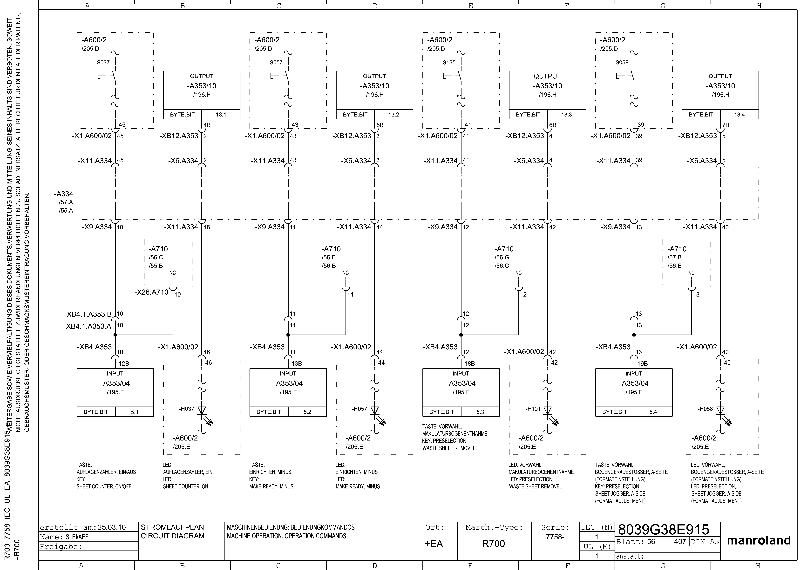

# +EA — Sheet 56 of 407 — MASCHINENBEDIENUNG: BEDIENUNGKOMMANDOS

**MACHINE OPERATION: OPERATION COMMANDS**

> Part of the manroland **R700** printing press IEC/UL circuit diagrams.
> Drawing class: **Stromlaufplan / Circuit diagram** (DIN A3).
> Document `+EA` covers the **Printing unit** machine section.

## At a glance

| Field | Value |
|---|---|
| Document | `+EA`  (8039G38E915) |
| Sheet | **56** of 407 |
| Section (DE) | MASCHINENBEDIENUNG: BEDIENUNGKOMMANDOS |
| Section (EN) | MACHINE OPERATION: OPERATION COMMANDS |
| Section type | CIRCUIT — Circuit diagram |
| Machine type | `R700` |
| Series | `7758` |
| Created | 25.03.10 |
| Replaces | — |
| Columns used | A, B, C, D, E, F, G, H |
| Path numbers | — |
| Labels on sheet | 214 |
| Cross-refs out | 26 |
| Cross-refs in | 70 |

**Previous:** [+EA sheet 55](SHEET_0055.md) · **Next:** [+EA sheet 57](SHEET_0057.md) · **Document TOC:** [_TOC.md](_TOC.md)  (+EA) · **Master TOC:** [all sheets](../_MASTER_TOC.md)

## Sheet image (300 DPI, exact vector render)



_Rendered directly from the PDF vector layer at 300 DPI (1-bit), no OCR and no resampling. Use it to confirm anything ambiguous in the text below._

## Cross-references on this sheet

Each entry is a wire leaving this sheet. The printed token is `/sheet.column`; the link resolves to that sheet inside the same document.

| Ref | Target sheet | Col | Path | Destination on target | Target section | From col |
|---|---|---|---|---|---|---|
| `/205.D` | [+EA sheet 205](SHEET_0205.md) | D | — | A600/2 | REFERENZMODUL | A |
| `/205.D` | [+EA sheet 205](SHEET_0205.md) | D | — | A600/2 | REFERENZMODUL | C |
| `/205.D` | [+EA sheet 205](SHEET_0205.md) | D | — | A600/2 | REFERENZMODUL | E |
| `/205.D` | [+EA sheet 205](SHEET_0205.md) | D | — | A600/2 | REFERENZMODUL | F |
| `/196.H` | [+EA sheet 196](SHEET_0196.md) | H | — | — | REFERENZMODUL | B |
| `/196.H` | [+EA sheet 196](SHEET_0196.md) | H | — | — | REFERENZMODUL | D |
| `/196.H` | [+EA sheet 196](SHEET_0196.md) | H | — | — | REFERENZMODUL | F |
| `/196.H` | [+EA sheet 196](SHEET_0196.md) | H | — | — | REFERENZMODUL | H |
| `/57.A` | [+EA sheet 57](SHEET_0057.md) | A | — | — | MASCHINENBEDIENUNG: BEDIENUNGKOMMANDOS | A |
| `/55.A` | [+EA sheet 55](SHEET_0055.md) | A | — | — | MASCHINENBEDIENUNG: LAUFKOMMANDOS | A |
| `/56.C` | [+EA sheet 56](SHEET_0056.md) | C | — | A710 | MASCHINENBEDIENUNG: BEDIENUNGKOMMANDOS | B |
| `/55.B` | [+EA sheet 55](SHEET_0055.md) | B | — | A710 | MASCHINENBEDIENUNG: LAUFKOMMANDOS | B |
| `/56.E` | [+EA sheet 56](SHEET_0056.md) | E | — | A710 | MASCHINENBEDIENUNG: BEDIENUNGKOMMANDOS | D |
| `/56.B` | [+EA sheet 56](SHEET_0056.md) | B | — | A710 | MASCHINENBEDIENUNG: BEDIENUNGKOMMANDOS | D |
| `/56.G` | [+EA sheet 56](SHEET_0056.md) | G | — | A710 | MASCHINENBEDIENUNG: BEDIENUNGKOMMANDOS | E |
| `/56.C` | [+EA sheet 56](SHEET_0056.md) | C | — | A710 | MASCHINENBEDIENUNG: BEDIENUNGKOMMANDOS | E |
| `/57.B` | [+EA sheet 57](SHEET_0057.md) | B | — | A710 | MASCHINENBEDIENUNG: BEDIENUNGKOMMANDOS | G |
| `/56.E` | [+EA sheet 56](SHEET_0056.md) | E | — | A710 | MASCHINENBEDIENUNG: BEDIENUNGKOMMANDOS | G |
| `/195.F` | [+EA sheet 195](SHEET_0195.md) | F | — | — | REFERENZMODUL | A |
| `/195.F` | [+EA sheet 195](SHEET_0195.md) | F | — | — | REFERENZMODUL | C |
| `/195.F` | [+EA sheet 195](SHEET_0195.md) | F | — | — | REFERENZMODUL | E |
| `/195.F` | [+EA sheet 195](SHEET_0195.md) | F | — | — | REFERENZMODUL | G |
| `/205.E` | [+EA sheet 205](SHEET_0205.md) | E | — | A600/2 | REFERENZMODUL | B |
| `/205.E` | [+EA sheet 205](SHEET_0205.md) | E | — | A600/2 | REFERENZMODUL | D |
| `/205.E` | [+EA sheet 205](SHEET_0205.md) | E | — | A600/2 | REFERENZMODUL | F |
| `/205.E` | [+EA sheet 205](SHEET_0205.md) | E | — | A600/2 | REFERENZMODUL | G |

### Incoming references (sheets that point here)

Every other sheet that sends a wire to this one. `Back-ref` is the token printed on *that* sheet; `Path` is its line number.

| From sheet | Cols | Back-ref | Path | Refs | What continues there |
|---|---|---|---|---|---|
| [+EA#55](SHEET_0055.md) | A, B | `/55.A`, `/55.B` | — | 2 | — |
| [+EA#56](SHEET_0056.md) | B, D, E, G | `/56.B`, `/56.D`, `/56.E`, `/56.G` | — | 6 | A710 |
| [+EA#57](SHEET_0057.md) | A, B | `/57.A`, `/57.B` | — | 2 | A710 |
| [+EA#195](SHEET_0195.md) | F | `/195.F` | — | 4 | — |
| [+EA#196](SHEET_0196.md) | H | `/196.H` | — | 4 | — |
| [+EA#205](SHEET_0205.md) | D, E | `/205.D`, `/205.E` | — | 8 | — |
| [+EA#212](SHEET_0212.md) | H | `/212.H` | — | 8 | — |
| [+EA#237](SHEET_0237.md) | A, B, C | `/237.A`, `/237.B`, `/237.C` | — | 12 | — |
| [+EA#244](SHEET_0244.md) | F | `/244.F` | — | 4 | — |
| [+EA#252](SHEET_0252.md) | A | `/252.A` | — | 4 | — |
| [+EA#255](SHEET_0255.md) | H | `/255.H` | — | 8 | — |
| [+EA#257](SHEET_0257.md) | C | `/257.C` | — | 4 | — |
| [+EA#270](SHEET_0270.md) | C | `/270.C` | — | 4 | — |


## Devices on this sheet

| Tag | Class | Class meaning (IEC) | Col | Sub | Terminal | Sign |
|---|---|---|---|---|---|---|
| `S037` | S | Schalter / switch | A | — | — | — |
| `A600/2` | A | Baugruppe / assembly, module, PC board | A | 2 | — | — |
| `A353/10` | A | Baugruppe / assembly, module, PC board | B | 10 | — | — |
| `S057` | S | Schalter / switch | C | — | — | — |
| `A600/2` | A | Baugruppe / assembly, module, PC board | C | 2 | — | — |
| `A353/10` | A | Baugruppe / assembly, module, PC board | D | 10 | — | — |
| `S058` | S | Schalter / switch | G | — | — | — |
| `A600/2` | A | Baugruppe / assembly, module, PC board | F | 2 | — | — |
| `A353/10` | A | Baugruppe / assembly, module, PC board | H | 10 | — | — |
| `S165` | S | Schalter / switch | E | — | — | — |
| `A600/2` | A | Baugruppe / assembly, module, PC board | E | 2 | — | — |
| `A353/10` | A | Baugruppe / assembly, module, PC board | F | 10 | — | — |
| `A334` | A | Baugruppe / assembly, module, PC board | A | — | — | — |
| `A600/2` | A | Baugruppe / assembly, module, PC board | B | 2 | — | — |
| `A600/2` | A | Baugruppe / assembly, module, PC board | D | 2 | — | — |
| `A353/04` | A | Baugruppe / assembly, module, PC board | C | 04 | — | — |
| `A353/04` | A | Baugruppe / assembly, module, PC board | A | 04 | — | — |
| `A600/2` | A | Baugruppe / assembly, module, PC board | G | 2 | — | — |
| `A353/04` | A | Baugruppe / assembly, module, PC board | G | 04 | — | — |
| `A353/04` | A | Baugruppe / assembly, module, PC board | E | 04 | — | — |
| `A600/2` | A | Baugruppe / assembly, module, PC board | F | 2 | — | — |
| `A710` | A | Baugruppe / assembly, module, PC board | B | — | — | — |
| `A710` | A | Baugruppe / assembly, module, PC board | D | — | — | — |
| `A710` | A | Baugruppe / assembly, module, PC board | E | — | — | — |
| `A710` | A | Baugruppe / assembly, module, PC board | G | — | — | — |
| `13.1` | — | cross-device reference | B | — | — | — |
| `XB12.A353` | — | cross-device reference | B | — | — | — |
| `13.2` | — | cross-device reference | D | — | — | — |
| `XB12.A353` | — | cross-device reference | D | — | — | — |
| `13.4` | — | cross-device reference | H | — | — | — |
| `XB12.A353` | — | cross-device reference | G | — | — | — |
| `13.3` | — | cross-device reference | F | — | — | — |
| `XB12.A353` | — | cross-device reference | F | — | — | — |
| `X11.A334` | — | cross-device reference | A | — | — | — |
| `X6.A334` | — | cross-device reference | B | — | — | — |
| `X11.A334` | — | cross-device reference | C | — | — | — |
| `X6.A334` | — | cross-device reference | D | — | — | — |
| `X11.A334` | — | cross-device reference | F | — | — | — |
| `X6.A334` | — | cross-device reference | G | — | — | — |
| `X11.A334` | — | cross-device reference | E | — | — | — |
| `X6.A334` | — | cross-device reference | F | — | — | — |
| `5.2` | — | cross-device reference | C | — | — | — |
| `XB4.A353` | — | cross-device reference | C | — | — | — |
| `5.1` | — | cross-device reference | A | — | — | — |
| `XB4.A353` | — | cross-device reference | A | — | — | — |
| `5.4` | — | cross-device reference | G | — | — | — |
| `XB4.A353` | — | cross-device reference | F | — | — | — |
| `5.3` | — | cross-device reference | E | — | — | — |
| `XB4.A353` | — | cross-device reference | E | — | — | — |
| `XB4.1.A353.B` | — | cross-device reference | A | — | — | — |
| `XB4.1.A353.A` | — | cross-device reference | A | — | — | — |
| `X9.A334` | — | cross-device reference | A | — | — | — |
| `X9.A334` | — | cross-device reference | C | — | — | — |
| `X11.A334` | — | cross-device reference | B | — | — | — |
| `X11.A334` | — | cross-device reference | D | — | — | — |
| `X9.A334` | — | cross-device reference | G | — | — | — |
| `X11.A334` | — | cross-device reference | G | — | — | — |
| `X9.A334` | — | cross-device reference | E | — | — | — |
| `X11.A334` | — | cross-device reference | F | — | — | — |
| `X26.A710` | — | cross-device reference | B | — | — | — |

## Potentials / nets

| Potential | Count | Columns | Attached devices | Terminals |
|---|---|---|---|---|
| `H037` | 1 | B | — | — |
| `H057` | 1 | D | — | — |
| `H058` | 1 | G | — | — |
| `H101` | 1 | F | — | — |


A potential such as `L24+/4` or `M24+` is a named supply/return rail; every place it appears on this sheet is electrically common.

## Wire-end annotations (grouped as printed)

A wire that continues elsewhere is annotated with a small cluster: the destination description, the path/line number `#NN`, and the `/sheet.column` cross reference. Each row below is one such cluster exactly as it is grouped on the drawing.

| Col | Y | Path | Cross-ref | Text on the wire |
|---|---|---|---|---|
| A | 54.2 | — | `/205.D` | `A600/2` |
| C | 54.2 | — | `/205.D` | `A600/2` |
| E | 54.2 | — | `/205.D` | `A600/2` |
| F | 54.2 | — | `/205.D` | `A600/2` |
| A | 88.6 | — | — | `S037` |
| C | 88.6 | — | — | `S057` |
| E | 88.6 | — | — | `S165` |
| G | 88.6 | — | — | `S058` |
| F | 108.3 | — | — | `QUTPUT` |
| B | 108.8 | — | — | `QUTPUT` |
| D | 108.8 | — | — | `QUTPUT` |
| H | 108.8 | — | — | `QUTPUT` |
| B | 122.2 | — | — | `A353/10` |
| D | 122.2 | — | — | `A353/10` |
| F | 122.2 | — | — | `A353/10` |
| H | 122.2 | — | — | `A353/10` |
| B | 136.0 | — | `/196.H` | — |
| D | 136.0 | — | `/196.H` | — |
| F | 136.0 | — | `/196.H` | — |
| H | 136.0 | — | `/196.H` | — |
| B | 165.6 | — | — | `BYTE.BIT 13.1` |
| D | 165.6 | — | — | `BYTE.BIT 13.2` |
| F | 165.6 | — | — | `BYTE.BIT 13.3` |
| H | 165.6 | — | — | `BYTE.BIT 13.4` |
| A | 180.3 | — | — | `45` |
| C | 180.3 | — | — | `43` |
| E | 180.3 | — | — | `41` |
| G | 180.3 | — | — | `39` |
| B | 181.0 | — | — | `4B` |
| D | 181.0 | — | — | `5B` |
| F | 181.0 | — | — | `6B` |
| H | 181.0 | — | — | `7B` |
| A | 195.9 | — | — | `X1.A600/02 45` |
| B | 195.9 | — | — | `XB12.A353 2 X1.A600/02 43` |
| E | 195.9 | — | — | `XB12.A353 3 X1.A600/02 39` |
| F | 195.9 | — | — | `X1.A600/02 41 XB12.A353 5` |
| F | 195.9 | — | — | `XB12.A353 4` |
| D | 232.8 | — | — | `X11.A334 45 X6.A334 2 X11.A334 43 X6.A334 3 X11.A334 41 X6.A334 4 X11.A334 39 X6.A334 5` |
| A | 281.6 | — | — | `A334` |
| A | 294.7 | — | `/57.A`, `/55.A` | — |
| D | 330.5 | — | — | `X9.A334 10 X11.A334 46 X9.A334 11 X11.A334 44 X9.A334 12 X11.A334 42 X9.A334 13 X11.A334 40` |
| B | 363.1 | — | `/56.C`, `/55.B` | `A710` |
| D | 363.1 | — | `/56.E`, `/56.B` | `A710` |
| E | 363.1 | — | `/56.G`, `/56.C` | `A710` |
| G | 363.1 | — | `/57.B`, `/56.E` | `A710` |
| E | 400.3 | — | — | `NC NC NC NC` |
| B | 426.9 | — | — | `X26.A710 10` |
| D | 431.2 | — | — | `11` |
| F | 431.2 | — | — | `12` |
| G | 431.2 | — | — | `13` |
| A | 459.5 | — | — | `XB4.1.A353.B 10` |
| C | 459.5 | — | — | `11` |
| E | 459.5 | — | — | `12` |
| G | 459.5 | — | — | `13` |
| A | 476.5 | — | — | `XB4.1.A353.A 10` |
| C | 476.5 | — | — | `11` |
| E | 476.5 | — | — | `12` |
| G | 476.5 | — | — | `13` |
| A | 507.7 | — | — | `XB4.A353 10` |
| B | 507.7 | — | — | `X1.A600/02 46` |
| C | 507.7 | — | — | `XB4.A353 11` |
| D | 507.7 | — | — | `X1.A600/02 44` |
| E | 507.7 | — | — | `XB4.A353 12` |
| G | 507.7 | — | — | `XB4.A353 13` |
| G | 507.7 | — | — | `X1.A600/02 40` |
| F | 514.8 | — | — | `X1.A600/02 42` |
| B | 531.8 | — | — | `46` |
| D | 531.8 | — | — | `44` |
| F | 531.8 | — | — | `42` |
| H | 531.8 | — | — | `40` |
| A | 533.2 | — | — | `12B` |
| C | 533.2 | — | — | `13B` |
| E | 533.2 | — | — | `18B` |
| G | 533.2 | — | — | `19B` |
| A | 548.3 | — | — | `INPUT` |
| C | 548.3 | — | — | `INPUT` |
| E | 548.3 | — | — | `INPUT` |
| G | 548.3 | — | — | `INPUT` |
| A | 561.6 | — | — | `A353/04` |
| C | 561.6 | — | — | `A353/04` |
| E | 561.6 | — | — | `A353/04` |
| G | 561.6 | — | — | `A353/04` |
| A | 575.4 | — | `/195.F` | — |
| C | 575.4 | — | `/195.F` | — |
| E | 575.4 | — | `/195.F` | — |
| G | 575.4 | — | `/195.F` | — |
| B | 600.2 | — | — | `H037` |
| D | 600.2 | — | — | `H057` |
| F | 600.2 | — | — | `H101` |
| G | 600.2 | — | — | `H058` |
| A | 605.0 | — | — | `BYTE.BIT 5.1` |
| C | 605.0 | — | — | `BYTE.BIT 5.2` |
| E | 605.0 | — | — | `BYTE.BIT 5.3` |
| G | 605.0 | — | — | `BYTE.BIT 5.4` |
| E | 627.0 | — | — | `KEY: PRESELECTION, MAKULATURBOGENENTNAHME TASTE: VORWAHL,` |
| B | 642.4 | — | `/205.E` | `A600/2` |
| D | 642.4 | — | `/205.E` | `A600/2` |
| F | 642.4 | — | `/205.E` | `A600/2` |
| G | 642.4 | — | `/205.E` | `A600/2` |
| E | 659.0 | — | — | `WASTE SHEET REMOVEL` |
| A | 683.7 | — | — | `KEY: TASTE: AUFLAGENZÄHLER, EIN/AUS` |
| B | 683.7 | — | — | `LED:` |
| C | 683.7 | — | — | `EINRICHTEN, MINUS KEY: MAKE READY, MINUS TASTE:` |
| D | 683.7 | — | — | `LED: EINRICHTEN, MINUS LED: MAKE READY, MINUS` |
| F | 683.7 | — | — | `LED: VORWAHL, LED: PRESELECTION, MAKULATURBOGENENTNAHME` |
| G | 683.7 | — | — | `BOGENGERADESTOSSER, A SEITE KEY: PRESELECTION, (FORMATEINSTELLUNG) TASTE: VORWAHL,` |
| H | 683.7 | — | — | `LED: VORWAHL, BOGENGERADESTOSSER, A SEITE LED: PRESELECTION, (FORMATEINSTELLUNG)` |
| B | 694.4 | — | — | `LED: AUFLAGENZÄHLER, EIN` |
| F | 715.6 | — | — | `WASTE SHEET REMOVEL` |
| A | 715.7 | — | — | `SHEET COUNTER, ON/OFF` |
| B | 715.7 | — | — | `SHEET COUNTER, ON` |
| G | 726.3 | — | — | `(FORMAT ADJUSTMENT) SHEET JOGGER, A SIDE` |
| H | 726.3 | — | — | `(FORMAT ADJUSTMENT) SHEET JOGGER, A SIDE` |


## Reconstructed tables

This sheet carries tabular content (pin map / terminal assignment / index). The grid below was rebuilt from the drawing's own rule lines, so each row is exactly one physical row of the table.

### Table 1 — 7 data rows × 6 columns (at x=113.4, y=48.2) — **A600/2 /205.D S037 QUTPUT A353/10 /196.H**

|  |  |  |  | BYTE.BIT | 13.1 |
|---|---|---|---|---|---|
|  | `45` |  |  |  | `4B` |
| `X1.A600/02 X11.A334 X9.A334 XB4.1.A353.B XB4.1.A353.A` | `45 45 10 X26.A710 10 10` | `A710 /56.C /55.B` | `NC` | `XB12.A353 X6.A334 X11.A334 10` | `2 2 46` |
| `XB4.A353` | `10` |  |  | `X1.A600/02` | `46` |
|  | `12B` |  |  |  | `46` |
| `INPUT` | `A353/04 /195.F` |  |  |  |  |
| `BYTE.BIT` | `5.1` |  |  | `H037` |  |
|  |  |  |  | `A600/2 /205.E` |  |


### Table 2 — 8 data rows × 6 columns (at x=368.5, y=48.2) — **A600/2 /205.D S057**

|  |  |  |  | QUTPUT | A353/10 /196.H |
|---|---|---|---|---|---|
|  |  |  |  | `BYTE.BIT` | `13.2` |
|  | `43` |  |  |  | `5B` |
| `X1.A600/02 X11.A334 X9.A334` | `43 43 11 11 11` | `A710 /56.E /56.B` | `NC` | `XB12.A353 X6.A334 X11.A334 11` | `3 3 44` |
| `XB4.A353` | `11` |  |  | `X1.A600/02` | `44` |
|  | `13B` |  |  |  | `44` |
| `INPUT` | `A353/04 /195.F` |  |  |  |  |
| `BYTE.BIT` | `5.2` |  |  | `H057` |  |
|  |  |  |  | `A600/2 /205.E` |  |


### Table 3 — 8 data rows × 6 columns (at x=623.6, y=48.2) — **A600/2 /205.D S165**

|  |  |  |  | QUTPUT | A353/10 /196.H |
|---|---|---|---|---|---|
|  |  |  |  | `BYTE.BIT` | `13.3` |
|  | `41` |  |  |  | `6B` |
| `X1.A600/02 X11.A334 X9.A334` | `41 41 12 12 12` | `A710 /56.G /56.C` | `NC` | `XB12.A353 X6.A334 X11.A334 12` | `4 4 42` |
| `XB4.A353` | `12` |  |  | `X1.A600/02` | `42` |
|  | `18B` |  |  |  | `42` |
| `INPUT` | `A353/04 /195.F` |  |  |  |  |
| `BYTE.BIT` | `5.3` |  |  | `H101` |  |
| `TASTE: VORWAHL, MAKULATURBOGENENTNAHME KEY: PRESELECTION, WASTE SHEET` | `REMOVEL` |  |  | `A600/2 /205.E` |  |


### Table 4 — 8 data rows × 6 columns (at x=878.7, y=48.2) — **A600/2 /205.D S058**

|  |  |  |  | QUTPUT | A353/10 /196.H |
|---|---|---|---|---|---|
|  |  |  |  | `BYTE.BIT` | `13.4` |
|  | `39` |  |  |  | `7B` |
| `X1.A600/02 X11.A334 X9.A334` | `39 39 13 13 13` | `A710 /57.B /56.E` | `NC` | `XB12.A353 X6.A334 X11.A334 13` | `5 5 40` |
| `XB4.A353` | `13` |  |  | `X1.A600/02` | `40` |
|  | `19B` |  |  |  | `40` |
| `INPUT` | `A353/04 /195.F` |  |  |  |  |
| `BYTE.BIT` | `5.4` |  |  | `H058` |  |
|  |  |  |  | `A600/2 /205.E` |  |


## Notes and free text on this sheet

| Text | Col | Y (pt) |
|---|---|---|
| `X1.A600/02` | A | 195.9 |
| `4B` | B | 180.98 |
| `QUTPUT` | B | 108.84 |
| `BYTE.BIT` | B | 165.6 |
| `X1.A600/02` | C | 195.9 |
| `5B` | D | 180.98 |
| `QUTPUT` | D | 108.84 |
| `BYTE.BIT` | D | 165.6 |
| `X1.A600/02` | F | 195.9 |
| `7B` | H | 180.98 |
| `QUTPUT` | H | 108.84 |
| `BYTE.BIT` | G | 165.6 |
| `X1.A600/02` | E | 195.9 |
| `6B` | F | 180.98 |
| `QUTPUT` | F | 108.33 |
| `BYTE.BIT` | F | 165.6 |
| `LED:` | B | 683.69 |
| `AUFLAGENZÄHLER, EIN` | B | 694.41 |
| `SHEET COUNTER, ON` | B | 715.67 |
| `X1.A600/02` | B | 507.71 |
| `LED:` | D | 683.69 |
| `EINRICHTEN, MINUS` | D | 694.41 |
| `MAKE READY, MINUS` | D | 715.67 |
| `X1.A600/02` | D | 507.71 |
| `13B` | C | 533.2 |
| `INPUT` | C | 548.28 |
| `BYTE.BIT` | C | 604.97 |
| `TASTE:` | C | 683.71 |
| `EINRICHTEN, MINUS` | C | 694.41 |
| `KEY:` | C | 704.9 |
| `MAKE READY, MINUS` | C | 715.67 |
| `12B` | A | 533.2 |
| `INPUT` | A | 548.28 |
| `BYTE.BIT` | A | 604.97 |
| `TASTE:` | A | 683.71 |
| `AUFLAGENZÄHLER, EIN/AUS` | A | 694.41 |
| `KEY:` | A | 704.9 |
| `SHEET COUNTER, ON/OFF` | A | 715.68 |
| `LED: VORWAHL,` | G | 683.72 |
| `BOGENGERADESTOSSER, A SEITE` | H | 694.39 |
| `(FORMATEINSTELLUNG)` | H | 705.06 |
| `LED: PRESELECTION,` | H | 715.65 |
| `SHEET JOGGER, A SIDE` | H | 726.29 |
| `(FORMAT ADJUSTMENT)` | H | 736.95 |
| `X1.A600/02` | G | 507.71 |
| `19B` | G | 533.2 |
| `INPUT` | G | 548.28 |
| `TASTE: VORWAHL,` | G | 683.73 |
| `BOGENGERADESTOSSER, A SEITE` | G | 694.39 |
| `(FORMATEINSTELLUNG)` | G | 705.06 |
| `KEY: PRESELECTION,` | G | 715.64 |
| `SHEET JOGGER, A SIDE` | G | 726.29 |
| `(FORMAT ADJUSTMENT)` | G | 736.95 |
| `18B` | E | 533.2 |
| `INPUT` | E | 548.28 |
| `BYTE.BIT` | E | 604.97 |
| `TASTE: VORWAHL,` | E | 627.04 |
| `MAKULATURBOGENENTNAHME` | E | 637.73 |
| `KEY: PRESELECTION,` | E | 648.32 |
| `WASTE SHEET REMOVEL` | E | 658.96 |
| `LED: VORWAHL,` | F | 683.72 |
| `MAKULATURBOGENENTNAHME` | F | 694.43 |
| `LED: PRESELECTION,` | F | 705.02 |
| `WASTE SHEET REMOVEL` | F | 715.65 |
| `NC` | B | 400.27 |
| `NC` | D | 400.27 |
| `NC` | E | 400.27 |
| `NC` | G | 400.27 |

## Complete label inventory (exact text from the drawing)

Every text object inside the drawing area of this sheet, in DIN reading order (column A→H, then top→bottom). This is the authoritative list: if a string is not here it is not printed on this sheet.

| Col | Y | X | Dir | Type | Text |
|---|---|---|---|---|---|
| A | 54.2 | 120.2 | → | device tag | `A600/2` |
| A | 68.0 | 120.5 | → | cross-reference | `/205.D` |
| A | 88.6 | 140.0 | → | device tag | `S037` |
| A | 180.3 | 175.5 | → | number | `45` |
| A | 195.9 | 106.0 | → | text | `X1.A600/02` |
| A | 197.3 | 172.6 | → | number | `45` |
| A | 232.7 | 114.8 | → | device ref | `X11.A334` |
| A | 232.8 | 172.6 | → | number | `45` |
| A | 281.6 | 79.9 | → | device tag | `A334` |
| A | 294.7 | 87.0 | → | cross-reference | `/57.A` |
| A | 307.1 | 87.0 | → | cross-reference | `/55.A` |
| A | 330.5 | 120.8 | → | device ref | `X9.A334` |
| A | 332.0 | 172.1 | → | number | `10` |
| A | 459.5 | 95.0 | → | device ref | `XB4.1.A353.B` |
| A | 459.5 | 172.1 | → | number | `10` |
| A | 476.5 | 172.1 | → | number | `10` |
| A | 477.2 | 94.1 | → | device ref | `XB4.1.A353.A` |
| A | 507.7 | 113.7 | → | device ref | `XB4.A353` |
| A | 516.2 | 172.1 | → | number | `10` |
| A | 533.2 | 174.9 | → | text | `12B` |
| A | 548.3 | 157.6 | → | text | `INPUT` |
| A | 561.6 | 148.7 | → | device tag | `A353/04` |
| A | 575.4 | 157.7 | → | cross-reference | `/195.F` |
| A | 605.0 | 123.3 | → | text | `BYTE.BIT` |
| A | 605.0 | 193.3 | → | device ref | `5.1` |
| A | 683.7 | 113.1 | → | text | `TASTE:` |
| A | 694.4 | 113.4 | → | text | `AUFLAGENZÄHLER, EIN/AUS` |
| A | 704.9 | 112.5 | → | text | `KEY:` |
| A | 715.7 | 113.1 | → | text | `SHEET COUNTER, ON/OFF` |
| B | 108.8 | 280.3 | → | text | `QUTPUT` |
| B | 122.2 | 276.2 | → | device tag | `A353/10` |
| B | 136.0 | 285.2 | → | cross-reference | `/196.H` |
| B | 165.6 | 250.9 | → | text | `BYTE.BIT` |
| B | 165.6 | 318.3 | → | device ref | `13.1` |
| B | 181.0 | 300.2 | → | text | `4B` |
| B | 195.9 | 235.3 | → | device ref | `XB12.A353` |
| B | 197.3 | 300.2 | → | number | `2` |
| B | 232.8 | 248.3 | → | device ref | `X6.A334` |
| B | 232.8 | 300.2 | → | number | `2` |
| B | 330.5 | 242.4 | → | device ref | `X11.A334` |
| B | 332.0 | 300.2 | → | number | `46` |
| B | 363.1 | 219.4 | → | device tag | `A710` |
| B | 376.2 | 219.7 | → | cross-reference | `/56.C` |
| B | 388.6 | 219.7 | → | cross-reference | `/55.B` |
| B | 400.3 | 250.2 | → | text | `NC` |
| B | 426.9 | 198.4 | → | device ref | `X26.A710` |
| B | 431.2 | 257.1 | → | number | `10` |
| B | 507.7 | 233.6 | → | text | `X1.A600/02` |
| B | 516.2 | 300.2 | → | number | `46` |
| B | 531.8 | 303.0 | → | number | `46` |
| B | 600.3 | 264.2 | → | potential | `H037` |
| B | 642.4 | 254.8 | → | device tag | `A600/2` |
| B | 656.1 | 255.1 | → | cross-reference | `/205.E` |
| B | 683.7 | 240.1 | → | text | `LED:` |
| B | 694.4 | 240.9 | → | text | `AUFLAGENZÄHLER, EIN` |
| B | 705.0 | 240.1 | → | text | `LED:` |
| B | 715.7 | 240.7 | → | text | `SHEET COUNTER, ON` |
| C | 54.2 | 375.3 | → | device tag | `A600/2` |
| C | 68.0 | 375.6 | → | cross-reference | `/205.D` |
| C | 88.6 | 395.1 | → | device tag | `S057` |
| C | 180.3 | 430.6 | → | number | `43` |
| C | 195.9 | 361.1 | → | text | `X1.A600/02` |
| C | 197.3 | 427.7 | → | number | `43` |
| C | 232.7 | 369.9 | → | device ref | `X11.A334` |
| C | 232.8 | 427.7 | → | number | `43` |
| C | 330.5 | 375.9 | → | device ref | `X9.A334` |
| C | 332.0 | 427.2 | → | number | `11` |
| C | 459.5 | 427.2 | → | number | `11` |
| C | 476.5 | 427.2 | → | number | `11` |
| C | 507.7 | 368.8 | → | device ref | `XB4.A353` |
| C | 516.2 | 427.2 | → | number | `11` |
| C | 533.2 | 430.0 | → | text | `13B` |
| C | 548.3 | 412.7 | → | text | `INPUT` |
| C | 561.6 | 403.8 | → | device tag | `A353/04` |
| C | 575.4 | 412.9 | → | cross-reference | `/195.F` |
| C | 605.0 | 378.4 | → | text | `BYTE.BIT` |
| C | 605.0 | 448.0 | → | device ref | `5.2` |
| C | 683.7 | 368.2 | → | text | `TASTE:` |
| C | 694.4 | 367.7 | → | text | `EINRICHTEN, MINUS` |
| C | 704.9 | 367.7 | → | text | `KEY:` |
| C | 715.7 | 367.9 | → | text | `MAKE READY, MINUS` |
| D | 108.8 | 535.5 | → | text | `QUTPUT` |
| D | 122.2 | 531.4 | → | device tag | `A353/10` |
| D | 136.0 | 540.3 | → | cross-reference | `/196.H` |
| D | 165.6 | 506.0 | → | text | `BYTE.BIT` |
| D | 165.6 | 573.0 | → | device ref | `13.2` |
| D | 181.0 | 555.3 | → | text | `5B` |
| D | 195.9 | 490.4 | → | device ref | `XB12.A353` |
| D | 197.3 | 555.3 | → | number | `3` |
| D | 232.8 | 503.4 | → | device ref | `X6.A334` |
| D | 232.8 | 555.3 | → | number | `3` |
| D | 330.5 | 497.5 | → | device ref | `X11.A334` |
| D | 332.0 | 555.3 | → | number | `44` |
| D | 363.1 | 474.5 | → | device tag | `A710` |
| D | 376.2 | 474.8 | → | cross-reference | `/56.E` |
| D | 388.6 | 474.8 | → | cross-reference | `/56.B` |
| D | 400.3 | 505.4 | → | text | `NC` |
| D | 431.2 | 512.2 | → | number | `11` |
| D | 507.7 | 488.7 | → | text | `X1.A600/02` |
| D | 516.2 | 555.3 | → | number | `44` |
| D | 531.8 | 558.1 | → | number | `44` |
| D | 600.3 | 519.3 | → | potential | `H057` |
| D | 642.4 | 510.0 | → | device tag | `A600/2` |
| D | 656.1 | 510.2 | → | cross-reference | `/205.E` |
| D | 683.7 | 495.2 | → | text | `LED:` |
| D | 694.4 | 495.2 | → | text | `EINRICHTEN, MINUS` |
| D | 705.0 | 495.2 | → | text | `LED:` |
| D | 715.7 | 495.5 | → | text | `MAKE READY, MINUS` |
| E | 54.2 | 630.4 | → | device tag | `A600/2` |
| E | 68.0 | 630.7 | → | cross-reference | `/205.D` |
| E | 88.6 | 650.3 | → | device tag | `S165` |
| E | 180.3 | 685.7 | → | number | `41` |
| E | 195.9 | 616.3 | → | text | `X1.A600/02` |
| E | 197.3 | 682.9 | → | number | `41` |
| E | 232.7 | 625.0 | → | device ref | `X11.A334` |
| E | 232.8 | 682.9 | → | number | `41` |
| E | 330.5 | 631.0 | → | device ref | `X9.A334` |
| E | 332.0 | 682.3 | → | number | `12` |
| E | 363.1 | 729.6 | → | device tag | `A710` |
| E | 376.2 | 729.9 | → | cross-reference | `/56.G` |
| E | 388.6 | 729.9 | → | cross-reference | `/56.C` |
| E | 400.3 | 760.5 | → | text | `NC` |
| E | 459.5 | 682.3 | → | number | `12` |
| E | 476.5 | 682.3 | → | number | `12` |
| E | 507.7 | 623.9 | → | device ref | `XB4.A353` |
| E | 516.2 | 682.3 | → | number | `12` |
| E | 533.2 | 685.1 | → | text | `18B` |
| E | 548.3 | 667.8 | → | text | `INPUT` |
| E | 561.6 | 658.9 | → | device tag | `A353/04` |
| E | 575.4 | 668.0 | → | cross-reference | `/195.F` |
| E | 605.0 | 633.5 | → | text | `BYTE.BIT` |
| E | 605.0 | 703.0 | → | device ref | `5.3` |
| E | 627.0 | 623.3 | → | text | `TASTE: VORWAHL,` |
| E | 637.7 | 623.1 | → | text | `MAKULATURBOGENENTNAHME` |
| E | 648.3 | 622.8 | → | text | `KEY: PRESELECTION,` |
| E | 659.0 | 623.6 | → | text | `WASTE SHEET REMOVEL` |
| F | 54.2 | 885.5 | → | device tag | `A600/2` |
| F | 68.0 | 885.8 | → | cross-reference | `/205.D` |
| F | 108.3 | 787.6 | → | text | `QUTPUT` |
| F | 122.2 | 786.5 | → | device tag | `A353/10` |
| F | 136.0 | 795.4 | → | cross-reference | `/196.H` |
| F | 165.6 | 761.1 | → | text | `BYTE.BIT` |
| F | 165.6 | 828.0 | → | device ref | `13.3` |
| F | 181.0 | 810.4 | → | text | `6B` |
| F | 195.9 | 745.5 | → | device ref | `XB12.A353` |
| F | 195.9 | 871.4 | → | text | `X1.A600/02` |
| F | 197.3 | 810.4 | → | number | `4` |
| F | 232.7 | 880.2 | → | device ref | `X11.A334` |
| F | 232.8 | 758.6 | → | device ref | `X6.A334` |
| F | 232.8 | 810.4 | → | number | `4` |
| F | 330.5 | 752.6 | → | device ref | `X11.A334` |
| F | 332.0 | 810.4 | → | number | `42` |
| F | 431.2 | 767.3 | → | number | `12` |
| F | 507.7 | 879.0 | → | device ref | `XB4.A353` |
| F | 514.8 | 743.8 | → | text | `X1.A600/02` |
| F | 516.2 | 810.4 | → | number | `42` |
| F | 531.8 | 813.3 | → | number | `42` |
| F | 600.3 | 775.6 | → | potential | `H101` |
| F | 605.0 | 888.7 | → | text | `BYTE.BIT` |
| F | 642.4 | 765.1 | → | device tag | `A600/2` |
| F | 656.1 | 765.4 | → | cross-reference | `/205.E` |
| F | 683.7 | 750.3 | → | text | `LED: VORWAHL,` |
| F | 694.4 | 750.6 | → | text | `MAKULATURBOGENENTNAHME` |
| F | 705.0 | 750.3 | → | text | `LED: PRESELECTION,` |
| F | 715.7 | 751.2 | → | text | `WASTE SHEET REMOVEL` |
| G | 88.6 | 905.4 | → | device tag | `S058` |
| G | 165.6 | 1016.2 | → | text | `BYTE.BIT` |
| G | 180.3 | 940.8 | → | number | `39` |
| G | 195.9 | 1000.6 | → | device ref | `XB12.A353` |
| G | 197.3 | 938.0 | → | number | `39` |
| G | 232.8 | 938.0 | → | number | `39` |
| G | 232.8 | 1013.7 | → | device ref | `X6.A334` |
| G | 330.5 | 886.1 | → | device ref | `X9.A334` |
| G | 330.5 | 1007.7 | → | device ref | `X11.A334` |
| G | 332.0 | 937.4 | → | number | `13` |
| G | 363.1 | 984.8 | → | device tag | `A710` |
| G | 376.2 | 985.0 | → | cross-reference | `/57.B` |
| G | 388.6 | 985.0 | → | cross-reference | `/56.E` |
| G | 400.3 | 1015.6 | → | text | `NC` |
| G | 431.2 | 1022.5 | → | number | `13` |
| G | 459.5 | 937.4 | → | number | `13` |
| G | 476.5 | 937.4 | → | number | `13` |
| G | 507.7 | 998.9 | → | text | `X1.A600/02` |
| G | 516.2 | 937.4 | → | number | `13` |
| G | 533.2 | 940.3 | → | text | `19B` |
| G | 548.3 | 923.0 | → | text | `INPUT` |
| G | 561.6 | 914.0 | → | device tag | `A353/04` |
| G | 575.4 | 923.1 | → | cross-reference | `/195.F` |
| G | 600.3 | 1029.5 | → | potential | `H058` |
| G | 605.0 | 958.1 | → | device ref | `5.4` |
| G | 642.4 | 1020.2 | → | device tag | `A600/2` |
| G | 656.1 | 1020.5 | → | cross-reference | `/205.E` |
| G | 683.7 | 878.5 | → | text | `TASTE: VORWAHL,` |
| G | 683.7 | 1019.6 | → | text | `LED: VORWAHL,` |
| G | 694.4 | 877.9 | → | text | `BOGENGERADESTOSSER, A SEITE` |
| G | 705.1 | 878.2 | → | text | `(FORMATEINSTELLUNG)` |
| G | 715.6 | 877.9 | → | text | `KEY: PRESELECTION,` |
| G | 726.3 | 878.5 | → | text | `SHEET JOGGER, A SIDE` |
| G | 737.0 | 878.2 | → | text | `(FORMAT ADJUSTMENT)` |
| H | 108.8 | 1045.7 | → | text | `QUTPUT` |
| H | 122.2 | 1041.6 | → | device tag | `A353/10` |
| H | 136.0 | 1050.5 | → | cross-reference | `/196.H` |
| H | 165.6 | 1083.1 | → | device ref | `13.4` |
| H | 181.0 | 1065.5 | → | text | `7B` |
| H | 197.3 | 1065.5 | → | number | `5` |
| H | 232.8 | 1065.5 | → | number | `5` |
| H | 332.0 | 1065.5 | → | number | `40` |
| H | 516.2 | 1065.5 | → | number | `40` |
| H | 531.8 | 1068.4 | → | number | `40` |
| H | 694.4 | 1019.6 | → | text | `BOGENGERADESTOSSER, A SEITE` |
| H | 705.1 | 1019.9 | → | text | `(FORMATEINSTELLUNG)` |
| H | 715.7 | 1019.6 | → | text | `LED: PRESELECTION,` |
| H | 726.3 | 1020.2 | → | text | `SHEET JOGGER, A SIDE` |
| H | 737.0 | 1019.9 | → | text | `(FORMAT ADJUSTMENT)` |

## Reading-order text block

The same content as a plain block, grouped by DIN column — convenient to paste or to match against a visual description.

```text
=== Column A ===
  54.2  120.2  devtag       A600/2
  68.0  120.5  xref         /205.D
  88.6  140.0  devtag       S037
 180.3  175.5  numeric      45
 195.9  106.0  text         X1.A600/02
 197.3  172.6  numeric      45
 232.7  114.8  devref       X11.A334
 232.8  172.6  numeric      45
 281.6   79.9  devtag       A334
 294.7   87.0  xref         /57.A
 307.1   87.0  xref         /55.A
 330.5  120.8  devref       X9.A334
 332.0  172.1  numeric      10
 459.5   95.0  devref       XB4.1.A353.B
 459.5  172.1  numeric      10
 476.5  172.1  numeric      10
 477.2   94.1  devref       XB4.1.A353.A
 507.7  113.7  devref       XB4.A353
 516.2  172.1  numeric      10
 533.2  174.9  text         12B
 548.3  157.6  text         INPUT
 561.6  148.7  devtag       A353/04
 575.4  157.7  xref         /195.F
 605.0  123.3  text         BYTE.BIT
 605.0  193.3  devref       5.1
 683.7  113.1  text         TASTE:
 694.4  113.4  text         AUFLAGENZÄHLER, EIN/AUS
 704.9  112.5  text         KEY:
 715.7  113.1  text         SHEET COUNTER, ON/OFF
=== Column B ===
 108.8  280.3  text         QUTPUT
 122.2  276.2  devtag       A353/10
 136.0  285.2  xref         /196.H
 165.6  250.9  text         BYTE.BIT
 165.6  318.3  devref       13.1
 181.0  300.2  text         4B
 195.9  235.3  devref       XB12.A353
 197.3  300.2  numeric      2
 232.8  248.3  devref       X6.A334
 232.8  300.2  numeric      2
 330.5  242.4  devref       X11.A334
 332.0  300.2  numeric      46
 363.1  219.4  devtag       A710
 376.2  219.7  xref         /56.C
 388.6  219.7  xref         /55.B
 400.3  250.2  text         NC
 426.9  198.4  devref       X26.A710
 431.2  257.1  numeric      10
 507.7  233.6  text         X1.A600/02
 516.2  300.2  numeric      46
 531.8  303.0  numeric      46
 600.3  264.2  net          H037
 642.4  254.8  devtag       A600/2
 656.1  255.1  xref         /205.E
 683.7  240.1  text         LED:
 694.4  240.9  text         AUFLAGENZÄHLER, EIN
 705.0  240.1  text         LED:
 715.7  240.7  text         SHEET COUNTER, ON
=== Column C ===
  54.2  375.3  devtag       A600/2
  68.0  375.6  xref         /205.D
  88.6  395.1  devtag       S057
 180.3  430.6  numeric      43
 195.9  361.1  text         X1.A600/02
 197.3  427.7  numeric      43
 232.7  369.9  devref       X11.A334
 232.8  427.7  numeric      43
 330.5  375.9  devref       X9.A334
 332.0  427.2  numeric      11
 459.5  427.2  numeric      11
 476.5  427.2  numeric      11
 507.7  368.8  devref       XB4.A353
 516.2  427.2  numeric      11
 533.2  430.0  text         13B
 548.3  412.7  text         INPUT
 561.6  403.8  devtag       A353/04
 575.4  412.9  xref         /195.F
 605.0  378.4  text         BYTE.BIT
 605.0  448.0  devref       5.2
 683.7  368.2  text         TASTE:
 694.4  367.7  text         EINRICHTEN, MINUS
 704.9  367.7  text         KEY:
 715.7  367.9  text         MAKE READY, MINUS
=== Column D ===
 108.8  535.5  text         QUTPUT
 122.2  531.4  devtag       A353/10
 136.0  540.3  xref         /196.H
 165.6  506.0  text         BYTE.BIT
 165.6  573.0  devref       13.2
 181.0  555.3  text         5B
 195.9  490.4  devref       XB12.A353
 197.3  555.3  numeric      3
 232.8  503.4  devref       X6.A334
 232.8  555.3  numeric      3
 330.5  497.5  devref       X11.A334
 332.0  555.3  numeric      44
 363.1  474.5  devtag       A710
 376.2  474.8  xref         /56.E
 388.6  474.8  xref         /56.B
 400.3  505.4  text         NC
 431.2  512.2  numeric      11
 507.7  488.7  text         X1.A600/02
 516.2  555.3  numeric      44
 531.8  558.1  numeric      44
 600.3  519.3  net          H057
 642.4  510.0  devtag       A600/2
 656.1  510.2  xref         /205.E
 683.7  495.2  text         LED:
 694.4  495.2  text         EINRICHTEN, MINUS
 705.0  495.2  text         LED:
 715.7  495.5  text         MAKE READY, MINUS
=== Column E ===
  54.2  630.4  devtag       A600/2
  68.0  630.7  xref         /205.D
  88.6  650.3  devtag       S165
 180.3  685.7  numeric      41
 195.9  616.3  text         X1.A600/02
 197.3  682.9  numeric      41
 232.7  625.0  devref       X11.A334
 232.8  682.9  numeric      41
 330.5  631.0  devref       X9.A334
 332.0  682.3  numeric      12
 363.1  729.6  devtag       A710
 376.2  729.9  xref         /56.G
 388.6  729.9  xref         /56.C
 400.3  760.5  text         NC
 459.5  682.3  numeric      12
 476.5  682.3  numeric      12
 507.7  623.9  devref       XB4.A353
 516.2  682.3  numeric      12
 533.2  685.1  text         18B
 548.3  667.8  text         INPUT
 561.6  658.9  devtag       A353/04
 575.4  668.0  xref         /195.F
 605.0  633.5  text         BYTE.BIT
 605.0  703.0  devref       5.3
 627.0  623.3  text         TASTE: VORWAHL,
 637.7  623.1  text         MAKULATURBOGENENTNAHME
 648.3  622.8  text         KEY: PRESELECTION,
 659.0  623.6  text         WASTE SHEET REMOVEL
=== Column F ===
  54.2  885.5  devtag       A600/2
  68.0  885.8  xref         /205.D
 108.3  787.6  text         QUTPUT
 122.2  786.5  devtag       A353/10
 136.0  795.4  xref         /196.H
 165.6  761.1  text         BYTE.BIT
 165.6  828.0  devref       13.3
 181.0  810.4  text         6B
 195.9  745.5  devref       XB12.A353
 195.9  871.4  text         X1.A600/02
 197.3  810.4  numeric      4
 232.7  880.2  devref       X11.A334
 232.8  758.6  devref       X6.A334
 232.8  810.4  numeric      4
 330.5  752.6  devref       X11.A334
 332.0  810.4  numeric      42
 431.2  767.3  numeric      12
 507.7  879.0  devref       XB4.A353
 514.8  743.8  text         X1.A600/02
 516.2  810.4  numeric      42
 531.8  813.3  numeric      42
 600.3  775.6  net          H101
 605.0  888.7  text         BYTE.BIT
 642.4  765.1  devtag       A600/2
 656.1  765.4  xref         /205.E
 683.7  750.3  text         LED: VORWAHL,
 694.4  750.6  text         MAKULATURBOGENENTNAHME
 705.0  750.3  text         LED: PRESELECTION,
 715.7  751.2  text         WASTE SHEET REMOVEL
=== Column G ===
  88.6  905.4  devtag       S058
 165.6 1016.2  text         BYTE.BIT
 180.3  940.8  numeric      39
 195.9 1000.6  devref       XB12.A353
 197.3  938.0  numeric      39
 232.8  938.0  numeric      39
 232.8 1013.7  devref       X6.A334
 330.5  886.1  devref       X9.A334
 330.5 1007.7  devref       X11.A334
 332.0  937.4  numeric      13
 363.1  984.8  devtag       A710
 376.2  985.0  xref         /57.B
 388.6  985.0  xref         /56.E
 400.3 1015.6  text         NC
 431.2 1022.5  numeric      13
 459.5  937.4  numeric      13
 476.5  937.4  numeric      13
 507.7  998.9  text         X1.A600/02
 516.2  937.4  numeric      13
 533.2  940.3  text         19B
 548.3  923.0  text         INPUT
 561.6  914.0  devtag       A353/04
 575.4  923.1  xref         /195.F
 600.3 1029.5  net          H058
 605.0  958.1  devref       5.4
 642.4 1020.2  devtag       A600/2
 656.1 1020.5  xref         /205.E
 683.7  878.5  text         TASTE: VORWAHL,
 683.7 1019.6  text         LED: VORWAHL,
 694.4  877.9  text         BOGENGERADESTOSSER, A SEITE
 705.1  878.2  text         (FORMATEINSTELLUNG)
 715.6  877.9  text         KEY: PRESELECTION,
 726.3  878.5  text         SHEET JOGGER, A SIDE
 737.0  878.2  text         (FORMAT ADJUSTMENT)
=== Column H ===
 108.8 1045.7  text         QUTPUT
 122.2 1041.6  devtag       A353/10
 136.0 1050.5  xref         /196.H
 165.6 1083.1  devref       13.4
 181.0 1065.5  text         7B
 197.3 1065.5  numeric      5
 232.8 1065.5  numeric      5
 332.0 1065.5  numeric      40
 516.2 1065.5  numeric      40
 531.8 1068.4  numeric      40
 694.4 1019.6  text         BOGENGERADESTOSSER, A SEITE
 705.1 1019.9  text         (FORMATEINSTELLUNG)
 715.7 1019.6  text         LED: PRESELECTION,
 726.3 1020.2  text         SHEET JOGGER, A SIDE
 737.0 1019.9  text         (FORMAT ADJUSTMENT)
```

---
_Generated from the PDF vector text layer; no OCR. Source: `R700_7758_IEC_UL_EA_8039G38E915_p`, sheet 56._
