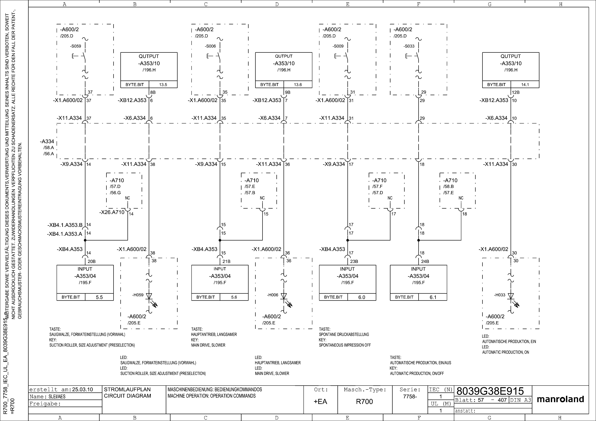

# +EA — Sheet 57 of 407 — MASCHINENBEDIENUNG: BEDIENUNGKOMMANDOS

**MACHINE OPERATION: OPERATION COMMANDS**

> Part of the manroland **R700** printing press IEC/UL circuit diagrams.
> Drawing class: **Stromlaufplan / Circuit diagram** (DIN A3).
> Document `+EA` covers the **Printing unit** machine section.

## At a glance

| Field | Value |
|---|---|
| Document | `+EA`  (8039G38E915) |
| Sheet | **57** of 407 |
| Section (DE) | MASCHINENBEDIENUNG: BEDIENUNGKOMMANDOS |
| Section (EN) | MACHINE OPERATION: OPERATION COMMANDS |
| Section type | CIRCUIT — Circuit diagram |
| Machine type | `R700` |
| Series | `7758` |
| Created | 25.03.10 |
| Replaces | — |
| Columns used | A, B, C, D, E, F, G, H |
| Path numbers | — |
| Labels on sheet | 184 |
| Cross-refs out | 24 |
| Cross-refs in | 64 |

**Previous:** [+EA sheet 56](SHEET_0056.md) · **Next:** [+EA sheet 58](SHEET_0058.md) · **Document TOC:** [_TOC.md](_TOC.md)  (+EA) · **Master TOC:** [all sheets](../_MASTER_TOC.md)

## Sheet image (300 DPI, exact vector render)



_Rendered directly from the PDF vector layer at 300 DPI (1-bit), no OCR and no resampling. Use it to confirm anything ambiguous in the text below._

## Cross-references on this sheet

Each entry is a wire leaving this sheet. The printed token is `/sheet.column`; the link resolves to that sheet inside the same document.

| Ref | Target sheet | Col | Path | Destination on target | Target section | From col |
|---|---|---|---|---|---|---|
| `/205.D` | [+EA sheet 205](SHEET_0205.md) | D | — | A600/2 | REFERENZMODUL | A |
| `/205.D` | [+EA sheet 205](SHEET_0205.md) | D | — | A600/2 | REFERENZMODUL | C |
| `/205.D` | [+EA sheet 205](SHEET_0205.md) | D | — | A600/2 | REFERENZMODUL | E |
| `/205.D` | [+EA sheet 205](SHEET_0205.md) | D | — | A600/2 | REFERENZMODUL | F |
| `/196.H` | [+EA sheet 196](SHEET_0196.md) | H | — | — | REFERENZMODUL | B |
| `/196.H` | [+EA sheet 196](SHEET_0196.md) | H | — | — | REFERENZMODUL | D |
| `/196.H` | [+EA sheet 196](SHEET_0196.md) | H | — | — | REFERENZMODUL | G |
| `/58.A` | [+EA sheet 58](SHEET_0058.md) | A | — | — | MASCHINENBEDIENUNG: BEDIENUNGKOMMANDOS | A |
| `/56.A` | [+EA sheet 56](SHEET_0056.md) | A | — | — | MASCHINENBEDIENUNG: BEDIENUNGKOMMANDOS | A |
| `/57.D` | [+EA sheet 57](SHEET_0057.md) | D | — | A710 | MASCHINENBEDIENUNG: BEDIENUNGKOMMANDOS | B |
| `/56.G` | [+EA sheet 56](SHEET_0056.md) | G | — | A710 | MASCHINENBEDIENUNG: BEDIENUNGKOMMANDOS | B |
| `/57.E` | [+EA sheet 57](SHEET_0057.md) | E | — | A710 | MASCHINENBEDIENUNG: BEDIENUNGKOMMANDOS | D |
| `/57.B` | [+EA sheet 57](SHEET_0057.md) | B | — | A710 | MASCHINENBEDIENUNG: BEDIENUNGKOMMANDOS | D |
| `/57.F` | [+EA sheet 57](SHEET_0057.md) | F | — | A710 | MASCHINENBEDIENUNG: BEDIENUNGKOMMANDOS | E |
| `/57.D` | [+EA sheet 57](SHEET_0057.md) | D | — | A710 | MASCHINENBEDIENUNG: BEDIENUNGKOMMANDOS | E |
| `/58.B` | [+EA sheet 58](SHEET_0058.md) | B | — | A710 | MASCHINENBEDIENUNG: BEDIENUNGKOMMANDOS | F |
| `/57.E` | [+EA sheet 57](SHEET_0057.md) | E | — | A710 | MASCHINENBEDIENUNG: BEDIENUNGKOMMANDOS | F |
| `/195.F` | [+EA sheet 195](SHEET_0195.md) | F | — | — | REFERENZMODUL | A |
| `/195.F` | [+EA sheet 195](SHEET_0195.md) | F | — | — | REFERENZMODUL | C |
| `/195.F` | [+EA sheet 195](SHEET_0195.md) | F | — | — | REFERENZMODUL | E |
| `/195.F` | [+EA sheet 195](SHEET_0195.md) | F | — | — | REFERENZMODUL | F |
| `/205.E` | [+EA sheet 205](SHEET_0205.md) | E | — | A600/2 | REFERENZMODUL | B |
| `/205.E` | [+EA sheet 205](SHEET_0205.md) | E | — | A600/2 | REFERENZMODUL | D |
| `/205.E` | [+EA sheet 205](SHEET_0205.md) | E | — | A600/2 | REFERENZMODUL | G |

### Incoming references (sheets that point here)

Every other sheet that sends a wire to this one. `Back-ref` is the token printed on *that* sheet; `Path` is its line number.

| From sheet | Cols | Back-ref | Path | Refs | What continues there |
|---|---|---|---|---|---|
| [+EA#56](SHEET_0056.md) | A, G | `/56.A`, `/56.G` | — | 2 | A710 |
| [+EA#57](SHEET_0057.md) | B, D, E, F | `/57.B`, `/57.D`, `/57.E`, `/57.F` | — | 6 | A710 |
| [+EA#58](SHEET_0058.md) | A, B | `/58.A`, `/58.B` | — | 2 | A710 |
| [+EA#195](SHEET_0195.md) | F | `/195.F` | — | 4 | — |
| [+EA#196](SHEET_0196.md) | H | `/196.H` | — | 3 | — |
| [+EA#205](SHEET_0205.md) | D, E | `/205.D`, `/205.E` | — | 7 | — |
| [+EA#212](SHEET_0212.md) | H | `/212.H` | — | 7 | — |
| [+EA#237](SHEET_0237.md) | A, B, C | `/237.A`, `/237.B`, `/237.C` | — | 12 | — |
| [+EA#244](SHEET_0244.md) | F | `/244.F` | — | 3 | — |
| [+EA#252](SHEET_0252.md) | A | `/252.A` | — | 4 | — |
| [+EA#255](SHEET_0255.md) | H | `/255.H` | — | 7 | — |
| [+EA#257](SHEET_0257.md) | C | `/257.C` | — | 3 | — |
| [+EA#270](SHEET_0270.md) | C | `/270.C` | — | 4 | — |


## Devices on this sheet

| Tag | Class | Class meaning (IEC) | Col | Sub | Terminal | Sign |
|---|---|---|---|---|---|---|
| `S059` | S | Schalter / switch | A | — | — | — |
| `A600/2` | A | Baugruppe / assembly, module, PC board | A | 2 | — | — |
| `A353/10` | A | Baugruppe / assembly, module, PC board | B | 10 | — | — |
| `S006` | S | Schalter / switch | C | — | — | — |
| `A600/2` | A | Baugruppe / assembly, module, PC board | C | 2 | — | — |
| `A353/10` | A | Baugruppe / assembly, module, PC board | D | 10 | — | — |
| `S033` | S | Schalter / switch | F | — | — | — |
| `A600/2` | A | Baugruppe / assembly, module, PC board | F | 2 | — | — |
| `S009` | S | Schalter / switch | E | — | — | — |
| `A600/2` | A | Baugruppe / assembly, module, PC board | E | 2 | — | — |
| `A334` | A | Baugruppe / assembly, module, PC board | A | — | — | — |
| `A353/04` | A | Baugruppe / assembly, module, PC board | F | 04 | — | — |
| `A353/04` | A | Baugruppe / assembly, module, PC board | A | 04 | — | — |
| `A600/2` | A | Baugruppe / assembly, module, PC board | B | 2 | — | — |
| `A600/2` | A | Baugruppe / assembly, module, PC board | D | 2 | — | — |
| `A353/04` | A | Baugruppe / assembly, module, PC board | C | 04 | — | — |
| `A353/04` | A | Baugruppe / assembly, module, PC board | E | 04 | — | — |
| `A710` | A | Baugruppe / assembly, module, PC board | B | — | — | — |
| `A710` | A | Baugruppe / assembly, module, PC board | D | — | — | — |
| `A710` | A | Baugruppe / assembly, module, PC board | E | — | — | — |
| `A353/10` | A | Baugruppe / assembly, module, PC board | G | 10 | — | — |
| `A600/2` | A | Baugruppe / assembly, module, PC board | G | 2 | — | — |
| `A710` | A | Baugruppe / assembly, module, PC board | F | — | — | — |
| `13.5` | — | cross-device reference | B | — | — | — |
| `XB12.A353` | — | cross-device reference | B | — | — | — |
| `13.6` | — | cross-device reference | D | — | — | — |
| `XB12.A353` | — | cross-device reference | D | — | — | — |
| `X11.A334` | — | cross-device reference | A | — | — | — |
| `X6.A334` | — | cross-device reference | B | — | — | — |
| `X11.A334` | — | cross-device reference | C | — | — | — |
| `X6.A334` | — | cross-device reference | D | — | — | — |
| `X11.A334` | — | cross-device reference | E | — | — | — |
| `X9.A334` | — | cross-device reference | A | — | — | — |
| `X11.A334` | — | cross-device reference | B | — | — | — |
| `X9.A334` | — | cross-device reference | C | — | — | — |
| `X11.A334` | — | cross-device reference | D | — | — | — |
| `X9.A334` | — | cross-device reference | E | — | — | — |
| `6.1` | — | cross-device reference | F | — | — | — |
| `5.5` | — | cross-device reference | A | — | — | — |
| `XB4.A353` | — | cross-device reference | A | — | — | — |
| `5.6` | — | cross-device reference | C | — | — | — |
| `XB4.A353` | — | cross-device reference | C | — | — | — |
| `6.0` | — | cross-device reference | E | — | — | — |
| `XB4.A353` | — | cross-device reference | E | — | — | — |
| `XB4.1.A353.B` | — | cross-device reference | A | — | — | — |
| `XB4.1.A353.A` | — | cross-device reference | A | — | — | — |
| `X26.A710` | — | cross-device reference | B | — | — | — |
| `14.1` | — | cross-device reference | H | — | — | — |
| `XB12.A353` | — | cross-device reference | G | — | — | — |
| `X6.A334` | — | cross-device reference | G | — | — | — |
| `X11.A334` | — | cross-device reference | G | — | — | — |

## Potentials / nets

| Potential | Count | Columns | Attached devices | Terminals |
|---|---|---|---|---|
| `H006` | 1 | D | — | — |
| `H033` | 1 | G | — | — |
| `H059` | 1 | B | — | — |


A potential such as `L24+/4` or `M24+` is a named supply/return rail; every place it appears on this sheet is electrically common.

## Wire-end annotations (grouped as printed)

A wire that continues elsewhere is annotated with a small cluster: the destination description, the path/line number `#NN`, and the `/sheet.column` cross reference. Each row below is one such cluster exactly as it is grouped on the drawing.

| Col | Y | Path | Cross-ref | Text on the wire |
|---|---|---|---|---|
| A | 54.2 | — | `/205.D` | `A600/2` |
| C | 54.2 | — | `/205.D` | `A600/2` |
| E | 54.2 | — | `/205.D` | `A600/2` |
| F | 54.2 | — | `/205.D` | `A600/2` |
| A | 88.6 | — | — | `S059` |
| C | 88.6 | — | — | `S006` |
| E | 88.6 | — | — | `S009` |
| F | 88.6 | — | — | `S033` |
| B | 108.3 | — | — | `QUTPUT` |
| G | 108.3 | — | — | `QUTPUT` |
| D | 108.8 | — | — | `QUTPUT` |
| B | 122.2 | — | — | `A353/10` |
| D | 122.2 | — | — | `A353/10` |
| G | 122.2 | — | — | `A353/10` |
| B | 136.0 | — | `/196.H` | — |
| D | 136.0 | — | `/196.H` | — |
| G | 136.0 | — | `/196.H` | — |
| B | 165.6 | — | — | `BYTE.BIT 13.5` |
| D | 165.6 | — | — | `BYTE.BIT 13.6` |
| G | 165.6 | — | — | `BYTE.BIT 14.1` |
| A | 180.3 | — | — | `37` |
| C | 180.3 | — | — | `35` |
| E | 180.3 | — | — | `31` |
| F | 180.3 | — | — | `29` |
| B | 181.0 | — | — | `8B` |
| D | 181.0 | — | — | `9B` |
| G | 181.0 | — | — | `12B` |
| A | 195.9 | — | — | `X1.A600/02 37` |
| C | 195.9 | — | — | `XB12.A353 6 X1.A600/02 35` |
| E | 195.9 | — | — | `XB12.A353 7 29` |
| E | 195.9 | — | — | `X1.A600/02 31` |
| G | 195.9 | — | — | `XB12.A353 10` |
| C | 231.3 | — | — | `X11.A334 37 X6.A334 6 X11.A334 35 X6.A334 7 X11.A334 31` |
| G | 231.3 | — | — | `X6.A334 10` |
| F | 232.8 | — | — | `29` |
| A | 278.1 | — | — | `A334` |
| A | 291.1 | — | `/58.A`, `/56.A` | — |
| D | 323.4 | — | — | `X9.A334 14 X11.A334 38 X9.A334 15 X11.A334 36 X9.A334 17 18` |
| G | 323.4 | — | — | `X11.A334 30` |
| B | 356.1 | — | `/57.D`, `/56.G` | `A710` |
| D | 356.1 | — | `/57.E`, `/57.B` | `A710` |
| E | 356.1 | — | `/57.F`, `/57.D` | `A710` |
| F | 356.1 | — | `/58.B`, `/57.E` | `A710` |
| D | 393.2 | — | — | `NC NC NC NC` |
| B | 419.8 | — | — | `X26.A710 14` |
| D | 424.1 | — | — | `15` |
| F | 424.1 | — | — | `17` |
| G | 424.1 | — | — | `18` |
| A | 445.4 | — | — | `XB4.1.A353.B 14` |
| C | 445.4 | — | — | `15` |
| E | 445.4 | — | — | `17` |
| F | 445.4 | — | — | `18` |
| A | 462.4 | — | — | `XB4.1.A353.A 14` |
| C | 462.4 | — | — | `15` |
| E | 462.4 | — | — | `17` |
| F | 462.4 | — | — | `18` |
| A | 493.5 | — | — | `XB4.A353 14` |
| B | 493.5 | — | — | `X1.A600/02 38` |
| C | 493.5 | — | — | `XB4.A353 15` |
| D | 493.5 | — | — | `X1.A600/02 36` |
| E | 493.5 | — | — | `XB4.A353 17` |
| G | 493.5 | — | — | `X1.A600/02 30` |
| F | 502.1 | — | — | `18` |
| B | 517.6 | — | — | `38` |
| D | 517.6 | — | — | `36` |
| G | 517.6 | — | — | `30` |
| A | 519.0 | — | — | `20B` |
| C | 519.0 | — | — | `21B` |
| E | 519.0 | — | — | `23B` |
| F | 519.0 | — | — | `24B` |
| A | 533.5 | — | — | `INPUT` |
| E | 533.5 | — | — | `INPUT` |
| F | 533.5 | — | — | `INPUT` |
| C | 534.1 | — | — | `INPUT` |
| A | 547.4 | — | — | `A353/04` |
| C | 547.4 | — | — | `A353/04` |
| E | 547.4 | — | — | `A353/04` |
| F | 547.4 | — | — | `A353/04` |
| A | 561.2 | — | `/195.F` | — |
| C | 561.2 | — | `/195.F` | — |
| E | 561.2 | — | `/195.F` | — |
| F | 561.2 | — | `/195.F` | — |
| B | 586.1 | — | — | `H059` |
| D | 586.1 | — | — | `H006` |
| G | 586.1 | — | — | `H033` |
| A | 590.2 | — | — | `BYTE.BIT 5.5` |
| E | 590.2 | — | — | `BYTE.BIT 6.0` |
| F | 590.2 | — | — | `BYTE.BIT 6.1` |
| C | 590.8 | — | — | `BYTE.BIT 5.6` |
| B | 628.2 | — | `/205.E` | `A600/2` |
| D | 628.2 | — | `/205.E` | `A600/2` |
| G | 628.2 | — | `/205.E` | `A600/2` |
| A | 655.4 | — | — | `KEY: TASTE: SAUGWALZE, FORMATEINSTELLUNG (VORWAHL)` |
| C | 655.4 | — | — | `HAUPTANTRIEB, LANGSAMER KEY: MAIN DRIVE, SLOWER TASTE:` |
| E | 655.4 | — | — | `KEY: TASTE: SPONTANE DRUCKABSTELLUNG` |
| G | 669.5 | — | — | `LED:` |
| G | 680.2 | — | — | `LED: AUTOMATISCHE PRODUKTION, EIN` |
| A | 687.3 | — | — | `SUCTION ROLLER, SIZE ADJUSTMENT (PRESELECTION)` |
| E | 687.3 | — | — | `SPONTANEOUS IMPRESSION OFF` |
| G | 701.5 | — | — | `AUTOMATIC PRODUCTION, ON` |
| B | 712.0 | — | — | `LED:` |
| D | 712.0 | — | — | `LED: HAUPTANTRIEB, LANGSAMER LED: MAIN DRIVE, SLOWER` |
| F | 712.1 | — | — | `KEY: TASTE: AUTOMATISCHE PRODUKTION, EIN/AUS` |
| B | 722.8 | — | — | `LED: SAUGWALZE, FORMATEINSTELLUNG (VORWAHL)` |
| B | 744.0 | — | — | `SUCTION ROLLER, SIZE ADJUSTMENT (PRESELECTION)` |
| F | 744.0 | — | — | `AUTOMATIC PRODUCTION, ON/OFF` |


## Reconstructed tables

This sheet carries tabular content (pin map / terminal assignment / index). The grid below was rebuilt from the drawing's own rule lines, so each row is exactly one physical row of the table.

### Table 1 — 8 data rows × 6 columns (at x=113.4, y=48.2) — **A600/2 /205.D S059**

|  |  |  |  | QUTPUT | A353/10 /196.H |
|---|---|---|---|---|---|
|  |  |  |  | `BYTE.BIT` | `13.5` |
|  | `37` |  |  |  | `8B` |
| `X1.A600/02 X11.A334 X9.A334 XB4.1.A353.B XB4.1.A353.A` | `37 37 14 X26.A710 14 14` | `A710 /57.D /56.G` | `NC` | `XB12.A353 X6.A334 X11.A334 14` | `6 6 38` |
| `XB4.A353` | `14` |  |  | `X1.A600/02` | `38` |
|  | `20B` |  |  |  | `38` |
| `INPUT` | `A353/04 /195.F` |  |  |  |  |
| `BYTE.BIT` | `5.5` |  |  | `H059` |  |
|  |  |  |  | `A600/2 /205.E` |  |


### Table 2 — 7 data rows × 6 columns (at x=382.7, y=48.2) — **A600/2 /205.D S006 QUTPUT A353/10 /196.H**

|  |  |  |  | BYTE.BIT | 13.6 |
|---|---|---|---|---|---|
|  | `35` |  |  |  | `9B` |
| `X1.A600/02 X11.A334 X9.A334` | `35 35 15 15 15` | `A710 /57.E /57.B` | `NC` | `XB12.A353 X6.A334 X11.A334 15` | `7 7 36` |
| `XB4.A353` | `15` |  |  | `X1.A600/02` | `36` |
|  | `21B` |  |  |  | `36` |
| `INPUT` | `A353/04 /195.F` |  |  |  |  |
| `BYTE.BIT` | `5.6` |  |  | `H006` |  |
|  |  |  |  | `A600/2 /205.E` |  |


### Table 3 — 9 data rows × 9 columns (at x=637.8, y=48.2)

| A600/2 /205.D S009 |  |  | A600/2 /205.D S033 |  |  |  |  |  |
|---|---|---|---|---|---|---|---|---|
|  |  |  |  |  |  |  | `QUTPUT` | `A353/10 /196.H` |
|  |  |  |  |  |  |  | `BYTE.BIT` | `14.1` |
|  | `31` |  |  | `29` |  |  |  | `12B` |
| `X1.A600/02 X11.A334 X9.A334` | `31 31 17 17 17` | `A710 /57.F /57.D NC` | `17` | `29 29 18 18 18` | `A710 /58.B /57.E NC` | `18` | `XB12.A353 X6.A334 X11.A334` | `10 10 30` |
| `XB4.A353` | `17` |  |  | `18` |  |  | `X1.A600/02` | `30` |
|  | `23B` |  |  | `24B` |  |  |  | `30` |
| `INPUT` | `A353/04 /195.F` |  | `INPUT` | `A353/04 /195.F` |  |  |  |  |
| `BYTE.BIT` | `6.0` |  | `BYTE.BIT` | `6.1` |  |  | `H033` |  |
|  |  |  |  |  |  |  | `A600/2 /205.E` |  |


## Notes and free text on this sheet

| Text | Col | Y (pt) |
|---|---|---|
| `X1.A600/02` | A | 195.9 |
| `8B` | B | 180.98 |
| `QUTPUT` | B | 108.33 |
| `BYTE.BIT` | B | 165.6 |
| `X1.A600/02` | C | 195.9 |
| `9B` | D | 180.98 |
| `QUTPUT` | D | 108.84 |
| `BYTE.BIT` | D | 165.6 |
| `X1.A600/02` | E | 195.9 |
| `24B` | F | 519.03 |
| `INPUT` | F | 533.55 |
| `BYTE.BIT` | F | 590.8 |
| `TASTE:` | F | 712.06 |
| `AUTOMATISCHE PRODUKTION, EIN/AUS` | F | 722.76 |
| `KEY:` | F | 733.25 |
| `AUTOMATIC PRODUCTION, ON/OFF` | F | 744.04 |
| `20B` | A | 519.03 |
| `INPUT` | A | 533.55 |
| `BYTE.BIT` | A | 590.8 |
| `TASTE:` | A | 655.36 |
| `SAUGWALZE, FORMATEINSTELLUNG (VORWAHL)` | A | 666.05 |
| `KEY:` | A | 676.56 |
| `SUCTION ROLLER, SIZE ADJUSTMENT (PRESELECTION)` | A | 687.33 |
| `LED:` | B | 712.03 |
| `SAUGWALZE, FORMATEINSTELLUNG (VORWAHL)` | B | 722.75 |
| `SUCTION ROLLER, SIZE ADJUSTMENT (PRESELECTION)` | B | 744.03 |
| `X1.A600/02` | B | 493.54 |
| `LED:` | D | 712.03 |
| `HAUPTANTRIEB, LANGSAMER` | D | 722.75 |
| `MAIN DRIVE, SLOWER` | D | 743.99 |
| `21B` | C | 519.03 |
| `INPUT` | C | 534.11 |
| `BYTE.BIT` | C | 590.8 |
| `TASTE:` | C | 655.36 |
| `HAUPTANTRIEB, LANGSAMER` | C | 666.06 |
| `KEY:` | C | 676.56 |
| `MAIN DRIVE, SLOWER` | C | 687.3 |
| `X1.A600/02` | D | 493.54 |
| `23B` | E | 519.03 |
| `INPUT` | E | 533.55 |
| `BYTE.BIT` | E | 590.8 |
| `TASTE:` | E | 655.36 |
| `SPONTANE DRUCKABSTELLUNG` | E | 666.07 |
| `KEY:` | E | 676.56 |
| `SPONTANEOUS IMPRESSION OFF` | E | 687.33 |
| `12B` | G | 181 |
| `QUTPUT` | G | 108.33 |
| `BYTE.BIT` | G | 165.6 |
| `LED:` | G | 669.51 |
| `AUTOMATISCHE PRODUKTION, EIN` | G | 680.24 |
| `AUTOMATIC PRODUCTION, ON` | G | 701.52 |
| `X1.A600/02` | G | 493.54 |
| `NC` | B | 393.18 |
| `NC` | D | 393.18 |
| `NC` | F | 393.18 |
| `NC` | G | 393.18 |

## Complete label inventory (exact text from the drawing)

Every text object inside the drawing area of this sheet, in DIN reading order (column A→H, then top→bottom). This is the authoritative list: if a string is not here it is not printed on this sheet.

| Col | Y | X | Dir | Type | Text |
|---|---|---|---|---|---|
| A | 54.2 | 120.2 | → | device tag | `A600/2` |
| A | 68.0 | 120.5 | → | cross-reference | `/205.D` |
| A | 88.6 | 140.0 | → | device tag | `S059` |
| A | 180.3 | 175.5 | → | number | `37` |
| A | 195.9 | 106.0 | → | text | `X1.A600/02` |
| A | 197.3 | 172.6 | → | number | `37` |
| A | 231.3 | 113.4 | → | device ref | `X11.A334` |
| A | 232.8 | 172.6 | → | number | `37` |
| A | 278.1 | 79.9 | → | device tag | `A334` |
| A | 291.2 | 87.0 | → | cross-reference | `/58.A` |
| A | 303.6 | 87.0 | → | cross-reference | `/56.A` |
| A | 323.5 | 120.8 | → | device ref | `X9.A334` |
| A | 324.9 | 172.1 | → | number | `14` |
| A | 445.4 | 95.0 | → | device ref | `XB4.1.A353.B` |
| A | 445.4 | 172.1 | → | number | `14` |
| A | 462.4 | 172.1 | → | number | `14` |
| A | 463.1 | 94.1 | → | device ref | `XB4.1.A353.A` |
| A | 493.5 | 113.7 | → | device ref | `XB4.A353` |
| A | 502.1 | 172.1 | → | number | `14` |
| A | 519.0 | 175.5 | → | text | `20B` |
| A | 533.6 | 155.2 | → | text | `INPUT` |
| A | 547.4 | 148.7 | → | device tag | `A353/04` |
| A | 561.2 | 157.7 | → | cross-reference | `/195.F` |
| A | 590.2 | 191.6 | → | device ref | `5.5` |
| A | 590.8 | 123.3 | → | text | `BYTE.BIT` |
| A | 655.4 | 98.9 | → | text | `TASTE:` |
| A | 666.1 | 98.9 | → | text | `SAUGWALZE, FORMATEINSTELLUNG (VORWAHL)` |
| A | 676.6 | 98.4 | → | text | `KEY:` |
| A | 687.3 | 98.9 | → | text | `SUCTION ROLLER, SIZE ADJUSTMENT (PRESELECTION)` |
| B | 108.3 | 277.4 | → | text | `QUTPUT` |
| B | 122.2 | 276.2 | → | device tag | `A353/10` |
| B | 136.0 | 285.2 | → | cross-reference | `/196.H` |
| B | 165.6 | 250.9 | → | text | `BYTE.BIT` |
| B | 165.6 | 317.8 | → | device ref | `13.5` |
| B | 181.0 | 300.2 | → | text | `8B` |
| B | 195.9 | 235.3 | → | device ref | `XB12.A353` |
| B | 197.3 | 300.2 | → | number | `6` |
| B | 231.3 | 246.9 | → | device ref | `X6.A334` |
| B | 232.8 | 300.2 | → | number | `6` |
| B | 323.5 | 242.4 | → | device ref | `X11.A334` |
| B | 324.9 | 300.2 | → | number | `38` |
| B | 356.1 | 219.4 | → | device tag | `A710` |
| B | 369.1 | 219.7 | → | cross-reference | `/57.D` |
| B | 381.5 | 219.7 | → | cross-reference | `/56.G` |
| B | 393.2 | 250.2 | → | text | `NC` |
| B | 419.8 | 198.4 | → | device ref | `X26.A710` |
| B | 424.1 | 257.1 | → | number | `14` |
| B | 493.5 | 233.6 | → | text | `X1.A600/02` |
| B | 502.1 | 300.2 | → | number | `38` |
| B | 517.6 | 303.0 | → | number | `38` |
| B | 586.1 | 264.2 | → | potential | `H059` |
| B | 628.2 | 254.8 | → | device tag | `A600/2` |
| B | 642.0 | 255.1 | → | cross-reference | `/205.E` |
| B | 712.0 | 240.1 | → | text | `LED:` |
| B | 722.7 | 240.7 | → | text | `SAUGWALZE, FORMATEINSTELLUNG (VORWAHL)` |
| B | 733.3 | 240.1 | → | text | `LED:` |
| B | 744.0 | 240.7 | → | text | `SUCTION ROLLER, SIZE ADJUSTMENT (PRESELECTION)` |
| C | 54.2 | 389.5 | → | device tag | `A600/2` |
| C | 68.0 | 389.8 | → | cross-reference | `/205.D` |
| C | 88.6 | 409.3 | → | device tag | `S006` |
| C | 180.3 | 444.8 | → | number | `35` |
| C | 195.9 | 375.3 | → | text | `X1.A600/02` |
| C | 197.3 | 441.9 | → | number | `35` |
| C | 231.3 | 382.7 | → | device ref | `X11.A334` |
| C | 232.8 | 441.9 | → | number | `35` |
| C | 323.5 | 390.0 | → | device ref | `X9.A334` |
| C | 324.9 | 441.4 | → | number | `15` |
| C | 445.4 | 441.4 | → | number | `15` |
| C | 462.4 | 441.4 | → | number | `15` |
| C | 493.5 | 383.0 | → | device ref | `XB4.A353` |
| C | 502.1 | 441.4 | → | number | `15` |
| C | 519.0 | 444.8 | → | text | `21B` |
| C | 534.1 | 426.9 | → | text | `INPUT` |
| C | 547.4 | 418.0 | → | device tag | `A353/04` |
| C | 561.2 | 427.0 | → | cross-reference | `/195.F` |
| C | 590.8 | 392.6 | → | text | `BYTE.BIT` |
| C | 590.8 | 462.0 | → | device ref | `5.6` |
| C | 655.4 | 382.4 | → | text | `TASTE:` |
| C | 666.1 | 381.8 | → | text | `HAUPTANTRIEB, LANGSAMER` |
| C | 676.6 | 381.8 | → | text | `KEY:` |
| C | 687.3 | 382.1 | → | text | `MAIN DRIVE, SLOWER` |
| D | 108.8 | 549.6 | → | text | `QUTPUT` |
| D | 122.2 | 545.5 | → | device tag | `A353/10` |
| D | 136.0 | 554.5 | → | cross-reference | `/196.H` |
| D | 165.6 | 520.2 | → | text | `BYTE.BIT` |
| D | 165.6 | 587.1 | → | device ref | `13.6` |
| D | 181.0 | 569.5 | → | text | `9B` |
| D | 195.9 | 504.6 | → | device ref | `XB12.A353` |
| D | 197.3 | 569.5 | → | number | `7` |
| D | 231.3 | 516.2 | → | device ref | `X6.A334` |
| D | 232.8 | 569.5 | → | number | `7` |
| D | 323.5 | 511.7 | → | device ref | `X11.A334` |
| D | 324.9 | 569.5 | → | number | `36` |
| D | 356.1 | 488.7 | → | device tag | `A710` |
| D | 369.1 | 489.0 | → | cross-reference | `/57.E` |
| D | 381.5 | 489.0 | → | cross-reference | `/57.B` |
| D | 393.2 | 519.5 | → | text | `NC` |
| D | 424.1 | 526.4 | → | number | `15` |
| D | 493.5 | 502.9 | → | text | `X1.A600/02` |
| D | 502.1 | 569.5 | → | number | `36` |
| D | 517.6 | 572.3 | → | number | `36` |
| D | 586.1 | 533.5 | → | potential | `H006` |
| D | 628.2 | 524.1 | → | device tag | `A600/2` |
| D | 642.0 | 524.4 | → | cross-reference | `/205.E` |
| D | 712.0 | 509.4 | → | text | `LED:` |
| D | 722.8 | 509.4 | → | text | `HAUPTANTRIEB, LANGSAMER` |
| D | 733.3 | 509.4 | → | text | `LED:` |
| D | 744.0 | 509.7 | → | text | `MAIN DRIVE, SLOWER` |
| E | 54.2 | 644.6 | → | device tag | `A600/2` |
| E | 68.0 | 644.9 | → | cross-reference | `/205.D` |
| E | 88.6 | 664.4 | → | device tag | `S009` |
| E | 180.3 | 699.9 | → | number | `31` |
| E | 195.9 | 630.4 | → | text | `X1.A600/02` |
| E | 197.3 | 697.0 | → | number | `31` |
| E | 231.3 | 637.8 | → | device ref | `X11.A334` |
| E | 232.8 | 697.0 | → | number | `31` |
| E | 323.5 | 645.2 | → | device ref | `X9.A334` |
| E | 324.9 | 696.5 | → | number | `17` |
| E | 356.1 | 743.8 | → | device tag | `A710` |
| E | 369.1 | 744.1 | → | cross-reference | `/57.F` |
| E | 381.5 | 744.1 | → | cross-reference | `/57.D` |
| E | 445.4 | 696.5 | → | number | `17` |
| E | 462.4 | 696.5 | → | number | `17` |
| E | 493.5 | 638.1 | → | device ref | `XB4.A353` |
| E | 502.1 | 696.5 | → | number | `17` |
| E | 519.0 | 699.9 | → | text | `23B` |
| E | 533.6 | 679.6 | → | text | `INPUT` |
| E | 547.4 | 673.1 | → | device tag | `A353/04` |
| E | 561.2 | 682.2 | → | cross-reference | `/195.F` |
| E | 590.2 | 716.0 | → | device ref | `6.0` |
| E | 590.8 | 647.7 | → | text | `BYTE.BIT` |
| E | 655.4 | 637.5 | → | text | `TASTE:` |
| E | 666.1 | 637.5 | → | text | `SPONTANE DRUCKABSTELLUNG` |
| E | 676.6 | 636.9 | → | text | `KEY:` |
| E | 687.3 | 637.5 | → | text | `SPONTANEOUS IMPRESSION OFF` |
| F | 54.2 | 786.3 | → | device tag | `A600/2` |
| F | 68.0 | 786.6 | → | cross-reference | `/205.D` |
| F | 88.6 | 806.2 | → | device tag | `S033` |
| F | 180.3 | 841.6 | → | number | `29` |
| F | 197.3 | 838.8 | → | number | `29` |
| F | 232.8 | 838.8 | → | number | `29` |
| F | 324.9 | 838.2 | → | number | `18` |
| F | 356.1 | 885.5 | → | device tag | `A710` |
| F | 369.1 | 885.8 | → | cross-reference | `/58.B` |
| F | 381.5 | 885.8 | → | cross-reference | `/57.E` |
| F | 393.2 | 774.7 | → | text | `NC` |
| F | 424.1 | 781.5 | → | number | `17` |
| F | 445.4 | 838.2 | → | number | `18` |
| F | 462.4 | 838.2 | → | number | `18` |
| F | 502.1 | 838.2 | → | number | `18` |
| F | 519.0 | 841.6 | → | text | `24B` |
| F | 533.6 | 821.3 | → | text | `INPUT` |
| F | 547.4 | 814.8 | → | device tag | `A353/04` |
| F | 561.2 | 823.9 | → | cross-reference | `/195.F` |
| F | 590.2 | 858.6 | → | device ref | `6.1` |
| F | 590.8 | 789.4 | → | text | `BYTE.BIT` |
| F | 712.1 | 779.2 | → | text | `TASTE:` |
| F | 722.8 | 779.5 | → | text | `AUTOMATISCHE PRODUKTION, EIN/AUS` |
| F | 733.2 | 778.7 | → | text | `KEY:` |
| F | 744.0 | 779.5 | → | text | `AUTOMATIC PRODUCTION, ON/OFF` |
| G | 108.3 | 1000.2 | → | text | `QUTPUT` |
| G | 122.2 | 999.1 | → | device tag | `A353/10` |
| G | 136.0 | 1008.0 | → | cross-reference | `/196.H` |
| G | 165.6 | 973.7 | → | text | `BYTE.BIT` |
| G | 181.0 | 1022.5 | → | text | `12B` |
| G | 195.9 | 958.1 | → | device ref | `XB12.A353` |
| G | 197.3 | 1022.5 | → | number | `10` |
| G | 231.3 | 969.7 | → | device ref | `X6.A334` |
| G | 232.8 | 1022.5 | → | number | `10` |
| G | 323.5 | 965.2 | → | device ref | `X11.A334` |
| G | 324.9 | 1023.0 | → | number | `30` |
| G | 393.2 | 916.4 | → | text | `NC` |
| G | 424.1 | 923.2 | → | number | `18` |
| G | 493.5 | 956.4 | → | text | `X1.A600/02` |
| G | 502.1 | 1023.0 | → | number | `30` |
| G | 517.6 | 1025.9 | → | number | `30` |
| G | 586.1 | 987.0 | → | potential | `H033` |
| G | 628.2 | 970.6 | → | device tag | `A600/2` |
| G | 642.0 | 970.9 | → | cross-reference | `/205.E` |
| G | 669.5 | 962.9 | → | text | `LED:` |
| G | 680.2 | 963.8 | → | text | `AUTOMATISCHE PRODUKTION, EIN` |
| G | 690.8 | 962.9 | → | text | `LED:` |
| G | 701.5 | 963.8 | → | text | `AUTOMATIC PRODUCTION, ON` |
| H | 165.6 | 1041.2 | → | device ref | `14.1` |

## Reading-order text block

The same content as a plain block, grouped by DIN column — convenient to paste or to match against a visual description.

```text
=== Column A ===
  54.2  120.2  devtag       A600/2
  68.0  120.5  xref         /205.D
  88.6  140.0  devtag       S059
 180.3  175.5  numeric      37
 195.9  106.0  text         X1.A600/02
 197.3  172.6  numeric      37
 231.3  113.4  devref       X11.A334
 232.8  172.6  numeric      37
 278.1   79.9  devtag       A334
 291.2   87.0  xref         /58.A
 303.6   87.0  xref         /56.A
 323.5  120.8  devref       X9.A334
 324.9  172.1  numeric      14
 445.4   95.0  devref       XB4.1.A353.B
 445.4  172.1  numeric      14
 462.4  172.1  numeric      14
 463.1   94.1  devref       XB4.1.A353.A
 493.5  113.7  devref       XB4.A353
 502.1  172.1  numeric      14
 519.0  175.5  text         20B
 533.6  155.2  text         INPUT
 547.4  148.7  devtag       A353/04
 561.2  157.7  xref         /195.F
 590.2  191.6  devref       5.5
 590.8  123.3  text         BYTE.BIT
 655.4   98.9  text         TASTE:
 666.1   98.9  text         SAUGWALZE, FORMATEINSTELLUNG (VORWAHL)
 676.6   98.4  text         KEY:
 687.3   98.9  text         SUCTION ROLLER, SIZE ADJUSTMENT (PRESELECTION)
=== Column B ===
 108.3  277.4  text         QUTPUT
 122.2  276.2  devtag       A353/10
 136.0  285.2  xref         /196.H
 165.6  250.9  text         BYTE.BIT
 165.6  317.8  devref       13.5
 181.0  300.2  text         8B
 195.9  235.3  devref       XB12.A353
 197.3  300.2  numeric      6
 231.3  246.9  devref       X6.A334
 232.8  300.2  numeric      6
 323.5  242.4  devref       X11.A334
 324.9  300.2  numeric      38
 356.1  219.4  devtag       A710
 369.1  219.7  xref         /57.D
 381.5  219.7  xref         /56.G
 393.2  250.2  text         NC
 419.8  198.4  devref       X26.A710
 424.1  257.1  numeric      14
 493.5  233.6  text         X1.A600/02
 502.1  300.2  numeric      38
 517.6  303.0  numeric      38
 586.1  264.2  net          H059
 628.2  254.8  devtag       A600/2
 642.0  255.1  xref         /205.E
 712.0  240.1  text         LED:
 722.7  240.7  text         SAUGWALZE, FORMATEINSTELLUNG (VORWAHL)
 733.3  240.1  text         LED:
 744.0  240.7  text         SUCTION ROLLER, SIZE ADJUSTMENT (PRESELECTION)
=== Column C ===
  54.2  389.5  devtag       A600/2
  68.0  389.8  xref         /205.D
  88.6  409.3  devtag       S006
 180.3  444.8  numeric      35
 195.9  375.3  text         X1.A600/02
 197.3  441.9  numeric      35
 231.3  382.7  devref       X11.A334
 232.8  441.9  numeric      35
 323.5  390.0  devref       X9.A334
 324.9  441.4  numeric      15
 445.4  441.4  numeric      15
 462.4  441.4  numeric      15
 493.5  383.0  devref       XB4.A353
 502.1  441.4  numeric      15
 519.0  444.8  text         21B
 534.1  426.9  text         INPUT
 547.4  418.0  devtag       A353/04
 561.2  427.0  xref         /195.F
 590.8  392.6  text         BYTE.BIT
 590.8  462.0  devref       5.6
 655.4  382.4  text         TASTE:
 666.1  381.8  text         HAUPTANTRIEB, LANGSAMER
 676.6  381.8  text         KEY:
 687.3  382.1  text         MAIN DRIVE, SLOWER
=== Column D ===
 108.8  549.6  text         QUTPUT
 122.2  545.5  devtag       A353/10
 136.0  554.5  xref         /196.H
 165.6  520.2  text         BYTE.BIT
 165.6  587.1  devref       13.6
 181.0  569.5  text         9B
 195.9  504.6  devref       XB12.A353
 197.3  569.5  numeric      7
 231.3  516.2  devref       X6.A334
 232.8  569.5  numeric      7
 323.5  511.7  devref       X11.A334
 324.9  569.5  numeric      36
 356.1  488.7  devtag       A710
 369.1  489.0  xref         /57.E
 381.5  489.0  xref         /57.B
 393.2  519.5  text         NC
 424.1  526.4  numeric      15
 493.5  502.9  text         X1.A600/02
 502.1  569.5  numeric      36
 517.6  572.3  numeric      36
 586.1  533.5  net          H006
 628.2  524.1  devtag       A600/2
 642.0  524.4  xref         /205.E
 712.0  509.4  text         LED:
 722.8  509.4  text         HAUPTANTRIEB, LANGSAMER
 733.3  509.4  text         LED:
 744.0  509.7  text         MAIN DRIVE, SLOWER
=== Column E ===
  54.2  644.6  devtag       A600/2
  68.0  644.9  xref         /205.D
  88.6  664.4  devtag       S009
 180.3  699.9  numeric      31
 195.9  630.4  text         X1.A600/02
 197.3  697.0  numeric      31
 231.3  637.8  devref       X11.A334
 232.8  697.0  numeric      31
 323.5  645.2  devref       X9.A334
 324.9  696.5  numeric      17
 356.1  743.8  devtag       A710
 369.1  744.1  xref         /57.F
 381.5  744.1  xref         /57.D
 445.4  696.5  numeric      17
 462.4  696.5  numeric      17
 493.5  638.1  devref       XB4.A353
 502.1  696.5  numeric      17
 519.0  699.9  text         23B
 533.6  679.6  text         INPUT
 547.4  673.1  devtag       A353/04
 561.2  682.2  xref         /195.F
 590.2  716.0  devref       6.0
 590.8  647.7  text         BYTE.BIT
 655.4  637.5  text         TASTE:
 666.1  637.5  text         SPONTANE DRUCKABSTELLUNG
 676.6  636.9  text         KEY:
 687.3  637.5  text         SPONTANEOUS IMPRESSION OFF
=== Column F ===
  54.2  786.3  devtag       A600/2
  68.0  786.6  xref         /205.D
  88.6  806.2  devtag       S033
 180.3  841.6  numeric      29
 197.3  838.8  numeric      29
 232.8  838.8  numeric      29
 324.9  838.2  numeric      18
 356.1  885.5  devtag       A710
 369.1  885.8  xref         /58.B
 381.5  885.8  xref         /57.E
 393.2  774.7  text         NC
 424.1  781.5  numeric      17
 445.4  838.2  numeric      18
 462.4  838.2  numeric      18
 502.1  838.2  numeric      18
 519.0  841.6  text         24B
 533.6  821.3  text         INPUT
 547.4  814.8  devtag       A353/04
 561.2  823.9  xref         /195.F
 590.2  858.6  devref       6.1
 590.8  789.4  text         BYTE.BIT
 712.1  779.2  text         TASTE:
 722.8  779.5  text         AUTOMATISCHE PRODUKTION, EIN/AUS
 733.2  778.7  text         KEY:
 744.0  779.5  text         AUTOMATIC PRODUCTION, ON/OFF
=== Column G ===
 108.3 1000.2  text         QUTPUT
 122.2  999.1  devtag       A353/10
 136.0 1008.0  xref         /196.H
 165.6  973.7  text         BYTE.BIT
 181.0 1022.5  text         12B
 195.9  958.1  devref       XB12.A353
 197.3 1022.5  numeric      10
 231.3  969.7  devref       X6.A334
 232.8 1022.5  numeric      10
 323.5  965.2  devref       X11.A334
 324.9 1023.0  numeric      30
 393.2  916.4  text         NC
 424.1  923.2  numeric      18
 493.5  956.4  text         X1.A600/02
 502.1 1023.0  numeric      30
 517.6 1025.9  numeric      30
 586.1  987.0  net          H033
 628.2  970.6  devtag       A600/2
 642.0  970.9  xref         /205.E
 669.5  962.9  text         LED:
 680.2  963.8  text         AUTOMATISCHE PRODUKTION, EIN
 690.8  962.9  text         LED:
 701.5  963.8  text         AUTOMATIC PRODUCTION, ON
=== Column H ===
 165.6 1041.2  devref       14.1
```

---
_Generated from the PDF vector text layer; no OCR. Source: `R700_7758_IEC_UL_EA_8039G38E915_p`, sheet 57._
