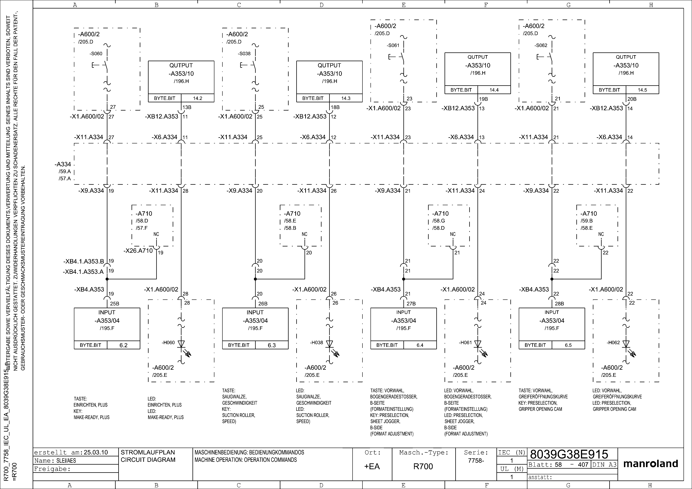

# +EA — Sheet 58 of 407 — MASCHINENBEDIENUNG: BEDIENUNGKOMMANDOS

**MACHINE OPERATION: OPERATION COMMANDS**

> Part of the manroland **R700** printing press IEC/UL circuit diagrams.
> Drawing class: **Stromlaufplan / Circuit diagram** (DIN A3).
> Document `+EA` covers the **Printing unit** machine section.

## At a glance

| Field | Value |
|---|---|
| Document | `+EA`  (8039G38E915) |
| Sheet | **58** of 407 |
| Section (DE) | MASCHINENBEDIENUNG: BEDIENUNGKOMMANDOS |
| Section (EN) | MACHINE OPERATION: OPERATION COMMANDS |
| Section type | CIRCUIT — Circuit diagram |
| Machine type | `R700` |
| Series | `7758` |
| Created | 25.03.10 |
| Replaces | — |
| Columns used | A, B, C, D, E, F, G, H |
| Path numbers | — |
| Labels on sheet | 221 |
| Cross-refs out | 26 |
| Cross-refs in | 70 |

**Previous:** [+EA sheet 57](SHEET_0057.md) · **Next:** [+EA sheet 59](SHEET_0059.md) · **Document TOC:** [_TOC.md](_TOC.md)  (+EA) · **Master TOC:** [all sheets](../_MASTER_TOC.md)

## Sheet image (300 DPI, exact vector render)



_Rendered directly from the PDF vector layer at 300 DPI (1-bit), no OCR and no resampling. Use it to confirm anything ambiguous in the text below._

## Cross-references on this sheet

Each entry is a wire leaving this sheet. The printed token is `/sheet.column`; the link resolves to that sheet inside the same document.

| Ref | Target sheet | Col | Path | Destination on target | Target section | From col |
|---|---|---|---|---|---|---|
| `/205.D` | [+EA sheet 205](SHEET_0205.md) | D | — | A600/2 | REFERENZMODUL | E |
| `/205.D` | [+EA sheet 205](SHEET_0205.md) | D | — | A600/2 | REFERENZMODUL | G |
| `/205.D` | [+EA sheet 205](SHEET_0205.md) | D | — | A600/2 | REFERENZMODUL | A |
| `/205.D` | [+EA sheet 205](SHEET_0205.md) | D | — | A600/2 | REFERENZMODUL | C |
| `/196.H` | [+EA sheet 196](SHEET_0196.md) | H | — | — | REFERENZMODUL | F |
| `/196.H` | [+EA sheet 196](SHEET_0196.md) | H | — | — | REFERENZMODUL | H |
| `/196.H` | [+EA sheet 196](SHEET_0196.md) | H | — | — | REFERENZMODUL | B |
| `/196.H` | [+EA sheet 196](SHEET_0196.md) | H | — | — | REFERENZMODUL | D |
| `/59.A` | [+EA sheet 59](SHEET_0059.md) | A | — | — | MASCHINENBEDIENUNG: BEDIENUNGKOMMANDOS | A |
| `/57.A` | [+EA sheet 57](SHEET_0057.md) | A | — | — | MASCHINENBEDIENUNG: BEDIENUNGKOMMANDOS | A |
| `/58.D` | [+EA sheet 58](SHEET_0058.md) | D | — | A710 | MASCHINENBEDIENUNG: BEDIENUNGKOMMANDOS | B |
| `/57.F` | [+EA sheet 57](SHEET_0057.md) | F | — | A710 | MASCHINENBEDIENUNG: BEDIENUNGKOMMANDOS | B |
| `/58.E` | [+EA sheet 58](SHEET_0058.md) | E | — | A710 | MASCHINENBEDIENUNG: BEDIENUNGKOMMANDOS | D |
| `/58.B` | [+EA sheet 58](SHEET_0058.md) | B | — | A710 | MASCHINENBEDIENUNG: BEDIENUNGKOMMANDOS | D |
| `/58.G` | [+EA sheet 58](SHEET_0058.md) | G | — | A710 | MASCHINENBEDIENUNG: BEDIENUNGKOMMANDOS | E |
| `/58.D` | [+EA sheet 58](SHEET_0058.md) | D | — | A710 | MASCHINENBEDIENUNG: BEDIENUNGKOMMANDOS | E |
| `/59.B` | [+EA sheet 59](SHEET_0059.md) | B | — | A710 | MASCHINENBEDIENUNG: BEDIENUNGKOMMANDOS | G |
| `/58.E` | [+EA sheet 58](SHEET_0058.md) | E | — | A710 | MASCHINENBEDIENUNG: BEDIENUNGKOMMANDOS | G |
| `/195.F` | [+EA sheet 195](SHEET_0195.md) | F | — | — | REFERENZMODUL | A |
| `/195.F` | [+EA sheet 195](SHEET_0195.md) | F | — | — | REFERENZMODUL | C |
| `/195.F` | [+EA sheet 195](SHEET_0195.md) | F | — | — | REFERENZMODUL | E |
| `/195.F` | [+EA sheet 195](SHEET_0195.md) | F | — | — | REFERENZMODUL | G |
| `/205.E` | [+EA sheet 205](SHEET_0205.md) | E | — | A600/2 | REFERENZMODUL | B |
| `/205.E` | [+EA sheet 205](SHEET_0205.md) | E | — | A600/2 | REFERENZMODUL | D |
| `/205.E` | [+EA sheet 205](SHEET_0205.md) | E | — | A600/2 | REFERENZMODUL | F |
| `/205.E` | [+EA sheet 205](SHEET_0205.md) | E | — | A600/2 | REFERENZMODUL | H |

### Incoming references (sheets that point here)

Every other sheet that sends a wire to this one. `Back-ref` is the token printed on *that* sheet; `Path` is its line number.

| From sheet | Cols | Back-ref | Path | Refs | What continues there |
|---|---|---|---|---|---|
| [+EA#57](SHEET_0057.md) | A, F | `/57.A`, `/57.F` | — | 2 | A710 |
| [+EA#58](SHEET_0058.md) | B, D, E, G | `/58.B`, `/58.D`, `/58.E`, `/58.G` | — | 6 | A710 |
| [+EA#59](SHEET_0059.md) | A, B | `/59.A`, `/59.B` | — | 2 | A710 |
| [+EA#195](SHEET_0195.md) | F | `/195.F` | — | 4 | — |
| [+EA#196](SHEET_0196.md) | H | `/196.H` | — | 4 | — |
| [+EA#205](SHEET_0205.md) | D, E | `/205.D`, `/205.E` | — | 8 | — |
| [+EA#212](SHEET_0212.md) | G, H | `/212.G`, `/212.H` | — | 8 | — |
| [+EA#237](SHEET_0237.md) | A, B, C | `/237.A`, `/237.B`, `/237.C` | — | 12 | — |
| [+EA#244](SHEET_0244.md) | F | `/244.F` | — | 4 | — |
| [+EA#252](SHEET_0252.md) | A | `/252.A` | — | 4 | — |
| [+EA#255](SHEET_0255.md) | G, H | `/255.G`, `/255.H` | — | 8 | — |
| [+EA#257](SHEET_0257.md) | C | `/257.C` | — | 4 | — |
| [+EA#270](SHEET_0270.md) | C | `/270.C` | — | 4 | — |


## Devices on this sheet

| Tag | Class | Class meaning (IEC) | Col | Sub | Terminal | Sign |
|---|---|---|---|---|---|---|
| `S038` | S | Schalter / switch | C | — | — | — |
| `A600/2` | A | Baugruppe / assembly, module, PC board | C | 2 | — | — |
| `A353/10` | A | Baugruppe / assembly, module, PC board | D | 10 | — | — |
| `S061` | S | Schalter / switch | E | — | — | — |
| `A600/2` | A | Baugruppe / assembly, module, PC board | E | 2 | — | — |
| `S062` | S | Schalter / switch | G | — | — | — |
| `A600/2` | A | Baugruppe / assembly, module, PC board | G | 2 | — | — |
| `A353/10` | A | Baugruppe / assembly, module, PC board | F | 10 | — | — |
| `A353/10` | A | Baugruppe / assembly, module, PC board | H | 10 | — | — |
| `A353/10` | A | Baugruppe / assembly, module, PC board | B | 10 | — | — |
| `S060` | S | Schalter / switch | A | — | — | — |
| `A600/2` | A | Baugruppe / assembly, module, PC board | A | 2 | — | — |
| `A334` | A | Baugruppe / assembly, module, PC board | A | — | — | — |
| `A353/04` | A | Baugruppe / assembly, module, PC board | C | 04 | — | — |
| `A600/2` | A | Baugruppe / assembly, module, PC board | D | 2 | — | — |
| `A600/2` | A | Baugruppe / assembly, module, PC board | F | 2 | — | — |
| `A600/2` | A | Baugruppe / assembly, module, PC board | H | 2 | — | — |
| `A353/04` | A | Baugruppe / assembly, module, PC board | E | 04 | — | — |
| `A353/04` | A | Baugruppe / assembly, module, PC board | G | 04 | — | — |
| `A600/2` | A | Baugruppe / assembly, module, PC board | B | 2 | — | — |
| `A353/04` | A | Baugruppe / assembly, module, PC board | A | 04 | — | — |
| `A710` | A | Baugruppe / assembly, module, PC board | B | — | — | — |
| `A710` | A | Baugruppe / assembly, module, PC board | D | — | — | — |
| `A710` | A | Baugruppe / assembly, module, PC board | E | — | — | — |
| `A710` | A | Baugruppe / assembly, module, PC board | G | — | — | — |
| `14.3` | — | cross-device reference | D | — | — | — |
| `XB12.A353` | — | cross-device reference | D | — | — | — |
| `14.4` | — | cross-device reference | F | — | — | — |
| `XB12.A353` | — | cross-device reference | F | — | — | — |
| `14.5` | — | cross-device reference | H | — | — | — |
| `XB12.A353` | — | cross-device reference | G | — | — | — |
| `14.2` | — | cross-device reference | B | — | — | — |
| `XB12.A353` | — | cross-device reference | B | — | — | — |
| `X11.A334` | — | cross-device reference | C | — | — | — |
| `X6.A334` | — | cross-device reference | D | — | — | — |
| `X11.A334` | — | cross-device reference | E | — | — | — |
| `X6.A334` | — | cross-device reference | F | — | — | — |
| `X11.A334` | — | cross-device reference | G | — | — | — |
| `X6.A334` | — | cross-device reference | G | — | — | — |
| `X6.A334` | — | cross-device reference | B | — | — | — |
| `X11.A334` | — | cross-device reference | A | — | — | — |
| `X9.A334` | — | cross-device reference | C | — | — | — |
| `X11.A334` | — | cross-device reference | D | — | — | — |
| `X9.A334` | — | cross-device reference | E | — | — | — |
| `X9.A334` | — | cross-device reference | G | — | — | — |
| `X11.A334` | — | cross-device reference | F | — | — | — |
| `X11.A334` | — | cross-device reference | G | — | — | — |
| `X11.A334` | — | cross-device reference | B | — | — | — |
| `X9.A334` | — | cross-device reference | A | — | — | — |
| `6.3` | — | cross-device reference | C | — | — | — |
| `6.4` | — | cross-device reference | E | — | — | — |
| `6.5` | — | cross-device reference | G | — | — | — |
| `XB4.A353` | — | cross-device reference | E | — | — | — |
| `XB4.A353` | — | cross-device reference | G | — | — | — |
| `6.2` | — | cross-device reference | B | — | — | — |
| `XB4.A353` | — | cross-device reference | A | — | — | — |
| `X26.A710` | — | cross-device reference | B | — | — | — |
| `XB4.1.A353.B` | — | cross-device reference | A | — | — | — |
| `XB4.1.A353.A` | — | cross-device reference | A | — | — | — |

## Potentials / nets

| Potential | Count | Columns | Attached devices | Terminals |
|---|---|---|---|---|
| `H038` | 1 | D | — | — |
| `H060` | 1 | B | — | — |
| `H061` | 1 | F | — | — |
| `H062` | 1 | H | — | — |


A potential such as `L24+/4` or `M24+` is a named supply/return rail; every place it appears on this sheet is electrically common.

## Wire-end annotations (grouped as printed)

A wire that continues elsewhere is annotated with a small cluster: the destination description, the path/line number `#NN`, and the `/sheet.column` cross reference. Each row below is one such cluster exactly as it is grouped on the drawing.

| Col | Y | Path | Cross-ref | Text on the wire |
|---|---|---|---|---|
| E | 40.0 | — | `/205.D` | `A600/2` |
| G | 40.0 | — | `/205.D` | `A600/2` |
| A | 54.2 | — | `/205.D` | `A600/2` |
| C | 54.2 | — | `/205.D` | `A600/2` |
| E | 74.4 | — | — | `S061` |
| G | 74.4 | — | — | `S062` |
| A | 88.6 | — | — | `S060` |
| C | 88.6 | — | — | `S038` |
| F | 94.7 | — | — | `QUTPUT` |
| H | 94.7 | — | — | `QUTPUT` |
| F | 108.0 | — | — | `A353/10` |
| H | 108.0 | — | — | `A353/10` |
| B | 108.3 | — | — | `QUTPUT` |
| D | 108.3 | — | — | `QUTPUT` |
| F | 121.8 | — | `/196.H` | — |
| H | 121.8 | — | `/196.H` | — |
| B | 122.2 | — | — | `A353/10` |
| D | 122.2 | — | — | `A353/10` |
| B | 136.0 | — | `/196.H` | — |
| D | 136.0 | — | `/196.H` | — |
| F | 151.4 | — | — | `BYTE.BIT 14.4` |
| H | 151.4 | — | — | `BYTE.BIT 14.5` |
| B | 165.6 | — | — | `BYTE.BIT 14.2` |
| D | 165.6 | — | — | `BYTE.BIT 14.3` |
| E | 166.2 | — | — | `23` |
| G | 166.2 | — | — | `21` |
| F | 166.8 | — | — | `19B` |
| H | 166.8 | — | — | `20B` |
| A | 180.3 | — | — | `27` |
| C | 180.3 | — | — | `25` |
| E | 181.0 | — | — | `13B XB12.A353 14` |
| D | 181.0 | — | — | `18B` |
| E | 181.7 | — | — | `X1.A600/02 23` |
| F | 181.7 | — | — | `XB12.A353 13` |
| G | 181.7 | — | — | `X1.A600/02 21` |
| B | 195.9 | — | — | `X1.A600/02 27 XB12.A353 11` |
| C | 195.9 | — | — | `X1.A600/02 25` |
| D | 195.9 | — | — | `XB12.A353 12` |
| B | 231.3 | — | — | `X11.A334 27 X6.A334 11` |
| E | 231.3 | — | — | `X11.A334 25 X6.A334 12 X11.A334 23 X6.A334 13 X11.A334 21 X6.A334 14` |
| A | 278.1 | — | — | `A334` |
| A | 291.1 | — | `/59.A`, `/57.A` | — |
| D | 323.4 | — | — | `X9.A334 19 X11.A334 28 X9.A334 20 X11.A334 26 X9.A334 21 X11.A334 24 X9.A334 22 X11.A334 22` |
| B | 363.1 | — | `/58.D`, `/57.F` | `A710` |
| D | 363.1 | — | `/58.E`, `/58.B` | `A710` |
| E | 363.1 | — | `/58.G`, `/58.D` | `A710` |
| G | 363.1 | — | `/59.B`, `/58.E` | `A710` |
| E | 400.3 | — | — | `NC NC NC NC` |
| B | 426.9 | — | — | `X26.A710 19` |
| D | 431.2 | — | — | `20` |
| F | 431.2 | — | — | `21` |
| G | 431.2 | — | — | `22` |
| A | 445.4 | — | — | `XB4.1.A353.B 19` |
| C | 445.4 | — | — | `20` |
| E | 445.4 | — | — | `21` |
| G | 445.4 | — | — | `22` |
| A | 462.4 | — | — | `XB4.1.A353.A 19` |
| C | 462.4 | — | — | `20` |
| E | 462.4 | — | — | `21` |
| G | 462.4 | — | — | `22` |
| A | 493.5 | — | — | `XB4.A353 19` |
| B | 493.5 | — | — | `X1.A600/02 28` |
| D | 493.5 | — | — | `X1.A600/02 26` |
| E | 493.5 | — | — | `XB4.A353 21` |
| F | 493.5 | — | — | `X1.A600/02 24 XB4.A353 22` |
| H | 493.5 | — | — | `X1.A600/02 22` |
| C | 502.1 | — | — | `20` |
| B | 517.6 | — | — | `28` |
| D | 517.6 | — | — | `26` |
| F | 517.6 | — | — | `24` |
| H | 517.6 | — | — | `22` |
| A | 519.0 | — | — | `25B` |
| C | 519.0 | — | — | `26B` |
| E | 519.0 | — | — | `27B` |
| G | 519.0 | — | — | `28B` |
| A | 533.5 | — | — | `INPUT` |
| C | 533.5 | — | — | `INPUT` |
| E | 534.1 | — | — | `INPUT` |
| G | 534.1 | — | — | `INPUT` |
| A | 547.4 | — | — | `A353/04` |
| C | 547.4 | — | — | `A353/04` |
| E | 547.4 | — | — | `A353/04` |
| G | 547.4 | — | — | `A353/04` |
| A | 561.2 | — | `/195.F` | — |
| C | 561.2 | — | `/195.F` | — |
| E | 561.2 | — | `/195.F` | — |
| G | 561.2 | — | `/195.F` | — |
| B | 586.1 | — | — | `H060` |
| D | 586.1 | — | — | `H038` |
| F | 586.1 | — | — | `H061` |
| H | 586.1 | — | — | `H062` |
| A | 590.2 | — | — | `BYTE.BIT 6.2` |
| C | 590.2 | — | — | `BYTE.BIT 6.3` |
| E | 590.8 | — | — | `BYTE.BIT 6.4` |
| G | 590.8 | — | — | `BYTE.BIT 6.5` |
| B | 628.2 | — | `/205.E` | `A600/2` |
| D | 628.2 | — | `/205.E` | `A600/2` |
| F | 628.2 | — | `/205.E` | `A600/2` |
| H | 628.2 | — | `/205.E` | `A600/2` |
| C | 669.5 | — | — | `KEY: TASTE: SAUGWALZE, GESCHWINDIGKEIT` |
| D | 669.5 | — | — | `LED:` |
| F | 669.5 | — | — | `LED: VORWAHL, BOGENGERADESTOSSER, B SEITE LED: PRESELECTION, (FORMATEINSTELLUNG)` |
| G | 669.5 | — | — | `LED: VORWAHL,` |
| E | 669.6 | — | — | `BOGENGERADESTOSSER, B SEITE KEY: PRESELECTION, (FORMATEINSTELLUNG) TASTE: VORWAHL,` |
| G | 669.6 | — | — | `KEY: PRESELECTION, TASTE: VORWAHL, GREIFERÖFFNUNGSKURVE` |
| D | 680.2 | — | — | `LED: SAUGWALZE, GESCHWINDIGKEIT` |
| H | 680.2 | — | — | `LED: PRESELECTION, GREIFERÖFFNUNGSKURVE` |
| A | 683.7 | — | — | `EINRICHTEN, PLUS KEY: MAKE READY, PLUS TASTE:` |
| B | 683.7 | — | — | `LED: EINRICHTEN, PLUS LED: MAKE READY, PLUS` |
| G | 701.5 | — | — | `GRIPPER OPENING CAM` |
| H | 701.5 | — | — | `GRIPPER OPENING CAM` |
| C | 712.1 | — | — | `SUCTION ROLLER, SPEED)` |
| D | 712.1 | — | — | `SUCTION ROLLER, SPEED)` |
| E | 722.8 | — | — | `B SIDE (FORMAT ADJUSTMENT) SHEET JOGGER,` |
| F | 722.8 | — | — | `B SIDE (FORMAT ADJUSTMENT) SHEET JOGGER,` |


## Reconstructed tables

This sheet carries tabular content (pin map / terminal assignment / index). The grid below was rebuilt from the drawing's own rule lines, so each row is exactly one physical row of the table.

### Table 1 — 8 data rows × 6 columns (at x=127.6, y=34.0) — **A600/2 /205.D S060**

|  |  |  |  | QUTPUT | A353/10 /196.H |
|---|---|---|---|---|---|
|  |  |  |  | `BYTE.BIT` | `14.2` |
|  | `27` |  |  |  | `13B` |
| `X1.A600/02 X11.A334 X9.A334 XB4.1.A353.B XB4.1.A353.A` | `27 27 19 X26.A710 19 19` | `A710 /58.D /57.F` | `NC` | `XB12.A353 X6.A334 X11.A334 19` | `11 11 28` |
| `XB4.A353` | `19` |  |  | `X1.A600/02` | `28` |
|  | `25B` |  |  |  | `28` |
| `INPUT` | `A353/04 /195.F` |  |  |  |  |
| `BYTE.BIT` | `6.2` |  |  | `H060` |  |
|  |  |  |  | `A600/2 /205.E` |  |


### Table 2 — 8 data rows × 6 columns (at x=382.7, y=34.0) — **A600/2 /205.D S038**

|  |  |  |  | QUTPUT | A353/10 /196.H |
|---|---|---|---|---|---|
|  |  |  |  | `BYTE.BIT` | `14.3` |
|  | `25` |  |  |  | `18B` |
| `X1.A600/02 X11.A334 X9.A334` | `25 25 20 20 20` | `A710 /58.E /58.B` | `NC` | `XB12.A353 X6.A334 X11.A334 20` | `12 12 26` |
|  | `20` |  |  | `X1.A600/02` | `26` |
|  | `26B` |  |  |  | `26` |
| `INPUT` | `A353/04 /195.F` |  |  |  |  |
| `BYTE.BIT` | `6.3` |  |  | `H038` |  |
|  |  |  |  | `A600/2 /205.E` |  |


### Table 3 — 13 data rows × 6 columns (at x=637.8, y=34.0)

| C1 | C2 | C3 | C4 | C5 | C6 |
|---|---|---|---|---|---|
| `A600/2` |  |  |  |  |  |
| `/205.D S061` |  |  |  |  |  |
|  |  |  |  |  | `QUTPUT` |
|  |  |  |  |  | `A353/10 /196.H` |
|  |  |  |  | `BYTE.BIT` | `14.4` |
|  | `23` |  |  |  | `19B` |
| `X1.A600/02` | `23` |  |  | `XB12.A353` | `13` |
| `X11.A334 X9.A334` | `23 21 21 21` | `A710 /58.G /58.D` | `NC` | `X6.A334 X11.A334 21` | `13 24` |
| `XB4.A353` | `21` |  |  | `X1.A600/02` | `24` |
|  | `27B` |  |  |  | `24` |
| `INPUT` | `A353/04 /195.F` |  |  |  |  |
| `BYTE.BIT` | `6.4` |  |  | `H061` |  |
|  |  |  |  | `A600/2 /205.E` |  |


### Table 4 — 13 data rows × 6 columns (at x=892.9, y=34.0)

| C1 | C2 | C3 | C4 | C5 | C6 |
|---|---|---|---|---|---|
| `A600/2` |  |  |  |  |  |
| `/205.D S062` |  |  |  |  |  |
|  |  |  |  | `QUTPUT` |  |
|  |  |  |  |  | `A353/10 /196.H` |
|  |  |  |  | `BYTE.BIT` | `14.5` |
|  | `21` |  |  |  | `20B` |
| `X1.A600/02` | `21` |  |  | `XB12.A353` | `14` |
| `X11.A334 X9.A334` | `21 22 22 22` | `A710 /59.B /58.E` | `NC` | `X6.A334 X11.A334 22` | `14 22` |
| `XB4.A353` | `22` |  |  | `X1.A600/02` | `22` |
|  | `28B` |  |  |  | `22` |
| `INPUT` | `A353/04 /195.F` |  |  |  |  |
| `BYTE.BIT` | `6.5` |  |  | `H062` |  |
|  |  |  |  | `A600/2 /205.E` |  |


## Notes and free text on this sheet

| Text | Col | Y (pt) |
|---|---|---|
| `X1.A600/02` | C | 195.9 |
| `18B` | D | 181 |
| `QUTPUT` | D | 108.33 |
| `BYTE.BIT` | D | 165.6 |
| `X1.A600/02` | E | 181.73 |
| `X1.A600/02` | G | 181.73 |
| `19B` | F | 166.82 |
| `QUTPUT` | F | 94.67 |
| `BYTE.BIT` | F | 151.43 |
| `20B` | H | 166.82 |
| `QUTPUT` | H | 94.67 |
| `BYTE.BIT` | G | 151.43 |
| `13B` | B | 181 |
| `QUTPUT` | B | 108.33 |
| `BYTE.BIT` | B | 165.6 |
| `X1.A600/02` | A | 195.9 |
| `26B` | C | 519.03 |
| `INPUT` | C | 533.55 |
| `BYTE.BIT` | C | 590.8 |
| `TASTE:` | C | 669.54 |
| `SAUGWALZE,` | C | 680.17 |
| `GESCHWINDIGKEIT` | C | 690.84 |
| `KEY:` | C | 701.36 |
| `SUCTION ROLLER,` | C | 712.14 |
| `SPEED)` | C | 722.74 |
| `LED:` | D | 669.51 |
| `SAUGWALZE,` | D | 680.17 |
| `GESCHWINDIGKEIT` | D | 690.84 |
| `SUCTION ROLLER,` | D | 712.14 |
| `SPEED)` | D | 722.74 |
| `X1.A600/02` | D | 493.54 |
| `LED: VORWAHL,` | F | 669.55 |
| `BOGENGERADESTOSSER,` | F | 680.22 |
| `B SEITE` | F | 690.8 |
| `(FORMATEINSTELLUNG)` | F | 701.52 |
| `LED: PRESELECTION,` | F | 712.11 |
| `SHEET JOGGER,` | F | 722.75 |
| `B SIDE` | F | 733.34 |
| `(FORMAT ADJUSTMENT)` | F | 744.05 |
| `LED: VORWAHL,` | G | 669.55 |
| `GREIFERÖFFNUNGSKURVE` | H | 680.24 |
| `LED: PRESELECTION,` | H | 690.85 |
| `GRIPPER OPENING CAM` | H | 701.5 |
| `27B` | E | 519.03 |
| `INPUT` | E | 534.11 |
| `BYTE.BIT` | E | 590.8 |
| `TASTE: VORWAHL,` | E | 669.56 |
| `BOGENGERADESTOSSER,` | E | 680.22 |
| `B SEITE` | E | 690.8 |
| `(FORMATEINSTELLUNG)` | E | 701.52 |
| `KEY: PRESELECTION,` | E | 712.1 |
| `SHEET JOGGER,` | E | 722.75 |
| `B SIDE` | E | 733.34 |
| `(FORMAT ADJUSTMENT)` | E | 744.05 |
| `28B` | G | 519.03 |
| `INPUT` | G | 534.11 |
| `TASTE: VORWAHL,` | G | 669.56 |
| `GREIFERÖFFNUNGSKURVE` | G | 680.24 |
| `KEY: PRESELECTION,` | G | 690.84 |
| `GRIPPER OPENING CAM` | G | 701.5 |
| `X1.A600/02` | F | 493.54 |
| `LED:` | B | 683.69 |
| `EINRICHTEN, PLUS` | B | 694.4 |
| `MAKE READY, PLUS` | B | 715.67 |
| `X1.A600/02` | B | 493.54 |
| `25B` | A | 519.03 |
| `INPUT` | A | 533.55 |
| `BYTE.BIT` | A | 590.8 |
| `TASTE:` | A | 683.71 |
| `EINRICHTEN, PLUS` | A | 694.4 |
| `KEY:` | A | 704.9 |
| `MAKE READY, PLUS` | A | 715.67 |
| `NC` | B | 400.27 |
| `NC` | D | 400.27 |
| `NC` | F | 400.27 |
| `NC` | G | 400.27 |

## Complete label inventory (exact text from the drawing)

Every text object inside the drawing area of this sheet, in DIN reading order (column A→H, then top→bottom). This is the authoritative list: if a string is not here it is not printed on this sheet.

| Col | Y | X | Dir | Type | Text |
|---|---|---|---|---|---|
| A | 54.2 | 134.4 | → | device tag | `A600/2` |
| A | 68.0 | 134.6 | → | cross-reference | `/205.D` |
| A | 88.6 | 154.2 | → | device tag | `S060` |
| A | 180.3 | 189.6 | → | number | `27` |
| A | 195.9 | 120.2 | → | text | `X1.A600/02` |
| A | 197.3 | 186.8 | → | number | `27` |
| A | 231.3 | 127.6 | → | device ref | `X11.A334` |
| A | 232.8 | 186.8 | → | number | `27` |
| A | 278.1 | 94.1 | → | device tag | `A334` |
| A | 291.2 | 101.2 | → | cross-reference | `/59.A` |
| A | 303.6 | 101.2 | → | cross-reference | `/57.A` |
| A | 323.5 | 134.9 | → | device ref | `X9.A334` |
| A | 324.9 | 186.2 | → | number | `19` |
| A | 445.4 | 109.1 | → | device ref | `XB4.1.A353.B` |
| A | 445.4 | 186.2 | → | number | `19` |
| A | 462.4 | 186.2 | → | number | `19` |
| A | 463.1 | 108.3 | → | device ref | `XB4.1.A353.A` |
| A | 493.5 | 127.8 | → | device ref | `XB4.A353` |
| A | 502.1 | 186.2 | → | number | `19` |
| A | 519.0 | 189.6 | → | text | `25B` |
| A | 533.6 | 169.4 | → | text | `INPUT` |
| A | 547.4 | 162.9 | → | device tag | `A353/04` |
| A | 561.2 | 171.9 | → | cross-reference | `/195.F` |
| A | 590.8 | 137.5 | → | text | `BYTE.BIT` |
| A | 683.7 | 127.3 | → | text | `TASTE:` |
| A | 694.4 | 126.7 | → | text | `EINRICHTEN, PLUS` |
| A | 704.9 | 126.7 | → | text | `KEY:` |
| A | 715.7 | 127.0 | → | text | `MAKE READY, PLUS` |
| B | 108.3 | 291.5 | → | text | `QUTPUT` |
| B | 122.2 | 290.4 | → | device tag | `A353/10` |
| B | 136.0 | 299.3 | → | cross-reference | `/196.H` |
| B | 165.6 | 265.0 | → | text | `BYTE.BIT` |
| B | 165.6 | 332.1 | → | device ref | `14.2` |
| B | 181.0 | 313.8 | → | text | `13B` |
| B | 195.9 | 249.4 | → | device ref | `XB12.A353` |
| B | 197.3 | 313.8 | → | number | `11` |
| B | 231.3 | 261.1 | → | device ref | `X6.A334` |
| B | 232.8 | 313.8 | → | number | `11` |
| B | 323.5 | 256.5 | → | device ref | `X11.A334` |
| B | 324.9 | 314.4 | → | number | `28` |
| B | 363.1 | 233.6 | → | device tag | `A710` |
| B | 376.2 | 233.9 | → | cross-reference | `/58.D` |
| B | 388.6 | 233.9 | → | cross-reference | `/57.F` |
| B | 400.3 | 264.4 | → | text | `NC` |
| B | 426.9 | 212.6 | → | device ref | `X26.A710` |
| B | 431.2 | 271.3 | → | number | `19` |
| B | 493.5 | 247.7 | → | text | `X1.A600/02` |
| B | 502.1 | 314.4 | → | number | `28` |
| B | 517.6 | 317.2 | → | number | `28` |
| B | 586.1 | 278.4 | → | potential | `H060` |
| B | 590.2 | 205.8 | → | device ref | `6.2` |
| B | 628.2 | 261.9 | → | device tag | `A600/2` |
| B | 642.0 | 262.2 | → | cross-reference | `/205.E` |
| B | 683.7 | 254.3 | → | text | `LED:` |
| B | 694.4 | 254.3 | → | text | `EINRICHTEN, PLUS` |
| B | 705.0 | 254.3 | → | text | `LED:` |
| B | 715.7 | 254.6 | → | text | `MAKE READY, PLUS` |
| C | 54.2 | 389.5 | → | device tag | `A600/2` |
| C | 68.0 | 389.8 | → | cross-reference | `/205.D` |
| C | 88.6 | 409.3 | → | device tag | `S038` |
| C | 180.3 | 444.8 | → | number | `25` |
| C | 195.9 | 375.3 | → | text | `X1.A600/02` |
| C | 197.3 | 441.9 | → | number | `25` |
| C | 231.3 | 375.6 | → | device ref | `X11.A334` |
| C | 232.8 | 441.9 | → | number | `25` |
| C | 323.5 | 390.0 | → | device ref | `X9.A334` |
| C | 324.9 | 441.9 | → | number | `20` |
| C | 445.4 | 441.9 | → | number | `20` |
| C | 462.4 | 441.9 | → | number | `20` |
| C | 502.1 | 441.9 | → | number | `20` |
| C | 519.0 | 444.8 | → | text | `26B` |
| C | 533.6 | 424.5 | → | text | `INPUT` |
| C | 547.4 | 418.0 | → | device tag | `A353/04` |
| C | 561.2 | 427.0 | → | cross-reference | `/195.F` |
| C | 590.2 | 460.9 | → | device ref | `6.3` |
| C | 590.8 | 392.6 | → | text | `BYTE.BIT` |
| C | 669.5 | 382.4 | → | text | `TASTE:` |
| C | 680.2 | 382.4 | → | text | `SAUGWALZE,` |
| C | 690.8 | 382.4 | → | text | `GESCHWINDIGKEIT` |
| C | 701.4 | 381.8 | → | text | `KEY:` |
| C | 712.1 | 382.4 | → | text | `SUCTION ROLLER,` |
| C | 722.7 | 382.4 | → | text | `SPEED)` |
| D | 108.3 | 546.7 | → | text | `QUTPUT` |
| D | 122.2 | 545.5 | → | device tag | `A353/10` |
| D | 136.0 | 554.5 | → | cross-reference | `/196.H` |
| D | 165.6 | 520.2 | → | text | `BYTE.BIT` |
| D | 165.6 | 587.1 | → | device ref | `14.3` |
| D | 181.0 | 568.9 | → | text | `18B` |
| D | 195.9 | 504.6 | → | device ref | `XB12.A353` |
| D | 197.3 | 568.9 | → | number | `12` |
| D | 231.3 | 516.2 | → | device ref | `X6.A334` |
| D | 232.8 | 568.9 | → | number | `12` |
| D | 323.5 | 511.7 | → | device ref | `X11.A334` |
| D | 324.9 | 569.5 | → | number | `26` |
| D | 363.1 | 488.7 | → | device tag | `A710` |
| D | 376.2 | 489.0 | → | cross-reference | `/58.E` |
| D | 388.6 | 489.0 | → | cross-reference | `/58.B` |
| D | 400.3 | 519.5 | → | text | `NC` |
| D | 431.2 | 527.0 | → | number | `20` |
| D | 493.5 | 502.9 | → | text | `X1.A600/02` |
| D | 502.1 | 569.5 | → | number | `26` |
| D | 517.6 | 572.3 | → | number | `26` |
| D | 586.1 | 533.5 | → | potential | `H038` |
| D | 628.2 | 524.1 | → | device tag | `A600/2` |
| D | 642.0 | 524.4 | → | cross-reference | `/205.E` |
| D | 669.5 | 509.4 | → | text | `LED:` |
| D | 680.2 | 510.0 | → | text | `SAUGWALZE,` |
| D | 690.8 | 510.0 | → | text | `GESCHWINDIGKEIT` |
| D | 701.4 | 509.4 | → | text | `LED:` |
| D | 712.1 | 510.0 | → | text | `SUCTION ROLLER,` |
| D | 722.7 | 510.0 | → | text | `SPEED)` |
| E | 40.0 | 644.6 | → | device tag | `A600/2` |
| E | 53.8 | 644.9 | → | cross-reference | `/205.D` |
| E | 74.4 | 665.6 | → | device tag | `S061` |
| E | 166.2 | 699.9 | → | number | `23` |
| E | 181.7 | 630.4 | → | text | `X1.A600/02` |
| E | 183.2 | 697.0 | → | number | `23` |
| E | 231.3 | 637.8 | → | device ref | `X11.A334` |
| E | 232.8 | 697.0 | → | number | `23` |
| E | 323.5 | 645.2 | → | device ref | `X9.A334` |
| E | 324.9 | 697.0 | → | number | `21` |
| E | 363.1 | 743.8 | → | device tag | `A710` |
| E | 376.2 | 744.1 | → | cross-reference | `/58.G` |
| E | 388.6 | 744.1 | → | cross-reference | `/58.D` |
| E | 445.4 | 697.0 | → | number | `21` |
| E | 462.4 | 697.0 | → | number | `21` |
| E | 493.5 | 638.1 | → | device ref | `XB4.A353` |
| E | 502.1 | 697.0 | → | number | `21` |
| E | 519.0 | 699.9 | → | text | `27B` |
| E | 534.1 | 682.0 | → | text | `INPUT` |
| E | 547.4 | 673.1 | → | device tag | `A353/04` |
| E | 561.2 | 682.2 | → | cross-reference | `/195.F` |
| E | 590.8 | 647.7 | → | text | `BYTE.BIT` |
| E | 590.8 | 717.2 | → | device ref | `6.4` |
| E | 669.6 | 637.5 | → | text | `TASTE: VORWAHL,` |
| E | 680.2 | 636.9 | → | text | `BOGENGERADESTOSSER,` |
| E | 690.8 | 636.9 | → | text | `B SEITE` |
| E | 701.5 | 637.2 | → | text | `(FORMATEINSTELLUNG)` |
| E | 712.1 | 636.9 | → | text | `KEY: PRESELECTION,` |
| E | 722.7 | 637.5 | → | text | `SHEET JOGGER,` |
| E | 733.3 | 636.9 | → | text | `B SIDE` |
| E | 744.0 | 637.2 | → | text | `(FORMAT ADJUSTMENT)` |
| F | 94.7 | 804.8 | → | text | `QUTPUT` |
| F | 108.0 | 800.6 | → | device tag | `A353/10` |
| F | 121.8 | 809.6 | → | cross-reference | `/196.H` |
| F | 151.4 | 775.3 | → | text | `BYTE.BIT` |
| F | 151.5 | 842.2 | → | device ref | `14.4` |
| F | 166.8 | 824.0 | → | text | `19B` |
| F | 181.7 | 759.7 | → | device ref | `XB12.A353` |
| F | 183.2 | 824.0 | → | number | `13` |
| F | 231.3 | 771.3 | → | device ref | `X6.A334` |
| F | 232.8 | 824.0 | → | number | `13` |
| F | 323.5 | 766.8 | → | device ref | `X11.A334` |
| F | 324.9 | 824.6 | → | number | `24` |
| F | 400.3 | 774.7 | → | text | `NC` |
| F | 431.2 | 782.1 | → | number | `21` |
| F | 493.5 | 758.0 | → | text | `X1.A600/02` |
| F | 502.1 | 824.6 | → | number | `24` |
| F | 517.6 | 827.4 | → | number | `24` |
| F | 586.1 | 789.7 | → | potential | `H061` |
| F | 628.2 | 779.2 | → | device tag | `A600/2` |
| F | 642.0 | 779.5 | → | cross-reference | `/205.E` |
| F | 669.6 | 764.5 | → | text | `LED: VORWAHL,` |
| F | 680.2 | 764.5 | → | text | `BOGENGERADESTOSSER,` |
| F | 690.8 | 764.5 | → | text | `B SEITE` |
| F | 701.5 | 764.8 | → | text | `(FORMATEINSTELLUNG)` |
| F | 712.1 | 764.5 | → | text | `LED: PRESELECTION,` |
| F | 722.7 | 765.1 | → | text | `SHEET JOGGER,` |
| F | 733.3 | 764.5 | → | text | `B SIDE` |
| F | 744.0 | 764.8 | → | text | `(FORMAT ADJUSTMENT)` |
| G | 40.0 | 899.7 | → | device tag | `A600/2` |
| G | 53.8 | 900.0 | → | cross-reference | `/205.D` |
| G | 74.4 | 919.8 | → | device tag | `S062` |
| G | 151.4 | 1030.4 | → | text | `BYTE.BIT` |
| G | 166.2 | 955.0 | → | number | `21` |
| G | 181.7 | 885.5 | → | text | `X1.A600/02` |
| G | 181.7 | 1014.8 | → | device ref | `XB12.A353` |
| G | 183.2 | 952.2 | → | number | `21` |
| G | 231.3 | 892.9 | → | device ref | `X11.A334` |
| G | 231.3 | 1026.4 | → | device ref | `X6.A334` |
| G | 232.8 | 952.2 | → | number | `21` |
| G | 323.5 | 900.3 | → | device ref | `X9.A334` |
| G | 323.5 | 1021.9 | → | device ref | `X11.A334` |
| G | 324.9 | 952.2 | → | number | `22` |
| G | 363.1 | 998.9 | → | device tag | `A710` |
| G | 376.2 | 999.2 | → | cross-reference | `/59.B` |
| G | 388.6 | 999.2 | → | cross-reference | `/58.E` |
| G | 400.3 | 1029.8 | → | text | `NC` |
| G | 431.2 | 1037.2 | → | number | `22` |
| G | 445.4 | 952.2 | → | number | `22` |
| G | 462.4 | 952.2 | → | number | `22` |
| G | 493.5 | 893.2 | → | device ref | `XB4.A353` |
| G | 493.5 | 1013.1 | → | text | `X1.A600/02` |
| G | 502.1 | 952.2 | → | number | `22` |
| G | 519.0 | 955.0 | → | text | `28B` |
| G | 534.1 | 937.1 | → | text | `INPUT` |
| G | 547.4 | 928.2 | → | device tag | `A353/04` |
| G | 561.2 | 937.3 | → | cross-reference | `/195.F` |
| G | 590.8 | 902.8 | → | text | `BYTE.BIT` |
| G | 590.8 | 972.3 | → | device ref | `6.5` |
| G | 642.0 | 1034.6 | → | cross-reference | `/205.E` |
| G | 669.6 | 892.6 | → | text | `TASTE: VORWAHL,` |
| G | 669.6 | 1019.6 | → | text | `LED: VORWAHL,` |
| G | 680.2 | 892.6 | → | text | `GREIFERÖFFNUNGSKURVE` |
| G | 690.8 | 892.1 | → | text | `KEY: PRESELECTION,` |
| G | 701.5 | 892.6 | → | text | `GRIPPER OPENING CAM` |
| H | 94.7 | 1059.9 | → | text | `QUTPUT` |
| H | 108.0 | 1055.8 | → | device tag | `A353/10` |
| H | 121.8 | 1064.7 | → | cross-reference | `/196.H` |
| H | 151.5 | 1097.3 | → | device ref | `14.5` |
| H | 166.8 | 1079.7 | → | text | `20B` |
| H | 183.2 | 1079.1 | → | number | `14` |
| H | 232.8 | 1079.1 | → | number | `14` |
| H | 324.9 | 1079.7 | → | number | `22` |
| H | 502.1 | 1079.7 | → | number | `22` |
| H | 517.6 | 1082.6 | → | number | `22` |
| H | 586.1 | 1044.0 | → | potential | `H062` |
| H | 628.2 | 1034.4 | → | device tag | `A600/2` |
| H | 680.2 | 1020.2 | → | text | `GREIFERÖFFNUNGSKURVE` |
| H | 690.8 | 1019.6 | → | text | `LED: PRESELECTION,` |
| H | 701.5 | 1020.2 | → | text | `GRIPPER OPENING CAM` |

## Reading-order text block

The same content as a plain block, grouped by DIN column — convenient to paste or to match against a visual description.

```text
=== Column A ===
  54.2  134.4  devtag       A600/2
  68.0  134.6  xref         /205.D
  88.6  154.2  devtag       S060
 180.3  189.6  numeric      27
 195.9  120.2  text         X1.A600/02
 197.3  186.8  numeric      27
 231.3  127.6  devref       X11.A334
 232.8  186.8  numeric      27
 278.1   94.1  devtag       A334
 291.2  101.2  xref         /59.A
 303.6  101.2  xref         /57.A
 323.5  134.9  devref       X9.A334
 324.9  186.2  numeric      19
 445.4  109.1  devref       XB4.1.A353.B
 445.4  186.2  numeric      19
 462.4  186.2  numeric      19
 463.1  108.3  devref       XB4.1.A353.A
 493.5  127.8  devref       XB4.A353
 502.1  186.2  numeric      19
 519.0  189.6  text         25B
 533.6  169.4  text         INPUT
 547.4  162.9  devtag       A353/04
 561.2  171.9  xref         /195.F
 590.8  137.5  text         BYTE.BIT
 683.7  127.3  text         TASTE:
 694.4  126.7  text         EINRICHTEN, PLUS
 704.9  126.7  text         KEY:
 715.7  127.0  text         MAKE READY, PLUS
=== Column B ===
 108.3  291.5  text         QUTPUT
 122.2  290.4  devtag       A353/10
 136.0  299.3  xref         /196.H
 165.6  265.0  text         BYTE.BIT
 165.6  332.1  devref       14.2
 181.0  313.8  text         13B
 195.9  249.4  devref       XB12.A353
 197.3  313.8  numeric      11
 231.3  261.1  devref       X6.A334
 232.8  313.8  numeric      11
 323.5  256.5  devref       X11.A334
 324.9  314.4  numeric      28
 363.1  233.6  devtag       A710
 376.2  233.9  xref         /58.D
 388.6  233.9  xref         /57.F
 400.3  264.4  text         NC
 426.9  212.6  devref       X26.A710
 431.2  271.3  numeric      19
 493.5  247.7  text         X1.A600/02
 502.1  314.4  numeric      28
 517.6  317.2  numeric      28
 586.1  278.4  net          H060
 590.2  205.8  devref       6.2
 628.2  261.9  devtag       A600/2
 642.0  262.2  xref         /205.E
 683.7  254.3  text         LED:
 694.4  254.3  text         EINRICHTEN, PLUS
 705.0  254.3  text         LED:
 715.7  254.6  text         MAKE READY, PLUS
=== Column C ===
  54.2  389.5  devtag       A600/2
  68.0  389.8  xref         /205.D
  88.6  409.3  devtag       S038
 180.3  444.8  numeric      25
 195.9  375.3  text         X1.A600/02
 197.3  441.9  numeric      25
 231.3  375.6  devref       X11.A334
 232.8  441.9  numeric      25
 323.5  390.0  devref       X9.A334
 324.9  441.9  numeric      20
 445.4  441.9  numeric      20
 462.4  441.9  numeric      20
 502.1  441.9  numeric      20
 519.0  444.8  text         26B
 533.6  424.5  text         INPUT
 547.4  418.0  devtag       A353/04
 561.2  427.0  xref         /195.F
 590.2  460.9  devref       6.3
 590.8  392.6  text         BYTE.BIT
 669.5  382.4  text         TASTE:
 680.2  382.4  text         SAUGWALZE,
 690.8  382.4  text         GESCHWINDIGKEIT
 701.4  381.8  text         KEY:
 712.1  382.4  text         SUCTION ROLLER,
 722.7  382.4  text         SPEED)
=== Column D ===
 108.3  546.7  text         QUTPUT
 122.2  545.5  devtag       A353/10
 136.0  554.5  xref         /196.H
 165.6  520.2  text         BYTE.BIT
 165.6  587.1  devref       14.3
 181.0  568.9  text         18B
 195.9  504.6  devref       XB12.A353
 197.3  568.9  numeric      12
 231.3  516.2  devref       X6.A334
 232.8  568.9  numeric      12
 323.5  511.7  devref       X11.A334
 324.9  569.5  numeric      26
 363.1  488.7  devtag       A710
 376.2  489.0  xref         /58.E
 388.6  489.0  xref         /58.B
 400.3  519.5  text         NC
 431.2  527.0  numeric      20
 493.5  502.9  text         X1.A600/02
 502.1  569.5  numeric      26
 517.6  572.3  numeric      26
 586.1  533.5  net          H038
 628.2  524.1  devtag       A600/2
 642.0  524.4  xref         /205.E
 669.5  509.4  text         LED:
 680.2  510.0  text         SAUGWALZE,
 690.8  510.0  text         GESCHWINDIGKEIT
 701.4  509.4  text         LED:
 712.1  510.0  text         SUCTION ROLLER,
 722.7  510.0  text         SPEED)
=== Column E ===
  40.0  644.6  devtag       A600/2
  53.8  644.9  xref         /205.D
  74.4  665.6  devtag       S061
 166.2  699.9  numeric      23
 181.7  630.4  text         X1.A600/02
 183.2  697.0  numeric      23
 231.3  637.8  devref       X11.A334
 232.8  697.0  numeric      23
 323.5  645.2  devref       X9.A334
 324.9  697.0  numeric      21
 363.1  743.8  devtag       A710
 376.2  744.1  xref         /58.G
 388.6  744.1  xref         /58.D
 445.4  697.0  numeric      21
 462.4  697.0  numeric      21
 493.5  638.1  devref       XB4.A353
 502.1  697.0  numeric      21
 519.0  699.9  text         27B
 534.1  682.0  text         INPUT
 547.4  673.1  devtag       A353/04
 561.2  682.2  xref         /195.F
 590.8  647.7  text         BYTE.BIT
 590.8  717.2  devref       6.4
 669.6  637.5  text         TASTE: VORWAHL,
 680.2  636.9  text         BOGENGERADESTOSSER,
 690.8  636.9  text         B SEITE
 701.5  637.2  text         (FORMATEINSTELLUNG)
 712.1  636.9  text         KEY: PRESELECTION,
 722.7  637.5  text         SHEET JOGGER,
 733.3  636.9  text         B SIDE
 744.0  637.2  text         (FORMAT ADJUSTMENT)
=== Column F ===
  94.7  804.8  text         QUTPUT
 108.0  800.6  devtag       A353/10
 121.8  809.6  xref         /196.H
 151.4  775.3  text         BYTE.BIT
 151.5  842.2  devref       14.4
 166.8  824.0  text         19B
 181.7  759.7  devref       XB12.A353
 183.2  824.0  numeric      13
 231.3  771.3  devref       X6.A334
 232.8  824.0  numeric      13
 323.5  766.8  devref       X11.A334
 324.9  824.6  numeric      24
 400.3  774.7  text         NC
 431.2  782.1  numeric      21
 493.5  758.0  text         X1.A600/02
 502.1  824.6  numeric      24
 517.6  827.4  numeric      24
 586.1  789.7  net          H061
 628.2  779.2  devtag       A600/2
 642.0  779.5  xref         /205.E
 669.6  764.5  text         LED: VORWAHL,
 680.2  764.5  text         BOGENGERADESTOSSER,
 690.8  764.5  text         B SEITE
 701.5  764.8  text         (FORMATEINSTELLUNG)
 712.1  764.5  text         LED: PRESELECTION,
 722.7  765.1  text         SHEET JOGGER,
 733.3  764.5  text         B SIDE
 744.0  764.8  text         (FORMAT ADJUSTMENT)
=== Column G ===
  40.0  899.7  devtag       A600/2
  53.8  900.0  xref         /205.D
  74.4  919.8  devtag       S062
 151.4 1030.4  text         BYTE.BIT
 166.2  955.0  numeric      21
 181.7  885.5  text         X1.A600/02
 181.7 1014.8  devref       XB12.A353
 183.2  952.2  numeric      21
 231.3  892.9  devref       X11.A334
 231.3 1026.4  devref       X6.A334
 232.8  952.2  numeric      21
 323.5  900.3  devref       X9.A334
 323.5 1021.9  devref       X11.A334
 324.9  952.2  numeric      22
 363.1  998.9  devtag       A710
 376.2  999.2  xref         /59.B
 388.6  999.2  xref         /58.E
 400.3 1029.8  text         NC
 431.2 1037.2  numeric      22
 445.4  952.2  numeric      22
 462.4  952.2  numeric      22
 493.5  893.2  devref       XB4.A353
 493.5 1013.1  text         X1.A600/02
 502.1  952.2  numeric      22
 519.0  955.0  text         28B
 534.1  937.1  text         INPUT
 547.4  928.2  devtag       A353/04
 561.2  937.3  xref         /195.F
 590.8  902.8  text         BYTE.BIT
 590.8  972.3  devref       6.5
 642.0 1034.6  xref         /205.E
 669.6  892.6  text         TASTE: VORWAHL,
 669.6 1019.6  text         LED: VORWAHL,
 680.2  892.6  text         GREIFERÖFFNUNGSKURVE
 690.8  892.1  text         KEY: PRESELECTION,
 701.5  892.6  text         GRIPPER OPENING CAM
=== Column H ===
  94.7 1059.9  text         QUTPUT
 108.0 1055.8  devtag       A353/10
 121.8 1064.7  xref         /196.H
 151.5 1097.3  devref       14.5
 166.8 1079.7  text         20B
 183.2 1079.1  numeric      14
 232.8 1079.1  numeric      14
 324.9 1079.7  numeric      22
 502.1 1079.7  numeric      22
 517.6 1082.6  numeric      22
 586.1 1044.0  net          H062
 628.2 1034.4  devtag       A600/2
 680.2 1020.2  text         GREIFERÖFFNUNGSKURVE
 690.8 1019.6  text         LED: PRESELECTION,
 701.5 1020.2  text         GRIPPER OPENING CAM
```

---
_Generated from the PDF vector text layer; no OCR. Source: `R700_7758_IEC_UL_EA_8039G38E915_p`, sheet 58._
