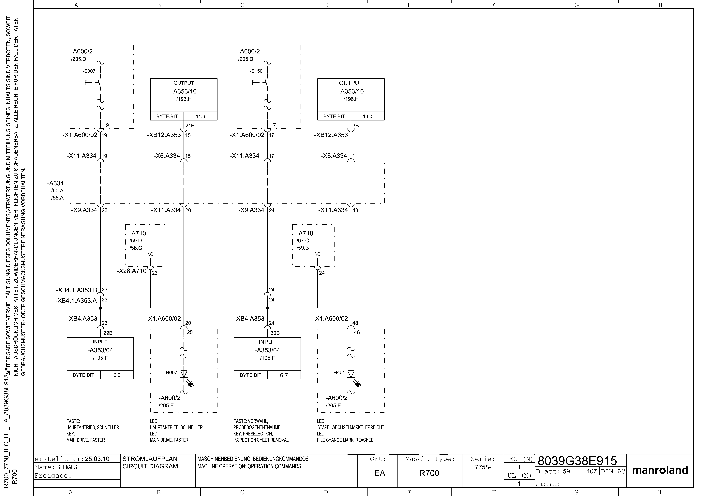

# +EA — Sheet 59 of 407 — MASCHINENBEDIENUNG: BEDIENUNGKOMMANDOS

**MACHINE OPERATION: OPERATION COMMANDS**

> Part of the manroland **R700** printing press IEC/UL circuit diagrams.
> Drawing class: **Stromlaufplan / Circuit diagram** (DIN A3).
> Document `+EA` covers the **Printing unit** machine section.

## At a glance

| Field | Value |
|---|---|
| Document | `+EA`  (8039G38E915) |
| Sheet | **59** of 407 |
| Section (DE) | MASCHINENBEDIENUNG: BEDIENUNGKOMMANDOS |
| Section (EN) | MACHINE OPERATION: OPERATION COMMANDS |
| Section type | CIRCUIT — Circuit diagram |
| Machine type | `R700` |
| Series | `7758` |
| Created | 25.03.10 |
| Replaces | — |
| Columns used | A, B, C, D |
| Path numbers | — |
| Labels on sheet | 108 |
| Cross-refs out | 14 |
| Cross-refs in | 36 |

**Previous:** [+EA sheet 58](SHEET_0058.md) · **Next:** [+EA sheet 60](SHEET_0060.md) · **Document TOC:** [_TOC.md](_TOC.md)  (+EA) · **Master TOC:** [all sheets](../_MASTER_TOC.md)

## Sheet image (300 DPI, exact vector render)



_Rendered directly from the PDF vector layer at 300 DPI (1-bit), no OCR and no resampling. Use it to confirm anything ambiguous in the text below._

## Cross-references on this sheet

Each entry is a wire leaving this sheet. The printed token is `/sheet.column`; the link resolves to that sheet inside the same document.

| Ref | Target sheet | Col | Path | Destination on target | Target section | From col |
|---|---|---|---|---|---|---|
| `/205.D` | [+EA sheet 205](SHEET_0205.md) | D | — | A600/2 | REFERENZMODUL | A |
| `/205.D` | [+EA sheet 205](SHEET_0205.md) | D | — | A600/2 | REFERENZMODUL | C |
| `/196.H` | [+EA sheet 196](SHEET_0196.md) | H | — | — | REFERENZMODUL | B |
| `/196.H` | [+EA sheet 196](SHEET_0196.md) | H | — | — | REFERENZMODUL | D |
| `/60.A` | [+EA sheet 60](SHEET_0060.md) | A | — | — | MASCHINENBEDIENUNG: BEDIENUNGKOMMANDOS | A |
| `/58.A` | [+EA sheet 58](SHEET_0058.md) | A | — | — | MASCHINENBEDIENUNG: BEDIENUNGKOMMANDOS | A |
| `/59.D` | [+EA sheet 59](SHEET_0059.md) | D | — | A710 | MASCHINENBEDIENUNG: BEDIENUNGKOMMANDOS | B |
| `/58.G` | [+EA sheet 58](SHEET_0058.md) | G | — | A710 | MASCHINENBEDIENUNG: BEDIENUNGKOMMANDOS | B |
| `/67.C` | [+EA sheet 67](SHEET_0067.md) | C | — | A710 | LEITSTANDSFUNKTIONEN | D |
| `/59.B` | [+EA sheet 59](SHEET_0059.md) | B | — | A710 | MASCHINENBEDIENUNG: BEDIENUNGKOMMANDOS | D |
| `/195.F` | [+EA sheet 195](SHEET_0195.md) | F | — | — | REFERENZMODUL | A |
| `/195.F` | [+EA sheet 195](SHEET_0195.md) | F | — | — | REFERENZMODUL | C |
| `/205.E` | [+EA sheet 205](SHEET_0205.md) | E | — | A600/2 | REFERENZMODUL | B |
| `/205.E` | [+EA sheet 205](SHEET_0205.md) | E | — | A600/2 | REFERENZMODUL | D |

### Incoming references (sheets that point here)

Every other sheet that sends a wire to this one. `Back-ref` is the token printed on *that* sheet; `Path` is its line number.

| From sheet | Cols | Back-ref | Path | Refs | What continues there |
|---|---|---|---|---|---|
| [+EA#58](SHEET_0058.md) | A, G | `/58.A`, `/58.G` | — | 2 | A710 |
| [+EA#59](SHEET_0059.md) | B, D | `/59.B`, `/59.D` | — | 2 | A710 |
| [+EA#60](SHEET_0060.md) | A | `/60.A` | — | 1 | — |
| [+EA#67](SHEET_0067.md) | B | `/67.B` | — | 1 | — |
| [+EA#195](SHEET_0195.md) | F | `/195.F` | — | 2 | — |
| [+EA#196](SHEET_0196.md) | H | `/196.H` | — | 2 | — |
| [+EA#205](SHEET_0205.md) | D, E | `/205.D`, `/205.E` | — | 4 | — |
| [+EA#212](SHEET_0212.md) | G, H | `/212.G`, `/212.H` | — | 4 | — |
| [+EA#237](SHEET_0237.md) | A, B, C | `/237.A`, `/237.B`, `/237.C` | — | 6 | — |
| [+EA#244](SHEET_0244.md) | F | `/244.F` | — | 2 | — |
| [+EA#252](SHEET_0252.md) | A | `/252.A` | — | 2 | — |
| [+EA#255](SHEET_0255.md) | G, H | `/255.G`, `/255.H` | — | 4 | — |
| [+EA#257](SHEET_0257.md) | C | `/257.C` | — | 2 | — |
| [+EA#270](SHEET_0270.md) | C | `/270.C` | — | 2 | — |


## Devices on this sheet

| Tag | Class | Class meaning (IEC) | Col | Sub | Terminal | Sign |
|---|---|---|---|---|---|---|
| `S150` | S | Schalter / switch | C | — | — | — |
| `A600/2` | A | Baugruppe / assembly, module, PC board | C | 2 | — | — |
| `A353/10` | A | Baugruppe / assembly, module, PC board | D | 10 | — | — |
| `S007` | S | Schalter / switch | A | — | — | — |
| `A600/2` | A | Baugruppe / assembly, module, PC board | A | 2 | — | — |
| `A353/10` | A | Baugruppe / assembly, module, PC board | B | 10 | — | — |
| `A353/04` | A | Baugruppe / assembly, module, PC board | C | 04 | — | — |
| `A600/2` | A | Baugruppe / assembly, module, PC board | D | 2 | — | — |
| `A353/04` | A | Baugruppe / assembly, module, PC board | A | 04 | — | — |
| `A600/2` | A | Baugruppe / assembly, module, PC board | B | 2 | — | — |
| `A334` | A | Baugruppe / assembly, module, PC board | A | — | — | — |
| `A710` | A | Baugruppe / assembly, module, PC board | B | — | — | — |
| `A710` | A | Baugruppe / assembly, module, PC board | D | — | — | — |
| `13.0` | — | cross-device reference | D | — | — | — |
| `XB12.A353` | — | cross-device reference | D | — | — | — |
| `14.6` | — | cross-device reference | B | — | — | — |
| `XB12.A353` | — | cross-device reference | B | — | — | — |
| `6.7` | — | cross-device reference | C | — | — | — |
| `XB4.A353` | — | cross-device reference | C | — | — | — |
| `6.6` | — | cross-device reference | A | — | — | — |
| `XB4.A353` | — | cross-device reference | A | — | — | — |
| `X11.A334` | — | cross-device reference | C | — | — | — |
| `X6.A334` | — | cross-device reference | D | — | — | — |
| `X11.A334` | — | cross-device reference | A | — | — | — |
| `X6.A334` | — | cross-device reference | B | — | — | — |
| `X9.A334` | — | cross-device reference | C | — | — | — |
| `X11.A334` | — | cross-device reference | D | — | — | — |
| `X9.A334` | — | cross-device reference | A | — | — | — |
| `X11.A334` | — | cross-device reference | B | — | — | — |
| `XB4.1.A353.B` | — | cross-device reference | A | — | — | — |
| `XB4.1.A353.A` | — | cross-device reference | A | — | — | — |
| `X26.A710` | — | cross-device reference | B | — | — | — |

## Potentials / nets

| Potential | Count | Columns | Attached devices | Terminals |
|---|---|---|---|---|
| `H007` | 1 | B | — | — |
| `H401` | 1 | D | — | — |


A potential such as `L24+/4` or `M24+` is a named supply/return rail; every place it appears on this sheet is electrically common.

## Wire-end annotations (grouped as printed)

A wire that continues elsewhere is annotated with a small cluster: the destination description, the path/line number `#NN`, and the `/sheet.column` cross reference. Each row below is one such cluster exactly as it is grouped on the drawing.

| Col | Y | Path | Cross-ref | Text on the wire |
|---|---|---|---|---|
| A | 82.5 | — | `/205.D` | `A600/2` |
| C | 82.5 | — | `/205.D` | `A600/2` |
| A | 117.0 | — | — | `S007` |
| C | 117.0 | — | — | `S150` |
| D | 136.7 | — | — | `QUTPUT` |
| B | 137.2 | — | — | `QUTPUT` |
| B | 150.5 | — | — | `A353/10` |
| D | 150.5 | — | — | `A353/10` |
| B | 164.3 | — | `/196.H` | — |
| D | 164.3 | — | `/196.H` | — |
| B | 193.9 | — | — | `BYTE.BIT 14.6` |
| D | 193.9 | — | — | `BYTE.BIT 13.0` |
| A | 208.7 | — | — | `19` |
| C | 208.7 | — | — | `17` |
| B | 209.3 | — | — | `21B` |
| D | 209.3 | — | — | `3B` |
| C | 224.2 | — | — | `X1.A600/02 19 XB12.A353 1` |
| B | 224.2 | — | — | `XB12.A353 15` |
| C | 224.2 | — | — | `X1.A600/02 17` |
| B | 259.7 | — | — | `X11.A334 19 X6.A334 15` |
| D | 259.7 | — | — | `X11.A334 17 X6.A334 1` |
| A | 306.4 | — | — | `A334` |
| A | 319.5 | — | `/60.A`, `/58.A` | — |
| C | 351.8 | — | — | `X9.A334 23 X11.A334 20 X9.A334 24 X11.A334 48` |
| B | 391.5 | — | `/59.D`, `/58.G` | `A710` |
| D | 391.5 | — | `/67.C`, `/59.B` | `A710` |
| C | 428.6 | — | — | `NC NC` |
| B | 455.3 | — | — | `X26.A710 23` |
| D | 459.5 | — | — | `24` |
| A | 487.9 | — | — | `XB4.1.A353.B 23` |
| C | 487.9 | — | — | `24` |
| A | 504.9 | — | — | `XB4.1.A353.A 23` |
| C | 504.9 | — | — | `24` |
| A | 536.1 | — | — | `XB4.A353 23` |
| B | 536.1 | — | — | `X1.A600/02 20` |
| C | 536.1 | — | — | `XB4.A353 24` |
| D | 536.1 | — | — | `X1.A600/02 48` |
| B | 560.2 | — | — | `20` |
| D | 560.2 | — | — | `48` |
| A | 561.5 | — | — | `29B` |
| C | 561.5 | — | — | `30B` |
| C | 576.1 | — | — | `INPUT` |
| A | 576.6 | — | — | `INPUT` |
| A | 589.9 | — | — | `A353/04` |
| C | 589.9 | — | — | `A353/04` |
| A | 603.7 | — | `/195.F` | — |
| C | 603.7 | — | `/195.F` | — |
| B | 628.6 | — | — | `H007` |
| D | 628.6 | — | — | `H401` |
| C | 632.7 | — | — | `BYTE.BIT 6.7` |
| A | 633.3 | — | — | `BYTE.BIT 6.6` |
| B | 670.7 | — | `/205.E` | `A600/2` |
| D | 670.7 | — | `/205.E` | `A600/2` |
| B | 712.0 | — | — | `LED: HAUPTANTRIEB, SCHNELLER LED: MAIN DRIVE, FASTER` |
| D | 712.0 | — | — | `LED:` |
| A | 712.1 | — | — | `HAUPTANTRIEB, SCHNELLER KEY: MAIN DRIVE, FASTER TASTE:` |
| C | 712.1 | — | — | `PROBEBOGENENTNAHME KEY: PRESELECTION, INSPECTION SHEET REMOVAL TASTE: VORWAHL,` |
| D | 722.8 | — | — | `LED: PILE CHANGE MARK, REACHED STAPELWECHSELMARKE, ERREICHT` |


## Reconstructed tables

This sheet carries tabular content (pin map / terminal assignment / index). The grid below was rebuilt from the drawing's own rule lines, so each row is exactly one physical row of the table.

### Table 1 — 7 data rows × 5 columns (at x=113.4, y=76.5) — **A600/2 /205.D S007 QUTPUT A353/10 /196.H**

|  |  |  | BYTE.BIT | 14.6 |
|---|---|---|---|---|
|  | `19` |  |  | `21B` |
| `X1.A600/02 X11.A334 X9.A334 XB4.1.A353.B XB4.1.A353.A` | `19 19 23 X26.A710 23 23` | `A710 /59.D /58.G NC` | `XB12.A353 X6.A334 X11.A334 23` | `15 15 20` |
| `XB4.A353` | `23` |  | `X1.A600/02` | `20` |
|  | `29B` |  |  | `20` |
| `INPUT` | `A353/04 /195.F` |  |  |  |
| `BYTE.BIT` | `6.6` |  | `H007` |  |
|  |  |  | `A600/2 /205.E` |  |


### Table 2 — 8 data rows × 5 columns (at x=396.9, y=76.5) — **A600/2 /205.D S150**

|  |  |  | QUTPUT | A353/10 /196.H |
|---|---|---|---|---|
|  |  |  | `BYTE.BIT` | `13.0` |
|  | `17` |  |  | `3B` |
| `X1.A600/02 X11.A334 X9.A334` | `17 17 24 24 24` | `A710 /67.C /59.B NC` | `XB12.A353 X6.A334 X11.A334 24` | `1 1 48` |
| `XB4.A353` | `24` |  | `X1.A600/02` | `48` |
|  | `30B` |  |  | `48` |
| `INPUT` | `A353/04 /195.F` |  |  |  |
| `BYTE.BIT` | `6.7` |  | `H401` |  |
|  |  |  | `A600/2 /205.E` |  |


## Notes and free text on this sheet

| Text | Col | Y (pt) |
|---|---|---|
| `X1.A600/02` | C | 224.25 |
| `3B` | D | 209.32 |
| `QUTPUT` | D | 136.68 |
| `BYTE.BIT` | D | 193.95 |
| `X1.A600/02` | A | 224.25 |
| `21B` | B | 209.34 |
| `QUTPUT` | B | 137.19 |
| `BYTE.BIT` | B | 193.95 |
| `30B` | C | 561.55 |
| `INPUT` | C | 576.07 |
| `BYTE.BIT` | C | 633.32 |
| `TASTE: VORWAHL,` | C | 712.07 |
| `PROBEBOGENENTNAHME` | C | 722.76 |
| `KEY: PRESELECTION,` | C | 733.36 |
| `INSPECTION SHEET REMOVAL` | C | 744.02 |
| `LED:` | D | 712.03 |
| `STAPELWECHSELMARKE, ERREICHT` | D | 722.75 |
| `PILE CHANGE MARK, REACHED` | D | 744.02 |
| `X1.A600/02` | D | 536.06 |
| `29B` | A | 561.55 |
| `INPUT` | A | 576.63 |
| `BYTE.BIT` | A | 633.32 |
| `TASTE:` | A | 712.06 |
| `HAUPTANTRIEB, SCHNELLER` | A | 722.76 |
| `KEY:` | A | 733.25 |
| `MAIN DRIVE, FASTER` | A | 744.01 |
| `LED:` | B | 712.03 |
| `HAUPTANTRIEB, SCHNELLER` | B | 722.76 |
| `MAIN DRIVE, FASTER` | B | 744.01 |
| `X1.A600/02` | B | 536.06 |
| `NC` | B | 428.62 |
| `NC` | D | 428.62 |

## Complete label inventory (exact text from the drawing)

Every text object inside the drawing area of this sheet, in DIN reading order (column A→H, then top→bottom). This is the authoritative list: if a string is not here it is not printed on this sheet.

| Col | Y | X | Dir | Type | Text |
|---|---|---|---|---|---|
| A | 82.5 | 120.2 | → | device tag | `A600/2` |
| A | 96.3 | 120.5 | → | cross-reference | `/205.D` |
| A | 117.0 | 140.0 | → | device tag | `S007` |
| A | 208.7 | 174.9 | → | number | `19` |
| A | 224.2 | 106.0 | → | text | `X1.A600/02` |
| A | 225.7 | 172.1 | → | number | `19` |
| A | 259.7 | 113.4 | → | device ref | `X11.A334` |
| A | 261.1 | 172.1 | → | number | `19` |
| A | 306.4 | 79.9 | → | device tag | `A334` |
| A | 319.5 | 87.0 | → | cross-reference | `/60.A` |
| A | 331.9 | 87.0 | → | cross-reference | `/58.A` |
| A | 351.8 | 120.8 | → | device ref | `X9.A334` |
| A | 353.2 | 172.6 | → | number | `23` |
| A | 487.9 | 95.0 | → | device ref | `XB4.1.A353.B` |
| A | 487.9 | 172.6 | → | number | `23` |
| A | 504.9 | 172.6 | → | number | `23` |
| A | 505.6 | 94.1 | → | device ref | `XB4.1.A353.A` |
| A | 536.1 | 113.7 | → | device ref | `XB4.A353` |
| A | 544.6 | 172.6 | → | number | `23` |
| A | 561.5 | 175.5 | → | text | `29B` |
| A | 576.6 | 157.6 | → | text | `INPUT` |
| A | 589.9 | 148.7 | → | device tag | `A353/04` |
| A | 603.7 | 157.7 | → | cross-reference | `/195.F` |
| A | 633.3 | 123.3 | → | text | `BYTE.BIT` |
| A | 633.3 | 192.8 | → | device ref | `6.6` |
| A | 712.1 | 113.1 | → | text | `TASTE:` |
| A | 722.8 | 112.5 | → | text | `HAUPTANTRIEB, SCHNELLER` |
| A | 733.2 | 112.5 | → | text | `KEY:` |
| A | 744.0 | 112.8 | → | text | `MAIN DRIVE, FASTER` |
| B | 137.2 | 294.5 | → | text | `QUTPUT` |
| B | 150.5 | 290.4 | → | device tag | `A353/10` |
| B | 164.3 | 299.3 | → | cross-reference | `/196.H` |
| B | 194.0 | 265.0 | → | text | `BYTE.BIT` |
| B | 194.0 | 331.9 | → | device ref | `14.6` |
| B | 209.3 | 314.4 | → | text | `21B` |
| B | 224.2 | 249.4 | → | device ref | `XB12.A353` |
| B | 225.7 | 313.8 | → | number | `15` |
| B | 259.7 | 261.1 | → | device ref | `X6.A334` |
| B | 261.1 | 313.8 | → | number | `15` |
| B | 351.8 | 256.5 | → | device ref | `X11.A334` |
| B | 353.2 | 314.4 | → | number | `20` |
| B | 391.5 | 219.4 | → | device tag | `A710` |
| B | 404.6 | 219.7 | → | cross-reference | `/59.D` |
| B | 417.0 | 219.7 | → | cross-reference | `/58.G` |
| B | 428.6 | 250.2 | → | text | `NC` |
| B | 455.3 | 198.4 | → | device ref | `X26.A710` |
| B | 459.5 | 257.7 | → | number | `23` |
| B | 536.1 | 247.7 | → | text | `X1.A600/02` |
| B | 544.6 | 314.4 | → | number | `20` |
| B | 560.2 | 317.2 | → | number | `20` |
| B | 628.6 | 278.4 | → | potential | `H007` |
| B | 670.7 | 269.0 | → | device tag | `A600/2` |
| B | 684.5 | 269.3 | → | cross-reference | `/205.E` |
| B | 712.0 | 254.3 | → | text | `LED:` |
| B | 722.8 | 254.3 | → | text | `HAUPTANTRIEB, SCHNELLER` |
| B | 733.3 | 254.3 | → | text | `LED:` |
| B | 744.0 | 254.6 | → | text | `MAIN DRIVE, FASTER` |
| C | 82.5 | 403.7 | → | device tag | `A600/2` |
| C | 96.3 | 403.9 | → | cross-reference | `/205.D` |
| C | 117.0 | 423.5 | → | device tag | `S150` |
| C | 208.7 | 458.4 | → | number | `17` |
| C | 224.2 | 389.5 | → | text | `X1.A600/02` |
| C | 225.7 | 455.5 | → | number | `17` |
| C | 259.7 | 389.8 | → | device ref | `X11.A334` |
| C | 261.1 | 455.5 | → | number | `17` |
| C | 351.8 | 404.2 | → | device ref | `X9.A334` |
| C | 353.2 | 456.1 | → | number | `24` |
| C | 487.9 | 456.1 | → | number | `24` |
| C | 504.9 | 456.1 | → | number | `24` |
| C | 536.1 | 397.1 | → | device ref | `XB4.A353` |
| C | 544.6 | 456.1 | → | number | `24` |
| C | 561.5 | 458.9 | → | text | `30B` |
| C | 576.1 | 438.7 | → | text | `INPUT` |
| C | 589.9 | 432.1 | → | device tag | `A353/04` |
| C | 603.7 | 441.2 | → | cross-reference | `/195.F` |
| C | 632.7 | 475.1 | → | device ref | `6.7` |
| C | 633.3 | 406.8 | → | text | `BYTE.BIT` |
| C | 712.1 | 396.6 | → | text | `TASTE: VORWAHL,` |
| C | 722.8 | 396.0 | → | text | `PROBEBOGENENTNAHME` |
| C | 733.4 | 396.0 | → | text | `KEY: PRESELECTION,` |
| C | 744.0 | 396.0 | → | text | `INSPECTION SHEET REMOVAL` |
| D | 136.7 | 575.0 | → | text | `QUTPUT` |
| D | 150.5 | 573.9 | → | device tag | `A353/10` |
| D | 164.3 | 582.8 | → | cross-reference | `/196.H` |
| D | 194.0 | 548.5 | → | text | `BYTE.BIT` |
| D | 194.0 | 615.4 | → | device ref | `13.0` |
| D | 209.3 | 597.8 | → | text | `3B` |
| D | 224.2 | 532.9 | → | device ref | `XB12.A353` |
| D | 225.7 | 597.3 | → | number | `1` |
| D | 259.7 | 544.5 | → | device ref | `X6.A334` |
| D | 261.1 | 597.3 | → | number | `1` |
| D | 351.8 | 540.0 | → | device ref | `X11.A334` |
| D | 353.2 | 597.8 | → | number | `48` |
| D | 391.5 | 502.9 | → | device tag | `A710` |
| D | 404.6 | 503.1 | → | cross-reference | `/67.C` |
| D | 416.9 | 503.1 | → | cross-reference | `/59.B` |
| D | 428.6 | 533.7 | → | text | `NC` |
| D | 459.5 | 541.1 | → | number | `24` |
| D | 536.1 | 531.2 | → | text | `X1.A600/02` |
| D | 544.6 | 597.8 | → | number | `48` |
| D | 560.2 | 600.7 | → | number | `48` |
| D | 628.6 | 563.0 | → | potential | `H401` |
| D | 670.7 | 552.5 | → | device tag | `A600/2` |
| D | 684.5 | 552.8 | → | cross-reference | `/205.E` |
| D | 712.0 | 537.7 | → | text | `LED:` |
| D | 722.7 | 538.3 | → | text | `STAPELWECHSELMARKE, ERREICHT` |
| D | 733.3 | 537.7 | → | text | `LED:` |
| D | 744.0 | 537.7 | → | text | `PILE CHANGE MARK, REACHED` |

## Reading-order text block

The same content as a plain block, grouped by DIN column — convenient to paste or to match against a visual description.

```text
=== Column A ===
  82.5  120.2  devtag       A600/2
  96.3  120.5  xref         /205.D
 117.0  140.0  devtag       S007
 208.7  174.9  numeric      19
 224.2  106.0  text         X1.A600/02
 225.7  172.1  numeric      19
 259.7  113.4  devref       X11.A334
 261.1  172.1  numeric      19
 306.4   79.9  devtag       A334
 319.5   87.0  xref         /60.A
 331.9   87.0  xref         /58.A
 351.8  120.8  devref       X9.A334
 353.2  172.6  numeric      23
 487.9   95.0  devref       XB4.1.A353.B
 487.9  172.6  numeric      23
 504.9  172.6  numeric      23
 505.6   94.1  devref       XB4.1.A353.A
 536.1  113.7  devref       XB4.A353
 544.6  172.6  numeric      23
 561.5  175.5  text         29B
 576.6  157.6  text         INPUT
 589.9  148.7  devtag       A353/04
 603.7  157.7  xref         /195.F
 633.3  123.3  text         BYTE.BIT
 633.3  192.8  devref       6.6
 712.1  113.1  text         TASTE:
 722.8  112.5  text         HAUPTANTRIEB, SCHNELLER
 733.2  112.5  text         KEY:
 744.0  112.8  text         MAIN DRIVE, FASTER
=== Column B ===
 137.2  294.5  text         QUTPUT
 150.5  290.4  devtag       A353/10
 164.3  299.3  xref         /196.H
 194.0  265.0  text         BYTE.BIT
 194.0  331.9  devref       14.6
 209.3  314.4  text         21B
 224.2  249.4  devref       XB12.A353
 225.7  313.8  numeric      15
 259.7  261.1  devref       X6.A334
 261.1  313.8  numeric      15
 351.8  256.5  devref       X11.A334
 353.2  314.4  numeric      20
 391.5  219.4  devtag       A710
 404.6  219.7  xref         /59.D
 417.0  219.7  xref         /58.G
 428.6  250.2  text         NC
 455.3  198.4  devref       X26.A710
 459.5  257.7  numeric      23
 536.1  247.7  text         X1.A600/02
 544.6  314.4  numeric      20
 560.2  317.2  numeric      20
 628.6  278.4  net          H007
 670.7  269.0  devtag       A600/2
 684.5  269.3  xref         /205.E
 712.0  254.3  text         LED:
 722.8  254.3  text         HAUPTANTRIEB, SCHNELLER
 733.3  254.3  text         LED:
 744.0  254.6  text         MAIN DRIVE, FASTER
=== Column C ===
  82.5  403.7  devtag       A600/2
  96.3  403.9  xref         /205.D
 117.0  423.5  devtag       S150
 208.7  458.4  numeric      17
 224.2  389.5  text         X1.A600/02
 225.7  455.5  numeric      17
 259.7  389.8  devref       X11.A334
 261.1  455.5  numeric      17
 351.8  404.2  devref       X9.A334
 353.2  456.1  numeric      24
 487.9  456.1  numeric      24
 504.9  456.1  numeric      24
 536.1  397.1  devref       XB4.A353
 544.6  456.1  numeric      24
 561.5  458.9  text         30B
 576.1  438.7  text         INPUT
 589.9  432.1  devtag       A353/04
 603.7  441.2  xref         /195.F
 632.7  475.1  devref       6.7
 633.3  406.8  text         BYTE.BIT
 712.1  396.6  text         TASTE: VORWAHL,
 722.8  396.0  text         PROBEBOGENENTNAHME
 733.4  396.0  text         KEY: PRESELECTION,
 744.0  396.0  text         INSPECTION SHEET REMOVAL
=== Column D ===
 136.7  575.0  text         QUTPUT
 150.5  573.9  devtag       A353/10
 164.3  582.8  xref         /196.H
 194.0  548.5  text         BYTE.BIT
 194.0  615.4  devref       13.0
 209.3  597.8  text         3B
 224.2  532.9  devref       XB12.A353
 225.7  597.3  numeric      1
 259.7  544.5  devref       X6.A334
 261.1  597.3  numeric      1
 351.8  540.0  devref       X11.A334
 353.2  597.8  numeric      48
 391.5  502.9  devtag       A710
 404.6  503.1  xref         /67.C
 416.9  503.1  xref         /59.B
 428.6  533.7  text         NC
 459.5  541.1  numeric      24
 536.1  531.2  text         X1.A600/02
 544.6  597.8  numeric      48
 560.2  600.7  numeric      48
 628.6  563.0  net          H401
 670.7  552.5  devtag       A600/2
 684.5  552.8  xref         /205.E
 712.0  537.7  text         LED:
 722.7  538.3  text         STAPELWECHSELMARKE, ERREICHT
 733.3  537.7  text         LED:
 744.0  537.7  text         PILE CHANGE MARK, REACHED
```

---
_Generated from the PDF vector text layer; no OCR. Source: `R700_7758_IEC_UL_EA_8039G38E915_p`, sheet 59._
