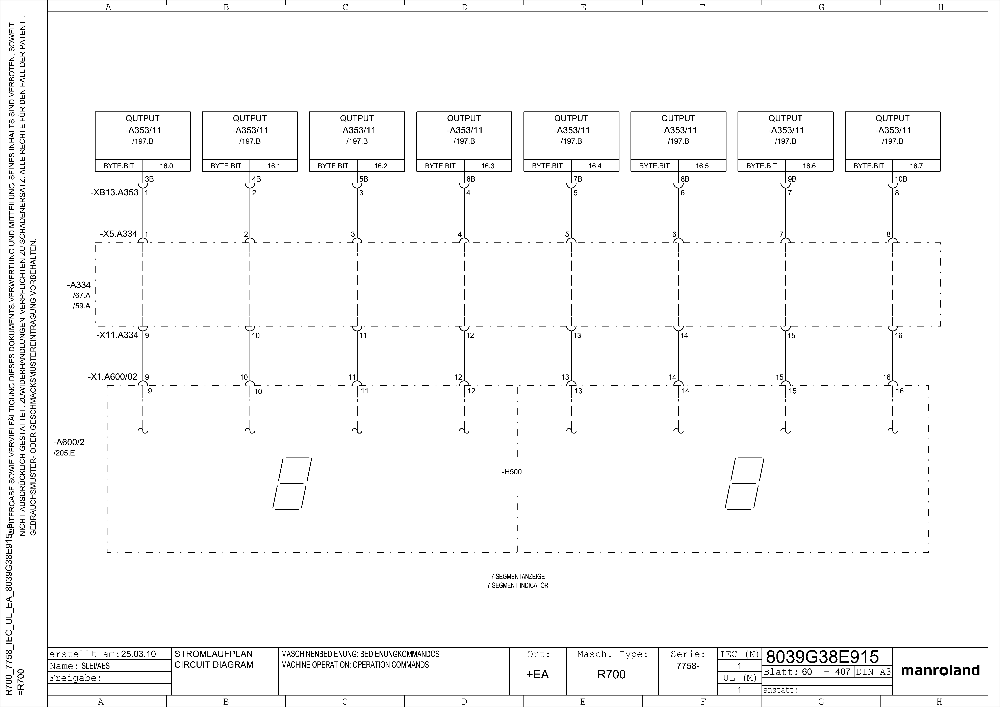

# +EA — Sheet 60 of 407 — MASCHINENBEDIENUNG: BEDIENUNGKOMMANDOS

**MACHINE OPERATION: OPERATION COMMANDS**

> Part of the manroland **R700** printing press IEC/UL circuit diagrams.
> Drawing class: **Stromlaufplan / Circuit diagram** (DIN A3).
> Document `+EA` covers the **Printing unit** machine section.

## At a glance

| Field | Value |
|---|---|
| Document | `+EA`  (8039G38E915) |
| Sheet | **60** of 407 |
| Section (DE) | MASCHINENBEDIENUNG: BEDIENUNGKOMMANDOS |
| Section (EN) | MACHINE OPERATION: OPERATION COMMANDS |
| Section type | CIRCUIT — Circuit diagram |
| Machine type | `R700` |
| Series | `7758` |
| Created | 25.03.10 |
| Replaces | — |
| Columns used | A, B, C, D, E, F, G, H |
| Path numbers | — |
| Labels on sheet | 100 |
| Cross-refs out | 11 |
| Cross-refs in | 43 |

**Previous:** [+EA sheet 59](SHEET_0059.md) · **Next:** [+EA sheet 61](SHEET_0061.md) · **Document TOC:** [_TOC.md](_TOC.md)  (+EA) · **Master TOC:** [all sheets](../_MASTER_TOC.md)

## Sheet image (300 DPI, exact vector render)



_Rendered directly from the PDF vector layer at 300 DPI (1-bit), no OCR and no resampling. Use it to confirm anything ambiguous in the text below._

## Cross-references on this sheet

Each entry is a wire leaving this sheet. The printed token is `/sheet.column`; the link resolves to that sheet inside the same document.

| Ref | Target sheet | Col | Path | Destination on target | Target section | From col |
|---|---|---|---|---|---|---|
| `/197.B` | [+EA sheet 197](SHEET_0197.md) | B | — | — | REFERENZMODUL | A |
| `/197.B` | [+EA sheet 197](SHEET_0197.md) | B | — | — | REFERENZMODUL | B |
| `/197.B` | [+EA sheet 197](SHEET_0197.md) | B | — | — | REFERENZMODUL | C |
| `/197.B` | [+EA sheet 197](SHEET_0197.md) | B | — | — | REFERENZMODUL | D |
| `/197.B` | [+EA sheet 197](SHEET_0197.md) | B | — | — | REFERENZMODUL | E |
| `/197.B` | [+EA sheet 197](SHEET_0197.md) | B | — | — | REFERENZMODUL | F |
| `/197.B` | [+EA sheet 197](SHEET_0197.md) | B | — | — | REFERENZMODUL | G |
| `/197.B` | [+EA sheet 197](SHEET_0197.md) | B | — | — | REFERENZMODUL | H |
| `/67.A` | [+EA sheet 67](SHEET_0067.md) | A | — | — | LEITSTANDSFUNKTIONEN | A |
| `/59.A` | [+EA sheet 59](SHEET_0059.md) | A | — | — | MASCHINENBEDIENUNG: BEDIENUNGKOMMANDOS | A |
| `/205.E` | [+EA sheet 205](SHEET_0205.md) | E | — | A600/2 | REFERENZMODUL | A |

### Incoming references (sheets that point here)

Every other sheet that sends a wire to this one. `Back-ref` is the token printed on *that* sheet; `Path` is its line number.

| From sheet | Cols | Back-ref | Path | Refs | What continues there |
|---|---|---|---|---|---|
| [+EA#59](SHEET_0059.md) | A | `/59.A` | — | 1 | — |
| [+EA#67](SHEET_0067.md) | A | `/67.A` | — | 1 | — |
| [+EA#197](SHEET_0197.md) | B | `/197.B` | — | 8 | — |
| [+EA#205](SHEET_0205.md) | E | `/205.E` | — | 1 | — |
| [+EA#212](SHEET_0212.md) | G | `/212.G` | — | 8 | — |
| [+EA#240](SHEET_0240.md) | B | `/240.B` | — | 8 | — |
| [+EA#255](SHEET_0255.md) | G | `/255.G` | — | 8 | — |
| [+EA#258](SHEET_0258.md) | E | `/258.E` | — | 8 | — |


## Devices on this sheet

| Tag | Class | Class meaning (IEC) | Col | Sub | Terminal | Sign |
|---|---|---|---|---|---|---|
| `A334` | A | Baugruppe / assembly, module, PC board | A | — | — | — |
| `A353/11` | A | Baugruppe / assembly, module, PC board | A | 11 | — | — |
| `A353/11` | A | Baugruppe / assembly, module, PC board | B | 11 | — | — |
| `A353/11` | A | Baugruppe / assembly, module, PC board | C | 11 | — | — |
| `A353/11` | A | Baugruppe / assembly, module, PC board | D | 11 | — | — |
| `A353/11` | A | Baugruppe / assembly, module, PC board | E | 11 | — | — |
| `A353/11` | A | Baugruppe / assembly, module, PC board | F | 11 | — | — |
| `A353/11` | A | Baugruppe / assembly, module, PC board | G | 11 | — | — |
| `A353/11` | A | Baugruppe / assembly, module, PC board | H | 11 | — | — |
| `A600/2` | A | Baugruppe / assembly, module, PC board | A | 2 | — | — |
| `X11.A334` | — | cross-device reference | A | — | — | — |
| `16.0` | — | cross-device reference | A | — | — | — |
| `16.1` | — | cross-device reference | B | — | — | — |
| `16.2` | — | cross-device reference | C | — | — | — |
| `16.3` | — | cross-device reference | D | — | — | — |
| `16.4` | — | cross-device reference | E | — | — | — |
| `16.5` | — | cross-device reference | F | — | — | — |
| `16.6` | — | cross-device reference | G | — | — | — |
| `16.7` | — | cross-device reference | H | — | — | — |
| `XB13.A353` | — | cross-device reference | A | — | — | — |
| `X5.A334` | — | cross-device reference | A | — | — | — |

## Potentials / nets

| Potential | Count | Columns | Attached devices | Terminals |
|---|---|---|---|---|
| `H500` | 1 | D | — | — |


A potential such as `L24+/4` or `M24+` is a named supply/return rail; every place it appears on this sheet is electrically common.

## Wire-end annotations (grouped as printed)

A wire that continues elsewhere is annotated with a small cluster: the destination description, the path/line number `#NN`, and the `/sheet.column` cross reference. Each row below is one such cluster exactly as it is grouped on the drawing.

| Col | Y | Path | Cross-ref | Text on the wire |
|---|---|---|---|---|
| A | 136.7 | — | — | `QUTPUT` |
| B | 136.7 | — | — | `QUTPUT` |
| C | 136.7 | — | — | `QUTPUT` |
| D | 136.7 | — | — | `QUTPUT` |
| E | 136.7 | — | — | `QUTPUT` |
| F | 136.7 | — | — | `QUTPUT` |
| G | 136.7 | — | — | `QUTPUT` |
| H | 136.7 | — | — | `QUTPUT` |
| A | 150.5 | — | — | `A353/11` |
| B | 150.5 | — | — | `A353/11` |
| C | 150.5 | — | — | `A353/11` |
| D | 150.5 | — | — | `A353/11` |
| E | 150.5 | — | — | `A353/11` |
| F | 150.5 | — | — | `A353/11` |
| G | 150.5 | — | — | `A353/11` |
| H | 150.5 | — | — | `A353/11` |
| A | 164.3 | — | `/197.B` | — |
| B | 164.3 | — | `/197.B` | — |
| C | 164.3 | — | `/197.B` | — |
| D | 164.3 | — | `/197.B` | — |
| E | 164.3 | — | `/197.B` | — |
| F | 164.3 | — | `/197.B` | — |
| G | 164.3 | — | `/197.B` | — |
| H | 164.3 | — | `/197.B` | — |
| A | 193.9 | — | — | `BYTE.BIT 16.0` |
| B | 193.9 | — | — | `BYTE.BIT 16.1` |
| C | 193.9 | — | — | `BYTE.BIT 16.2` |
| D | 193.9 | — | — | `BYTE.BIT 16.3` |
| E | 193.9 | — | — | `BYTE.BIT 16.4` |
| F | 193.9 | — | — | `BYTE.BIT 16.5` |
| G | 193.9 | — | — | `BYTE.BIT 16.6` |
| H | 193.9 | — | — | `BYTE.BIT 16.7` |
| A | 209.3 | — | — | `3B` |
| B | 209.3 | — | — | `4B` |
| C | 209.3 | — | — | `5B` |
| D | 209.3 | — | — | `6B` |
| E | 209.3 | — | — | `7B` |
| F | 209.3 | — | — | `8B` |
| G | 209.3 | — | — | `9B` |
| H | 209.3 | — | — | `10B` |
| D | 224.2 | — | — | `XB13.A353 1 2 3 4 5 6 7 8` |
| A | 273.9 | — | — | `X5.A334 1` |
| E | 275.3 | — | — | `2 3 4 5 6 7 8` |
| A | 334.8 | — | — | `A334` |
| A | 347.9 | — | `/67.A`, `/59.A` | — |
| D | 394.3 | — | — | `X11.A334 9 10 11 12 13 14 15 16` |
| A | 443.9 | — | — | `X1.A600/02 9` |
| E | 445.4 | — | — | `10 11 12 13 14 15 16` |
| E | 461.7 | — | — | `9 10 11 12 13 14 15 16` |
| A | 521.9 | — | `/205.E` | `A600/2` |
| D | 558.0 | — | — | `H500` |
| D | 683.8 | — | — | `7 SEGMENT INDICATOR 7 SEGMENTANZEIGE` |


## Reconstructed tables

This sheet carries tabular content (pin map / terminal assignment / index). The grid below was rebuilt from the drawing's own rule lines, so each row is exactly one physical row of the table.

### Table 1 — 1 data rows × 2 columns (at x=113.4, y=133.2)

| QUTPUT | A353/11 /197.B |
|---|---|
| `BYTE.BIT` | `16.0` |


### Table 2 — 1 data rows × 2 columns (at x=240.9, y=133.2)

| QUTPUT | A353/11 /197.B |
|---|---|
| `BYTE.BIT` | `16.1` |


### Table 3 — 1 data rows × 2 columns (at x=368.5, y=133.2)

| QUTPUT | A353/11 /197.B |
|---|---|
| `BYTE.BIT` | `16.2` |


### Table 4 — 1 data rows × 2 columns (at x=496.1, y=133.2)

| QUTPUT | A353/11 /197.B |
|---|---|
| `BYTE.BIT` | `16.3` |


### Table 5 — 1 data rows × 2 columns (at x=623.6, y=133.2)

| QUTPUT | A353/11 /197.B |
|---|---|
| `BYTE.BIT` | `16.4` |


### Table 6 — 1 data rows × 2 columns (at x=751.2, y=133.2)

| QUTPUT | A353/11 /197.B |
|---|---|
| `BYTE.BIT` | `16.5` |


### Table 7 — 1 data rows × 2 columns (at x=878.7, y=133.2)

| QUTPUT | A353/11 /197.B |
|---|---|
| `BYTE.BIT` | `16.6` |


### Table 8 — 1 data rows × 2 columns (at x=1006.3, y=133.2)

| QUTPUT | A353/11 /197.B |
|---|---|
| `BYTE.BIT` | `16.7` |


## Notes and free text on this sheet

| Text | Col | Y (pt) |
|---|---|---|
| `3B` | A | 209.32 |
| `QUTPUT` | A | 136.68 |
| `BYTE.BIT` | A | 193.95 |
| `4B` | B | 209.32 |
| `QUTPUT` | B | 136.68 |
| `BYTE.BIT` | B | 193.95 |
| `5B` | C | 209.32 |
| `QUTPUT` | C | 136.68 |
| `BYTE.BIT` | C | 193.95 |
| `6B` | D | 209.32 |
| `QUTPUT` | D | 136.68 |
| `BYTE.BIT` | D | 193.95 |
| `7B` | E | 209.32 |
| `QUTPUT` | E | 136.68 |
| `BYTE.BIT` | E | 193.95 |
| `8B` | F | 209.32 |
| `QUTPUT` | F | 136.68 |
| `BYTE.BIT` | F | 193.95 |
| `9B` | G | 209.32 |
| `QUTPUT` | G | 136.68 |
| `10B` | H | 209.34 |
| `QUTPUT` | H | 136.68 |
| `BYTE.BIT` | G | 193.95 |
| `7 SEGMENTANZEIGE` | D | 683.78 |
| `7 SEGMENT INDICATOR` | D | 694.43 |
| `X1.A600/02` | A | 443.93 |

## Complete label inventory (exact text from the drawing)

Every text object inside the drawing area of this sheet, in DIN reading order (column A→H, then top→bottom). This is the authoritative list: if a string is not here it is not printed on this sheet.

| Col | Y | X | Dir | Type | Text |
|---|---|---|---|---|---|
| A | 136.7 | 149.8 | → | text | `QUTPUT` |
| A | 150.5 | 149.4 | → | device tag | `A353/11` |
| A | 164.3 | 157.5 | → | cross-reference | `/197.B` |
| A | 194.0 | 123.3 | → | text | `BYTE.BIT` |
| A | 194.0 | 190.2 | → | device ref | `16.0` |
| A | 209.3 | 172.6 | → | text | `3B` |
| A | 224.2 | 107.7 | → | device ref | `XB13.A353` |
| A | 225.7 | 172.1 | → | number | `1` |
| A | 273.9 | 119.3 | → | device ref | `X5.A334` |
| A | 275.3 | 172.1 | → | number | `1` |
| A | 334.8 | 79.9 | → | device tag | `A334` |
| A | 347.8 | 87.0 | → | cross-reference | `/67.A` |
| A | 360.2 | 87.0 | → | cross-reference | `/59.A` |
| A | 394.3 | 114.8 | → | device ref | `X11.A334` |
| A | 395.8 | 172.6 | → | number | `9` |
| A | 443.9 | 104.6 | → | text | `X1.A600/02` |
| A | 445.4 | 172.6 | → | number | `9` |
| A | 461.7 | 176.2 | → | number | `9` |
| A | 521.9 | 63.5 | → | device tag | `A600/2` |
| A | 535.7 | 63.8 | → | cross-reference | `/205.E` |
| B | 136.7 | 277.4 | → | text | `QUTPUT` |
| B | 150.5 | 276.9 | → | device tag | `A353/11` |
| B | 164.3 | 285.0 | → | cross-reference | `/197.B` |
| B | 194.0 | 250.9 | → | text | `BYTE.BIT` |
| B | 194.0 | 318.3 | → | device ref | `16.1` |
| B | 209.3 | 300.2 | → | text | `4B` |
| B | 225.7 | 300.2 | → | number | `2` |
| B | 275.3 | 290.6 | → | number | `2` |
| B | 395.8 | 299.6 | → | number | `10` |
| B | 445.4 | 285.4 | → | number | `10` |
| B | 462.4 | 302.5 | → | number | `10` |
| C | 136.7 | 404.9 | → | text | `QUTPUT` |
| C | 150.5 | 404.5 | → | device tag | `A353/11` |
| C | 164.3 | 412.6 | → | cross-reference | `/197.B` |
| C | 194.0 | 378.4 | → | text | `BYTE.BIT` |
| C | 194.0 | 445.5 | → | device ref | `16.2` |
| C | 209.3 | 427.7 | → | text | `5B` |
| C | 225.7 | 427.7 | → | number | `3` |
| C | 275.3 | 417.8 | → | number | `3` |
| C | 395.8 | 427.2 | → | number | `11` |
| C | 445.4 | 414.4 | → | number | `11` |
| C | 461.7 | 429.3 | → | number | `11` |
| D | 136.7 | 532.5 | → | text | `QUTPUT` |
| D | 150.5 | 532.1 | → | device tag | `A353/11` |
| D | 164.3 | 540.1 | → | cross-reference | `/197.B` |
| D | 194.0 | 506.0 | → | text | `BYTE.BIT` |
| D | 194.0 | 572.9 | → | device ref | `16.3` |
| D | 209.3 | 555.3 | → | text | `6B` |
| D | 225.7 | 555.3 | → | number | `4` |
| D | 275.3 | 545.4 | → | number | `4` |
| D | 395.8 | 554.7 | → | number | `12` |
| D | 445.4 | 540.9 | → | number | `12` |
| D | 461.7 | 556.3 | → | number | `12` |
| D | 558.1 | 597.8 | → | potential | `H500` |
| D | 683.8 | 584.7 | → | text | `7 SEGMENTANZEIGE` |
| D | 694.4 | 580.2 | → | text | `7 SEGMENT INDICATOR` |
| E | 136.7 | 660.0 | → | text | `QUTPUT` |
| E | 150.5 | 659.6 | → | device tag | `A353/11` |
| E | 164.3 | 667.7 | → | cross-reference | `/197.B` |
| E | 194.0 | 633.5 | → | text | `BYTE.BIT` |
| E | 194.0 | 700.4 | → | device ref | `16.4` |
| E | 209.3 | 682.9 | → | text | `7B` |
| E | 225.7 | 682.9 | → | number | `5` |
| E | 275.3 | 672.9 | → | number | `5` |
| E | 395.8 | 682.3 | → | number | `13` |
| E | 445.4 | 668.1 | → | number | `13` |
| E | 461.7 | 683.7 | → | number | `13` |
| F | 136.7 | 787.6 | → | text | `QUTPUT` |
| F | 150.5 | 787.2 | → | device tag | `A353/11` |
| F | 164.3 | 795.3 | → | cross-reference | `/197.B` |
| F | 194.0 | 761.1 | → | text | `BYTE.BIT` |
| F | 194.0 | 828.0 | → | device ref | `16.5` |
| F | 194.0 | 888.7 | → | text | `BYTE.BIT` |
| F | 209.3 | 810.4 | → | text | `8B` |
| F | 225.7 | 810.4 | → | number | `6` |
| F | 275.3 | 800.5 | → | number | `6` |
| F | 395.8 | 809.9 | → | number | `14` |
| F | 445.4 | 795.7 | → | number | `14` |
| F | 461.7 | 811.3 | → | number | `14` |
| G | 136.7 | 915.2 | → | text | `QUTPUT` |
| G | 150.5 | 914.7 | → | device tag | `A353/11` |
| G | 164.3 | 922.8 | → | cross-reference | `/197.B` |
| G | 194.0 | 955.6 | → | device ref | `16.6` |
| G | 194.0 | 1016.2 | → | text | `BYTE.BIT` |
| G | 209.3 | 938.0 | → | text | `9B` |
| G | 225.7 | 938.0 | → | number | `7` |
| G | 275.3 | 928.1 | → | number | `7` |
| G | 395.8 | 937.4 | → | number | `15` |
| G | 445.4 | 923.2 | → | number | `15` |
| G | 461.7 | 938.8 | → | number | `15` |
| H | 136.7 | 1042.7 | → | text | `QUTPUT` |
| H | 150.5 | 1042.3 | → | device tag | `A353/11` |
| H | 164.3 | 1050.4 | → | cross-reference | `/197.B` |
| H | 194.0 | 1083.1 | → | device ref | `16.7` |
| H | 209.3 | 1065.0 | → | text | `10B` |
| H | 225.7 | 1065.5 | → | number | `8` |
| H | 275.3 | 1055.6 | → | number | `8` |
| H | 395.8 | 1065.0 | → | number | `16` |
| H | 445.4 | 1050.8 | → | number | `16` |
| H | 461.7 | 1066.4 | → | number | `16` |

## Reading-order text block

The same content as a plain block, grouped by DIN column — convenient to paste or to match against a visual description.

```text
=== Column A ===
 136.7  149.8  text         QUTPUT
 150.5  149.4  devtag       A353/11
 164.3  157.5  xref         /197.B
 194.0  123.3  text         BYTE.BIT
 194.0  190.2  devref       16.0
 209.3  172.6  text         3B
 224.2  107.7  devref       XB13.A353
 225.7  172.1  numeric      1
 273.9  119.3  devref       X5.A334
 275.3  172.1  numeric      1
 334.8   79.9  devtag       A334
 347.8   87.0  xref         /67.A
 360.2   87.0  xref         /59.A
 394.3  114.8  devref       X11.A334
 395.8  172.6  numeric      9
 443.9  104.6  text         X1.A600/02
 445.4  172.6  numeric      9
 461.7  176.2  numeric      9
 521.9   63.5  devtag       A600/2
 535.7   63.8  xref         /205.E
=== Column B ===
 136.7  277.4  text         QUTPUT
 150.5  276.9  devtag       A353/11
 164.3  285.0  xref         /197.B
 194.0  250.9  text         BYTE.BIT
 194.0  318.3  devref       16.1
 209.3  300.2  text         4B
 225.7  300.2  numeric      2
 275.3  290.6  numeric      2
 395.8  299.6  numeric      10
 445.4  285.4  numeric      10
 462.4  302.5  numeric      10
=== Column C ===
 136.7  404.9  text         QUTPUT
 150.5  404.5  devtag       A353/11
 164.3  412.6  xref         /197.B
 194.0  378.4  text         BYTE.BIT
 194.0  445.5  devref       16.2
 209.3  427.7  text         5B
 225.7  427.7  numeric      3
 275.3  417.8  numeric      3
 395.8  427.2  numeric      11
 445.4  414.4  numeric      11
 461.7  429.3  numeric      11
=== Column D ===
 136.7  532.5  text         QUTPUT
 150.5  532.1  devtag       A353/11
 164.3  540.1  xref         /197.B
 194.0  506.0  text         BYTE.BIT
 194.0  572.9  devref       16.3
 209.3  555.3  text         6B
 225.7  555.3  numeric      4
 275.3  545.4  numeric      4
 395.8  554.7  numeric      12
 445.4  540.9  numeric      12
 461.7  556.3  numeric      12
 558.1  597.8  net          H500
 683.8  584.7  text         7 SEGMENTANZEIGE
 694.4  580.2  text         7 SEGMENT INDICATOR
=== Column E ===
 136.7  660.0  text         QUTPUT
 150.5  659.6  devtag       A353/11
 164.3  667.7  xref         /197.B
 194.0  633.5  text         BYTE.BIT
 194.0  700.4  devref       16.4
 209.3  682.9  text         7B
 225.7  682.9  numeric      5
 275.3  672.9  numeric      5
 395.8  682.3  numeric      13
 445.4  668.1  numeric      13
 461.7  683.7  numeric      13
=== Column F ===
 136.7  787.6  text         QUTPUT
 150.5  787.2  devtag       A353/11
 164.3  795.3  xref         /197.B
 194.0  761.1  text         BYTE.BIT
 194.0  828.0  devref       16.5
 194.0  888.7  text         BYTE.BIT
 209.3  810.4  text         8B
 225.7  810.4  numeric      6
 275.3  800.5  numeric      6
 395.8  809.9  numeric      14
 445.4  795.7  numeric      14
 461.7  811.3  numeric      14
=== Column G ===
 136.7  915.2  text         QUTPUT
 150.5  914.7  devtag       A353/11
 164.3  922.8  xref         /197.B
 194.0  955.6  devref       16.6
 194.0 1016.2  text         BYTE.BIT
 209.3  938.0  text         9B
 225.7  938.0  numeric      7
 275.3  928.1  numeric      7
 395.8  937.4  numeric      15
 445.4  923.2  numeric      15
 461.7  938.8  numeric      15
=== Column H ===
 136.7 1042.7  text         QUTPUT
 150.5 1042.3  devtag       A353/11
 164.3 1050.4  xref         /197.B
 194.0 1083.1  devref       16.7
 209.3 1065.0  text         10B
 225.7 1065.5  numeric      8
 275.3 1055.6  numeric      8
 395.8 1065.0  numeric      16
 445.4 1050.8  numeric      16
 461.7 1066.4  numeric      16
```

---
_Generated from the PDF vector text layer; no OCR. Source: `R700_7758_IEC_UL_EA_8039G38E915_p`, sheet 60._
