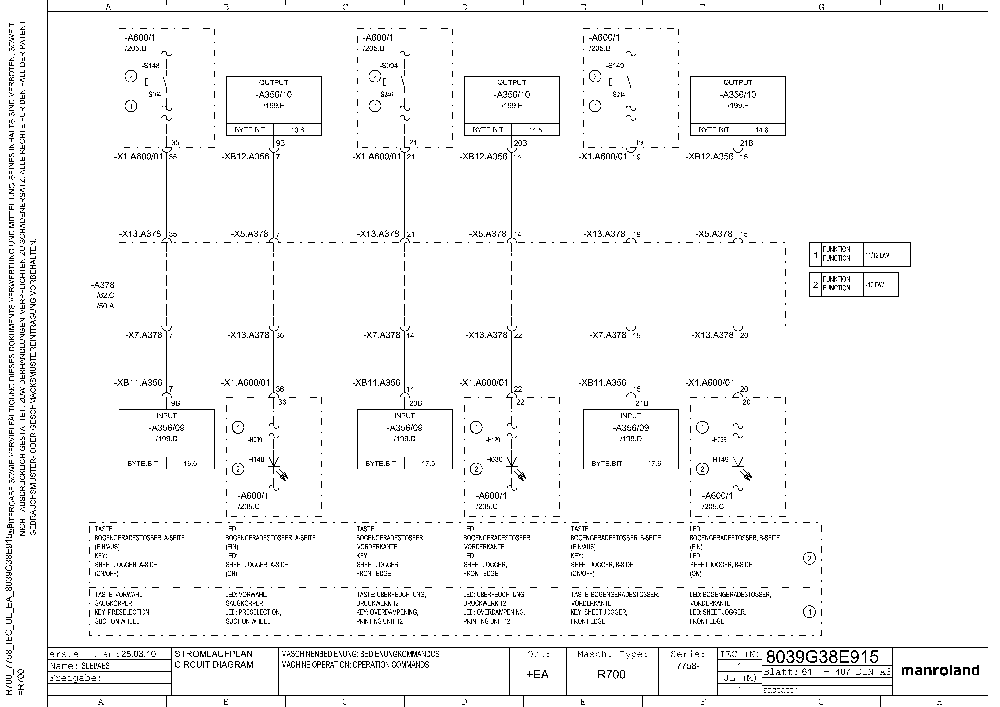

# +EA — Sheet 61 of 407 — MASCHINENBEDIENUNG: BEDIENUNGKOMMANDOS

**MACHINE OPERATION: OPERATION COMMANDS**

> Part of the manroland **R700** printing press IEC/UL circuit diagrams.
> Drawing class: **Stromlaufplan / Circuit diagram** (DIN A3).
> Document `+EA` covers the **Printing unit** machine section.

## At a glance

| Field | Value |
|---|---|
| Document | `+EA`  (8039G38E915) |
| Sheet | **61** of 407 |
| Section (DE) | MASCHINENBEDIENUNG: BEDIENUNGKOMMANDOS |
| Section (EN) | MACHINE OPERATION: OPERATION COMMANDS |
| Section type | CIRCUIT — Circuit diagram |
| Machine type | `R700` |
| Series | `7758` |
| Created | 25.03.10 |
| Replaces | — |
| Columns used | A, B, C, D, E, F, G |
| Path numbers | — |
| Labels on sheet | 199 |
| Cross-refs out | 14 |
| Cross-refs in | 38 |

**Previous:** [+EA sheet 60](SHEET_0060.md) · **Next:** [+EA sheet 62](SHEET_0062.md) · **Document TOC:** [_TOC.md](_TOC.md)  (+EA) · **Master TOC:** [all sheets](../_MASTER_TOC.md)

## Sheet image (300 DPI, exact vector render)



_Rendered directly from the PDF vector layer at 300 DPI (1-bit), no OCR and no resampling. Use it to confirm anything ambiguous in the text below._

## Cross-references on this sheet

Each entry is a wire leaving this sheet. The printed token is `/sheet.column`; the link resolves to that sheet inside the same document.

| Ref | Target sheet | Col | Path | Destination on target | Target section | From col |
|---|---|---|---|---|---|---|
| `/205.B` | [+EA sheet 205](SHEET_0205.md) | B | — | A600/1 | REFERENZMODUL | A |
| `/205.B` | [+EA sheet 205](SHEET_0205.md) | B | — | A600/1 | REFERENZMODUL | C |
| `/205.B` | [+EA sheet 205](SHEET_0205.md) | B | — | A600/1 | REFERENZMODUL | E |
| `/199.F` | [+EA sheet 199](SHEET_0199.md) | F | — | — | REFERENZMODUL | B |
| `/199.F` | [+EA sheet 199](SHEET_0199.md) | F | — | — | REFERENZMODUL | D |
| `/199.F` | [+EA sheet 199](SHEET_0199.md) | F | — | — | REFERENZMODUL | F |
| `/62.C` | [+EA sheet 62](SHEET_0062.md) | C | — | — | MASCHINENBEDIENUNG: BEDIENUNGKOMMANDOS | A |
| `/50.A` | [+EA sheet 50](SHEET_0050.md) | A | — | — | SCHUTZ | A |
| `/199.D` | [+EA sheet 199](SHEET_0199.md) | D | — | — | REFERENZMODUL | A |
| `/199.D` | [+EA sheet 199](SHEET_0199.md) | D | — | — | REFERENZMODUL | C |
| `/199.D` | [+EA sheet 199](SHEET_0199.md) | D | — | — | REFERENZMODUL | E |
| `/205.C` | [+EA sheet 205](SHEET_0205.md) | C | — | A600/1 | REFERENZMODUL | B |
| `/205.C` | [+EA sheet 205](SHEET_0205.md) | C | — | A600/1 | REFERENZMODUL | D |
| `/205.C` | [+EA sheet 205](SHEET_0205.md) | C | — | A600/1 | REFERENZMODUL | F |

### Incoming references (sheets that point here)

Every other sheet that sends a wire to this one. `Back-ref` is the token printed on *that* sheet; `Path` is its line number.

| From sheet | Cols | Back-ref | Path | Refs | What continues there |
|---|---|---|---|---|---|
| [+EA#50](SHEET_0050.md) | A | `/50.A` | — | 1 | — |
| [+EA#62](SHEET_0062.md) | C | `/62.C` | — | 1 | — |
| [+EA#199](SHEET_0199.md) | D, F | `/199.D`, `/199.F` | — | 6 | — |
| [+EA#205](SHEET_0205.md) | B, C | `/205.B`, `/205.C` | — | 6 | — |
| [+EA#212](SHEET_0212.md) | E, F | `/212.E`, `/212.F` | — | 6 | — |
| [+EA#242](SHEET_0242.md) | D | `/242.D` | — | 3 | — |
| [+EA#247](SHEET_0247.md) | F | `/247.F` | — | 3 | — |
| [+EA#256](SHEET_0256.md) | B | `/256.B` | — | 3 | — |
| [+EA#257](SHEET_0257.md) | D | `/257.D` | — | 3 | — |
| [+EA#259](SHEET_0259.md) | A, B | `/259.A`, `/259.B` | — | 6 | — |


## Devices on this sheet

| Tag | Class | Class meaning (IEC) | Col | Sub | Terminal | Sign |
|---|---|---|---|---|---|---|
| `A600/1` | A | Baugruppe / assembly, module, PC board | B | 1 | — | — |
| `A356/09` | A | Baugruppe / assembly, module, PC board | A | 09 | — | — |
| `S148` | S | Schalter / switch | A | — | — | — |
| `A600/1` | A | Baugruppe / assembly, module, PC board | A | 1 | — | — |
| `A356/10` | A | Baugruppe / assembly, module, PC board | B | 10 | — | — |
| `A600/1` | A | Baugruppe / assembly, module, PC board | D | 1 | — | — |
| `A356/09` | A | Baugruppe / assembly, module, PC board | C | 09 | — | — |
| `S094` | S | Schalter / switch | C | — | — | — |
| `A600/1` | A | Baugruppe / assembly, module, PC board | C | 1 | — | — |
| `A356/10` | A | Baugruppe / assembly, module, PC board | D | 10 | — | — |
| `A600/1` | A | Baugruppe / assembly, module, PC board | F | 1 | — | — |
| `A356/09` | A | Baugruppe / assembly, module, PC board | E | 09 | — | — |
| `S149` | S | Schalter / switch | E | — | — | — |
| `A600/1` | A | Baugruppe / assembly, module, PC board | E | 1 | — | — |
| `A356/10` | A | Baugruppe / assembly, module, PC board | F | 10 | — | — |
| `A378` | A | Baugruppe / assembly, module, PC board | A | — | — | — |
| `S164` | S | Schalter / switch | A | — | — | — |
| `S094` | S | Schalter / switch | E | — | — | — |
| `S246` | S | Schalter / switch | C | — | — | — |
| `16.6` | — | cross-device reference | B | — | — | — |
| `XB11.A356` | — | cross-device reference | A | — | — | — |
| `13.6` | — | cross-device reference | C | — | — | — |
| `XB12.A356` | — | cross-device reference | B | — | — | — |
| `17.5` | — | cross-device reference | D | — | — | — |
| `XB11.A356` | — | cross-device reference | C | — | — | — |
| `14.5` | — | cross-device reference | E | — | — | — |
| `XB12.A356` | — | cross-device reference | D | — | — | — |
| `17.6` | — | cross-device reference | F | — | — | — |
| `XB11.A356` | — | cross-device reference | E | — | — | — |
| `14.6` | — | cross-device reference | F | — | — | — |
| `XB12.A356` | — | cross-device reference | F | — | — | — |
| `X7.A378` | — | cross-device reference | A | — | — | — |
| `X13.A378` | — | cross-device reference | B | — | — | — |
| `X13.A378` | — | cross-device reference | A | — | — | — |
| `X5.A378` | — | cross-device reference | B | — | — | — |
| `X7.A378` | — | cross-device reference | C | — | — | — |
| `X13.A378` | — | cross-device reference | D | — | — | — |
| `X13.A378` | — | cross-device reference | C | — | — | — |
| `X5.A378` | — | cross-device reference | D | — | — | — |
| `X7.A378` | — | cross-device reference | E | — | — | — |
| `X13.A378` | — | cross-device reference | F | — | — | — |
| `X13.A378` | — | cross-device reference | E | — | — | — |
| `X5.A378` | — | cross-device reference | F | — | — | — |

## Potentials / nets

| Potential | Count | Columns | Attached devices | Terminals |
|---|---|---|---|---|
| `H036` | 2 | D, F | — | — |
| `H099` | 1 | B | — | — |
| `H129` | 1 | D | — | — |
| `H148` | 1 | B | — | — |
| `H149` | 1 | F | — | — |


A potential such as `L24+/4` or `M24+` is a named supply/return rail; every place it appears on this sheet is electrically common.

## Wire-end annotations (grouped as printed)

A wire that continues elsewhere is annotated with a small cluster: the destination description, the path/line number `#NN`, and the `/sheet.column` cross reference. Each row below is one such cluster exactly as it is grouped on the drawing.

| Col | Y | Path | Cross-ref | Text on the wire |
|---|---|---|---|---|
| A | 40.0 | — | `/205.B` | `A600/1` |
| C | 40.0 | — | `/205.B` | `A600/1` |
| E | 40.0 | — | `/205.B` | `A600/1` |
| A | 74.4 | — | — | `S148` |
| C | 74.4 | — | — | `S094` |
| E | 74.4 | — | — | `S149` |
| C | 88.2 | — | — | `2 2 2` |
| B | 94.7 | — | — | `QUTPUT` |
| D | 94.7 | — | — | `QUTPUT` |
| F | 94.7 | — | — | `QUTPUT` |
| B | 108.0 | — | — | `A356/10` |
| D | 108.0 | — | — | `A356/10` |
| F | 108.0 | — | — | `A356/10` |
| A | 109.8 | — | — | `S164` |
| D | 109.8 | — | — | `S246 S094` |
| B | 121.8 | — | `/199.F` | — |
| D | 121.8 | — | `/199.F` | — |
| F | 121.8 | — | `/199.F` | — |
| A | 123.1 | — | — | `1` |
| C | 123.1 | — | — | `1` |
| E | 123.1 | — | — | `1` |
| B | 151.4 | — | — | `BYTE.BIT 13.6` |
| D | 151.4 | — | — | `BYTE.BIT 14.5` |
| F | 151.4 | — | — | `BYTE.BIT 14.6` |
| B | 166.2 | — | — | `35` |
| D | 166.2 | — | — | `21` |
| E | 166.2 | — | — | `19` |
| B | 166.8 | — | — | `9B` |
| D | 166.8 | — | — | `20B` |
| F | 166.8 | — | — | `21B` |
| A | 181.7 | — | — | `X1.A600/01 35` |
| B | 181.7 | — | — | `XB12.A356 7` |
| C | 181.7 | — | — | `X1.A600/01 21` |
| D | 181.7 | — | — | `XB12.A356 14` |
| E | 181.7 | — | — | `X1.A600/01 19` |
| F | 181.7 | — | — | `XB12.A356 15` |
| B | 273.9 | — | — | `X13.A378 35 X5.A378 7` |
| D | 273.9 | — | — | `X13.A378 21 X5.A378 14` |
| F | 273.9 | — | — | `X13.A378 19 X5.A378 15` |
| G | 294.0 | — | — | `1 FUNKTION FUNCTION 11/12 DW` |
| G | 329.4 | — | — | `2 FUNKTION FUNCTION 10 DW` |
| A | 334.8 | — | — | `A378` |
| A | 347.9 | — | `/62.C`, `/50.A` | — |
| B | 394.3 | — | — | `X7.A378 7 X13.A378 36` |
| D | 394.3 | — | — | `X7.A378 14 X13.A378 22` |
| F | 394.3 | — | — | `X7.A378 15 X13.A378 20` |
| A | 451.0 | — | — | `XB11.A356 7` |
| B | 451.0 | — | — | `X1.A600/01 36` |
| C | 451.0 | — | — | `XB11.A356 14` |
| D | 451.0 | — | — | `X1.A600/01 22` |
| E | 451.0 | — | — | `XB11.A356 15` |
| F | 451.0 | — | — | `X1.A600/01 20` |
| B | 475.1 | — | — | `36` |
| D | 475.1 | — | — | `22` |
| F | 475.1 | — | — | `20` |
| B | 476.5 | — | — | `9B` |
| D | 476.5 | — | — | `20B` |
| E | 476.5 | — | — | `21B` |
| A | 491.6 | — | — | `INPUT` |
| C | 491.6 | — | — | `INPUT` |
| E | 491.6 | — | — | `INPUT` |
| A | 504.9 | — | — | `A356/09` |
| C | 504.9 | — | — | `A356/09` |
| E | 504.9 | — | — | `A356/09` |
| B | 505.8 | — | — | `1` |
| D | 505.8 | — | — | `1` |
| F | 505.8 | — | — | `1` |
| A | 518.7 | — | `/199.D` | — |
| C | 518.7 | — | `/199.D` | — |
| E | 518.7 | — | `/199.D` | — |
| B | 520.8 | — | — | `H099` |
| D | 520.8 | — | — | `H129` |
| F | 520.8 | — | — | `H036` |
| B | 543.6 | — | — | `H148` |
| D | 543.6 | — | — | `H036` |
| F | 543.6 | — | — | `H149` |
| A | 548.3 | — | — | `BYTE.BIT 16.6` |
| C | 548.3 | — | — | `BYTE.BIT 17.5` |
| E | 548.3 | — | — | `BYTE.BIT 17.6` |
| B | 555.9 | — | — | `2` |
| E | 555.9 | — | — | `2 2` |
| B | 585.7 | — | `/205.C` | `A600/1` |
| D | 585.7 | — | `/205.C` | `A600/1` |
| F | 585.7 | — | `/205.C` | `A600/1` |
| A | 627.0 | — | — | `BOGENGERADESTOSSER, A SEITE KEY: (EIN/AUS) TASTE:` |
| B | 627.0 | — | — | `LED: BOGENGERADESTOSSER, A SEITE LED: (EIN)` |
| C | 627.0 | — | — | `BOGENGERADESTOSSER, TASTE:` |
| D | 627.0 | — | — | `LED: BOGENGERADESTOSSER,` |
| E | 627.0 | — | — | `BOGENGERADESTOSSER, B SEITE KEY: (EIN/AUS) TASTE:` |
| F | 627.0 | — | — | `LED: BOGENGERADESTOSSER, B SEITE LED: (EIN)` |
| C | 648.4 | — | — | `KEY: VORDERKANTE` |
| D | 648.4 | — | — | `LED: VORDERKANTE` |
| G | 662.2 | — | — | `2` |
| A | 669.6 | — | — | `(ON/OFF) SHEET JOGGER, A SIDE` |
| B | 669.6 | — | — | `(ON) SHEET JOGGER, A SIDE` |
| C | 669.6 | — | — | `FRONT EDGE SHEET JOGGER,` |
| D | 669.6 | — | — | `FRONT EDGE SHEET JOGGER,` |
| E | 669.6 | — | — | `(ON/OFF) SHEET JOGGER, B SIDE` |
| F | 669.6 | — | — | `(ON) SHEET JOGGER, B SIDE` |
| A | 705.0 | — | — | `KEY: PRESELECTION, TASTE: VORWAHL, SAUGKÖRPER` |
| B | 705.0 | — | — | `LED: VORWAHL,` |
| C | 705.0 | — | — | `DRUCKWERK 12 KEY: OVERDAMPENING, PRINTING UNIT 12 TASTE: ÜBERFEUCHTUNG,` |
| D | 705.0 | — | — | `LED: ÜBERFEUCHTUNG, DRUCKWERK 12 LED: OVERDAMPENING, PRINTING UNIT 12` |
| E | 705.0 | — | — | `KEY: SHEET JOGGER, FRONT EDGE TASTE: BOGENGERADESTOSSER, VORDERKANTE` |
| F | 705.0 | — | — | `LED: BOGENGERADESTOSSER,` |
| B | 715.7 | — | — | `LED: PRESELECTION, SAUGKÖRPER` |
| F | 715.7 | — | — | `LED: SHEET JOGGER, FRONT EDGE VORDERKANTE` |
| G | 725.5 | — | — | `1` |
| A | 736.9 | — | — | `SUCTION WHEEL` |
| B | 736.9 | — | — | `SUCTION WHEEL` |


## Reconstructed tables

This sheet carries tabular content (pin map / terminal assignment / index). The grid below was rebuilt from the drawing's own rule lines, so each row is exactly one physical row of the table.

### Table 1 — 4 data rows × 2 columns (at x=141.7, y=34.0) — **A600/1 /205.B S148 2 S164 1 35**

| X1.A600/01 X13.A378 X7.A378 XB11.A356 | 35 35 7 7 |
|---|---|
|  | `9B` |
| `INPUT` | `A356/09 /199.D` |
| `BYTE.BIT` | `16.6` |
| `BOGENGERADESTOSSER, JOGGER, A SIDE` | `A SEITE` |


### Table 2 — 8 data rows × 2 columns (at x=269.3, y=34.0)

| QUTPUT | A356/10 /199.F |
|---|---|
| `BYTE.BIT` | `13.6` |
|  | `9B` |
| `XB12.A356 X5.A378 X13.A378 X1.A600/01` | `7 7 36 36` |
|  | `36` |
| `1 H099` |  |
| `H148` |  |
| `2 A600/1 /205.C` |  |
| `LED: BOGENGERADESTOSSER, (EIN) LED: SHEET JOGGER, (ON)` | `A SEITE A SIDE` |


### Table 3 — 4 data rows × 2 columns (at x=425.2, y=34.0) — **A600/1 /205.B S094 2 S246 1 21**

| X1.A600/01 X13.A378 X7.A378 XB11.A356 | 21 21 14 14 |
|---|---|
|  | `20B` |
| `INPUT` | `A356/09 /199.D` |
| `BYTE.BIT` | `17.5` |
| `TASTE: BOGENGERADESTOSSER, VORDERKANTE KEY: SHEET JOGGER, FRONT EDGE` |  |


### Table 4 — 8 data rows × 5 columns (at x=552.8, y=34.0) — **A600/1 /205.B S149**

|  | QUTPUT A356/10 /199.F |  | 2 S094 1 |  |
|---|---|---|---|---|
| `BYTE.BIT` | `14.5` |  |  |  |
|  | `20B` |  |  | `19` |
| `XB12.A356 X5.A378 X13.A378 X1.A600/01` | `14 14 22 22` |  | `X1.A600/01 X13.A378 X7.A378 XB11.A356` | `19 19 15 15` |
|  | `22` |  |  | `21B` |
| `1 H129` |  |  | `INPUT` | `A356/09 /199.D` |
| `H036` |  |  | `BYTE.BIT` | `17.6` |
| `2 A600/1 /205.C` |  |  |  |  |
| `LED: BOGENGERADESTOSSER, VORDERKANTE LED: SHEET JOGGER, FRONT EDGE` |  | `TASTE: KEY: SHEET (ON/OFF)` | `BOGENGERADESTOSSER, (EIN/AUS) JOGGER, B SIDE` | `B SEITE` |


### Table 5 — 7 data rows × 2 columns (at x=822.0, y=34.0) — **QUTPUT A356/10 /199.F**

| BYTE.BIT | 14.6 |
|---|---|
|  | `21B` |
| `XB12.A356 X5.A378 X13.A378 X1.A600/01` | `15 15 20 20` |
|  | `20` |
| `1 H036` |  |
| `H149` |  |
| `2 A600/1 /205.C` |  |
| `LED: BOGENGERADESTOSSER, (EIN) LED: SHEET JOGGER, (ON)` | `B SEITE B SIDE` |


## Notes and free text on this sheet

| Text | Col | Y (pt) |
|---|---|---|
| `LED:` | B | 626.99 |
| `BOGENGERADESTOSSER, A SEITE` | B | 637.7 |
| `(EIN)` | B | 648.31 |
| `SHEET JOGGER, A SIDE` | B | 669.6 |
| `(ON)` | B | 680.24 |
| `9B` | B | 476.49 |
| `INPUT` | A | 491.59 |
| `BYTE.BIT` | A | 548.28 |
| `TASTE:` | A | 627.02 |
| `BOGENGERADESTOSSER, A SEITE` | A | 637.7 |
| `(EIN/AUS)` | A | 648.32 |
| `KEY:` | A | 658.84 |
| `SHEET JOGGER, A SIDE` | A | 669.6 |
| `(ON/OFF)` | A | 680.24 |
| `X1.A600/01` | B | 451.02 |
| `X1.A600/01` | A | 181.73 |
| `QUTPUT` | B | 94.67 |
| `BYTE.BIT` | B | 151.43 |
| `LED:` | D | 626.99 |
| `BOGENGERADESTOSSER,` | D | 637.7 |
| `VORDERKANTE` | D | 648.35 |
| `SHEET JOGGER,` | D | 669.59 |
| `FRONT EDGE` | D | 680.24 |
| `20B` | D | 476.51 |
| `INPUT` | C | 491.59 |
| `BYTE.BIT` | C | 548.28 |
| `TASTE:` | C | 627.02 |
| `BOGENGERADESTOSSER,` | C | 637.7 |
| `VORDERKANTE` | C | 648.35 |
| `KEY:` | C | 658.84 |
| `SHEET JOGGER,` | C | 669.59 |
| `FRONT EDGE` | C | 680.24 |
| `X1.A600/01` | D | 451.02 |
| `X1.A600/01` | C | 181.73 |
| `QUTPUT` | D | 94.67 |
| `BYTE.BIT` | D | 151.43 |
| `LED:` | F | 626.99 |
| `BOGENGERADESTOSSER, B SEITE` | F | 637.7 |
| `(EIN)` | F | 648.31 |
| `SHEET JOGGER, B SIDE` | F | 669.6 |
| `(ON)` | F | 680.24 |
| `21B` | E | 476.51 |
| `INPUT` | E | 491.59 |
| `BYTE.BIT` | E | 548.28 |
| `TASTE:` | E | 627.02 |
| `BOGENGERADESTOSSER, B SEITE` | E | 637.7 |
| `(EIN/AUS)` | E | 648.32 |
| `KEY:` | E | 658.84 |
| `SHEET JOGGER, B SIDE` | E | 669.6 |
| `(ON/OFF)` | E | 680.24 |
| `X1.A600/01` | F | 451.02 |
| `X1.A600/01` | E | 181.73 |
| `21B` | F | 166.82 |
| `QUTPUT` | F | 94.67 |
| `BYTE.BIT` | F | 151.43 |
| `TASTE: VORWAHL,` | A | 704.99 |
| `SAUGKÖRPER` | A | 715.67 |
| `KEY: PRESELECTION,` | A | 726.27 |
| `SUCTION WHEEL` | A | 736.91 |
| `TASTE: ÜBERFEUCHTUNG,` | C | 705.03 |
| `DRUCKWERK 12` | C | 715.64 |
| `KEY: OVERDAMPENING,` | C | 726.28 |
| `PRINTING UNIT 12` | C | 736.93 |
| `LED: ÜBERFEUCHTUNG,` | D | 705.04 |
| `DRUCKWERK 12` | D | 715.64 |
| `LED: OVERDAMPENING,` | D | 726.29 |
| `PRINTING UNIT 12` | D | 736.93 |
| `TASTE: BOGENGERADESTOSSER,` | E | 705.02 |
| `VORDERKANTE` | E | 715.67 |
| `KEY: SHEET JOGGER,` | E | 726.27 |
| `FRONT EDGE` | E | 736.92 |
| `LED: BOGENGERADESTOSSER,` | F | 705.02 |
| `VORDERKANTE` | F | 715.67 |
| `LED: SHEET JOGGER,` | F | 726.28 |
| `FRONT EDGE` | F | 736.92 |
| `LED: VORWAHL,` | B | 704.98 |
| `SAUGKÖRPER` | B | 715.67 |
| `LED: PRESELECTION,` | B | 726.28 |
| `SUCTION WHEEL` | B | 736.91 |
| `FUNKTION` | G | 293.99 |
| `FUNCTION` | G | 304.64 |
| `11/12 DW` | G | 301.05 |
| `10 DW` | G | 336.47 |

## Complete label inventory (exact text from the drawing)

Every text object inside the drawing area of this sheet, in DIN reading order (column A→H, then top→bottom). This is the authoritative list: if a string is not here it is not printed on this sheet.

| Col | Y | X | Dir | Type | Text |
|---|---|---|---|---|---|
| A | 40.0 | 148.5 | → | device tag | `A600/1` |
| A | 53.8 | 148.8 | → | cross-reference | `/205.B` |
| A | 74.4 | 168.4 | → | device tag | `S148` |
| A | 88.2 | 153.9 | → | number | `2` |
| A | 109.8 | 175.0 | → | device tag | `S164` |
| A | 123.1 | 154.1 | → | number | `1` |
| A | 181.7 | 135.8 | → | text | `X1.A600/01` |
| A | 273.8 | 141.7 | → | device ref | `X13.A378` |
| A | 334.8 | 108.3 | → | device tag | `A378` |
| A | 347.9 | 115.4 | → | cross-reference | `/62.C` |
| A | 360.2 | 115.4 | → | cross-reference | `/50.A` |
| A | 394.3 | 149.1 | → | device ref | `X7.A378` |
| A | 451.0 | 136.1 | → | device ref | `XB11.A356` |
| A | 491.6 | 186.0 | → | text | `INPUT` |
| A | 504.9 | 177.0 | → | device tag | `A356/09` |
| A | 518.7 | 185.7 | → | cross-reference | `/199.D` |
| A | 548.3 | 151.7 | → | text | `BYTE.BIT` |
| A | 627.0 | 113.1 | → | text | `TASTE:` |
| A | 637.7 | 112.5 | → | text | `BOGENGERADESTOSSER, A SEITE` |
| A | 648.3 | 112.8 | → | text | `(EIN/AUS)` |
| A | 658.8 | 112.5 | → | text | `KEY:` |
| A | 669.6 | 113.1 | → | text | `SHEET JOGGER, A SIDE` |
| A | 680.2 | 112.8 | → | text | `(ON/OFF)` |
| A | 705.0 | 113.1 | → | text | `TASTE: VORWAHL,` |
| A | 715.7 | 113.1 | → | text | `SAUGKÖRPER` |
| A | 726.3 | 112.5 | → | text | `KEY: PRESELECTION,` |
| A | 736.9 | 113.1 | → | text | `SUCTION WHEEL` |
| B | 94.7 | 308.7 | → | text | `QUTPUT` |
| B | 108.0 | 304.6 | → | device tag | `A356/10` |
| B | 121.8 | 313.7 | → | cross-reference | `/199.F` |
| B | 151.4 | 279.2 | → | text | `BYTE.BIT` |
| B | 166.2 | 203.8 | → | number | `35` |
| B | 166.8 | 328.5 | → | text | `9B` |
| B | 181.7 | 263.6 | → | device ref | `XB12.A356` |
| B | 183.2 | 201.0 | → | number | `35` |
| B | 183.2 | 328.5 | → | number | `7` |
| B | 273.9 | 275.2 | → | device ref | `X5.A378` |
| B | 275.3 | 201.0 | → | number | `35` |
| B | 275.3 | 328.5 | → | number | `7` |
| B | 394.3 | 270.7 | → | device ref | `X13.A378` |
| B | 395.8 | 201.0 | → | number | `7` |
| B | 395.8 | 328.5 | → | number | `36` |
| B | 451.0 | 263.3 | → | text | `X1.A600/01` |
| B | 459.5 | 201.0 | → | number | `7` |
| B | 459.5 | 328.5 | → | number | `36` |
| B | 475.1 | 331.4 | → | number | `36` |
| B | 476.5 | 203.8 | → | text | `9B` |
| B | 505.8 | 281.7 | → | number | `1` |
| B | 520.8 | 295.2 | → | potential | `H099` |
| B | 543.6 | 292.5 | → | potential | `H148` |
| B | 548.3 | 218.6 | → | device ref | `16.6` |
| B | 555.9 | 281.5 | → | number | `2` |
| B | 585.7 | 283.2 | → | device tag | `A600/1` |
| B | 599.5 | 283.5 | → | cross-reference | `/205.C` |
| B | 627.0 | 268.4 | → | text | `LED:` |
| B | 637.7 | 268.4 | → | text | `BOGENGERADESTOSSER, A SEITE` |
| B | 648.3 | 268.7 | → | text | `(EIN)` |
| B | 658.9 | 268.4 | → | text | `LED:` |
| B | 669.6 | 269.0 | → | text | `SHEET JOGGER, A SIDE` |
| B | 680.2 | 268.7 | → | text | `(ON)` |
| B | 705.0 | 268.4 | → | text | `LED: VORWAHL,` |
| B | 715.7 | 269.0 | → | text | `SAUGKÖRPER` |
| B | 726.3 | 268.4 | → | text | `LED: PRESELECTION,` |
| B | 736.9 | 269.0 | → | text | `SUCTION WHEEL` |
| C | 40.0 | 432.0 | → | device tag | `A600/1` |
| C | 53.8 | 432.3 | → | cross-reference | `/205.B` |
| C | 74.4 | 451.8 | → | device tag | `S094` |
| C | 88.2 | 444.5 | → | number | `2` |
| C | 109.8 | 451.3 | → | device tag | `S246` |
| C | 123.1 | 444.7 | → | number | `1` |
| C | 151.5 | 346.1 | → | device ref | `13.6` |
| C | 181.7 | 419.2 | → | text | `X1.A600/01` |
| C | 273.8 | 425.2 | → | device ref | `X13.A378` |
| C | 394.3 | 432.6 | → | device ref | `X7.A378` |
| C | 451.0 | 419.5 | → | device ref | `XB11.A356` |
| C | 491.6 | 469.4 | → | text | `INPUT` |
| C | 504.9 | 460.5 | → | device tag | `A356/09` |
| C | 518.7 | 469.1 | → | cross-reference | `/199.D` |
| C | 548.3 | 435.1 | → | text | `BYTE.BIT` |
| C | 627.0 | 424.9 | → | text | `TASTE:` |
| C | 637.7 | 424.3 | → | text | `BOGENGERADESTOSSER,` |
| C | 648.4 | 425.2 | → | text | `VORDERKANTE` |
| C | 658.8 | 424.3 | → | text | `KEY:` |
| C | 669.6 | 424.9 | → | text | `SHEET JOGGER,` |
| C | 680.2 | 424.3 | → | text | `FRONT EDGE` |
| C | 705.0 | 424.9 | → | text | `TASTE: ÜBERFEUCHTUNG,` |
| C | 715.6 | 424.3 | → | text | `DRUCKWERK 12` |
| C | 726.3 | 424.3 | → | text | `KEY: OVERDAMPENING,` |
| C | 736.9 | 424.3 | → | text | `PRINTING UNIT 12` |
| D | 94.7 | 592.2 | → | text | `QUTPUT` |
| D | 108.0 | 588.0 | → | device tag | `A356/10` |
| D | 121.8 | 597.1 | → | cross-reference | `/199.F` |
| D | 151.4 | 562.7 | → | text | `BYTE.BIT` |
| D | 166.2 | 487.3 | → | number | `21` |
| D | 166.8 | 612.0 | → | text | `20B` |
| D | 181.7 | 547.1 | → | device ref | `XB12.A356` |
| D | 183.2 | 484.4 | → | number | `21` |
| D | 183.2 | 611.4 | → | number | `14` |
| D | 273.9 | 558.7 | → | device ref | `X5.A378` |
| D | 275.3 | 484.4 | → | number | `21` |
| D | 275.3 | 611.4 | → | number | `14` |
| D | 394.3 | 554.2 | → | device ref | `X13.A378` |
| D | 395.8 | 483.9 | → | number | `14` |
| D | 395.8 | 612.0 | → | number | `22` |
| D | 451.0 | 546.8 | → | text | `X1.A600/01` |
| D | 459.5 | 483.9 | → | number | `14` |
| D | 459.5 | 612.0 | → | number | `22` |
| D | 475.1 | 614.8 | → | number | `22` |
| D | 476.5 | 487.3 | → | text | `20B` |
| D | 505.8 | 565.2 | → | number | `1` |
| D | 520.8 | 578.7 | → | potential | `H129` |
| D | 543.6 | 576.0 | → | potential | `H036` |
| D | 548.3 | 502.0 | → | device ref | `17.5` |
| D | 555.9 | 564.9 | → | number | `2` |
| D | 585.7 | 566.6 | → | device tag | `A600/1` |
| D | 599.5 | 566.9 | → | cross-reference | `/205.C` |
| D | 627.0 | 551.9 | → | text | `LED:` |
| D | 637.7 | 551.9 | → | text | `BOGENGERADESTOSSER,` |
| D | 648.4 | 552.8 | → | text | `VORDERKANTE` |
| D | 658.9 | 551.9 | → | text | `LED:` |
| D | 669.6 | 552.5 | → | text | `SHEET JOGGER,` |
| D | 680.2 | 551.9 | → | text | `FRONT EDGE` |
| D | 705.0 | 551.9 | → | text | `LED: ÜBERFEUCHTUNG,` |
| D | 715.6 | 551.9 | → | text | `DRUCKWERK 12` |
| D | 726.3 | 551.9 | → | text | `LED: OVERDAMPENING,` |
| D | 736.9 | 551.9 | → | text | `PRINTING UNIT 12` |
| E | 40.0 | 701.3 | → | device tag | `A600/1` |
| E | 53.8 | 701.6 | → | cross-reference | `/205.B` |
| E | 74.4 | 721.1 | → | device tag | `S149` |
| E | 88.2 | 706.7 | → | number | `2` |
| E | 109.8 | 727.7 | → | device tag | `S094` |
| E | 123.1 | 706.9 | → | number | `1` |
| E | 151.5 | 629.6 | → | device ref | `14.5` |
| E | 166.2 | 756.0 | → | number | `19` |
| E | 181.7 | 688.5 | → | text | `X1.A600/01` |
| E | 183.2 | 753.2 | → | number | `19` |
| E | 273.8 | 694.5 | → | device ref | `X13.A378` |
| E | 275.3 | 753.2 | → | number | `19` |
| E | 394.3 | 701.9 | → | device ref | `X7.A378` |
| E | 395.8 | 753.2 | → | number | `15` |
| E | 451.0 | 688.8 | → | device ref | `XB11.A356` |
| E | 459.5 | 753.2 | → | number | `15` |
| E | 476.5 | 756.6 | → | text | `21B` |
| E | 491.6 | 738.7 | → | text | `INPUT` |
| E | 504.9 | 729.8 | → | device tag | `A356/09` |
| E | 518.7 | 738.4 | → | cross-reference | `/199.D` |
| E | 548.3 | 704.4 | → | text | `BYTE.BIT` |
| E | 627.0 | 680.0 | → | text | `TASTE:` |
| E | 637.7 | 679.5 | → | text | `BOGENGERADESTOSSER, B SEITE` |
| E | 648.3 | 679.7 | → | text | `(EIN/AUS)` |
| E | 658.8 | 679.5 | → | text | `KEY:` |
| E | 669.6 | 680.0 | → | text | `SHEET JOGGER, B SIDE` |
| E | 680.2 | 679.7 | → | text | `(ON/OFF)` |
| E | 705.0 | 680.0 | → | text | `TASTE: BOGENGERADESTOSSER,` |
| E | 715.7 | 680.3 | → | text | `VORDERKANTE` |
| E | 726.3 | 679.5 | → | text | `KEY: SHEET JOGGER,` |
| E | 736.9 | 679.5 | → | text | `FRONT EDGE` |
| F | 94.7 | 861.4 | → | text | `QUTPUT` |
| F | 108.0 | 857.3 | → | device tag | `A356/10` |
| F | 121.8 | 866.4 | → | cross-reference | `/199.F` |
| F | 151.4 | 832.0 | → | text | `BYTE.BIT` |
| F | 151.5 | 898.9 | → | device ref | `14.6` |
| F | 166.8 | 881.3 | → | text | `21B` |
| F | 181.7 | 816.4 | → | device ref | `XB12.A356` |
| F | 183.2 | 880.7 | → | number | `15` |
| F | 273.9 | 828.0 | → | device ref | `X5.A378` |
| F | 275.3 | 880.7 | → | number | `15` |
| F | 394.3 | 823.5 | → | device ref | `X13.A378` |
| F | 395.8 | 881.3 | → | number | `20` |
| F | 451.0 | 816.1 | → | text | `X1.A600/01` |
| F | 459.5 | 881.3 | → | number | `20` |
| F | 475.1 | 884.1 | → | number | `20` |
| F | 505.8 | 834.5 | → | number | `1` |
| F | 520.8 | 848.0 | → | potential | `H036` |
| F | 543.6 | 845.3 | → | potential | `H149` |
| F | 548.3 | 771.3 | → | device ref | `17.6` |
| F | 555.9 | 834.2 | → | number | `2` |
| F | 585.7 | 835.9 | → | device tag | `A600/1` |
| F | 599.5 | 836.2 | → | cross-reference | `/205.C` |
| F | 627.0 | 821.2 | → | text | `LED:` |
| F | 637.7 | 821.2 | → | text | `BOGENGERADESTOSSER, B SEITE` |
| F | 648.3 | 821.5 | → | text | `(EIN)` |
| F | 658.9 | 821.2 | → | text | `LED:` |
| F | 669.6 | 821.8 | → | text | `SHEET JOGGER, B SIDE` |
| F | 680.2 | 821.5 | → | text | `(ON)` |
| F | 705.0 | 821.2 | → | text | `LED: BOGENGERADESTOSSER,` |
| F | 715.7 | 822.0 | → | text | `VORDERKANTE` |
| F | 726.3 | 821.2 | → | text | `LED: SHEET JOGGER,` |
| F | 736.9 | 821.2 | → | text | `FRONT EDGE` |
| G | 294.0 | 979.9 | → | text | `FUNKTION` |
| G | 299.3 | 968.3 | → | number | `1` |
| G | 301.0 | 1030.3 | → | text | `11/12 DW` |
| G | 304.6 | 979.9 | → | text | `FUNCTION` |
| G | 329.4 | 979.9 | → | text | `FUNKTION` |
| G | 334.8 | 968.0 | → | number | `2` |
| G | 336.5 | 1030.8 | → | text | `10 DW` |
| G | 340.1 | 979.9 | → | text | `FUNCTION` |
| G | 662.2 | 961.8 | → | number | `2` |
| G | 725.4 | 962.0 | → | number | `1` |

## Reading-order text block

The same content as a plain block, grouped by DIN column — convenient to paste or to match against a visual description.

```text
=== Column A ===
  40.0  148.5  devtag       A600/1
  53.8  148.8  xref         /205.B
  74.4  168.4  devtag       S148
  88.2  153.9  numeric      2
 109.8  175.0  devtag       S164
 123.1  154.1  numeric      1
 181.7  135.8  text         X1.A600/01
 273.8  141.7  devref       X13.A378
 334.8  108.3  devtag       A378
 347.9  115.4  xref         /62.C
 360.2  115.4  xref         /50.A
 394.3  149.1  devref       X7.A378
 451.0  136.1  devref       XB11.A356
 491.6  186.0  text         INPUT
 504.9  177.0  devtag       A356/09
 518.7  185.7  xref         /199.D
 548.3  151.7  text         BYTE.BIT
 627.0  113.1  text         TASTE:
 637.7  112.5  text         BOGENGERADESTOSSER, A SEITE
 648.3  112.8  text         (EIN/AUS)
 658.8  112.5  text         KEY:
 669.6  113.1  text         SHEET JOGGER, A SIDE
 680.2  112.8  text         (ON/OFF)
 705.0  113.1  text         TASTE: VORWAHL,
 715.7  113.1  text         SAUGKÖRPER
 726.3  112.5  text         KEY: PRESELECTION,
 736.9  113.1  text         SUCTION WHEEL
=== Column B ===
  94.7  308.7  text         QUTPUT
 108.0  304.6  devtag       A356/10
 121.8  313.7  xref         /199.F
 151.4  279.2  text         BYTE.BIT
 166.2  203.8  numeric      35
 166.8  328.5  text         9B
 181.7  263.6  devref       XB12.A356
 183.2  201.0  numeric      35
 183.2  328.5  numeric      7
 273.9  275.2  devref       X5.A378
 275.3  201.0  numeric      35
 275.3  328.5  numeric      7
 394.3  270.7  devref       X13.A378
 395.8  201.0  numeric      7
 395.8  328.5  numeric      36
 451.0  263.3  text         X1.A600/01
 459.5  201.0  numeric      7
 459.5  328.5  numeric      36
 475.1  331.4  numeric      36
 476.5  203.8  text         9B
 505.8  281.7  numeric      1
 520.8  295.2  net          H099
 543.6  292.5  net          H148
 548.3  218.6  devref       16.6
 555.9  281.5  numeric      2
 585.7  283.2  devtag       A600/1
 599.5  283.5  xref         /205.C
 627.0  268.4  text         LED:
 637.7  268.4  text         BOGENGERADESTOSSER, A SEITE
 648.3  268.7  text         (EIN)
 658.9  268.4  text         LED:
 669.6  269.0  text         SHEET JOGGER, A SIDE
 680.2  268.7  text         (ON)
 705.0  268.4  text         LED: VORWAHL,
 715.7  269.0  text         SAUGKÖRPER
 726.3  268.4  text         LED: PRESELECTION,
 736.9  269.0  text         SUCTION WHEEL
=== Column C ===
  40.0  432.0  devtag       A600/1
  53.8  432.3  xref         /205.B
  74.4  451.8  devtag       S094
  88.2  444.5  numeric      2
 109.8  451.3  devtag       S246
 123.1  444.7  numeric      1
 151.5  346.1  devref       13.6
 181.7  419.2  text         X1.A600/01
 273.8  425.2  devref       X13.A378
 394.3  432.6  devref       X7.A378
 451.0  419.5  devref       XB11.A356
 491.6  469.4  text         INPUT
 504.9  460.5  devtag       A356/09
 518.7  469.1  xref         /199.D
 548.3  435.1  text         BYTE.BIT
 627.0  424.9  text         TASTE:
 637.7  424.3  text         BOGENGERADESTOSSER,
 648.4  425.2  text         VORDERKANTE
 658.8  424.3  text         KEY:
 669.6  424.9  text         SHEET JOGGER,
 680.2  424.3  text         FRONT EDGE
 705.0  424.9  text         TASTE: ÜBERFEUCHTUNG,
 715.6  424.3  text         DRUCKWERK 12
 726.3  424.3  text         KEY: OVERDAMPENING,
 736.9  424.3  text         PRINTING UNIT 12
=== Column D ===
  94.7  592.2  text         QUTPUT
 108.0  588.0  devtag       A356/10
 121.8  597.1  xref         /199.F
 151.4  562.7  text         BYTE.BIT
 166.2  487.3  numeric      21
 166.8  612.0  text         20B
 181.7  547.1  devref       XB12.A356
 183.2  484.4  numeric      21
 183.2  611.4  numeric      14
 273.9  558.7  devref       X5.A378
 275.3  484.4  numeric      21
 275.3  611.4  numeric      14
 394.3  554.2  devref       X13.A378
 395.8  483.9  numeric      14
 395.8  612.0  numeric      22
 451.0  546.8  text         X1.A600/01
 459.5  483.9  numeric      14
 459.5  612.0  numeric      22
 475.1  614.8  numeric      22
 476.5  487.3  text         20B
 505.8  565.2  numeric      1
 520.8  578.7  net          H129
 543.6  576.0  net          H036
 548.3  502.0  devref       17.5
 555.9  564.9  numeric      2
 585.7  566.6  devtag       A600/1
 599.5  566.9  xref         /205.C
 627.0  551.9  text         LED:
 637.7  551.9  text         BOGENGERADESTOSSER,
 648.4  552.8  text         VORDERKANTE
 658.9  551.9  text         LED:
 669.6  552.5  text         SHEET JOGGER,
 680.2  551.9  text         FRONT EDGE
 705.0  551.9  text         LED: ÜBERFEUCHTUNG,
 715.6  551.9  text         DRUCKWERK 12
 726.3  551.9  text         LED: OVERDAMPENING,
 736.9  551.9  text         PRINTING UNIT 12
=== Column E ===
  40.0  701.3  devtag       A600/1
  53.8  701.6  xref         /205.B
  74.4  721.1  devtag       S149
  88.2  706.7  numeric      2
 109.8  727.7  devtag       S094
 123.1  706.9  numeric      1
 151.5  629.6  devref       14.5
 166.2  756.0  numeric      19
 181.7  688.5  text         X1.A600/01
 183.2  753.2  numeric      19
 273.8  694.5  devref       X13.A378
 275.3  753.2  numeric      19
 394.3  701.9  devref       X7.A378
 395.8  753.2  numeric      15
 451.0  688.8  devref       XB11.A356
 459.5  753.2  numeric      15
 476.5  756.6  text         21B
 491.6  738.7  text         INPUT
 504.9  729.8  devtag       A356/09
 518.7  738.4  xref         /199.D
 548.3  704.4  text         BYTE.BIT
 627.0  680.0  text         TASTE:
 637.7  679.5  text         BOGENGERADESTOSSER, B SEITE
 648.3  679.7  text         (EIN/AUS)
 658.8  679.5  text         KEY:
 669.6  680.0  text         SHEET JOGGER, B SIDE
 680.2  679.7  text         (ON/OFF)
 705.0  680.0  text         TASTE: BOGENGERADESTOSSER,
 715.7  680.3  text         VORDERKANTE
 726.3  679.5  text         KEY: SHEET JOGGER,
 736.9  679.5  text         FRONT EDGE
=== Column F ===
  94.7  861.4  text         QUTPUT
 108.0  857.3  devtag       A356/10
 121.8  866.4  xref         /199.F
 151.4  832.0  text         BYTE.BIT
 151.5  898.9  devref       14.6
 166.8  881.3  text         21B
 181.7  816.4  devref       XB12.A356
 183.2  880.7  numeric      15
 273.9  828.0  devref       X5.A378
 275.3  880.7  numeric      15
 394.3  823.5  devref       X13.A378
 395.8  881.3  numeric      20
 451.0  816.1  text         X1.A600/01
 459.5  881.3  numeric      20
 475.1  884.1  numeric      20
 505.8  834.5  numeric      1
 520.8  848.0  net          H036
 543.6  845.3  net          H149
 548.3  771.3  devref       17.6
 555.9  834.2  numeric      2
 585.7  835.9  devtag       A600/1
 599.5  836.2  xref         /205.C
 627.0  821.2  text         LED:
 637.7  821.2  text         BOGENGERADESTOSSER, B SEITE
 648.3  821.5  text         (EIN)
 658.9  821.2  text         LED:
 669.6  821.8  text         SHEET JOGGER, B SIDE
 680.2  821.5  text         (ON)
 705.0  821.2  text         LED: BOGENGERADESTOSSER,
 715.7  822.0  text         VORDERKANTE
 726.3  821.2  text         LED: SHEET JOGGER,
 736.9  821.2  text         FRONT EDGE
=== Column G ===
 294.0  979.9  text         FUNKTION
 299.3  968.3  numeric      1
 301.0 1030.3  text         11/12 DW
 304.6  979.9  text         FUNCTION
 329.4  979.9  text         FUNKTION
 334.8  968.0  numeric      2
 336.5 1030.8  text         10 DW
 340.1  979.9  text         FUNCTION
 662.2  961.8  numeric      2
 725.4  962.0  numeric      1
```

---
_Generated from the PDF vector text layer; no OCR. Source: `R700_7758_IEC_UL_EA_8039G38E915_p`, sheet 61._
