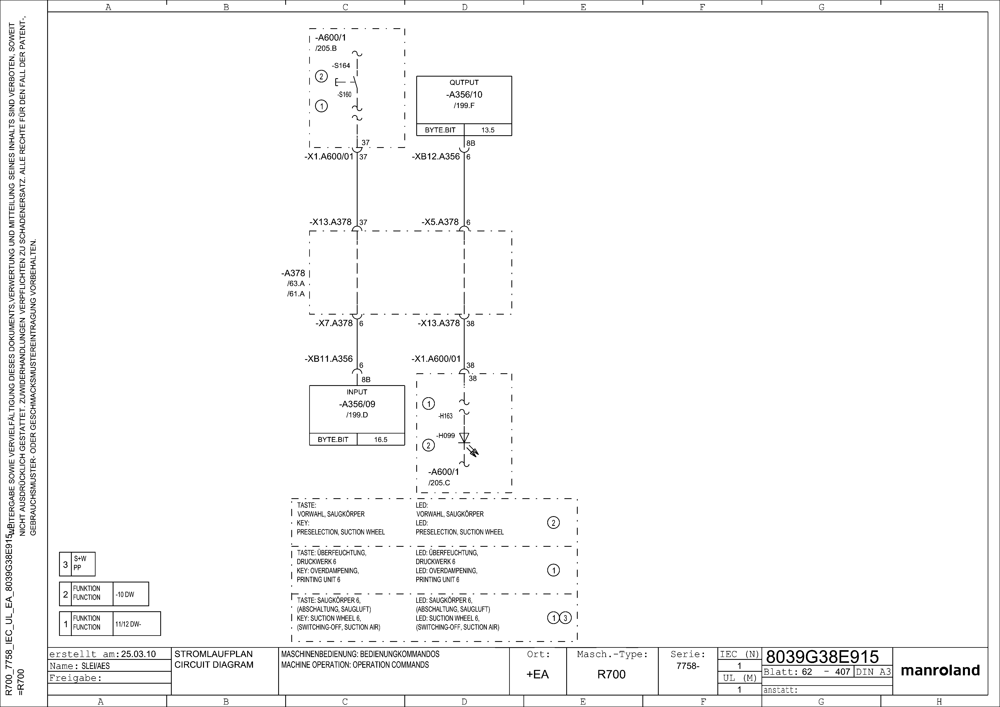

# +EA — Sheet 62 of 407 — MASCHINENBEDIENUNG: BEDIENUNGKOMMANDOS

**MACHINE OPERATION: OPERATION COMMANDS**

> Part of the manroland **R700** printing press IEC/UL circuit diagrams.
> Drawing class: **Stromlaufplan / Circuit diagram** (DIN A3).
> Document `+EA` covers the **Printing unit** machine section.

## At a glance

| Field | Value |
|---|---|
| Document | `+EA`  (8039G38E915) |
| Sheet | **62** of 407 |
| Section (DE) | MASCHINENBEDIENUNG: BEDIENUNGKOMMANDOS |
| Section (EN) | MACHINE OPERATION: OPERATION COMMANDS |
| Section type | CIRCUIT — Circuit diagram |
| Machine type | `R700` |
| Series | `7758` |
| Created | 25.03.10 |
| Replaces | — |
| Columns used | A, C, D, E |
| Path numbers | — |
| Labels on sheet | 84 |
| Cross-refs out | 6 |
| Cross-refs in | 14 |

**Previous:** [+EA sheet 61](SHEET_0061.md) · **Next:** [+EA sheet 63](SHEET_0063.md) · **Document TOC:** [_TOC.md](_TOC.md)  (+EA) · **Master TOC:** [all sheets](../_MASTER_TOC.md)

## Sheet image (300 DPI, exact vector render)



_Rendered directly from the PDF vector layer at 300 DPI (1-bit), no OCR and no resampling. Use it to confirm anything ambiguous in the text below._

## Cross-references on this sheet

Each entry is a wire leaving this sheet. The printed token is `/sheet.column`; the link resolves to that sheet inside the same document.

| Ref | Target sheet | Col | Path | Destination on target | Target section | From col |
|---|---|---|---|---|---|---|
| `/205.B` | [+EA sheet 205](SHEET_0205.md) | B | — | A600/1 | REFERENZMODUL | C |
| `/199.F` | [+EA sheet 199](SHEET_0199.md) | F | — | — | REFERENZMODUL | D |
| `/63.A` | [+EA sheet 63](SHEET_0063.md) | A | — | — | MASCHINENBEDIENUNG: BEDIENUNGKOMMANDOS | C |
| `/61.A` | [+EA sheet 61](SHEET_0061.md) | A | — | — | MASCHINENBEDIENUNG: BEDIENUNGKOMMANDOS | C |
| `/199.D` | [+EA sheet 199](SHEET_0199.md) | D | — | — | REFERENZMODUL | C |
| `/205.C` | [+EA sheet 205](SHEET_0205.md) | C | — | A600/1 | REFERENZMODUL | D |

### Incoming references (sheets that point here)

Every other sheet that sends a wire to this one. `Back-ref` is the token printed on *that* sheet; `Path` is its line number.

| From sheet | Cols | Back-ref | Path | Refs | What continues there |
|---|---|---|---|---|---|
| [+EA#61](SHEET_0061.md) | A | `/61.A` | — | 1 | — |
| [+EA#63](SHEET_0063.md) | A | `/63.A` | — | 1 | — |
| [+EA#199](SHEET_0199.md) | D, F | `/199.D`, `/199.F` | — | 2 | — |
| [+EA#205](SHEET_0205.md) | B, C | `/205.B`, `/205.C` | — | 2 | — |
| [+EA#212](SHEET_0212.md) | F | `/212.F` | — | 2 | — |
| [+EA#242](SHEET_0242.md) | D | `/242.D` | — | 1 | — |
| [+EA#247](SHEET_0247.md) | F | `/247.F` | — | 1 | — |
| [+EA#256](SHEET_0256.md) | B | `/256.B` | — | 1 | — |
| [+EA#257](SHEET_0257.md) | D | `/257.D` | — | 1 | — |
| [+EA#259](SHEET_0259.md) | B | `/259.B` | — | 2 | — |


## Devices on this sheet

| Tag | Class | Class meaning (IEC) | Col | Sub | Terminal | Sign |
|---|---|---|---|---|---|---|
| `A600/1` | A | Baugruppe / assembly, module, PC board | D | 1 | — | — |
| `A356/09` | A | Baugruppe / assembly, module, PC board | C | 09 | — | — |
| `A378` | A | Baugruppe / assembly, module, PC board | C | — | — | — |
| `S164` | S | Schalter / switch | C | — | — | — |
| `A600/1` | A | Baugruppe / assembly, module, PC board | C | 1 | — | — |
| `A356/10` | A | Baugruppe / assembly, module, PC board | D | 10 | — | — |
| `S160` | S | Schalter / switch | C | — | — | — |
| `X7.A378` | — | cross-device reference | C | — | — | — |
| `X13.A378` | — | cross-device reference | D | — | — | — |
| `X13.A378` | — | cross-device reference | C | — | — | — |
| `X5.A378` | — | cross-device reference | D | — | — | — |
| `16.5` | — | cross-device reference | C | — | — | — |
| `XB11.A356` | — | cross-device reference | C | — | — | — |
| `13.5` | — | cross-device reference | D | — | — | — |
| `XB12.A356` | — | cross-device reference | D | — | — | — |

## Potentials / nets

| Potential | Count | Columns | Attached devices | Terminals |
|---|---|---|---|---|
| `H099` | 1 | D | — | — |
| `H163` | 1 | D | — | — |


A potential such as `L24+/4` or `M24+` is a named supply/return rail; every place it appears on this sheet is electrically common.

## Wire-end annotations (grouped as printed)

A wire that continues elsewhere is annotated with a small cluster: the destination description, the path/line number `#NN`, and the `/sheet.column` cross reference. Each row below is one such cluster exactly as it is grouped on the drawing.

| Col | Y | Path | Cross-ref | Text on the wire |
|---|---|---|---|---|
| C | 40.0 | — | `/205.B` | `A600/1` |
| C | 74.4 | — | — | `S164` |
| C | 88.2 | — | — | `2` |
| D | 94.7 | — | — | `QUTPUT` |
| D | 108.0 | — | — | `A356/10` |
| C | 109.8 | — | — | `S160` |
| D | 121.8 | — | `/199.F` | — |
| C | 123.1 | — | — | `1` |
| D | 151.4 | — | — | `BYTE.BIT 13.5` |
| C | 166.2 | — | — | `37` |
| D | 166.8 | — | — | `8B` |
| C | 181.7 | — | — | `X1.A600/01 37` |
| D | 181.7 | — | — | `XB12.A356 6` |
| C | 259.7 | — | — | `X13.A378 37 X5.A378 6` |
| C | 320.6 | — | — | `A378` |
| C | 333.7 | — | `/63.A`, `/61.A` | — |
| C | 380.1 | — | — | `X7.A378 6 X13.A378 38` |
| C | 422.7 | — | — | `XB11.A356 6` |
| D | 422.7 | — | — | `X1.A600/01 38` |
| D | 446.8 | — | — | `38` |
| C | 448.1 | — | — | `8B` |
| C | 463.2 | — | — | `INPUT` |
| C | 476.5 | — | — | `A356/09` |
| D | 477.4 | — | — | `1` |
| C | 490.3 | — | `/199.D` | — |
| D | 492.5 | — | — | `H163` |
| D | 515.2 | — | — | `H099` |
| C | 519.9 | — | — | `BYTE.BIT 16.5` |
| D | 527.5 | — | — | `2` |
| D | 557.3 | — | `/205.C` | `A600/1` |
| D | 598.6 | — | — | `LED:` |
| C | 598.7 | — | — | `KEY: PRESELECTION, SUCTION WHEEL TASTE: VORWAHL, SAUGKÖRPER` |
| D | 609.4 | — | — | `LED: PRESELECTION, SUCTION WHEEL VORWAHL, SAUGKÖRPER` |
| E | 619.7 | — | — | `2` |
| C | 655.4 | — | — | `DRUCKWERK 6 KEY: OVERDAMPENING, PRINTING UNIT 6 TASTE: ÜBERFEUCHTUNG,` |
| D | 655.4 | — | — | `LED: ÜBERFEUCHTUNG, DRUCKWERK 6 LED: OVERDAMPENING, PRINTING UNIT 6` |
| A | 662.4 | — | — | `3 PP S+W` |
| E | 675.8 | — | — | `1` |
| A | 697.9 | — | — | `2 FUNKTION FUNCTION 10 DW` |
| C | 712.1 | — | — | `KEY: SUCTION WHEEL 6, (ABSCHALTUNG, SAUGLUFT) (SWITCHING OFF, SUCTION AIR) TASTE: SAUGKÖRPER 6,` |
| D | 712.1 | — | — | `LED: SAUGKÖRPER 6, LED: SUCTION WHEEL 6, (ABSCHALTUNG, SAUGLUFT) (SWITCHING OFF, SUCTION AIR)` |
| C | 732.5 | — | — | `1 FUNKTION FUNCTION 11/12 DW 1 3` |


## Reconstructed tables

This sheet carries tabular content (pin map / terminal assignment / index). The grid below was rebuilt from the drawing's own rule lines, so each row is exactly one physical row of the table.

### Table 1 — 5 data rows × 2 columns (at x=368.5, y=34.0) — **A600/1 /205.B S164 2 S160 1 37**

| X1.A600/01 X13.A378 X7.A378 XB11.A356 | 37 37 6 6 |
|---|---|
|  | `8B` |
| `INPUT` | `A356/09 /199.D` |
| `BYTE.BIT` | `16.5` |
| `VORWAHL, SAUGKÖRPER PRESELECTION, SUCTION` | `WHEEL` |
| `ÜBERFEUCHTUNG, DRUCKWERK 6 OVERDAMPENING, UNIT 6` |  |


### Table 2 — 9 data rows × 2 columns (at x=496.1, y=34.0)

| QUTPUT | A356/10 /199.F |
|---|---|
| `BYTE.BIT` | `13.5` |
|  | `8B` |
| `XB12.A356 X5.A378 X13.A378 X1.A600/01` | `6 6 38 38` |
|  | `38` |
| `1 H163` |  |
| `H099` |  |
| `2 A600/1 /205.C` |  |
| `LED: VORWAHL, LED: PRESELECTION,` | `SAUGKÖRPER SUCTION WHEEL` |
| `LED: ÜBERFEUCHTUNG, DRUCKWERK 6 LED: OVERDAMPENING, PRINTING UNIT 6` |  |


## Notes and free text on this sheet

| Text | Col | Y (pt) |
|---|---|---|
| `LED:` | D | 598.65 |
| `VORWAHL, SAUGKÖRPER` | D | 609.36 |
| `PRESELECTION, SUCTION WHEEL` | D | 630.62 |
| `8B` | C | 448.14 |
| `INPUT` | C | 463.24 |
| `BYTE.BIT` | C | 519.94 |
| `TASTE:` | C | 598.67 |
| `VORWAHL, SAUGKÖRPER` | C | 609.36 |
| `KEY:` | C | 619.86 |
| `PRESELECTION, SUCTION WHEEL` | C | 630.62 |
| `X1.A600/01` | D | 422.67 |
| `X1.A600/01` | C | 181.73 |
| `8B` | D | 166.81 |
| `QUTPUT` | D | 94.67 |
| `BYTE.BIT` | D | 151.43 |
| `TASTE: ÜBERFEUCHTUNG,` | C | 655.43 |
| `DRUCKWERK 6` | C | 666.03 |
| `KEY: OVERDAMPENING,` | C | 676.68 |
| `PRINTING UNIT 6` | C | 687.32 |
| `LED: ÜBERFEUCHTUNG,` | D | 655.43 |
| `DRUCKWERK 6` | D | 666.03 |
| `LED: OVERDAMPENING,` | D | 676.69 |
| `PRINTING UNIT 6` | D | 687.32 |
| `TASTE: SAUGKÖRPER 6,` | C | 712.1 |
| `(ABSCHALTUNG, SAUGLUFT)` | C | 722.76 |
| `KEY: SUCTION WHEEL 6,` | C | 733.35 |
| `(SWITCHING OFF, SUCTION AIR)` | C | 744.01 |
| `LED: SAUGKÖRPER 6,` | D | 712.1 |
| `(ABSCHALTUNG, SAUGLUFT)` | D | 722.76 |
| `LED: SUCTION WHEEL 6,` | D | 733.36 |
| `(SWITCHING OFF, SUCTION AIR)` | D | 744.01 |
| `FUNKTION` | A | 733.36 |
| `FUNCTION` | A | 744.01 |
| `11/12 DW` | A | 740.42 |
| `10 DW` | A | 704.98 |
| `S+W` | A | 662.37 |
| `PP` | A | 673.01 |

## Complete label inventory (exact text from the drawing)

Every text object inside the drawing area of this sheet, in DIN reading order (column A→H, then top→bottom). This is the authoritative list: if a string is not here it is not printed on this sheet.

| Col | Y | X | Dir | Type | Text |
|---|---|---|---|---|---|
| A | 662.4 | 88.3 | → | text | `S+W` |
| A | 667.8 | 75.0 | → | number | `3` |
| A | 673.0 | 87.7 | → | text | `PP` |
| A | 697.9 | 87.0 | → | text | `FUNKTION` |
| A | 703.3 | 75.1 | → | number | `2` |
| A | 705.0 | 137.9 | → | text | `10 DW` |
| A | 708.6 | 87.0 | → | text | `FUNCTION` |
| A | 733.4 | 87.0 | → | text | `FUNKTION` |
| A | 738.7 | 75.4 | → | number | `1` |
| A | 740.4 | 137.3 | → | text | `11/12 DW` |
| A | 744.0 | 87.0 | → | text | `FUNCTION` |
| C | 40.0 | 375.3 | → | device tag | `A600/1` |
| C | 53.8 | 375.6 | → | cross-reference | `/205.B` |
| C | 74.4 | 395.1 | → | device tag | `S164` |
| C | 88.2 | 380.7 | → | number | `2` |
| C | 109.8 | 401.7 | → | device tag | `S160` |
| C | 123.1 | 380.9 | → | number | `1` |
| C | 166.2 | 430.6 | → | number | `37` |
| C | 181.7 | 362.6 | → | text | `X1.A600/01` |
| C | 183.2 | 427.7 | → | number | `37` |
| C | 259.7 | 368.5 | → | device ref | `X13.A378` |
| C | 261.1 | 427.7 | → | number | `37` |
| C | 320.6 | 335.1 | → | device tag | `A378` |
| C | 333.7 | 342.1 | → | cross-reference | `/63.A` |
| C | 346.1 | 342.1 | → | cross-reference | `/61.A` |
| C | 380.2 | 375.9 | → | device ref | `X7.A378` |
| C | 381.6 | 427.7 | → | number | `6` |
| C | 422.7 | 362.8 | → | device ref | `XB11.A356` |
| C | 431.2 | 427.7 | → | number | `6` |
| C | 448.1 | 430.6 | → | text | `8B` |
| C | 463.2 | 412.7 | → | text | `INPUT` |
| C | 476.5 | 403.8 | → | device tag | `A356/09` |
| C | 490.3 | 412.4 | → | cross-reference | `/199.D` |
| C | 519.9 | 378.4 | → | text | `BYTE.BIT` |
| C | 520.0 | 445.3 | → | device ref | `16.5` |
| C | 598.7 | 354.0 | → | text | `TASTE:` |
| C | 609.4 | 354.3 | → | text | `VORWAHL, SAUGKÖRPER` |
| C | 619.9 | 353.5 | → | text | `KEY:` |
| C | 630.6 | 353.5 | → | text | `PRESELECTION, SUCTION WHEEL` |
| C | 655.4 | 354.0 | → | text | `TASTE: ÜBERFEUCHTUNG,` |
| C | 666.0 | 353.5 | → | text | `DRUCKWERK 6` |
| C | 676.7 | 353.5 | → | text | `KEY: OVERDAMPENING,` |
| C | 687.3 | 353.5 | → | text | `PRINTING UNIT 6` |
| C | 712.1 | 354.0 | → | text | `TASTE: SAUGKÖRPER 6,` |
| C | 722.8 | 353.8 | → | text | `(ABSCHALTUNG, SAUGLUFT)` |
| C | 733.3 | 353.5 | → | text | `KEY: SUCTION WHEEL 6,` |
| C | 744.0 | 353.8 | → | text | `(SWITCHING OFF, SUCTION AIR)` |
| D | 94.7 | 535.5 | → | text | `QUTPUT` |
| D | 108.0 | 531.4 | → | device tag | `A356/10` |
| D | 121.8 | 540.4 | → | cross-reference | `/199.F` |
| D | 151.4 | 506.0 | → | text | `BYTE.BIT` |
| D | 151.5 | 572.9 | → | device ref | `13.5` |
| D | 166.8 | 555.3 | → | text | `8B` |
| D | 181.7 | 490.4 | → | device ref | `XB12.A356` |
| D | 183.2 | 555.3 | → | number | `6` |
| D | 259.7 | 502.0 | → | device ref | `X5.A378` |
| D | 261.1 | 555.3 | → | number | `6` |
| D | 380.1 | 497.5 | → | device ref | `X13.A378` |
| D | 381.6 | 555.3 | → | number | `38` |
| D | 422.7 | 490.1 | → | text | `X1.A600/01` |
| D | 431.2 | 555.3 | → | number | `38` |
| D | 446.8 | 558.1 | → | number | `38` |
| D | 477.4 | 508.5 | → | number | `1` |
| D | 492.5 | 522.0 | → | potential | `H163` |
| D | 515.2 | 519.3 | → | potential | `H099` |
| D | 527.5 | 508.2 | → | number | `2` |
| D | 557.3 | 510.0 | → | device tag | `A600/1` |
| D | 571.1 | 510.2 | → | cross-reference | `/205.C` |
| D | 598.6 | 495.2 | → | text | `LED:` |
| D | 609.4 | 496.1 | → | text | `VORWAHL, SAUGKÖRPER` |
| D | 619.9 | 495.2 | → | text | `LED:` |
| D | 630.6 | 495.2 | → | text | `PRESELECTION, SUCTION WHEEL` |
| D | 655.4 | 495.2 | → | text | `LED: ÜBERFEUCHTUNG,` |
| D | 666.0 | 495.2 | → | text | `DRUCKWERK 6` |
| D | 676.7 | 495.2 | → | text | `LED: OVERDAMPENING,` |
| D | 687.3 | 495.2 | → | text | `PRINTING UNIT 6` |
| D | 712.1 | 495.2 | → | text | `LED: SAUGKÖRPER 6,` |
| D | 722.8 | 495.5 | → | text | `(ABSCHALTUNG, SAUGLUFT)` |
| D | 733.4 | 495.2 | → | text | `LED: SUCTION WHEEL 6,` |
| D | 744.0 | 495.5 | → | text | `(SWITCHING OFF, SUCTION AIR)` |
| E | 619.7 | 657.1 | → | number | `2` |
| E | 675.8 | 657.3 | → | number | `1` |
| E | 732.5 | 657.3 | → | number | `1` |
| E | 733.0 | 671.2 | → | number | `3` |

## Reading-order text block

The same content as a plain block, grouped by DIN column — convenient to paste or to match against a visual description.

```text
=== Column A ===
 662.4   88.3  text         S+W
 667.8   75.0  numeric      3
 673.0   87.7  text         PP
 697.9   87.0  text         FUNKTION
 703.3   75.1  numeric      2
 705.0  137.9  text         10 DW
 708.6   87.0  text         FUNCTION
 733.4   87.0  text         FUNKTION
 738.7   75.4  numeric      1
 740.4  137.3  text         11/12 DW
 744.0   87.0  text         FUNCTION
=== Column C ===
  40.0  375.3  devtag       A600/1
  53.8  375.6  xref         /205.B
  74.4  395.1  devtag       S164
  88.2  380.7  numeric      2
 109.8  401.7  devtag       S160
 123.1  380.9  numeric      1
 166.2  430.6  numeric      37
 181.7  362.6  text         X1.A600/01
 183.2  427.7  numeric      37
 259.7  368.5  devref       X13.A378
 261.1  427.7  numeric      37
 320.6  335.1  devtag       A378
 333.7  342.1  xref         /63.A
 346.1  342.1  xref         /61.A
 380.2  375.9  devref       X7.A378
 381.6  427.7  numeric      6
 422.7  362.8  devref       XB11.A356
 431.2  427.7  numeric      6
 448.1  430.6  text         8B
 463.2  412.7  text         INPUT
 476.5  403.8  devtag       A356/09
 490.3  412.4  xref         /199.D
 519.9  378.4  text         BYTE.BIT
 520.0  445.3  devref       16.5
 598.7  354.0  text         TASTE:
 609.4  354.3  text         VORWAHL, SAUGKÖRPER
 619.9  353.5  text         KEY:
 630.6  353.5  text         PRESELECTION, SUCTION WHEEL
 655.4  354.0  text         TASTE: ÜBERFEUCHTUNG,
 666.0  353.5  text         DRUCKWERK 6
 676.7  353.5  text         KEY: OVERDAMPENING,
 687.3  353.5  text         PRINTING UNIT 6
 712.1  354.0  text         TASTE: SAUGKÖRPER 6,
 722.8  353.8  text         (ABSCHALTUNG, SAUGLUFT)
 733.3  353.5  text         KEY: SUCTION WHEEL 6,
 744.0  353.8  text         (SWITCHING OFF, SUCTION AIR)
=== Column D ===
  94.7  535.5  text         QUTPUT
 108.0  531.4  devtag       A356/10
 121.8  540.4  xref         /199.F
 151.4  506.0  text         BYTE.BIT
 151.5  572.9  devref       13.5
 166.8  555.3  text         8B
 181.7  490.4  devref       XB12.A356
 183.2  555.3  numeric      6
 259.7  502.0  devref       X5.A378
 261.1  555.3  numeric      6
 380.1  497.5  devref       X13.A378
 381.6  555.3  numeric      38
 422.7  490.1  text         X1.A600/01
 431.2  555.3  numeric      38
 446.8  558.1  numeric      38
 477.4  508.5  numeric      1
 492.5  522.0  net          H163
 515.2  519.3  net          H099
 527.5  508.2  numeric      2
 557.3  510.0  devtag       A600/1
 571.1  510.2  xref         /205.C
 598.6  495.2  text         LED:
 609.4  496.1  text         VORWAHL, SAUGKÖRPER
 619.9  495.2  text         LED:
 630.6  495.2  text         PRESELECTION, SUCTION WHEEL
 655.4  495.2  text         LED: ÜBERFEUCHTUNG,
 666.0  495.2  text         DRUCKWERK 6
 676.7  495.2  text         LED: OVERDAMPENING,
 687.3  495.2  text         PRINTING UNIT 6
 712.1  495.2  text         LED: SAUGKÖRPER 6,
 722.8  495.5  text         (ABSCHALTUNG, SAUGLUFT)
 733.4  495.2  text         LED: SUCTION WHEEL 6,
 744.0  495.5  text         (SWITCHING OFF, SUCTION AIR)
=== Column E ===
 619.7  657.1  numeric      2
 675.8  657.3  numeric      1
 732.5  657.3  numeric      1
 733.0  671.2  numeric      3
```

---
_Generated from the PDF vector text layer; no OCR. Source: `R700_7758_IEC_UL_EA_8039G38E915_p`, sheet 62._
