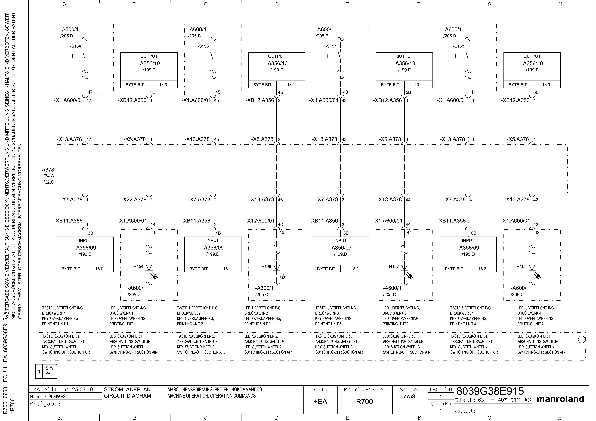

# +EA — Sheet 63 of 407 — MASCHINENBEDIENUNG: BEDIENUNGKOMMANDOS

**MACHINE OPERATION: OPERATION COMMANDS**

> Part of the manroland **R700** printing press IEC/UL circuit diagrams.
> Drawing class: **Stromlaufplan / Circuit diagram** (DIN A3).
> Document `+EA` covers the **Printing unit** machine section.

## At a glance

| Field | Value |
|---|---|
| Document | `+EA`  (8039G38E915) |
| Sheet | **63** of 407 |
| Section (DE) | MASCHINENBEDIENUNG: BEDIENUNGKOMMANDOS |
| Section (EN) | MACHINE OPERATION: OPERATION COMMANDS |
| Section type | CIRCUIT — Circuit diagram |
| Machine type | `R700` |
| Series | `7758` |
| Created | 25.03.10 |
| Replaces | — |
| Columns used | A, B, C, D, E, F, G, H |
| Path numbers | — |
| Labels on sheet | 215 |
| Cross-refs out | 18 |
| Cross-refs in | 50 |

**Previous:** [+EA sheet 62](SHEET_0062.md) · **Next:** [+EA sheet 64](SHEET_0064.md) · **Document TOC:** [_TOC.md](_TOC.md)  (+EA) · **Master TOC:** [all sheets](../_MASTER_TOC.md)

## Sheet image (300 DPI, exact vector render)



_Rendered directly from the PDF vector layer at 300 DPI (1-bit), no OCR and no resampling. Use it to confirm anything ambiguous in the text below._

## Cross-references on this sheet

Each entry is a wire leaving this sheet. The printed token is `/sheet.column`; the link resolves to that sheet inside the same document.

| Ref | Target sheet | Col | Path | Destination on target | Target section | From col |
|---|---|---|---|---|---|---|
| `/205.B` | [+EA sheet 205](SHEET_0205.md) | B | — | A600/1 | REFERENZMODUL | A |
| `/205.B` | [+EA sheet 205](SHEET_0205.md) | B | — | A600/1 | REFERENZMODUL | C |
| `/205.B` | [+EA sheet 205](SHEET_0205.md) | B | — | A600/1 | REFERENZMODUL | E |
| `/205.B` | [+EA sheet 205](SHEET_0205.md) | B | — | A600/1 | REFERENZMODUL | F |
| `/199.F` | [+EA sheet 199](SHEET_0199.md) | F | — | — | REFERENZMODUL | B |
| `/199.F` | [+EA sheet 199](SHEET_0199.md) | F | — | — | REFERENZMODUL | D |
| `/199.F` | [+EA sheet 199](SHEET_0199.md) | F | — | — | REFERENZMODUL | F |
| `/199.F` | [+EA sheet 199](SHEET_0199.md) | F | — | — | REFERENZMODUL | H |
| `/64.A` | [+EA sheet 64](SHEET_0064.md) | A | — | — | MASCHINENBEDIENUNG: BEDIENUNGKOMMANDOS | A |
| `/62.C` | [+EA sheet 62](SHEET_0062.md) | C | — | — | MASCHINENBEDIENUNG: BEDIENUNGKOMMANDOS | A |
| `/199.D` | [+EA sheet 199](SHEET_0199.md) | D | — | — | REFERENZMODUL | A |
| `/199.D` | [+EA sheet 199](SHEET_0199.md) | D | — | — | REFERENZMODUL | C |
| `/199.D` | [+EA sheet 199](SHEET_0199.md) | D | — | — | REFERENZMODUL | E |
| `/199.D` | [+EA sheet 199](SHEET_0199.md) | D | — | — | REFERENZMODUL | G |
| `/205.C` | [+EA sheet 205](SHEET_0205.md) | C | — | A600/1 | REFERENZMODUL | B |
| `/205.C` | [+EA sheet 205](SHEET_0205.md) | C | — | A600/1 | REFERENZMODUL | D |
| `/205.C` | [+EA sheet 205](SHEET_0205.md) | C | — | A600/1 | REFERENZMODUL | F |
| `/205.C` | [+EA sheet 205](SHEET_0205.md) | C | — | A600/1 | REFERENZMODUL | G |

### Incoming references (sheets that point here)

Every other sheet that sends a wire to this one. `Back-ref` is the token printed on *that* sheet; `Path` is its line number.

| From sheet | Cols | Back-ref | Path | Refs | What continues there |
|---|---|---|---|---|---|
| [+EA#62](SHEET_0062.md) | C | `/62.C` | — | 1 | — |
| [+EA#64](SHEET_0064.md) | A | `/64.A` | — | 1 | — |
| [+EA#199](SHEET_0199.md) | D, F | `/199.D`, `/199.F` | — | 8 | — |
| [+EA#205](SHEET_0205.md) | B, C | `/205.B`, `/205.C` | — | 8 | — |
| [+EA#212](SHEET_0212.md) | F | `/212.F` | — | 8 | — |
| [+EA#242](SHEET_0242.md) | D | `/242.D` | — | 4 | — |
| [+EA#247](SHEET_0247.md) | F | `/247.F` | — | 4 | — |
| [+EA#256](SHEET_0256.md) | B | `/256.B` | — | 4 | — |
| [+EA#257](SHEET_0257.md) | D | `/257.D` | — | 4 | — |
| [+EA#259](SHEET_0259.md) | B | `/259.B` | — | 7 | — |
| [+EA#264](SHEET_0264.md) | H | `/264.H` | — | 1 | — |


## Devices on this sheet

| Tag | Class | Class meaning (IEC) | Col | Sub | Terminal | Sign |
|---|---|---|---|---|---|---|
| `S156` | S | Schalter / switch | C | — | — | — |
| `A600/1` | A | Baugruppe / assembly, module, PC board | C | 1 | — | — |
| `S157` | S | Schalter / switch | E | — | — | — |
| `A600/1` | A | Baugruppe / assembly, module, PC board | E | 1 | — | — |
| `S158` | S | Schalter / switch | G | — | — | — |
| `A600/1` | A | Baugruppe / assembly, module, PC board | F | 1 | — | — |
| `A356/10` | A | Baugruppe / assembly, module, PC board | D | 10 | — | — |
| `A356/10` | A | Baugruppe / assembly, module, PC board | F | 10 | — | — |
| `A356/10` | A | Baugruppe / assembly, module, PC board | H | 10 | — | — |
| `S154` | S | Schalter / switch | A | — | — | — |
| `A600/1` | A | Baugruppe / assembly, module, PC board | A | 1 | — | — |
| `A356/10` | A | Baugruppe / assembly, module, PC board | B | 10 | — | — |
| `A378` | A | Baugruppe / assembly, module, PC board | A | — | — | — |
| `A600/1` | A | Baugruppe / assembly, module, PC board | B | 1 | — | — |
| `A600/1` | A | Baugruppe / assembly, module, PC board | D | 1 | — | — |
| `A600/1` | A | Baugruppe / assembly, module, PC board | F | 1 | — | — |
| `A600/1` | A | Baugruppe / assembly, module, PC board | G | 1 | — | — |
| `A356/09` | A | Baugruppe / assembly, module, PC board | A | 09 | — | — |
| `A356/09` | A | Baugruppe / assembly, module, PC board | C | 09 | — | — |
| `A356/09` | A | Baugruppe / assembly, module, PC board | E | 09 | — | — |
| `A356/09` | A | Baugruppe / assembly, module, PC board | G | 09 | — | — |
| `13.1` | — | cross-device reference | D | — | — | — |
| `XB12.A356` | — | cross-device reference | D | — | — | — |
| `13.2` | — | cross-device reference | F | — | — | — |
| `XB12.A356` | — | cross-device reference | F | — | — | — |
| `13.3` | — | cross-device reference | H | — | — | — |
| `XB12.A356` | — | cross-device reference | G | — | — | — |
| `13.0` | — | cross-device reference | B | — | — | — |
| `XB12.A356` | — | cross-device reference | B | — | — | — |
| `X7.A378` | — | cross-device reference | A | — | — | — |
| `X7.A378` | — | cross-device reference | C | — | — | — |
| `X7.A378` | — | cross-device reference | E | — | — | — |
| `X7.A378` | — | cross-device reference | G | — | — | — |
| `X22.A378` | — | cross-device reference | B | — | — | — |
| `X13.A378` | — | cross-device reference | D | — | — | — |
| `X13.A378` | — | cross-device reference | F | — | — | — |
| `X13.A378` | — | cross-device reference | G | — | — | — |
| `X13.A378` | — | cross-device reference | A | — | — | — |
| `X5.A378` | — | cross-device reference | B | — | — | — |
| `X13.A378` | — | cross-device reference | C | — | — | — |
| `X5.A378` | — | cross-device reference | D | — | — | — |
| `X13.A378` | — | cross-device reference | E | — | — | — |
| `X5.A378` | — | cross-device reference | F | — | — | — |
| `X13.A378` | — | cross-device reference | F | — | — | — |
| `X5.A378` | — | cross-device reference | G | — | — | — |
| `16.0` | — | cross-device reference | A | — | — | — |
| `16.1` | — | cross-device reference | C | — | — | — |
| `16.2` | — | cross-device reference | E | — | — | — |
| `16.3` | — | cross-device reference | G | — | — | — |
| `XB11.A356` | — | cross-device reference | A | — | — | — |
| `XB11.A356` | — | cross-device reference | C | — | — | — |
| `XB11.A356` | — | cross-device reference | E | — | — | — |
| `XB11.A356` | — | cross-device reference | F | — | — | — |

## Potentials / nets

| Potential | Count | Columns | Attached devices | Terminals |
|---|---|---|---|---|
| `H154` | 1 | B | — | — |
| `H157` | 1 | F | — | — |
| `H158` | 1 | G | — | — |
| `H196` | 1 | D | — | — |


A potential such as `L24+/4` or `M24+` is a named supply/return rail; every place it appears on this sheet is electrically common.

## Wire-end annotations (grouped as printed)

A wire that continues elsewhere is annotated with a small cluster: the destination description, the path/line number `#NN`, and the `/sheet.column` cross reference. Each row below is one such cluster exactly as it is grouped on the drawing.

| Col | Y | Path | Cross-ref | Text on the wire |
|---|---|---|---|---|
| A | 54.2 | — | `/205.B` | `A600/1` |
| C | 54.2 | — | `/205.B` | `A600/1` |
| E | 54.2 | — | `/205.B` | `A600/1` |
| F | 54.2 | — | `/205.B` | `A600/1` |
| A | 88.6 | — | — | `S154` |
| C | 88.6 | — | — | `S156` |
| E | 88.6 | — | — | `S157` |
| G | 88.6 | — | — | `S158` |
| B | 108.8 | — | — | `QUTPUT` |
| D | 108.8 | — | — | `QUTPUT` |
| F | 108.8 | — | — | `QUTPUT` |
| H | 108.8 | — | — | `QUTPUT` |
| B | 122.2 | — | — | `A356/10` |
| D | 122.2 | — | — | `A356/10` |
| F | 122.2 | — | — | `A356/10` |
| H | 122.2 | — | — | `A356/10` |
| B | 136.0 | — | `/199.F` | — |
| D | 136.0 | — | `/199.F` | — |
| F | 136.0 | — | `/199.F` | — |
| H | 136.0 | — | `/199.F` | — |
| B | 165.6 | — | — | `BYTE.BIT 13.0` |
| D | 165.6 | — | — | `BYTE.BIT 13.1` |
| F | 165.6 | — | — | `BYTE.BIT 13.2` |
| H | 165.6 | — | — | `BYTE.BIT 13.3` |
| A | 180.3 | — | — | `47` |
| C | 180.3 | — | — | `45` |
| E | 180.3 | — | — | `43` |
| G | 180.3 | — | — | `41` |
| B | 181.0 | — | — | `3B` |
| D | 181.0 | — | — | `4B` |
| F | 181.0 | — | — | `5B` |
| H | 181.0 | — | — | `6B` |
| B | 195.9 | — | — | `X1.A600/01 47 X1.A600/01 45` |
| B | 195.9 | — | — | `XB12.A356 1` |
| D | 195.9 | — | — | `XB12.A356 2` |
| E | 195.9 | — | — | `X1.A600/01 43` |
| F | 195.9 | — | — | `XB12.A356 3` |
| G | 195.9 | — | — | `X1.A600/01 41` |
| G | 195.9 | — | — | `XB12.A356 4` |
| D | 273.9 | — | — | `X13.A378 47 X5.A378 1 X13.A378 45 X5.A378 2 X13.A378 43 X5.A378 3 X13.A378 41 X5.A378 4` |
| A | 334.8 | — | — | `A378` |
| A | 347.9 | — | `/64.A`, `/62.C` | — |
| D | 394.3 | — | — | `X7.A378 1 X22.A378 2 X7.A378 2 X13.A378 46 X7.A378 3 X13.A378 44 X7.A378 4 X13.A378 42` |
| A | 436.8 | — | — | `XB11.A356 1` |
| D | 436.8 | — | — | `X1.A600/01 48 XB11.A356 4` |
| C | 436.8 | — | — | `XB11.A356 2` |
| D | 436.8 | — | — | `X1.A600/01 46` |
| E | 436.8 | — | — | `XB11.A356 3` |
| F | 436.8 | — | — | `X1.A600/01 44` |
| G | 436.8 | — | — | `X1.A600/01 42` |
| B | 460.9 | — | — | `48` |
| D | 460.9 | — | — | `46` |
| F | 460.9 | — | — | `44` |
| H | 460.9 | — | — | `42` |
| A | 462.3 | — | — | `3B` |
| C | 462.3 | — | — | `4B` |
| E | 462.3 | — | — | `5B` |
| G | 462.3 | — | — | `6B` |
| A | 477.4 | — | — | `INPUT` |
| C | 477.4 | — | — | `INPUT` |
| E | 477.4 | — | — | `INPUT` |
| G | 477.4 | — | — | `INPUT` |
| A | 490.7 | — | — | `A356/09` |
| C | 490.7 | — | — | `A356/09` |
| E | 490.7 | — | — | `A356/09` |
| G | 490.7 | — | — | `A356/09` |
| A | 504.5 | — | `/199.D` | — |
| C | 504.5 | — | `/199.D` | — |
| E | 504.5 | — | `/199.D` | — |
| G | 504.5 | — | `/199.D` | — |
| B | 529.4 | — | — | `H154` |
| D | 529.4 | — | — | `H196` |
| F | 529.4 | — | — | `H157` |
| G | 529.4 | — | — | `H158` |
| A | 534.1 | — | — | `BYTE.BIT 16.0` |
| C | 534.1 | — | — | `BYTE.BIT 16.1` |
| E | 534.1 | — | — | `BYTE.BIT 16.2` |
| G | 534.1 | — | — | `BYTE.BIT 16.3` |
| B | 571.5 | — | `/205.C` | `A600/1` |
| D | 571.5 | — | `/205.C` | `A600/1` |
| F | 571.5 | — | `/205.C` | `A600/1` |
| G | 571.5 | — | `/205.C` | `A600/1` |
| A | 612.9 | — | — | `DRUCKWERK 1 KEY: OVERDAMPENING PRINTING UNIT 1 TASTE: ÜBERFEUCHTUNG,` |
| B | 612.9 | — | — | `LED: ÜBERFEUCHTUNG, DRUCKWERK 1 LED: OVERDAMPENING PRINTING UNIT 1` |
| C | 612.9 | — | — | `DRUCKWERK 2 KEY: OVERDAMPENING, PRINTING UNIT 2 TASTE: ÜBERFEUCHTUNG,` |
| D | 612.9 | — | — | `LED: ÜBERFEUCHTUNG, DRUCKWERK 2 LED: OVERDAMPENING, PRINTING UNIT 2` |
| E | 612.9 | — | — | `DRUCKWERK 3 KEY: OVERDAMPENING, PRINTING UNIT 3 TASTE: ÜBERFEUCHTUNG,` |
| F | 612.9 | — | — | `LED: ÜBERFEUCHTUNG, DRUCKWERK 3 LED: OVERDAMPENING, PRINTING UNIT 3` |
| G | 612.9 | — | — | `DRUCKWERK 4 KEY: OVERDAMPENING, PRINTING UNIT 4 TASTE: ÜBERFEUCHTUNG,` |
| H | 612.9 | — | — | `LED: ÜBERFEUCHTUNG, DRUCKWERK 4 LED: OVERDAMPENING, PRINTING UNIT 4` |
| A | 669.6 | — | — | `KEY: SUCTION WHEEL 1, TASTE: SAUGKÖRPER 1, ABSCHALTUNG: SAUGLUFT` |
| B | 669.6 | — | — | `LED: SAUGKÖRPER 1,` |
| E | 669.6 | — | — | `KEY: SUCTION WHEEL 2, TASTE: SAUGKÖRPER 2, ABSCHALTUNG: SAUGLUFT 1` |
| D | 669.6 | — | — | `LED: SAUGKÖRPER 2,` |
| E | 669.6 | — | — | `KEY: SUCTION WHEEL 3, TASTE: SAUGKÖRPER 3, ABSCHALTUNG: SAUGLUFT` |
| F | 669.6 | — | — | `LED: SAUGKÖRPER 3,` |
| G | 669.6 | — | — | `KEY: SUCTION WHEEL 4, TASTE: SAUGKÖRPER 4, ABSCHALTUNG: SAUGLUFT` |
| H | 669.6 | — | — | `LED: SAUGKÖRPER 4,` |
| B | 680.2 | — | — | `LED: SUCTION WHEEL 1, ABSCHALTUNG: SAUGLUFT` |
| D | 680.2 | — | — | `LED: SUCTION WHEEL 2, ABSCHALTUNG: SAUGLUFT` |
| F | 680.2 | — | — | `LED: SUCTION WHEEL 3, ABSCHALTUNG: SAUGLUFT` |
| H | 680.2 | — | — | `LED: SUCTION WHEEL 4, ABSCHALTUNG: SAUGLUFT` |
| A | 701.5 | — | — | `SWITCHING OFF: SUCTION AIR` |
| B | 701.5 | — | — | `SWITCHING OFF: SUCTION AIR` |
| C | 701.5 | — | — | `SWITCHING OFF: SUCTION AIR` |
| D | 701.5 | — | — | `SWITCHING OFF: SUCTION AIR` |
| E | 701.5 | — | — | `SWITCHING OFF: SUCTION AIR` |
| F | 701.5 | — | — | `SWITCHING OFF: SUCTION AIR` |
| G | 701.5 | — | — | `SWITCHING OFF: SUCTION AIR` |
| H | 701.5 | — | — | `SWITCHING OFF: SUCTION AIR` |
| A | 733.2 | — | — | `1 PP S+W` |


## Reconstructed tables

This sheet carries tabular content (pin map / terminal assignment / index). The grid below was rebuilt from the drawing's own rule lines, so each row is exactly one physical row of the table.

### Table 1 — 3 data rows × 2 columns (at x=113.4, y=48.2) — **A600/1 /205.B S154 47**

| X1.A600/01 X13.A378 X7.A378 XB11.A356 | 47 47 1 1 |
|---|---|
|  | `3B` |
| `INPUT` | `A356/09 /199.D` |
| `BYTE.BIT` | `16.0` |


### Table 2 — 5 data rows × 2 columns (at x=240.9, y=48.2) — **QUTPUT A356/10 /199.F**

| BYTE.BIT | 13.0 |
|---|---|
|  | `3B` |
| `XB12.A356 X5.A378 X22.A378 X1.A600/01` | `1 1 2 48` |
|  | `48` |
| `H154` |  |
| `A600/1 /205.C` |  |


### Table 3 — 3 data rows × 2 columns (at x=368.5, y=48.2) — **A600/1 /205.B S156 45**

| X1.A600/01 X13.A378 X7.A378 XB11.A356 | 45 45 2 2 |
|---|---|
|  | `4B` |
| `INPUT` | `A356/09 /199.D` |
| `BYTE.BIT` | `16.1` |


### Table 4 — 6 data rows × 2 columns (at x=496.1, y=48.2)

| QUTPUT | A356/10 /199.F |
|---|---|
| `BYTE.BIT` | `13.1` |
|  | `4B` |
| `XB12.A356 X5.A378 X13.A378 X1.A600/01` | `2 2 46 46` |
|  | `46` |
| `H196` |  |
| `A600/1 /205.C` |  |


### Table 5 — 3 data rows × 2 columns (at x=623.6, y=48.2) — **A600/1 /205.B S157 43**

| X1.A600/01 X13.A378 X7.A378 XB11.A356 | 43 43 3 3 |
|---|---|
|  | `5B` |
| `INPUT` | `A356/09 /199.D` |
| `BYTE.BIT` | `16.2` |


### Table 6 — 6 data rows × 2 columns (at x=751.2, y=48.2)

| QUTPUT | A356/10 /199.F |
|---|---|
| `BYTE.BIT` | `13.2` |
|  | `5B` |
| `XB12.A356 X5.A378 X13.A378 X1.A600/01` | `3 3 44 44` |
|  | `44` |
| `H157` |  |
| `A600/1 /205.C` |  |


### Table 7 — 3 data rows × 2 columns (at x=878.7, y=48.2) — **A600/1 /205.B S158 41**

| X1.A600/01 X13.A378 X7.A378 XB11.A356 | 41 41 4 4 |
|---|---|
|  | `6B` |
| `INPUT` | `A356/09 /199.D` |
| `BYTE.BIT` | `16.3` |


### Table 8 — 6 data rows × 2 columns (at x=1006.3, y=48.2)

| QUTPUT | A356/10 /199.F |
|---|---|
| `BYTE.BIT` | `13.3` |
|  | `6B` |
| `XB12.A356 X5.A378 X13.A378 X1.A600/01` | `4 4 42 42` |
|  | `42` |
| `H158` |  |
| `A600/1 /205.C` |  |


## Notes and free text on this sheet

| Text | Col | Y (pt) |
|---|---|---|
| `X1.A600/01` | A | 195.9 |
| `X1.A600/01` | C | 195.9 |
| `X1.A600/01` | E | 195.9 |
| `X1.A600/01` | F | 195.9 |
| `4B` | D | 180.98 |
| `QUTPUT` | D | 108.84 |
| `BYTE.BIT` | D | 165.6 |
| `5B` | F | 180.98 |
| `QUTPUT` | F | 108.84 |
| `BYTE.BIT` | F | 165.6 |
| `6B` | H | 180.98 |
| `QUTPUT` | H | 108.84 |
| `BYTE.BIT` | G | 165.6 |
| `3B` | B | 180.98 |
| `QUTPUT` | B | 108.84 |
| `BYTE.BIT` | B | 165.6 |
| `LED: ÜBERFEUCHTUNG,` | B | 612.91 |
| `DRUCKWERK 1` | B | 623.49 |
| `LED: OVERDAMPENING` | B | 634.17 |
| `PRINTING UNIT 1` | B | 644.78 |
| `LED: ÜBERFEUCHTUNG,` | D | 612.91 |
| `DRUCKWERK 2` | D | 623.51 |
| `LED: OVERDAMPENING,` | D | 634.17 |
| `PRINTING UNIT 2` | D | 644.8 |
| `LED: ÜBERFEUCHTUNG,` | F | 612.91 |
| `DRUCKWERK 3` | F | 623.51 |
| `LED: OVERDAMPENING,` | F | 634.17 |
| `PRINTING UNIT 3` | F | 644.8 |
| `LED: ÜBERFEUCHTUNG,` | H | 612.91 |
| `DRUCKWERK 4` | H | 623.51 |
| `LED: OVERDAMPENING,` | H | 634.17 |
| `PRINTING UNIT 4` | H | 644.8 |
| `3B` | A | 462.32 |
| `INPUT` | A | 477.42 |
| `BYTE.BIT` | A | 534.11 |
| `TASTE: ÜBERFEUCHTUNG,` | A | 612.91 |
| `DRUCKWERK 1` | A | 623.49 |
| `KEY: OVERDAMPENING` | A | 634.16 |
| `PRINTING UNIT 1` | A | 644.78 |
| `4B` | C | 462.32 |
| `INPUT` | C | 477.42 |
| `BYTE.BIT` | C | 534.11 |
| `TASTE: ÜBERFEUCHTUNG,` | C | 612.91 |
| `DRUCKWERK 2` | C | 623.51 |
| `KEY: OVERDAMPENING,` | C | 634.16 |
| `PRINTING UNIT 2` | C | 644.8 |
| `5B` | E | 462.32 |
| `INPUT` | E | 477.42 |
| `BYTE.BIT` | E | 534.11 |
| `TASTE: ÜBERFEUCHTUNG,` | E | 612.91 |
| `DRUCKWERK 3` | E | 623.51 |
| `KEY: OVERDAMPENING,` | E | 634.16 |
| `PRINTING UNIT 3` | E | 644.8 |
| `6B` | G | 462.32 |
| `INPUT` | G | 477.42 |
| `TASTE: ÜBERFEUCHTUNG,` | G | 612.91 |
| `DRUCKWERK 4` | G | 623.51 |
| `KEY: OVERDAMPENING,` | G | 634.16 |
| `PRINTING UNIT 4` | G | 644.8 |
| `X1.A600/01` | B | 436.84 |
| `X1.A600/01` | D | 436.84 |
| `X1.A600/01` | G | 436.84 |
| `TASTE: SAUGKÖRPER 1,` | A | 669.58 |
| `ABSCHALTUNG: SAUGLUFT` | A | 680.25 |
| `KEY: SUCTION WHEEL 1,` | A | 690.83 |
| `SWITCHING OFF: SUCTION AIR` | A | 701.49 |
| `LED: SAUGKÖRPER 1,` | B | 669.59 |
| `ABSCHALTUNG: SAUGLUFT` | B | 680.25 |
| `LED: SUCTION WHEEL 1,` | B | 690.84 |
| `SWITCHING OFF: SUCTION AIR` | B | 701.49 |
| `TASTE: SAUGKÖRPER 2,` | C | 669.58 |
| `ABSCHALTUNG: SAUGLUFT` | C | 680.25 |
| `KEY: SUCTION WHEEL 2,` | C | 690.83 |
| `SWITCHING OFF: SUCTION AIR` | C | 701.49 |
| `LED: SAUGKÖRPER 2,` | D | 669.59 |
| `ABSCHALTUNG: SAUGLUFT` | D | 680.25 |
| `LED: SUCTION WHEEL 2,` | D | 690.84 |
| `SWITCHING OFF: SUCTION AIR` | D | 701.49 |
| `TASTE: SAUGKÖRPER 3,` | E | 669.58 |
| `ABSCHALTUNG: SAUGLUFT` | E | 680.25 |
| `KEY: SUCTION WHEEL 3,` | E | 690.83 |
| `SWITCHING OFF: SUCTION AIR` | E | 701.49 |
| `LED: SAUGKÖRPER 3,` | F | 669.59 |
| `ABSCHALTUNG: SAUGLUFT` | F | 680.25 |
| `LED: SUCTION WHEEL 3,` | F | 690.84 |
| `SWITCHING OFF: SUCTION AIR` | F | 701.49 |
| `TASTE: SAUGKÖRPER 4,` | G | 669.58 |
| `ABSCHALTUNG: SAUGLUFT` | G | 680.25 |
| `KEY: SUCTION WHEEL 4,` | G | 690.83 |
| `SWITCHING OFF: SUCTION AIR` | G | 701.49 |
| `LED: SAUGKÖRPER 4,` | H | 669.59 |
| `ABSCHALTUNG: SAUGLUFT` | H | 680.25 |
| `LED: SUCTION WHEEL 4,` | H | 690.84 |
| `SWITCHING OFF: SUCTION AIR` | H | 701.49 |
| `S+W` | A | 733.24 |
| `PP` | A | 743.87 |

## Complete label inventory (exact text from the drawing)

Every text object inside the drawing area of this sheet, in DIN reading order (column A→H, then top→bottom). This is the authoritative list: if a string is not here it is not printed on this sheet.

| Col | Y | X | Dir | Type | Text |
|---|---|---|---|---|---|
| A | 54.2 | 120.2 | → | device tag | `A600/1` |
| A | 67.9 | 120.5 | → | cross-reference | `/205.B` |
| A | 88.6 | 140.0 | → | device tag | `S154` |
| A | 180.3 | 175.5 | → | number | `47` |
| A | 195.9 | 107.4 | → | text | `X1.A600/01` |
| A | 197.3 | 172.6 | → | number | `47` |
| A | 273.8 | 113.4 | → | device ref | `X13.A378` |
| A | 275.3 | 172.6 | → | number | `47` |
| A | 334.8 | 79.9 | → | device tag | `A378` |
| A | 347.8 | 87.0 | → | cross-reference | `/64.A` |
| A | 360.3 | 87.0 | → | cross-reference | `/62.C` |
| A | 394.3 | 120.8 | → | device ref | `X7.A378` |
| A | 395.8 | 172.1 | → | number | `1` |
| A | 436.8 | 107.7 | → | device ref | `XB11.A356` |
| A | 445.4 | 172.1 | → | number | `1` |
| A | 462.3 | 175.5 | → | text | `3B` |
| A | 477.4 | 157.6 | → | text | `INPUT` |
| A | 490.7 | 148.7 | → | device tag | `A356/09` |
| A | 504.5 | 157.3 | → | cross-reference | `/199.D` |
| A | 534.1 | 123.3 | → | text | `BYTE.BIT` |
| A | 534.1 | 190.2 | → | device ref | `16.0` |
| A | 612.9 | 84.8 | → | text | `TASTE: ÜBERFEUCHTUNG,` |
| A | 623.5 | 84.2 | → | text | `DRUCKWERK 1` |
| A | 634.2 | 84.2 | → | text | `KEY: OVERDAMPENING` |
| A | 644.8 | 84.2 | → | text | `PRINTING UNIT 1` |
| A | 669.6 | 84.8 | → | text | `TASTE: SAUGKÖRPER 1,` |
| A | 680.2 | 85.0 | → | text | `ABSCHALTUNG: SAUGLUFT` |
| A | 690.8 | 84.2 | → | text | `KEY: SUCTION WHEEL 1,` |
| A | 701.5 | 84.8 | → | text | `SWITCHING OFF: SUCTION AIR` |
| A | 733.2 | 91.8 | → | text | `S+W` |
| A | 738.7 | 75.4 | → | number | `1` |
| A | 743.9 | 91.3 | → | text | `PP` |
| B | 108.8 | 280.3 | → | text | `QUTPUT` |
| B | 122.2 | 276.2 | → | device tag | `A356/10` |
| B | 136.0 | 285.3 | → | cross-reference | `/199.F` |
| B | 165.6 | 250.9 | → | text | `BYTE.BIT` |
| B | 165.6 | 317.8 | → | device ref | `13.0` |
| B | 181.0 | 300.2 | → | text | `3B` |
| B | 195.9 | 235.3 | → | device ref | `XB12.A356` |
| B | 197.3 | 299.6 | → | number | `1` |
| B | 273.9 | 246.9 | → | device ref | `X5.A378` |
| B | 275.3 | 299.6 | → | number | `1` |
| B | 394.3 | 242.4 | → | device ref | `X22.A378` |
| B | 395.8 | 300.2 | → | number | `2` |
| B | 436.8 | 235.0 | → | text | `X1.A600/01` |
| B | 445.4 | 300.2 | → | number | `48` |
| B | 461.0 | 303.0 | → | number | `48` |
| B | 529.4 | 264.2 | → | potential | `H154` |
| B | 571.5 | 254.8 | → | device tag | `A600/1` |
| B | 585.3 | 255.1 | → | cross-reference | `/205.C` |
| B | 612.9 | 218.8 | → | text | `LED: ÜBERFEUCHTUNG,` |
| B | 623.5 | 218.8 | → | text | `DRUCKWERK 1` |
| B | 634.2 | 218.8 | → | text | `LED: OVERDAMPENING` |
| B | 644.8 | 218.8 | → | text | `PRINTING UNIT 1` |
| B | 669.6 | 218.8 | → | text | `LED: SAUGKÖRPER 1,` |
| B | 680.2 | 219.7 | → | text | `ABSCHALTUNG: SAUGLUFT` |
| B | 690.8 | 218.8 | → | text | `LED: SUCTION WHEEL 1,` |
| B | 701.5 | 219.4 | → | text | `SWITCHING OFF: SUCTION AIR` |
| C | 54.2 | 375.3 | → | device tag | `A600/1` |
| C | 67.9 | 375.6 | → | cross-reference | `/205.B` |
| C | 88.6 | 395.1 | → | device tag | `S156` |
| C | 180.3 | 430.6 | → | number | `45` |
| C | 195.9 | 362.6 | → | text | `X1.A600/01` |
| C | 197.3 | 427.7 | → | number | `45` |
| C | 273.8 | 368.5 | → | device ref | `X13.A378` |
| C | 275.3 | 427.7 | → | number | `45` |
| C | 394.3 | 375.9 | → | device ref | `X7.A378` |
| C | 395.8 | 427.7 | → | number | `2` |
| C | 436.8 | 362.8 | → | device ref | `XB11.A356` |
| C | 445.4 | 427.7 | → | number | `2` |
| C | 462.3 | 430.6 | → | text | `4B` |
| C | 477.4 | 412.7 | → | text | `INPUT` |
| C | 490.7 | 403.8 | → | device tag | `A356/09` |
| C | 504.5 | 412.4 | → | cross-reference | `/199.D` |
| C | 534.1 | 378.4 | → | text | `BYTE.BIT` |
| C | 534.1 | 445.9 | → | device ref | `16.1` |
| C | 612.9 | 354.0 | → | text | `TASTE: ÜBERFEUCHTUNG,` |
| C | 623.5 | 353.5 | → | text | `DRUCKWERK 2` |
| C | 634.2 | 353.5 | → | text | `KEY: OVERDAMPENING,` |
| C | 644.8 | 353.5 | → | text | `PRINTING UNIT 2` |
| C | 669.6 | 354.0 | → | text | `TASTE: SAUGKÖRPER 2,` |
| C | 680.2 | 354.3 | → | text | `ABSCHALTUNG: SAUGLUFT` |
| C | 690.8 | 353.5 | → | text | `KEY: SUCTION WHEEL 2,` |
| C | 701.5 | 354.0 | → | text | `SWITCHING OFF: SUCTION AIR` |
| D | 108.8 | 535.5 | → | text | `QUTPUT` |
| D | 122.2 | 531.4 | → | device tag | `A356/10` |
| D | 136.0 | 540.4 | → | cross-reference | `/199.F` |
| D | 165.6 | 506.0 | → | text | `BYTE.BIT` |
| D | 165.6 | 573.4 | → | device ref | `13.1` |
| D | 181.0 | 555.3 | → | text | `4B` |
| D | 195.9 | 490.4 | → | device ref | `XB12.A356` |
| D | 197.3 | 555.3 | → | number | `2` |
| D | 273.9 | 502.0 | → | device ref | `X5.A378` |
| D | 275.3 | 555.3 | → | number | `2` |
| D | 394.3 | 497.5 | → | device ref | `X13.A378` |
| D | 395.8 | 555.3 | → | number | `46` |
| D | 436.8 | 490.1 | → | text | `X1.A600/01` |
| D | 445.4 | 555.3 | → | number | `46` |
| D | 461.0 | 558.1 | → | number | `46` |
| D | 529.4 | 519.3 | → | potential | `H196` |
| D | 571.5 | 510.0 | → | device tag | `A600/1` |
| D | 585.3 | 510.2 | → | cross-reference | `/205.C` |
| D | 612.9 | 488.1 | → | text | `LED: ÜBERFEUCHTUNG,` |
| D | 623.5 | 488.1 | → | text | `DRUCKWERK 2` |
| D | 634.2 | 488.1 | → | text | `LED: OVERDAMPENING,` |
| D | 644.8 | 488.1 | → | text | `PRINTING UNIT 2` |
| D | 669.6 | 488.1 | → | text | `LED: SAUGKÖRPER 2,` |
| D | 680.2 | 489.0 | → | text | `ABSCHALTUNG: SAUGLUFT` |
| D | 690.8 | 488.1 | → | text | `LED: SUCTION WHEEL 2,` |
| D | 701.5 | 488.7 | → | text | `SWITCHING OFF: SUCTION AIR` |
| E | 54.2 | 630.4 | → | device tag | `A600/1` |
| E | 67.9 | 630.7 | → | cross-reference | `/205.B` |
| E | 88.6 | 650.3 | → | device tag | `S157` |
| E | 180.3 | 685.7 | → | number | `43` |
| E | 195.9 | 617.7 | → | text | `X1.A600/01` |
| E | 197.3 | 682.9 | → | number | `43` |
| E | 273.8 | 623.6 | → | device ref | `X13.A378` |
| E | 275.3 | 682.9 | → | number | `43` |
| E | 394.3 | 631.0 | → | device ref | `X7.A378` |
| E | 395.8 | 682.9 | → | number | `3` |
| E | 436.8 | 618.0 | → | device ref | `XB11.A356` |
| E | 445.4 | 682.9 | → | number | `3` |
| E | 462.3 | 685.7 | → | text | `5B` |
| E | 477.4 | 667.8 | → | text | `INPUT` |
| E | 490.7 | 658.9 | → | device tag | `A356/09` |
| E | 504.5 | 667.6 | → | cross-reference | `/199.D` |
| E | 534.1 | 633.5 | → | text | `BYTE.BIT` |
| E | 534.1 | 700.6 | → | device ref | `16.2` |
| E | 612.9 | 630.4 | → | text | `TASTE: ÜBERFEUCHTUNG,` |
| E | 623.5 | 629.9 | → | text | `DRUCKWERK 3` |
| E | 634.2 | 629.9 | → | text | `KEY: OVERDAMPENING,` |
| E | 644.8 | 629.9 | → | text | `PRINTING UNIT 3` |
| E | 669.6 | 630.4 | → | text | `TASTE: SAUGKÖRPER 3,` |
| E | 680.2 | 630.7 | → | text | `ABSCHALTUNG: SAUGLUFT` |
| E | 690.8 | 629.9 | → | text | `KEY: SUCTION WHEEL 3,` |
| E | 701.5 | 630.4 | → | text | `SWITCHING OFF: SUCTION AIR` |
| F | 54.2 | 885.5 | → | device tag | `A600/1` |
| F | 67.9 | 885.8 | → | cross-reference | `/205.B` |
| F | 108.8 | 790.6 | → | text | `QUTPUT` |
| F | 122.2 | 786.5 | → | device tag | `A356/10` |
| F | 136.0 | 795.5 | → | cross-reference | `/199.F` |
| F | 165.6 | 761.1 | → | text | `BYTE.BIT` |
| F | 165.6 | 828.1 | → | device ref | `13.2` |
| F | 181.0 | 810.4 | → | text | `5B` |
| F | 195.9 | 745.5 | → | device ref | `XB12.A356` |
| F | 195.9 | 872.8 | → | text | `X1.A600/01` |
| F | 197.3 | 810.4 | → | number | `3` |
| F | 273.8 | 878.7 | → | device ref | `X13.A378` |
| F | 273.9 | 757.1 | → | device ref | `X5.A378` |
| F | 275.3 | 810.4 | → | number | `3` |
| F | 394.3 | 752.6 | → | device ref | `X13.A378` |
| F | 395.8 | 810.4 | → | number | `44` |
| F | 436.8 | 745.2 | → | text | `X1.A600/01` |
| F | 436.8 | 873.1 | → | device ref | `XB11.A356` |
| F | 445.4 | 810.4 | → | number | `44` |
| F | 461.0 | 813.3 | → | number | `44` |
| F | 529.4 | 774.4 | → | potential | `H157` |
| F | 534.1 | 888.7 | → | text | `BYTE.BIT` |
| F | 571.5 | 765.1 | → | device tag | `A600/1` |
| F | 585.3 | 765.4 | → | cross-reference | `/205.C` |
| F | 612.9 | 764.5 | → | text | `LED: ÜBERFEUCHTUNG,` |
| F | 623.5 | 764.5 | → | text | `DRUCKWERK 3` |
| F | 634.2 | 764.5 | → | text | `LED: OVERDAMPENING,` |
| F | 644.8 | 764.5 | → | text | `PRINTING UNIT 3` |
| F | 669.6 | 764.5 | → | text | `LED: SAUGKÖRPER 3,` |
| F | 680.2 | 765.4 | → | text | `ABSCHALTUNG: SAUGLUFT` |
| F | 690.8 | 764.5 | → | text | `LED: SUCTION WHEEL 3,` |
| F | 701.5 | 765.1 | → | text | `SWITCHING OFF: SUCTION AIR` |
| G | 88.6 | 905.4 | → | device tag | `S158` |
| G | 165.6 | 1016.2 | → | text | `BYTE.BIT` |
| G | 180.3 | 940.8 | → | number | `41` |
| G | 195.9 | 1000.6 | → | device ref | `XB12.A356` |
| G | 197.3 | 938.0 | → | number | `41` |
| G | 273.9 | 1012.3 | → | device ref | `X5.A378` |
| G | 275.3 | 938.0 | → | number | `41` |
| G | 394.3 | 886.1 | → | device ref | `X7.A378` |
| G | 394.3 | 1007.7 | → | device ref | `X13.A378` |
| G | 395.8 | 938.0 | → | number | `4` |
| G | 436.8 | 1000.3 | → | text | `X1.A600/01` |
| G | 445.4 | 938.0 | → | number | `4` |
| G | 462.3 | 940.8 | → | text | `6B` |
| G | 477.4 | 923.0 | → | text | `INPUT` |
| G | 490.7 | 914.0 | → | device tag | `A356/09` |
| G | 504.5 | 922.7 | → | cross-reference | `/199.D` |
| G | 529.4 | 1029.5 | → | potential | `H158` |
| G | 534.1 | 955.6 | → | device ref | `16.3` |
| G | 571.5 | 1020.2 | → | device tag | `A600/1` |
| G | 585.3 | 1020.5 | → | cross-reference | `/205.C` |
| G | 612.9 | 899.7 | → | text | `TASTE: ÜBERFEUCHTUNG,` |
| G | 623.5 | 899.1 | → | text | `DRUCKWERK 4` |
| G | 634.2 | 899.1 | → | text | `KEY: OVERDAMPENING,` |
| G | 644.8 | 899.1 | → | text | `PRINTING UNIT 4` |
| G | 669.6 | 899.7 | → | text | `TASTE: SAUGKÖRPER 4,` |
| G | 680.2 | 900.0 | → | text | `ABSCHALTUNG: SAUGLUFT` |
| G | 690.8 | 899.1 | → | text | `KEY: SUCTION WHEEL 4,` |
| G | 701.5 | 899.7 | → | text | `SWITCHING OFF: SUCTION AIR` |
| H | 108.8 | 1045.7 | → | text | `QUTPUT` |
| H | 122.2 | 1041.6 | → | device tag | `A356/10` |
| H | 136.0 | 1050.7 | → | cross-reference | `/199.F` |
| H | 165.6 | 1083.1 | → | device ref | `13.3` |
| H | 181.0 | 1065.5 | → | text | `6B` |
| H | 197.3 | 1065.5 | → | number | `4` |
| H | 275.3 | 1065.5 | → | number | `4` |
| H | 395.8 | 1065.5 | → | number | `42` |
| H | 445.4 | 1065.5 | → | number | `42` |
| H | 461.0 | 1068.4 | → | number | `42` |
| H | 612.9 | 1033.8 | → | text | `LED: ÜBERFEUCHTUNG,` |
| H | 623.5 | 1033.8 | → | text | `DRUCKWERK 4` |
| H | 634.2 | 1033.8 | → | text | `LED: OVERDAMPENING,` |
| H | 644.8 | 1033.8 | → | text | `PRINTING UNIT 4` |
| H | 669.6 | 1033.8 | → | text | `LED: SAUGKÖRPER 4,` |
| H | 675.8 | 1160.4 | → | number | `1` |
| H | 680.2 | 1034.6 | → | text | `ABSCHALTUNG: SAUGLUFT` |
| H | 690.8 | 1033.8 | → | text | `LED: SUCTION WHEEL 4,` |
| H | 701.5 | 1034.4 | → | text | `SWITCHING OFF: SUCTION AIR` |

## Reading-order text block

The same content as a plain block, grouped by DIN column — convenient to paste or to match against a visual description.

```text
=== Column A ===
  54.2  120.2  devtag       A600/1
  67.9  120.5  xref         /205.B
  88.6  140.0  devtag       S154
 180.3  175.5  numeric      47
 195.9  107.4  text         X1.A600/01
 197.3  172.6  numeric      47
 273.8  113.4  devref       X13.A378
 275.3  172.6  numeric      47
 334.8   79.9  devtag       A378
 347.8   87.0  xref         /64.A
 360.3   87.0  xref         /62.C
 394.3  120.8  devref       X7.A378
 395.8  172.1  numeric      1
 436.8  107.7  devref       XB11.A356
 445.4  172.1  numeric      1
 462.3  175.5  text         3B
 477.4  157.6  text         INPUT
 490.7  148.7  devtag       A356/09
 504.5  157.3  xref         /199.D
 534.1  123.3  text         BYTE.BIT
 534.1  190.2  devref       16.0
 612.9   84.8  text         TASTE: ÜBERFEUCHTUNG,
 623.5   84.2  text         DRUCKWERK 1
 634.2   84.2  text         KEY: OVERDAMPENING
 644.8   84.2  text         PRINTING UNIT 1
 669.6   84.8  text         TASTE: SAUGKÖRPER 1,
 680.2   85.0  text         ABSCHALTUNG: SAUGLUFT
 690.8   84.2  text         KEY: SUCTION WHEEL 1,
 701.5   84.8  text         SWITCHING OFF: SUCTION AIR
 733.2   91.8  text         S+W
 738.7   75.4  numeric      1
 743.9   91.3  text         PP
=== Column B ===
 108.8  280.3  text         QUTPUT
 122.2  276.2  devtag       A356/10
 136.0  285.3  xref         /199.F
 165.6  250.9  text         BYTE.BIT
 165.6  317.8  devref       13.0
 181.0  300.2  text         3B
 195.9  235.3  devref       XB12.A356
 197.3  299.6  numeric      1
 273.9  246.9  devref       X5.A378
 275.3  299.6  numeric      1
 394.3  242.4  devref       X22.A378
 395.8  300.2  numeric      2
 436.8  235.0  text         X1.A600/01
 445.4  300.2  numeric      48
 461.0  303.0  numeric      48
 529.4  264.2  net          H154
 571.5  254.8  devtag       A600/1
 585.3  255.1  xref         /205.C
 612.9  218.8  text         LED: ÜBERFEUCHTUNG,
 623.5  218.8  text         DRUCKWERK 1
 634.2  218.8  text         LED: OVERDAMPENING
 644.8  218.8  text         PRINTING UNIT 1
 669.6  218.8  text         LED: SAUGKÖRPER 1,
 680.2  219.7  text         ABSCHALTUNG: SAUGLUFT
 690.8  218.8  text         LED: SUCTION WHEEL 1,
 701.5  219.4  text         SWITCHING OFF: SUCTION AIR
=== Column C ===
  54.2  375.3  devtag       A600/1
  67.9  375.6  xref         /205.B
  88.6  395.1  devtag       S156
 180.3  430.6  numeric      45
 195.9  362.6  text         X1.A600/01
 197.3  427.7  numeric      45
 273.8  368.5  devref       X13.A378
 275.3  427.7  numeric      45
 394.3  375.9  devref       X7.A378
 395.8  427.7  numeric      2
 436.8  362.8  devref       XB11.A356
 445.4  427.7  numeric      2
 462.3  430.6  text         4B
 477.4  412.7  text         INPUT
 490.7  403.8  devtag       A356/09
 504.5  412.4  xref         /199.D
 534.1  378.4  text         BYTE.BIT
 534.1  445.9  devref       16.1
 612.9  354.0  text         TASTE: ÜBERFEUCHTUNG,
 623.5  353.5  text         DRUCKWERK 2
 634.2  353.5  text         KEY: OVERDAMPENING,
 644.8  353.5  text         PRINTING UNIT 2
 669.6  354.0  text         TASTE: SAUGKÖRPER 2,
 680.2  354.3  text         ABSCHALTUNG: SAUGLUFT
 690.8  353.5  text         KEY: SUCTION WHEEL 2,
 701.5  354.0  text         SWITCHING OFF: SUCTION AIR
=== Column D ===
 108.8  535.5  text         QUTPUT
 122.2  531.4  devtag       A356/10
 136.0  540.4  xref         /199.F
 165.6  506.0  text         BYTE.BIT
 165.6  573.4  devref       13.1
 181.0  555.3  text         4B
 195.9  490.4  devref       XB12.A356
 197.3  555.3  numeric      2
 273.9  502.0  devref       X5.A378
 275.3  555.3  numeric      2
 394.3  497.5  devref       X13.A378
 395.8  555.3  numeric      46
 436.8  490.1  text         X1.A600/01
 445.4  555.3  numeric      46
 461.0  558.1  numeric      46
 529.4  519.3  net          H196
 571.5  510.0  devtag       A600/1
 585.3  510.2  xref         /205.C
 612.9  488.1  text         LED: ÜBERFEUCHTUNG,
 623.5  488.1  text         DRUCKWERK 2
 634.2  488.1  text         LED: OVERDAMPENING,
 644.8  488.1  text         PRINTING UNIT 2
 669.6  488.1  text         LED: SAUGKÖRPER 2,
 680.2  489.0  text         ABSCHALTUNG: SAUGLUFT
 690.8  488.1  text         LED: SUCTION WHEEL 2,
 701.5  488.7  text         SWITCHING OFF: SUCTION AIR
=== Column E ===
  54.2  630.4  devtag       A600/1
  67.9  630.7  xref         /205.B
  88.6  650.3  devtag       S157
 180.3  685.7  numeric      43
 195.9  617.7  text         X1.A600/01
 197.3  682.9  numeric      43
 273.8  623.6  devref       X13.A378
 275.3  682.9  numeric      43
 394.3  631.0  devref       X7.A378
 395.8  682.9  numeric      3
 436.8  618.0  devref       XB11.A356
 445.4  682.9  numeric      3
 462.3  685.7  text         5B
 477.4  667.8  text         INPUT
 490.7  658.9  devtag       A356/09
 504.5  667.6  xref         /199.D
 534.1  633.5  text         BYTE.BIT
 534.1  700.6  devref       16.2
 612.9  630.4  text         TASTE: ÜBERFEUCHTUNG,
 623.5  629.9  text         DRUCKWERK 3
 634.2  629.9  text         KEY: OVERDAMPENING,
 644.8  629.9  text         PRINTING UNIT 3
 669.6  630.4  text         TASTE: SAUGKÖRPER 3,
 680.2  630.7  text         ABSCHALTUNG: SAUGLUFT
 690.8  629.9  text         KEY: SUCTION WHEEL 3,
 701.5  630.4  text         SWITCHING OFF: SUCTION AIR
=== Column F ===
  54.2  885.5  devtag       A600/1
  67.9  885.8  xref         /205.B
 108.8  790.6  text         QUTPUT
 122.2  786.5  devtag       A356/10
 136.0  795.5  xref         /199.F
 165.6  761.1  text         BYTE.BIT
 165.6  828.1  devref       13.2
 181.0  810.4  text         5B
 195.9  745.5  devref       XB12.A356
 195.9  872.8  text         X1.A600/01
 197.3  810.4  numeric      3
 273.8  878.7  devref       X13.A378
 273.9  757.1  devref       X5.A378
 275.3  810.4  numeric      3
 394.3  752.6  devref       X13.A378
 395.8  810.4  numeric      44
 436.8  745.2  text         X1.A600/01
 436.8  873.1  devref       XB11.A356
 445.4  810.4  numeric      44
 461.0  813.3  numeric      44
 529.4  774.4  net          H157
 534.1  888.7  text         BYTE.BIT
 571.5  765.1  devtag       A600/1
 585.3  765.4  xref         /205.C
 612.9  764.5  text         LED: ÜBERFEUCHTUNG,
 623.5  764.5  text         DRUCKWERK 3
 634.2  764.5  text         LED: OVERDAMPENING,
 644.8  764.5  text         PRINTING UNIT 3
 669.6  764.5  text         LED: SAUGKÖRPER 3,
 680.2  765.4  text         ABSCHALTUNG: SAUGLUFT
 690.8  764.5  text         LED: SUCTION WHEEL 3,
 701.5  765.1  text         SWITCHING OFF: SUCTION AIR
=== Column G ===
  88.6  905.4  devtag       S158
 165.6 1016.2  text         BYTE.BIT
 180.3  940.8  numeric      41
 195.9 1000.6  devref       XB12.A356
 197.3  938.0  numeric      41
 273.9 1012.3  devref       X5.A378
 275.3  938.0  numeric      41
 394.3  886.1  devref       X7.A378
 394.3 1007.7  devref       X13.A378
 395.8  938.0  numeric      4
 436.8 1000.3  text         X1.A600/01
 445.4  938.0  numeric      4
 462.3  940.8  text         6B
 477.4  923.0  text         INPUT
 490.7  914.0  devtag       A356/09
 504.5  922.7  xref         /199.D
 529.4 1029.5  net          H158
 534.1  955.6  devref       16.3
 571.5 1020.2  devtag       A600/1
 585.3 1020.5  xref         /205.C
 612.9  899.7  text         TASTE: ÜBERFEUCHTUNG,
 623.5  899.1  text         DRUCKWERK 4
 634.2  899.1  text         KEY: OVERDAMPENING,
 644.8  899.1  text         PRINTING UNIT 4
 669.6  899.7  text         TASTE: SAUGKÖRPER 4,
 680.2  900.0  text         ABSCHALTUNG: SAUGLUFT
 690.8  899.1  text         KEY: SUCTION WHEEL 4,
 701.5  899.7  text         SWITCHING OFF: SUCTION AIR
=== Column H ===
 108.8 1045.7  text         QUTPUT
 122.2 1041.6  devtag       A356/10
 136.0 1050.7  xref         /199.F
 165.6 1083.1  devref       13.3
 181.0 1065.5  text         6B
 197.3 1065.5  numeric      4
 275.3 1065.5  numeric      4
 395.8 1065.5  numeric      42
 445.4 1065.5  numeric      42
 461.0 1068.4  numeric      42
 612.9 1033.8  text         LED: ÜBERFEUCHTUNG,
 623.5 1033.8  text         DRUCKWERK 4
 634.2 1033.8  text         LED: OVERDAMPENING,
 644.8 1033.8  text         PRINTING UNIT 4
 669.6 1033.8  text         LED: SAUGKÖRPER 4,
 675.8 1160.4  numeric      1
 680.2 1034.6  text         ABSCHALTUNG: SAUGLUFT
 690.8 1033.8  text         LED: SUCTION WHEEL 4,
 701.5 1034.4  text         SWITCHING OFF: SUCTION AIR
```

---
_Generated from the PDF vector text layer; no OCR. Source: `R700_7758_IEC_UL_EA_8039G38E915_p`, sheet 63._
