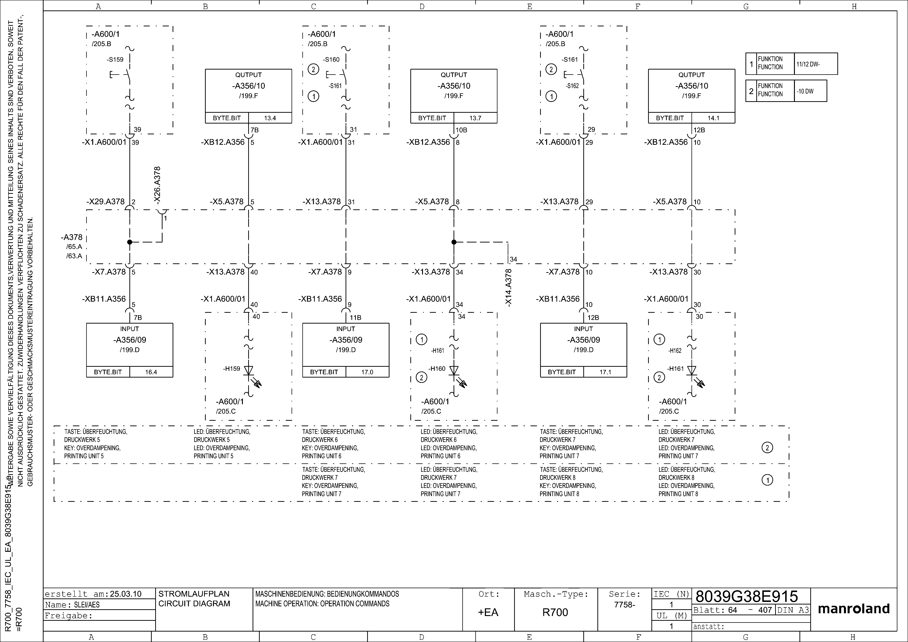

# +EA — Sheet 64 of 407 — MASCHINENBEDIENUNG: BEDIENUNGKOMMANDOS

**MACHINE OPERATION: OPERATION COMMANDS**

> Part of the manroland **R700** printing press IEC/UL circuit diagrams.
> Drawing class: **Stromlaufplan / Circuit diagram** (DIN A3).
> Document `+EA` covers the **Printing unit** machine section.

## At a glance

| Field | Value |
|---|---|
| Document | `+EA`  (8039G38E915) |
| Sheet | **64** of 407 |
| Section (DE) | MASCHINENBEDIENUNG: BEDIENUNGKOMMANDOS |
| Section (EN) | MACHINE OPERATION: OPERATION COMMANDS |
| Section type | CIRCUIT — Circuit diagram |
| Machine type | `R700` |
| Series | `7758` |
| Created | 25.03.10 |
| Replaces | — |
| Columns used | A, B, C, D, E, F, G, H |
| Path numbers | — |
| Labels on sheet | 177 |
| Cross-refs out | 14 |
| Cross-refs in | 40 |

**Previous:** [+EA sheet 63](SHEET_0063.md) · **Next:** [+EA sheet 65](SHEET_0065.md) · **Document TOC:** [_TOC.md](_TOC.md)  (+EA) · **Master TOC:** [all sheets](../_MASTER_TOC.md)

## Sheet image (300 DPI, exact vector render)



_Rendered directly from the PDF vector layer at 300 DPI (1-bit), no OCR and no resampling. Use it to confirm anything ambiguous in the text below._

## Cross-references on this sheet

Each entry is a wire leaving this sheet. The printed token is `/sheet.column`; the link resolves to that sheet inside the same document.

| Ref | Target sheet | Col | Path | Destination on target | Target section | From col |
|---|---|---|---|---|---|---|
| `/205.B` | [+EA sheet 205](SHEET_0205.md) | B | — | A600/1 | REFERENZMODUL | A |
| `/205.B` | [+EA sheet 205](SHEET_0205.md) | B | — | A600/1 | REFERENZMODUL | C |
| `/205.B` | [+EA sheet 205](SHEET_0205.md) | B | — | A600/1 | REFERENZMODUL | E |
| `/199.F` | [+EA sheet 199](SHEET_0199.md) | F | — | — | REFERENZMODUL | B |
| `/199.F` | [+EA sheet 199](SHEET_0199.md) | F | — | — | REFERENZMODUL | D |
| `/199.F` | [+EA sheet 199](SHEET_0199.md) | F | — | — | REFERENZMODUL | G |
| `/65.A` | [+EA sheet 65](SHEET_0065.md) | A | — | — | MASCHINENBEDIENUNG: BEDIENUNGKOMMANDOS | A |
| `/63.A` | [+EA sheet 63](SHEET_0063.md) | A | — | — | MASCHINENBEDIENUNG: BEDIENUNGKOMMANDOS | A |
| `/199.D` | [+EA sheet 199](SHEET_0199.md) | D | — | — | REFERENZMODUL | A |
| `/199.D` | [+EA sheet 199](SHEET_0199.md) | D | — | — | REFERENZMODUL | C |
| `/199.D` | [+EA sheet 199](SHEET_0199.md) | D | — | — | REFERENZMODUL | F |
| `/205.C` | [+EA sheet 205](SHEET_0205.md) | C | — | A600/1 | REFERENZMODUL | B |
| `/205.C` | [+EA sheet 205](SHEET_0205.md) | C | — | A600/1 | REFERENZMODUL | D |
| `/205.C` | [+EA sheet 205](SHEET_0205.md) | C | — | A600/1 | REFERENZMODUL | F |

### Incoming references (sheets that point here)

Every other sheet that sends a wire to this one. `Back-ref` is the token printed on *that* sheet; `Path` is its line number.

| From sheet | Cols | Back-ref | Path | Refs | What continues there |
|---|---|---|---|---|---|
| [+EA#63](SHEET_0063.md) | A | `/63.A` | — | 1 | — |
| [+EA#65](SHEET_0065.md) | A | `/65.A` | — | 1 | — |
| [+EA#199](SHEET_0199.md) | D, F | `/199.D`, `/199.F` | — | 6 | — |
| [+EA#205](SHEET_0205.md) | B, C | `/205.B`, `/205.C` | — | 6 | — |
| [+EA#212](SHEET_0212.md) | F | `/212.F` | — | 6 | — |
| [+EA#242](SHEET_0242.md) | D | `/242.D` | — | 3 | — |
| [+EA#247](SHEET_0247.md) | F | `/247.F` | — | 3 | — |
| [+EA#256](SHEET_0256.md) | B | `/256.B` | — | 3 | — |
| [+EA#257](SHEET_0257.md) | D | `/257.D` | — | 3 | — |
| [+EA#259](SHEET_0259.md) | B | `/259.B` | — | 5 | — |
| [+EA#260](SHEET_0260.md) | B | `/260.B` | — | 1 | — |
| [+EA#269](SHEET_0269.md) | D | `/269.D` | — | 1 | STROMPFAD PIN |
| [+EA#273](SHEET_0273.md) | H | `/273.H` | — | 1 | — |


## Devices on this sheet

| Tag | Class | Class meaning (IEC) | Col | Sub | Terminal | Sign |
|---|---|---|---|---|---|---|
| `S161` | S | Schalter / switch | E | — | — | — |
| `A600/1` | A | Baugruppe / assembly, module, PC board | E | 1 | — | — |
| `A356/10` | A | Baugruppe / assembly, module, PC board | D | 10 | — | — |
| `A356/09` | A | Baugruppe / assembly, module, PC board | F | 09 | — | — |
| `A600/1` | A | Baugruppe / assembly, module, PC board | D | 1 | — | — |
| `A356/10` | A | Baugruppe / assembly, module, PC board | B | 10 | — | — |
| `S160` | S | Schalter / switch | C | — | — | — |
| `A600/1` | A | Baugruppe / assembly, module, PC board | C | 1 | — | — |
| `A600/1` | A | Baugruppe / assembly, module, PC board | B | 1 | — | — |
| `A356/09` | A | Baugruppe / assembly, module, PC board | C | 09 | — | — |
| `A356/10` | A | Baugruppe / assembly, module, PC board | G | 10 | — | — |
| `A600/1` | A | Baugruppe / assembly, module, PC board | F | 1 | — | — |
| `A378` | A | Baugruppe / assembly, module, PC board | A | — | — | — |
| `S159` | S | Schalter / switch | A | — | — | — |
| `A600/1` | A | Baugruppe / assembly, module, PC board | A | 1 | — | — |
| `A356/09` | A | Baugruppe / assembly, module, PC board | A | 09 | — | — |
| `S162` | S | Schalter / switch | E | — | — | — |
| `S161` | S | Schalter / switch | C | — | — | — |
| `13.7` | — | cross-device reference | D | — | — | — |
| `XB12.A356` | — | cross-device reference | D | — | — | — |
| `X13.A378` | — | cross-device reference | E | — | — | — |
| `X5.A378` | — | cross-device reference | D | — | — | — |
| `17.1` | — | cross-device reference | F | — | — | — |
| `XB11.A356` | — | cross-device reference | E | — | — | — |
| `13.4` | — | cross-device reference | C | — | — | — |
| `XB12.A356` | — | cross-device reference | B | — | — | — |
| `X5.A378` | — | cross-device reference | B | — | — | — |
| `X13.A378` | — | cross-device reference | C | — | — | — |
| `17.0` | — | cross-device reference | C | — | — | — |
| `XB11.A356` | — | cross-device reference | C | — | — | — |
| `14.1` | — | cross-device reference | G | — | — | — |
| `XB12.A356` | — | cross-device reference | F | — | — | — |
| `X5.A378` | — | cross-device reference | F | — | — | — |
| `X7.A378` | — | cross-device reference | E | — | — | — |
| `X13.A378` | — | cross-device reference | D | — | — | — |
| `X13.A378` | — | cross-device reference | B | — | — | — |
| `X7.A378` | — | cross-device reference | C | — | — | — |
| `X13.A378` | — | cross-device reference | F | — | — | — |
| `X29.A378` | — | cross-device reference | A | — | — | — |
| `16.4` | — | cross-device reference | A | — | — | — |
| `XB11.A356` | — | cross-device reference | A | — | — | — |
| `X7.A378` | — | cross-device reference | A | — | — | — |
| `X14.A378` | — | cross-device reference | E | — | — | — |
| `X26.A378` | — | cross-device reference | B | — | — | — |

## Potentials / nets

| Potential | Count | Columns | Attached devices | Terminals |
|---|---|---|---|---|
| `H159` | 1 | B | — | — |
| `H160` | 1 | D | — | — |
| `H161` | 2 | D, F | — | — |
| `H162` | 1 | F | — | — |


A potential such as `L24+/4` or `M24+` is a named supply/return rail; every place it appears on this sheet is electrically common.

## Wire-end annotations (grouped as printed)

A wire that continues elsewhere is annotated with a small cluster: the destination description, the path/line number `#NN`, and the `/sheet.column` cross reference. Each row below is one such cluster exactly as it is grouped on the drawing.

| Col | Y | Path | Cross-ref | Text on the wire |
|---|---|---|---|---|
| A | 40.0 | — | `/205.B` | `A600/1` |
| C | 40.0 | — | `/205.B` | `A600/1` |
| E | 40.0 | — | `/205.B` | `A600/1` |
| G | 74.3 | — | — | `1 FUNKTION FUNCTION 11/12 DW` |
| A | 74.4 | — | — | `S159` |
| C | 74.4 | — | — | `S160` |
| E | 74.4 | — | — | `S161` |
| C | 88.2 | — | — | `2` |
| E | 88.2 | — | — | `2` |
| B | 94.7 | — | — | `QUTPUT` |
| D | 94.7 | — | — | `QUTPUT` |
| F | 94.7 | — | — | `QUTPUT` |
| B | 108.0 | — | — | `A356/10` |
| D | 108.0 | — | — | `A356/10` |
| G | 108.0 | — | — | `A356/10` |
| C | 109.7 | — | — | `S161` |
| G | 109.7 | — | — | `2 FUNKTION FUNCTION 10 DW` |
| E | 109.8 | — | — | `S162` |
| B | 121.8 | — | `/199.F` | — |
| D | 121.8 | — | `/199.F` | — |
| G | 121.8 | — | `/199.F` | — |
| C | 123.1 | — | — | `1` |
| E | 123.1 | — | — | `1` |
| B | 151.4 | — | — | `BYTE.BIT 13.4` |
| D | 151.4 | — | — | `BYTE.BIT 13.7` |
| F | 151.4 | — | — | `BYTE.BIT 14.1` |
| A | 166.2 | — | — | `39` |
| C | 166.2 | — | — | `31` |
| F | 166.2 | — | — | `29` |
| B | 166.8 | — | — | `7B` |
| D | 166.8 | — | — | `10B` |
| G | 166.8 | — | — | `12B` |
| A | 181.7 | — | — | `X1.A600/01 39` |
| C | 181.7 | — | — | `XB12.A356 5 X1.A600/01 31` |
| D | 181.7 | — | — | `XB12.A356 8` |
| E | 181.7 | — | — | `X1.A600/01 29` |
| F | 181.7 | — | — | `XB12.A356 10` |
| B | 218.0 | — | — | `X26.A378` |
| A | 259.7 | — | — | `X29.A378 2` |
| C | 259.7 | — | — | `X5.A378 5 X13.A378 31` |
| E | 259.7 | — | — | `X5.A378 8 X13.A378 29` |
| F | 259.7 | — | — | `X5.A378 10` |
| B | 282.4 | — | — | `1` |
| A | 306.4 | — | — | `A378` |
| A | 319.5 | — | `/65.A`, `/63.A` | — |
| E | 336.2 | — | — | `34` |
| A | 351.8 | — | — | `X7.A378 5` |
| D | 351.8 | — | — | `X13.A378 40 X7.A378 9 X13.A378 30` |
| E | 351.8 | — | — | `X13.A378 34 X7.A378 10` |
| E | 352.4 | — | — | `X14.A378` |
| A | 387.2 | — | — | `XB11.A356 5` |
| B | 387.2 | — | — | `X1.A600/01 40` |
| C | 387.2 | — | — | `XB11.A356 9` |
| D | 387.2 | — | — | `X1.A600/01 34` |
| E | 387.2 | — | — | `XB11.A356 10` |
| F | 387.2 | — | — | `X1.A600/01 30` |
| B | 411.4 | — | — | `40` |
| D | 411.4 | — | — | `34` |
| G | 411.4 | — | — | `30` |
| A | 412.7 | — | — | `7B` |
| C | 412.7 | — | — | `11B` |
| F | 412.7 | — | — | `12B` |
| A | 427.8 | — | — | `INPUT` |
| C | 427.8 | — | — | `INPUT` |
| E | 427.8 | — | — | `INPUT` |
| A | 441.1 | — | — | `A356/09` |
| C | 441.1 | — | — | `A356/09` |
| F | 441.1 | — | — | `A356/09` |
| D | 442.0 | — | — | `1` |
| F | 442.0 | — | — | `1` |
| A | 454.9 | — | `/199.D` | — |
| C | 454.9 | — | `/199.D` | — |
| F | 454.9 | — | `/199.D` | — |
| D | 457.0 | — | — | `H161` |
| F | 457.0 | — | — | `H162` |
| B | 479.8 | — | — | `H159` |
| D | 479.8 | — | — | `H160` |
| F | 479.8 | — | — | `H161` |
| A | 484.5 | — | — | `BYTE.BIT 16.4` |
| C | 484.5 | — | — | `BYTE.BIT 17.0` |
| E | 484.5 | — | — | `BYTE.BIT 17.1` |
| D | 492.1 | — | — | `2` |
| F | 492.1 | — | — | `2` |
| B | 521.9 | — | `/205.C` | `A600/1` |
| D | 521.9 | — | `/205.C` | `A600/1` |
| F | 521.9 | — | `/205.C` | `A600/1` |
| A | 563.3 | — | — | `DRUCKWERK 5 KEY: OVERDAMPENING, PRINTING UNIT 5 TASTE: ÜBERFEUCHTUNG,` |
| B | 563.3 | — | — | `LED: ÜBERFEUCHTUNG, DRUCKWERK 5 LED: OVERDAMPENING, PRINTING UNIT 5` |
| C | 563.3 | — | — | `DRUCKWERK 6 KEY: OVERDAMPENING, PRINTING UNIT 6 TASTE: ÜBERFEUCHTUNG,` |
| D | 563.3 | — | — | `LED: ÜBERFEUCHTUNG, DRUCKWERK 6 LED: OVERDAMPENING, PRINTING UNIT 6` |
| E | 563.3 | — | — | `DRUCKWERK 7 KEY: OVERDAMPENING, PRINTING UNIT 7 TASTE: ÜBERFEUCHTUNG,` |
| F | 563.3 | — | — | `LED: ÜBERFEUCHTUNG, DRUCKWERK 7 LED: OVERDAMPENING, PRINTING UNIT 7` |
| G | 584.2 | — | — | `2` |
| C | 612.9 | — | — | `DRUCKWERK 7 KEY: OVERDAMPENING, PRINTING UNIT 7 TASTE: ÜBERFEUCHTUNG,` |
| D | 612.9 | — | — | `LED: ÜBERFEUCHTUNG, DRUCKWERK 7 LED: OVERDAMPENING, PRINTING UNIT 7` |
| E | 612.9 | — | — | `DRUCKWERK 8 KEY: OVERDAMPENING, PRINTING UNIT 8 TASTE: ÜBERFEUCHTUNG,` |
| F | 612.9 | — | — | `LED: ÜBERFEUCHTUNG, DRUCKWERK 8 LED: OVERDAMPENING, PRINTING UNIT 8` |
| G | 626.2 | — | — | `1` |


## Reconstructed tables

This sheet carries tabular content (pin map / terminal assignment / index). The grid below was rebuilt from the drawing's own rule lines, so each row is exactly one physical row of the table.

### Table 1 — 4 data rows × 3 columns (at x=113.4, y=34.0) — **A600/1 /205.B S159 39**

| X1.A600/01 X29.A378 | 39 X26.A378 2 | 1 |
|---|---|---|
| `X7.A378 XB11.A356` | `5 5` |  |
|  | `7B` |  |
| `INPUT` | `A356/09 /199.D` |  |
| `BYTE.BIT` | `16.4` |  |


### Table 2 — 7 data rows × 2 columns (at x=269.3, y=34.0)

| QUTPUT | A356/10 /199.F |
|---|---|
| `BYTE.BIT` | `13.4` |
|  | `7B` |
| `XB12.A356 X5.A378` | `5 5` |
| `X13.A378 X1.A600/01` | `40 40` |
|  | `40` |
| `H159` |  |
| `A600/1 /205.C` |  |


### Table 3 — 4 data rows × 2 columns (at x=396.9, y=34.0) — **A600/1 /205.B S160 2 S161 1 31**

| X1.A600/01 X13.A378 | 31 31 |
|---|---|
| `X7.A378 XB11.A356` | `9 9` |
|  | `11B` |
| `INPUT` | `A356/09 /199.D` |
| `BYTE.BIT` | `17.0` |


### Table 4 — 8 data rows × 5 columns (at x=538.6, y=34.0) — **A600/1 /205.B S161**

| QUTPUT | A356/10 /199.F |  | 2 S162 1 |  |
|---|---|---|---|---|
| `BYTE.BIT` | `13.7` |  |  |  |
|  | `10B` |  |  | `29` |
| `XB12.A356 X5.A378` | `8 8` |  | `X1.A600/01 X13.A378` | `29 29` |
| `X13.A378 X1.A600/01` | `34 34` | `34 X14.A378` | `X7.A378 XB11.A356` | `10 10` |
|  | `34` |  |  | `12B` |
| `1 H161` |  |  | `INPUT` | `A356/09 /199.D` |
| `H160` |  |  | `BYTE.BIT` | `17.1` |
| `2 A600/1 /205.C` |  |  |  |  |


### Table 5 — 8 data rows × 2 columns (at x=850.4, y=34.0)

| QUTPUT | A356/10 /199.F |
|---|---|
| `BYTE.BIT` | `14.1` |
|  | `12B` |
| `XB12.A356 X5.A378` | `10 10` |
| `X13.A378 X1.A600/01` | `30 30` |
|  | `30` |
| `1 H162` |  |
| `H161` |  |
| `2 A600/1 /205.C` |  |


## Notes and free text on this sheet

| Text | Col | Y (pt) |
|---|---|---|
| `X1.A600/01` | E | 181.73 |
| `10B` | D | 166.82 |
| `QUTPUT` | D | 94.67 |
| `BYTE.BIT` | D | 151.43 |
| `12B` | F | 412.73 |
| `INPUT` | E | 427.81 |
| `BYTE.BIT` | E | 484.5 |
| `TASTE: ÜBERFEUCHTUNG,` | E | 563.3 |
| `DRUCKWERK 7` | E | 573.91 |
| `KEY: OVERDAMPENING,` | E | 584.55 |
| `PRINTING UNIT 7` | E | 595.2 |
| `LED: ÜBERFEUCHTUNG,` | D | 563.31 |
| `DRUCKWERK 6` | D | 573.91 |
| `LED: OVERDAMPENING,` | D | 584.56 |
| `PRINTING UNIT 6` | D | 595.2 |
| `X1.A600/01` | D | 387.24 |
| `7B` | B | 166.81 |
| `QUTPUT` | B | 94.67 |
| `BYTE.BIT` | B | 151.43 |
| `X1.A600/01` | C | 181.73 |
| `LED: ÜBERFEUCHTUNG,` | B | 563.31 |
| `DRUCKWERK 5` | B | 573.91 |
| `LED: OVERDAMPENING,` | B | 584.56 |
| `PRINTING UNIT 5` | B | 595.2 |
| `X1.A600/01` | B | 387.24 |
| `11B` | C | 412.73 |
| `INPUT` | C | 427.81 |
| `BYTE.BIT` | C | 484.5 |
| `TASTE: ÜBERFEUCHTUNG,` | C | 563.3 |
| `DRUCKWERK 6` | C | 573.91 |
| `KEY: OVERDAMPENING,` | C | 584.55 |
| `PRINTING UNIT 6` | C | 595.2 |
| `12B` | G | 166.82 |
| `QUTPUT` | F | 94.67 |
| `BYTE.BIT` | F | 151.43 |
| `LED: ÜBERFEUCHTUNG,` | F | 563.31 |
| `DRUCKWERK 7` | F | 573.91 |
| `LED: OVERDAMPENING,` | F | 584.56 |
| `PRINTING UNIT 7` | F | 595.2 |
| `X1.A600/01` | F | 387.24 |
| `X1.A600/01` | A | 181.73 |
| `7B` | A | 412.71 |
| `INPUT` | A | 427.81 |
| `BYTE.BIT` | A | 484.5 |
| `TASTE: ÜBERFEUCHTUNG,` | A | 563.3 |
| `DRUCKWERK 5` | A | 573.91 |
| `KEY: OVERDAMPENING,` | A | 584.55 |
| `PRINTING UNIT 5` | A | 595.2 |
| `DRUCKWERK 7` | D | 623.51 |
| `PRINTING UNIT 7` | D | 644.8 |
| `DRUCKWERK 8` | E | 623.51 |
| `PRINTING UNIT 8` | E | 644.8 |
| `DRUCKWERK 7` | C | 623.51 |
| `PRINTING UNIT 7` | C | 644.8 |
| `DRUCKWERK 8` | F | 623.51 |
| `PRINTING UNIT 8` | F | 644.8 |
| `FUNKTION` | G | 109.74 |
| `FUNCTION` | G | 120.38 |
| `10 DW` | H | 116.79 |
| `11/12 DW` | H | 81.36 |

## Complete label inventory (exact text from the drawing)

Every text object inside the drawing area of this sheet, in DIN reading order (column A→H, then top→bottom). This is the authoritative list: if a string is not here it is not printed on this sheet.

| Col | Y | X | Dir | Type | Text |
|---|---|---|---|---|---|
| A | 40.0 | 120.2 | → | device tag | `A600/1` |
| A | 53.8 | 120.5 | → | cross-reference | `/205.B` |
| A | 74.4 | 140.0 | → | device tag | `S159` |
| A | 166.2 | 175.5 | → | number | `39` |
| A | 181.7 | 107.4 | → | text | `X1.A600/01` |
| A | 183.2 | 172.6 | → | number | `39` |
| A | 259.7 | 113.4 | → | device ref | `X29.A378` |
| A | 261.1 | 172.6 | → | number | `2` |
| A | 306.4 | 79.9 | → | device tag | `A378` |
| A | 319.5 | 87.0 | → | cross-reference | `/65.A` |
| A | 331.9 | 87.0 | → | cross-reference | `/63.A` |
| A | 351.8 | 120.8 | → | device ref | `X7.A378` |
| A | 353.2 | 172.6 | → | number | `5` |
| A | 387.2 | 107.7 | → | device ref | `XB11.A356` |
| A | 395.8 | 172.6 | → | number | `5` |
| A | 412.7 | 175.5 | → | text | `7B` |
| A | 427.8 | 157.6 | → | text | `INPUT` |
| A | 441.1 | 148.7 | → | device tag | `A356/09` |
| A | 454.9 | 157.3 | → | cross-reference | `/199.D` |
| A | 484.5 | 123.3 | → | text | `BYTE.BIT` |
| A | 484.5 | 190.2 | → | device ref | `16.4` |
| A | 563.3 | 84.8 | → | text | `TASTE: ÜBERFEUCHTUNG,` |
| A | 573.9 | 84.2 | → | text | `DRUCKWERK 5` |
| A | 584.6 | 84.2 | → | text | `KEY: OVERDAMPENING,` |
| A | 595.2 | 84.2 | → | text | `PRINTING UNIT 5` |
| B | 94.7 | 308.7 | → | text | `QUTPUT` |
| B | 108.0 | 304.6 | → | device tag | `A356/10` |
| B | 121.8 | 313.7 | → | cross-reference | `/199.F` |
| B | 151.4 | 279.2 | → | text | `BYTE.BIT` |
| B | 166.8 | 328.5 | → | text | `7B` |
| B | 181.7 | 263.6 | → | device ref | `XB12.A356` |
| B | 183.2 | 328.5 | → | number | `5` |
| B | 218.0 | 201.6 | ↕ | device ref | `X26.A378` |
| B | 259.7 | 275.2 | → | device ref | `X5.A378` |
| B | 261.1 | 328.5 | → | number | `5` |
| B | 282.4 | 214.6 | → | number | `1` |
| B | 351.8 | 270.7 | → | device ref | `X13.A378` |
| B | 353.2 | 328.5 | → | number | `40` |
| B | 387.2 | 263.3 | → | text | `X1.A600/01` |
| B | 395.8 | 328.5 | → | number | `40` |
| B | 411.3 | 331.4 | → | number | `40` |
| B | 479.8 | 292.5 | → | potential | `H159` |
| B | 521.9 | 283.2 | → | device tag | `A600/1` |
| B | 535.7 | 283.5 | → | cross-reference | `/205.C` |
| B | 563.3 | 254.3 | → | text | `LED: ÜBERFEUCHTUNG,` |
| B | 573.9 | 254.3 | → | text | `DRUCKWERK 5` |
| B | 584.6 | 254.3 | → | text | `LED: OVERDAMPENING,` |
| B | 595.2 | 254.3 | → | text | `PRINTING UNIT 5` |
| C | 40.0 | 403.7 | → | device tag | `A600/1` |
| C | 53.8 | 403.9 | → | cross-reference | `/205.B` |
| C | 74.4 | 423.5 | → | device tag | `S160` |
| C | 88.2 | 409.0 | → | number | `2` |
| C | 109.7 | 431.1 | → | device tag | `S161` |
| C | 123.1 | 409.3 | → | number | `1` |
| C | 151.5 | 346.1 | → | device ref | `13.4` |
| C | 166.2 | 458.9 | → | number | `31` |
| C | 181.7 | 390.9 | → | text | `X1.A600/01` |
| C | 183.2 | 456.1 | → | number | `31` |
| C | 259.7 | 396.9 | → | device ref | `X13.A378` |
| C | 261.1 | 456.1 | → | number | `31` |
| C | 351.8 | 404.2 | → | device ref | `X7.A378` |
| C | 353.2 | 456.1 | → | number | `9` |
| C | 387.2 | 391.2 | → | device ref | `XB11.A356` |
| C | 395.8 | 456.1 | → | number | `9` |
| C | 412.7 | 458.4 | → | text | `11B` |
| C | 427.8 | 441.1 | → | text | `INPUT` |
| C | 441.1 | 432.1 | → | device tag | `A356/09` |
| C | 454.9 | 440.8 | → | cross-reference | `/199.D` |
| C | 484.5 | 406.8 | → | text | `BYTE.BIT` |
| C | 484.5 | 473.7 | → | device ref | `17.0` |
| C | 563.3 | 396.6 | → | text | `TASTE: ÜBERFEUCHTUNG,` |
| C | 573.9 | 396.0 | → | text | `DRUCKWERK 6` |
| C | 584.6 | 396.0 | → | text | `KEY: OVERDAMPENING,` |
| C | 595.2 | 396.0 | → | text | `PRINTING UNIT 6` |
| C | 612.9 | 396.6 | → | text | `TASTE: ÜBERFEUCHTUNG,` |
| C | 623.5 | 396.0 | → | text | `DRUCKWERK 7` |
| C | 634.2 | 396.0 | → | text | `KEY: OVERDAMPENING,` |
| C | 644.8 | 396.0 | → | text | `PRINTING UNIT 7` |
| D | 94.7 | 578.0 | → | text | `QUTPUT` |
| D | 108.0 | 573.9 | → | device tag | `A356/10` |
| D | 121.8 | 582.9 | → | cross-reference | `/199.F` |
| D | 151.4 | 548.5 | → | text | `BYTE.BIT` |
| D | 151.5 | 615.4 | → | device ref | `13.7` |
| D | 166.8 | 597.3 | → | text | `10B` |
| D | 181.7 | 532.9 | → | device ref | `XB12.A356` |
| D | 183.2 | 597.8 | → | number | `8` |
| D | 259.7 | 544.5 | → | device ref | `X5.A378` |
| D | 261.1 | 597.8 | → | number | `8` |
| D | 351.8 | 540.0 | → | device ref | `X13.A378` |
| D | 353.2 | 597.8 | → | number | `34` |
| D | 387.2 | 532.6 | → | text | `X1.A600/01` |
| D | 395.8 | 597.8 | → | number | `34` |
| D | 411.3 | 600.7 | → | number | `34` |
| D | 442.0 | 551.0 | → | number | `1` |
| D | 457.0 | 565.5 | → | potential | `H161` |
| D | 479.8 | 561.8 | → | potential | `H160` |
| D | 492.1 | 550.8 | → | number | `2` |
| D | 521.9 | 552.5 | → | device tag | `A600/1` |
| D | 535.7 | 552.8 | → | cross-reference | `/205.C` |
| D | 563.3 | 551.9 | → | text | `LED: ÜBERFEUCHTUNG,` |
| D | 573.9 | 551.9 | → | text | `DRUCKWERK 6` |
| D | 584.6 | 551.9 | → | text | `LED: OVERDAMPENING,` |
| D | 595.2 | 551.9 | → | text | `PRINTING UNIT 6` |
| D | 612.9 | 551.9 | → | text | `LED: ÜBERFEUCHTUNG,` |
| D | 623.5 | 551.9 | → | text | `DRUCKWERK 7` |
| D | 634.2 | 551.9 | → | text | `LED: OVERDAMPENING,` |
| D | 644.8 | 551.9 | → | text | `PRINTING UNIT 7` |
| E | 40.0 | 715.5 | → | device tag | `A600/1` |
| E | 53.8 | 715.7 | → | cross-reference | `/205.B` |
| E | 74.4 | 736.4 | → | device tag | `S161` |
| E | 88.2 | 720.8 | → | number | `2` |
| E | 109.8 | 742.1 | → | device tag | `S162` |
| E | 123.1 | 721.1 | → | number | `1` |
| E | 181.7 | 702.7 | → | text | `X1.A600/01` |
| E | 259.7 | 708.7 | → | device ref | `X13.A378` |
| E | 336.2 | 668.7 | → | number | `34` |
| E | 351.8 | 716.0 | → | device ref | `X7.A378` |
| E | 352.3 | 662.2 | ↕ | device ref | `X14.A378` |
| E | 387.2 | 703.0 | → | device ref | `XB11.A356` |
| E | 427.8 | 752.9 | → | text | `INPUT` |
| E | 484.5 | 718.6 | → | text | `BYTE.BIT` |
| E | 563.3 | 708.4 | → | text | `TASTE: ÜBERFEUCHTUNG,` |
| E | 573.9 | 707.8 | → | text | `DRUCKWERK 7` |
| E | 584.6 | 707.8 | → | text | `KEY: OVERDAMPENING,` |
| E | 595.2 | 707.8 | → | text | `PRINTING UNIT 7` |
| E | 612.9 | 708.4 | → | text | `TASTE: ÜBERFEUCHTUNG,` |
| E | 623.5 | 707.8 | → | text | `DRUCKWERK 8` |
| E | 634.2 | 707.8 | → | text | `KEY: OVERDAMPENING,` |
| E | 644.8 | 707.8 | → | text | `PRINTING UNIT 8` |
| F | 94.7 | 889.8 | → | text | `QUTPUT` |
| F | 151.4 | 860.3 | → | text | `BYTE.BIT` |
| F | 166.2 | 770.7 | → | number | `29` |
| F | 181.7 | 844.7 | → | device ref | `XB12.A356` |
| F | 183.2 | 767.9 | → | number | `29` |
| F | 259.7 | 856.3 | → | device ref | `X5.A378` |
| F | 261.1 | 767.9 | → | number | `29` |
| F | 351.8 | 851.8 | → | device ref | `X13.A378` |
| F | 353.2 | 767.3 | → | number | `10` |
| F | 387.2 | 844.4 | → | text | `X1.A600/01` |
| F | 395.8 | 767.3 | → | number | `10` |
| F | 412.7 | 770.2 | → | text | `12B` |
| F | 441.1 | 744.0 | → | device tag | `A356/09` |
| F | 442.0 | 862.8 | → | number | `1` |
| F | 454.9 | 752.6 | → | cross-reference | `/199.D` |
| F | 457.0 | 876.5 | → | potential | `H162` |
| F | 479.8 | 874.8 | → | potential | `H161` |
| F | 484.5 | 786.0 | → | device ref | `17.1` |
| F | 492.1 | 862.6 | → | number | `2` |
| F | 521.9 | 864.3 | → | device tag | `A600/1` |
| F | 535.7 | 864.6 | → | cross-reference | `/205.C` |
| F | 563.3 | 863.7 | → | text | `LED: ÜBERFEUCHTUNG,` |
| F | 573.9 | 863.7 | → | text | `DRUCKWERK 7` |
| F | 584.6 | 863.7 | → | text | `LED: OVERDAMPENING,` |
| F | 595.2 | 863.7 | → | text | `PRINTING UNIT 7` |
| F | 612.9 | 863.7 | → | text | `LED: ÜBERFEUCHTUNG,` |
| F | 623.5 | 863.7 | → | text | `DRUCKWERK 8` |
| F | 634.2 | 863.7 | → | text | `LED: OVERDAMPENING,` |
| F | 644.8 | 863.7 | → | text | `PRINTING UNIT 8` |
| G | 74.3 | 994.1 | → | text | `FUNKTION` |
| G | 79.6 | 982.5 | → | number | `1` |
| G | 85.0 | 994.1 | → | text | `FUNCTION` |
| G | 108.0 | 885.7 | → | device tag | `A356/10` |
| G | 109.7 | 994.1 | → | text | `FUNKTION` |
| G | 115.1 | 982.2 | → | number | `2` |
| G | 120.4 | 994.1 | → | text | `FUNCTION` |
| G | 121.8 | 894.8 | → | cross-reference | `/199.F` |
| G | 151.5 | 927.8 | → | device ref | `14.1` |
| G | 166.8 | 909.1 | → | text | `12B` |
| G | 183.2 | 909.1 | → | number | `10` |
| G | 261.1 | 909.1 | → | number | `10` |
| G | 353.2 | 909.6 | → | number | `30` |
| G | 395.8 | 909.6 | → | number | `30` |
| G | 411.3 | 912.5 | → | number | `30` |
| G | 584.2 | 1004.3 | → | number | `2` |
| G | 626.2 | 1004.5 | → | number | `1` |
| H | 81.4 | 1044.4 | → | text | `11/12 DW` |
| H | 116.8 | 1045.0 | → | text | `10 DW` |

## Reading-order text block

The same content as a plain block, grouped by DIN column — convenient to paste or to match against a visual description.

```text
=== Column A ===
  40.0  120.2  devtag       A600/1
  53.8  120.5  xref         /205.B
  74.4  140.0  devtag       S159
 166.2  175.5  numeric      39
 181.7  107.4  text         X1.A600/01
 183.2  172.6  numeric      39
 259.7  113.4  devref       X29.A378
 261.1  172.6  numeric      2
 306.4   79.9  devtag       A378
 319.5   87.0  xref         /65.A
 331.9   87.0  xref         /63.A
 351.8  120.8  devref       X7.A378
 353.2  172.6  numeric      5
 387.2  107.7  devref       XB11.A356
 395.8  172.6  numeric      5
 412.7  175.5  text         7B
 427.8  157.6  text         INPUT
 441.1  148.7  devtag       A356/09
 454.9  157.3  xref         /199.D
 484.5  123.3  text         BYTE.BIT
 484.5  190.2  devref       16.4
 563.3   84.8  text         TASTE: ÜBERFEUCHTUNG,
 573.9   84.2  text         DRUCKWERK 5
 584.6   84.2  text         KEY: OVERDAMPENING,
 595.2   84.2  text         PRINTING UNIT 5
=== Column B ===
  94.7  308.7  text         QUTPUT
 108.0  304.6  devtag       A356/10
 121.8  313.7  xref         /199.F
 151.4  279.2  text         BYTE.BIT
 166.8  328.5  text         7B
 181.7  263.6  devref       XB12.A356
 183.2  328.5  numeric      5
 218.0  201.6  devref       X26.A378
 259.7  275.2  devref       X5.A378
 261.1  328.5  numeric      5
 282.4  214.6  numeric      1
 351.8  270.7  devref       X13.A378
 353.2  328.5  numeric      40
 387.2  263.3  text         X1.A600/01
 395.8  328.5  numeric      40
 411.3  331.4  numeric      40
 479.8  292.5  net          H159
 521.9  283.2  devtag       A600/1
 535.7  283.5  xref         /205.C
 563.3  254.3  text         LED: ÜBERFEUCHTUNG,
 573.9  254.3  text         DRUCKWERK 5
 584.6  254.3  text         LED: OVERDAMPENING,
 595.2  254.3  text         PRINTING UNIT 5
=== Column C ===
  40.0  403.7  devtag       A600/1
  53.8  403.9  xref         /205.B
  74.4  423.5  devtag       S160
  88.2  409.0  numeric      2
 109.7  431.1  devtag       S161
 123.1  409.3  numeric      1
 151.5  346.1  devref       13.4
 166.2  458.9  numeric      31
 181.7  390.9  text         X1.A600/01
 183.2  456.1  numeric      31
 259.7  396.9  devref       X13.A378
 261.1  456.1  numeric      31
 351.8  404.2  devref       X7.A378
 353.2  456.1  numeric      9
 387.2  391.2  devref       XB11.A356
 395.8  456.1  numeric      9
 412.7  458.4  text         11B
 427.8  441.1  text         INPUT
 441.1  432.1  devtag       A356/09
 454.9  440.8  xref         /199.D
 484.5  406.8  text         BYTE.BIT
 484.5  473.7  devref       17.0
 563.3  396.6  text         TASTE: ÜBERFEUCHTUNG,
 573.9  396.0  text         DRUCKWERK 6
 584.6  396.0  text         KEY: OVERDAMPENING,
 595.2  396.0  text         PRINTING UNIT 6
 612.9  396.6  text         TASTE: ÜBERFEUCHTUNG,
 623.5  396.0  text         DRUCKWERK 7
 634.2  396.0  text         KEY: OVERDAMPENING,
 644.8  396.0  text         PRINTING UNIT 7
=== Column D ===
  94.7  578.0  text         QUTPUT
 108.0  573.9  devtag       A356/10
 121.8  582.9  xref         /199.F
 151.4  548.5  text         BYTE.BIT
 151.5  615.4  devref       13.7
 166.8  597.3  text         10B
 181.7  532.9  devref       XB12.A356
 183.2  597.8  numeric      8
 259.7  544.5  devref       X5.A378
 261.1  597.8  numeric      8
 351.8  540.0  devref       X13.A378
 353.2  597.8  numeric      34
 387.2  532.6  text         X1.A600/01
 395.8  597.8  numeric      34
 411.3  600.7  numeric      34
 442.0  551.0  numeric      1
 457.0  565.5  net          H161
 479.8  561.8  net          H160
 492.1  550.8  numeric      2
 521.9  552.5  devtag       A600/1
 535.7  552.8  xref         /205.C
 563.3  551.9  text         LED: ÜBERFEUCHTUNG,
 573.9  551.9  text         DRUCKWERK 6
 584.6  551.9  text         LED: OVERDAMPENING,
 595.2  551.9  text         PRINTING UNIT 6
 612.9  551.9  text         LED: ÜBERFEUCHTUNG,
 623.5  551.9  text         DRUCKWERK 7
 634.2  551.9  text         LED: OVERDAMPENING,
 644.8  551.9  text         PRINTING UNIT 7
=== Column E ===
  40.0  715.5  devtag       A600/1
  53.8  715.7  xref         /205.B
  74.4  736.4  devtag       S161
  88.2  720.8  numeric      2
 109.8  742.1  devtag       S162
 123.1  721.1  numeric      1
 181.7  702.7  text         X1.A600/01
 259.7  708.7  devref       X13.A378
 336.2  668.7  numeric      34
 351.8  716.0  devref       X7.A378
 352.3  662.2  devref       X14.A378
 387.2  703.0  devref       XB11.A356
 427.8  752.9  text         INPUT
 484.5  718.6  text         BYTE.BIT
 563.3  708.4  text         TASTE: ÜBERFEUCHTUNG,
 573.9  707.8  text         DRUCKWERK 7
 584.6  707.8  text         KEY: OVERDAMPENING,
 595.2  707.8  text         PRINTING UNIT 7
 612.9  708.4  text         TASTE: ÜBERFEUCHTUNG,
 623.5  707.8  text         DRUCKWERK 8
 634.2  707.8  text         KEY: OVERDAMPENING,
 644.8  707.8  text         PRINTING UNIT 8
=== Column F ===
  94.7  889.8  text         QUTPUT
 151.4  860.3  text         BYTE.BIT
 166.2  770.7  numeric      29
 181.7  844.7  devref       XB12.A356
 183.2  767.9  numeric      29
 259.7  856.3  devref       X5.A378
 261.1  767.9  numeric      29
 351.8  851.8  devref       X13.A378
 353.2  767.3  numeric      10
 387.2  844.4  text         X1.A600/01
 395.8  767.3  numeric      10
 412.7  770.2  text         12B
 441.1  744.0  devtag       A356/09
 442.0  862.8  numeric      1
 454.9  752.6  xref         /199.D
 457.0  876.5  net          H162
 479.8  874.8  net          H161
 484.5  786.0  devref       17.1
 492.1  862.6  numeric      2
 521.9  864.3  devtag       A600/1
 535.7  864.6  xref         /205.C
 563.3  863.7  text         LED: ÜBERFEUCHTUNG,
 573.9  863.7  text         DRUCKWERK 7
 584.6  863.7  text         LED: OVERDAMPENING,
 595.2  863.7  text         PRINTING UNIT 7
 612.9  863.7  text         LED: ÜBERFEUCHTUNG,
 623.5  863.7  text         DRUCKWERK 8
 634.2  863.7  text         LED: OVERDAMPENING,
 644.8  863.7  text         PRINTING UNIT 8
=== Column G ===
  74.3  994.1  text         FUNKTION
  79.6  982.5  numeric      1
  85.0  994.1  text         FUNCTION
 108.0  885.7  devtag       A356/10
 109.7  994.1  text         FUNKTION
 115.1  982.2  numeric      2
 120.4  994.1  text         FUNCTION
 121.8  894.8  xref         /199.F
 151.5  927.8  devref       14.1
 166.8  909.1  text         12B
 183.2  909.1  numeric      10
 261.1  909.1  numeric      10
 353.2  909.6  numeric      30
 395.8  909.6  numeric      30
 411.3  912.5  numeric      30
 584.2 1004.3  numeric      2
 626.2 1004.5  numeric      1
=== Column H ===
  81.4 1044.4  text         11/12 DW
 116.8 1045.0  text         10 DW
```

---
_Generated from the PDF vector text layer; no OCR. Source: `R700_7758_IEC_UL_EA_8039G38E915_p`, sheet 64._
