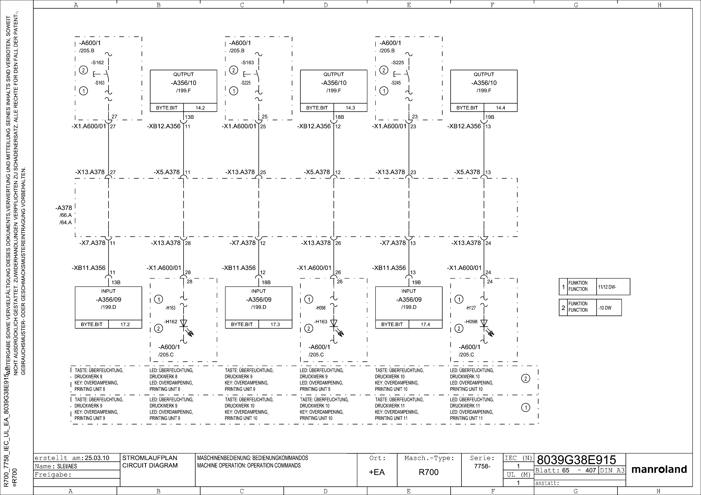

# +EA — Sheet 65 of 407 — MASCHINENBEDIENUNG: BEDIENUNGKOMMANDOS

**MACHINE OPERATION: OPERATION COMMANDS**

> Part of the manroland **R700** printing press IEC/UL circuit diagrams.
> Drawing class: **Stromlaufplan / Circuit diagram** (DIN A3).
> Document `+EA` covers the **Printing unit** machine section.

## At a glance

| Field | Value |
|---|---|
| Document | `+EA`  (8039G38E915) |
| Sheet | **65** of 407 |
| Section (DE) | MASCHINENBEDIENUNG: BEDIENUNGKOMMANDOS |
| Section (EN) | MACHINE OPERATION: OPERATION COMMANDS |
| Section type | CIRCUIT — Circuit diagram |
| Machine type | `R700` |
| Series | `7758` |
| Created | 25.03.10 |
| Replaces | — |
| Columns used | A, B, C, D, E, F, G |
| Path numbers | — |
| Labels on sheet | 187 |
| Cross-refs out | 14 |
| Cross-refs in | 38 |

**Previous:** [+EA sheet 64](SHEET_0064.md) · **Next:** [+EA sheet 66](SHEET_0066.md) · **Document TOC:** [_TOC.md](_TOC.md)  (+EA) · **Master TOC:** [all sheets](../_MASTER_TOC.md)

## Sheet image (300 DPI, exact vector render)



_Rendered directly from the PDF vector layer at 300 DPI (1-bit), no OCR and no resampling. Use it to confirm anything ambiguous in the text below._

## Cross-references on this sheet

Each entry is a wire leaving this sheet. The printed token is `/sheet.column`; the link resolves to that sheet inside the same document.

| Ref | Target sheet | Col | Path | Destination on target | Target section | From col |
|---|---|---|---|---|---|---|
| `/205.B` | [+EA sheet 205](SHEET_0205.md) | B | — | A600/1 | REFERENZMODUL | A |
| `/205.B` | [+EA sheet 205](SHEET_0205.md) | B | — | A600/1 | REFERENZMODUL | C |
| `/205.B` | [+EA sheet 205](SHEET_0205.md) | B | — | A600/1 | REFERENZMODUL | E |
| `/199.F` | [+EA sheet 199](SHEET_0199.md) | F | — | — | REFERENZMODUL | B |
| `/199.F` | [+EA sheet 199](SHEET_0199.md) | F | — | — | REFERENZMODUL | D |
| `/199.F` | [+EA sheet 199](SHEET_0199.md) | F | — | — | REFERENZMODUL | F |
| `/66.A` | [+EA sheet 66](SHEET_0066.md) | A | — | — | MASCHINENBEDIENUNG: BEDIENUNGKOMMANDOS | A |
| `/64.A` | [+EA sheet 64](SHEET_0064.md) | A | — | — | MASCHINENBEDIENUNG: BEDIENUNGKOMMANDOS | A |
| `/199.D` | [+EA sheet 199](SHEET_0199.md) | D | — | — | REFERENZMODUL | A |
| `/199.D` | [+EA sheet 199](SHEET_0199.md) | D | — | — | REFERENZMODUL | C |
| `/199.D` | [+EA sheet 199](SHEET_0199.md) | D | — | — | REFERENZMODUL | E |
| `/205.C` | [+EA sheet 205](SHEET_0205.md) | C | — | A600/1 | REFERENZMODUL | B |
| `/205.C` | [+EA sheet 205](SHEET_0205.md) | C | — | A600/1 | REFERENZMODUL | D |
| `/205.C` | [+EA sheet 205](SHEET_0205.md) | C | — | A600/1 | REFERENZMODUL | F |

### Incoming references (sheets that point here)

Every other sheet that sends a wire to this one. `Back-ref` is the token printed on *that* sheet; `Path` is its line number.

| From sheet | Cols | Back-ref | Path | Refs | What continues there |
|---|---|---|---|---|---|
| [+EA#64](SHEET_0064.md) | A | `/64.A` | — | 1 | — |
| [+EA#66](SHEET_0066.md) | A | `/66.A` | — | 1 | — |
| [+EA#199](SHEET_0199.md) | D, F | `/199.D`, `/199.F` | — | 6 | — |
| [+EA#205](SHEET_0205.md) | B, C | `/205.B`, `/205.C` | — | 6 | — |
| [+EA#212](SHEET_0212.md) | E, F | `/212.E`, `/212.F` | — | 6 | — |
| [+EA#242](SHEET_0242.md) | D | `/242.D` | — | 3 | — |
| [+EA#247](SHEET_0247.md) | F | `/247.F` | — | 3 | — |
| [+EA#256](SHEET_0256.md) | B | `/256.B` | — | 3 | — |
| [+EA#257](SHEET_0257.md) | D | `/257.D` | — | 3 | — |
| [+EA#259](SHEET_0259.md) | A, B | `/259.A`, `/259.B` | — | 6 | — |


## Devices on this sheet

| Tag | Class | Class meaning (IEC) | Col | Sub | Terminal | Sign |
|---|---|---|---|---|---|---|
| `S162` | S | Schalter / switch | A | — | — | — |
| `A600/1` | A | Baugruppe / assembly, module, PC board | A | 1 | — | — |
| `S163` | S | Schalter / switch | C | — | — | — |
| `A600/1` | A | Baugruppe / assembly, module, PC board | C | 1 | — | — |
| `S225` | S | Schalter / switch | E | — | — | — |
| `A600/1` | A | Baugruppe / assembly, module, PC board | E | 1 | — | — |
| `A356/10` | A | Baugruppe / assembly, module, PC board | B | 10 | — | — |
| `A356/10` | A | Baugruppe / assembly, module, PC board | D | 10 | — | — |
| `A356/10` | A | Baugruppe / assembly, module, PC board | F | 10 | — | — |
| `A600/1` | A | Baugruppe / assembly, module, PC board | B | 1 | — | — |
| `A600/1` | A | Baugruppe / assembly, module, PC board | D | 1 | — | — |
| `A600/1` | A | Baugruppe / assembly, module, PC board | F | 1 | — | — |
| `A356/09` | A | Baugruppe / assembly, module, PC board | A | 09 | — | — |
| `A356/09` | A | Baugruppe / assembly, module, PC board | C | 09 | — | — |
| `A356/09` | A | Baugruppe / assembly, module, PC board | E | 09 | — | — |
| `A378` | A | Baugruppe / assembly, module, PC board | A | — | — | — |
| `S163` | S | Schalter / switch | A | — | — | — |
| `S225` | S | Schalter / switch | C | — | — | — |
| `S245` | S | Schalter / switch | E | — | — | — |
| `14.2` | — | cross-device reference | B | — | — | — |
| `XB12.A356` | — | cross-device reference | B | — | — | — |
| `14.3` | — | cross-device reference | D | — | — | — |
| `XB12.A356` | — | cross-device reference | D | — | — | — |
| `14.4` | — | cross-device reference | F | — | — | — |
| `XB12.A356` | — | cross-device reference | F | — | — | — |
| `X7.A378` | — | cross-device reference | A | — | — | — |
| `X7.A378` | — | cross-device reference | C | — | — | — |
| `X7.A378` | — | cross-device reference | E | — | — | — |
| `X13.A378` | — | cross-device reference | B | — | — | — |
| `X13.A378` | — | cross-device reference | D | — | — | — |
| `X13.A378` | — | cross-device reference | F | — | — | — |
| `X13.A378` | — | cross-device reference | A | — | — | — |
| `X5.A378` | — | cross-device reference | B | — | — | — |
| `X13.A378` | — | cross-device reference | C | — | — | — |
| `X5.A378` | — | cross-device reference | D | — | — | — |
| `X13.A378` | — | cross-device reference | E | — | — | — |
| `X5.A378` | — | cross-device reference | F | — | — | — |
| `17.2` | — | cross-device reference | B | — | — | — |
| `17.3` | — | cross-device reference | C | — | — | — |
| `17.4` | — | cross-device reference | E | — | — | — |
| `XB11.A356` | — | cross-device reference | A | — | — | — |
| `XB11.A356` | — | cross-device reference | C | — | — | — |
| `XB11.A356` | — | cross-device reference | E | — | — | — |

## Potentials / nets

| Potential | Count | Columns | Attached devices | Terminals |
|---|---|---|---|---|
| `H098` | 2 | D, F | — | — |
| `H127` | 1 | F | — | — |
| `H162` | 1 | B | — | — |
| `H163` | 2 | B, D | — | — |


A potential such as `L24+/4` or `M24+` is a named supply/return rail; every place it appears on this sheet is electrically common.

## Wire-end annotations (grouped as printed)

A wire that continues elsewhere is annotated with a small cluster: the destination description, the path/line number `#NN`, and the `/sheet.column` cross reference. Each row below is one such cluster exactly as it is grouped on the drawing.

| Col | Y | Path | Cross-ref | Text on the wire |
|---|---|---|---|---|
| A | 68.3 | — | `/205.B` | `A600/1` |
| C | 68.3 | — | `/205.B` | `A600/1` |
| E | 68.3 | — | `/205.B` | `A600/1` |
| A | 102.8 | — | — | `S162` |
| C | 102.8 | — | — | `S163` |
| E | 102.8 | — | — | `S225` |
| C | 116.5 | — | — | `2 2 2` |
| B | 123.0 | — | — | `QUTPUT` |
| D | 123.0 | — | — | `QUTPUT` |
| F | 123.0 | — | — | `QUTPUT` |
| B | 136.4 | — | — | `A356/10` |
| D | 136.4 | — | — | `A356/10` |
| F | 136.4 | — | — | `A356/10` |
| C | 138.1 | — | — | `S163 S225 S245` |
| B | 150.2 | — | `/199.F` | — |
| D | 150.2 | — | `/199.F` | — |
| F | 150.2 | — | `/199.F` | — |
| C | 151.4 | — | — | `1 1 1` |
| B | 179.8 | — | — | `BYTE.BIT 14.2` |
| D | 179.8 | — | — | `BYTE.BIT 14.3` |
| F | 179.8 | — | — | `BYTE.BIT 14.4` |
| A | 194.5 | — | — | `27` |
| C | 194.5 | — | — | `25` |
| E | 194.5 | — | — | `23` |
| B | 195.2 | — | — | `13B` |
| D | 195.2 | — | — | `18B` |
| F | 195.2 | — | — | `19B` |
| A | 210.1 | — | — | `X1.A600/01 27` |
| B | 210.1 | — | — | `XB12.A356 11` |
| C | 210.1 | — | — | `X1.A600/01 25` |
| D | 210.1 | — | — | `XB12.A356 12` |
| E | 210.1 | — | — | `X1.A600/01 23` |
| F | 210.1 | — | — | `XB12.A356 13` |
| C | 288.0 | — | — | `X13.A378 27 X5.A378 11 X13.A378 25 X5.A378 12 X13.A378 23 X5.A378 13` |
| A | 349.0 | — | — | `A378` |
| A | 362.0 | — | `/66.A`, `/64.A` | — |
| D | 408.5 | — | — | `X7.A378 11 X13.A378 28 X7.A378 12 X13.A378 26 X7.A378 13 X13.A378 24` |
| A | 451.0 | — | — | `XB11.A356 11` |
| C | 451.0 | — | — | `X1.A600/01 28 XB11.A356 13` |
| C | 451.0 | — | — | `XB11.A356 12` |
| D | 451.0 | — | — | `X1.A600/01 26` |
| F | 451.0 | — | — | `X1.A600/01 24` |
| B | 475.1 | — | — | `28` |
| D | 475.1 | — | — | `26` |
| F | 475.1 | — | — | `24` |
| A | 476.5 | — | — | `13B` |
| C | 476.5 | — | — | `18B` |
| E | 476.5 | — | — | `19B` |
| G | 478.2 | — | — | `1 FUNKTION FUNCTION 11/12 DW` |
| A | 491.6 | — | — | `INPUT` |
| C | 491.6 | — | — | `INPUT` |
| E | 491.6 | — | — | `INPUT` |
| A | 504.9 | — | — | `A356/09` |
| C | 504.9 | — | — | `A356/09` |
| E | 504.9 | — | — | `A356/09` |
| D | 505.8 | — | — | `1 1 1` |
| G | 513.7 | — | — | `2 FUNKTION FUNCTION 10 DW` |
| A | 518.7 | — | `/199.D` | — |
| C | 518.7 | — | `/199.D` | — |
| E | 518.7 | — | `/199.D` | — |
| D | 520.8 | — | — | `H163 H098 H127` |
| B | 543.6 | — | — | `H162` |
| D | 543.6 | — | — | `H163` |
| F | 543.6 | — | — | `H098` |
| A | 548.3 | — | — | `BYTE.BIT 17.2` |
| C | 548.3 | — | — | `BYTE.BIT 17.3` |
| E | 548.3 | — | — | `BYTE.BIT 17.4` |
| B | 555.9 | — | — | `2` |
| E | 555.9 | — | — | `2 2` |
| B | 585.7 | — | `/205.C` | `A600/1` |
| D | 585.7 | — | `/205.C` | `A600/1` |
| F | 585.7 | — | `/205.C` | `A600/1` |
| A | 627.1 | — | — | `DRUCKWERK 8 KEY: OVERDAMPENING, PRINTING UNIT 8 TASTE: ÜBERFEUCHTUNG,` |
| B | 627.1 | — | — | `LED: ÜBERFEUCHTUNG, DRUCKWERK 8 LED: OVERDAMPENING, PRINTING UNIT 8` |
| C | 627.1 | — | — | `DRUCKWERK 9 KEY: OVERDAMPENING, PRINTING UNIT 9 TASTE: ÜBERFEUCHTUNG,` |
| D | 627.1 | — | — | `LED: ÜBERFEUCHTUNG, DRUCKWERK 9 LED: OVERDAMPENING, PRINTING UNIT 9` |
| E | 627.1 | — | — | `DRUCKWERK 10 KEY: OVERDAMPENING, PRINTING UNIT 10 TASTE: ÜBERFEUCHTUNG,` |
| F | 627.1 | — | — | `LED: ÜBERFEUCHTUNG, DRUCKWERK 10 LED: OVERDAMPENING, PRINTING UNIT 10` |
| F | 640.9 | — | — | `2` |
| A | 676.7 | — | — | `DRUCKWERK 9 KEY: OVERDAMPENING, PRINTING UNIT 9 TASTE: ÜBERFEUCHTUNG,` |
| B | 676.7 | — | — | `LED: ÜBERFEUCHTUNG, DRUCKWERK 9 LED: OVERDAMPENING, PRINTING UNIT 9` |
| C | 676.7 | — | — | `DRUCKWERK 10 KEY: OVERDAMPENING, PRINTING UNIT 10 TASTE: ÜBERFEUCHTUNG,` |
| D | 676.7 | — | — | `DRUCKWERK 10 KEY: OVERDAMPENING, PRINTING UNIT 10 TASTE: ÜBERFEUCHTUNG,` |
| E | 676.7 | — | — | `DRUCKWERK 11 KEY: OVERDAMPENING, PRINTING UNIT 11 TASTE: ÜBERFEUCHTUNG,` |
| F | 676.7 | — | — | `LED: ÜBERFEUCHTUNG, DRUCKWERK 11 LED: OVERDAMPENING, PRINTING UNIT 11` |
| F | 690.0 | — | — | `1` |


## Reconstructed tables

This sheet carries tabular content (pin map / terminal assignment / index). The grid below was rebuilt from the drawing's own rule lines, so each row is exactly one physical row of the table.

### Table 1 — 4 data rows × 2 columns (at x=127.6, y=62.4) — **A600/1 /205.B S162 2 S163 1 27**

| X1.A600/01 X13.A378 X7.A378 XB11.A356 | 27 27 11 11 |
|---|---|
|  | `13B` |
| `INPUT` | `A356/09 /199.D` |
| `BYTE.BIT` | `17.2` |
| `TASTE: ÜBERFEUCHTUNG, DRUCKWERK 8 KEY: OVERDAMPENING, PRINTING UNIT 8` |  |


### Table 2 — 7 data rows × 2 columns (at x=255.1, y=62.4) — **QUTPUT A356/10 /199.F**

| BYTE.BIT | 14.2 |
|---|---|
|  | `13B` |
| `XB12.A356 X5.A378 X13.A378 X1.A600/01` | `11 11 28 28` |
|  | `28` |
| `1 H163` |  |
| `H162` |  |
| `2 A600/1 /205.C` |  |
| `LED: ÜBERFEUCHTUNG, DRUCKWERK 8 LED: OVERDAMPENING, PRINTING UNIT 8` |  |


### Table 3 — 4 data rows × 2 columns (at x=382.7, y=62.4) — **A600/1 /205.B S163 2 S225 1 25**

| X1.A600/01 X13.A378 X7.A378 XB11.A356 | 25 25 12 12 |
|---|---|
|  | `18B` |
| `INPUT` | `A356/09 /199.D` |
| `BYTE.BIT` | `17.3` |
| `TASTE: ÜBERFEUCHTUNG, DRUCKWERK 9 KEY: OVERDAMPENING, PRINTING UNIT 9` |  |


### Table 4 — 7 data rows × 2 columns (at x=510.2, y=62.4) — **QUTPUT A356/10 /199.F**

| BYTE.BIT | 14.3 |
|---|---|
|  | `18B` |
| `XB12.A356 X5.A378 X13.A378 X1.A600/01` | `12 12 26 26` |
|  | `26` |
| `1 H098` |  |
| `H163` |  |
| `2 A600/1 /205.C` |  |
| `LED: ÜBERFEUCHTUNG, DRUCKWERK 9 LED: OVERDAMPENING, PRINTING UNIT 9` |  |


### Table 5 — 4 data rows × 2 columns (at x=637.8, y=62.4) — **A600/1 /205.B S225 2 S245 1 23**

| X1.A600/01 X13.A378 X7.A378 XB11.A356 | 23 23 13 13 |
|---|---|
|  | `19B` |
| `INPUT` | `A356/09 /199.D` |
| `BYTE.BIT` | `17.4` |
| `TASTE: ÜBERFEUCHTUNG, DRUCKWERK 10 KEY: OVERDAMPENING, PRINTING UNIT 10` |  |


### Table 6 — 7 data rows × 2 columns (at x=765.4, y=62.4) — **QUTPUT A356/10 /199.F**

| BYTE.BIT | 14.4 |
|---|---|
|  | `19B` |
| `XB12.A356 X5.A378 X13.A378 X1.A600/01` | `13 13 24 24` |
|  | `24` |
| `1 H127` |  |
| `H098` |  |
| `2 A600/1 /205.C` |  |
| `LED: ÜBERFEUCHTUNG, DRUCKWERK 10 LED: OVERDAMPENING, PRINTING UNIT 10` |  |


## Notes and free text on this sheet

| Text | Col | Y (pt) |
|---|---|---|
| `X1.A600/01` | A | 210.07 |
| `X1.A600/01` | C | 210.07 |
| `X1.A600/01` | E | 210.07 |
| `13B` | B | 195.17 |
| `QUTPUT` | B | 123.01 |
| `BYTE.BIT` | B | 179.78 |
| `18B` | D | 195.17 |
| `QUTPUT` | D | 123.01 |
| `BYTE.BIT` | D | 179.78 |
| `19B` | F | 195.17 |
| `QUTPUT` | F | 123.01 |
| `BYTE.BIT` | F | 179.78 |
| `LED: ÜBERFEUCHTUNG,` | B | 627.08 |
| `DRUCKWERK 8` | B | 637.69 |
| `LED: OVERDAMPENING,` | B | 648.34 |
| `PRINTING UNIT 8` | B | 658.98 |
| `LED: ÜBERFEUCHTUNG,` | D | 627.08 |
| `DRUCKWERK 9` | D | 637.69 |
| `LED: OVERDAMPENING,` | D | 648.34 |
| `PRINTING UNIT 9` | D | 658.98 |
| `LED: ÜBERFEUCHTUNG,` | F | 627.08 |
| `DRUCKWERK 10` | F | 637.69 |
| `LED: OVERDAMPENING,` | F | 648.34 |
| `PRINTING UNIT 10` | F | 658.98 |
| `13B` | A | 476.51 |
| `INPUT` | A | 491.59 |
| `BYTE.BIT` | A | 548.28 |
| `TASTE: ÜBERFEUCHTUNG,` | A | 627.08 |
| `DRUCKWERK 8` | A | 637.69 |
| `KEY: OVERDAMPENING,` | A | 648.33 |
| `PRINTING UNIT 8` | A | 658.98 |
| `18B` | C | 476.51 |
| `INPUT` | C | 491.59 |
| `BYTE.BIT` | C | 548.28 |
| `TASTE: ÜBERFEUCHTUNG,` | C | 627.08 |
| `DRUCKWERK 9` | C | 637.69 |
| `KEY: OVERDAMPENING,` | C | 648.33 |
| `PRINTING UNIT 9` | C | 658.98 |
| `19B` | E | 476.51 |
| `INPUT` | E | 491.59 |
| `BYTE.BIT` | E | 548.28 |
| `TASTE: ÜBERFEUCHTUNG,` | E | 627.08 |
| `DRUCKWERK 10` | E | 637.69 |
| `KEY: OVERDAMPENING,` | E | 648.33 |
| `PRINTING UNIT 10` | E | 658.98 |
| `X1.A600/01` | B | 451.02 |
| `X1.A600/01` | D | 451.02 |
| `X1.A600/01` | F | 451.02 |
| `DRUCKWERK 9` | A | 687.29 |
| `PRINTING UNIT 9` | A | 708.58 |
| `DRUCKWERK 9` | B | 687.29 |
| `PRINTING UNIT 9` | B | 708.58 |
| `DRUCKWERK 10` | C | 687.3 |
| `PRINTING UNIT 10` | C | 708.59 |
| `TASTE: ÜBERFEUCHTUNG,` | D | 676.69 |
| `DRUCKWERK 10` | D | 687.3 |
| `KEY: OVERDAMPENING,` | D | 697.94 |
| `PRINTING UNIT 10` | D | 708.59 |
| `DRUCKWERK 11` | E | 687.27 |
| `PRINTING UNIT 11` | E | 708.56 |
| `DRUCKWERK 11` | F | 687.27 |
| `PRINTING UNIT 11` | F | 708.56 |
| `FUNKTION` | G | 478.24 |
| `FUNCTION` | G | 488.89 |
| `11/12 DW` | G | 485.3 |
| `10 DW` | G | 520.72 |

## Complete label inventory (exact text from the drawing)

Every text object inside the drawing area of this sheet, in DIN reading order (column A→H, then top→bottom). This is the authoritative list: if a string is not here it is not printed on this sheet.

| Col | Y | X | Dir | Type | Text |
|---|---|---|---|---|---|
| A | 68.3 | 134.4 | → | device tag | `A600/1` |
| A | 82.1 | 134.6 | → | cross-reference | `/205.B` |
| A | 102.8 | 154.5 | → | device tag | `S162` |
| A | 116.5 | 139.7 | → | number | `2` |
| A | 138.1 | 160.8 | → | device tag | `S163` |
| A | 151.4 | 140.0 | → | number | `1` |
| A | 194.5 | 189.6 | → | number | `27` |
| A | 210.1 | 121.6 | → | text | `X1.A600/01` |
| A | 211.5 | 186.8 | → | number | `27` |
| A | 288.0 | 127.6 | → | device ref | `X13.A378` |
| A | 289.5 | 186.8 | → | number | `27` |
| A | 349.0 | 94.1 | → | device tag | `A378` |
| A | 362.0 | 101.2 | → | cross-reference | `/66.A` |
| A | 374.4 | 101.2 | → | cross-reference | `/64.A` |
| A | 408.5 | 134.9 | → | device ref | `X7.A378` |
| A | 409.9 | 186.2 | → | number | `11` |
| A | 451.0 | 121.9 | → | device ref | `XB11.A356` |
| A | 459.5 | 186.2 | → | number | `11` |
| A | 476.5 | 189.1 | → | text | `13B` |
| A | 491.6 | 171.8 | → | text | `INPUT` |
| A | 504.9 | 162.9 | → | device tag | `A356/09` |
| A | 518.7 | 171.5 | → | cross-reference | `/199.D` |
| A | 548.3 | 137.5 | → | text | `BYTE.BIT` |
| A | 627.1 | 127.3 | → | text | `TASTE: ÜBERFEUCHTUNG,` |
| A | 637.7 | 126.7 | → | text | `DRUCKWERK 8` |
| A | 648.3 | 126.7 | → | text | `KEY: OVERDAMPENING,` |
| A | 659.0 | 126.7 | → | text | `PRINTING UNIT 8` |
| A | 676.7 | 127.3 | → | text | `TASTE: ÜBERFEUCHTUNG,` |
| A | 687.3 | 126.7 | → | text | `DRUCKWERK 9` |
| A | 697.9 | 126.7 | → | text | `KEY: OVERDAMPENING,` |
| A | 708.6 | 126.7 | → | text | `PRINTING UNIT 9` |
| B | 123.0 | 294.5 | → | text | `QUTPUT` |
| B | 136.4 | 290.4 | → | device tag | `A356/10` |
| B | 150.2 | 299.5 | → | cross-reference | `/199.F` |
| B | 179.8 | 265.0 | → | text | `BYTE.BIT` |
| B | 179.8 | 332.1 | → | device ref | `14.2` |
| B | 195.2 | 313.8 | → | text | `13B` |
| B | 210.1 | 249.4 | → | device ref | `XB12.A356` |
| B | 211.5 | 313.8 | → | number | `11` |
| B | 288.0 | 261.1 | → | device ref | `X5.A378` |
| B | 289.5 | 313.8 | → | number | `11` |
| B | 408.5 | 256.5 | → | device ref | `X13.A378` |
| B | 409.9 | 314.4 | → | number | `28` |
| B | 451.0 | 249.2 | → | text | `X1.A600/01` |
| B | 459.5 | 314.4 | → | number | `28` |
| B | 475.1 | 317.2 | → | number | `28` |
| B | 505.8 | 267.5 | → | number | `1` |
| B | 520.8 | 281.1 | → | potential | `H163` |
| B | 543.6 | 278.6 | → | potential | `H162` |
| B | 548.3 | 204.5 | → | device ref | `17.2` |
| B | 555.9 | 267.3 | → | number | `2` |
| B | 585.7 | 269.0 | → | device tag | `A600/1` |
| B | 599.5 | 269.3 | → | cross-reference | `/205.C` |
| B | 627.1 | 254.3 | → | text | `LED: ÜBERFEUCHTUNG,` |
| B | 637.7 | 254.3 | → | text | `DRUCKWERK 8` |
| B | 648.3 | 254.3 | → | text | `LED: OVERDAMPENING,` |
| B | 659.0 | 254.3 | → | text | `PRINTING UNIT 8` |
| B | 676.7 | 254.3 | → | text | `LED: ÜBERFEUCHTUNG,` |
| B | 687.3 | 254.3 | → | text | `DRUCKWERK 9` |
| B | 697.9 | 254.3 | → | text | `LED: OVERDAMPENING,` |
| B | 708.6 | 254.3 | → | text | `PRINTING UNIT 9` |
| C | 68.3 | 389.5 | → | device tag | `A600/1` |
| C | 82.1 | 389.8 | → | cross-reference | `/205.B` |
| C | 102.8 | 409.3 | → | device tag | `S163` |
| C | 116.5 | 394.9 | → | number | `2` |
| C | 138.1 | 408.8 | → | device tag | `S225` |
| C | 151.4 | 395.1 | → | number | `1` |
| C | 194.5 | 444.8 | → | number | `25` |
| C | 210.1 | 376.7 | → | text | `X1.A600/01` |
| C | 211.5 | 441.9 | → | number | `25` |
| C | 288.0 | 382.7 | → | device ref | `X13.A378` |
| C | 289.5 | 441.9 | → | number | `25` |
| C | 408.5 | 390.0 | → | device ref | `X7.A378` |
| C | 409.9 | 441.4 | → | number | `12` |
| C | 451.0 | 377.0 | → | device ref | `XB11.A356` |
| C | 459.5 | 441.4 | → | number | `12` |
| C | 476.5 | 444.2 | → | text | `18B` |
| C | 491.6 | 426.9 | → | text | `INPUT` |
| C | 504.9 | 418.0 | → | device tag | `A356/09` |
| C | 518.7 | 426.6 | → | cross-reference | `/199.D` |
| C | 548.3 | 392.6 | → | text | `BYTE.BIT` |
| C | 548.3 | 459.5 | → | device ref | `17.3` |
| C | 627.1 | 382.4 | → | text | `TASTE: ÜBERFEUCHTUNG,` |
| C | 637.7 | 381.8 | → | text | `DRUCKWERK 9` |
| C | 648.3 | 381.8 | → | text | `KEY: OVERDAMPENING,` |
| C | 659.0 | 381.8 | → | text | `PRINTING UNIT 9` |
| C | 676.7 | 382.4 | → | text | `TASTE: ÜBERFEUCHTUNG,` |
| C | 687.3 | 381.8 | → | text | `DRUCKWERK 10` |
| C | 697.9 | 381.8 | → | text | `KEY: OVERDAMPENING,` |
| C | 708.6 | 381.8 | → | text | `PRINTING UNIT 10` |
| D | 123.0 | 549.6 | → | text | `QUTPUT` |
| D | 136.4 | 545.5 | → | device tag | `A356/10` |
| D | 150.2 | 554.6 | → | cross-reference | `/199.F` |
| D | 179.8 | 520.2 | → | text | `BYTE.BIT` |
| D | 179.8 | 587.1 | → | device ref | `14.3` |
| D | 195.2 | 568.9 | → | text | `18B` |
| D | 210.1 | 504.6 | → | device ref | `XB12.A356` |
| D | 211.5 | 568.9 | → | number | `12` |
| D | 288.0 | 516.2 | → | device ref | `X5.A378` |
| D | 289.5 | 568.9 | → | number | `12` |
| D | 408.5 | 511.7 | → | device ref | `X13.A378` |
| D | 409.9 | 569.5 | → | number | `26` |
| D | 451.0 | 504.3 | → | text | `X1.A600/01` |
| D | 459.5 | 569.5 | → | number | `26` |
| D | 475.1 | 572.3 | → | number | `26` |
| D | 505.8 | 522.7 | → | number | `1` |
| D | 520.8 | 536.2 | → | potential | `H098` |
| D | 543.6 | 533.5 | → | potential | `H163` |
| D | 555.9 | 522.4 | → | number | `2` |
| D | 585.7 | 524.1 | → | device tag | `A600/1` |
| D | 599.5 | 524.4 | → | cross-reference | `/205.C` |
| D | 627.1 | 509.4 | → | text | `LED: ÜBERFEUCHTUNG,` |
| D | 637.7 | 509.4 | → | text | `DRUCKWERK 9` |
| D | 648.3 | 509.4 | → | text | `LED: OVERDAMPENING,` |
| D | 659.0 | 509.4 | → | text | `PRINTING UNIT 9` |
| D | 676.7 | 510.0 | → | text | `TASTE: ÜBERFEUCHTUNG,` |
| D | 687.3 | 509.4 | → | text | `DRUCKWERK 10` |
| D | 697.9 | 509.4 | → | text | `KEY: OVERDAMPENING,` |
| D | 708.6 | 509.4 | → | text | `PRINTING UNIT 10` |
| E | 68.3 | 644.6 | → | device tag | `A600/1` |
| E | 82.1 | 644.9 | → | cross-reference | `/205.B` |
| E | 102.8 | 664.4 | → | device tag | `S225` |
| E | 116.5 | 650.0 | → | number | `2` |
| E | 138.1 | 663.9 | → | device tag | `S245` |
| E | 151.4 | 650.2 | → | number | `1` |
| E | 194.5 | 699.9 | → | number | `23` |
| E | 210.1 | 631.8 | → | text | `X1.A600/01` |
| E | 211.5 | 697.0 | → | number | `23` |
| E | 288.0 | 637.8 | → | device ref | `X13.A378` |
| E | 289.5 | 697.0 | → | number | `23` |
| E | 408.5 | 645.2 | → | device ref | `X7.A378` |
| E | 409.9 | 696.5 | → | number | `13` |
| E | 451.0 | 632.1 | → | device ref | `XB11.A356` |
| E | 459.5 | 696.5 | → | number | `13` |
| E | 476.5 | 699.3 | → | text | `19B` |
| E | 491.6 | 682.0 | → | text | `INPUT` |
| E | 504.9 | 673.1 | → | device tag | `A356/09` |
| E | 518.7 | 681.7 | → | cross-reference | `/199.D` |
| E | 548.3 | 647.7 | → | text | `BYTE.BIT` |
| E | 548.3 | 714.6 | → | device ref | `17.4` |
| E | 627.1 | 637.5 | → | text | `TASTE: ÜBERFEUCHTUNG,` |
| E | 637.7 | 636.9 | → | text | `DRUCKWERK 10` |
| E | 648.3 | 636.9 | → | text | `KEY: OVERDAMPENING,` |
| E | 659.0 | 636.9 | → | text | `PRINTING UNIT 10` |
| E | 676.7 | 637.5 | → | text | `TASTE: ÜBERFEUCHTUNG,` |
| E | 687.3 | 636.9 | → | text | `DRUCKWERK 11` |
| E | 697.9 | 636.9 | → | text | `KEY: OVERDAMPENING,` |
| E | 708.6 | 636.9 | → | text | `PRINTING UNIT 11` |
| F | 123.0 | 804.8 | → | text | `QUTPUT` |
| F | 136.4 | 800.6 | → | device tag | `A356/10` |
| F | 150.2 | 809.7 | → | cross-reference | `/199.F` |
| F | 179.8 | 775.3 | → | text | `BYTE.BIT` |
| F | 179.8 | 842.2 | → | device ref | `14.4` |
| F | 195.2 | 824.0 | → | text | `19B` |
| F | 210.1 | 759.7 | → | device ref | `XB12.A356` |
| F | 211.5 | 824.0 | → | number | `13` |
| F | 288.0 | 771.3 | → | device ref | `X5.A378` |
| F | 289.5 | 824.0 | → | number | `13` |
| F | 408.5 | 766.8 | → | device ref | `X13.A378` |
| F | 409.9 | 824.6 | → | number | `24` |
| F | 451.0 | 759.4 | → | text | `X1.A600/01` |
| F | 459.5 | 824.6 | → | number | `24` |
| F | 475.1 | 827.4 | → | number | `24` |
| F | 505.8 | 777.8 | → | number | `1` |
| F | 520.8 | 791.3 | → | potential | `H127` |
| F | 543.6 | 788.6 | → | potential | `H098` |
| F | 555.9 | 777.5 | → | number | `2` |
| F | 585.7 | 779.2 | → | device tag | `A600/1` |
| F | 599.5 | 779.5 | → | cross-reference | `/205.C` |
| F | 627.1 | 764.5 | → | text | `LED: ÜBERFEUCHTUNG,` |
| F | 637.7 | 764.5 | → | text | `DRUCKWERK 10` |
| F | 640.9 | 890.9 | → | number | `2` |
| F | 648.3 | 764.5 | → | text | `LED: OVERDAMPENING,` |
| F | 659.0 | 764.5 | → | text | `PRINTING UNIT 10` |
| F | 676.7 | 764.5 | → | text | `LED: ÜBERFEUCHTUNG,` |
| F | 687.3 | 764.5 | → | text | `DRUCKWERK 11` |
| F | 690.0 | 891.2 | → | number | `1` |
| F | 697.9 | 764.5 | → | text | `LED: OVERDAMPENING,` |
| F | 708.6 | 764.5 | → | text | `PRINTING UNIT 11` |
| G | 478.2 | 965.8 | → | text | `FUNKTION` |
| G | 483.6 | 954.1 | → | number | `1` |
| G | 485.3 | 1016.1 | → | text | `11/12 DW` |
| G | 488.9 | 965.8 | → | text | `FUNCTION` |
| G | 513.7 | 965.8 | → | text | `FUNKTION` |
| G | 519.0 | 953.9 | → | number | `2` |
| G | 520.7 | 1016.6 | → | text | `10 DW` |
| G | 524.3 | 965.8 | → | text | `FUNCTION` |

## Reading-order text block

The same content as a plain block, grouped by DIN column — convenient to paste or to match against a visual description.

```text
=== Column A ===
  68.3  134.4  devtag       A600/1
  82.1  134.6  xref         /205.B
 102.8  154.5  devtag       S162
 116.5  139.7  numeric      2
 138.1  160.8  devtag       S163
 151.4  140.0  numeric      1
 194.5  189.6  numeric      27
 210.1  121.6  text         X1.A600/01
 211.5  186.8  numeric      27
 288.0  127.6  devref       X13.A378
 289.5  186.8  numeric      27
 349.0   94.1  devtag       A378
 362.0  101.2  xref         /66.A
 374.4  101.2  xref         /64.A
 408.5  134.9  devref       X7.A378
 409.9  186.2  numeric      11
 451.0  121.9  devref       XB11.A356
 459.5  186.2  numeric      11
 476.5  189.1  text         13B
 491.6  171.8  text         INPUT
 504.9  162.9  devtag       A356/09
 518.7  171.5  xref         /199.D
 548.3  137.5  text         BYTE.BIT
 627.1  127.3  text         TASTE: ÜBERFEUCHTUNG,
 637.7  126.7  text         DRUCKWERK 8
 648.3  126.7  text         KEY: OVERDAMPENING,
 659.0  126.7  text         PRINTING UNIT 8
 676.7  127.3  text         TASTE: ÜBERFEUCHTUNG,
 687.3  126.7  text         DRUCKWERK 9
 697.9  126.7  text         KEY: OVERDAMPENING,
 708.6  126.7  text         PRINTING UNIT 9
=== Column B ===
 123.0  294.5  text         QUTPUT
 136.4  290.4  devtag       A356/10
 150.2  299.5  xref         /199.F
 179.8  265.0  text         BYTE.BIT
 179.8  332.1  devref       14.2
 195.2  313.8  text         13B
 210.1  249.4  devref       XB12.A356
 211.5  313.8  numeric      11
 288.0  261.1  devref       X5.A378
 289.5  313.8  numeric      11
 408.5  256.5  devref       X13.A378
 409.9  314.4  numeric      28
 451.0  249.2  text         X1.A600/01
 459.5  314.4  numeric      28
 475.1  317.2  numeric      28
 505.8  267.5  numeric      1
 520.8  281.1  net          H163
 543.6  278.6  net          H162
 548.3  204.5  devref       17.2
 555.9  267.3  numeric      2
 585.7  269.0  devtag       A600/1
 599.5  269.3  xref         /205.C
 627.1  254.3  text         LED: ÜBERFEUCHTUNG,
 637.7  254.3  text         DRUCKWERK 8
 648.3  254.3  text         LED: OVERDAMPENING,
 659.0  254.3  text         PRINTING UNIT 8
 676.7  254.3  text         LED: ÜBERFEUCHTUNG,
 687.3  254.3  text         DRUCKWERK 9
 697.9  254.3  text         LED: OVERDAMPENING,
 708.6  254.3  text         PRINTING UNIT 9
=== Column C ===
  68.3  389.5  devtag       A600/1
  82.1  389.8  xref         /205.B
 102.8  409.3  devtag       S163
 116.5  394.9  numeric      2
 138.1  408.8  devtag       S225
 151.4  395.1  numeric      1
 194.5  444.8  numeric      25
 210.1  376.7  text         X1.A600/01
 211.5  441.9  numeric      25
 288.0  382.7  devref       X13.A378
 289.5  441.9  numeric      25
 408.5  390.0  devref       X7.A378
 409.9  441.4  numeric      12
 451.0  377.0  devref       XB11.A356
 459.5  441.4  numeric      12
 476.5  444.2  text         18B
 491.6  426.9  text         INPUT
 504.9  418.0  devtag       A356/09
 518.7  426.6  xref         /199.D
 548.3  392.6  text         BYTE.BIT
 548.3  459.5  devref       17.3
 627.1  382.4  text         TASTE: ÜBERFEUCHTUNG,
 637.7  381.8  text         DRUCKWERK 9
 648.3  381.8  text         KEY: OVERDAMPENING,
 659.0  381.8  text         PRINTING UNIT 9
 676.7  382.4  text         TASTE: ÜBERFEUCHTUNG,
 687.3  381.8  text         DRUCKWERK 10
 697.9  381.8  text         KEY: OVERDAMPENING,
 708.6  381.8  text         PRINTING UNIT 10
=== Column D ===
 123.0  549.6  text         QUTPUT
 136.4  545.5  devtag       A356/10
 150.2  554.6  xref         /199.F
 179.8  520.2  text         BYTE.BIT
 179.8  587.1  devref       14.3
 195.2  568.9  text         18B
 210.1  504.6  devref       XB12.A356
 211.5  568.9  numeric      12
 288.0  516.2  devref       X5.A378
 289.5  568.9  numeric      12
 408.5  511.7  devref       X13.A378
 409.9  569.5  numeric      26
 451.0  504.3  text         X1.A600/01
 459.5  569.5  numeric      26
 475.1  572.3  numeric      26
 505.8  522.7  numeric      1
 520.8  536.2  net          H098
 543.6  533.5  net          H163
 555.9  522.4  numeric      2
 585.7  524.1  devtag       A600/1
 599.5  524.4  xref         /205.C
 627.1  509.4  text         LED: ÜBERFEUCHTUNG,
 637.7  509.4  text         DRUCKWERK 9
 648.3  509.4  text         LED: OVERDAMPENING,
 659.0  509.4  text         PRINTING UNIT 9
 676.7  510.0  text         TASTE: ÜBERFEUCHTUNG,
 687.3  509.4  text         DRUCKWERK 10
 697.9  509.4  text         KEY: OVERDAMPENING,
 708.6  509.4  text         PRINTING UNIT 10
=== Column E ===
  68.3  644.6  devtag       A600/1
  82.1  644.9  xref         /205.B
 102.8  664.4  devtag       S225
 116.5  650.0  numeric      2
 138.1  663.9  devtag       S245
 151.4  650.2  numeric      1
 194.5  699.9  numeric      23
 210.1  631.8  text         X1.A600/01
 211.5  697.0  numeric      23
 288.0  637.8  devref       X13.A378
 289.5  697.0  numeric      23
 408.5  645.2  devref       X7.A378
 409.9  696.5  numeric      13
 451.0  632.1  devref       XB11.A356
 459.5  696.5  numeric      13
 476.5  699.3  text         19B
 491.6  682.0  text         INPUT
 504.9  673.1  devtag       A356/09
 518.7  681.7  xref         /199.D
 548.3  647.7  text         BYTE.BIT
 548.3  714.6  devref       17.4
 627.1  637.5  text         TASTE: ÜBERFEUCHTUNG,
 637.7  636.9  text         DRUCKWERK 10
 648.3  636.9  text         KEY: OVERDAMPENING,
 659.0  636.9  text         PRINTING UNIT 10
 676.7  637.5  text         TASTE: ÜBERFEUCHTUNG,
 687.3  636.9  text         DRUCKWERK 11
 697.9  636.9  text         KEY: OVERDAMPENING,
 708.6  636.9  text         PRINTING UNIT 11
=== Column F ===
 123.0  804.8  text         QUTPUT
 136.4  800.6  devtag       A356/10
 150.2  809.7  xref         /199.F
 179.8  775.3  text         BYTE.BIT
 179.8  842.2  devref       14.4
 195.2  824.0  text         19B
 210.1  759.7  devref       XB12.A356
 211.5  824.0  numeric      13
 288.0  771.3  devref       X5.A378
 289.5  824.0  numeric      13
 408.5  766.8  devref       X13.A378
 409.9  824.6  numeric      24
 451.0  759.4  text         X1.A600/01
 459.5  824.6  numeric      24
 475.1  827.4  numeric      24
 505.8  777.8  numeric      1
 520.8  791.3  net          H127
 543.6  788.6  net          H098
 555.9  777.5  numeric      2
 585.7  779.2  devtag       A600/1
 599.5  779.5  xref         /205.C
 627.1  764.5  text         LED: ÜBERFEUCHTUNG,
 637.7  764.5  text         DRUCKWERK 10
 640.9  890.9  numeric      2
 648.3  764.5  text         LED: OVERDAMPENING,
 659.0  764.5  text         PRINTING UNIT 10
 676.7  764.5  text         LED: ÜBERFEUCHTUNG,
 687.3  764.5  text         DRUCKWERK 11
 690.0  891.2  numeric      1
 697.9  764.5  text         LED: OVERDAMPENING,
 708.6  764.5  text         PRINTING UNIT 11
=== Column G ===
 478.2  965.8  text         FUNKTION
 483.6  954.1  numeric      1
 485.3 1016.1  text         11/12 DW
 488.9  965.8  text         FUNCTION
 513.7  965.8  text         FUNKTION
 519.0  953.9  numeric      2
 520.7 1016.6  text         10 DW
 524.3  965.8  text         FUNCTION
```

---
_Generated from the PDF vector text layer; no OCR. Source: `R700_7758_IEC_UL_EA_8039G38E915_p`, sheet 65._
