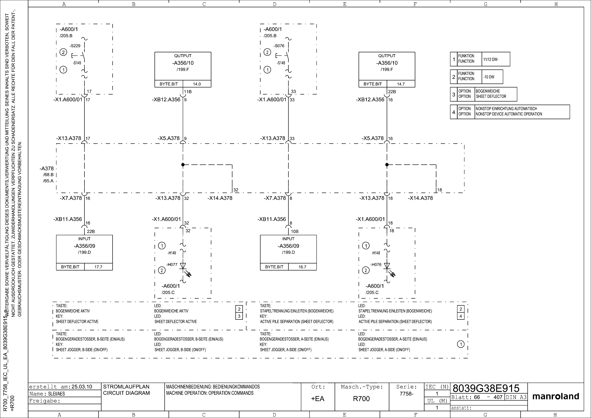

# +EA — Sheet 66 of 407 — MASCHINENBEDIENUNG: BEDIENUNGKOMMANDOS

**MACHINE OPERATION: OPERATION COMMANDS**

> Part of the manroland **R700** printing press IEC/UL circuit diagrams.
> Drawing class: **Stromlaufplan / Circuit diagram** (DIN A3).
> Document `+EA` covers the **Printing unit** machine section.

## At a glance

| Field | Value |
|---|---|
| Document | `+EA`  (8039G38E915) |
| Sheet | **66** of 407 |
| Section (DE) | MASCHINENBEDIENUNG: BEDIENUNGKOMMANDOS |
| Section (EN) | MACHINE OPERATION: OPERATION COMMANDS |
| Section type | CIRCUIT — Circuit diagram |
| Machine type | `R700` |
| Series | `7758` |
| Created | 25.03.10 |
| Replaces | — |
| Columns used | A, B, C, D, E, F, G |
| Path numbers | — |
| Labels on sheet | 146 |
| Cross-refs out | 10 |
| Cross-refs in | 28 |

**Previous:** [+EA sheet 65](SHEET_0065.md) · **Next:** [+EA sheet 67](SHEET_0067.md) · **Document TOC:** [_TOC.md](_TOC.md)  (+EA) · **Master TOC:** [all sheets](../_MASTER_TOC.md)

## Sheet image (300 DPI, exact vector render)



_Rendered directly from the PDF vector layer at 300 DPI (1-bit), no OCR and no resampling. Use it to confirm anything ambiguous in the text below._

## Cross-references on this sheet

Each entry is a wire leaving this sheet. The printed token is `/sheet.column`; the link resolves to that sheet inside the same document.

| Ref | Target sheet | Col | Path | Destination on target | Target section | From col |
|---|---|---|---|---|---|---|
| `/205.B` | [+EA sheet 205](SHEET_0205.md) | B | — | A600/1 | REFERENZMODUL | A |
| `/205.B` | [+EA sheet 205](SHEET_0205.md) | B | — | A600/1 | REFERENZMODUL | D |
| `/199.F` | [+EA sheet 199](SHEET_0199.md) | F | — | — | REFERENZMODUL | C |
| `/199.F` | [+EA sheet 199](SHEET_0199.md) | F | — | — | REFERENZMODUL | F |
| `/68.B` | [+EA sheet 68](SHEET_0068.md) | B | — | — | LEITSTANDSFUNKTIONEN | A |
| `/65.A` | [+EA sheet 65](SHEET_0065.md) | A | — | — | MASCHINENBEDIENUNG: BEDIENUNGKOMMANDOS | A |
| `/199.D` | [+EA sheet 199](SHEET_0199.md) | D | — | — | REFERENZMODUL | A |
| `/199.D` | [+EA sheet 199](SHEET_0199.md) | D | — | — | REFERENZMODUL | D |
| `/205.C` | [+EA sheet 205](SHEET_0205.md) | C | — | A600/1 | REFERENZMODUL | C |
| `/205.C` | [+EA sheet 205](SHEET_0205.md) | C | — | A600/1 | REFERENZMODUL | E |

### Incoming references (sheets that point here)

Every other sheet that sends a wire to this one. `Back-ref` is the token printed on *that* sheet; `Path` is its line number.

| From sheet | Cols | Back-ref | Path | Refs | What continues there |
|---|---|---|---|---|---|
| [+EA#65](SHEET_0065.md) | A | `/65.A` | — | 1 | — |
| [+EA#68](SHEET_0068.md) | B | `/68.B` | — | 1 | — |
| [+EA#199](SHEET_0199.md) | D, F | `/199.D`, `/199.F` | — | 4 | — |
| [+EA#205](SHEET_0205.md) | B, C | `/205.B`, `/205.C` | — | 4 | — |
| [+EA#212](SHEET_0212.md) | E, F | `/212.E`, `/212.F` | — | 4 | — |
| [+EA#242](SHEET_0242.md) | D | `/242.D` | — | 2 | — |
| [+EA#247](SHEET_0247.md) | F | `/247.F` | — | 2 | — |
| [+EA#256](SHEET_0256.md) | B | `/256.B` | — | 2 | — |
| [+EA#257](SHEET_0257.md) | D | `/257.D` | — | 2 | — |
| [+EA#259](SHEET_0259.md) | A, B | `/259.A`, `/259.B` | — | 4 | — |
| [+EA#260](SHEET_0260.md) | A, B | `/260.A`, `/260.B` | — | 2 | — |


## Devices on this sheet

| Tag | Class | Class meaning (IEC) | Col | Sub | Terminal | Sign |
|---|---|---|---|---|---|---|
| `A378` | A | Baugruppe / assembly, module, PC board | A | — | — | — |
| `A356/09` | A | Baugruppe / assembly, module, PC board | A | 09 | — | — |
| `A600/1` | A | Baugruppe / assembly, module, PC board | C | 1 | — | — |
| `A356/09` | A | Baugruppe / assembly, module, PC board | D | 09 | — | — |
| `A600/1` | A | Baugruppe / assembly, module, PC board | E | 1 | — | — |
| `S229` | S | Schalter / switch | A | — | — | — |
| `A600/1` | A | Baugruppe / assembly, module, PC board | A | 1 | — | — |
| `A356/10` | A | Baugruppe / assembly, module, PC board | C | 10 | — | — |
| `S076` | S | Schalter / switch | D | — | — | — |
| `A600/1` | A | Baugruppe / assembly, module, PC board | D | 1 | — | — |
| `A356/10` | A | Baugruppe / assembly, module, PC board | F | 10 | — | — |
| `S149` | S | Schalter / switch | A | — | — | — |
| `S148` | S | Schalter / switch | D | — | — | — |
| `X7.A378` | — | cross-device reference | A | — | — | — |
| `X13.A378` | — | cross-device reference | A | — | — | — |
| `17.7` | — | cross-device reference | A | — | — | — |
| `XB11.A356` | — | cross-device reference | A | — | — | — |
| `X13.A378` | — | cross-device reference | B | — | — | — |
| `X5.A378` | — | cross-device reference | B | — | — | — |
| `X7.A378` | — | cross-device reference | D | — | — | — |
| `X13.A378` | — | cross-device reference | D | — | — | — |
| `16.7` | — | cross-device reference | D | — | — | — |
| `XB11.A356` | — | cross-device reference | D | — | — | — |
| `X13.A378` | — | cross-device reference | E | — | — | — |
| `X5.A378` | — | cross-device reference | E | — | — | — |
| `14.0` | — | cross-device reference | C | — | — | — |
| `XB12.A356` | — | cross-device reference | B | — | — | — |
| `14.7` | — | cross-device reference | F | — | — | — |
| `XB12.A356` | — | cross-device reference | E | — | — | — |
| `X14.A378` | — | cross-device reference | C | — | — | — |
| `X14.A378` | — | cross-device reference | F | — | — | — |

## Potentials / nets

| Potential | Count | Columns | Attached devices | Terminals |
|---|---|---|---|---|
| `H076` | 1 | E | — | — |
| `H077` | 1 | C | — | — |
| `H148` | 1 | E | — | — |
| `H149` | 1 | C | — | — |


A potential such as `L24+/4` or `M24+` is a named supply/return rail; every place it appears on this sheet is electrically common.

## Wire-end annotations (grouped as printed)

A wire that continues elsewhere is annotated with a small cluster: the destination description, the path/line number `#NN`, and the `/sheet.column` cross reference. Each row below is one such cluster exactly as it is grouped on the drawing.

| Col | Y | Path | Cross-ref | Text on the wire |
|---|---|---|---|---|
| A | 54.2 | — | `/205.B` | `A600/1` |
| D | 54.2 | — | `/205.B` | `A600/1` |
| A | 88.6 | — | — | `S229` |
| D | 88.6 | — | — | `S076` |
| A | 101.3 | — | — | `2` |
| D | 102.3 | — | — | `2` |
| C | 108.8 | — | — | `QUTPUT` |
| F | 108.8 | — | — | `QUTPUT` |
| G | 109.7 | — | — | `1 FUNKTION FUNCTION 11/12 DW` |
| C | 122.2 | — | — | `A356/10` |
| F | 122.2 | — | — | `A356/10` |
| A | 123.9 | — | — | `S149` |
| D | 123.9 | — | — | `S148` |
| C | 136.0 | — | `/199.F` | — |
| F | 136.0 | — | `/199.F` | — |
| A | 137.3 | — | — | `1` |
| D | 137.3 | — | — | `1` |
| G | 145.2 | — | — | `2 FUNKTION FUNCTION 10 DW` |
| C | 165.6 | — | — | `BYTE.BIT 14.0` |
| F | 165.6 | — | — | `BYTE.BIT 14.7` |
| A | 180.3 | — | — | `17` |
| D | 180.3 | — | — | `33` |
| G | 180.6 | — | — | `3 OPTION OPTION` |
| G | 180.6 | — | — | `BOGENWEICHE` |
| C | 181.0 | — | — | `11B` |
| F | 181.0 | — | — | `22B` |
| G | 191.3 | — | — | `SHEET DEFLECTOR` |
| A | 195.9 | — | — | `X1.A600/01 17` |
| C | 195.9 | — | — | `XB12.A356 9 X1.A600/01 33` |
| E | 195.9 | — | — | `XB12.A356 16` |
| G | 216.0 | — | — | `4 OPTION OPTION` |
| G | 216.1 | — | — | `NONSTOP EINRICHTUNG AUTOMATISCH NONSTOP DEVICE AUTOMATIC OPERATION` |
| A | 273.9 | — | — | `X13.A378 17` |
| C | 273.9 | — | — | `X5.A378 9` |
| D | 273.9 | — | — | `X13.A378 33` |
| E | 273.9 | — | — | `X5.A378 16` |
| A | 334.8 | — | — | `A378` |
| A | 347.9 | — | `/68.B`, `/65.A` | — |
| C | 378.8 | — | — | `32` |
| F | 378.8 | — | — | `18` |
| A | 394.3 | — | — | `X7.A378 16` |
| C | 394.3 | — | — | `X13.A378 32` |
| C | 394.3 | — | — | `X14.A378` |
| D | 394.3 | — | — | `X7.A378 8` |
| E | 394.3 | — | — | `X13.A378 18` |
| F | 394.3 | — | — | `X14.A378` |
| A | 436.8 | — | — | `XB11.A356 16` |
| C | 436.8 | — | — | `X1.A600/01 32` |
| D | 436.8 | — | — | `XB11.A356 8` |
| E | 436.8 | — | — | `X1.A600/01 18` |
| C | 460.9 | — | — | `32` |
| F | 460.9 | — | — | `18` |
| A | 462.3 | — | — | `22B` |
| D | 462.3 | — | — | `10B` |
| A | 477.4 | — | — | `INPUT` |
| D | 477.4 | — | — | `INPUT` |
| A | 490.7 | — | — | `A356/09` |
| D | 490.7 | — | — | `A356/09` |
| B | 491.6 | — | — | `1` |
| E | 491.6 | — | — | `1` |
| A | 504.5 | — | `/199.D` | — |
| D | 504.5 | — | `/199.D` | — |
| C | 506.6 | — | — | `H149` |
| E | 506.6 | — | — | `H148` |
| C | 529.4 | — | — | `H077` |
| E | 529.4 | — | — | `H076` |
| A | 534.1 | — | — | `BYTE.BIT 17.7` |
| D | 534.1 | — | — | `BYTE.BIT 16.7` |
| B | 541.7 | — | — | `2` |
| E | 541.7 | — | — | `2` |
| C | 571.5 | — | `/205.C` | `A600/1` |
| E | 571.5 | — | `/205.C` | `A600/1` |
| A | 612.8 | — | — | `BOGENWEICHE AKTIV KEY: TASTE:` |
| C | 612.8 | — | — | `LED: BOGENWEICHE AKTIV LED:` |
| D | 612.8 | — | — | `KEY: TASTE: STAPELTRENNUNG EINLEITEN (BOGENWEICHE)` |
| E | 612.8 | — | — | `LED:` |
| C | 619.0 | — | — | `2` |
| G | 619.0 | — | — | `2` |
| F | 623.5 | — | — | `LED: STAPELTRENNUNG EINLEITEN (BOGENWEICHE)` |
| C | 633.2 | — | — | `3` |
| G | 633.2 | — | — | `4` |
| A | 644.8 | — | — | `SHEET DEFLECTOR ACTIVE` |
| C | 644.8 | — | — | `SHEET DEFLECTOR ACTIVE` |
| D | 644.8 | — | — | `ACTIVE PILE SEPARATION (SHEET DEFLECTOR)` |
| F | 644.8 | — | — | `ACTIVE PILE SEPARATION (SHEET DEFLECTOR)` |
| A | 669.5 | — | — | `BOGENGERADESTOSSER, B SEITE (EIN/AUS) KEY: TASTE:` |
| C | 669.5 | — | — | `LED: BOGENGERADESTOSSER, B SEITE (EIN/AUS) LED:` |
| D | 669.5 | — | — | `BOGENGERADESTOSSER, A SEITE (EIN/AUS) KEY: TASTE:` |
| F | 669.5 | — | — | `LED: BOGENGERADESTOSSER, A SEITE (EIN/AUS) LED:` |
| G | 690.0 | — | — | `1` |
| A | 701.5 | — | — | `SHEET JOGGER, B SIDE (ON/OFF)` |
| C | 701.5 | — | — | `SHEET JOGGER, B SIDE (ON/OFF)` |
| D | 701.5 | — | — | `SHEET JOGGER, A SIDE (ON/OFF)` |
| F | 701.5 | — | — | `SHEET JOGGER, A SIDE (ON/OFF)` |


## Reconstructed tables

This sheet carries tabular content (pin map / terminal assignment / index). The grid below was rebuilt from the drawing's own rule lines, so each row is exactly one physical row of the table.

### Table 1 — 5 data rows × 2 columns (at x=113.4, y=48.2) — **A600/1 /205.B S229 2 S149 1 17**

| X1.A600/01 X13.A378 | 17 17 |
|---|---|
| `X7.A378 XB11.A356` | `16 16` |
|  | `22B` |
| `INPUT` | `A356/09 /199.D` |
| `BYTE.BIT` | `17.7` |
| `TASTE: BOGENWEICHE KEY: SHEET DEFLECTOR` | `AKTIV ACTIVE` |


### Table 2 — 8 data rows × 3 columns (at x=311.8, y=48.2) — **QUTPUT A356/10 /199.F**

| BYTE.BIT | 14.0 |  |
|---|---|---|
|  | `11B` |  |
| `XB12.A356 X5.A378` | `9 9` |  |
| `X13.A378 X1.A600/01` | `32 32` | `X14.A378` |
|  | `32` |  |
| `1 H149` |  |  |
| `H077` |  |  |
| `2 A600/1 /205.C` |  |  |
| `LED: BOGENWEICHE LED: SHEET DEFLECTOR` | `AKTIV ACTIVE` |  |


### Table 3 — 2 data rows × 1 columns (at x=474.8, y=48.2)

| C1 |
|---|
| `32` |
| `2 3` |


### Table 4 — 9 data rows × 8 columns (at x=524.4, y=48.2) — **A600/1 /205.B S076**

| 2 S148 1 |  |  |  | QUTPUT A356/10 /199.F |  | 1 2 |  |
|---|---|---|---|---|---|---|---|
|  |  |  | `BYTE.BIT` | `14.7` |  |  |  |
|  | `33` |  |  | `22B` |  |  |  |
| `X1.A600/01 X13.A378` | `33 33` |  | `XB12.A356 X5.A378` | `16 16` |  | `3 4` |  |
| `X7.A378 XB11.A356` | `8 8` |  | `X13.A378 X1.A600/01` | `18 18` | `X14.A378` | `18` |  |
|  | `10B` |  |  | `18` |  |  |  |
| `INPUT` | `A356/09 /199.D` |  | `1 H148` |  |  |  |  |
| `BYTE.BIT` | `16.7` |  | `H076` |  |  |  |  |
|  |  |  | `2 A600/1 /205.C` |  |  |  |  |
| `TASTE: STAPELTRENNUNG KEY: ACTIVE PILE` | `EINLEITEN SEPARATION (SHEET` | `(BOGENWEICHE) DEFLECTOR)` | `LED: STAPELTRENNUNG LED: ACTIVE PILE` | `EINLEITEN SEPARATION (SHEET` | `(BOGENWEICHE) DEFLECTOR)` |  | `2 4` |


## Notes and free text on this sheet

| Text | Col | Y (pt) |
|---|---|---|
| `22B` | A | 462.33 |
| `INPUT` | A | 477.42 |
| `BYTE.BIT` | A | 534.11 |
| `TASTE:` | A | 612.84 |
| `BOGENWEICHE AKTIV` | A | 623.5 |
| `KEY:` | A | 634.04 |
| `SHEET DEFLECTOR ACTIVE` | A | 644.8 |
| `LED:` | B | 612.82 |
| `BOGENWEICHE AKTIV` | C | 623.5 |
| `SHEET DEFLECTOR ACTIVE` | C | 644.8 |
| `X1.A600/01` | B | 436.84 |
| `10B` | D | 462.33 |
| `INPUT` | D | 477.42 |
| `BYTE.BIT` | D | 534.11 |
| `TASTE:` | D | 612.84 |
| `STAPELTRENNUNG EINLEITEN (BOGENWEICHE)` | D | 623.54 |
| `KEY:` | D | 634.04 |
| `ACTIVE PILE SEPARATION (SHEET DEFLECTOR)` | D | 644.8 |
| `LED:` | E | 612.82 |
| `STAPELTRENNUNG EINLEITEN (BOGENWEICHE)` | F | 623.54 |
| `ACTIVE PILE SEPARATION (SHEET DEFLECTOR)` | F | 644.8 |
| `X1.A600/01` | E | 436.84 |
| `X1.A600/01` | A | 195.9 |
| `11B` | C | 181 |
| `QUTPUT` | C | 108.84 |
| `BYTE.BIT` | B | 165.6 |
| `X1.A600/01` | D | 195.9 |
| `22B` | F | 181 |
| `QUTPUT` | F | 108.84 |
| `BYTE.BIT` | E | 165.6 |
| `BOGENGERADESTOSSER, B SEITE (EIN/AUS)` | A | 680.22 |
| `SHEET JOGGER, B SIDE (ON/OFF)` | A | 701.5 |
| `BOGENGERADESTOSSER, A SEITE (EIN/AUS)` | D | 680.22 |
| `SHEET JOGGER, A SIDE (ON/OFF)` | D | 701.5 |
| `BOGENGERADESTOSSER, B SEITE (EIN/AUS)` | C | 680.22 |
| `SHEET JOGGER, B SIDE (ON/OFF)` | C | 701.5 |
| `BOGENGERADESTOSSER, A SEITE (EIN/AUS)` | F | 680.22 |
| `SHEET JOGGER, A SIDE (ON/OFF)` | F | 701.5 |
| `FUNKTION` | G | 109.74 |
| `FUNCTION` | G | 120.38 |
| `11/12 DW` | G | 116.79 |
| `10 DW` | G | 152.22 |
| `OPTION` | G | 180.6 |
| `BOGENWEICHE` | G | 180.58 |
| `SHEET DEFLECTOR` | G | 191.26 |
| `NONSTOP EINRICHTUNG AUTOMATISCH` | G | 216.07 |
| `NONSTOP DEVICE AUTOMATIC OPERATION` | G | 226.69 |

## Complete label inventory (exact text from the drawing)

Every text object inside the drawing area of this sheet, in DIN reading order (column A→H, then top→bottom). This is the authoritative list: if a string is not here it is not printed on this sheet.

| Col | Y | X | Dir | Type | Text |
|---|---|---|---|---|---|
| A | 54.2 | 120.2 | → | device tag | `A600/1` |
| A | 67.9 | 120.5 | → | cross-reference | `/205.B` |
| A | 88.6 | 140.0 | → | device tag | `S229` |
| A | 101.3 | 124.9 | → | number | `2` |
| A | 123.9 | 146.6 | → | device tag | `S149` |
| A | 137.3 | 125.8 | → | number | `1` |
| A | 180.3 | 174.9 | → | number | `17` |
| A | 195.9 | 107.4 | → | text | `X1.A600/01` |
| A | 197.3 | 172.1 | → | number | `17` |
| A | 273.8 | 113.4 | → | device ref | `X13.A378` |
| A | 275.3 | 172.1 | → | number | `17` |
| A | 334.8 | 79.9 | → | device tag | `A378` |
| A | 347.8 | 87.3 | → | cross-reference | `/68.B` |
| A | 360.2 | 87.0 | → | cross-reference | `/65.A` |
| A | 394.3 | 120.8 | → | device ref | `X7.A378` |
| A | 395.8 | 172.1 | → | number | `16` |
| A | 436.8 | 107.7 | → | device ref | `XB11.A356` |
| A | 445.4 | 172.1 | → | number | `16` |
| A | 462.3 | 175.5 | → | text | `22B` |
| A | 477.4 | 157.6 | → | text | `INPUT` |
| A | 490.7 | 148.7 | → | device tag | `A356/09` |
| A | 504.5 | 157.3 | → | cross-reference | `/199.D` |
| A | 534.1 | 123.3 | → | text | `BYTE.BIT` |
| A | 534.1 | 190.2 | → | device ref | `17.7` |
| A | 612.8 | 113.1 | → | text | `TASTE:` |
| A | 623.5 | 112.5 | → | text | `BOGENWEICHE AKTIV` |
| A | 634.0 | 112.5 | → | text | `KEY:` |
| A | 644.8 | 113.1 | → | text | `SHEET DEFLECTOR ACTIVE` |
| A | 669.5 | 113.1 | → | text | `TASTE:` |
| A | 680.2 | 112.5 | → | text | `BOGENGERADESTOSSER, B SEITE (EIN/AUS)` |
| A | 690.7 | 112.5 | → | text | `KEY:` |
| A | 701.5 | 113.1 | → | text | `SHEET JOGGER, B SIDE (ON/OFF)` |
| B | 165.6 | 321.7 | → | text | `BYTE.BIT` |
| B | 195.9 | 306.1 | → | device ref | `XB12.A356` |
| B | 273.9 | 317.8 | → | device ref | `X5.A378` |
| B | 394.3 | 313.2 | → | device ref | `X13.A378` |
| B | 436.8 | 305.9 | → | text | `X1.A600/01` |
| B | 491.6 | 324.2 | → | number | `1` |
| B | 541.7 | 324.0 | → | number | `2` |
| B | 585.3 | 326.0 | → | cross-reference | `/205.C` |
| B | 612.8 | 311.0 | → | text | `LED:` |
| B | 634.1 | 311.0 | → | text | `LED:` |
| B | 669.5 | 311.0 | → | text | `LED:` |
| B | 690.8 | 311.0 | → | text | `LED:` |
| C | 108.8 | 351.2 | → | text | `QUTPUT` |
| C | 122.2 | 347.1 | → | device tag | `A356/10` |
| C | 136.0 | 356.2 | → | cross-reference | `/199.F` |
| C | 165.6 | 388.6 | → | device ref | `14.0` |
| C | 181.0 | 370.5 | → | text | `11B` |
| C | 197.3 | 371.1 | → | number | `9` |
| C | 275.3 | 371.1 | → | number | `9` |
| C | 378.7 | 470.3 | → | number | `32` |
| C | 394.3 | 418.1 | → | device ref | `X14.A378` |
| C | 395.8 | 371.1 | → | number | `32` |
| C | 445.4 | 371.1 | → | number | `32` |
| C | 461.0 | 373.9 | → | number | `32` |
| C | 506.6 | 337.7 | → | potential | `H149` |
| C | 529.4 | 335.1 | → | potential | `H077` |
| C | 571.5 | 325.7 | → | device tag | `A600/1` |
| C | 619.0 | 479.6 | → | number | `2` |
| C | 623.5 | 311.0 | → | text | `BOGENWEICHE AKTIV` |
| C | 633.2 | 479.5 | → | number | `3` |
| C | 644.8 | 311.5 | → | text | `SHEET DEFLECTOR ACTIVE` |
| C | 680.2 | 311.0 | → | text | `BOGENGERADESTOSSER, B SEITE (EIN/AUS)` |
| C | 701.5 | 311.5 | → | text | `SHEET JOGGER, B SIDE (ON/OFF)` |
| D | 54.2 | 531.2 | → | device tag | `A600/1` |
| D | 67.9 | 531.5 | → | cross-reference | `/205.B` |
| D | 88.6 | 551.1 | → | device tag | `S076` |
| D | 102.3 | 536.6 | → | number | `2` |
| D | 123.9 | 557.6 | → | device tag | `S148` |
| D | 137.3 | 536.8 | → | number | `1` |
| D | 180.3 | 586.5 | → | number | `33` |
| D | 195.9 | 518.5 | → | text | `X1.A600/01` |
| D | 197.3 | 583.7 | → | number | `33` |
| D | 273.8 | 524.4 | → | device ref | `X13.A378` |
| D | 275.3 | 583.7 | → | number | `33` |
| D | 394.3 | 531.8 | → | device ref | `X7.A378` |
| D | 395.8 | 583.7 | → | number | `8` |
| D | 436.8 | 518.7 | → | device ref | `XB11.A356` |
| D | 445.4 | 583.7 | → | number | `8` |
| D | 462.3 | 585.9 | → | text | `10B` |
| D | 477.4 | 568.6 | → | text | `INPUT` |
| D | 490.7 | 559.7 | → | device tag | `A356/09` |
| D | 504.5 | 568.3 | → | cross-reference | `/199.D` |
| D | 534.1 | 534.3 | → | text | `BYTE.BIT` |
| D | 534.1 | 601.2 | → | device ref | `16.7` |
| D | 612.8 | 524.1 | → | text | `TASTE:` |
| D | 623.5 | 524.1 | → | text | `STAPELTRENNUNG EINLEITEN (BOGENWEICHE)` |
| D | 634.0 | 523.6 | → | text | `KEY:` |
| D | 644.8 | 524.4 | → | text | `ACTIVE PILE SEPARATION (SHEET DEFLECTOR)` |
| D | 669.5 | 524.1 | → | text | `TASTE:` |
| D | 680.2 | 523.6 | → | text | `BOGENGERADESTOSSER, A SEITE (EIN/AUS)` |
| D | 690.7 | 523.6 | → | text | `KEY:` |
| D | 701.5 | 524.1 | → | text | `SHEET JOGGER, A SIDE (ON/OFF)` |
| E | 165.6 | 732.8 | → | text | `BYTE.BIT` |
| E | 195.9 | 717.2 | → | device ref | `XB12.A356` |
| E | 273.9 | 728.8 | → | device ref | `X5.A378` |
| E | 394.3 | 724.3 | → | device ref | `X13.A378` |
| E | 436.8 | 716.9 | → | text | `X1.A600/01` |
| E | 491.6 | 735.3 | → | number | `1` |
| E | 506.6 | 748.8 | → | potential | `H148` |
| E | 529.4 | 746.1 | → | potential | `H076` |
| E | 541.7 | 735.0 | → | number | `2` |
| E | 571.5 | 736.7 | → | device tag | `A600/1` |
| E | 585.3 | 737.0 | → | cross-reference | `/205.C` |
| E | 612.8 | 722.0 | → | text | `LED:` |
| E | 634.1 | 722.0 | → | text | `LED:` |
| E | 669.5 | 722.0 | → | text | `LED:` |
| E | 690.8 | 722.0 | → | text | `LED:` |
| F | 108.8 | 762.2 | → | text | `QUTPUT` |
| F | 122.2 | 758.1 | → | device tag | `A356/10` |
| F | 136.0 | 767.2 | → | cross-reference | `/199.F` |
| F | 165.6 | 799.7 | → | device ref | `14.7` |
| F | 181.0 | 782.1 | → | text | `22B` |
| F | 197.3 | 781.5 | → | number | `16` |
| F | 275.3 | 781.5 | → | number | `16` |
| F | 378.7 | 880.7 | → | number | `18` |
| F | 394.3 | 822.0 | → | device ref | `X14.A378` |
| F | 395.8 | 781.5 | → | number | `18` |
| F | 445.4 | 781.5 | → | number | `18` |
| F | 461.0 | 784.3 | → | number | `18` |
| F | 623.5 | 722.6 | → | text | `STAPELTRENNUNG EINLEITEN (BOGENWEICHE)` |
| F | 644.8 | 722.8 | → | text | `ACTIVE PILE SEPARATION (SHEET DEFLECTOR)` |
| F | 680.2 | 722.0 | → | text | `BOGENGERADESTOSSER, A SEITE (EIN/AUS)` |
| F | 701.5 | 722.6 | → | text | `SHEET JOGGER, A SIDE (ON/OFF)` |
| G | 109.7 | 923.2 | → | text | `FUNKTION` |
| G | 115.1 | 911.6 | → | number | `1` |
| G | 116.8 | 973.6 | → | text | `11/12 DW` |
| G | 120.4 | 923.2 | → | text | `FUNCTION` |
| G | 145.2 | 923.2 | → | text | `FUNKTION` |
| G | 150.5 | 911.3 | → | number | `2` |
| G | 152.2 | 974.1 | → | text | `10 DW` |
| G | 155.8 | 923.2 | → | text | `FUNCTION` |
| G | 180.6 | 923.8 | → | text | `OPTION` |
| G | 180.6 | 958.7 | → | text | `BOGENWEICHE` |
| G | 185.9 | 911.2 | → | number | `3` |
| G | 191.2 | 923.8 | → | text | `OPTION` |
| G | 191.3 | 959.2 | → | text | `SHEET DEFLECTOR` |
| G | 216.0 | 923.8 | → | text | `OPTION` |
| G | 216.1 | 958.7 | → | text | `NONSTOP EINRICHTUNG AUTOMATISCH` |
| G | 221.4 | 911.3 | → | number | `4` |
| G | 226.7 | 923.8 | → | text | `OPTION` |
| G | 226.7 | 958.7 | → | text | `NONSTOP DEVICE AUTOMATIC OPERATION` |
| G | 619.0 | 926.1 | → | number | `2` |
| G | 633.2 | 925.9 | → | number | `4` |
| G | 690.0 | 926.6 | → | number | `1` |

## Reading-order text block

The same content as a plain block, grouped by DIN column — convenient to paste or to match against a visual description.

```text
=== Column A ===
  54.2  120.2  devtag       A600/1
  67.9  120.5  xref         /205.B
  88.6  140.0  devtag       S229
 101.3  124.9  numeric      2
 123.9  146.6  devtag       S149
 137.3  125.8  numeric      1
 180.3  174.9  numeric      17
 195.9  107.4  text         X1.A600/01
 197.3  172.1  numeric      17
 273.8  113.4  devref       X13.A378
 275.3  172.1  numeric      17
 334.8   79.9  devtag       A378
 347.8   87.3  xref         /68.B
 360.2   87.0  xref         /65.A
 394.3  120.8  devref       X7.A378
 395.8  172.1  numeric      16
 436.8  107.7  devref       XB11.A356
 445.4  172.1  numeric      16
 462.3  175.5  text         22B
 477.4  157.6  text         INPUT
 490.7  148.7  devtag       A356/09
 504.5  157.3  xref         /199.D
 534.1  123.3  text         BYTE.BIT
 534.1  190.2  devref       17.7
 612.8  113.1  text         TASTE:
 623.5  112.5  text         BOGENWEICHE AKTIV
 634.0  112.5  text         KEY:
 644.8  113.1  text         SHEET DEFLECTOR ACTIVE
 669.5  113.1  text         TASTE:
 680.2  112.5  text         BOGENGERADESTOSSER, B SEITE (EIN/AUS)
 690.7  112.5  text         KEY:
 701.5  113.1  text         SHEET JOGGER, B SIDE (ON/OFF)
=== Column B ===
 165.6  321.7  text         BYTE.BIT
 195.9  306.1  devref       XB12.A356
 273.9  317.8  devref       X5.A378
 394.3  313.2  devref       X13.A378
 436.8  305.9  text         X1.A600/01
 491.6  324.2  numeric      1
 541.7  324.0  numeric      2
 585.3  326.0  xref         /205.C
 612.8  311.0  text         LED:
 634.1  311.0  text         LED:
 669.5  311.0  text         LED:
 690.8  311.0  text         LED:
=== Column C ===
 108.8  351.2  text         QUTPUT
 122.2  347.1  devtag       A356/10
 136.0  356.2  xref         /199.F
 165.6  388.6  devref       14.0
 181.0  370.5  text         11B
 197.3  371.1  numeric      9
 275.3  371.1  numeric      9
 378.7  470.3  numeric      32
 394.3  418.1  devref       X14.A378
 395.8  371.1  numeric      32
 445.4  371.1  numeric      32
 461.0  373.9  numeric      32
 506.6  337.7  net          H149
 529.4  335.1  net          H077
 571.5  325.7  devtag       A600/1
 619.0  479.6  numeric      2
 623.5  311.0  text         BOGENWEICHE AKTIV
 633.2  479.5  numeric      3
 644.8  311.5  text         SHEET DEFLECTOR ACTIVE
 680.2  311.0  text         BOGENGERADESTOSSER, B SEITE (EIN/AUS)
 701.5  311.5  text         SHEET JOGGER, B SIDE (ON/OFF)
=== Column D ===
  54.2  531.2  devtag       A600/1
  67.9  531.5  xref         /205.B
  88.6  551.1  devtag       S076
 102.3  536.6  numeric      2
 123.9  557.6  devtag       S148
 137.3  536.8  numeric      1
 180.3  586.5  numeric      33
 195.9  518.5  text         X1.A600/01
 197.3  583.7  numeric      33
 273.8  524.4  devref       X13.A378
 275.3  583.7  numeric      33
 394.3  531.8  devref       X7.A378
 395.8  583.7  numeric      8
 436.8  518.7  devref       XB11.A356
 445.4  583.7  numeric      8
 462.3  585.9  text         10B
 477.4  568.6  text         INPUT
 490.7  559.7  devtag       A356/09
 504.5  568.3  xref         /199.D
 534.1  534.3  text         BYTE.BIT
 534.1  601.2  devref       16.7
 612.8  524.1  text         TASTE:
 623.5  524.1  text         STAPELTRENNUNG EINLEITEN (BOGENWEICHE)
 634.0  523.6  text         KEY:
 644.8  524.4  text         ACTIVE PILE SEPARATION (SHEET DEFLECTOR)
 669.5  524.1  text         TASTE:
 680.2  523.6  text         BOGENGERADESTOSSER, A SEITE (EIN/AUS)
 690.7  523.6  text         KEY:
 701.5  524.1  text         SHEET JOGGER, A SIDE (ON/OFF)
=== Column E ===
 165.6  732.8  text         BYTE.BIT
 195.9  717.2  devref       XB12.A356
 273.9  728.8  devref       X5.A378
 394.3  724.3  devref       X13.A378
 436.8  716.9  text         X1.A600/01
 491.6  735.3  numeric      1
 506.6  748.8  net          H148
 529.4  746.1  net          H076
 541.7  735.0  numeric      2
 571.5  736.7  devtag       A600/1
 585.3  737.0  xref         /205.C
 612.8  722.0  text         LED:
 634.1  722.0  text         LED:
 669.5  722.0  text         LED:
 690.8  722.0  text         LED:
=== Column F ===
 108.8  762.2  text         QUTPUT
 122.2  758.1  devtag       A356/10
 136.0  767.2  xref         /199.F
 165.6  799.7  devref       14.7
 181.0  782.1  text         22B
 197.3  781.5  numeric      16
 275.3  781.5  numeric      16
 378.7  880.7  numeric      18
 394.3  822.0  devref       X14.A378
 395.8  781.5  numeric      18
 445.4  781.5  numeric      18
 461.0  784.3  numeric      18
 623.5  722.6  text         STAPELTRENNUNG EINLEITEN (BOGENWEICHE)
 644.8  722.8  text         ACTIVE PILE SEPARATION (SHEET DEFLECTOR)
 680.2  722.0  text         BOGENGERADESTOSSER, A SEITE (EIN/AUS)
 701.5  722.6  text         SHEET JOGGER, A SIDE (ON/OFF)
=== Column G ===
 109.7  923.2  text         FUNKTION
 115.1  911.6  numeric      1
 116.8  973.6  text         11/12 DW
 120.4  923.2  text         FUNCTION
 145.2  923.2  text         FUNKTION
 150.5  911.3  numeric      2
 152.2  974.1  text         10 DW
 155.8  923.2  text         FUNCTION
 180.6  923.8  text         OPTION
 180.6  958.7  text         BOGENWEICHE
 185.9  911.2  numeric      3
 191.2  923.8  text         OPTION
 191.3  959.2  text         SHEET DEFLECTOR
 216.0  923.8  text         OPTION
 216.1  958.7  text         NONSTOP EINRICHTUNG AUTOMATISCH
 221.4  911.3  numeric      4
 226.7  923.8  text         OPTION
 226.7  958.7  text         NONSTOP DEVICE AUTOMATIC OPERATION
 619.0  926.1  numeric      2
 633.2  925.9  numeric      4
 690.0  926.6  numeric      1
```

---
_Generated from the PDF vector text layer; no OCR. Source: `R700_7758_IEC_UL_EA_8039G38E915_p`, sheet 66._
