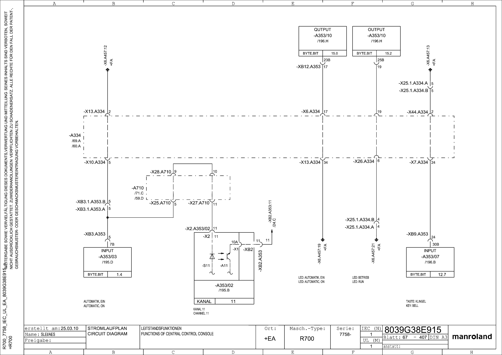

# +EA — Sheet 67 of 407 — LEITSTANDSFUNKTIONEN

**FUNCTIONS OF CENTRAL CONTROL CONSOLE**

> Part of the manroland **R700** printing press IEC/UL circuit diagrams.
> Drawing class: **Stromlaufplan / Circuit diagram** (DIN A3).
> Document `+EA` covers the **Printing unit** machine section.

## At a glance

| Field | Value |
|---|---|
| Document | `+EA`  (8039G38E915) |
| Sheet | **67** of 407 |
| Section (DE) | LEITSTANDSFUNKTIONEN |
| Section (EN) | FUNCTIONS OF CENTRAL CONTROL CONSOLE |
| Section type | CIRCUIT — Circuit diagram |
| Machine type | `R700` |
| Series | `7758` |
| Created | 25.03.10 |
| Replaces | — |
| Columns used | A, B, C, D, E, F, G |
| Path numbers | — |
| Labels on sheet | 107 |
| Cross-refs out | 10 |
| Cross-refs in | 34 |

**Previous:** [+EA sheet 66](SHEET_0066.md) · **Next:** [+EA sheet 68](SHEET_0068.md) · **Document TOC:** [_TOC.md](_TOC.md)  (+EA) · **Master TOC:** [all sheets](../_MASTER_TOC.md)

## Sheet image (300 DPI, exact vector render)



_Rendered directly from the PDF vector layer at 300 DPI (1-bit), no OCR and no resampling. Use it to confirm anything ambiguous in the text below._

## Cross-references on this sheet

Each entry is a wire leaving this sheet. The printed token is `/sheet.column`; the link resolves to that sheet inside the same document.

| Ref | Target sheet | Col | Path | Destination on target | Target section | From col |
|---|---|---|---|---|---|---|
| `/196.H` | [+EA sheet 196](SHEET_0196.md) | H | — | — | REFERENZMODUL | F |
| `/196.H` | [+EA sheet 196](SHEET_0196.md) | H | — | — | REFERENZMODUL | F |
| `/69.A` | [+EA sheet 69](SHEET_0069.md) | A | — | — | SCHMIERUNG | A |
| `/60.A` | [+EA sheet 60](SHEET_0060.md) | A | — | — | MASCHINENBEDIENUNG: BEDIENUNGKOMMANDOS | A |
| `/71.C` | [+EA sheet 71](SHEET_0071.md) | C | — | — | AUSLEGERSTAPELSTEUERUNG | B |
| `/59.D` | [+EA sheet 59](SHEET_0059.md) | D | — | — | MASCHINENBEDIENUNG: BEDIENUNGKOMMANDOS | B |
| `/24.C` | [+EA sheet 24](SHEET_0024.md) | C | — | XB2.A353:11 | BUSVERBINDUNGEN: SICHERHEITSBUS | E |
| `/196.B` | [+EA sheet 196](SHEET_0196.md) | B | — | — | REFERENZMODUL | G |
| `/195.D` | [+EA sheet 195](SHEET_0195.md) | D | — | — | REFERENZMODUL | B |
| `/195.B` | [+EA sheet 195](SHEET_0195.md) | B | — | — | REFERENZMODUL | D |

### Incoming references (sheets that point here)

Every other sheet that sends a wire to this one. `Back-ref` is the token printed on *that* sheet; `Path` is its line number.

| From sheet | Cols | Back-ref | Path | Refs | What continues there |
|---|---|---|---|---|---|
| [+EA#24](SHEET_0024.md) | C | `/24.C` | — | 1 | XB2.A353:11 |
| [+EA#59](SHEET_0059.md) | D | `/59.D` | — | 1 | A710 |
| [+EA#60](SHEET_0060.md) | A | `/60.A` | — | 1 | — |
| [+EA#69](SHEET_0069.md) | A | `/69.A` | — | 1 | — |
| [+EA#71](SHEET_0071.md) | C | `/71.C` | — | 1 | — |
| [+EA#195](SHEET_0195.md) | B, D | `/195.B`, `/195.D` | — | 2 | — |
| [+EA#196](SHEET_0196.md) | B, H | `/196.B`, `/196.H` | — | 3 | — |
| [+EA#224](SHEET_0224.md) | G | `/224.G` | — | 1 | — |
| [+EA#225](SHEET_0225.md) | C | `/225.C` | — | 1 | — |
| [+EA#234](SHEET_0234.md) | C, D, F | `/234.C`, `/234.D`, `/234.F` | — | 3 | — |
| [+EA#244](SHEET_0244.md) | F | `/244.F` | — | 2 | — |
| [+EA#246](SHEET_0246.md) | F | `/246.F` | — | 1 | — |
| [+EA#252](SHEET_0252.md) | C | `/252.C` | — | 1 | — |
| [+EA#253](SHEET_0253.md) | H | `/253.H` | — | 1 | — |
| [+EA#257](SHEET_0257.md) | C | `/257.C` | — | 2 | — |
| [+EA#258](SHEET_0258.md) | C, D | `/258.C`, `/258.D` | — | 2 | — |
| [+EA#267](SHEET_0267.md) | C | `/267.C` | — | 4 | — |
| [+EA#268](SHEET_0268.md) | C | `/268.C` | — | 1 | — |
| [+EA#269](SHEET_0269.md) | B | `/269.B` | — | 1 | — |
| [+EA#271](SHEET_0271.md) | B | `/271.B` | — | 1 | — |
| [+EA#272](SHEET_0272.md) | G | `/272.G` | — | 2 | — |
| [+EA#281](SHEET_0281.md) | F | `/281.F` | — | 1 | — |


## Devices on this sheet

| Tag | Class | Class meaning (IEC) | Col | Sub | Terminal | Sign |
|---|---|---|---|---|---|---|
| `A334` | A | Baugruppe / assembly, module, PC board | A | — | — | — |
| `A353/10` | A | Baugruppe / assembly, module, PC board | F | 10 | — | — |
| `A353/10` | A | Baugruppe / assembly, module, PC board | F | 10 | — | — |
| `S11` | S | Schalter / switch | D | — | — | — |
| `A11` | A | Baugruppe / assembly, module, PC board | D | — | — | — |
| `X1` | X | Klemme / terminal, plug connector | D | — | — | — |
| `X2` | X | Klemme / terminal, plug connector | D | — | — | — |
| `XB2` | XB |  | D | — | — | — |
| `A353/02` | A | Baugruppe / assembly, module, PC board | D | 02 | — | — |
| `A710` | A | Baugruppe / assembly, module, PC board | B | — | — | — |
| `A353/07` | A | Baugruppe / assembly, module, PC board | G | 07 | — | — |
| `A353/03` | A | Baugruppe / assembly, module, PC board | B | 03 | — | — |
| `X6.A457:12` | — | cross-device reference | B | — | 12 | — |
| `X10.A334` | — | cross-device reference | B | — | — | — |
| `X13.A334` | — | cross-device reference | B | — | — | — |
| `15.0` | — | cross-device reference | F | — | — | — |
| `XB12.A353` | — | cross-device reference | E | — | — | — |
| `X6.A334` | — | cross-device reference | E | — | — | — |
| `X13.A334` | — | cross-device reference | E | — | — | — |
| `15.2` | — | cross-device reference | G | — | — | — |
| `X26.A334` | — | cross-device reference | F | — | — | — |
| `X7.A334` | — | cross-device reference | G | — | — | — |
| `X6.A457:13` | — | cross-device reference | G | — | 13 | — |
| `X44.A334` | — | cross-device reference | G | — | — | — |
| `X25.1.A334.A` | — | cross-device reference | G | — | — | — |
| `X25.1.A334.B` | — | cross-device reference | G | — | — | — |
| `XB2.A353` | — | cross-device reference | D | — | — | — |
| `XB3.1.A353.B` | — | cross-device reference | B | — | — | — |
| `XB3.1.A353.A` | — | cross-device reference | B | — | — | — |
| `X28.A710` | — | cross-device reference | C | — | — | — |
| `X27.A710` | — | cross-device reference | C | — | — | — |
| `X25.A710` | — | cross-device reference | C | — | — | — |
| `X6.A457:19` | — | cross-device reference | E | — | 19 | — |
| `X6.A457:21` | — | cross-device reference | F | — | 21 | — |
| `X25.1.A334.B` | — | cross-device reference | F | — | — | — |
| `X25.1.A334.A` | — | cross-device reference | F | — | — | — |
| `12.7` | — | cross-device reference | G | — | — | — |
| `XB9.A353` | — | cross-device reference | G | — | — | — |
| `1.4` | — | cross-device reference | B | — | — | — |
| `XB3.A353` | — | cross-device reference | B | — | — | — |
| `XB2.A353:11` | — | cross-device reference | E | — | 11 | — |

## Potentials / nets

_No named potentials on this sheet._

## Wire-end annotations (grouped as printed)

A wire that continues elsewhere is annotated with a small cluster: the destination description, the path/line number `#NN`, and the `/sheet.column` cross reference. Each row below is one such cluster exactly as it is grouped on the drawing.

| Col | Y | Path | Cross-ref | Text on the wire |
|---|---|---|---|---|
| E | 65.8 | — | — | `QUTPUT` |
| F | 65.8 | — | — | `OUTPUT` |
| F | 79.7 | — | — | `A353/10` |
| F | 79.7 | — | — | `A353/10` |
| F | 93.5 | — | `/196.H` | — |
| F | 93.5 | — | `/196.H` | — |
| B | 107.4 | — | — | `X6.A457:12` |
| G | 107.4 | — | — | `X6.A457:13` |
| E | 123.1 | — | — | `BYTE.BIT 15.0` |
| F | 123.1 | — | — | `BYTE.BIT 15.2` |
| F | 138.5 | — | — | `23B` |
| F | 138.5 | — | — | `25B` |
| B | 139.8 | — | — | `+FA` |
| G | 139.8 | — | — | `+FA` |
| E | 153.4 | — | — | `XB12.A353 17` |
| F | 154.8 | — | — | `19` |
| G | 192.4 | — | — | `X25.1.A334.A 5` |
| G | 210.1 | — | — | `X25.1.A334.B 5` |
| B | 259.7 | — | — | `X13.A334 2` |
| E | 259.7 | — | — | `X6.A334 17` |
| F | 261.1 | — | — | `19` |
| G | 261.1 | — | — | `X44.A334 2` |
| A | 316.4 | — | — | `A334` |
| A | 330.1 | — | `/69.A`, `/60.A` | — |
| G | 377.3 | — | — | `X26.A334 6 X7.A334 24` |
| B | 380.1 | — | — | `X10.A334 5` |
| E | 380.1 | — | — | `X13.A334 34` |
| C | 402.8 | — | — | `X28.A710 9 10` |
| B | 441.1 | — | — | `A710` |
| B | 454.2 | — | `/71.C`, `/59.D` | — |
| B | 473.7 | — | — | `XB3.1.A353.B 5` |
| E | 474.2 | — | `/24.C` | `XB2.A353:11` |
| C | 476.5 | — | — | `X25.A710 5 X27.A710 11` |
| B | 490.7 | — | — | `XB3.1.A353.A 5` |
| F | 516.2 | — | — | `X25.1.A334.B 4` |
| F | 533.2 | — | — | `X25.1.A334.A 4` |
| C | 537.5 | — | — | `X2.A353/02 11` |
| B | 550.2 | — | — | `XB3.A353 5` |
| G | 550.2 | — | — | `XB9.A353 24` |
| D | 555.9 | — | — | `X2` |
| D | 557.3 | — | — | `11 11` |
| E | 565.8 | — | — | `11` |
| D | 570.0 | — | — | `10A` |
| B | 575.7 | — | — | `7B` |
| G | 575.7 | — | — | `30B` |
| F | 576.6 | — | — | `X6.A457:21` |
| E | 578.0 | — | — | `X6.A457:19` |
| F | 578.3 | — | — | `+FA` |
| F | 578.3 | — | — | `+FA` |
| D | 587.1 | — | — | `X1` |
| D | 587.1 | — | — | `XB2` |
| B | 590.2 | — | — | `INPUT` |
| G | 590.2 | — | — | `INPUT` |
| D | 593.3 | — | — | `XB2.A353` |
| B | 604.1 | — | — | `A353/03` |
| G | 604.1 | — | — | `A353/07` |
| B | 617.9 | — | `/195.D` | — |
| G | 617.9 | — | `/196.B` | — |
| D | 626.0 | — | — | `S11 A11` |
| B | 646.9 | — | — | `BYTE.BIT 1.4` |
| G | 646.9 | — | — | `BYTE.BIT 12.7` |
| E | 655.6 | — | — | `LED: AUTOMATIK, EIN LED: AUTOMATIC, ON` |
| F | 655.6 | — | — | `LED: BETRIEB LED: RUN` |
| D | 672.1 | — | — | `A353/02` |
| D | 684.5 | — | `/195.B` | — |
| D | 710.4 | — | — | `KANAL 11` |
| B | 712.1 | — | — | `AUTOMATIK, EIN AUTOMATIC, ON` |
| G | 712.3 | — | — | `KEY: BELL TASTE: KLINGEL` |
| C | 730.7 | — | — | `KANAL 11 CHANNEL 11` |


## Reconstructed tables

This sheet carries tabular content (pin map / terminal assignment / index). The grid below was rebuilt from the drawing's own rule lines, so each row is exactly one physical row of the table.

### Table 1 — 10 data rows × 12 columns (at x=198.4, y=62.4)

|  |  |  |  |  |  |  |  |  |  | QUTPUT | A353/10 /196.H |
|---|---|---|---|---|---|---|---|---|---|---|---|
| `X6.A457:12` |  |  |  |  |  |  |  |  |  | `BYTE.BIT` | `15.0` |
| `X13.A334 X10.A334` | `+FA 2 5` |  |  |  |  |  |  |  |  | `XB12.A353 X6.A334 X13.A334` | `23B 17 17 34` |
| `XB3.1.A353.B XB3.1.A353.A` | `5 5` | `X28.A710 A710 /71.C /59.D X25.A710` | `9 5` | `X27.A710` | `10 11` |  |  | `XB2.A353:11` |  |  |  |
|  |  |  |  | `X2.A353/02` | `11` |  |  |  | `/24.C` |  |  |
| `XB3.A353` | `5 7B` |  |  | `X2` | `11` | `10A` |  | `11 11` |  |  | `+FA` |
| `INPUT` | `A353/03 /195.D` |  |  | `S11` | `A11` | `X1` | `XB2` | `XB2.A353` |  | `X6.A457:19` |  |
| `BYTE.BIT` | `1.4` |  |  |  |  |  |  |  |  |  |  |
|  |  |  |  |  |  |  |  |  |  | `LED: AUTOMATIK, EIN` |  |
|  |  |  |  |  | `A353/02 /195.B` |  |  |  |  | `LED: AUTOMATIC, ON` |  |
| `AUTOMATIK, EIN` |  |  |  | `KANAL` |  | `11` |  |  |  |  |  |


### Table 2 — 7 data rows × 2 columns (at x=836.2, y=62.4)

| OUTPUT | A353/10 /196.H |
|---|---|
| `BYTE.BIT` | `15.2` |
| `X26.A334` | `25B 19 19 6` |
| `X25.1.A334.B X25.1.A334.A` | `4 4` |
|  | `+FA` |
| `X6.A457:21` |  |
| `LED: BETRIEB` |  |
| `LED: RUN` |  |


### Table 3 — 4 data rows × 2 columns (at x=963.8, y=62.4) — **X6.A457:13**

| X25.1.A334.A X25.1.A334.B X44.A334 X7.A334 | +FA 5 5 2 24 |
|---|---|
| `XB9.A353` | `24 30B` |
| `INPUT` | `A353/07 /196.B` |
| `BYTE.BIT` | `12.7` |
| `TASTE: KLINGEL` |  |


## Notes and free text on this sheet

| Text | Col | Y (pt) |
|---|---|---|
| `+FA` | B | 139.75 |
| `23B` | F | 138.48 |
| `QUTPUT` | E | 65.81 |
| `BYTE.BIT` | E | 123.08 |
| `LED: AUTOMATIK, EIN` | E | 655.59 |
| `LED: AUTOMATIC, ON` | E | 665.52 |
| `25B` | F | 138.48 |
| `OUTPUT` | F | 65.81 |
| `BYTE.BIT` | F | 123.08 |
| `LED: BETRIEB` | F | 655.59 |
| `LED: RUN` | F | 665.51 |
| `+FA` | G | 139.75 |
| `KANAL 11` | C | 730.67 |
| `CHANNEL 11` | C | 740.63 |
| `10A` | D | 570.05 |
| `KANAL` | D | 710.38 |
| `X2.A353/02` | C | 537.47 |
| `+FA` | F | 578.27 |
| `30B` | G | 575.72 |
| `INPUT` | G | 590.24 |
| `BYTE.BIT` | G | 647.49 |
| `TASTE: KLINGEL` | G | 712.27 |
| `KEY: BELL` | G | 722.24 |
| `7B` | B | 575.7 |
| `INPUT` | B | 590.24 |
| `BYTE.BIT` | B | 647.49 |
| `AUTOMATIK, EIN` | B | 712.11 |
| `AUTOMATIC, ON` | B | 722.76 |

## Complete label inventory (exact text from the drawing)

Every text object inside the drawing area of this sheet, in DIN reading order (column A→H, then top→bottom). This is the authoritative list: if a string is not here it is not printed on this sheet.

| Col | Y | X | Dir | Type | Text |
|---|---|---|---|---|---|
| A | 316.4 | 163.6 | → | device tag | `A334` |
| A | 330.1 | 170.6 | → | cross-reference | `/69.A` |
| A | 342.5 | 170.6 | → | cross-reference | `/60.A` |
| B | 107.4 | 246.2 | ↕ | device ref | `X6.A457:12` |
| B | 139.7 | 260.3 | ↕ | text | `+FA` |
| B | 259.7 | 198.4 | → | device ref | `X13.A334` |
| B | 261.1 | 257.7 | → | number | `2` |
| B | 380.1 | 199.8 | → | device ref | `X10.A334` |
| B | 381.6 | 257.7 | → | number | `5` |
| B | 441.1 | 312.4 | → | device tag | `A710` |
| B | 454.2 | 319.5 | → | cross-reference | `/71.C` |
| B | 466.6 | 319.5 | → | cross-reference | `/59.D` |
| B | 473.7 | 180.0 | → | device ref | `XB3.1.A353.B` |
| B | 473.7 | 257.7 | → | number | `5` |
| B | 490.7 | 257.7 | → | number | `5` |
| B | 491.4 | 179.1 | → | device ref | `XB3.1.A353.A` |
| B | 550.2 | 198.7 | → | device ref | `XB3.A353` |
| B | 558.7 | 257.7 | → | number | `5` |
| B | 575.7 | 260.5 | → | text | `7B` |
| B | 590.2 | 240.2 | → | text | `INPUT` |
| B | 604.1 | 233.7 | → | device tag | `A353/03` |
| B | 617.9 | 242.4 | → | cross-reference | `/195.D` |
| B | 646.9 | 276.4 | → | device ref | `1.4` |
| B | 647.5 | 208.3 | → | text | `BYTE.BIT` |
| B | 712.1 | 198.4 | → | text | `AUTOMATIK, EIN` |
| B | 722.8 | 198.4 | → | text | `AUTOMATIC, ON` |
| C | 402.8 | 355.7 | → | device ref | `X28.A710` |
| C | 402.8 | 413.6 | → | number | `9` |
| C | 476.5 | 354.3 | → | device ref | `X25.A710` |
| C | 476.5 | 446.5 | → | device ref | `X27.A710` |
| C | 480.8 | 413.6 | → | number | `5` |
| C | 537.5 | 439.1 | → | text | `X2.A353/02` |
| C | 730.7 | 458.6 | → | text | `KANAL 11` |
| C | 740.6 | 458.9 | → | text | `CHANNEL 11` |
| D | 402.8 | 505.1 | → | number | `10` |
| D | 480.8 | 505.1 | → | number | `11` |
| D | 537.5 | 505.1 | → | number | `11` |
| D | 555.9 | 481.6 | → | device tag | `X2` |
| D | 557.3 | 508.0 | → | number | `11` |
| D | 567.3 | 607.2 | → | number | `11` |
| D | 570.1 | 548.5 | → | text | `10A` |
| D | 587.1 | 552.2 | → | device tag | `X1` |
| D | 587.1 | 576.6 | → | device tag | `XB2` |
| D | 593.3 | 612.6 | ↕ | device ref | `XB2.A353` |
| D | 626.1 | 479.3 | → | device tag | `S11` |
| D | 626.1 | 521.9 | → | device tag | `A11` |
| D | 672.1 | 510.1 | → | device tag | `A353/02` |
| D | 684.5 | 518.9 | → | cross-reference | `/195.B` |
| D | 710.3 | 547.2 | → | number | `11` |
| D | 710.4 | 466.9 | → | text | `KANAL` |
| E | 65.8 | 745.1 | → | text | `QUTPUT` |
| E | 123.1 | 718.6 | → | text | `BYTE.BIT` |
| E | 153.4 | 703.0 | → | device ref | `XB12.A353` |
| E | 259.7 | 714.6 | → | device ref | `X6.A334` |
| E | 380.1 | 710.1 | → | device ref | `X13.A334` |
| E | 474.2 | 636.7 | ↕ | device ref | `XB2.A353:11` |
| E | 517.6 | 646.6 | ↕ | cross-reference | `/24.C` |
| E | 565.8 | 629.9 | → | number | `11` |
| E | 578.0 | 753.6 | ↕ | device ref | `X6.A457:19` |
| E | 655.6 | 708.1 | → | text | `LED: AUTOMATIK, EIN` |
| E | 665.5 | 708.1 | → | text | `LED: AUTOMATIC, ON` |
| F | 65.8 | 872.6 | → | text | `OUTPUT` |
| F | 79.7 | 744.0 | → | device tag | `A353/10` |
| F | 79.7 | 871.5 | → | device tag | `A353/10` |
| F | 93.5 | 752.9 | → | cross-reference | `/196.H` |
| F | 93.5 | 880.4 | → | cross-reference | `/196.H` |
| F | 123.1 | 785.5 | → | device ref | `15.0` |
| F | 123.1 | 846.1 | → | text | `BYTE.BIT` |
| F | 138.5 | 767.9 | → | text | `23B` |
| F | 138.5 | 895.5 | → | text | `25B` |
| F | 154.8 | 767.3 | → | number | `17` |
| F | 154.8 | 894.9 | → | number | `19` |
| F | 261.1 | 767.3 | → | number | `17` |
| F | 261.1 | 894.9 | → | number | `19` |
| F | 377.3 | 895.5 | → | number | `6` |
| F | 378.0 | 837.6 | → | device ref | `X26.A334` |
| F | 381.6 | 767.9 | → | number | `34` |
| F | 516.2 | 818.9 | → | device ref | `X25.1.A334.B` |
| F | 516.2 | 895.5 | → | number | `4` |
| F | 533.2 | 895.5 | → | number | `4` |
| F | 533.9 | 818.1 | → | device ref | `X25.1.A334.A` |
| F | 576.6 | 881.2 | ↕ | device ref | `X6.A457:21` |
| F | 578.3 | 767.7 | ↕ | text | `+FA` |
| F | 578.3 | 895.3 | ↕ | text | `+FA` |
| F | 655.6 | 835.7 | → | text | `LED: BETRIEB` |
| F | 665.5 | 835.7 | → | text | `LED: RUN` |
| G | 107.4 | 1011.5 | ↕ | device ref | `X6.A457:13` |
| G | 123.1 | 913.2 | → | device ref | `15.2` |
| G | 139.7 | 1025.7 | ↕ | text | `+FA` |
| G | 192.4 | 945.6 | → | device ref | `X25.1.A334.A` |
| G | 194.5 | 1023.0 | → | number | `5` |
| G | 210.1 | 946.5 | → | device ref | `X25.1.A334.B` |
| G | 211.5 | 1023.0 | → | number | `5` |
| G | 261.1 | 965.2 | → | device ref | `X44.A334` |
| G | 261.1 | 1023.0 | → | number | `2` |
| G | 380.2 | 971.1 | → | device ref | `X7.A334` |
| G | 381.6 | 1023.0 | → | number | `24` |
| G | 550.2 | 964.1 | → | device ref | `XB9.A353` |
| G | 558.7 | 1023.0 | → | number | `24` |
| G | 575.7 | 1025.9 | → | text | `30B` |
| G | 590.2 | 1005.6 | → | text | `INPUT` |
| G | 604.1 | 999.1 | → | device tag | `A353/07` |
| G | 617.9 | 1007.9 | → | cross-reference | `/196.B` |
| G | 646.9 | 1039.0 | → | device ref | `12.7` |
| G | 647.5 | 973.7 | → | text | `BYTE.BIT` |
| G | 712.3 | 963.5 | → | text | `TASTE: KLINGEL` |
| G | 722.2 | 963.2 | → | text | `KEY: BELL` |

## Reading-order text block

The same content as a plain block, grouped by DIN column — convenient to paste or to match against a visual description.

```text
=== Column A ===
 316.4  163.6  devtag       A334
 330.1  170.6  xref         /69.A
 342.5  170.6  xref         /60.A
=== Column B ===
 107.4  246.2  devref       X6.A457:12
 139.7  260.3  text         +FA
 259.7  198.4  devref       X13.A334
 261.1  257.7  numeric      2
 380.1  199.8  devref       X10.A334
 381.6  257.7  numeric      5
 441.1  312.4  devtag       A710
 454.2  319.5  xref         /71.C
 466.6  319.5  xref         /59.D
 473.7  180.0  devref       XB3.1.A353.B
 473.7  257.7  numeric      5
 490.7  257.7  numeric      5
 491.4  179.1  devref       XB3.1.A353.A
 550.2  198.7  devref       XB3.A353
 558.7  257.7  numeric      5
 575.7  260.5  text         7B
 590.2  240.2  text         INPUT
 604.1  233.7  devtag       A353/03
 617.9  242.4  xref         /195.D
 646.9  276.4  devref       1.4
 647.5  208.3  text         BYTE.BIT
 712.1  198.4  text         AUTOMATIK, EIN
 722.8  198.4  text         AUTOMATIC, ON
=== Column C ===
 402.8  355.7  devref       X28.A710
 402.8  413.6  numeric      9
 476.5  354.3  devref       X25.A710
 476.5  446.5  devref       X27.A710
 480.8  413.6  numeric      5
 537.5  439.1  text         X2.A353/02
 730.7  458.6  text         KANAL 11
 740.6  458.9  text         CHANNEL 11
=== Column D ===
 402.8  505.1  numeric      10
 480.8  505.1  numeric      11
 537.5  505.1  numeric      11
 555.9  481.6  devtag       X2
 557.3  508.0  numeric      11
 567.3  607.2  numeric      11
 570.1  548.5  text         10A
 587.1  552.2  devtag       X1
 587.1  576.6  devtag       XB2
 593.3  612.6  devref       XB2.A353
 626.1  479.3  devtag       S11
 626.1  521.9  devtag       A11
 672.1  510.1  devtag       A353/02
 684.5  518.9  xref         /195.B
 710.3  547.2  numeric      11
 710.4  466.9  text         KANAL
=== Column E ===
  65.8  745.1  text         QUTPUT
 123.1  718.6  text         BYTE.BIT
 153.4  703.0  devref       XB12.A353
 259.7  714.6  devref       X6.A334
 380.1  710.1  devref       X13.A334
 474.2  636.7  devref       XB2.A353:11
 517.6  646.6  xref         /24.C
 565.8  629.9  numeric      11
 578.0  753.6  devref       X6.A457:19
 655.6  708.1  text         LED: AUTOMATIK, EIN
 665.5  708.1  text         LED: AUTOMATIC, ON
=== Column F ===
  65.8  872.6  text         OUTPUT
  79.7  744.0  devtag       A353/10
  79.7  871.5  devtag       A353/10
  93.5  752.9  xref         /196.H
  93.5  880.4  xref         /196.H
 123.1  785.5  devref       15.0
 123.1  846.1  text         BYTE.BIT
 138.5  767.9  text         23B
 138.5  895.5  text         25B
 154.8  767.3  numeric      17
 154.8  894.9  numeric      19
 261.1  767.3  numeric      17
 261.1  894.9  numeric      19
 377.3  895.5  numeric      6
 378.0  837.6  devref       X26.A334
 381.6  767.9  numeric      34
 516.2  818.9  devref       X25.1.A334.B
 516.2  895.5  numeric      4
 533.2  895.5  numeric      4
 533.9  818.1  devref       X25.1.A334.A
 576.6  881.2  devref       X6.A457:21
 578.3  767.7  text         +FA
 578.3  895.3  text         +FA
 655.6  835.7  text         LED: BETRIEB
 665.5  835.7  text         LED: RUN
=== Column G ===
 107.4 1011.5  devref       X6.A457:13
 123.1  913.2  devref       15.2
 139.7 1025.7  text         +FA
 192.4  945.6  devref       X25.1.A334.A
 194.5 1023.0  numeric      5
 210.1  946.5  devref       X25.1.A334.B
 211.5 1023.0  numeric      5
 261.1  965.2  devref       X44.A334
 261.1 1023.0  numeric      2
 380.2  971.1  devref       X7.A334
 381.6 1023.0  numeric      24
 550.2  964.1  devref       XB9.A353
 558.7 1023.0  numeric      24
 575.7 1025.9  text         30B
 590.2 1005.6  text         INPUT
 604.1  999.1  devtag       A353/07
 617.9 1007.9  xref         /196.B
 646.9 1039.0  devref       12.7
 647.5  973.7  text         BYTE.BIT
 712.3  963.5  text         TASTE: KLINGEL
 722.2  963.2  text         KEY: BELL
```

---
_Generated from the PDF vector text layer; no OCR. Source: `R700_7758_IEC_UL_EA_8039G38E915_p`, sheet 67._
