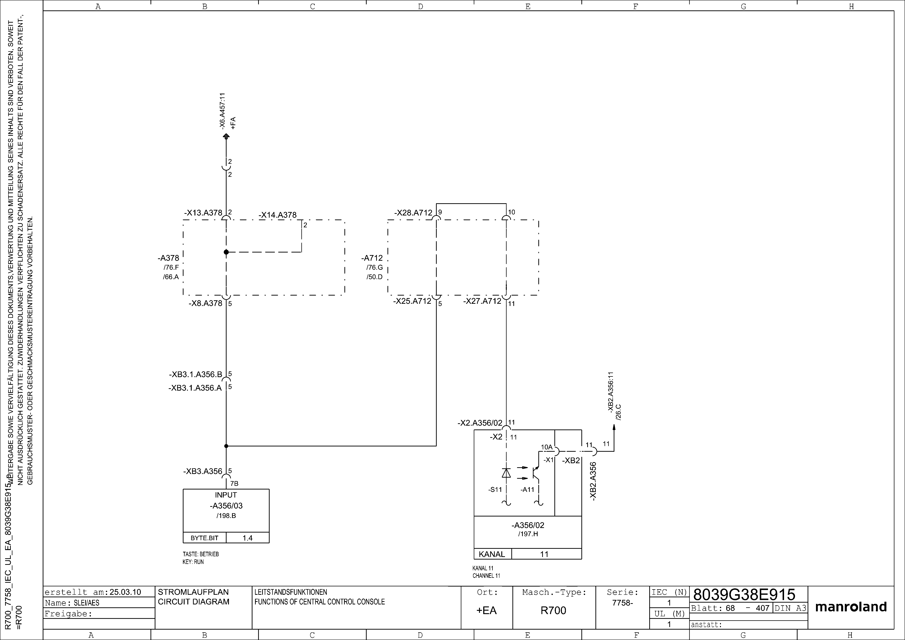

# +EA — Sheet 68 of 407 — LEITSTANDSFUNKTIONEN

**FUNCTIONS OF CENTRAL CONTROL CONSOLE**

> Part of the manroland **R700** printing press IEC/UL circuit diagrams.
> Drawing class: **Stromlaufplan / Circuit diagram** (DIN A3).
> Document `+EA` covers the **Printing unit** machine section.

## At a glance

| Field | Value |
|---|---|
| Document | `+EA`  (8039G38E915) |
| Sheet | **68** of 407 |
| Section (DE) | LEITSTANDSFUNKTIONEN |
| Section (EN) | FUNCTIONS OF CENTRAL CONTROL CONSOLE |
| Section type | CIRCUIT — Circuit diagram |
| Machine type | `R700` |
| Series | `7758` |
| Created | 25.03.10 |
| Replaces | — |
| Columns used | B, C, D, E, F |
| Path numbers | — |
| Labels on sheet | 57 |
| Cross-refs out | 7 |
| Cross-refs in | 21 |

**Previous:** [+EA sheet 67](SHEET_0067.md) · **Next:** [+EA sheet 69](SHEET_0069.md) · **Document TOC:** [_TOC.md](_TOC.md)  (+EA) · **Master TOC:** [all sheets](../_MASTER_TOC.md)

## Sheet image (300 DPI, exact vector render)



_Rendered directly from the PDF vector layer at 300 DPI (1-bit), no OCR and no resampling. Use it to confirm anything ambiguous in the text below._

## Cross-references on this sheet

Each entry is a wire leaving this sheet. The printed token is `/sheet.column`; the link resolves to that sheet inside the same document.

| Ref | Target sheet | Col | Path | Destination on target | Target section | From col |
|---|---|---|---|---|---|---|
| `/76.F` | [+EA sheet 76](SHEET_0076.md) | F | — | — | AUSLEGERSTAPELSTEUERUNG | B |
| `/66.A` | [+EA sheet 66](SHEET_0066.md) | A | — | — | MASCHINENBEDIENUNG: BEDIENUNGKOMMANDOS | B |
| `/76.G` | [+EA sheet 76](SHEET_0076.md) | G | — | — | AUSLEGERSTAPELSTEUERUNG | D |
| `/50.D` | [+EA sheet 50](SHEET_0050.md) | D | — | — | SCHUTZ | D |
| `/26.C` | [+EA sheet 26](SHEET_0026.md) | C | — | XB2.A356:11 | BUSVERBINDUNGEN: SICHERHEITSBUS | F |
| `/198.B` | [+EA sheet 198](SHEET_0198.md) | B | — | — | REFERENZMODUL | B |
| `/197.H` | [+EA sheet 197](SHEET_0197.md) | H | — | — | REFERENZMODUL | E |

### Incoming references (sheets that point here)

Every other sheet that sends a wire to this one. `Back-ref` is the token printed on *that* sheet; `Path` is its line number.

| From sheet | Cols | Back-ref | Path | Refs | What continues there |
|---|---|---|---|---|---|
| [+EA#26](SHEET_0026.md) | C | `/26.C` | — | 1 | XB2.A356:11 |
| [+EA#50](SHEET_0050.md) | D | `/50.D` | — | 1 | — |
| [+EA#66](SHEET_0066.md) | A | `/66.A` | — | 1 | — |
| [+EA#76](SHEET_0076.md) | E, F | `/76.E`, `/76.F` | — | 2 | — |
| [+EA#197](SHEET_0197.md) | H | `/197.H` | — | 1 | — |
| [+EA#198](SHEET_0198.md) | B | `/198.B` | — | 1 | — |
| [+EA#225](SHEET_0225.md) | F | `/225.F` | — | 1 | — |
| [+EA#226](SHEET_0226.md) | E | `/226.E` | — | 1 | — |
| [+EA#234](SHEET_0234.md) | H | `/234.H` | — | 1 | — |
| [+EA#235](SHEET_0235.md) | A, B | `/235.A`, `/235.B` | — | 2 | — |
| [+EA#250](SHEET_0250.md) | D | `/250.D` | — | 1 | — |
| [+EA#259](SHEET_0259.md) | A | `/259.A` | — | 1 | — |
| [+EA#260](SHEET_0260.md) | A | `/260.A` | — | 1 | — |
| [+EA#267](SHEET_0267.md) | C | `/267.C` | — | 2 | — |
| [+EA#268](SHEET_0268.md) | F | `/268.F` | — | 1 | — |
| [+EA#271](SHEET_0271.md) | G | `/271.G` | — | 1 | — |
| [+EA#273](SHEET_0273.md) | C | `/273.C` | — | 2 | — |


## Devices on this sheet

| Tag | Class | Class meaning (IEC) | Col | Sub | Terminal | Sign |
|---|---|---|---|---|---|---|
| `A356/03` | A | Baugruppe / assembly, module, PC board | B | 03 | — | — |
| `A378` | A | Baugruppe / assembly, module, PC board | B | — | — | — |
| `S11` | S | Schalter / switch | E | — | — | — |
| `A11` | A | Baugruppe / assembly, module, PC board | E | — | — | — |
| `X1` | X | Klemme / terminal, plug connector | E | — | — | — |
| `X2` | X | Klemme / terminal, plug connector | E | — | — | — |
| `XB2` | XB |  | E | — | — | — |
| `A356/02` | A | Baugruppe / assembly, module, PC board | E | 02 | — | — |
| `A712` | A | Baugruppe / assembly, module, PC board | D | — | — | — |
| `1.4` | — | cross-device reference | B | — | — | — |
| `XB3.A356` | — | cross-device reference | B | — | — | — |
| `X8.A378` | — | cross-device reference | B | — | — | — |
| `X13.A378` | — | cross-device reference | B | — | — | — |
| `X6.A457:11` | — | cross-device reference | B | — | 11 | — |
| `XB2.A356` | — | cross-device reference | F | — | — | — |
| `X28.A712` | — | cross-device reference | D | — | — | — |
| `X27.A712` | — | cross-device reference | E | — | — | — |
| `X25.A712` | — | cross-device reference | D | — | — | — |
| `XB3.1.A356.B` | — | cross-device reference | B | — | — | — |
| `XB3.1.A356.A` | — | cross-device reference | B | — | — | — |
| `XB2.A356:11` | — | cross-device reference | F | — | 11 | — |
| `X14.A378` | — | cross-device reference | C | — | — | — |

## Potentials / nets

_No named potentials on this sheet._

## Wire-end annotations (grouped as printed)

A wire that continues elsewhere is annotated with a small cluster: the destination description, the path/line number `#NN`, and the `/sheet.column` cross reference. Each row below is one such cluster exactly as it is grouped on the drawing.

| Col | Y | Path | Cross-ref | Text on the wire |
|---|---|---|---|---|
| B | 121.6 | — | — | `X6.A457:11` |
| B | 153.9 | — | — | `+FA` |
| B | 208.7 | — | — | `2` |
| B | 225.7 | — | — | `2` |
| B | 275.3 | — | — | `X13.A378 2` |
| D | 275.3 | — | — | `X28.A712 9 10` |
| C | 278.1 | — | — | `X14.A378` |
| C | 292.3 | — | — | `2` |
| B | 334.8 | — | — | `A378` |
| D | 334.8 | — | — | `A712` |
| B | 347.9 | — | `/76.F`, `/66.A` | — |
| D | 347.9 | — | `/76.G`, `/50.D` | — |
| D | 391.5 | — | — | `X25.A712 5 X27.A712 11` |
| B | 394.3 | — | — | `X8.A378 5` |
| B | 487.9 | — | — | `XB3.1.A356.B 5` |
| F | 488.4 | — | `/26.C` | `XB2.A356:11` |
| B | 504.9 | — | — | `XB3.1.A356.A 5` |
| E | 551.6 | — | — | `X2.A356/02 11` |
| E | 570.1 | — | — | `X2` |
| E | 571.5 | — | — | `11 11` |
| F | 580.0 | — | — | `11` |
| E | 584.2 | — | — | `10A` |
| E | 601.2 | — | — | `X1` |
| E | 601.3 | — | — | `XB2` |
| F | 607.5 | — | — | `XB2.A356` |
| B | 615.4 | — | — | `XB3.A356 5` |
| B | 632.4 | — | — | `7B` |
| E | 640.2 | — | — | `S11 A11` |
| B | 646.9 | — | — | `INPUT` |
| B | 660.8 | — | — | `A356/03` |
| B | 674.5 | — | `/198.B` | — |
| E | 686.3 | — | — | `A356/02` |
| E | 698.7 | — | `/197.H` | — |
| B | 703.6 | — | — | `BYTE.BIT 1.4` |
| E | 724.5 | — | — | `KANAL 11` |
| B | 726.4 | — | — | `KEY: RUN TASTE: BETRIEB` |
| E | 744.9 | — | — | `KANAL 11 CHANNEL 11` |


## Reconstructed tables

This sheet carries tabular content (pin map / terminal assignment / index). The grid below was rebuilt from the drawing's own rule lines, so each row is exactly one physical row of the table.

### Table 1 — 3 data rows × 2 columns (at x=240.9, y=331.7)

| X8.A378 XB3.1.A356.B XB3.1.A356.A | 5 5 5 |
|---|---|
| `XB3.A356` | `5 7B` |
| `INPUT` | `A356/03 /198.B` |
| `BYTE.BIT` | `1.4` |


### Table 2 — 4 data rows × 6 columns (at x=574.0, y=267.9)

| 9 5 | X27.A712 X2.A356/02 | 10 11 11 |  |  | XB2.A356:11 |
|---|---|---|---|---|---|
|  | `X2` | `11` |  |  | `11 11` |
|  | `S11` | `A11` | `10A X1` | `XB2` | `XB2.A356` |
|  |  | `A356/02 /197.H` |  |  |  |
|  | `KANAL` |  | `11` |  |  |


## Notes and free text on this sheet

| Text | Col | Y (pt) |
|---|---|---|
| `7B` | B | 632.4 |
| `INPUT` | B | 646.94 |
| `BYTE.BIT` | B | 704.19 |
| `TASTE: BETRIEB` | B | 726.44 |
| `KEY: RUN` | B | 736.38 |
| `+FA` | B | 153.92 |
| `KANAL 11` | E | 744.85 |
| `CHANNEL 11` | E | 754.8 |
| `10A` | E | 584.22 |
| `KANAL` | E | 724.55 |
| `X2.A356/02` | E | 551.65 |

## Complete label inventory (exact text from the drawing)

Every text object inside the drawing area of this sheet, in DIN reading order (column A→H, then top→bottom). This is the authoritative list: if a string is not here it is not printed on this sheet.

| Col | Y | X | Dir | Type | Text |
|---|---|---|---|---|---|
| B | 121.6 | 288.7 | ↕ | device ref | `X6.A457:11` |
| B | 153.9 | 302.9 | ↕ | text | `+FA` |
| B | 208.7 | 300.2 | → | number | `2` |
| B | 225.7 | 300.2 | → | number | `2` |
| B | 275.3 | 242.4 | → | device ref | `X13.A378` |
| B | 275.3 | 300.2 | → | number | `2` |
| B | 334.8 | 207.5 | → | device tag | `A378` |
| B | 347.9 | 215.4 | → | cross-reference | `/76.F` |
| B | 360.2 | 214.6 | → | cross-reference | `/66.A` |
| B | 394.3 | 248.3 | → | device ref | `X8.A378` |
| B | 395.8 | 300.2 | → | number | `5` |
| B | 487.9 | 222.5 | → | device ref | `XB3.1.A356.B` |
| B | 487.9 | 300.2 | → | number | `5` |
| B | 504.9 | 300.2 | → | number | `5` |
| B | 505.6 | 221.7 | → | device ref | `XB3.1.A356.A` |
| B | 615.4 | 241.2 | → | device ref | `XB3.A356` |
| B | 615.4 | 300.2 | → | number | `5` |
| B | 632.4 | 303.0 | → | text | `7B` |
| B | 646.9 | 282.8 | → | text | `INPUT` |
| B | 660.8 | 276.2 | → | device tag | `A356/03` |
| B | 674.6 | 285.0 | → | cross-reference | `/198.B` |
| B | 703.6 | 318.9 | → | device ref | `1.4` |
| B | 704.2 | 250.9 | → | text | `BYTE.BIT` |
| B | 726.4 | 240.7 | → | text | `TASTE: BETRIEB` |
| B | 736.4 | 240.4 | → | text | `KEY: RUN` |
| C | 278.1 | 340.2 | → | device ref | `X14.A378` |
| C | 292.3 | 399.4 | → | number | `2` |
| D | 275.3 | 518.7 | → | device ref | `X28.A712` |
| D | 275.3 | 576.6 | → | number | `9` |
| D | 334.8 | 475.4 | → | device tag | `A712` |
| D | 347.9 | 482.2 | → | cross-reference | `/76.G` |
| D | 360.3 | 482.5 | → | cross-reference | `/50.D` |
| D | 391.5 | 517.3 | → | device ref | `X25.A712` |
| D | 395.8 | 576.6 | → | number | `5` |
| E | 275.3 | 668.1 | → | number | `10` |
| E | 391.5 | 609.4 | → | device ref | `X27.A712` |
| E | 395.8 | 668.1 | → | number | `11` |
| E | 551.6 | 602.1 | → | text | `X2.A356/02` |
| E | 551.7 | 668.1 | → | number | `11` |
| E | 570.1 | 644.6 | → | device tag | `X2` |
| E | 571.5 | 671.0 | → | number | `11` |
| E | 584.2 | 711.5 | → | text | `10A` |
| E | 601.2 | 715.2 | → | device tag | `X1` |
| E | 601.3 | 739.6 | → | device tag | `XB2` |
| E | 640.2 | 642.3 | → | device tag | `S11` |
| E | 640.2 | 684.9 | → | device tag | `A11` |
| E | 686.3 | 673.1 | → | device tag | `A356/02` |
| E | 698.7 | 682.0 | → | cross-reference | `/197.H` |
| E | 724.5 | 710.2 | → | number | `11` |
| E | 724.6 | 629.9 | → | text | `KANAL` |
| E | 744.8 | 621.6 | → | text | `KANAL 11` |
| E | 754.8 | 621.9 | → | text | `CHANNEL 11` |
| F | 488.4 | 799.6 | ↕ | device ref | `XB2.A356:11` |
| F | 531.8 | 809.6 | ↕ | cross-reference | `/26.C` |
| F | 580.0 | 792.9 | → | number | `11` |
| F | 581.4 | 770.2 | → | number | `11` |
| F | 607.5 | 775.6 | ↕ | device ref | `XB2.A356` |

## Reading-order text block

The same content as a plain block, grouped by DIN column — convenient to paste or to match against a visual description.

```text
=== Column B ===
 121.6  288.7  devref       X6.A457:11
 153.9  302.9  text         +FA
 208.7  300.2  numeric      2
 225.7  300.2  numeric      2
 275.3  242.4  devref       X13.A378
 275.3  300.2  numeric      2
 334.8  207.5  devtag       A378
 347.9  215.4  xref         /76.F
 360.2  214.6  xref         /66.A
 394.3  248.3  devref       X8.A378
 395.8  300.2  numeric      5
 487.9  222.5  devref       XB3.1.A356.B
 487.9  300.2  numeric      5
 504.9  300.2  numeric      5
 505.6  221.7  devref       XB3.1.A356.A
 615.4  241.2  devref       XB3.A356
 615.4  300.2  numeric      5
 632.4  303.0  text         7B
 646.9  282.8  text         INPUT
 660.8  276.2  devtag       A356/03
 674.6  285.0  xref         /198.B
 703.6  318.9  devref       1.4
 704.2  250.9  text         BYTE.BIT
 726.4  240.7  text         TASTE: BETRIEB
 736.4  240.4  text         KEY: RUN
=== Column C ===
 278.1  340.2  devref       X14.A378
 292.3  399.4  numeric      2
=== Column D ===
 275.3  518.7  devref       X28.A712
 275.3  576.6  numeric      9
 334.8  475.4  devtag       A712
 347.9  482.2  xref         /76.G
 360.3  482.5  xref         /50.D
 391.5  517.3  devref       X25.A712
 395.8  576.6  numeric      5
=== Column E ===
 275.3  668.1  numeric      10
 391.5  609.4  devref       X27.A712
 395.8  668.1  numeric      11
 551.6  602.1  text         X2.A356/02
 551.7  668.1  numeric      11
 570.1  644.6  devtag       X2
 571.5  671.0  numeric      11
 584.2  711.5  text         10A
 601.2  715.2  devtag       X1
 601.3  739.6  devtag       XB2
 640.2  642.3  devtag       S11
 640.2  684.9  devtag       A11
 686.3  673.1  devtag       A356/02
 698.7  682.0  xref         /197.H
 724.5  710.2  numeric      11
 724.6  629.9  text         KANAL
 744.8  621.6  text         KANAL 11
 754.8  621.9  text         CHANNEL 11
=== Column F ===
 488.4  799.6  devref       XB2.A356:11
 531.8  809.6  xref         /26.C
 580.0  792.9  numeric      11
 581.4  770.2  numeric      11
 607.5  775.6  devref       XB2.A356
```

---
_Generated from the PDF vector text layer; no OCR. Source: `R700_7758_IEC_UL_EA_8039G38E915_p`, sheet 68._
