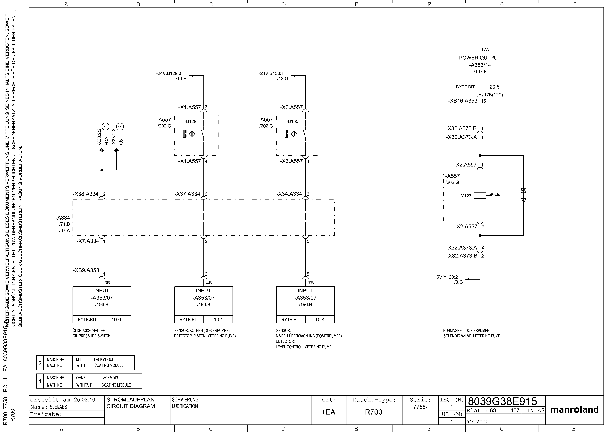

# +EA — Sheet 69 of 407 — SCHMIERUNG

**LUBRICATION**

> Part of the manroland **R700** printing press IEC/UL circuit diagrams.
> Drawing class: **Stromlaufplan / Circuit diagram** (DIN A3).
> Document `+EA` covers the **Printing unit** machine section.

## At a glance

| Field | Value |
|---|---|
| Document | `+EA`  (8039G38E915) |
| Sheet | **69** of 407 |
| Section (DE) | SCHMIERUNG |
| Section (EN) | LUBRICATION |
| Section type | CIRCUIT — Circuit diagram |
| Machine type | `R700` |
| Series | `7758` |
| Created | 25.03.10 |
| Replaces | — |
| Columns used | A, B, C, D, F, G |
| Path numbers | — |
| Labels on sheet | 109 |
| Cross-refs out | 12 |
| Cross-refs in | 32 |

**Previous:** [+EA sheet 68](SHEET_0068.md) · **Next:** [+EA sheet 70](SHEET_0070.md) · **Document TOC:** [_TOC.md](_TOC.md)  (+EA) · **Master TOC:** [all sheets](../_MASTER_TOC.md)

## Sheet image (300 DPI, exact vector render)



_Rendered directly from the PDF vector layer at 300 DPI (1-bit), no OCR and no resampling. Use it to confirm anything ambiguous in the text below._

## Cross-references on this sheet

Each entry is a wire leaving this sheet. The printed token is `/sheet.column`; the link resolves to that sheet inside the same document.

| Ref | Target sheet | Col | Path | Destination on target | Target section | From col |
|---|---|---|---|---|---|---|
| `/197.F` | [+EA sheet 197](SHEET_0197.md) | F | — | — | REFERENZMODUL | G |
| `/13.H` | [+EA sheet 13](SHEET_0013.md) | H | — | 24V.B129:3 | SPANNUNGSVERSORGUNG: 400V, 24V | B |
| `/13.G` | [+EA sheet 13](SHEET_0013.md) | G | — | 24V.B130:1 | SPANNUNGSVERSORGUNG: 400V, 24V | D |
| `/202.G` | [+EA sheet 202](SHEET_0202.md) | G | — | — | REFERENZMODUL | B |
| `/202.G` | [+EA sheet 202](SHEET_0202.md) | G | — | — | REFERENZMODUL | D |
| `/202.G` | [+EA sheet 202](SHEET_0202.md) | G | — | A557 | REFERENZMODUL | F |
| `/71.B` | [+EA sheet 71](SHEET_0071.md) | B | — | — | AUSLEGERSTAPELSTEUERUNG | A |
| `/67.A` | [+EA sheet 67](SHEET_0067.md) | A | — | — | LEITSTANDSFUNKTIONEN | A |
| `/8.G` | [+EA sheet 8](SHEET_0008.md) | G | — | 0V.Y123:2 | SPANNUNGSVERSORGUNG: 400V, 24V | F |
| `/196.B` | [+EA sheet 196](SHEET_0196.md) | B | — | — | REFERENZMODUL | A |
| `/196.B` | [+EA sheet 196](SHEET_0196.md) | B | — | — | REFERENZMODUL | C |
| `/196.B` | [+EA sheet 196](SHEET_0196.md) | B | — | — | REFERENZMODUL | D |

### Incoming references (sheets that point here)

Every other sheet that sends a wire to this one. `Back-ref` is the token printed on *that* sheet; `Path` is its line number.

| From sheet | Cols | Back-ref | Path | Refs | What continues there |
|---|---|---|---|---|---|
| [+EA#8](SHEET_0008.md) | G | `/8.G` | — | 1 | 0V.Y123:2 |
| [+EA#13](SHEET_0013.md) | G, H | `/13.G`, `/13.H` | — | 2 | 24V.B129:3; 24V.B130:1 |
| [+EA#67](SHEET_0067.md) | A | `/67.A` | — | 1 | — |
| [+EA#71](SHEET_0071.md) | A | `/71.A` | — | 1 | — |
| [+EA#196](SHEET_0196.md) | B | `/196.B` | — | 3 | — |
| [+EA#197](SHEET_0197.md) | F | `/197.F` | — | 1 | — |
| [+EA#202](SHEET_0202.md) | G | `/202.G` | — | 3 | — |
| [+EA#211](SHEET_0211.md) | G | `/211.G` | — | 2 | — |
| [+EA#230](SHEET_0230.md) | C | `/230.C` | — | 2 | — |
| [+EA#235](SHEET_0235.md) | F | `/235.F` | — | 2 | — |
| [+EA#246](SHEET_0246.md) | F | `/246.F` | — | 3 | — |
| [+EA#252](SHEET_0252.md) | C | `/252.C` | — | 3 | — |
| [+EA#261](SHEET_0261.md) | G | `/261.G` | — | 1 | — |
| [+EA#276](SHEET_0276.md) | G | `/276.G` | — | 4 | — |
| [+EA#278](SHEET_0278.md) | A | `/278.A` | — | 1 | — |
| [+EA#279](SHEET_0279.md) | F | `/279.F` | — | 1 | — |
| [+EA#280](SHEET_0280.md) | B | `/280.B` | — | 1 | — |


## Devices on this sheet

| Tag | Class | Class meaning (IEC) | Col | Sub | Terminal | Sign |
|---|---|---|---|---|---|---|
| `A353/07` | A | Baugruppe / assembly, module, PC board | A | 07 | — | — |
| `A353/07` | A | Baugruppe / assembly, module, PC board | C | 07 | — | — |
| `A353/07` | A | Baugruppe / assembly, module, PC board | D | 07 | — | — |
| `A353/14` | A | Baugruppe / assembly, module, PC board | G | 14 | — | — |
| `A334` | A | Baugruppe / assembly, module, PC board | A | — | — | — |
| `B129` | B | Umformer / transducer, sensor | C | — | — | — |
| `A557` | A | Baugruppe / assembly, module, PC board | B | — | — | — |
| `B130` | B | Umformer / transducer, sensor | D | — | — | — |
| `A557` | A | Baugruppe / assembly, module, PC board | D | — | — | — |
| `Y123` | Y | Magnetventil / solenoid valve, actuator | F | — | — | — |
| `A557` | A | Baugruppe / assembly, module, PC board | F | — | — | — |
| `10.0` | — | cross-device reference | B | — | — | — |
| `XB9.A353` | — | cross-device reference | A | — | — | — |
| `10.1` | — | cross-device reference | C | — | — | — |
| `10.4` | — | cross-device reference | D | — | — | — |
| `X32.A373.A` | — | cross-device reference | F | — | — | — |
| `X32.A373.B` | — | cross-device reference | F | — | — | — |
| `20.6` | — | cross-device reference | G | — | — | — |
| `XB16.A353` | — | cross-device reference | F | — | — | — |
| `X38.A334` | — | cross-device reference | A | — | — | — |
| `X37.A334` | — | cross-device reference | C | — | — | — |
| `X34.A334` | — | cross-device reference | D | — | — | — |
| `X7.A334` | — | cross-device reference | A | — | — | — |
| `X1.A557` | — | cross-device reference | C | — | — | — |
| `X1.A557` | — | cross-device reference | C | — | — | — |
| `X3.A557` | — | cross-device reference | D | — | — | — |
| `X3.A557` | — | cross-device reference | D | — | — | — |
| `X38.2:2` | — | cross-device reference | A | — | 2 | — |
| `X38.2:2` | — | cross-device reference | B | — | 2 | — |
| `X32.A373.B` | — | cross-device reference | F | — | — | — |
| `X32.A373.A` | — | cross-device reference | F | — | — | — |
| `X2.A557` | — | cross-device reference | F | — | — | — |
| `X2.A557` | — | cross-device reference | G | — | — | — |

## Potentials / nets

| Potential | Count | Columns | Attached devices | Terminals |
|---|---|---|---|---|
| `0V` | 1 | F | `Y123` | `2` |
| `24V` | 2 | B, D | `B129`, `B130` | `1`, `3` |


A potential such as `L24+/4` or `M24+` is a named supply/return rail; every place it appears on this sheet is electrically common.

## Wire-end annotations (grouped as printed)

A wire that continues elsewhere is annotated with a small cluster: the destination description, the path/line number `#NN`, and the `/sheet.column` cross reference. Each row below is one such cluster exactly as it is grouped on the drawing.

| Col | Y | Path | Cross-ref | Text on the wire |
|---|---|---|---|---|
| G | 93.1 | — | — | `17A` |
| G | 108.3 | — | — | `POWER QUTPUT` |
| G | 122.2 | — | — | `A353/14` |
| G | 136.0 | — | `/197.F` | — |
| B | 139.2 | — | `/13.H` | `24V.B129:3` |
| D | 139.2 | — | `/13.G` | `24V.B130:1` |
| G | 165.0 | — | — | `BYTE.BIT 20.6` |
| G | 181.0 | — | — | `17B(17C)` |
| G | 191.6 | — | — | `XB16.A353 15` |
| C | 204.4 | — | — | `X1.A557 3` |
| D | 204.4 | — | — | `X3.A557 1` |
| C | 228.5 | — | — | `A557 B129` |
| D | 228.5 | — | — | `A557 B130` |
| B | 241.6 | — | `/202.G` | — |
| D | 241.6 | — | `/202.G` | — |
| B | 243.7 | — | — | `1` |
| B | 244.6 | — | — | `2` |
| F | 245.5 | — | — | `X32.A373.B 1` |
| A | 250.6 | — | — | `X38.2:2` |
| B | 250.6 | — | — | `X38.2:2` |
| F | 262.5 | — | — | `X32.A373.A 1` |
| B | 266.5 | — | — | `+DA` |
| B | 270.1 | — | — | `+Jx` |
| C | 309.3 | — | — | `X1.A557 4` |
| D | 309.3 | — | — | `X3.A557 4` |
| G | 316.4 | — | — | `X2.A557 1` |
| F | 338.3 | — | `/202.G` | `A557` |
| C | 373.1 | — | — | `X38.A334 2 X37.A334 2 X34.A334 2` |
| F | 378.0 | — | — | `Y123` |
| A | 419.8 | — | — | `A334` |
| A | 432.9 | — | `/71.B`, `/67.A` | — |
| G | 436.8 | — | — | `X2.A557 2` |
| C | 465.2 | — | — | `X7.A334 1 2 5` |
| F | 477.9 | — | — | `X32.A373.A 2` |
| F | 493.5 | — | — | `X32.A373.B 2` |
| A | 521.9 | — | — | `XB9.A353 1` |
| C | 530.4 | — | — | `2` |
| D | 530.4 | — | — | `5` |
| F | 536.0 | — | `/8.G` | `0V.Y123:2` |
| B | 547.4 | — | — | `3B` |
| C | 547.4 | — | — | `4B` |
| D | 547.4 | — | — | `7B` |
| A | 561.9 | — | — | `INPUT` |
| C | 561.9 | — | — | `INPUT` |
| D | 561.9 | — | — | `INPUT` |
| A | 575.7 | — | — | `A353/07` |
| C | 575.7 | — | — | `A353/07` |
| D | 575.7 | — | — | `A353/07` |
| A | 589.5 | — | `/196.B` | — |
| C | 589.5 | — | `/196.B` | — |
| D | 589.5 | — | `/196.B` | — |
| A | 618.6 | — | — | `BYTE.BIT 10.0` |
| C | 618.6 | — | — | `BYTE.BIT 10.1` |
| D | 618.6 | — | — | `BYTE.BIT 10.4` |
| D | 641.2 | — | — | `NIVEAU ÜBERWACHUNG (DOSIERPUMPE) DETECTOR: LEVEL CONTROL (METERING PUMP) SENSOR:` |
| A | 641.3 | — | — | `ÖLDRUCKSCHALTER OIL PRESSURE SWITCH` |
| C | 641.3 | — | — | `DETECTOR: PISTON (METERING PUMP) SENSOR: KOLBEN (DOSIERPUMPE)` |
| G | 641.3 | — | — | `HUBMAGNET: DOSIERPUMPE` |
| G | 651.9 | — | — | `SOLENOID VALVE: METERING PUMP` |
| A | 697.9 | — | — | `MIT` |
| A | 698.0 | — | — | `MASCHINE` |
| B | 698.0 | — | — | `LACKMODUL` |
| A | 703.3 | — | — | `2 COATING MODULE` |
| A | 709.2 | — | — | `WITH` |
| A | 709.3 | — | — | `MACHINE` |
| A | 733.4 | — | — | `MASCHINE` |
| A | 733.4 | — | — | `OHNE` |
| B | 733.4 | — | — | `LACKMODUL` |
| A | 738.7 | — | — | `1 COATING MODULE` |
| A | 747.5 | — | — | `WITHOUT` |
| A | 747.6 | — | — | `MACHINE` |


## Reconstructed tables

This sheet carries tabular content (pin map / terminal assignment / index). The grid below was rebuilt from the drawing's own rule lines, so each row is exactly one physical row of the table.

### Table 1 — 1 data rows × 2 columns (at x=141.7, y=558.4)

| INPUT | A353/07 /196.B |
|---|---|
| `BYTE.BIT` | `10.0` |


### Table 2 — 1 data rows × 2 columns (at x=340.2, y=558.4)

| INPUT | A353/07 /196.B |
|---|---|
| `BYTE.BIT` | `10.1` |


### Table 3 — 1 data rows × 2 columns (at x=538.6, y=558.4)

| INPUT | A353/07 /196.B |
|---|---|
| `BYTE.BIT` | `10.4` |


### Table 4 — 3 data rows × 2 columns (at x=878.7, y=104.9)

| POWER | QUTPUT A353/14 /197.F |
|---|---|
| `BYTE.BIT` | `20.6` |
| `XB16.A353 X32.A373.B X32.A373.A` | `17B(17C) 15 1 1` |
| `X2.A557 A557 /202.G Y123 X2.A557` | `1 2` |


## Notes and free text on this sheet

| Text | Col | Y (pt) |
|---|---|---|
| `3B` | B | 547.36 |
| `INPUT` | A | 561.9 |
| `BYTE.BIT` | A | 619.15 |
| `ÖLDRUCKSCHALTER` | A | 641.28 |
| `OIL PRESSURE SWITCH` | A | 651.86 |
| `4B` | C | 547.36 |
| `INPUT` | C | 561.9 |
| `BYTE.BIT` | C | 619.15 |
| `SENSOR: KOLBEN (DOSIERPUMPE)` | C | 641.26 |
| `DETECTOR: PISTON (METERING PUMP)` | C | 651.89 |
| `7B` | D | 547.36 |
| `INPUT` | D | 561.9 |
| `BYTE.BIT` | D | 619.15 |
| `SENSOR:` | D | 641.23 |
| `NIVEAU ÜBERWACHUNG (DOSIERPUMPE)` | D | 651.89 |
| `DETECTOR:` | D | 662.5 |
| `LEVEL CONTROL (METERING PUMP)` | D | 673.17 |
| `17A` | G | 93.12 |
| `17B(17C)` | G | 181.03 |
| `POWER QUTPUT` | G | 108.28 |
| `BYTE.BIT` | F | 165.6 |
| `+DA` | B | 266.46 |
| `+Jx` | B | 270.14 |
| `HUBMAGNET: DOSIERPUMPE` | G | 641.26 |
| `SOLENOID VALVE: METERING PUMP` | G | 651.89 |
| `MASCHINE` | A | 733.38 |
| `MACHINE` | A | 747.56 |
| `OHNE` | A | 733.37 |
| `WITHOUT` | A | 747.52 |
| `LACKMODUL` | B | 733.4 |
| `COATING MODULE` | B | 747.57 |
| `MIT` | A | 697.92 |
| `WITH` | A | 709.16 |

## Complete label inventory (exact text from the drawing)

Every text object inside the drawing area of this sheet, in DIN reading order (column A→H, then top→bottom). This is the authoritative list: if a string is not here it is not printed on this sheet.

| Col | Y | X | Dir | Type | Text |
|---|---|---|---|---|---|
| A | 250.6 | 189.5 | ↕ | device ref | `X38.2:2` |
| A | 373.1 | 141.7 | → | device ref | `X38.A334` |
| A | 419.8 | 108.3 | → | device tag | `A334` |
| A | 432.9 | 115.7 | → | cross-reference | `/71.B` |
| A | 445.3 | 115.4 | → | cross-reference | `/67.A` |
| A | 465.2 | 149.1 | → | device ref | `X7.A334` |
| A | 521.9 | 142.0 | → | device ref | `XB9.A353` |
| A | 561.9 | 183.5 | → | text | `INPUT` |
| A | 575.7 | 177.0 | → | device tag | `A353/07` |
| A | 589.5 | 185.8 | → | cross-reference | `/196.B` |
| A | 619.1 | 151.7 | → | text | `BYTE.BIT` |
| A | 641.3 | 141.4 | → | text | `ÖLDRUCKSCHALTER` |
| A | 651.9 | 141.4 | → | text | `OIL PRESSURE SWITCH` |
| A | 697.9 | 91.6 | → | text | `MASCHINE` |
| A | 697.9 | 148.3 | → | text | `MIT` |
| A | 703.3 | 75.1 | → | number | `2` |
| A | 709.2 | 148.8 | → | text | `WITH` |
| A | 709.3 | 91.6 | → | text | `MACHINE` |
| A | 733.4 | 91.6 | → | text | `MASCHINE` |
| A | 733.4 | 148.5 | → | text | `OHNE` |
| A | 738.7 | 75.4 | → | number | `1` |
| A | 747.5 | 148.8 | → | text | `WITHOUT` |
| A | 747.6 | 91.6 | → | text | `MACHINE` |
| B | 139.2 | 304.4 | → | potential | `24V.B129:3` |
| B | 228.5 | 305.3 | → | device tag | `A557` |
| B | 241.6 | 307.3 | → | cross-reference | `/202.G` |
| B | 243.7 | 202.5 | ↕ | number | `1` |
| B | 244.6 | 231.3 | ↕ | number | `2` |
| B | 250.6 | 217.8 | ↕ | device ref | `X38.2:2` |
| B | 266.5 | 203.7 | ↕ | text | `+DA` |
| B | 270.1 | 232.1 | ↕ | text | `+Jx` |
| B | 374.5 | 201.0 | → | number | `2` |
| B | 466.6 | 200.4 | → | number | `1` |
| B | 530.4 | 200.4 | → | number | `1` |
| B | 547.4 | 203.8 | → | text | `3B` |
| B | 618.6 | 217.0 | → | device ref | `10.0` |
| B | 698.0 | 183.4 | → | text | `LACKMODUL` |
| B | 709.3 | 184.0 | → | text | `COATING MODULE` |
| B | 733.4 | 197.6 | → | text | `LACKMODUL` |
| B | 747.6 | 198.1 | → | text | `COATING MODULE` |
| C | 149.1 | 342.7 | → | cross-reference | `/13.H` |
| C | 204.4 | 347.5 | → | device ref | `X1.A557` |
| C | 204.4 | 399.4 | → | number | `3` |
| C | 232.7 | 359.7 | → | device tag | `B129` |
| C | 309.3 | 347.5 | → | device ref | `X1.A557` |
| C | 310.7 | 399.4 | → | number | `4` |
| C | 373.1 | 340.2 | → | device ref | `X37.A334` |
| C | 374.5 | 399.4 | → | number | `2` |
| C | 466.6 | 399.4 | → | number | `2` |
| C | 530.4 | 399.4 | → | number | `2` |
| C | 547.4 | 402.2 | → | text | `4B` |
| C | 561.9 | 382.0 | → | text | `INPUT` |
| C | 575.7 | 375.4 | → | device tag | `A353/07` |
| C | 589.5 | 384.2 | → | cross-reference | `/196.B` |
| C | 618.6 | 416.3 | → | device ref | `10.1` |
| C | 619.1 | 350.1 | → | text | `BYTE.BIT` |
| C | 641.3 | 339.9 | → | text | `SENSOR: KOLBEN (DOSIERPUMPE)` |
| C | 651.9 | 339.3 | → | text | `DETECTOR: PISTON (METERING PUMP)` |
| D | 139.2 | 504.3 | → | potential | `24V.B130:1` |
| D | 149.1 | 540.3 | → | cross-reference | `/13.G` |
| D | 204.4 | 546.0 | → | device ref | `X3.A557` |
| D | 204.4 | 597.3 | → | number | `1` |
| D | 228.5 | 503.7 | → | device tag | `A557` |
| D | 232.7 | 558.1 | → | device tag | `B130` |
| D | 241.6 | 505.7 | → | cross-reference | `/202.G` |
| D | 309.3 | 546.0 | → | device ref | `X3.A557` |
| D | 310.7 | 597.8 | → | number | `4` |
| D | 373.1 | 538.6 | → | device ref | `X34.A334` |
| D | 374.5 | 597.8 | → | number | `2` |
| D | 466.6 | 597.8 | → | number | `5` |
| D | 530.4 | 597.8 | → | number | `5` |
| D | 547.4 | 600.7 | → | text | `7B` |
| D | 561.9 | 580.4 | → | text | `INPUT` |
| D | 575.7 | 573.9 | → | device tag | `A353/07` |
| D | 589.5 | 582.7 | → | cross-reference | `/196.B` |
| D | 618.6 | 613.8 | → | device ref | `10.4` |
| D | 619.1 | 548.5 | → | text | `BYTE.BIT` |
| D | 641.2 | 538.3 | → | text | `SENSOR:` |
| D | 651.9 | 537.7 | → | text | `NIVEAU ÜBERWACHUNG (DOSIERPUMPE)` |
| D | 662.5 | 537.7 | → | text | `DETECTOR:` |
| D | 673.2 | 537.7 | → | text | `LEVEL CONTROL (METERING PUMP)` |
| F | 165.6 | 888.7 | → | text | `BYTE.BIT` |
| F | 191.6 | 873.1 | → | device ref | `XB16.A353` |
| F | 245.5 | 868.8 | → | device ref | `X32.A373.B` |
| F | 262.5 | 869.4 | → | device ref | `X32.A373.A` |
| F | 316.4 | 884.7 | → | device ref | `X2.A557` |
| F | 338.3 | 867.8 | → | device tag | `A557` |
| F | 351.4 | 868.1 | → | cross-reference | `/202.G` |
| F | 378.0 | 895.5 | → | device tag | `Y123` |
| F | 477.9 | 869.4 | → | device ref | `X32.A373.A` |
| F | 493.5 | 870.2 | → | device ref | `X32.A373.B` |
| F | 536.0 | 851.0 | → | potential | `0V.Y123:2` |
| F | 545.9 | 885.3 | → | cross-reference | `/8.G` |
| G | 93.1 | 937.4 | → | text | `17A` |
| G | 108.3 | 894.6 | → | text | `POWER QUTPUT` |
| G | 122.2 | 914.0 | → | device tag | `A353/14` |
| G | 136.0 | 923.1 | → | cross-reference | `/197.F` |
| G | 165.0 | 954.3 | → | device ref | `20.6` |
| G | 181.0 | 943.1 | → | text | `17B(17C)` |
| G | 193.1 | 937.4 | → | number | `15` |
| G | 246.9 | 937.4 | → | number | `1` |
| G | 263.9 | 937.4 | → | number | `1` |
| G | 317.8 | 937.4 | → | number | `1` |
| G | 436.8 | 886.1 | → | device ref | `X2.A557` |
| G | 438.3 | 938.0 | → | number | `2` |
| G | 478.0 | 938.0 | → | number | `2` |
| G | 495.0 | 938.0 | → | number | `2` |
| G | 641.3 | 863.7 | → | text | `HUBMAGNET: DOSIERPUMPE` |
| G | 651.9 | 864.3 | → | text | `SOLENOID VALVE: METERING PUMP` |

## Reading-order text block

The same content as a plain block, grouped by DIN column — convenient to paste or to match against a visual description.

```text
=== Column A ===
 250.6  189.5  devref       X38.2:2
 373.1  141.7  devref       X38.A334
 419.8  108.3  devtag       A334
 432.9  115.7  xref         /71.B
 445.3  115.4  xref         /67.A
 465.2  149.1  devref       X7.A334
 521.9  142.0  devref       XB9.A353
 561.9  183.5  text         INPUT
 575.7  177.0  devtag       A353/07
 589.5  185.8  xref         /196.B
 619.1  151.7  text         BYTE.BIT
 641.3  141.4  text         ÖLDRUCKSCHALTER
 651.9  141.4  text         OIL PRESSURE SWITCH
 697.9   91.6  text         MASCHINE
 697.9  148.3  text         MIT
 703.3   75.1  numeric      2
 709.2  148.8  text         WITH
 709.3   91.6  text         MACHINE
 733.4   91.6  text         MASCHINE
 733.4  148.5  text         OHNE
 738.7   75.4  numeric      1
 747.5  148.8  text         WITHOUT
 747.6   91.6  text         MACHINE
=== Column B ===
 139.2  304.4  net          24V.B129:3
 228.5  305.3  devtag       A557
 241.6  307.3  xref         /202.G
 243.7  202.5  numeric      1
 244.6  231.3  numeric      2
 250.6  217.8  devref       X38.2:2
 266.5  203.7  text         +DA
 270.1  232.1  text         +Jx
 374.5  201.0  numeric      2
 466.6  200.4  numeric      1
 530.4  200.4  numeric      1
 547.4  203.8  text         3B
 618.6  217.0  devref       10.0
 698.0  183.4  text         LACKMODUL
 709.3  184.0  text         COATING MODULE
 733.4  197.6  text         LACKMODUL
 747.6  198.1  text         COATING MODULE
=== Column C ===
 149.1  342.7  xref         /13.H
 204.4  347.5  devref       X1.A557
 204.4  399.4  numeric      3
 232.7  359.7  devtag       B129
 309.3  347.5  devref       X1.A557
 310.7  399.4  numeric      4
 373.1  340.2  devref       X37.A334
 374.5  399.4  numeric      2
 466.6  399.4  numeric      2
 530.4  399.4  numeric      2
 547.4  402.2  text         4B
 561.9  382.0  text         INPUT
 575.7  375.4  devtag       A353/07
 589.5  384.2  xref         /196.B
 618.6  416.3  devref       10.1
 619.1  350.1  text         BYTE.BIT
 641.3  339.9  text         SENSOR: KOLBEN (DOSIERPUMPE)
 651.9  339.3  text         DETECTOR: PISTON (METERING PUMP)
=== Column D ===
 139.2  504.3  net          24V.B130:1
 149.1  540.3  xref         /13.G
 204.4  546.0  devref       X3.A557
 204.4  597.3  numeric      1
 228.5  503.7  devtag       A557
 232.7  558.1  devtag       B130
 241.6  505.7  xref         /202.G
 309.3  546.0  devref       X3.A557
 310.7  597.8  numeric      4
 373.1  538.6  devref       X34.A334
 374.5  597.8  numeric      2
 466.6  597.8  numeric      5
 530.4  597.8  numeric      5
 547.4  600.7  text         7B
 561.9  580.4  text         INPUT
 575.7  573.9  devtag       A353/07
 589.5  582.7  xref         /196.B
 618.6  613.8  devref       10.4
 619.1  548.5  text         BYTE.BIT
 641.2  538.3  text         SENSOR:
 651.9  537.7  text         NIVEAU ÜBERWACHUNG (DOSIERPUMPE)
 662.5  537.7  text         DETECTOR:
 673.2  537.7  text         LEVEL CONTROL (METERING PUMP)
=== Column F ===
 165.6  888.7  text         BYTE.BIT
 191.6  873.1  devref       XB16.A353
 245.5  868.8  devref       X32.A373.B
 262.5  869.4  devref       X32.A373.A
 316.4  884.7  devref       X2.A557
 338.3  867.8  devtag       A557
 351.4  868.1  xref         /202.G
 378.0  895.5  devtag       Y123
 477.9  869.4  devref       X32.A373.A
 493.5  870.2  devref       X32.A373.B
 536.0  851.0  net          0V.Y123:2
 545.9  885.3  xref         /8.G
=== Column G ===
  93.1  937.4  text         17A
 108.3  894.6  text         POWER QUTPUT
 122.2  914.0  devtag       A353/14
 136.0  923.1  xref         /197.F
 165.0  954.3  devref       20.6
 181.0  943.1  text         17B(17C)
 193.1  937.4  numeric      15
 246.9  937.4  numeric      1
 263.9  937.4  numeric      1
 317.8  937.4  numeric      1
 436.8  886.1  devref       X2.A557
 438.3  938.0  numeric      2
 478.0  938.0  numeric      2
 495.0  938.0  numeric      2
 641.3  863.7  text         HUBMAGNET: DOSIERPUMPE
 651.9  864.3  text         SOLENOID VALVE: METERING PUMP
```

---
_Generated from the PDF vector text layer; no OCR. Source: `R700_7758_IEC_UL_EA_8039G38E915_p`, sheet 69._
