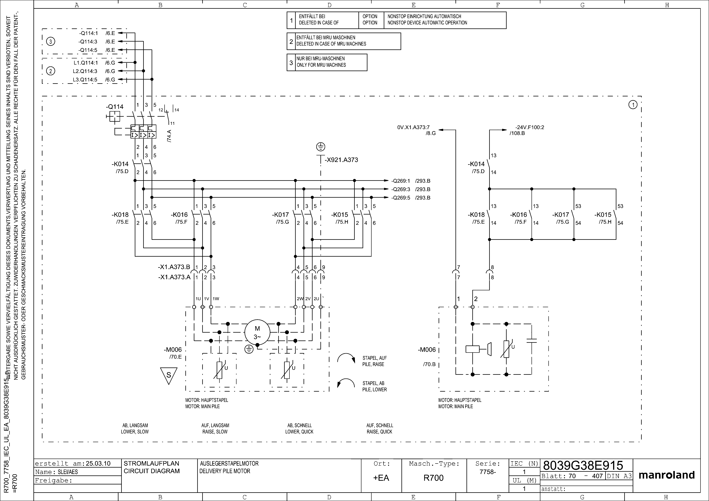

# +EA — Sheet 70 of 407 — AUSLEGERSTAPELMOTOR

**DELIVERY PILE MOTOR**

> Part of the manroland **R700** printing press IEC/UL circuit diagrams.
> Drawing class: **Stromlaufplan / Circuit diagram** (DIN A3).
> Document `+EA` covers the **Printing unit** machine section.

## At a glance

| Field | Value |
|---|---|
| Document | `+EA`  (8039G38E915) |
| Sheet | **70** of 407 |
| Section (DE) | AUSLEGERSTAPELMOTOR |
| Section (EN) | DELIVERY PILE MOTOR |
| Section type | CIRCUIT — Circuit diagram |
| Machine type | `R700` |
| Series | `7758` |
| Created | 25.03.10 |
| Replaces | — |
| Columns used | A, B, C, D, E, F, G, H |
| Path numbers | — |
| Labels on sheet | 163 |
| Cross-refs out | 24 |
| Cross-refs in | 42 |

**Previous:** [+EA sheet 69](SHEET_0069.md) · **Next:** [+EA sheet 71](SHEET_0071.md) · **Document TOC:** [_TOC.md](_TOC.md)  (+EA) · **Master TOC:** [all sheets](../_MASTER_TOC.md)

## Sheet image (300 DPI, exact vector render)



_Rendered directly from the PDF vector layer at 300 DPI (1-bit), no OCR and no resampling. Use it to confirm anything ambiguous in the text below._

## Cross-references on this sheet

Each entry is a wire leaving this sheet. The printed token is `/sheet.column`; the link resolves to that sheet inside the same document.

| Ref | Target sheet | Col | Path | Destination on target | Target section | From col |
|---|---|---|---|---|---|---|
| `/6.E` | [+EA sheet 6](SHEET_0006.md) | E | — | Q114:1 | SPANNUNGSVERSORGUNG: 400V,24V | A |
| `/6.E` | [+EA sheet 6](SHEET_0006.md) | E | — | Q114:3 | SPANNUNGSVERSORGUNG: 400V,24V | A |
| `/6.E` | [+EA sheet 6](SHEET_0006.md) | E | — | Q114:5 | SPANNUNGSVERSORGUNG: 400V,24V | A |
| `/6.G` | [+EA sheet 6](SHEET_0006.md) | G | — | L1.Q114:1 | SPANNUNGSVERSORGUNG: 400V,24V | A |
| `/6.G` | [+EA sheet 6](SHEET_0006.md) | G | — | L2.Q114:3 | SPANNUNGSVERSORGUNG: 400V,24V | A |
| `/6.G` | [+EA sheet 6](SHEET_0006.md) | G | — | L3.Q114:5 | SPANNUNGSVERSORGUNG: 400V,24V | A |
| `/8.G` | [+EA sheet 8](SHEET_0008.md) | G | — | 0V.X1.A373:7 | SPANNUNGSVERSORGUNG: 400V, 24V | E |
| `/74.A` | [+EA sheet 74](SHEET_0074.md) | A | — | — | AUSLEGERSTAPELSTEUERUNG | B |
| `/108.B` | [+EA sheet 108](SHEET_0108.md) | B | — | — | BLAS/SAUGLUFT MIT MOTORVENTILEINSTELLUNG | F |
| `/75.D` | [+EA sheet 75](SHEET_0075.md) | D | — | — | AUSLEGERSTAPELSTEUERUNG | B |
| `/75.D` | [+EA sheet 75](SHEET_0075.md) | D | — | — | AUSLEGERSTAPELSTEUERUNG | F |
| `/293.B` | [+EA sheet 293](SHEET_0293.md) | B | — | Q269:1 | OPTION: ZWISCHENSTAPEL / | E |
| `/293.B` | [+EA sheet 293](SHEET_0293.md) | B | — | Q269:3 | OPTION: ZWISCHENSTAPEL / | E |
| `/293.B` | [+EA sheet 293](SHEET_0293.md) | B | — | Q269:5 | OPTION: ZWISCHENSTAPEL / | E |
| `/75.E` | [+EA sheet 75](SHEET_0075.md) | E | — | — | AUSLEGERSTAPELSTEUERUNG | B |
| `/75.E` | [+EA sheet 75](SHEET_0075.md) | E | — | — | AUSLEGERSTAPELSTEUERUNG | F |
| `/75.F` | [+EA sheet 75](SHEET_0075.md) | F | — | — | AUSLEGERSTAPELSTEUERUNG | B |
| `/75.F` | [+EA sheet 75](SHEET_0075.md) | F | — | — | AUSLEGERSTAPELSTEUERUNG | F |
| `/75.G` | [+EA sheet 75](SHEET_0075.md) | G | — | — | AUSLEGERSTAPELSTEUERUNG | C |
| `/75.G` | [+EA sheet 75](SHEET_0075.md) | G | — | — | AUSLEGERSTAPELSTEUERUNG | G |
| `/75.H` | [+EA sheet 75](SHEET_0075.md) | H | — | — | AUSLEGERSTAPELSTEUERUNG | D |
| `/75.H` | [+EA sheet 75](SHEET_0075.md) | H | — | — | AUSLEGERSTAPELSTEUERUNG | G |
| `/70.E` | [+EA sheet 70](SHEET_0070.md) | E | — | — | AUSLEGERSTAPELMOTOR | B |
| `/70.B` | [+EA sheet 70](SHEET_0070.md) | B | — | — | AUSLEGERSTAPELMOTOR | E |

### Incoming references (sheets that point here)

Every other sheet that sends a wire to this one. `Back-ref` is the token printed on *that* sheet; `Path` is its line number.

| From sheet | Cols | Back-ref | Path | Refs | What continues there |
|---|---|---|---|---|---|
| [+EA#6](SHEET_0006.md) | E, H | `/6.E`, `/6.H` | — | 6 | L1.Q114:1; L2.Q114:3; L3.Q114:5; Q114:1; Q114:3; Q114:5 |
| [+EA#8](SHEET_0008.md) | G | `/8.G` | — | 1 | 0V.X1.A373:7 |
| [+EA#70](SHEET_0070.md) | B, E | `/70.B`, `/70.E` | — | 2 | — |
| [+EA#74](SHEET_0074.md) | A | `/74.A` | — | 1 | — |
| [+EA#75](SHEET_0075.md) | D, E, F, G, H | `/75.D`, `/75.E`, `/75.F`, `/75.G`, `/75.H` | — | 10 | — |
| [+EA#108](SHEET_0108.md) | B | `/108.B` | — | 1 | — |
| [+EA#209](SHEET_0209.md) | G | `/209.G` | — | 18 | — |
| [+EA#293](SHEET_0293.md) | A | `/293.A` | — | 3 | Q269:1; Q269:3; Q269:5 |


## Devices on this sheet

| Tag | Class | Class meaning (IEC) | Col | Sub | Terminal | Sign |
|---|---|---|---|---|---|---|
| `K016` | K | Relais / relay, contactor | B | — | — | — |
| `K017` | K | Relais / relay, contactor | C | — | — | — |
| `K018` | K | Relais / relay, contactor | F | — | — | — |
| `K014` | K | Relais / relay, contactor | F | — | — | — |
| `K018` | K | Relais / relay, contactor | B | — | — | — |
| `K015` | K | Relais / relay, contactor | D | — | — | — |
| `K016` | K | Relais / relay, contactor | F | — | — | — |
| `K017` | K | Relais / relay, contactor | G | — | — | — |
| `K015` | K | Relais / relay, contactor | G | — | — | — |
| `K014` | K | Relais / relay, contactor | B | — | — | — |
| `Q114` | Q | Leistungsschalter / power switching device | A | — | — | — |
| `Q114:5` | Q | Leistungsschalter / power switching device | A | — | 5 | — |
| `Q114:3` | Q | Leistungsschalter / power switching device | A | — | 3 | — |
| `Q114:1` | Q | Leistungsschalter / power switching device | A | — | 1 | — |
| `Q269:5` | Q | Leistungsschalter / power switching device | E | — | 5 | — |
| `Q269:3` | Q | Leistungsschalter / power switching device | E | — | 3 | — |
| `Q269:1` | Q | Leistungsschalter / power switching device | E | — | 1 | — |
| `X1.A373.A` | — | cross-device reference | B | — | — | — |
| `X1.A373.B` | — | cross-device reference | B | — | — | — |
| `X921.A373` | — | cross-device reference | D | — | — | — |

## Potentials / nets

| Potential | Count | Columns | Attached devices | Terminals |
|---|---|---|---|---|
| `0V` | 1 | E | `A373`, `X1` | `7` |
| `24V` | 1 | F | `F100` | `2` |
| `2V` | 1 | D | — | — |
| `L1` | 1 | A | `Q114` | `1` |
| `L2` | 1 | A | `Q114` | `3` |
| `L3` | 1 | A | `Q114` | `5` |
| `M006` | 2 | B, E | — | — |


A potential such as `L24+/4` or `M24+` is a named supply/return rail; every place it appears on this sheet is electrically common.

## Wire-end annotations (grouped as printed)

A wire that continues elsewhere is annotated with a small cluster: the destination description, the path/line number `#NN`, and the `/sheet.column` cross reference. Each row below is one such cluster exactly as it is grouped on the drawing.

| Col | Y | Path | Cross-ref | Text on the wire |
|---|---|---|---|---|
| D | 24.7 | — | — | `1 ENTFÄLLT BEI DELETED IN CASE OF OPTION OPTION` |
| E | 24.7 | — | — | `NONSTOP EINRICHTUNG AUTOMATISCH NONSTOP DEVICE AUTOMATIC OPERATION` |
| A | 52.0 | — | `/6.E` | `Q114:1` |
| D | 60.2 | — | — | `2 ENTFÄLLT BEI MRU MASCHINEN DELETED IN CASE OF MRU MACHINES` |
| A | 66.1 | — | `/6.E` | `Q114:3` |
| A | 66.9 | — | — | `3` |
| A | 80.3 | — | `/6.E` | `Q114:5` |
| D | 95.6 | — | — | `3 NUR BEI MRU MASCHINEN` |
| A | 101.6 | — | `/6.G` | `L1.Q114:1` |
| D | 106.2 | — | — | `ONLY FOR MRU MACHINES` |
| A | 115.8 | — | `/6.G` | `L2.Q114:3` |
| A | 116.5 | — | — | `2` |
| A | 129.9 | — | `/6.G` | `L3.Q114:5` |
| B | 172.5 | — | — | `1` |
| B | 172.5 | — | — | `3` |
| B | 172.5 | — | — | `5` |
| H | 172.7 | — | — | `1` |
| A | 174.6 | — | — | `Q114` |
| B | 181.6 | — | — | `12 14` |
| B | 204.3 | — | — | `11` |
| E | 210.0 | — | `/8.G` | `0V.X1.A373:7` |
| F | 210.1 | — | — | `24V.F100:2` |
| B | 218.3 | — | `/74.A` | — |
| F | 219.9 | — | `/108.B` | — |
| B | 243.4 | — | — | `2` |
| B | 243.4 | — | — | `4` |
| B | 243.4 | — | — | `6` |
| B | 257.6 | — | — | `1` |
| B | 257.6 | — | — | `3` |
| B | 257.6 | — | — | `5` |
| F | 257.6 | — | — | `13` |
| D | 263.9 | — | — | `X921.A373` |
| B | 271.0 | — | — | `K014 6` |
| F | 271.0 | — | — | `K014 14` |
| B | 284.1 | — | `/75.D` | — |
| F | 284.1 | — | `/75.D` | — |
| B | 285.9 | — | — | `2` |
| B | 285.9 | — | — | `4` |
| E | 300.0 | — | `/293.B` | `Q269:1` |
| E | 314.2 | — | `/293.B` | `Q269:3` |
| E | 328.4 | — | `/293.B` | `Q269:5` |
| B | 342.6 | — | — | `1` |
| B | 342.6 | — | — | `3` |
| B | 342.6 | — | — | `5` |
| B | 342.6 | — | — | `1` |
| C | 342.6 | — | — | `3` |
| C | 342.6 | — | — | `5` |
| D | 342.6 | — | — | `1` |
| D | 342.6 | — | — | `3` |
| D | 342.6 | — | — | `5` |
| D | 342.6 | — | — | `1` |
| D | 342.6 | — | — | `3` |
| E | 342.6 | — | — | `5` |
| F | 342.6 | — | — | `13` |
| F | 342.6 | — | — | `13` |
| G | 342.6 | — | — | `53` |
| G | 342.6 | — | — | `53` |
| B | 356.1 | — | — | `K018 6` |
| B | 356.1 | — | — | `K016 6` |
| D | 356.1 | — | — | `K017 6` |
| D | 356.1 | — | — | `K015 6` |
| F | 356.1 | — | — | `K018 14` |
| F | 356.1 | — | — | `K016 14` |
| G | 356.1 | — | — | `K017 54` |
| G | 356.1 | — | — | `K015 54` |
| B | 369.1 | — | `/75.E` | — |
| B | 369.1 | — | `/75.F` | — |
| C | 369.1 | — | `/75.G` | — |
| D | 369.1 | — | `/75.H` | — |
| F | 369.1 | — | `/75.E` | — |
| F | 369.1 | — | `/75.F` | — |
| G | 369.1 | — | `/75.G` | — |
| G | 369.1 | — | `/75.H` | — |
| B | 370.9 | — | — | `2` |
| B | 370.9 | — | — | `4` |
| B | 370.9 | — | — | `2` |
| C | 370.9 | — | — | `4` |
| D | 370.9 | — | — | `2` |
| D | 370.9 | — | — | `4` |
| D | 370.9 | — | — | `2` |
| D | 370.9 | — | — | `4` |
| B | 443.9 | — | — | `X1.A373.B 1` |
| C | 445.4 | — | — | `2` |
| C | 445.4 | — | — | `3` |
| D | 445.4 | — | — | `4` |
| D | 445.4 | — | — | `5` |
| D | 445.4 | — | — | `6` |
| D | 445.4 | — | — | `9` |
| F | 445.4 | — | — | `7` |
| F | 445.4 | — | — | `8` |
| B | 460.9 | — | — | `X1.A373.A 1` |
| C | 462.4 | — | — | `2` |
| C | 462.4 | — | — | `3` |
| D | 462.4 | — | — | `4` |
| D | 462.4 | — | — | `5` |
| D | 462.4 | — | — | `6` |
| D | 462.4 | — | — | `9` |
| F | 462.4 | — | — | `7` |
| F | 462.4 | — | — | `8` |
| F | 497.8 | — | — | `1 2` |
| C | 497.9 | — | — | `1U 1V 1W 2W 2V 2U '` |
| C | 547.4 | — | — | `3~ M` |
| F | 579.5 | — | — | `U` |
| B | 582.8 | — | — | `M006` |
| E | 582.8 | — | — | `M006` |
| B | 595.9 | — | `/70.E` | — |
| E | 598.7 | — | — | `PILE, RAISE STAPEL, AUF` |
| E | 608.3 | — | `/70.B` | — |
| C | 614.9 | — | — | `U U` |
| B | 624.7 | — | — | `S` |
| E | 641.2 | — | — | `PILE, LOWER STAPEL, AB` |
| C | 669.6 | — | — | `MOTOR: HAUPTSTAPEL MOTOR: MAIN PILE` |
| F | 669.6 | — | — | `MOTOR: HAUPTSTAPEL MOTOR: MAIN PILE` |
| B | 712.1 | — | — | `LOWER, SLOW AB, LANGSAM` |
| D | 712.1 | — | — | `AUF, LANGSAM RAISE, QUICK` |
| D | 712.1 | — | — | `LOWER, QUICK AB, SCHNELL` |
| E | 712.1 | — | — | `AUF, SCHNELL` |
| C | 722.7 | — | — | `RAISE, SLOW` |


## Reconstructed tables

This sheet carries tabular content (pin map / terminal assignment / index). The grid below was rebuilt from the drawing's own rule lines, so each row is exactly one physical row of the table.

### Table 1 — 2 data rows × 1 columns (at x=184.3, y=83.6)

| C1 |
|---|
| `/6.E /6.G /6.G` |
| `/6.G Q114` |


### Table 2 — 2 data rows × 1 columns (at x=201.3, y=83.6)

| C1 |
|---|
| `K014 /75.D` |
| `K018 /75.E` |


### Table 3 — 3 data rows × 1 columns (at x=226.8, y=83.6)

| C1 |
|---|
| `1` |
| `2 1 2` |
| `1 2` |


### Table 4 — 3 data rows × 1 columns (at x=240.9, y=83.6)

| C1 |
|---|
| `3` |
| `4 3 4` |
| `3 4` |


### Table 5 — 5 data rows × 5 columns (at x=255.1, y=83.6)

| 5 | 12 14 |  |  |  |
|---|---|---|---|---|
|  | `11` |  |  |  |
|  | `/74.A` |  |  |  |
| `6 5 6` |  |  |  |  |
| `5 6` | `K016 /75.F` | `1 2` | `3 4` | `5 6` |
|  | `X1.A373.B X1.A373.A` | `1 1 1U` | `2 2 1V` | `3 3 1W` |


### Table 6 — 3 data rows × 2 columns (at x=382.7, y=83.6)

| C1 | C2 |
|---|---|
|  | `K017 /75.G` |
| `M` |  |
| `3~` |  |


### Table 7 — 3 data rows × 7 columns (at x=486.1, y=83.6)

| 3 | NUR ONLY | BEI FOR |  | MRU MASCHINEN MRU MACHINES |  |  |
|---|---|---|---|---|---|---|
|  |  |  |  | `X921.A373` |  |  |
|  | `1 2` | `3 4` | `5 6` | `K015 /75.H` | `1 2` | `3 4` |
|  | `4 4 2W` | `5 5 2V` | `6 6 2U` | `9 9 '` |  |  |


### Table 8 — 1 data rows × 3 columns (at x=765.4, y=317.5)

|  | K018 /75.E | 13 14 |
|---|---|---|
| `7 7 1` | `2` | `8 8` |


### Table 9 — 1 data rows × 3 columns (at x=854.6, y=317.5)

| K016 /75.F | 13 K017 /75.G 14 | 53 K015 /75.H 54 |
|---|---|---|
| `U` |  |  |


## Notes and free text on this sheet

| Text | Col | Y (pt) |
|---|---|---|
| `MOTOR: HAUPTSTAPEL` | C | 669.6 |
| `MOTOR: MAIN PILE` | B | 680.23 |
| `1U 1V 1W` | C | 498.92 |
| `2U` | D | 499.09 |
| `2W` | D | 498.92 |
| `U` | F | 579.45 |
| `MOTOR: HAUPTSTAPEL` | F | 669.6 |
| `MOTOR: MAIN PILE` | F | 680.23 |
| `U` | C | 614.89 |
| `U` | D | 614.89 |
| `AB, LANGSAM` | B | 712.11 |
| `LOWER, SLOW` | B | 722.67 |
| `AUF, SCHNELL` | E | 712.13 |
| `RAISE, QUICK` | E | 722.73 |
| `AUF, LANGSAM` | C | 712.12 |
| `RAISE, SLOW` | C | 722.68 |
| `AB, SCHNELL` | D | 712.12 |
| `LOWER, QUICK` | D | 722.72 |
| `STAPEL, AUF` | E | 598.71 |
| `PILE, RAISE` | E | 609.31 |
| `STAPEL, AB` | E | 641.22 |
| `PILE, LOWER` | E | 651.82 |
| `M` | C | 547.42 |
| `S` | B | 624.71 |
| `OPTION` | D | 24.69 |
| `ENTFÄLLT BEI` | D | 24.68 |
| `DELETED IN CASE OF` | D | 35.34 |
| `NONSTOP EINRICHTUNG AUTOMATISCH` | E | 24.73 |
| `NONSTOP DEVICE AUTOMATIC OPERATION` | E | 35.35 |
| `ENTFÄLLT BEI MRU MASCHINEN` | D | 60.16 |
| `DELETED IN CASE OF MRU MACHINES` | D | 70.79 |
| `NUR BEI MRU MASCHINEN` | D | 95.6 |
| `ONLY FOR MRU MACHINES` | D | 106.24 |

## Complete label inventory (exact text from the drawing)

Every text object inside the drawing area of this sheet, in DIN reading order (column A→H, then top→bottom). This is the authoritative list: if a string is not here it is not printed on this sheet.

| Col | Y | X | Dir | Type | Text |
|---|---|---|---|---|---|
| A | 52.0 | 133.2 | → | device tag | `Q114:1` |
| A | 52.0 | 177.4 | → | cross-reference | `/6.E` |
| A | 66.1 | 177.4 | → | cross-reference | `/6.E` |
| A | 66.2 | 131.8 | → | device tag | `Q114:3` |
| A | 66.9 | 83.0 | → | number | `3` |
| A | 80.3 | 177.4 | → | cross-reference | `/6.E` |
| A | 80.4 | 131.8 | → | device tag | `Q114:5` |
| A | 101.6 | 123.9 | → | potential | `L1.Q114:1` |
| A | 101.6 | 176.6 | → | cross-reference | `/6.G` |
| A | 115.8 | 122.5 | → | potential | `L2.Q114:3` |
| A | 115.8 | 176.6 | → | cross-reference | `/6.G` |
| A | 116.5 | 83.0 | → | number | `2` |
| A | 129.9 | 176.6 | → | cross-reference | `/6.G` |
| A | 130.0 | 122.5 | → | potential | `L3.Q114:5` |
| A | 174.6 | 178.0 | → | device tag | `Q114` |
| B | 172.5 | 228.8 | → | number | `1` |
| B | 172.5 | 243.5 | → | number | `3` |
| B | 172.5 | 257.7 | → | number | `5` |
| B | 181.6 | 265.9 | → | number | `12` |
| B | 181.6 | 292.8 | → | number | `14` |
| B | 204.3 | 285.7 | → | number | `11` |
| B | 218.3 | 280.2 | ↕ | cross-reference | `/74.A` |
| B | 243.4 | 229.3 | → | number | `2` |
| B | 243.4 | 243.5 | → | number | `4` |
| B | 243.4 | 257.7 | → | number | `6` |
| B | 257.6 | 228.8 | → | number | `1` |
| B | 257.6 | 243.5 | → | number | `3` |
| B | 257.6 | 257.7 | → | number | `5` |
| B | 271.0 | 187.7 | → | device tag | `K014` |
| B | 284.1 | 194.7 | → | cross-reference | `/75.D` |
| B | 285.9 | 229.3 | → | number | `2` |
| B | 285.9 | 243.5 | → | number | `4` |
| B | 285.9 | 257.7 | → | number | `6` |
| B | 342.6 | 228.8 | → | number | `1` |
| B | 342.6 | 243.5 | → | number | `3` |
| B | 342.6 | 257.7 | → | number | `5` |
| B | 342.6 | 328.0 | → | number | `1` |
| B | 356.1 | 187.7 | → | device tag | `K018` |
| B | 356.1 | 286.9 | → | device tag | `K016` |
| B | 369.1 | 195.3 | → | cross-reference | `/75.E` |
| B | 369.1 | 294.8 | → | cross-reference | `/75.F` |
| B | 371.0 | 229.3 | → | number | `2` |
| B | 371.0 | 243.5 | → | number | `4` |
| B | 371.0 | 257.7 | → | number | `6` |
| B | 371.0 | 328.5 | → | number | `2` |
| B | 443.9 | 265.3 | → | device ref | `X1.A373.B` |
| B | 445.4 | 328.0 | → | number | `1` |
| B | 460.9 | 265.9 | → | device ref | `X1.A373.A` |
| B | 462.4 | 328.0 | → | number | `1` |
| B | 582.8 | 275.2 | → | potential | `M006` |
| B | 595.9 | 284.6 | → | cross-reference | `/70.E` |
| B | 624.7 | 279.4 | → | text | `S` |
| B | 680.2 | 311.2 | → | text | `MOTOR: MAIN PILE` |
| B | 712.1 | 205.7 | → | text | `AB, LANGSAM` |
| B | 722.7 | 203.4 | → | text | `LOWER, SLOW` |
| C | 342.6 | 342.7 | → | number | `3` |
| C | 342.6 | 356.9 | → | number | `5` |
| C | 356.1 | 456.9 | → | device tag | `K017` |
| C | 369.1 | 463.7 | → | cross-reference | `/75.G` |
| C | 371.0 | 342.7 | → | number | `4` |
| C | 371.0 | 356.9 | → | number | `6` |
| C | 445.4 | 342.7 | → | number | `2` |
| C | 445.4 | 356.9 | → | number | `3` |
| C | 462.4 | 342.7 | → | number | `2` |
| C | 462.4 | 356.9 | → | number | `3` |
| C | 498.9 | 328.3 | → | text | `1U 1V 1W` |
| C | 547.4 | 427.9 | → | text | `M` |
| C | 561.5 | 426.0 | → | other | `3~` |
| C | 614.9 | 376.9 | → | text | `U` |
| C | 669.6 | 311.2 | → | text | `MOTOR: HAUPTSTAPEL` |
| C | 712.1 | 338.4 | → | text | `AUF, LANGSAM` |
| C | 722.7 | 340.2 | → | text | `RAISE, SLOW` |
| D | 24.7 | 502.3 | → | text | `ENTFÄLLT BEI` |
| D | 24.7 | 609.2 | → | text | `OPTION` |
| D | 30.0 | 486.4 | → | number | `1` |
| D | 35.3 | 502.3 | → | text | `DELETED IN CASE OF` |
| D | 35.3 | 609.2 | → | text | `OPTION` |
| D | 60.2 | 498.0 | → | text | `ENTFÄLLT BEI MRU MASCHINEN` |
| D | 65.5 | 486.1 | → | number | `2` |
| D | 70.8 | 498.0 | → | text | `DELETED IN CASE OF MRU MACHINES` |
| D | 95.6 | 498.0 | → | text | `NUR BEI MRU MASCHINEN` |
| D | 100.9 | 486.0 | → | number | `3` |
| D | 106.2 | 498.6 | → | text | `ONLY FOR MRU MACHINES` |
| D | 263.9 | 545.4 | → | device ref | `X921.A373` |
| D | 342.6 | 498.0 | → | number | `1` |
| D | 342.6 | 512.8 | → | number | `3` |
| D | 342.6 | 527.0 | → | number | `5` |
| D | 342.6 | 597.3 | → | number | `1` |
| D | 342.6 | 612.0 | → | number | `3` |
| D | 356.1 | 556.2 | → | device tag | `K015` |
| D | 369.1 | 563.8 | → | cross-reference | `/75.H` |
| D | 371.0 | 498.6 | → | number | `2` |
| D | 371.0 | 512.8 | → | number | `4` |
| D | 371.0 | 527.0 | → | number | `6` |
| D | 371.0 | 597.8 | → | number | `2` |
| D | 371.0 | 612.0 | → | number | `4` |
| D | 445.4 | 498.6 | → | number | `4` |
| D | 445.4 | 512.8 | → | number | `5` |
| D | 445.4 | 527.0 | → | number | `6` |
| D | 445.4 | 541.1 | → | number | `9` |
| D | 462.4 | 498.6 | → | number | `4` |
| D | 462.4 | 512.8 | → | number | `5` |
| D | 462.4 | 527.0 | → | number | `6` |
| D | 462.4 | 541.1 | → | number | `9` |
| D | 497.9 | 541.1 | → | other | `'` |
| D | 498.9 | 498.6 | → | text | `2W` |
| D | 499.1 | 512.8 | → | potential | `2V` |
| D | 499.1 | 527.0 | → | text | `2U` |
| D | 614.9 | 490.3 | → | text | `U` |
| D | 712.1 | 482.9 | → | text | `AB, SCHNELL` |
| D | 722.7 | 479.3 | → | text | `LOWER, QUICK` |
| E | 24.7 | 651.1 | → | text | `NONSTOP EINRICHTUNG AUTOMATISCH` |
| E | 35.4 | 651.1 | → | text | `NONSTOP DEVICE AUTOMATIC OPERATION` |
| E | 210.0 | 667.3 | → | potential | `0V.X1.A373:7` |
| E | 219.9 | 715.2 | → | cross-reference | `/8.G` |
| E | 300.0 | 697.3 | → | cross-reference | `/293.B` |
| E | 300.1 | 657.4 | → | device tag | `Q269:1` |
| E | 314.2 | 657.4 | → | device tag | `Q269:3` |
| E | 314.2 | 697.3 | → | cross-reference | `/293.B` |
| E | 328.4 | 657.4 | → | device tag | `Q269:5` |
| E | 328.4 | 697.3 | → | cross-reference | `/293.B` |
| E | 342.6 | 626.2 | → | number | `5` |
| E | 371.0 | 626.2 | → | number | `6` |
| E | 582.8 | 701.9 | → | potential | `M006` |
| E | 598.7 | 609.2 | → | text | `STAPEL, AUF` |
| E | 608.3 | 710.9 | → | cross-reference | `/70.B` |
| E | 609.3 | 608.6 | → | text | `PILE, RAISE` |
| E | 641.2 | 609.2 | → | text | `STAPEL, AB` |
| E | 651.8 | 608.6 | → | text | `PILE, LOWER` |
| E | 712.1 | 615.6 | → | text | `AUF, SCHNELL` |
| E | 722.7 | 616.1 | → | text | `RAISE, QUICK` |
| F | 210.1 | 865.7 | → | potential | `24V.F100:2` |
| F | 219.9 | 856.1 | → | cross-reference | `/108.B` |
| F | 257.6 | 824.0 | → | number | `13` |
| F | 271.0 | 785.8 | → | device tag | `K014` |
| F | 284.1 | 792.9 | → | cross-reference | `/75.D` |
| F | 285.9 | 824.0 | → | number | `14` |
| F | 342.6 | 824.0 | → | number | `13` |
| F | 342.6 | 894.9 | → | number | `13` |
| F | 356.1 | 785.8 | → | device tag | `K018` |
| F | 356.1 | 856.6 | → | device tag | `K016` |
| F | 369.1 | 793.4 | → | cross-reference | `/75.E` |
| F | 369.1 | 864.6 | → | cross-reference | `/75.F` |
| F | 371.0 | 824.0 | → | number | `14` |
| F | 371.0 | 894.9 | → | number | `14` |
| F | 445.4 | 767.9 | → | number | `7` |
| F | 445.4 | 824.6 | → | number | `8` |
| F | 462.4 | 767.9 | → | number | `7` |
| F | 462.4 | 824.6 | → | number | `8` |
| F | 497.8 | 767.1 | → | number | `1` |
| F | 497.8 | 796.3 | → | number | `2` |
| F | 579.5 | 858.8 | → | text | `U` |
| F | 669.6 | 736.4 | → | text | `MOTOR: HAUPTSTAPEL` |
| F | 680.2 | 736.4 | → | text | `MOTOR: MAIN PILE` |
| G | 342.6 | 966.3 | → | number | `53` |
| G | 342.6 | 1037.2 | → | number | `53` |
| G | 356.1 | 927.5 | → | device tag | `K017` |
| G | 356.1 | 998.4 | → | device tag | `K015` |
| G | 369.1 | 934.3 | → | cross-reference | `/75.G` |
| G | 369.1 | 1006.0 | → | cross-reference | `/75.H` |
| G | 371.0 | 966.3 | → | number | `54` |
| G | 371.0 | 1037.2 | → | number | `54` |
| H | 172.7 | 1061.2 | → | number | `1` |

## Reading-order text block

The same content as a plain block, grouped by DIN column — convenient to paste or to match against a visual description.

```text
=== Column A ===
  52.0  133.2  devtag       Q114:1
  52.0  177.4  xref         /6.E
  66.1  177.4  xref         /6.E
  66.2  131.8  devtag       Q114:3
  66.9   83.0  numeric      3
  80.3  177.4  xref         /6.E
  80.4  131.8  devtag       Q114:5
 101.6  123.9  net          L1.Q114:1
 101.6  176.6  xref         /6.G
 115.8  122.5  net          L2.Q114:3
 115.8  176.6  xref         /6.G
 116.5   83.0  numeric      2
 129.9  176.6  xref         /6.G
 130.0  122.5  net          L3.Q114:5
 174.6  178.0  devtag       Q114
=== Column B ===
 172.5  228.8  numeric      1
 172.5  243.5  numeric      3
 172.5  257.7  numeric      5
 181.6  265.9  numeric      12
 181.6  292.8  numeric      14
 204.3  285.7  numeric      11
 218.3  280.2  xref         /74.A
 243.4  229.3  numeric      2
 243.4  243.5  numeric      4
 243.4  257.7  numeric      6
 257.6  228.8  numeric      1
 257.6  243.5  numeric      3
 257.6  257.7  numeric      5
 271.0  187.7  devtag       K014
 284.1  194.7  xref         /75.D
 285.9  229.3  numeric      2
 285.9  243.5  numeric      4
 285.9  257.7  numeric      6
 342.6  228.8  numeric      1
 342.6  243.5  numeric      3
 342.6  257.7  numeric      5
 342.6  328.0  numeric      1
 356.1  187.7  devtag       K018
 356.1  286.9  devtag       K016
 369.1  195.3  xref         /75.E
 369.1  294.8  xref         /75.F
 371.0  229.3  numeric      2
 371.0  243.5  numeric      4
 371.0  257.7  numeric      6
 371.0  328.5  numeric      2
 443.9  265.3  devref       X1.A373.B
 445.4  328.0  numeric      1
 460.9  265.9  devref       X1.A373.A
 462.4  328.0  numeric      1
 582.8  275.2  net          M006
 595.9  284.6  xref         /70.E
 624.7  279.4  text         S
 680.2  311.2  text         MOTOR: MAIN PILE
 712.1  205.7  text         AB, LANGSAM
 722.7  203.4  text         LOWER, SLOW
=== Column C ===
 342.6  342.7  numeric      3
 342.6  356.9  numeric      5
 356.1  456.9  devtag       K017
 369.1  463.7  xref         /75.G
 371.0  342.7  numeric      4
 371.0  356.9  numeric      6
 445.4  342.7  numeric      2
 445.4  356.9  numeric      3
 462.4  342.7  numeric      2
 462.4  356.9  numeric      3
 498.9  328.3  text         1U 1V 1W
 547.4  427.9  text         M
 561.5  426.0  other        3~
 614.9  376.9  text         U
 669.6  311.2  text         MOTOR: HAUPTSTAPEL
 712.1  338.4  text         AUF, LANGSAM
 722.7  340.2  text         RAISE, SLOW
=== Column D ===
  24.7  502.3  text         ENTFÄLLT BEI
  24.7  609.2  text         OPTION
  30.0  486.4  numeric      1
  35.3  502.3  text         DELETED IN CASE OF
  35.3  609.2  text         OPTION
  60.2  498.0  text         ENTFÄLLT BEI MRU MASCHINEN
  65.5  486.1  numeric      2
  70.8  498.0  text         DELETED IN CASE OF MRU MACHINES
  95.6  498.0  text         NUR BEI MRU MASCHINEN
 100.9  486.0  numeric      3
 106.2  498.6  text         ONLY FOR MRU MACHINES
 263.9  545.4  devref       X921.A373
 342.6  498.0  numeric      1
 342.6  512.8  numeric      3
 342.6  527.0  numeric      5
 342.6  597.3  numeric      1
 342.6  612.0  numeric      3
 356.1  556.2  devtag       K015
 369.1  563.8  xref         /75.H
 371.0  498.6  numeric      2
 371.0  512.8  numeric      4
 371.0  527.0  numeric      6
 371.0  597.8  numeric      2
 371.0  612.0  numeric      4
 445.4  498.6  numeric      4
 445.4  512.8  numeric      5
 445.4  527.0  numeric      6
 445.4  541.1  numeric      9
 462.4  498.6  numeric      4
 462.4  512.8  numeric      5
 462.4  527.0  numeric      6
 462.4  541.1  numeric      9
 497.9  541.1  other        `
 498.9  498.6  text         2W
 499.1  512.8  net          2V
 499.1  527.0  text         2U
 614.9  490.3  text         U
 712.1  482.9  text         AB, SCHNELL
 722.7  479.3  text         LOWER, QUICK
=== Column E ===
  24.7  651.1  text         NONSTOP EINRICHTUNG AUTOMATISCH
  35.4  651.1  text         NONSTOP DEVICE AUTOMATIC OPERATION
 210.0  667.3  net          0V.X1.A373:7
 219.9  715.2  xref         /8.G
 300.0  697.3  xref         /293.B
 300.1  657.4  devtag       Q269:1
 314.2  657.4  devtag       Q269:3
 314.2  697.3  xref         /293.B
 328.4  657.4  devtag       Q269:5
 328.4  697.3  xref         /293.B
 342.6  626.2  numeric      5
 371.0  626.2  numeric      6
 582.8  701.9  net          M006
 598.7  609.2  text         STAPEL, AUF
 608.3  710.9  xref         /70.B
 609.3  608.6  text         PILE, RAISE
 641.2  609.2  text         STAPEL, AB
 651.8  608.6  text         PILE, LOWER
 712.1  615.6  text         AUF, SCHNELL
 722.7  616.1  text         RAISE, QUICK
=== Column F ===
 210.1  865.7  net          24V.F100:2
 219.9  856.1  xref         /108.B
 257.6  824.0  numeric      13
 271.0  785.8  devtag       K014
 284.1  792.9  xref         /75.D
 285.9  824.0  numeric      14
 342.6  824.0  numeric      13
 342.6  894.9  numeric      13
 356.1  785.8  devtag       K018
 356.1  856.6  devtag       K016
 369.1  793.4  xref         /75.E
 369.1  864.6  xref         /75.F
 371.0  824.0  numeric      14
 371.0  894.9  numeric      14
 445.4  767.9  numeric      7
 445.4  824.6  numeric      8
 462.4  767.9  numeric      7
 462.4  824.6  numeric      8
 497.8  767.1  numeric      1
 497.8  796.3  numeric      2
 579.5  858.8  text         U
 669.6  736.4  text         MOTOR: HAUPTSTAPEL
 680.2  736.4  text         MOTOR: MAIN PILE
=== Column G ===
 342.6  966.3  numeric      53
 342.6 1037.2  numeric      53
 356.1  927.5  devtag       K017
 356.1  998.4  devtag       K015
 369.1  934.3  xref         /75.G
 369.1 1006.0  xref         /75.H
 371.0  966.3  numeric      54
 371.0 1037.2  numeric      54
=== Column H ===
 172.7 1061.2  numeric      1
```

---
_Generated from the PDF vector text layer; no OCR. Source: `R700_7758_IEC_UL_EA_8039G38E915_p`, sheet 70._
