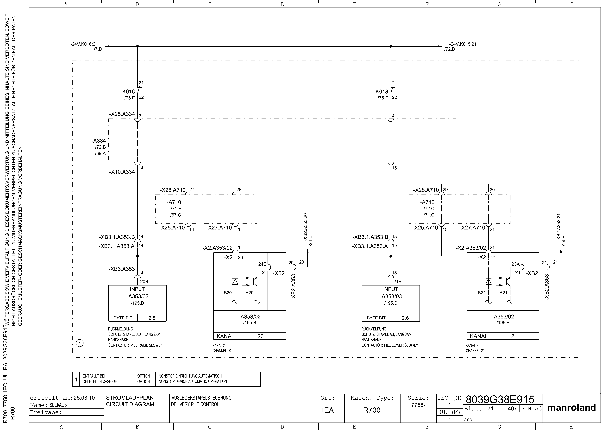

# +EA — Sheet 71 of 407 — AUSLEGERSTAPELSTEUERUNG

**DELIVERY PILE CONTROL**

> Part of the manroland **R700** printing press IEC/UL circuit diagrams.
> Drawing class: **Stromlaufplan / Circuit diagram** (DIN A3).
> Document `+EA` covers the **Printing unit** machine section.

## At a glance

| Field | Value |
|---|---|
| Document | `+EA`  (8039G38E915) |
| Sheet | **71** of 407 |
| Section (DE) | AUSLEGERSTAPELSTEUERUNG |
| Section (EN) | DELIVERY PILE CONTROL |
| Section type | CIRCUIT — Circuit diagram |
| Machine type | `R700` |
| Series | `7758` |
| Created | 25.03.10 |
| Replaces | — |
| Columns used | A, B, C, D, E, F, G, H |
| Path numbers | — |
| Labels on sheet | 120 |
| Cross-refs out | 16 |
| Cross-refs in | 38 |

**Previous:** [+EA sheet 70](SHEET_0070.md) · **Next:** [+EA sheet 72](SHEET_0072.md) · **Document TOC:** [_TOC.md](_TOC.md)  (+EA) · **Master TOC:** [all sheets](../_MASTER_TOC.md)

## Sheet image (300 DPI, exact vector render)



_Rendered directly from the PDF vector layer at 300 DPI (1-bit), no OCR and no resampling. Use it to confirm anything ambiguous in the text below._

## Cross-references on this sheet

Each entry is a wire leaving this sheet. The printed token is `/sheet.column`; the link resolves to that sheet inside the same document.

| Ref | Target sheet | Col | Path | Destination on target | Target section | From col |
|---|---|---|---|---|---|---|
| `/7.D` | [+EA sheet 7](SHEET_0007.md) | D | — | 24V.K016:21 | SPANNUNGSVERSORGUNG: 400V, 24V | A |
| `/72.B` | [+EA sheet 72](SHEET_0072.md) | B | — | — | AUSLEGERSTAPELSTEUERUNG | F |
| `/75.E` | [+EA sheet 75](SHEET_0075.md) | E | — | — | AUSLEGERSTAPELSTEUERUNG | E |
| `/75.F` | [+EA sheet 75](SHEET_0075.md) | F | — | — | AUSLEGERSTAPELSTEUERUNG | B |
| `/72.B` | [+EA sheet 72](SHEET_0072.md) | B | — | — | AUSLEGERSTAPELSTEUERUNG | A |
| `/69.A` | [+EA sheet 69](SHEET_0069.md) | A | — | — | SCHMIERUNG | A |
| `/71.F` | [+EA sheet 71](SHEET_0071.md) | F | — | — | AUSLEGERSTAPELSTEUERUNG | C |
| `/67.C` | [+EA sheet 67](SHEET_0067.md) | C | — | — | LEITSTANDSFUNKTIONEN | C |
| `/72.C` | [+EA sheet 72](SHEET_0072.md) | C | — | — | AUSLEGERSTAPELSTEUERUNG | F |
| `/71.C` | [+EA sheet 71](SHEET_0071.md) | C | — | — | AUSLEGERSTAPELSTEUERUNG | F |
| `/24.E` | [+EA sheet 24](SHEET_0024.md) | E | — | XB2.A353:20 | BUSVERBINDUNGEN: SICHERHEITSBUS | D |
| `/24.E` | [+EA sheet 24](SHEET_0024.md) | E | — | XB2.A353:21 | BUSVERBINDUNGEN: SICHERHEITSBUS | H |
| `/195.D` | [+EA sheet 195](SHEET_0195.md) | D | — | — | REFERENZMODUL | B |
| `/195.D` | [+EA sheet 195](SHEET_0195.md) | D | — | — | REFERENZMODUL | F |
| `/195.B` | [+EA sheet 195](SHEET_0195.md) | B | — | — | REFERENZMODUL | D |
| `/195.B` | [+EA sheet 195](SHEET_0195.md) | B | — | — | REFERENZMODUL | G |

### Incoming references (sheets that point here)

Every other sheet that sends a wire to this one. `Back-ref` is the token printed on *that* sheet; `Path` is its line number.

| From sheet | Cols | Back-ref | Path | Refs | What continues there |
|---|---|---|---|---|---|
| [+EA#7](SHEET_0007.md) | D | `/7.D` | — | 1 | 24V.K016:21 |
| [+EA#24](SHEET_0024.md) | E | `/24.E` | — | 2 | XB2.A353:20; XB2.A353:21 |
| [+EA#67](SHEET_0067.md) | B | `/67.B` | — | 1 | — |
| [+EA#69](SHEET_0069.md) | A | `/69.A` | — | 1 | — |
| [+EA#71](SHEET_0071.md) | C, F | `/71.C`, `/71.F` | — | 2 | — |
| [+EA#72](SHEET_0072.md) | A, C, D | `/72.A`, `/72.C`, `/72.D` | — | 3 | 24V.K015:21 24V.K014:21 |
| [+EA#75](SHEET_0075.md) | E, F | `/75.E`, `/75.F` | — | 2 | — |
| [+EA#195](SHEET_0195.md) | B, D | `/195.B`, `/195.D` | — | 4 | — |
| [+EA#224](SHEET_0224.md) | H | `/224.H` | — | 2 | — |
| [+EA#225](SHEET_0225.md) | D | `/225.D` | — | 2 | — |
| [+EA#234](SHEET_0234.md) | C, D, F | `/234.C`, `/234.D`, `/234.F` | — | 6 | — |
| [+EA#253](SHEET_0253.md) | H | `/253.H` | — | 2 | — |
| [+EA#267](SHEET_0267.md) | B | `/267.B` | — | 2 | — |
| [+EA#268](SHEET_0268.md) | C | `/268.C` | — | 2 | — |
| [+EA#271](SHEET_0271.md) | C | `/271.C` | — | 2 | — |
| [+EA#272](SHEET_0272.md) | H | `/272.H` | — | 4 | — |


## Devices on this sheet

| Tag | Class | Class meaning (IEC) | Col | Sub | Terminal | Sign |
|---|---|---|---|---|---|---|
| `K016` | K | Relais / relay, contactor | B | — | — | — |
| `A334` | A | Baugruppe / assembly, module, PC board | A | — | — | — |
| `A353/03` | A | Baugruppe / assembly, module, PC board | B | 03 | — | — |
| `A710` | A | Baugruppe / assembly, module, PC board | C | — | — | — |
| `S20` | S | Schalter / switch | C | — | — | — |
| `A20` | A | Baugruppe / assembly, module, PC board | D | — | — | — |
| `X1` | X | Klemme / terminal, plug connector | D | — | — | — |
| `X2` | X | Klemme / terminal, plug connector | C | — | — | — |
| `XB2` | XB |  | D | — | — | — |
| `A353/02` | A | Baugruppe / assembly, module, PC board | D | 02 | — | — |
| `K018` | K | Relais / relay, contactor | E | — | — | — |
| `A353/03` | A | Baugruppe / assembly, module, PC board | F | 03 | — | — |
| `A710` | A | Baugruppe / assembly, module, PC board | F | — | — | — |
| `S21` | S | Schalter / switch | G | — | — | — |
| `A21` | A | Baugruppe / assembly, module, PC board | G | — | — | — |
| `X1` | X | Klemme / terminal, plug connector | G | — | — | — |
| `X2` | X | Klemme / terminal, plug connector | G | — | — | — |
| `XB2` | XB |  | G | — | — | — |
| `A353/02` | A | Baugruppe / assembly, module, PC board | G | 02 | — | — |
| `X10.A334` | — | cross-device reference | B | — | — | — |
| `X25.A334` | — | cross-device reference | B | — | — | — |
| `2.5` | — | cross-device reference | B | — | — | — |
| `XB3.A353` | — | cross-device reference | B | — | — | — |
| `X28.A710` | — | cross-device reference | B | — | — | — |
| `X27.A710` | — | cross-device reference | C | — | — | — |
| `X25.A710` | — | cross-device reference | B | — | — | — |
| `XB2.A353` | — | cross-device reference | D | — | — | — |
| `XB3.1.A353.B` | — | cross-device reference | B | — | — | — |
| `XB3.1.A353.A` | — | cross-device reference | B | — | — | — |
| `2.6` | — | cross-device reference | F | — | — | — |
| `X28.A710` | — | cross-device reference | F | — | — | — |
| `X27.A710` | — | cross-device reference | G | — | — | — |
| `X25.A710` | — | cross-device reference | F | — | — | — |
| `XB2.A353` | — | cross-device reference | H | — | — | — |
| `XB3.1.A353.B` | — | cross-device reference | E | — | — | — |
| `XB3.1.A353.A` | — | cross-device reference | E | — | — | — |
| `XB2.A353:21` | — | cross-device reference | H | — | 21 | — |
| `XB2.A353:20` | — | cross-device reference | D | — | 20 | — |

## Potentials / nets

| Potential | Count | Columns | Attached devices | Terminals |
|---|---|---|---|---|
| `24V` | 2 | A, F | `K015`, `K016` | `21` |


A potential such as `L24+/4` or `M24+` is a named supply/return rail; every place it appears on this sheet is electrically common.

## Wire-end annotations (grouped as printed)

A wire that continues elsewhere is annotated with a small cluster: the destination description, the path/line number `#NN`, and the `/sheet.column` cross reference. Each row below is one such cluster exactly as it is grouped on the drawing.

| Col | Y | Path | Cross-ref | Text on the wire |
|---|---|---|---|---|
| A | 82.5 | — | `/7.D` | `24V.K016:21` |
| F | 82.5 | — | — | `24V.K015:21` |
| F | 92.4 | — | `/72.B` | — |
| B | 158.4 | — | — | `21` |
| F | 158.4 | — | — | `21` |
| B | 174.6 | — | — | `K016 22` |
| E | 174.6 | — | — | `K018 22` |
| B | 187.7 | — | `/75.F` | — |
| E | 187.7 | — | `/75.E` | — |
| B | 218.6 | — | — | `X25.A334 3` |
| F | 222.8 | — | — | `4` |
| A | 271.0 | — | — | `A334` |
| A | 284.1 | — | `/72.B`, `/69.A` | — |
| B | 324.9 | — | — | `X10.A334 14` |
| F | 324.9 | — | — | `15` |
| C | 367.4 | — | — | `X28.A710 27 28` |
| F | 367.4 | — | — | `X28.A710 29 30` |
| C | 391.5 | — | — | `A710` |
| F | 391.5 | — | — | `A710` |
| C | 404.6 | — | `/71.F`, `/67.C` | — |
| F | 404.6 | — | `/72.C`, `/71.C` | — |
| D | 417.5 | — | `/24.E` | `XB2.A353:20` |
| H | 417.5 | — | `/24.E` | `XB2.A353:21` |
| C | 441.1 | — | — | `X25.A710 14 X27.A710 20` |
| F | 441.1 | — | — | `X25.A710 15 X27.A710 21` |
| B | 459.5 | — | — | `XB3.1.A353.B 14` |
| E | 459.5 | — | — | `XB3.1.A353.B 15` |
| B | 476.5 | — | — | `XB3.1.A353.A 14` |
| E | 476.5 | — | — | `XB3.1.A353.A 15` |
| C | 480.8 | — | — | `X2.A353/02 20` |
| G | 480.8 | — | — | `X2.A353/02 21` |
| C | 499.2 | — | — | `X2` |
| G | 499.2 | — | — | `X2` |
| D | 500.6 | — | — | `20 20` |
| G | 500.6 | — | — | `21 21` |
| D | 509.1 | — | — | `20` |
| H | 509.1 | — | — | `21` |
| D | 513.4 | — | — | `24C` |
| G | 513.4 | — | — | `23A` |
| B | 521.9 | — | — | `XB3.A353 14` |
| D | 530.4 | — | — | `X1` |
| D | 530.4 | — | — | `XB2` |
| F | 530.4 | — | — | `15` |
| G | 530.4 | — | — | `X1` |
| G | 530.4 | — | — | `XB2` |
| D | 536.6 | — | — | `XB2.A353` |
| H | 536.6 | — | — | `XB2.A353` |
| B | 547.4 | — | — | `20B` |
| F | 547.4 | — | — | `21B` |
| B | 561.9 | — | — | `INPUT` |
| E | 561.9 | — | — | `INPUT` |
| C | 569.4 | — | — | `S20 A20` |
| G | 569.4 | — | — | `S21 A21` |
| B | 575.7 | — | — | `A353/03` |
| F | 575.7 | — | — | `A353/03` |
| B | 589.5 | — | `/195.D` | — |
| F | 589.5 | — | `/195.D` | — |
| D | 615.4 | — | — | `A353/02` |
| G | 615.4 | — | — | `A353/02` |
| B | 618.6 | — | — | `BYTE.BIT 2.5` |
| E | 618.6 | — | — | `BYTE.BIT 2.6` |
| D | 627.8 | — | `/195.B` | — |
| G | 627.8 | — | `/195.B` | — |
| B | 641.3 | — | — | `RÜCKMELDUNG` |
| E | 641.3 | — | — | `RÜCKMELDUNG` |
| B | 651.9 | — | — | `HANDSHAKE SCHÜTZ: STAPEL AUF, LANGSAM` |
| E | 651.9 | — | — | `HANDSHAKE SCHÜTZ: STAPEL AB, LANGSAM` |
| C | 653.7 | — | — | `KANAL 20` |
| G | 653.7 | — | — | `KANAL 21` |
| A | 668.8 | — | — | `1` |
| B | 673.1 | — | — | `CONTACTOR: PILE RAISE SLOWLY` |
| E | 673.1 | — | — | `CONTACTOR: PILE LOWER SLOWLY` |
| C | 674.0 | — | — | `KANAL 20 CHANNEL 20` |
| G | 674.0 | — | — | `KANAL 21 CHANNEL 21` |
| B | 733.4 | — | — | `1 ENTFÄLLT BEI DELETED IN CASE OF NONSTOP EINRICHTUNG AUTOMATISCH NONSTOP DEVICE AUTOMATIC OPERATION` |
| B | 733.4 | — | — | `OPTION OPTION` |


## Reconstructed tables

This sheet carries tabular content (pin map / terminal assignment / index). The grid below was rebuilt from the drawing's own rule lines, so each row is exactly one physical row of the table.

### Table 1 — 6 data rows × 19 columns (at x=212.6, y=90.7)

| K016 /75.F X25.A334 X10.A334 | 21 22 3 14 |  |  |  |  |  |  |  |  | K018 /75.E | 21 22 4 15 |  | /72.B |  |  |  |  |  |
|---|---|---|---|---|---|---|---|---|---|---|---|---|---|---|---|---|---|---|
| `XB3.1.A353.B XB3.1.A353.A` | `14 14` | `X28.A710 A710 /71.F /67.C X25.A710` | `27 14` | `X27.A710 X2.A353/02` | `28 20 20` |  |  | `XB2.A353:20` | `/24.E` | `XB3.1.A353.B XB3.1.A353.A` | `15 15` | `X28.A710 A710 /72.C /71.C X25.A710` | `29 15` | `X27.A710 X2.A353/02` | `30 21 21` |  |  | `XB2.A353:21` |
| `XB3.A353` | `14 20B` |  |  | `X2` | `20` | `24C X1` | `XB2` | `20 20` |  |  | `15 21B` |  |  | `X2` | `21` | `23A X1` | `XB2` | `21 21` |
| `INPUT` | `A353/03 /195.D` |  |  | `S20` | `A20` |  |  | `XB2.A353` |  | `INPUT` | `A353/03 /195.D` |  |  | `S21` | `A21` |  |  | `XB2.A353` |
| `BYTE.BIT` | `2.5` |  |  |  | `A353/02` |  |  |  |  | `BYTE.BIT` | `2.6` |  |  |  | `A353/02` |  |  |  |
| `RÜCKMELDUNG` |  |  |  |  | `/195.B` |  |  |  |  | `RÜCKMELDUNG` |  |  |  |  | `/195.B` |  |  |  |
| `SCHÜTZ: STAPEL` | `AUF, LANGSAM` |  |  | `KANAL` |  | `20` |  |  |  | `SCHÜTZ: STAPEL` | `AB, LANGSAM` |  |  | `KANAL` |  | `21` |  |  |


## Notes and free text on this sheet

| Text | Col | Y (pt) |
|---|---|---|
| `20B` | B | 547.37 |
| `INPUT` | B | 561.9 |
| `BYTE.BIT` | B | 619.15 |
| `RÜCKMELDUNG` | B | 641.28 |
| `SCHÜTZ: STAPEL AUF, LANGSAM` | B | 651.89 |
| `HANDSHAKE` | B | 662.5 |
| `CONTACTOR: PILE RAISE SLOWLY` | B | 673.14 |
| `KANAL 20` | C | 674.01 |
| `CHANNEL 20` | C | 683.96 |
| `24C` | D | 513.4 |
| `KANAL` | C | 653.68 |
| `X2.A353/02` | C | 480.78 |
| `21B` | F | 547.37 |
| `INPUT` | E | 561.9 |
| `BYTE.BIT` | E | 619.15 |
| `RÜCKMELDUNG` | E | 641.28 |
| `SCHÜTZ: STAPEL AB, LANGSAM` | E | 651.88 |
| `HANDSHAKE` | E | 662.5 |
| `CONTACTOR: PILE LOWER SLOWLY` | E | 673.13 |
| `KANAL 21` | G | 673.98 |
| `CHANNEL 21` | G | 683.93 |
| `23A` | G | 513.36 |
| `KANAL` | G | 653.68 |
| `X2.A353/02` | G | 480.78 |
| `OPTION` | B | 733.35 |
| `NONSTOP EINRICHTUNG AUTOMATISCH` | C | 733.39 |
| `NONSTOP DEVICE AUTOMATIC OPERATION` | C | 744.01 |
| `ENTFÄLLT BEI` | A | 733.35 |
| `DELETED IN CASE OF` | A | 744 |

## Complete label inventory (exact text from the drawing)

Every text object inside the drawing area of this sheet, in DIN reading order (column A→H, then top→bottom). This is the authoritative list: if a string is not here it is not printed on this sheet.

| Col | Y | X | Dir | Type | Text |
|---|---|---|---|---|---|
| A | 82.5 | 138.0 | → | potential | `24V.K016:21` |
| A | 92.4 | 184.0 | → | cross-reference | `/7.D` |
| A | 271.0 | 179.1 | → | device tag | `A334` |
| A | 284.1 | 186.5 | → | cross-reference | `/72.B` |
| A | 296.5 | 186.2 | → | cross-reference | `/69.A` |
| A | 668.8 | 154.1 | → | number | `1` |
| A | 733.3 | 162.1 | → | text | `ENTFÄLLT BEI` |
| A | 738.7 | 146.3 | → | number | `1` |
| A | 744.0 | 162.1 | → | text | `DELETED IN CASE OF` |
| B | 158.4 | 271.8 | → | number | `21` |
| B | 174.6 | 235.8 | → | device tag | `K016` |
| B | 186.7 | 271.8 | → | number | `22` |
| B | 187.7 | 243.8 | → | cross-reference | `/75.F` |
| B | 218.6 | 214.0 | → | device ref | `X25.A334` |
| B | 222.8 | 271.8 | → | number | `3` |
| B | 324.9 | 271.3 | → | number | `14` |
| B | 332.0 | 214.0 | → | device ref | `X10.A334` |
| B | 367.4 | 313.2 | → | device ref | `X28.A710` |
| B | 441.1 | 311.8 | → | device ref | `X25.A710` |
| B | 459.5 | 194.2 | → | device ref | `XB3.1.A353.B` |
| B | 459.5 | 271.3 | → | number | `14` |
| B | 476.5 | 271.3 | → | number | `14` |
| B | 477.2 | 193.3 | → | device ref | `XB3.1.A353.A` |
| B | 521.9 | 212.9 | → | device ref | `XB3.A353` |
| B | 530.4 | 271.3 | → | number | `14` |
| B | 547.4 | 274.7 | → | text | `20B` |
| B | 561.9 | 254.4 | → | text | `INPUT` |
| B | 575.7 | 247.9 | → | device tag | `A353/03` |
| B | 589.5 | 256.5 | → | cross-reference | `/195.D` |
| B | 618.6 | 290.8 | → | device ref | `2.5` |
| B | 619.1 | 222.5 | → | text | `BYTE.BIT` |
| B | 641.3 | 211.7 | → | text | `RÜCKMELDUNG` |
| B | 651.9 | 212.3 | → | text | `SCHÜTZ: STAPEL AUF, LANGSAM` |
| B | 662.5 | 211.7 | → | text | `HANDSHAKE` |
| B | 673.1 | 212.3 | → | text | `CONTACTOR: PILE RAISE SLOWLY` |
| B | 733.4 | 269.0 | → | text | `OPTION` |
| B | 744.0 | 269.0 | → | text | `OPTION` |
| C | 367.4 | 371.1 | → | number | `27` |
| C | 367.4 | 463.2 | → | number | `28` |
| C | 391.5 | 326.6 | → | device tag | `A710` |
| C | 404.6 | 334.5 | → | cross-reference | `/71.F` |
| C | 417.0 | 333.6 | → | cross-reference | `/67.C` |
| C | 441.1 | 403.9 | → | device ref | `X27.A710` |
| C | 445.4 | 370.5 | → | number | `14` |
| C | 445.4 | 463.2 | → | number | `20` |
| C | 480.8 | 396.6 | → | text | `X2.A353/02` |
| C | 480.8 | 463.2 | → | number | `20` |
| C | 499.2 | 439.1 | → | device tag | `X2` |
| C | 500.6 | 466.0 | → | number | `20` |
| C | 569.4 | 435.4 | → | device tag | `S20` |
| C | 653.7 | 424.3 | → | text | `KANAL` |
| C | 674.0 | 416.1 | → | text | `KANAL 20` |
| C | 684.0 | 416.4 | → | text | `CHANNEL 20` |
| C | 733.4 | 311.0 | → | text | `NONSTOP EINRICHTUNG AUTOMATISCH` |
| C | 744.0 | 311.0 | → | text | `NONSTOP DEVICE AUTOMATIC OPERATION` |
| D | 417.5 | 594.1 | ↕ | device ref | `XB2.A353:20` |
| D | 461.2 | 604.0 | ↕ | cross-reference | `/24.E` |
| D | 509.1 | 585.9 | → | number | `20` |
| D | 510.6 | 565.2 | → | number | `20` |
| D | 513.4 | 506.0 | → | text | `24C` |
| D | 530.4 | 509.7 | → | device tag | `X1` |
| D | 530.4 | 534.0 | → | device tag | `XB2` |
| D | 536.6 | 570.1 | ↕ | device ref | `XB2.A353` |
| D | 569.4 | 477.9 | → | device tag | `A20` |
| D | 615.4 | 467.6 | → | device tag | `A353/02` |
| D | 627.8 | 476.4 | → | cross-reference | `/195.B` |
| D | 653.7 | 504.4 | → | number | `20` |
| E | 174.6 | 731.9 | → | device tag | `K018` |
| E | 187.7 | 739.6 | → | cross-reference | `/75.E` |
| E | 459.5 | 690.2 | → | device ref | `XB3.1.A353.B` |
| E | 477.2 | 689.4 | → | device ref | `XB3.1.A353.A` |
| E | 561.9 | 750.5 | → | text | `INPUT` |
| E | 619.1 | 718.6 | → | text | `BYTE.BIT` |
| E | 641.3 | 707.8 | → | text | `RÜCKMELDUNG` |
| E | 651.9 | 708.4 | → | text | `SCHÜTZ: STAPEL AB, LANGSAM` |
| E | 662.5 | 707.8 | → | text | `HANDSHAKE` |
| E | 673.1 | 708.4 | → | text | `CONTACTOR: PILE LOWER SLOWLY` |
| F | 82.5 | 879.9 | → | potential | `24V.K015:21` |
| F | 92.4 | 870.2 | → | cross-reference | `/72.B` |
| F | 158.4 | 767.9 | → | number | `21` |
| F | 186.7 | 767.9 | → | number | `22` |
| F | 222.8 | 767.9 | → | number | `4` |
| F | 324.9 | 767.3 | → | number | `15` |
| F | 367.4 | 809.3 | → | device ref | `X28.A710` |
| F | 367.4 | 867.1 | → | number | `29` |
| F | 391.5 | 822.6 | → | device tag | `A710` |
| F | 404.6 | 829.7 | → | cross-reference | `/72.C` |
| F | 417.0 | 829.7 | → | cross-reference | `/71.C` |
| F | 441.1 | 807.9 | → | device ref | `X25.A710` |
| F | 445.4 | 866.6 | → | number | `15` |
| F | 459.5 | 767.3 | → | number | `15` |
| F | 476.5 | 767.3 | → | number | `15` |
| F | 530.4 | 767.3 | → | number | `15` |
| F | 547.4 | 770.7 | → | text | `21B` |
| F | 575.7 | 744.0 | → | device tag | `A353/03` |
| F | 589.5 | 752.6 | → | cross-reference | `/195.D` |
| F | 618.6 | 786.9 | → | device ref | `2.6` |
| G | 367.4 | 959.2 | → | number | `30` |
| G | 441.1 | 900.0 | → | device ref | `X27.A710` |
| G | 445.4 | 959.2 | → | number | `21` |
| G | 480.8 | 892.6 | → | text | `X2.A353/02` |
| G | 480.8 | 959.2 | → | number | `21` |
| G | 499.2 | 935.1 | → | device tag | `X2` |
| G | 500.6 | 962.1 | → | number | `21` |
| G | 513.4 | 1002.0 | → | text | `23A` |
| G | 530.4 | 1005.7 | → | device tag | `X1` |
| G | 530.4 | 1030.1 | → | device tag | `XB2` |
| G | 569.4 | 932.9 | → | device tag | `S21` |
| G | 569.4 | 975.4 | → | device tag | `A21` |
| G | 615.4 | 963.6 | → | device tag | `A353/02` |
| G | 627.8 | 972.4 | → | cross-reference | `/195.B` |
| G | 653.7 | 920.4 | → | text | `KANAL` |
| G | 653.7 | 1001.2 | → | number | `21` |
| G | 674.0 | 912.2 | → | text | `KANAL 21` |
| G | 683.9 | 912.5 | → | text | `CHANNEL 21` |
| H | 417.5 | 1090.2 | ↕ | device ref | `XB2.A353:21` |
| H | 461.2 | 1100.1 | ↕ | cross-reference | `/24.E` |
| H | 509.1 | 1083.4 | → | number | `21` |
| H | 510.6 | 1061.3 | → | number | `21` |
| H | 536.6 | 1066.1 | ↕ | device ref | `XB2.A353` |

## Reading-order text block

The same content as a plain block, grouped by DIN column — convenient to paste or to match against a visual description.

```text
=== Column A ===
  82.5  138.0  net          24V.K016:21
  92.4  184.0  xref         /7.D
 271.0  179.1  devtag       A334
 284.1  186.5  xref         /72.B
 296.5  186.2  xref         /69.A
 668.8  154.1  numeric      1
 733.3  162.1  text         ENTFÄLLT BEI
 738.7  146.3  numeric      1
 744.0  162.1  text         DELETED IN CASE OF
=== Column B ===
 158.4  271.8  numeric      21
 174.6  235.8  devtag       K016
 186.7  271.8  numeric      22
 187.7  243.8  xref         /75.F
 218.6  214.0  devref       X25.A334
 222.8  271.8  numeric      3
 324.9  271.3  numeric      14
 332.0  214.0  devref       X10.A334
 367.4  313.2  devref       X28.A710
 441.1  311.8  devref       X25.A710
 459.5  194.2  devref       XB3.1.A353.B
 459.5  271.3  numeric      14
 476.5  271.3  numeric      14
 477.2  193.3  devref       XB3.1.A353.A
 521.9  212.9  devref       XB3.A353
 530.4  271.3  numeric      14
 547.4  274.7  text         20B
 561.9  254.4  text         INPUT
 575.7  247.9  devtag       A353/03
 589.5  256.5  xref         /195.D
 618.6  290.8  devref       2.5
 619.1  222.5  text         BYTE.BIT
 641.3  211.7  text         RÜCKMELDUNG
 651.9  212.3  text         SCHÜTZ: STAPEL AUF, LANGSAM
 662.5  211.7  text         HANDSHAKE
 673.1  212.3  text         CONTACTOR: PILE RAISE SLOWLY
 733.4  269.0  text         OPTION
 744.0  269.0  text         OPTION
=== Column C ===
 367.4  371.1  numeric      27
 367.4  463.2  numeric      28
 391.5  326.6  devtag       A710
 404.6  334.5  xref         /71.F
 417.0  333.6  xref         /67.C
 441.1  403.9  devref       X27.A710
 445.4  370.5  numeric      14
 445.4  463.2  numeric      20
 480.8  396.6  text         X2.A353/02
 480.8  463.2  numeric      20
 499.2  439.1  devtag       X2
 500.6  466.0  numeric      20
 569.4  435.4  devtag       S20
 653.7  424.3  text         KANAL
 674.0  416.1  text         KANAL 20
 684.0  416.4  text         CHANNEL 20
 733.4  311.0  text         NONSTOP EINRICHTUNG AUTOMATISCH
 744.0  311.0  text         NONSTOP DEVICE AUTOMATIC OPERATION
=== Column D ===
 417.5  594.1  devref       XB2.A353:20
 461.2  604.0  xref         /24.E
 509.1  585.9  numeric      20
 510.6  565.2  numeric      20
 513.4  506.0  text         24C
 530.4  509.7  devtag       X1
 530.4  534.0  devtag       XB2
 536.6  570.1  devref       XB2.A353
 569.4  477.9  devtag       A20
 615.4  467.6  devtag       A353/02
 627.8  476.4  xref         /195.B
 653.7  504.4  numeric      20
=== Column E ===
 174.6  731.9  devtag       K018
 187.7  739.6  xref         /75.E
 459.5  690.2  devref       XB3.1.A353.B
 477.2  689.4  devref       XB3.1.A353.A
 561.9  750.5  text         INPUT
 619.1  718.6  text         BYTE.BIT
 641.3  707.8  text         RÜCKMELDUNG
 651.9  708.4  text         SCHÜTZ: STAPEL AB, LANGSAM
 662.5  707.8  text         HANDSHAKE
 673.1  708.4  text         CONTACTOR: PILE LOWER SLOWLY
=== Column F ===
  82.5  879.9  net          24V.K015:21
  92.4  870.2  xref         /72.B
 158.4  767.9  numeric      21
 186.7  767.9  numeric      22
 222.8  767.9  numeric      4
 324.9  767.3  numeric      15
 367.4  809.3  devref       X28.A710
 367.4  867.1  numeric      29
 391.5  822.6  devtag       A710
 404.6  829.7  xref         /72.C
 417.0  829.7  xref         /71.C
 441.1  807.9  devref       X25.A710
 445.4  866.6  numeric      15
 459.5  767.3  numeric      15
 476.5  767.3  numeric      15
 530.4  767.3  numeric      15
 547.4  770.7  text         21B
 575.7  744.0  devtag       A353/03
 589.5  752.6  xref         /195.D
 618.6  786.9  devref       2.6
=== Column G ===
 367.4  959.2  numeric      30
 441.1  900.0  devref       X27.A710
 445.4  959.2  numeric      21
 480.8  892.6  text         X2.A353/02
 480.8  959.2  numeric      21
 499.2  935.1  devtag       X2
 500.6  962.1  numeric      21
 513.4 1002.0  text         23A
 530.4 1005.7  devtag       X1
 530.4 1030.1  devtag       XB2
 569.4  932.9  devtag       S21
 569.4  975.4  devtag       A21
 615.4  963.6  devtag       A353/02
 627.8  972.4  xref         /195.B
 653.7  920.4  text         KANAL
 653.7 1001.2  numeric      21
 674.0  912.2  text         KANAL 21
 683.9  912.5  text         CHANNEL 21
=== Column H ===
 417.5 1090.2  devref       XB2.A353:21
 461.2 1100.1  xref         /24.E
 509.1 1083.4  numeric      21
 510.6 1061.3  numeric      21
 536.6 1066.1  devref       XB2.A353
```

---
_Generated from the PDF vector text layer; no OCR. Source: `R700_7758_IEC_UL_EA_8039G38E915_p`, sheet 71._
