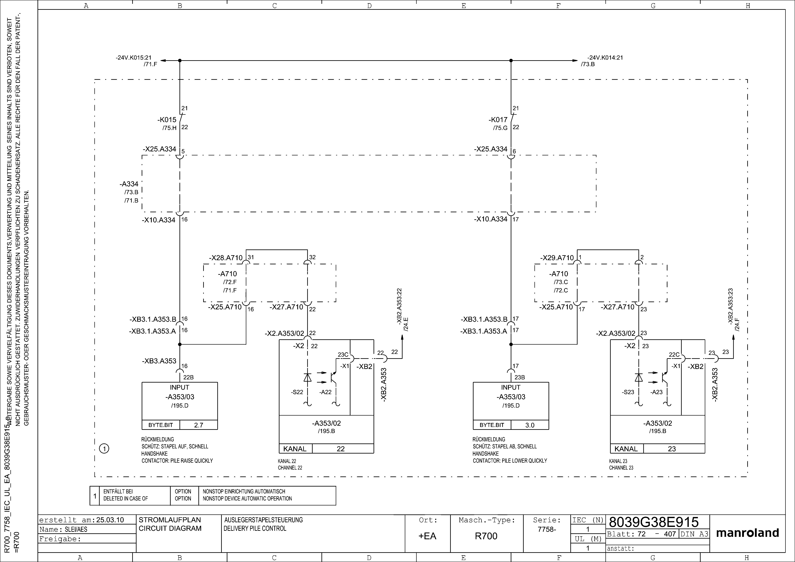

# +EA — Sheet 72 of 407 — AUSLEGERSTAPELSTEUERUNG

**DELIVERY PILE CONTROL**

> Part of the manroland **R700** printing press IEC/UL circuit diagrams.
> Drawing class: **Stromlaufplan / Circuit diagram** (DIN A3).
> Document `+EA` covers the **Printing unit** machine section.

## At a glance

| Field | Value |
|---|---|
| Document | `+EA`  (8039G38E915) |
| Sheet | **72** of 407 |
| Section (DE) | AUSLEGERSTAPELSTEUERUNG |
| Section (EN) | DELIVERY PILE CONTROL |
| Section type | CIRCUIT — Circuit diagram |
| Machine type | `R700` |
| Series | `7758` |
| Created | 25.03.10 |
| Replaces | — |
| Columns used | A, B, C, D, E, F, G, H |
| Path numbers | — |
| Labels on sheet | 122 |
| Cross-refs out | 16 |
| Cross-refs in | 38 |

**Previous:** [+EA sheet 71](SHEET_0071.md) · **Next:** [+EA sheet 73](SHEET_0073.md) · **Document TOC:** [_TOC.md](_TOC.md)  (+EA) · **Master TOC:** [all sheets](../_MASTER_TOC.md)

## Sheet image (300 DPI, exact vector render)



_Rendered directly from the PDF vector layer at 300 DPI (1-bit), no OCR and no resampling. Use it to confirm anything ambiguous in the text below._

## Cross-references on this sheet

Each entry is a wire leaving this sheet. The printed token is `/sheet.column`; the link resolves to that sheet inside the same document.

| Ref | Target sheet | Col | Path | Destination on target | Target section | From col |
|---|---|---|---|---|---|---|
| `/71.F` | [+EA sheet 71](SHEET_0071.md) | F | — | 24V.K015:21 24V.K014:21 | AUSLEGERSTAPELSTEUERUNG | D |
| `/73.B` | [+EA sheet 73](SHEET_0073.md) | B | — | — | AUSLEGERSTAPELSTEUERUNG | F |
| `/75.G` | [+EA sheet 75](SHEET_0075.md) | G | — | — | AUSLEGERSTAPELSTEUERUNG | E |
| `/75.H` | [+EA sheet 75](SHEET_0075.md) | H | — | — | AUSLEGERSTAPELSTEUERUNG | B |
| `/73.B` | [+EA sheet 73](SHEET_0073.md) | B | — | — | AUSLEGERSTAPELSTEUERUNG | A |
| `/71.B` | [+EA sheet 71](SHEET_0071.md) | B | — | — | AUSLEGERSTAPELSTEUERUNG | A |
| `/72.F` | [+EA sheet 72](SHEET_0072.md) | F | — | — | AUSLEGERSTAPELSTEUERUNG | C |
| `/71.F` | [+EA sheet 71](SHEET_0071.md) | F | — | — | AUSLEGERSTAPELSTEUERUNG | C |
| `/73.C` | [+EA sheet 73](SHEET_0073.md) | C | — | — | AUSLEGERSTAPELSTEUERUNG | F |
| `/72.C` | [+EA sheet 72](SHEET_0072.md) | C | — | — | AUSLEGERSTAPELSTEUERUNG | F |
| `/24.E` | [+EA sheet 24](SHEET_0024.md) | E | — | XB2.A353:22 | BUSVERBINDUNGEN: SICHERHEITSBUS | D |
| `/24.F` | [+EA sheet 24](SHEET_0024.md) | F | — | XB2.A353:23 | BUSVERBINDUNGEN: SICHERHEITSBUS | H |
| `/195.D` | [+EA sheet 195](SHEET_0195.md) | D | — | — | REFERENZMODUL | B |
| `/195.D` | [+EA sheet 195](SHEET_0195.md) | D | — | — | REFERENZMODUL | F |
| `/195.B` | [+EA sheet 195](SHEET_0195.md) | B | — | — | REFERENZMODUL | D |
| `/195.B` | [+EA sheet 195](SHEET_0195.md) | B | — | — | REFERENZMODUL | G |

### Incoming references (sheets that point here)

Every other sheet that sends a wire to this one. `Back-ref` is the token printed on *that* sheet; `Path` is its line number.

| From sheet | Cols | Back-ref | Path | Refs | What continues there |
|---|---|---|---|---|---|
| [+EA#24](SHEET_0024.md) | E, F | `/24.E`, `/24.F` | — | 2 | XB2.A353:22; XB2.A353:23 |
| [+EA#71](SHEET_0071.md) | A, F | `/71.A`, `/71.F` | — | 3 | — |
| [+EA#72](SHEET_0072.md) | C, F | `/72.C`, `/72.F` | — | 2 | — |
| [+EA#73](SHEET_0073.md) | B, C | `/73.B`, `/73.C` | — | 3 | 24V.K014:21 |
| [+EA#75](SHEET_0075.md) | G, H | `/75.G`, `/75.H` | — | 2 | — |
| [+EA#195](SHEET_0195.md) | B, D | `/195.B`, `/195.D` | — | 4 | — |
| [+EA#224](SHEET_0224.md) | H | `/224.H` | — | 2 | — |
| [+EA#225](SHEET_0225.md) | D | `/225.D` | — | 2 | — |
| [+EA#234](SHEET_0234.md) | C, D, F | `/234.C`, `/234.D`, `/234.F` | — | 6 | — |
| [+EA#253](SHEET_0253.md) | H | `/253.H` | — | 2 | — |
| [+EA#267](SHEET_0267.md) | B | `/267.B` | — | 2 | — |
| [+EA#268](SHEET_0268.md) | C | `/268.C` | — | 2 | — |
| [+EA#271](SHEET_0271.md) | C | `/271.C` | — | 2 | — |
| [+EA#272](SHEET_0272.md) | H | `/272.H` | — | 2 | — |
| [+EA#274](SHEET_0274.md) | B | `/274.B` | — | 2 | — |


## Devices on this sheet

| Tag | Class | Class meaning (IEC) | Col | Sub | Terminal | Sign |
|---|---|---|---|---|---|---|
| `K015` | K | Relais / relay, contactor | B | — | — | — |
| `K017` | K | Relais / relay, contactor | E | — | — | — |
| `A334` | A | Baugruppe / assembly, module, PC board | A | — | — | — |
| `A353/03` | A | Baugruppe / assembly, module, PC board | B | 03 | — | — |
| `A353/03` | A | Baugruppe / assembly, module, PC board | F | 03 | — | — |
| `A710` | A | Baugruppe / assembly, module, PC board | C | — | — | — |
| `S22` | S | Schalter / switch | C | — | — | — |
| `A22` | A | Baugruppe / assembly, module, PC board | D | — | — | — |
| `X1` | X | Klemme / terminal, plug connector | D | — | — | — |
| `X2` | X | Klemme / terminal, plug connector | C | — | — | — |
| `XB2` | XB |  | D | — | — | — |
| `A353/02` | A | Baugruppe / assembly, module, PC board | D | 02 | — | — |
| `A710` | A | Baugruppe / assembly, module, PC board | F | — | — | — |
| `S23` | S | Schalter / switch | G | — | — | — |
| `A23` | A | Baugruppe / assembly, module, PC board | G | — | — | — |
| `X1` | X | Klemme / terminal, plug connector | G | — | — | — |
| `X2` | X | Klemme / terminal, plug connector | G | — | — | — |
| `XB2` | XB |  | G | — | — | — |
| `A353/02` | A | Baugruppe / assembly, module, PC board | G | 02 | — | — |
| `X10.A334` | — | cross-device reference | B | — | — | — |
| `X25.A334` | — | cross-device reference | B | — | — | — |
| `X10.A334` | — | cross-device reference | E | — | — | — |
| `X25.A334` | — | cross-device reference | E | — | — | — |
| `2.7` | — | cross-device reference | B | — | — | — |
| `XB3.A353` | — | cross-device reference | B | — | — | — |
| `3.0` | — | cross-device reference | F | — | — | — |
| `X28.A710` | — | cross-device reference | B | — | — | — |
| `X27.A710` | — | cross-device reference | C | — | — | — |
| `X25.A710` | — | cross-device reference | B | — | — | — |
| `XB2.A353` | — | cross-device reference | D | — | — | — |
| `X29.A710` | — | cross-device reference | F | — | — | — |
| `X27.A710` | — | cross-device reference | G | — | — | — |
| `X25.A710` | — | cross-device reference | F | — | — | — |
| `XB2.A353` | — | cross-device reference | H | — | — | — |
| `XB3.1.A353.B` | — | cross-device reference | B | — | — | — |
| `XB3.1.A353.A` | — | cross-device reference | B | — | — | — |
| `XB3.1.A353.B` | — | cross-device reference | E | — | — | — |
| `XB3.1.A353.A` | — | cross-device reference | E | — | — | — |
| `XB2.A353:22` | — | cross-device reference | D | — | 22 | — |
| `XB2.A353:23` | — | cross-device reference | H | — | 23 | — |

## Potentials / nets

| Potential | Count | Columns | Attached devices | Terminals |
|---|---|---|---|---|
| `24V` | 2 | B, F | `K014`, `K015` | `21` |


A potential such as `L24+/4` or `M24+` is a named supply/return rail; every place it appears on this sheet is electrically common.

## Wire-end annotations (grouped as printed)

A wire that continues elsewhere is annotated with a small cluster: the destination description, the path/line number `#NN`, and the `/sheet.column` cross reference. Each row below is one such cluster exactly as it is grouped on the drawing.

| Col | Y | Path | Cross-ref | Text on the wire |
|---|---|---|---|---|
| D | 82.5 | — | `/71.F` | `24V.K015:21 24V.K014:21` |
| F | 92.4 | — | `/73.B` | — |
| B | 158.4 | — | — | `21` |
| F | 158.4 | — | — | `21` |
| B | 174.6 | — | — | `K015 22` |
| E | 174.6 | — | — | `K017 22` |
| B | 187.7 | — | `/75.H` | — |
| E | 187.7 | — | `/75.G` | — |
| B | 218.6 | — | — | `X25.A334 5` |
| E | 218.6 | — | — | `X25.A334 6` |
| A | 271.0 | — | — | `A334` |
| A | 284.1 | — | `/73.B`, `/71.B` | — |
| E | 323.4 | — | — | `X10.A334 17` |
| B | 324.9 | — | — | `X10.A334 16` |
| C | 381.6 | — | — | `X28.A710 31 32` |
| F | 381.6 | — | — | `X29.A710 1 2` |
| C | 405.7 | — | — | `A710` |
| F | 405.7 | — | — | `A710` |
| C | 418.7 | — | `/72.F`, `/71.F` | — |
| F | 418.8 | — | `/73.C`, `/72.C` | — |
| D | 431.7 | — | `/24.E` | `XB2.A353:22` |
| H | 431.7 | — | `/24.F` | `XB2.A353:23` |
| C | 455.3 | — | — | `X25.A710 16 X27.A710 22` |
| F | 455.3 | — | — | `X25.A710 17 X27.A710 23` |
| B | 473.7 | — | — | `XB3.1.A353.B 16` |
| E | 473.7 | — | — | `XB3.1.A353.B 17` |
| B | 490.7 | — | — | `XB3.1.A353.A 16` |
| E | 490.7 | — | — | `XB3.1.A353.A 17` |
| C | 494.9 | — | — | `X2.A353/02 22` |
| G | 494.9 | — | — | `X2.A353/02 23` |
| C | 513.4 | — | — | `X2` |
| G | 513.4 | — | — | `X2` |
| D | 514.8 | — | — | `22 22` |
| G | 514.8 | — | — | `23 23` |
| D | 523.3 | — | — | `22` |
| H | 523.3 | — | — | `23` |
| D | 527.6 | — | — | `23C` |
| G | 527.6 | — | — | `22C` |
| B | 536.1 | — | — | `XB3.A353 16` |
| D | 544.5 | — | — | `X1` |
| G | 544.5 | — | — | `X1` |
| D | 544.6 | — | — | `XB2` |
| F | 544.6 | — | — | `17` |
| G | 544.6 | — | — | `XB2` |
| D | 550.8 | — | — | `XB2.A353` |
| H | 550.8 | — | — | `XB2.A353` |
| B | 561.5 | — | — | `22B` |
| F | 561.5 | — | — | `23B` |
| B | 576.1 | — | — | `INPUT` |
| E | 576.1 | — | — | `INPUT` |
| C | 583.5 | — | — | `S22 A22` |
| G | 583.5 | — | — | `S23 A23` |
| B | 589.9 | — | — | `A353/03` |
| F | 589.9 | — | — | `A353/03` |
| B | 603.7 | — | `/195.D` | — |
| F | 603.7 | — | `/195.D` | — |
| D | 629.6 | — | — | `A353/02` |
| G | 629.6 | — | — | `A353/02` |
| B | 632.7 | — | — | `BYTE.BIT 2.7` |
| E | 632.7 | — | — | `BYTE.BIT 3.0` |
| D | 642.0 | — | `/195.B` | — |
| G | 642.0 | — | `/195.B` | — |
| B | 655.5 | — | — | `RÜCKMELDUNG` |
| E | 655.5 | — | — | `RÜCKMELDUNG` |
| B | 666.1 | — | — | `HANDSHAKE SCHÜTZ: STAPEL AUF, SCHNELL` |
| E | 666.1 | — | — | `HANDSHAKE SCHÜTZ: STAPEL AB, SCHNELL` |
| C | 667.8 | — | — | `KANAL 22` |
| G | 667.8 | — | — | `KANAL 23` |
| A | 668.8 | — | — | `1` |
| B | 687.3 | — | — | `CONTACTOR: PILE RAISE QUICKLY` |
| E | 687.3 | — | — | `CONTACTOR: PILE LOWER QUICKLY` |
| C | 688.2 | — | — | `KANAL 22 CHANNEL 22` |
| G | 688.2 | — | — | `KANAL 23 CHANNEL 23` |
| B | 733.4 | — | — | `1 ENTFÄLLT BEI DELETED IN CASE OF NONSTOP EINRICHTUNG AUTOMATISCH NONSTOP DEVICE AUTOMATIC OPERATION` |
| B | 733.4 | — | — | `OPTION OPTION` |


## Reconstructed tables

This sheet carries tabular content (pin map / terminal assignment / index). The grid below was rebuilt from the drawing's own rule lines, so each row is exactly one physical row of the table.

### Table 1 — 6 data rows × 19 columns (at x=212.6, y=90.7)

| /71.F K015 /75.H X25.A334 X10.A334 | 21 22 5 16 |  |  |  |  |  |  |  |  | K017 /75.G X25.A334 X10.A334 | 21 22 6 17 |  | /73.B |  |  |  |  |  |
|---|---|---|---|---|---|---|---|---|---|---|---|---|---|---|---|---|---|---|
| `XB3.1.A353.B XB3.1.A353.A` | `16 16` | `X28.A710 A710 /72.F /71.F X25.A710` | `31 16` | `X27.A710 X2.A353/02` | `32 22 22` |  |  | `XB2.A353:22` | `/24.E` | `XB3.1.A353.B XB3.1.A353.A` | `17 17` | `X29.A710 A710 /73.C /72.C X25.A710` | `1 17` | `X27.A710 X2.A353/02` | `2 23 23` |  |  | `XB2.A353:23` |
| `XB3.A353` | `16 22B` |  |  | `X2` | `22` | `23C X1` | `XB2` | `22 22` |  |  | `17 23B` |  |  | `X2` | `23` | `22C X1` | `XB2` | `23 23` |
| `INPUT` | `A353/03 /195.D` |  |  | `S22` | `A22` |  |  | `XB2.A353` |  | `INPUT` | `A353/03 /195.D` |  |  | `S23` | `A23` |  |  | `XB2.A353` |
| `BYTE.BIT` | `2.7` |  |  |  | `A353/02` |  |  |  |  | `BYTE.BIT` | `3.0` |  |  |  | `A353/02` |  |  |  |
| `RÜCKMELDUNG` |  |  |  |  | `/195.B` |  |  |  |  | `RÜCKMELDUNG` |  |  |  |  | `/195.B` |  |  |  |
| `SCHÜTZ: STAPEL` | `AUF, SCHNELL` |  |  | `KANAL` |  | `22` |  |  |  | `SCHÜTZ: STAPEL` | `AB, SCHNELL` |  |  | `KANAL` |  | `23` |  |  |


## Notes and free text on this sheet

| Text | Col | Y (pt) |
|---|---|---|
| `22B` | B | 561.55 |
| `INPUT` | B | 576.07 |
| `BYTE.BIT` | B | 633.32 |
| `RÜCKMELDUNG` | B | 655.45 |
| `SCHÜTZ: STAPEL AUF, SCHNELL` | B | 666.06 |
| `HANDSHAKE` | B | 676.68 |
| `CONTACTOR: PILE RAISE QUICKLY` | B | 687.33 |
| `23B` | F | 561.55 |
| `INPUT` | E | 576.07 |
| `BYTE.BIT` | E | 633.32 |
| `RÜCKMELDUNG` | E | 655.45 |
| `SCHÜTZ: STAPEL AB, SCHNELL` | E | 666.06 |
| `HANDSHAKE` | E | 676.68 |
| `CONTACTOR: PILE LOWER QUICKLY` | E | 687.32 |
| `KANAL 22` | C | 688.18 |
| `CHANNEL 22` | C | 698.12 |
| `23C` | D | 527.57 |
| `KANAL` | C | 667.86 |
| `X2.A353/02` | C | 494.95 |
| `KANAL 23` | G | 688.19 |
| `CHANNEL 23` | G | 698.13 |
| `22C` | G | 527.57 |
| `KANAL` | G | 667.86 |
| `X2.A353/02` | G | 494.95 |
| `OPTION` | B | 733.35 |
| `NONSTOP EINRICHTUNG AUTOMATISCH` | C | 733.39 |
| `NONSTOP DEVICE AUTOMATIC OPERATION` | C | 744.01 |
| `ENTFÄLLT BEI` | A | 733.35 |
| `DELETED IN CASE OF` | A | 744 |

## Complete label inventory (exact text from the drawing)

Every text object inside the drawing area of this sheet, in DIN reading order (column A→H, then top→bottom). This is the authoritative list: if a string is not here it is not printed on this sheet.

| Col | Y | X | Dir | Type | Text |
|---|---|---|---|---|---|
| A | 271.0 | 179.1 | → | device tag | `A334` |
| A | 284.1 | 186.5 | → | cross-reference | `/73.B` |
| A | 296.5 | 186.5 | → | cross-reference | `/71.B` |
| A | 668.8 | 154.1 | → | number | `1` |
| A | 733.3 | 155.1 | → | text | `ENTFÄLLT BEI` |
| A | 738.7 | 139.2 | → | number | `1` |
| A | 744.0 | 155.1 | → | text | `DELETED IN CASE OF` |
| B | 82.5 | 173.5 | → | potential | `24V.K015:21` |
| B | 92.4 | 215.4 | → | cross-reference | `/71.F` |
| B | 158.4 | 271.8 | → | number | `21` |
| B | 174.6 | 235.8 | → | device tag | `K015` |
| B | 186.7 | 271.8 | → | number | `22` |
| B | 187.7 | 243.5 | → | cross-reference | `/75.H` |
| B | 218.6 | 214.0 | → | device ref | `X25.A334` |
| B | 222.8 | 271.8 | → | number | `5` |
| B | 324.9 | 212.6 | → | device ref | `X10.A334` |
| B | 324.9 | 271.3 | → | number | `16` |
| B | 381.6 | 313.2 | → | device ref | `X28.A710` |
| B | 455.3 | 311.8 | → | device ref | `X25.A710` |
| B | 473.7 | 194.2 | → | device ref | `XB3.1.A353.B` |
| B | 473.7 | 271.3 | → | number | `16` |
| B | 490.7 | 271.3 | → | number | `16` |
| B | 491.4 | 193.3 | → | device ref | `XB3.1.A353.A` |
| B | 536.1 | 212.9 | → | device ref | `XB3.A353` |
| B | 544.6 | 271.3 | → | number | `16` |
| B | 561.5 | 274.7 | → | text | `22B` |
| B | 576.1 | 254.4 | → | text | `INPUT` |
| B | 589.9 | 247.9 | → | device tag | `A353/03` |
| B | 603.7 | 256.5 | → | cross-reference | `/195.D` |
| B | 632.7 | 290.8 | → | device ref | `2.7` |
| B | 633.3 | 222.5 | → | text | `BYTE.BIT` |
| B | 655.5 | 211.7 | → | text | `RÜCKMELDUNG` |
| B | 666.1 | 212.3 | → | text | `SCHÜTZ: STAPEL AUF, SCHNELL` |
| B | 676.7 | 211.7 | → | text | `HANDSHAKE` |
| B | 687.3 | 212.3 | → | text | `CONTACTOR: PILE RAISE QUICKLY` |
| B | 733.4 | 261.9 | → | text | `OPTION` |
| B | 744.0 | 261.9 | → | text | `OPTION` |
| C | 381.6 | 371.1 | → | number | `31` |
| C | 381.6 | 463.2 | → | number | `32` |
| C | 405.7 | 326.6 | → | device tag | `A710` |
| C | 418.7 | 334.5 | → | cross-reference | `/72.F` |
| C | 431.1 | 334.5 | → | cross-reference | `/71.F` |
| C | 455.3 | 403.9 | → | device ref | `X27.A710` |
| C | 459.5 | 370.5 | → | number | `16` |
| C | 459.5 | 463.2 | → | number | `22` |
| C | 495.0 | 396.6 | → | text | `X2.A353/02` |
| C | 495.0 | 463.2 | → | number | `22` |
| C | 513.4 | 439.1 | → | device tag | `X2` |
| C | 514.8 | 466.0 | → | number | `22` |
| C | 583.5 | 435.7 | → | device tag | `S22` |
| C | 667.9 | 424.3 | → | text | `KANAL` |
| C | 688.2 | 416.1 | → | text | `KANAL 22` |
| C | 698.1 | 416.4 | → | text | `CHANNEL 22` |
| C | 733.4 | 303.9 | → | text | `NONSTOP EINRICHTUNG AUTOMATISCH` |
| C | 744.0 | 303.9 | → | text | `NONSTOP DEVICE AUTOMATIC OPERATION` |
| D | 431.7 | 594.1 | ↕ | device ref | `XB2.A353:22` |
| D | 475.4 | 604.0 | ↕ | cross-reference | `/24.E` |
| D | 523.3 | 586.2 | → | number | `22` |
| D | 524.7 | 565.2 | → | number | `22` |
| D | 527.6 | 506.0 | → | text | `23C` |
| D | 544.5 | 509.7 | → | device tag | `X1` |
| D | 544.6 | 534.0 | → | device tag | `XB2` |
| D | 550.8 | 570.1 | ↕ | device ref | `XB2.A353` |
| D | 583.5 | 478.2 | → | device tag | `A22` |
| D | 629.6 | 467.6 | → | device tag | `A353/02` |
| D | 642.0 | 476.4 | → | cross-reference | `/195.B` |
| D | 667.8 | 504.4 | → | number | `22` |
| E | 174.6 | 731.9 | → | device tag | `K017` |
| E | 187.7 | 738.7 | → | cross-reference | `/75.G` |
| E | 218.6 | 710.1 | → | device ref | `X25.A334` |
| E | 323.5 | 710.1 | → | device ref | `X10.A334` |
| E | 473.7 | 690.2 | → | device ref | `XB3.1.A353.B` |
| E | 491.4 | 689.4 | → | device ref | `XB3.1.A353.A` |
| E | 576.1 | 750.5 | → | text | `INPUT` |
| E | 633.3 | 718.6 | → | text | `BYTE.BIT` |
| E | 655.5 | 707.8 | → | text | `RÜCKMELDUNG` |
| E | 666.1 | 708.4 | → | text | `SCHÜTZ: STAPEL AB, SCHNELL` |
| E | 676.7 | 707.8 | → | text | `HANDSHAKE` |
| E | 687.3 | 708.4 | → | text | `CONTACTOR: PILE LOWER QUICKLY` |
| F | 82.5 | 879.9 | → | potential | `24V.K014:21` |
| F | 92.4 | 870.2 | → | cross-reference | `/73.B` |
| F | 158.4 | 767.9 | → | number | `21` |
| F | 186.7 | 767.9 | → | number | `22` |
| F | 222.8 | 767.9 | → | number | `6` |
| F | 324.9 | 767.3 | → | number | `17` |
| F | 381.6 | 809.3 | → | device ref | `X29.A710` |
| F | 381.6 | 866.6 | → | number | `1` |
| F | 405.7 | 822.6 | → | device tag | `A710` |
| F | 418.7 | 829.7 | → | cross-reference | `/73.C` |
| F | 431.1 | 829.7 | → | cross-reference | `/72.C` |
| F | 455.3 | 807.9 | → | device ref | `X25.A710` |
| F | 459.5 | 866.6 | → | number | `17` |
| F | 473.7 | 767.3 | → | number | `17` |
| F | 490.7 | 767.3 | → | number | `17` |
| F | 544.6 | 767.3 | → | number | `17` |
| F | 561.5 | 770.7 | → | text | `23B` |
| F | 589.9 | 744.0 | → | device tag | `A353/03` |
| F | 603.7 | 752.6 | → | cross-reference | `/195.D` |
| F | 632.7 | 786.9 | → | device ref | `3.0` |
| G | 381.6 | 959.2 | → | number | `2` |
| G | 455.3 | 900.0 | → | device ref | `X27.A710` |
| G | 459.5 | 959.2 | → | number | `23` |
| G | 495.0 | 892.6 | → | text | `X2.A353/02` |
| G | 495.0 | 959.2 | → | number | `23` |
| G | 513.4 | 935.1 | → | device tag | `X2` |
| G | 514.8 | 962.1 | → | number | `23` |
| G | 527.6 | 1002.0 | → | text | `22C` |
| G | 544.5 | 1005.7 | → | device tag | `X1` |
| G | 544.6 | 1030.1 | → | device tag | `XB2` |
| G | 583.5 | 931.5 | → | device tag | `S23` |
| G | 583.5 | 974.0 | → | device tag | `A23` |
| G | 629.6 | 963.6 | → | device tag | `A353/02` |
| G | 642.0 | 972.4 | → | cross-reference | `/195.B` |
| G | 667.8 | 1000.5 | → | number | `23` |
| G | 667.9 | 920.4 | → | text | `KANAL` |
| G | 688.2 | 912.2 | → | text | `KANAL 23` |
| G | 698.1 | 912.5 | → | text | `CHANNEL 23` |
| H | 431.7 | 1090.2 | ↕ | device ref | `XB2.A353:23` |
| H | 475.9 | 1100.1 | ↕ | cross-reference | `/24.F` |
| H | 523.3 | 1082.0 | → | number | `23` |
| H | 524.7 | 1061.3 | → | number | `23` |
| H | 550.8 | 1066.1 | ↕ | device ref | `XB2.A353` |

## Reading-order text block

The same content as a plain block, grouped by DIN column — convenient to paste or to match against a visual description.

```text
=== Column A ===
 271.0  179.1  devtag       A334
 284.1  186.5  xref         /73.B
 296.5  186.5  xref         /71.B
 668.8  154.1  numeric      1
 733.3  155.1  text         ENTFÄLLT BEI
 738.7  139.2  numeric      1
 744.0  155.1  text         DELETED IN CASE OF
=== Column B ===
  82.5  173.5  net          24V.K015:21
  92.4  215.4  xref         /71.F
 158.4  271.8  numeric      21
 174.6  235.8  devtag       K015
 186.7  271.8  numeric      22
 187.7  243.5  xref         /75.H
 218.6  214.0  devref       X25.A334
 222.8  271.8  numeric      5
 324.9  212.6  devref       X10.A334
 324.9  271.3  numeric      16
 381.6  313.2  devref       X28.A710
 455.3  311.8  devref       X25.A710
 473.7  194.2  devref       XB3.1.A353.B
 473.7  271.3  numeric      16
 490.7  271.3  numeric      16
 491.4  193.3  devref       XB3.1.A353.A
 536.1  212.9  devref       XB3.A353
 544.6  271.3  numeric      16
 561.5  274.7  text         22B
 576.1  254.4  text         INPUT
 589.9  247.9  devtag       A353/03
 603.7  256.5  xref         /195.D
 632.7  290.8  devref       2.7
 633.3  222.5  text         BYTE.BIT
 655.5  211.7  text         RÜCKMELDUNG
 666.1  212.3  text         SCHÜTZ: STAPEL AUF, SCHNELL
 676.7  211.7  text         HANDSHAKE
 687.3  212.3  text         CONTACTOR: PILE RAISE QUICKLY
 733.4  261.9  text         OPTION
 744.0  261.9  text         OPTION
=== Column C ===
 381.6  371.1  numeric      31
 381.6  463.2  numeric      32
 405.7  326.6  devtag       A710
 418.7  334.5  xref         /72.F
 431.1  334.5  xref         /71.F
 455.3  403.9  devref       X27.A710
 459.5  370.5  numeric      16
 459.5  463.2  numeric      22
 495.0  396.6  text         X2.A353/02
 495.0  463.2  numeric      22
 513.4  439.1  devtag       X2
 514.8  466.0  numeric      22
 583.5  435.7  devtag       S22
 667.9  424.3  text         KANAL
 688.2  416.1  text         KANAL 22
 698.1  416.4  text         CHANNEL 22
 733.4  303.9  text         NONSTOP EINRICHTUNG AUTOMATISCH
 744.0  303.9  text         NONSTOP DEVICE AUTOMATIC OPERATION
=== Column D ===
 431.7  594.1  devref       XB2.A353:22
 475.4  604.0  xref         /24.E
 523.3  586.2  numeric      22
 524.7  565.2  numeric      22
 527.6  506.0  text         23C
 544.5  509.7  devtag       X1
 544.6  534.0  devtag       XB2
 550.8  570.1  devref       XB2.A353
 583.5  478.2  devtag       A22
 629.6  467.6  devtag       A353/02
 642.0  476.4  xref         /195.B
 667.8  504.4  numeric      22
=== Column E ===
 174.6  731.9  devtag       K017
 187.7  738.7  xref         /75.G
 218.6  710.1  devref       X25.A334
 323.5  710.1  devref       X10.A334
 473.7  690.2  devref       XB3.1.A353.B
 491.4  689.4  devref       XB3.1.A353.A
 576.1  750.5  text         INPUT
 633.3  718.6  text         BYTE.BIT
 655.5  707.8  text         RÜCKMELDUNG
 666.1  708.4  text         SCHÜTZ: STAPEL AB, SCHNELL
 676.7  707.8  text         HANDSHAKE
 687.3  708.4  text         CONTACTOR: PILE LOWER QUICKLY
=== Column F ===
  82.5  879.9  net          24V.K014:21
  92.4  870.2  xref         /73.B
 158.4  767.9  numeric      21
 186.7  767.9  numeric      22
 222.8  767.9  numeric      6
 324.9  767.3  numeric      17
 381.6  809.3  devref       X29.A710
 381.6  866.6  numeric      1
 405.7  822.6  devtag       A710
 418.7  829.7  xref         /73.C
 431.1  829.7  xref         /72.C
 455.3  807.9  devref       X25.A710
 459.5  866.6  numeric      17
 473.7  767.3  numeric      17
 490.7  767.3  numeric      17
 544.6  767.3  numeric      17
 561.5  770.7  text         23B
 589.9  744.0  devtag       A353/03
 603.7  752.6  xref         /195.D
 632.7  786.9  devref       3.0
=== Column G ===
 381.6  959.2  numeric      2
 455.3  900.0  devref       X27.A710
 459.5  959.2  numeric      23
 495.0  892.6  text         X2.A353/02
 495.0  959.2  numeric      23
 513.4  935.1  devtag       X2
 514.8  962.1  numeric      23
 527.6 1002.0  text         22C
 544.5 1005.7  devtag       X1
 544.6 1030.1  devtag       XB2
 583.5  931.5  devtag       S23
 583.5  974.0  devtag       A23
 629.6  963.6  devtag       A353/02
 642.0  972.4  xref         /195.B
 667.8 1000.5  numeric      23
 667.9  920.4  text         KANAL
 688.2  912.2  text         KANAL 23
 698.1  912.5  text         CHANNEL 23
=== Column H ===
 431.7 1090.2  devref       XB2.A353:23
 475.9 1100.1  xref         /24.F
 523.3 1082.0  numeric      23
 524.7 1061.3  numeric      23
 550.8 1066.1  devref       XB2.A353
```

---
_Generated from the PDF vector text layer; no OCR. Source: `R700_7758_IEC_UL_EA_8039G38E915_p`, sheet 72._
