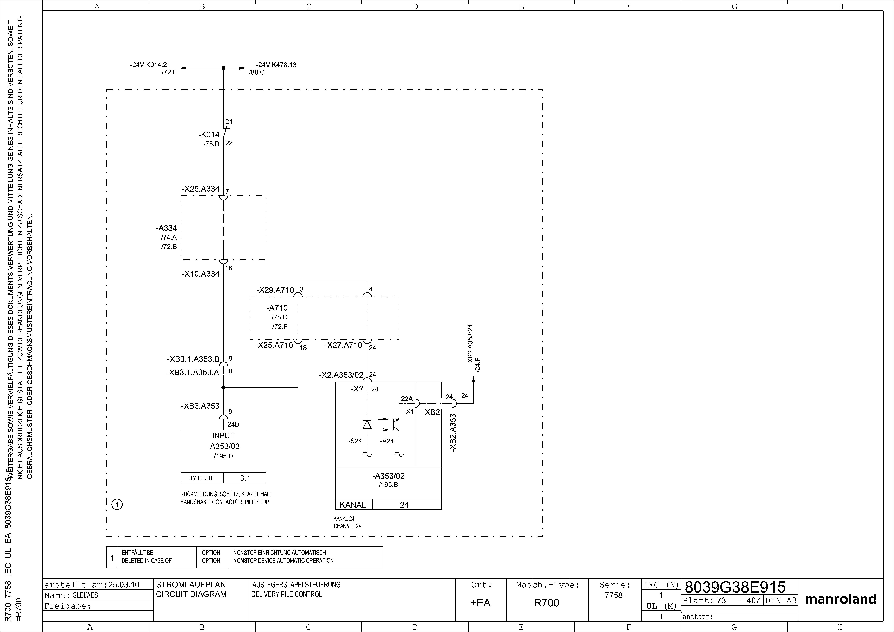

# +EA — Sheet 73 of 407 — AUSLEGERSTAPELSTEUERUNG

**DELIVERY PILE CONTROL**

> Part of the manroland **R700** printing press IEC/UL circuit diagrams.
> Drawing class: **Stromlaufplan / Circuit diagram** (DIN A3).
> Document `+EA` covers the **Printing unit** machine section.

## At a glance

| Field | Value |
|---|---|
| Document | `+EA`  (8039G38E915) |
| Sheet | **73** of 407 |
| Section (DE) | AUSLEGERSTAPELSTEUERUNG |
| Section (EN) | DELIVERY PILE CONTROL |
| Section type | CIRCUIT — Circuit diagram |
| Machine type | `R700` |
| Series | `7758` |
| Created | 25.03.10 |
| Replaces | — |
| Columns used | A, B, C, D, E |
| Path numbers | — |
| Labels on sheet | 67 |
| Cross-refs out | 10 |
| Cross-refs in | 21 |

**Previous:** [+EA sheet 72](SHEET_0072.md) · **Next:** [+EA sheet 74](SHEET_0074.md) · **Document TOC:** [_TOC.md](_TOC.md)  (+EA) · **Master TOC:** [all sheets](../_MASTER_TOC.md)

## Sheet image (300 DPI, exact vector render)



_Rendered directly from the PDF vector layer at 300 DPI (1-bit), no OCR and no resampling. Use it to confirm anything ambiguous in the text below._

## Cross-references on this sheet

Each entry is a wire leaving this sheet. The printed token is `/sheet.column`; the link resolves to that sheet inside the same document.

| Ref | Target sheet | Col | Path | Destination on target | Target section | From col |
|---|---|---|---|---|---|---|
| `/72.F` | [+EA sheet 72](SHEET_0072.md) | F | — | 24V.K014:21 | AUSLEGERSTAPELSTEUERUNG | B |
| `/88.C` | [+EA sheet 88](SHEET_0088.md) | C | — | — | SAUGWALZE | C |
| `/75.D` | [+EA sheet 75](SHEET_0075.md) | D | — | — | AUSLEGERSTAPELSTEUERUNG | B |
| `/74.A` | [+EA sheet 74](SHEET_0074.md) | A | — | — | AUSLEGERSTAPELSTEUERUNG | B |
| `/72.B` | [+EA sheet 72](SHEET_0072.md) | B | — | — | AUSLEGERSTAPELSTEUERUNG | B |
| `/78.D` | [+EA sheet 78](SHEET_0078.md) | D | — | — | AUSLEGERSTAPELSTEUERUNG | C |
| `/72.F` | [+EA sheet 72](SHEET_0072.md) | F | — | — | AUSLEGERSTAPELSTEUERUNG | C |
| `/24.F` | [+EA sheet 24](SHEET_0024.md) | F | — | XB2.A353:24 | BUSVERBINDUNGEN: SICHERHEITSBUS | E |
| `/195.D` | [+EA sheet 195](SHEET_0195.md) | D | — | — | REFERENZMODUL | B |
| `/195.B` | [+EA sheet 195](SHEET_0195.md) | B | — | — | REFERENZMODUL | D |

### Incoming references (sheets that point here)

Every other sheet that sends a wire to this one. `Back-ref` is the token printed on *that* sheet; `Path` is its line number.

| From sheet | Cols | Back-ref | Path | Refs | What continues there |
|---|---|---|---|---|---|
| [+EA#24](SHEET_0024.md) | F | `/24.F` | — | 1 | XB2.A353:24 |
| [+EA#72](SHEET_0072.md) | A, F | `/72.A`, `/72.F` | — | 3 | — |
| [+EA#74](SHEET_0074.md) | A | `/74.A` | — | 1 | — |
| [+EA#75](SHEET_0075.md) | D | `/75.D` | — | 1 | — |
| [+EA#78](SHEET_0078.md) | D | `/78.D` | — | 1 | — |
| [+EA#88](SHEET_0088.md) | D | `/88.D` | — | 1 | 24V.K478:13 24V.K408:21 |
| [+EA#195](SHEET_0195.md) | B, D | `/195.B`, `/195.D` | — | 2 | — |
| [+EA#224](SHEET_0224.md) | H | `/224.H` | — | 1 | — |
| [+EA#225](SHEET_0225.md) | D | `/225.D` | — | 1 | — |
| [+EA#234](SHEET_0234.md) | C, D, F | `/234.C`, `/234.D`, `/234.F` | — | 3 | — |
| [+EA#253](SHEET_0253.md) | H | `/253.H` | — | 1 | — |
| [+EA#267](SHEET_0267.md) | B | `/267.B` | — | 1 | — |
| [+EA#268](SHEET_0268.md) | C | `/268.C` | — | 1 | — |
| [+EA#271](SHEET_0271.md) | C | `/271.C` | — | 1 | — |
| [+EA#274](SHEET_0274.md) | B | `/274.B` | — | 2 | — |


## Devices on this sheet

| Tag | Class | Class meaning (IEC) | Col | Sub | Terminal | Sign |
|---|---|---|---|---|---|---|
| `K014` | K | Relais / relay, contactor | B | — | — | — |
| `A334` | A | Baugruppe / assembly, module, PC board | B | — | — | — |
| `A353/03` | A | Baugruppe / assembly, module, PC board | B | 03 | — | — |
| `A710` | A | Baugruppe / assembly, module, PC board | C | — | — | — |
| `S24` | S | Schalter / switch | C | — | — | — |
| `A24` | A | Baugruppe / assembly, module, PC board | D | — | — | — |
| `X1` | X | Klemme / terminal, plug connector | D | — | — | — |
| `X2` | X | Klemme / terminal, plug connector | C | — | — | — |
| `XB2` | XB |  | D | — | — | — |
| `A353/02` | A | Baugruppe / assembly, module, PC board | D | 02 | — | — |
| `X10.A334` | — | cross-device reference | B | — | — | — |
| `X25.A334` | — | cross-device reference | B | — | — | — |
| `3.1` | — | cross-device reference | B | — | — | — |
| `XB3.A353` | — | cross-device reference | B | — | — | — |
| `X29.A710` | — | cross-device reference | C | — | — | — |
| `X27.A710` | — | cross-device reference | C | — | — | — |
| `X25.A710` | — | cross-device reference | C | — | — | — |
| `XB2.A353` | — | cross-device reference | D | — | — | — |
| `XB3.1.A353.B` | — | cross-device reference | B | — | — | — |
| `XB3.1.A353.A` | — | cross-device reference | B | — | — | — |
| `XB2.A353:24` | — | cross-device reference | E | — | 24 | — |

## Potentials / nets

| Potential | Count | Columns | Attached devices | Terminals |
|---|---|---|---|---|
| `24V` | 2 | B, C | `K014`, `K478` | `13`, `21` |


A potential such as `L24+/4` or `M24+` is a named supply/return rail; every place it appears on this sheet is electrically common.

## Wire-end annotations (grouped as printed)

A wire that continues elsewhere is annotated with a small cluster: the destination description, the path/line number `#NN`, and the `/sheet.column` cross reference. Each row below is one such cluster exactly as it is grouped on the drawing.

| Col | Y | Path | Cross-ref | Text on the wire |
|---|---|---|---|---|
| B | 82.5 | — | `/72.F` | `24V.K014:21` |
| C | 82.5 | — | — | `24V.K478:13` |
| C | 92.4 | — | `/88.C` | — |
| B | 158.4 | — | — | `21` |
| B | 174.6 | — | — | `K014 22` |
| B | 187.7 | — | `/75.D` | — |
| B | 246.9 | — | — | `X25.A334 7` |
| B | 299.4 | — | — | `A334` |
| B | 312.4 | — | `/74.A`, `/72.B` | — |
| B | 353.2 | — | — | `X10.A334 18` |
| C | 381.6 | — | — | `X29.A710 3 4` |
| C | 405.7 | — | — | `A710` |
| C | 418.8 | — | `/78.D` | — |
| C | 431.1 | — | `/72.F` | — |
| E | 431.7 | — | `/24.F` | `XB2.A353:24` |
| C | 455.3 | — | — | `X25.A710 18 X27.A710 24` |
| B | 473.7 | — | — | `XB3.1.A353.B 18` |
| B | 490.7 | — | — | `XB3.1.A353.A 18` |
| C | 494.9 | — | — | `X2.A353/02 24` |
| C | 513.4 | — | — | `X2` |
| D | 514.8 | — | — | `24 24` |
| D | 523.3 | — | — | `24` |
| D | 527.5 | — | — | `22A` |
| B | 536.1 | — | — | `XB3.A353 18` |
| D | 544.5 | — | — | `X1` |
| D | 544.6 | — | — | `XB2` |
| D | 550.8 | — | — | `XB2.A353` |
| B | 561.5 | — | — | `24B` |
| B | 576.1 | — | — | `INPUT` |
| D | 583.5 | — | — | `S24 A24` |
| B | 589.9 | — | — | `A353/03` |
| B | 603.7 | — | `/195.D` | — |
| D | 629.6 | — | — | `A353/02` |
| B | 632.7 | — | — | `BYTE.BIT 3.1` |
| D | 642.0 | — | `/195.B` | — |
| B | 655.4 | — | — | `RÜCKMELDUNG: SCHÜTZ, STAPEL HALT HANDSHAKE: CONTACTOR, PILE STOP` |
| D | 667.8 | — | — | `KANAL 24` |
| A | 668.8 | — | — | `1` |
| C | 688.2 | — | — | `KANAL 24 CHANNEL 24` |
| B | 733.4 | — | — | `1 ENTFÄLLT BEI DELETED IN CASE OF NONSTOP EINRICHTUNG AUTOMATISCH NONSTOP DEVICE AUTOMATIC OPERATION` |
| B | 733.4 | — | — | `OPTION OPTION` |


## Reconstructed tables

This sheet carries tabular content (pin map / terminal assignment / index). The grid below was rebuilt from the drawing's own rule lines, so each row is exactly one physical row of the table.

### Table 1 — 6 data rows × 9 columns (at x=240.9, y=90.7)

| K014 /75.D X25.A334 X10.A334 | /88.C 21 22 7 18 |  |  |  |  |  |  |  |
|---|---|---|---|---|---|---|---|---|
| `XB3.1.A353.B XB3.1.A353.A` | `18 18` | `X29.A710 A710 /78.D /72.F X25.A710` | `3 18` | `X27.A710 X2.A353/02` | `4 24 24` |  |  | `XB2.A353:24` |
| `XB3.A353` | `18 24B` |  |  | `X2` | `24` | `22A X1` | `XB2` | `24 24` |
| `INPUT` | `A353/03 /195.D` |  |  | `S24` | `A24` |  |  | `XB2.A353` |
| `BYTE.BIT` | `3.1` |  |  |  | `A353/02` |  |  |  |
| `RÜCKMELDUNG:` | `SCHÜTZ, STAPEL` | `HALT` |  |  | `/195.B` |  |  |  |
| `HANDSHAKE:` | `CONTACTOR, PILE STOP` |  |  | `KANAL` |  | `24` |  |  |


## Notes and free text on this sheet

| Text | Col | Y (pt) |
|---|---|---|
| `24B` | B | 561.55 |
| `INPUT` | B | 576.07 |
| `BYTE.BIT` | B | 633.32 |
| `RÜCKMELDUNG: SCHÜTZ, STAPEL HALT` | B | 655.44 |
| `HANDSHAKE: CONTACTOR, PILE STOP` | B | 666.06 |
| `KANAL 24` | C | 688.19 |
| `CHANNEL 24` | C | 698.13 |
| `22A` | D | 527.53 |
| `KANAL` | C | 667.86 |
| `X2.A353/02` | C | 494.95 |
| `OPTION` | B | 733.35 |
| `NONSTOP EINRICHTUNG AUTOMATISCH` | C | 733.39 |
| `NONSTOP DEVICE AUTOMATIC OPERATION` | C | 744.01 |
| `ENTFÄLLT BEI` | A | 733.35 |
| `DELETED IN CASE OF` | A | 744 |

## Complete label inventory (exact text from the drawing)

Every text object inside the drawing area of this sheet, in DIN reading order (column A→H, then top→bottom). This is the authoritative list: if a string is not here it is not printed on this sheet.

| Col | Y | X | Dir | Type | Text |
|---|---|---|---|---|---|
| A | 668.8 | 154.1 | → | number | `1` |
| A | 733.3 | 162.1 | → | text | `ENTFÄLLT BEI` |
| A | 738.7 | 146.3 | → | number | `1` |
| A | 744.0 | 162.1 | → | text | `DELETED IN CASE OF` |
| B | 82.5 | 173.5 | → | potential | `24V.K014:21` |
| B | 92.4 | 215.4 | → | cross-reference | `/72.F` |
| B | 158.4 | 300.2 | → | number | `21` |
| B | 174.6 | 264.2 | → | device tag | `K014` |
| B | 186.7 | 300.2 | → | number | `22` |
| B | 187.7 | 271.3 | → | cross-reference | `/75.D` |
| B | 246.9 | 242.4 | → | device ref | `X25.A334` |
| B | 251.2 | 300.2 | → | number | `7` |
| B | 299.4 | 207.5 | → | device tag | `A334` |
| B | 312.4 | 214.6 | → | cross-reference | `/74.A` |
| B | 324.8 | 214.9 | → | cross-reference | `/72.B` |
| B | 353.2 | 299.6 | → | number | `18` |
| B | 360.3 | 242.4 | → | device ref | `X10.A334` |
| B | 473.7 | 222.5 | → | device ref | `XB3.1.A353.B` |
| B | 473.7 | 299.6 | → | number | `18` |
| B | 490.7 | 299.6 | → | number | `18` |
| B | 491.4 | 221.7 | → | device ref | `XB3.1.A353.A` |
| B | 536.1 | 241.2 | → | device ref | `XB3.A353` |
| B | 544.6 | 299.6 | → | number | `18` |
| B | 561.5 | 303.0 | → | text | `24B` |
| B | 576.1 | 282.8 | → | text | `INPUT` |
| B | 589.9 | 276.2 | → | device tag | `A353/03` |
| B | 603.7 | 284.9 | → | cross-reference | `/195.D` |
| B | 632.7 | 320.0 | → | device ref | `3.1` |
| B | 633.3 | 250.9 | → | text | `BYTE.BIT` |
| B | 655.4 | 240.1 | → | text | `RÜCKMELDUNG: SCHÜTZ, STAPEL HALT` |
| B | 666.1 | 240.1 | → | text | `HANDSHAKE: CONTACTOR, PILE STOP` |
| B | 733.4 | 269.0 | → | text | `OPTION` |
| B | 744.0 | 269.0 | → | text | `OPTION` |
| C | 82.5 | 341.3 | → | potential | `24V.K478:13` |
| C | 92.4 | 331.7 | → | cross-reference | `/88.C` |
| C | 381.6 | 341.6 | → | device ref | `X29.A710` |
| C | 381.6 | 399.4 | → | number | `3` |
| C | 405.7 | 354.9 | → | device tag | `A710` |
| C | 418.7 | 362.0 | → | cross-reference | `/78.D` |
| C | 431.1 | 362.8 | → | cross-reference | `/72.F` |
| C | 455.3 | 340.2 | → | device ref | `X25.A710` |
| C | 455.3 | 432.3 | → | device ref | `X27.A710` |
| C | 459.5 | 398.8 | → | number | `18` |
| C | 495.0 | 424.9 | → | text | `X2.A353/02` |
| C | 513.4 | 467.4 | → | device tag | `X2` |
| C | 583.5 | 463.7 | → | device tag | `S24` |
| C | 667.9 | 452.7 | → | text | `KANAL` |
| C | 688.2 | 444.5 | → | text | `KANAL 24` |
| C | 698.1 | 444.8 | → | text | `CHANNEL 24` |
| C | 733.4 | 311.0 | → | text | `NONSTOP EINRICHTUNG AUTOMATISCH` |
| C | 744.0 | 311.0 | → | text | `NONSTOP DEVICE AUTOMATIC OPERATION` |
| D | 381.6 | 491.5 | → | number | `4` |
| D | 459.5 | 491.5 | → | number | `24` |
| D | 495.0 | 491.5 | → | number | `24` |
| D | 514.8 | 494.4 | → | number | `24` |
| D | 523.3 | 614.3 | → | number | `24` |
| D | 524.7 | 593.6 | → | number | `24` |
| D | 527.5 | 534.3 | → | text | `22A` |
| D | 544.5 | 538.0 | → | device tag | `X1` |
| D | 544.6 | 562.4 | → | device tag | `XB2` |
| D | 550.8 | 598.4 | ↕ | device ref | `XB2.A353` |
| D | 583.5 | 506.3 | → | device tag | `A24` |
| D | 629.6 | 495.9 | → | device tag | `A353/02` |
| D | 642.0 | 504.7 | → | cross-reference | `/195.B` |
| D | 667.8 | 532.8 | → | number | `24` |
| E | 431.7 | 622.5 | ↕ | device ref | `XB2.A353:24` |
| E | 475.9 | 632.4 | ↕ | cross-reference | `/24.F` |

## Reading-order text block

The same content as a plain block, grouped by DIN column — convenient to paste or to match against a visual description.

```text
=== Column A ===
 668.8  154.1  numeric      1
 733.3  162.1  text         ENTFÄLLT BEI
 738.7  146.3  numeric      1
 744.0  162.1  text         DELETED IN CASE OF
=== Column B ===
  82.5  173.5  net          24V.K014:21
  92.4  215.4  xref         /72.F
 158.4  300.2  numeric      21
 174.6  264.2  devtag       K014
 186.7  300.2  numeric      22
 187.7  271.3  xref         /75.D
 246.9  242.4  devref       X25.A334
 251.2  300.2  numeric      7
 299.4  207.5  devtag       A334
 312.4  214.6  xref         /74.A
 324.8  214.9  xref         /72.B
 353.2  299.6  numeric      18
 360.3  242.4  devref       X10.A334
 473.7  222.5  devref       XB3.1.A353.B
 473.7  299.6  numeric      18
 490.7  299.6  numeric      18
 491.4  221.7  devref       XB3.1.A353.A
 536.1  241.2  devref       XB3.A353
 544.6  299.6  numeric      18
 561.5  303.0  text         24B
 576.1  282.8  text         INPUT
 589.9  276.2  devtag       A353/03
 603.7  284.9  xref         /195.D
 632.7  320.0  devref       3.1
 633.3  250.9  text         BYTE.BIT
 655.4  240.1  text         RÜCKMELDUNG: SCHÜTZ, STAPEL HALT
 666.1  240.1  text         HANDSHAKE: CONTACTOR, PILE STOP
 733.4  269.0  text         OPTION
 744.0  269.0  text         OPTION
=== Column C ===
  82.5  341.3  net          24V.K478:13
  92.4  331.7  xref         /88.C
 381.6  341.6  devref       X29.A710
 381.6  399.4  numeric      3
 405.7  354.9  devtag       A710
 418.7  362.0  xref         /78.D
 431.1  362.8  xref         /72.F
 455.3  340.2  devref       X25.A710
 455.3  432.3  devref       X27.A710
 459.5  398.8  numeric      18
 495.0  424.9  text         X2.A353/02
 513.4  467.4  devtag       X2
 583.5  463.7  devtag       S24
 667.9  452.7  text         KANAL
 688.2  444.5  text         KANAL 24
 698.1  444.8  text         CHANNEL 24
 733.4  311.0  text         NONSTOP EINRICHTUNG AUTOMATISCH
 744.0  311.0  text         NONSTOP DEVICE AUTOMATIC OPERATION
=== Column D ===
 381.6  491.5  numeric      4
 459.5  491.5  numeric      24
 495.0  491.5  numeric      24
 514.8  494.4  numeric      24
 523.3  614.3  numeric      24
 524.7  593.6  numeric      24
 527.5  534.3  text         22A
 544.5  538.0  devtag       X1
 544.6  562.4  devtag       XB2
 550.8  598.4  devref       XB2.A353
 583.5  506.3  devtag       A24
 629.6  495.9  devtag       A353/02
 642.0  504.7  xref         /195.B
 667.8  532.8  numeric      24
=== Column E ===
 431.7  622.5  devref       XB2.A353:24
 475.9  632.4  xref         /24.F
```

---
_Generated from the PDF vector text layer; no OCR. Source: `R700_7758_IEC_UL_EA_8039G38E915_p`, sheet 73._
