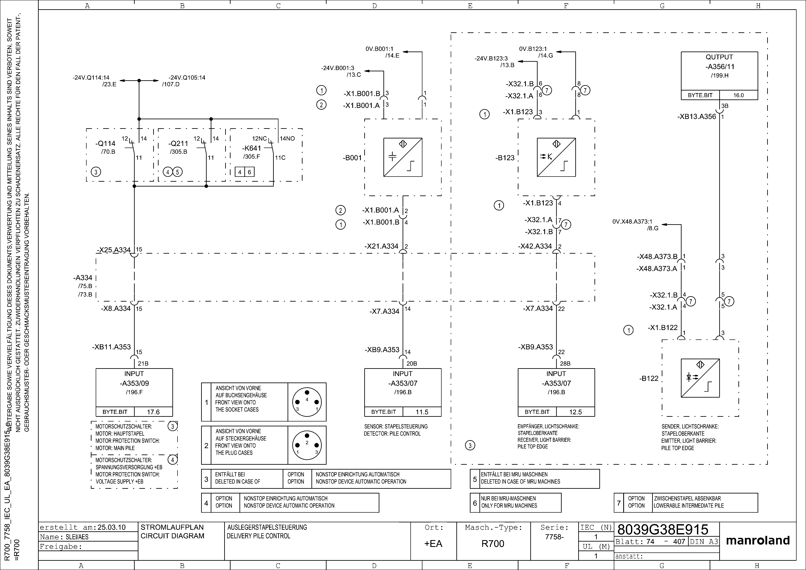

# +EA — Sheet 74 of 407 — AUSLEGERSTAPELSTEUERUNG

**DELIVERY PILE CONTROL**

> Part of the manroland **R700** printing press IEC/UL circuit diagrams.
> Drawing class: **Stromlaufplan / Circuit diagram** (DIN A3).
> Document `+EA` covers the **Printing unit** machine section.

## At a glance

| Field | Value |
|---|---|
| Document | `+EA`  (8039G38E915) |
| Sheet | **74** of 407 |
| Section (DE) | AUSLEGERSTAPELSTEUERUNG |
| Section (EN) | DELIVERY PILE CONTROL |
| Section type | CIRCUIT — Circuit diagram |
| Machine type | `R700` |
| Series | `7758` |
| Created | 25.03.10 |
| Replaces | — |
| Columns used | A, B, C, D, E, F, G, H |
| Path numbers | — |
| Labels on sheet | 196 |
| Cross-refs out | 16 |
| Cross-refs in | 51 |

**Previous:** [+EA sheet 73](SHEET_0073.md) · **Next:** [+EA sheet 75](SHEET_0075.md) · **Document TOC:** [_TOC.md](_TOC.md)  (+EA) · **Master TOC:** [all sheets](../_MASTER_TOC.md)

## Sheet image (300 DPI, exact vector render)



_Rendered directly from the PDF vector layer at 300 DPI (1-bit), no OCR and no resampling. Use it to confirm anything ambiguous in the text below._

## Cross-references on this sheet

Each entry is a wire leaving this sheet. The printed token is `/sheet.column`; the link resolves to that sheet inside the same document.

| Ref | Target sheet | Col | Path | Destination on target | Target section | From col |
|---|---|---|---|---|---|---|
| `/14.E` | [+EA sheet 14](SHEET_0014.md) | E | — | 0V.B001:1 0V.B123:1 | SPANNUNGSVERSORGUNG: 400V, 24V | E |
| `/14.G` | [+EA sheet 14](SHEET_0014.md) | G | — | 0V.B001:1 0V.B123:1 | SPANNUNGSVERSORGUNG: 400V, 24V | E |
| `/13.B` | [+EA sheet 13](SHEET_0013.md) | B | — | 24V.B123:3 | SPANNUNGSVERSORGUNG: 400V, 24V | E |
| `/13.C` | [+EA sheet 13](SHEET_0013.md) | C | — | 24V.B001:3 | SPANNUNGSVERSORGUNG: 400V, 24V | D |
| `/199.H` | [+EA sheet 199](SHEET_0199.md) | H | — | — | REFERENZMODUL | H |
| `/23.E` | [+EA sheet 23](SHEET_0023.md) | E | — | 24V.Q114:14 24V.Q105:14 | SPANNUNGSVERSORGUNG: 400V, 24V | B |
| `/107.D` | [+EA sheet 107](SHEET_0107.md) | D | — | — | BOGENGLÄTTER | B |
| `/70.B` | [+EA sheet 70](SHEET_0070.md) | B | — | — | AUSLEGERSTAPELMOTOR | A |
| `/305.B` | [+EA sheet 305](SHEET_0305.md) | B | — | — | OPTION: ZWISCHENSTAPEL / | B |
| `/305.F` | [+EA sheet 305](SHEET_0305.md) | F | — | — | OPTION: ZWISCHENSTAPEL / | C |
| `/8.G` | [+EA sheet 8](SHEET_0008.md) | G | — | 0V.X48.A373:1 | SPANNUNGSVERSORGUNG: 400V, 24V | G |
| `/75.B` | [+EA sheet 75](SHEET_0075.md) | B | — | — | AUSLEGERSTAPELSTEUERUNG | A |
| `/73.B` | [+EA sheet 73](SHEET_0073.md) | B | — | — | AUSLEGERSTAPELSTEUERUNG | A |
| `/196.B` | [+EA sheet 196](SHEET_0196.md) | B | — | — | REFERENZMODUL | D |
| `/196.B` | [+EA sheet 196](SHEET_0196.md) | B | — | — | REFERENZMODUL | F |
| `/196.F` | [+EA sheet 196](SHEET_0196.md) | F | — | — | REFERENZMODUL | A |

### Incoming references (sheets that point here)

Every other sheet that sends a wire to this one. `Back-ref` is the token printed on *that* sheet; `Path` is its line number.

| From sheet | Cols | Back-ref | Path | Refs | What continues there |
|---|---|---|---|---|---|
| [+EA#8](SHEET_0008.md) | G | `/8.G` | — | 1 | 0V.X48.A373:1 |
| [+EA#13](SHEET_0013.md) | B, C | `/13.B`, `/13.C` | — | 2 | 24V.B001:3 |
| [+EA#14](SHEET_0014.md) | E, G | `/14.E`, `/14.G` | — | 2 | 0V.B001:1; 0V.B123:1 |
| [+EA#23](SHEET_0023.md) | E | `/23.E` | — | 1 | — |
| [+EA#70](SHEET_0070.md) | B | `/70.B` | — | 1 | — |
| [+EA#73](SHEET_0073.md) | B | `/73.B` | — | 1 | — |
| [+EA#75](SHEET_0075.md) | B | `/75.B` | — | 1 | — |
| [+EA#107](SHEET_0107.md) | E | `/107.E` | — | 1 | 24V.K668:14 24V.Q105:14 |
| [+EA#196](SHEET_0196.md) | B, F | `/196.B`, `/196.F` | — | 3 | — |
| [+EA#199](SHEET_0199.md) | H | `/199.H` | — | 1 | — |
| [+EA#214](SHEET_0214.md) | C | `/214.C` | — | 6 | — |
| [+EA#216](SHEET_0216.md) | B | `/216.B` | — | 5 | — |
| [+EA#246](SHEET_0246.md) | F | `/246.F` | — | 2 | — |
| [+EA#249](SHEET_0249.md) | D | `/249.D` | — | 1 | — |
| [+EA#252](SHEET_0252.md) | C | `/252.C` | — | 2 | — |
| [+EA#256](SHEET_0256.md) | A | `/256.A` | — | 1 | — |
| [+EA#258](SHEET_0258.md) | F | `/258.F` | — | 1 | — |
| [+EA#264](SHEET_0264.md) | D | `/264.D` | — | 1 | — |
| [+EA#267](SHEET_0267.md) | B | `/267.B` | — | 1 | — |
| [+EA#276](SHEET_0276.md) | C | `/276.C` | — | 10 | — |
| [+EA#281](SHEET_0281.md) | B | `/281.B` | — | 1 | — |
| [+EA#282](SHEET_0282.md) | B | `/282.B` | — | 4 | — |
| [+EA#305](SHEET_0305.md) | B, F | `/305.B`, `/305.F` | — | 2 | — |


## Devices on this sheet

| Tag | Class | Class meaning (IEC) | Col | Sub | Terminal | Sign |
|---|---|---|---|---|---|---|
| `A356/11` | A | Baugruppe / assembly, module, PC board | H | 11 | — | — |
| `A334` | A | Baugruppe / assembly, module, PC board | A | — | — | — |
| `B001` | B | Umformer / transducer, sensor | D | — | — | — |
| `B123` | B | Umformer / transducer, sensor | E | — | — | — |
| `A353/09` | A | Baugruppe / assembly, module, PC board | A | 09 | — | — |
| `A353/07` | A | Baugruppe / assembly, module, PC board | D | 07 | — | — |
| `A353/07` | A | Baugruppe / assembly, module, PC board | F | 07 | — | — |
| `Q114` | Q | Leistungsschalter / power switching device | A | — | — | — |
| `B122` | B | Umformer / transducer, sensor | G | — | — | — |
| `Q211` | Q | Leistungsschalter / power switching device | B | — | — | — |
| `K641` | K | Relais / relay, contactor | C | — | — | — |
| `16.0` | — | cross-device reference | H | — | — | — |
| `XB13.A356` | — | cross-device reference | G | — | — | — |
| `X25.A334` | — | cross-device reference | A | — | — | — |
| `X1.B001.B` | — | cross-device reference | D | — | — | — |
| `X1.B001.A` | — | cross-device reference | D | — | — | — |
| `X1.B001.B` | — | cross-device reference | D | — | — | — |
| `X21.A334` | — | cross-device reference | D | — | — | — |
| `X1.B001.A` | — | cross-device reference | D | — | — | — |
| `X42.A334` | — | cross-device reference | F | — | — | — |
| `X1.B123` | — | cross-device reference | F | — | — | — |
| `X1.B123` | — | cross-device reference | E | — | — | — |
| `17.6` | — | cross-device reference | B | — | — | — |
| `XB11.A353` | — | cross-device reference | A | — | — | — |
| `11.5` | — | cross-device reference | D | — | — | — |
| `XB9.A353` | — | cross-device reference | D | — | — | — |
| `12.5` | — | cross-device reference | F | — | — | — |
| `XB9.A353` | — | cross-device reference | F | — | — | — |
| `X8.A334` | — | cross-device reference | A | — | — | — |
| `X7.A334` | — | cross-device reference | D | — | — | — |
| `X7.A334` | — | cross-device reference | F | — | — | — |
| `X1.B122` | — | cross-device reference | G | — | — | — |
| `X32.1.B` | — | cross-device reference | F | — | — | — |
| `X32.1.A` | — | cross-device reference | F | — | — | — |
| `X32.1.A` | — | cross-device reference | F | — | — | — |
| `X32.1.B` | — | cross-device reference | F | — | — | — |
| `X48.A373.B` | — | cross-device reference | G | — | — | — |
| `X48.A373.A` | — | cross-device reference | G | — | — | — |
| `X32.1.B` | — | cross-device reference | G | — | — | — |
| `X32.1.A` | — | cross-device reference | G | — | — | — |

## Potentials / nets

| Potential | Count | Columns | Attached devices | Terminals |
|---|---|---|---|---|
| `0V` | 3 | D, F, G | `A373`, `B001`, `B123`, `X48` | `1` |
| `24V` | 4 | A, B, D, E | `B001`, `B123`, `Q105`, `Q114` | `14`, `3` |


A potential such as `L24+/4` or `M24+` is a named supply/return rail; every place it appears on this sheet is electrically common.

## Wire-end annotations (grouped as printed)

A wire that continues elsewhere is annotated with a small cluster: the destination description, the path/line number `#NN`, and the `/sheet.column` cross reference. Each row below is one such cluster exactly as it is grouped on the drawing.

| Col | Y | Path | Cross-ref | Text on the wire |
|---|---|---|---|---|
| E | 68.3 | — | `/14.E`, `/14.G` | `0V.B001:1 0V.B123:1` |
| H | 80.0 | — | — | `QUTPUT` |
| E | 82.5 | — | `/13.B` | `24V.B123:3` |
| H | 93.8 | — | — | `A356/11` |
| D | 96.7 | — | `/13.C` | `24V.B001:3` |
| H | 107.7 | — | `/199.H` | — |
| B | 110.8 | — | `/23.E` | `24V.Q114:14 24V.Q105:14` |
| F | 119.4 | — | — | `X32.1.B 6 8` |
| B | 120.8 | — | `/107.D` | — |
| C | 130.2 | — | — | `1` |
| F | 130.7 | — | — | `7 7` |
| D | 133.6 | — | — | `X1.B001.B 3` |
| E | 133.6 | — | — | `1` |
| F | 136.4 | — | — | `X32.1.A 6 8` |
| H | 137.3 | — | — | `BYTE.BIT 16.0` |
| D | 150.6 | — | — | `X1.B001.A 3` |
| E | 150.6 | — | — | `1` |
| C | 151.9 | — | — | `2` |
| H | 152.6 | — | — | `3B` |
| F | 160.5 | — | — | `X1.B123 3 1` |
| E | 165.6 | — | — | `1` |
| G | 167.6 | — | — | `XB13.A356 1` |
| A | 200.9 | — | — | `Q114 14` |
| A | 200.9 | — | — | `12` |
| B | 200.9 | — | — | `Q211 14` |
| B | 200.9 | — | — | `12` |
| C | 200.9 | — | — | `K641 14NO` |
| C | 200.9 | — | — | `12NC` |
| A | 220.3 | — | `/70.B` | — |
| B | 220.3 | — | `/305.B` | — |
| C | 227.4 | — | `/305.F` | — |
| D | 228.5 | — | — | `B001` |
| E | 228.5 | — | — | `B123` |
| B | 229.2 | — | — | `11` |
| B | 229.2 | — | — | `11` |
| C | 229.2 | — | — | `11C` |
| B | 250.5 | — | — | `3 4 5 4 6` |
| F | 295.1 | — | — | `X1.B123 4` |
| E | 300.2 | — | — | `1` |
| D | 305.8 | — | — | `X1.B001.A 2` |
| D | 307.9 | — | — | `2` |
| F | 319.9 | — | — | `X32.1.A 7` |
| G | 323.4 | — | `/8.G` | `0V.X48.A373:1` |
| D | 323.5 | — | — | `X1.B001.B 4` |
| D | 328.6 | — | — | `1` |
| F | 329.1 | — | — | `7` |
| F | 337.6 | — | — | `X32.1.B 7` |
| D | 358.9 | — | — | `X21.A334 2` |
| F | 358.9 | — | — | `X42.A334 2` |
| A | 364.6 | — | — | `X25.A334 15` |
| G | 374.5 | — | — | `X48.A373.B 1` |
| H | 374.5 | — | — | `3` |
| G | 391.5 | — | — | `X48.A373.A 1` |
| H | 391.5 | — | — | `3` |
| A | 405.7 | — | — | `A334` |
| A | 418.7 | — | `/75.B`, `/73.B` | — |
| G | 431.2 | — | — | `X32.1.B 4` |
| H | 431.2 | — | — | `5` |
| G | 442.5 | — | — | `7 7` |
| G | 448.2 | — | — | `X32.1.A 4` |
| H | 448.2 | — | — | `5` |
| D | 451.0 | — | — | `X8.A334 15 X7.A334 14 X7.A334 22` |
| G | 479.4 | — | — | `X1.B122 1 3` |
| G | 484.5 | — | — | `1` |
| A | 507.7 | — | — | `XB11.A353 15` |
| F | 507.7 | — | — | `XB9.A353 22` |
| D | 512.0 | — | — | `XB9.A353 14` |
| B | 533.2 | — | — | `21B` |
| D | 533.2 | — | — | `20B` |
| F | 533.2 | — | — | `28B` |
| A | 547.7 | — | — | `INPUT` |
| D | 547.7 | — | — | `INPUT` |
| F | 547.7 | — | — | `INPUT` |
| G | 554.5 | — | — | `B122` |
| A | 561.6 | — | — | `A353/09` |
| D | 561.6 | — | — | `A353/07` |
| F | 561.6 | — | — | `A353/07` |
| C | 570.4 | — | — | `FRONT VIEW ONTO ANSICHT VON VORNE AUF BUCHSENGEHÄUSE` |
| D | 575.3 | — | `/196.B` | — |
| F | 575.3 | — | `/196.B` | — |
| A | 575.4 | — | `/196.F` | — |
| C | 587.0 | — | — | `4` |
| C | 589.9 | — | — | `1 THE SOCKET CASES` |
| C | 601.1 | — | — | `3 1` |
| A | 604.4 | — | — | `BYTE.BIT 17.6` |
| D | 604.4 | — | — | `BYTE.BIT 11.5` |
| F | 604.4 | — | — | `BYTE.BIT 12.5` |
| B | 626.8 | — | — | `3` |
| A | 627.1 | — | — | `MOTORSCHUTZSCHALTER: MOTOR: HAUPTSTAPEL MOTOR PROTECTION SWITCH: MOTOR: MAIN PILE` |
| D | 627.1 | — | — | `DETECTOR: PILE CONTROL SENSOR: STAPELSTEUERUNG` |
| G | 627.1 | — | — | `EMITTER, LIGHT BARRIER: PILE TOP EDGE SENDER, LICHTSCHRANKE: STAPELOBERKANTE` |
| F | 627.2 | — | — | `EMPFÄNGER, LICHTSCHRANKE: RECEIVER, LIGHT BARRIER: PILE TOP EDGE STAPELOBERKANTE` |
| C | 634.2 | — | — | `FRONT VIEW ONTO ANSICHT VON VORNE AUF STECKERGEHÄUSE` |
| C | 650.7 | — | — | `2` |
| B | 653.7 | — | — | `2 THE PLUG CASES` |
| E | 655.1 | — | — | `3` |
| C | 664.9 | — | — | `1 3` |
| B | 676.4 | — | — | `4` |
| A | 676.7 | — | — | `MOTORSCHUTZSCHALTER: MOTOR PROTECTION SWITCH: SPANNUNGSVERSORGUNG +EB` |
| C | 697.9 | — | — | `3 ENTFÄLLT BEI DELETED IN CASE OF NONSTOP EINRICHTUNG AUTOMATISCH NONSTOP DEVICE AUTOMATIC OPERATION` |
| C | 697.9 | — | — | `OPTION OPTION` |
| E | 698.0 | — | — | `5 ENTFÄLLT BEI MRU MASCHINEN DELETED IN CASE OF MRU MACHINES` |
| A | 708.6 | — | — | `VOLTAGE SUPPLY +EB` |
| B | 733.4 | — | — | `4 OPTION OPTION` |
| C | 733.4 | — | — | `NONSTOP EINRICHTUNG AUTOMATISCH NONSTOP DEVICE AUTOMATIC OPERATION` |
| E | 733.4 | — | — | `6 NUR BEI MRU MASCHINEN` |
| G | 733.4 | — | — | `7 OPTION OPTION` |
| G | 733.4 | — | — | `LOWERABLE INTERMEDIATE PILE ZWISCHENSTAPEL ABSENKBAR` |
| E | 744.0 | — | — | `ONLY FOR MRU MACHINES` |


## Reconstructed tables

This sheet carries tabular content (pin map / terminal assignment / index). The grid below was rebuilt from the drawing's own rule lines, so each row is exactly one physical row of the table.

### Table 1 — 4 data rows × 6 columns (at x=141.7, y=175.7)

| 12 Q114 /70.B 3 | 11 | 14 4 | 12 Q211 /305.B 5 | 11 | 14 12NC K641 /305.F 4 6 |
|---|---|---|---|---|---|
| `X25.A334 X8.A334 XB11.A353` | `15 15 15` | `21B` |  |  |  |
| `INPUT` | `A353/09 /196.F` |  |  | `1` | `ANSICHT VON VORNE AUF BUCHSENGEHÄUSE FRONT VIEW ONTO` |
| `BYTE.BIT` |  | `17.6` |  |  | `THE SOCKET CASES` |
| `MOTORSCHUTZSCHALTER: MOTOR: HAUPTSTAPEL MOTOR PROTECTION MOTOR: MAIN PILE` |  | `SWITCH:` | `3` | `2` | `ANSICHT VON VORNE AUF STECKERGEHÄUSE FRONT VIEW ONTO THE PLUG CASES` |


### Table 2 — 2 data rows × 3 columns (at x=538.6, y=204.1)

| X1.B001.A X1.B001.B X21.A334 XB9.A353 | X7.A334 | 2 4 2 14 14 20B |
|---|---|---|
|  | `INPUT` | `A353/07 /196.B` |
| `BYTE.BIT` |  | `11.5` |


### Table 3 — 2 data rows × 3 columns (at x=765.4, y=204.1)

| X42.A334 XB9.A353 | X1.B123 X32.1.A X32.1.B X7.A334 | 4 7 7 7 2 22 22 28B |
|---|---|---|
|  | `INPUT` | `A353/07 /196.B` |
| `BYTE.BIT` |  | `12.5` |


### Table 4 — 2 data rows × 2 columns (at x=1006.3, y=76.5)

| QUTPUT | A356/11 /199.H |
|---|---|
| `BYTE.BIT` | `16.0` |
| `XB13.A356 1 1 4 7 4 1` | `3B 1 3 3 5 7 5 3` |


## Notes and free text on this sheet

| Text | Col | Y (pt) |
|---|---|---|
| `3B` | H | 152.63 |
| `QUTPUT` | H | 79.98 |
| `BYTE.BIT` | G | 137.26 |
| `21B` | B | 533.2 |
| `INPUT` | A | 547.72 |
| `BYTE.BIT` | A | 604.97 |
| `MOTORSCHUTZSCHALTER:` | A | 627.1 |
| `MOTOR: HAUPTSTAPEL` | A | 637.72 |
| `MOTOR PROTECTION SWITCH:` | A | 648.34 |
| `MOTOR: MAIN PILE` | A | 658.98 |
| `20B` | D | 533.2 |
| `INPUT` | D | 547.72 |
| `BYTE.BIT` | D | 604.97 |
| `SENSOR: STAPELSTEUERUNG` | D | 627.08 |
| `DETECTOR: PILE CONTROL` | D | 637.72 |
| `28B` | F | 533.2 |
| `INPUT` | F | 547.72 |
| `BYTE.BIT` | F | 604.97 |
| `EMPFÄNGER, LICHTSCHRANKE:` | F | 627.24 |
| `STAPELOBERKANTE` | F | 637.17 |
| `RECEIVER, LIGHT BARRIER:` | F | 647.15 |
| `PILE TOP EDGE` | F | 657.07 |
| `SENDER, LICHTSCHRANKE:` | G | 627.08 |
| `STAPELOBERKANTE` | G | 637.7 |
| `EMITTER, LIGHT BARRIER:` | G | 648.34 |
| `PILE TOP EDGE` | G | 658.95 |
| `12NC` | C | 200.88 |
| `11C` | C | 229.23 |
| `14NO` | C | 200.87 |
| `SPANNUNGSVERSORGUNG +EB` | A | 687.33 |
| `VOLTAGE SUPPLY +EB` | A | 708.58 |
| `OPTION` | C | 697.92 |
| `NONSTOP EINRICHTUNG AUTOMATISCH` | D | 697.96 |
| `NONSTOP DEVICE AUTOMATIC OPERATION` | D | 708.58 |
| `ENTFÄLLT BEI` | B | 697.91 |
| `DELETED IN CASE OF` | C | 708.57 |
| `OPTION` | B | 733.35 |
| `NONSTOP EINRICHTUNG AUTOMATISCH` | C | 733.39 |
| `NONSTOP DEVICE AUTOMATIC OPERATION` | C | 744.01 |
| `ANSICHT VON VORNE` | C | 634.17 |
| `AUF STECKERGEHÄUSE` | C | 644.8 |
| `FRONT VIEW ONTO` | C | 655.4 |
| `THE PLUG CASES` | C | 666.06 |
| `AUF BUCHSENGEHÄUSE` | C | 581.03 |
| `THE SOCKET CASES` | C | 602.27 |
| `ENTFÄLLT BEI MRU MASCHINEN` | E | 697.95 |
| `DELETED IN CASE OF MRU MACHINES` | F | 708.58 |
| `NUR BEI MRU MASCHINEN` | E | 733.4 |
| `ONLY FOR MRU MACHINES` | E | 744.03 |
| `OPTION` | G | 733.35 |
| `ZWISCHENSTAPEL ABSENKBAR` | G | 733.36 |
| `LOWERABLE INTERMEDIATE PILE` | G | 743.99 |

## Complete label inventory (exact text from the drawing)

Every text object inside the drawing area of this sheet, in DIN reading order (column A→H, then top→bottom). This is the authoritative list: if a string is not here it is not printed on this sheet.

| Col | Y | X | Dir | Type | Text |
|---|---|---|---|---|---|
| A | 110.8 | 107.4 | → | potential | `24V.Q114:14` |
| A | 120.7 | 151.4 | → | cross-reference | `/23.E` |
| A | 200.9 | 179.4 | → | number | `12` |
| A | 207.2 | 141.2 | → | device tag | `Q114` |
| A | 220.3 | 149.7 | → | cross-reference | `/70.B` |
| A | 251.2 | 139.7 | → | number | `3` |
| A | 364.6 | 143.1 | → | device ref | `X25.A334` |
| A | 405.7 | 108.3 | → | device tag | `A334` |
| A | 418.7 | 115.7 | → | cross-reference | `/75.B` |
| A | 431.1 | 115.7 | → | cross-reference | `/73.B` |
| A | 451.0 | 149.1 | → | device ref | `X8.A334` |
| A | 507.7 | 136.1 | → | device ref | `XB11.A353` |
| A | 547.7 | 183.5 | → | text | `INPUT` |
| A | 561.6 | 177.0 | → | device tag | `A353/09` |
| A | 575.4 | 186.1 | → | cross-reference | `/196.F` |
| A | 605.0 | 151.7 | → | text | `BYTE.BIT` |
| A | 627.1 | 141.2 | → | text | `MOTORSCHUTZSCHALTER:` |
| A | 637.7 | 141.2 | → | text | `MOTOR: HAUPTSTAPEL` |
| A | 648.3 | 141.2 | → | text | `MOTOR PROTECTION SWITCH:` |
| A | 659.0 | 141.2 | → | text | `MOTOR: MAIN PILE` |
| A | 676.7 | 141.2 | → | text | `MOTORSCHUTZSCHALTER:` |
| A | 687.3 | 141.4 | → | text | `SPANNUNGSVERSORGUNG +EB` |
| A | 697.9 | 141.2 | → | text | `MOTOR PROTECTION SWITCH:` |
| A | 708.6 | 141.7 | → | text | `VOLTAGE SUPPLY +EB` |
| B | 110.8 | 249.2 | → | potential | `24V.Q105:14` |
| B | 120.8 | 239.5 | → | cross-reference | `/107.D` |
| B | 200.9 | 207.5 | → | number | `14` |
| B | 200.9 | 285.7 | → | number | `12` |
| B | 200.9 | 313.8 | → | number | `14` |
| B | 207.2 | 248.9 | → | device tag | `Q211` |
| B | 220.3 | 251.1 | → | cross-reference | `/305.B` |
| B | 229.2 | 200.4 | → | number | `11` |
| B | 229.2 | 306.7 | → | number | `11` |
| B | 251.2 | 246.0 | → | number | `4` |
| B | 251.2 | 260.2 | → | number | `5` |
| B | 364.6 | 200.4 | → | number | `15` |
| B | 452.5 | 200.4 | → | number | `15` |
| B | 516.2 | 200.4 | → | number | `15` |
| B | 533.2 | 203.8 | → | text | `21B` |
| B | 589.9 | 302.2 | → | number | `1` |
| B | 604.4 | 217.0 | → | device ref | `17.6` |
| B | 626.7 | 253.1 | → | number | `3` |
| B | 653.7 | 301.9 | → | number | `2` |
| B | 676.4 | 253.1 | → | number | `4` |
| B | 697.9 | 318.0 | → | text | `ENTFÄLLT BEI` |
| B | 703.3 | 301.7 | → | number | `3` |
| B | 733.4 | 318.6 | → | text | `OPTION` |
| B | 738.7 | 301.9 | → | number | `4` |
| B | 744.0 | 318.6 | → | text | `OPTION` |
| C | 130.2 | 473.0 | → | number | `1` |
| C | 151.9 | 472.8 | → | number | `2` |
| C | 200.9 | 372.2 | → | text | `12NC` |
| C | 200.9 | 413.0 | → | text | `14NO` |
| C | 214.3 | 357.7 | → | device tag | `K641` |
| C | 227.4 | 359.4 | → | cross-reference | `/305.F` |
| C | 229.2 | 405.9 | → | text | `11C` |
| C | 250.5 | 351.9 | → | number | `4` |
| C | 250.5 | 366.1 | → | number | `6` |
| C | 570.4 | 318.9 | → | text | `ANSICHT VON VORNE` |
| C | 581.0 | 318.9 | → | text | `AUF BUCHSENGEHÄUSE` |
| C | 587.0 | 451.6 | → | number | `4` |
| C | 591.6 | 318.0 | → | text | `FRONT VIEW ONTO` |
| C | 601.1 | 437.4 | → | number | `3` |
| C | 601.1 | 466.2 | → | number | `1` |
| C | 602.3 | 318.6 | → | text | `THE SOCKET CASES` |
| C | 634.2 | 318.9 | → | text | `ANSICHT VON VORNE` |
| C | 644.8 | 318.9 | → | text | `AUF STECKERGEHÄUSE` |
| C | 650.7 | 451.6 | → | number | `2` |
| C | 655.4 | 318.0 | → | text | `FRONT VIEW ONTO` |
| C | 664.9 | 437.8 | → | number | `1` |
| C | 664.9 | 465.7 | → | number | `3` |
| C | 666.1 | 318.6 | → | text | `THE PLUG CASES` |
| C | 697.9 | 424.9 | → | text | `OPTION` |
| C | 708.6 | 318.0 | → | text | `DELETED IN CASE OF` |
| C | 708.6 | 424.9 | → | text | `OPTION` |
| C | 733.4 | 360.6 | → | text | `NONSTOP EINRICHTUNG AUTOMATISCH` |
| C | 744.0 | 360.6 | → | text | `NONSTOP DEVICE AUTOMATIC OPERATION` |
| D | 68.3 | 540.3 | → | potential | `0V.B001:1` |
| D | 78.2 | 569.5 | → | cross-reference | `/14.E` |
| D | 96.7 | 474.5 | → | potential | `24V.B001:3` |
| D | 106.6 | 512.2 | → | cross-reference | `/13.C` |
| D | 133.5 | 507.7 | → | device ref | `X1.B001.B` |
| D | 133.6 | 569.5 | → | number | `3` |
| D | 150.6 | 569.5 | → | number | `3` |
| D | 151.3 | 506.8 | → | device ref | `X1.B001.A` |
| D | 228.5 | 506.6 | → | device tag | `B001` |
| D | 305.7 | 535.2 | → | device ref | `X1.B001.A` |
| D | 307.9 | 501.2 | → | number | `2` |
| D | 307.9 | 597.8 | → | number | `2` |
| D | 323.5 | 536.0 | → | device ref | `X1.B001.B` |
| D | 324.9 | 597.8 | → | number | `4` |
| D | 328.6 | 501.4 | → | number | `1` |
| D | 358.9 | 538.6 | → | device ref | `X21.A334` |
| D | 360.3 | 597.8 | → | number | `2` |
| D | 452.5 | 597.3 | → | number | `14` |
| D | 455.3 | 546.0 | → | device ref | `X7.A334` |
| D | 512.0 | 538.9 | → | device ref | `XB9.A353` |
| D | 516.2 | 597.3 | → | number | `14` |
| D | 533.2 | 600.7 | → | text | `20B` |
| D | 547.7 | 580.4 | → | text | `INPUT` |
| D | 561.6 | 573.9 | → | device tag | `A353/07` |
| D | 575.3 | 582.7 | → | cross-reference | `/196.B` |
| D | 604.4 | 613.8 | → | device ref | `11.5` |
| D | 605.0 | 548.5 | → | text | `BYTE.BIT` |
| D | 627.1 | 538.3 | → | text | `SENSOR: STAPELSTEUERUNG` |
| D | 637.7 | 537.7 | → | text | `DETECTOR: PILE CONTROL` |
| D | 698.0 | 466.9 | → | text | `NONSTOP EINRICHTUNG AUTOMATISCH` |
| D | 708.6 | 466.9 | → | text | `NONSTOP DEVICE AUTOMATIC OPERATION` |
| E | 82.5 | 701.3 | → | potential | `24V.B123:3` |
| E | 92.4 | 739.3 | → | cross-reference | `/13.B` |
| E | 133.6 | 625.6 | → | number | `1` |
| E | 150.6 | 625.6 | → | number | `1` |
| E | 160.5 | 743.0 | → | device ref | `X1.B123` |
| E | 165.6 | 714.0 | → | number | `1` |
| E | 228.5 | 731.9 | → | device tag | `B123` |
| E | 300.2 | 735.3 | → | number | `1` |
| E | 655.1 | 692.5 | → | number | `3` |
| E | 698.0 | 710.6 | → | text | `ENTFÄLLT BEI MRU MASCHINEN` |
| E | 703.3 | 698.6 | → | number | `5` |
| E | 733.4 | 710.6 | → | text | `NUR BEI MRU MASCHINEN` |
| E | 738.7 | 698.7 | → | number | `6` |
| E | 744.0 | 711.2 | → | text | `ONLY FOR MRU MACHINES` |
| F | 68.3 | 767.1 | → | potential | `0V.B123:1` |
| F | 78.2 | 795.4 | → | cross-reference | `/14.G` |
| F | 119.4 | 747.5 | → | device ref | `X32.1.B` |
| F | 119.4 | 796.3 | → | number | `6` |
| F | 119.4 | 852.9 | → | number | `8` |
| F | 130.7 | 805.9 | → | number | `7` |
| F | 130.7 | 862.6 | → | number | `7` |
| F | 136.4 | 796.3 | → | number | `6` |
| F | 136.4 | 852.9 | → | number | `8` |
| F | 137.1 | 746.6 | → | device ref | `X32.1.A` |
| F | 161.9 | 796.3 | → | number | `3` |
| F | 161.9 | 852.4 | → | number | `1` |
| F | 295.1 | 772.7 | → | device ref | `X1.B123` |
| F | 296.5 | 824.6 | → | number | `4` |
| F | 319.9 | 775.0 | → | device ref | `X32.1.A` |
| F | 322.1 | 824.6 | → | number | `7` |
| F | 329.1 | 834.2 | → | number | `7` |
| F | 337.6 | 775.8 | → | device ref | `X32.1.B` |
| F | 339.1 | 824.6 | → | number | `7` |
| F | 358.9 | 765.4 | → | device ref | `X42.A334` |
| F | 360.3 | 824.6 | → | number | `2` |
| F | 451.0 | 772.7 | → | device ref | `X7.A334` |
| F | 452.5 | 824.6 | → | number | `22` |
| F | 507.7 | 765.6 | → | device ref | `XB9.A353` |
| F | 516.2 | 824.6 | → | number | `22` |
| F | 533.2 | 827.4 | → | text | `28B` |
| F | 547.7 | 807.2 | → | text | `INPUT` |
| F | 561.6 | 800.6 | → | device tag | `A353/07` |
| F | 575.3 | 809.4 | → | cross-reference | `/196.B` |
| F | 604.4 | 840.6 | → | device ref | `12.5` |
| F | 605.0 | 775.3 | → | text | `BYTE.BIT` |
| F | 627.2 | 764.8 | → | text | `EMPFÄNGER, LICHTSCHRANKE:` |
| F | 637.2 | 765.1 | → | text | `STAPELOBERKANTE` |
| F | 647.1 | 764.8 | → | text | `RECEIVER, LIGHT BARRIER:` |
| F | 657.1 | 764.8 | → | text | `PILE TOP EDGE` |
| F | 708.6 | 710.6 | → | text | `DELETED IN CASE OF MRU MACHINES` |
| G | 137.3 | 1016.2 | → | text | `BYTE.BIT` |
| G | 167.5 | 1000.6 | → | device ref | `XB13.A356` |
| G | 323.4 | 904.8 | → | potential | `0V.X48.A373:1` |
| G | 333.3 | 956.1 | → | cross-reference | `/8.G` |
| G | 374.5 | 941.1 | → | device ref | `X48.A373.B` |
| G | 374.5 | 1008.3 | → | number | `1` |
| G | 391.5 | 1008.3 | → | number | `1` |
| G | 392.2 | 940.3 | → | device ref | `X48.A373.A` |
| G | 431.2 | 960.1 | → | device ref | `X32.1.B` |
| G | 431.2 | 1008.9 | → | number | `4` |
| G | 442.5 | 1018.5 | → | number | `7` |
| G | 448.2 | 1008.9 | → | number | `4` |
| G | 448.9 | 959.2 | → | device ref | `X32.1.A` |
| G | 479.4 | 957.0 | → | device ref | `X1.B122` |
| G | 484.5 | 926.6 | → | number | `1` |
| G | 487.9 | 1008.3 | → | number | `1` |
| G | 554.5 | 944.5 | → | device tag | `B122` |
| G | 627.1 | 977.7 | → | text | `SENDER, LICHTSCHRANKE:` |
| G | 637.7 | 977.7 | → | text | `STAPELOBERKANTE` |
| G | 648.3 | 977.1 | → | text | `EMITTER, LIGHT BARRIER:` |
| G | 658.9 | 977.1 | → | text | `PILE TOP EDGE` |
| G | 733.4 | 928.1 | → | text | `OPTION` |
| G | 733.4 | 966.6 | → | text | `ZWISCHENSTAPEL ABSENKBAR` |
| G | 738.7 | 911.3 | → | number | `7` |
| G | 744.0 | 928.1 | → | text | `OPTION` |
| G | 744.0 | 965.8 | → | text | `LOWERABLE INTERMEDIATE PILE` |
| H | 80.0 | 1042.7 | → | text | `QUTPUT` |
| H | 93.8 | 1042.3 | → | device tag | `A356/11` |
| H | 107.7 | 1050.5 | → | cross-reference | `/199.H` |
| H | 137.3 | 1083.1 | → | device ref | `16.0` |
| H | 152.6 | 1065.5 | → | text | `3B` |
| H | 169.0 | 1065.0 | → | number | `1` |
| H | 374.5 | 1065.5 | → | number | `3` |
| H | 391.5 | 1065.5 | → | number | `3` |
| H | 431.2 | 1065.5 | → | number | `5` |
| H | 442.5 | 1075.2 | → | number | `7` |
| H | 448.2 | 1065.5 | → | number | `5` |
| H | 487.9 | 1065.5 | → | number | `3` |

## Reading-order text block

The same content as a plain block, grouped by DIN column — convenient to paste or to match against a visual description.

```text
=== Column A ===
 110.8  107.4  net          24V.Q114:14
 120.7  151.4  xref         /23.E
 200.9  179.4  numeric      12
 207.2  141.2  devtag       Q114
 220.3  149.7  xref         /70.B
 251.2  139.7  numeric      3
 364.6  143.1  devref       X25.A334
 405.7  108.3  devtag       A334
 418.7  115.7  xref         /75.B
 431.1  115.7  xref         /73.B
 451.0  149.1  devref       X8.A334
 507.7  136.1  devref       XB11.A353
 547.7  183.5  text         INPUT
 561.6  177.0  devtag       A353/09
 575.4  186.1  xref         /196.F
 605.0  151.7  text         BYTE.BIT
 627.1  141.2  text         MOTORSCHUTZSCHALTER:
 637.7  141.2  text         MOTOR: HAUPTSTAPEL
 648.3  141.2  text         MOTOR PROTECTION SWITCH:
 659.0  141.2  text         MOTOR: MAIN PILE
 676.7  141.2  text         MOTORSCHUTZSCHALTER:
 687.3  141.4  text         SPANNUNGSVERSORGUNG +EB
 697.9  141.2  text         MOTOR PROTECTION SWITCH:
 708.6  141.7  text         VOLTAGE SUPPLY +EB
=== Column B ===
 110.8  249.2  net          24V.Q105:14
 120.8  239.5  xref         /107.D
 200.9  207.5  numeric      14
 200.9  285.7  numeric      12
 200.9  313.8  numeric      14
 207.2  248.9  devtag       Q211
 220.3  251.1  xref         /305.B
 229.2  200.4  numeric      11
 229.2  306.7  numeric      11
 251.2  246.0  numeric      4
 251.2  260.2  numeric      5
 364.6  200.4  numeric      15
 452.5  200.4  numeric      15
 516.2  200.4  numeric      15
 533.2  203.8  text         21B
 589.9  302.2  numeric      1
 604.4  217.0  devref       17.6
 626.7  253.1  numeric      3
 653.7  301.9  numeric      2
 676.4  253.1  numeric      4
 697.9  318.0  text         ENTFÄLLT BEI
 703.3  301.7  numeric      3
 733.4  318.6  text         OPTION
 738.7  301.9  numeric      4
 744.0  318.6  text         OPTION
=== Column C ===
 130.2  473.0  numeric      1
 151.9  472.8  numeric      2
 200.9  372.2  text         12NC
 200.9  413.0  text         14NO
 214.3  357.7  devtag       K641
 227.4  359.4  xref         /305.F
 229.2  405.9  text         11C
 250.5  351.9  numeric      4
 250.5  366.1  numeric      6
 570.4  318.9  text         ANSICHT VON VORNE
 581.0  318.9  text         AUF BUCHSENGEHÄUSE
 587.0  451.6  numeric      4
 591.6  318.0  text         FRONT VIEW ONTO
 601.1  437.4  numeric      3
 601.1  466.2  numeric      1
 602.3  318.6  text         THE SOCKET CASES
 634.2  318.9  text         ANSICHT VON VORNE
 644.8  318.9  text         AUF STECKERGEHÄUSE
 650.7  451.6  numeric      2
 655.4  318.0  text         FRONT VIEW ONTO
 664.9  437.8  numeric      1
 664.9  465.7  numeric      3
 666.1  318.6  text         THE PLUG CASES
 697.9  424.9  text         OPTION
 708.6  318.0  text         DELETED IN CASE OF
 708.6  424.9  text         OPTION
 733.4  360.6  text         NONSTOP EINRICHTUNG AUTOMATISCH
 744.0  360.6  text         NONSTOP DEVICE AUTOMATIC OPERATION
=== Column D ===
  68.3  540.3  net          0V.B001:1
  78.2  569.5  xref         /14.E
  96.7  474.5  net          24V.B001:3
 106.6  512.2  xref         /13.C
 133.5  507.7  devref       X1.B001.B
 133.6  569.5  numeric      3
 150.6  569.5  numeric      3
 151.3  506.8  devref       X1.B001.A
 228.5  506.6  devtag       B001
 305.7  535.2  devref       X1.B001.A
 307.9  501.2  numeric      2
 307.9  597.8  numeric      2
 323.5  536.0  devref       X1.B001.B
 324.9  597.8  numeric      4
 328.6  501.4  numeric      1
 358.9  538.6  devref       X21.A334
 360.3  597.8  numeric      2
 452.5  597.3  numeric      14
 455.3  546.0  devref       X7.A334
 512.0  538.9  devref       XB9.A353
 516.2  597.3  numeric      14
 533.2  600.7  text         20B
 547.7  580.4  text         INPUT
 561.6  573.9  devtag       A353/07
 575.3  582.7  xref         /196.B
 604.4  613.8  devref       11.5
 605.0  548.5  text         BYTE.BIT
 627.1  538.3  text         SENSOR: STAPELSTEUERUNG
 637.7  537.7  text         DETECTOR: PILE CONTROL
 698.0  466.9  text         NONSTOP EINRICHTUNG AUTOMATISCH
 708.6  466.9  text         NONSTOP DEVICE AUTOMATIC OPERATION
=== Column E ===
  82.5  701.3  net          24V.B123:3
  92.4  739.3  xref         /13.B
 133.6  625.6  numeric      1
 150.6  625.6  numeric      1
 160.5  743.0  devref       X1.B123
 165.6  714.0  numeric      1
 228.5  731.9  devtag       B123
 300.2  735.3  numeric      1
 655.1  692.5  numeric      3
 698.0  710.6  text         ENTFÄLLT BEI MRU MASCHINEN
 703.3  698.6  numeric      5
 733.4  710.6  text         NUR BEI MRU MASCHINEN
 738.7  698.7  numeric      6
 744.0  711.2  text         ONLY FOR MRU MACHINES
=== Column F ===
  68.3  767.1  net          0V.B123:1
  78.2  795.4  xref         /14.G
 119.4  747.5  devref       X32.1.B
 119.4  796.3  numeric      6
 119.4  852.9  numeric      8
 130.7  805.9  numeric      7
 130.7  862.6  numeric      7
 136.4  796.3  numeric      6
 136.4  852.9  numeric      8
 137.1  746.6  devref       X32.1.A
 161.9  796.3  numeric      3
 161.9  852.4  numeric      1
 295.1  772.7  devref       X1.B123
 296.5  824.6  numeric      4
 319.9  775.0  devref       X32.1.A
 322.1  824.6  numeric      7
 329.1  834.2  numeric      7
 337.6  775.8  devref       X32.1.B
 339.1  824.6  numeric      7
 358.9  765.4  devref       X42.A334
 360.3  824.6  numeric      2
 451.0  772.7  devref       X7.A334
 452.5  824.6  numeric      22
 507.7  765.6  devref       XB9.A353
 516.2  824.6  numeric      22
 533.2  827.4  text         28B
 547.7  807.2  text         INPUT
 561.6  800.6  devtag       A353/07
 575.3  809.4  xref         /196.B
 604.4  840.6  devref       12.5
 605.0  775.3  text         BYTE.BIT
 627.2  764.8  text         EMPFÄNGER, LICHTSCHRANKE:
 637.2  765.1  text         STAPELOBERKANTE
 647.1  764.8  text         RECEIVER, LIGHT BARRIER:
 657.1  764.8  text         PILE TOP EDGE
 708.6  710.6  text         DELETED IN CASE OF MRU MACHINES
=== Column G ===
 137.3 1016.2  text         BYTE.BIT
 167.5 1000.6  devref       XB13.A356
 323.4  904.8  net          0V.X48.A373:1
 333.3  956.1  xref         /8.G
 374.5  941.1  devref       X48.A373.B
 374.5 1008.3  numeric      1
 391.5 1008.3  numeric      1
 392.2  940.3  devref       X48.A373.A
 431.2  960.1  devref       X32.1.B
 431.2 1008.9  numeric      4
 442.5 1018.5  numeric      7
 448.2 1008.9  numeric      4
 448.9  959.2  devref       X32.1.A
 479.4  957.0  devref       X1.B122
 484.5  926.6  numeric      1
 487.9 1008.3  numeric      1
 554.5  944.5  devtag       B122
 627.1  977.7  text         SENDER, LICHTSCHRANKE:
 637.7  977.7  text         STAPELOBERKANTE
 648.3  977.1  text         EMITTER, LIGHT BARRIER:
 658.9  977.1  text         PILE TOP EDGE
 733.4  928.1  text         OPTION
 733.4  966.6  text         ZWISCHENSTAPEL ABSENKBAR
 738.7  911.3  numeric      7
 744.0  928.1  text         OPTION
 744.0  965.8  text         LOWERABLE INTERMEDIATE PILE
=== Column H ===
  80.0 1042.7  text         QUTPUT
  93.8 1042.3  devtag       A356/11
 107.7 1050.5  xref         /199.H
 137.3 1083.1  devref       16.0
 152.6 1065.5  text         3B
 169.0 1065.0  numeric      1
 374.5 1065.5  numeric      3
 391.5 1065.5  numeric      3
 431.2 1065.5  numeric      5
 442.5 1075.2  numeric      7
 448.2 1065.5  numeric      5
 487.9 1065.5  numeric      3
```

---
_Generated from the PDF vector text layer; no OCR. Source: `R700_7758_IEC_UL_EA_8039G38E915_p`, sheet 74._
