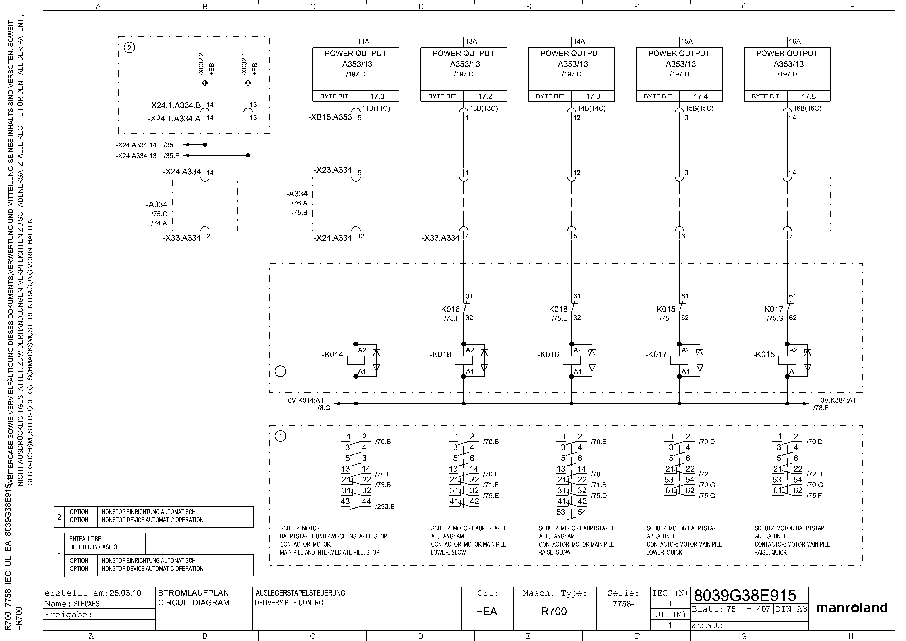

# +EA — Sheet 75 of 407 — AUSLEGERSTAPELSTEUERUNG

**DELIVERY PILE CONTROL**

> Part of the manroland **R700** printing press IEC/UL circuit diagrams.
> Drawing class: **Stromlaufplan / Circuit diagram** (DIN A3).
> Document `+EA` covers the **Printing unit** machine section.

## At a glance

| Field | Value |
|---|---|
| Document | `+EA`  (8039G38E915) |
| Sheet | **75** of 407 |
| Section (DE) | AUSLEGERSTAPELSTEUERUNG |
| Section (EN) | DELIVERY PILE CONTROL |
| Section type | CIRCUIT — Circuit diagram |
| Machine type | `R700` |
| Series | `7758` |
| Created | 25.03.10 |
| Replaces | — |
| Columns used | A, B, C, D, E, F, G, H |
| Path numbers | — |
| Labels on sheet | 236 |
| Cross-refs out | 37 |
| Cross-refs in | 58 |

**Previous:** [+EA sheet 74](SHEET_0074.md) · **Next:** [+EA sheet 76](SHEET_0076.md) · **Document TOC:** [_TOC.md](_TOC.md)  (+EA) · **Master TOC:** [all sheets](../_MASTER_TOC.md)

## Sheet image (300 DPI, exact vector render)



_Rendered directly from the PDF vector layer at 300 DPI (1-bit), no OCR and no resampling. Use it to confirm anything ambiguous in the text below._

## Cross-references on this sheet

Each entry is a wire leaving this sheet. The printed token is `/sheet.column`; the link resolves to that sheet inside the same document.

| Ref | Target sheet | Col | Path | Destination on target | Target section | From col |
|---|---|---|---|---|---|---|
| `/197.D` | [+EA sheet 197](SHEET_0197.md) | D | — | — | REFERENZMODUL | C |
| `/197.D` | [+EA sheet 197](SHEET_0197.md) | D | — | — | REFERENZMODUL | D |
| `/197.D` | [+EA sheet 197](SHEET_0197.md) | D | — | — | REFERENZMODUL | E |
| `/197.D` | [+EA sheet 197](SHEET_0197.md) | D | — | — | REFERENZMODUL | F |
| `/197.D` | [+EA sheet 197](SHEET_0197.md) | D | — | — | REFERENZMODUL | G |
| `/35.F` | [+EA sheet 35](SHEET_0035.md) | F | — | X24.A334:14 | BUSVERBINDUNGEN: NOT AUS | A |
| `/35.F` | [+EA sheet 35](SHEET_0035.md) | F | — | X24.A334:13 | BUSVERBINDUNGEN: NOT AUS | A |
| `/76.A` | [+EA sheet 76](SHEET_0076.md) | A | — | — | AUSLEGERSTAPELSTEUERUNG | C |
| `/75.B` | [+EA sheet 75](SHEET_0075.md) | B | — | — | AUSLEGERSTAPELSTEUERUNG | C |
| `/75.C` | [+EA sheet 75](SHEET_0075.md) | C | — | — | AUSLEGERSTAPELSTEUERUNG | B |
| `/74.A` | [+EA sheet 74](SHEET_0074.md) | A | — | — | AUSLEGERSTAPELSTEUERUNG | B |
| `/75.E` | [+EA sheet 75](SHEET_0075.md) | E | — | — | AUSLEGERSTAPELSTEUERUNG | E |
| `/75.F` | [+EA sheet 75](SHEET_0075.md) | F | — | — | AUSLEGERSTAPELSTEUERUNG | D |
| `/75.G` | [+EA sheet 75](SHEET_0075.md) | G | — | — | AUSLEGERSTAPELSTEUERUNG | G |
| `/75.H` | [+EA sheet 75](SHEET_0075.md) | H | — | — | AUSLEGERSTAPELSTEUERUNG | F |
| `/8.G` | [+EA sheet 8](SHEET_0008.md) | G | — | 0V.K014:A1 0V.K384:A1 | SPANNUNGSVERSORGUNG: 400V, 24V | E |
| `/78.F` | [+EA sheet 78](SHEET_0078.md) | F | — | — | AUSLEGERSTAPELSTEUERUNG | H |
| `/70.B` | [+EA sheet 70](SHEET_0070.md) | B | — | — | AUSLEGERSTAPELMOTOR | D |
| `/70.B` | [+EA sheet 70](SHEET_0070.md) | B | — | — | AUSLEGERSTAPELMOTOR | E |
| `/70.B` | [+EA sheet 70](SHEET_0070.md) | B | — | — | AUSLEGERSTAPELMOTOR | F |
| `/70.D` | [+EA sheet 70](SHEET_0070.md) | D | — | — | AUSLEGERSTAPELMOTOR | G |
| `/70.D` | [+EA sheet 70](SHEET_0070.md) | D | — | — | AUSLEGERSTAPELMOTOR | H |
| `/72.B` | [+EA sheet 72](SHEET_0072.md) | B | — | — | AUSLEGERSTAPELSTEUERUNG | H |
| `/70.F` | [+EA sheet 70](SHEET_0070.md) | F | — | — | AUSLEGERSTAPELMOTOR | D |
| `/70.F` | [+EA sheet 70](SHEET_0070.md) | F | — | — | AUSLEGERSTAPELMOTOR | E |
| `/70.F` | [+EA sheet 70](SHEET_0070.md) | F | — | — | AUSLEGERSTAPELMOTOR | F |
| `/72.F` | [+EA sheet 72](SHEET_0072.md) | F | — | — | AUSLEGERSTAPELSTEUERUNG | G |
| `/73.B` | [+EA sheet 73](SHEET_0073.md) | B | — | — | AUSLEGERSTAPELSTEUERUNG | D |
| `/71.B` | [+EA sheet 71](SHEET_0071.md) | B | — | — | AUSLEGERSTAPELSTEUERUNG | F |
| `/71.F` | [+EA sheet 71](SHEET_0071.md) | F | — | — | AUSLEGERSTAPELSTEUERUNG | E |
| `/70.G` | [+EA sheet 70](SHEET_0070.md) | G | — | — | AUSLEGERSTAPELMOTOR | G |
| `/70.G` | [+EA sheet 70](SHEET_0070.md) | G | — | — | AUSLEGERSTAPELMOTOR | H |
| `/75.E` | [+EA sheet 75](SHEET_0075.md) | E | — | — | AUSLEGERSTAPELSTEUERUNG | E |
| `/75.F` | [+EA sheet 75](SHEET_0075.md) | F | — | — | AUSLEGERSTAPELSTEUERUNG | H |
| `/75.G` | [+EA sheet 75](SHEET_0075.md) | G | — | — | AUSLEGERSTAPELSTEUERUNG | G |
| `/75.D` | [+EA sheet 75](SHEET_0075.md) | D | — | — | AUSLEGERSTAPELSTEUERUNG | F |
| `/293.E` | [+EA sheet 293](SHEET_0293.md) | E | — | — | OPTION: ZWISCHENSTAPEL / | D |

### Incoming references (sheets that point here)

Every other sheet that sends a wire to this one. `Back-ref` is the token printed on *that* sheet; `Path` is its line number.

| From sheet | Cols | Back-ref | Path | Refs | What continues there |
|---|---|---|---|---|---|
| [+EA#8](SHEET_0008.md) | G | `/8.G` | — | 1 | 0V.K014:A1 |
| [+EA#35](SHEET_0035.md) | F | `/35.F` | — | 2 | — |
| [+EA#70](SHEET_0070.md) | B, C, D, F, G | `/70.B`, `/70.C`, `/70.D`, `/70.F`, `/70.G` | — | 10 | — |
| [+EA#71](SHEET_0071.md) | B, E | `/71.B`, `/71.E` | — | 2 | — |
| [+EA#72](SHEET_0072.md) | B, E | `/72.B`, `/72.E` | — | 2 | — |
| [+EA#73](SHEET_0073.md) | B | `/73.B` | — | 1 | — |
| [+EA#74](SHEET_0074.md) | A | `/74.A` | — | 1 | — |
| [+EA#75](SHEET_0075.md) | B, C, D, E, F, G, H | `/75.B`, `/75.C`, `/75.D`, `/75.E`, `/75.F`, `/75.G`, `/75.H` | — | 10 | — |
| [+EA#76](SHEET_0076.md) | A | `/76.A` | — | 1 | — |
| [+EA#78](SHEET_0078.md) | G | `/78.G` | — | 1 | 0V.K384:A1 0V.K248:A1 |
| [+EA#197](SHEET_0197.md) | D | `/197.D` | — | 5 | — |
| [+EA#260](SHEET_0260.md) | F | `/260.F` | — | 5 | — |
| [+EA#265](SHEET_0265.md) | A, F, G, H | `/265.A`, `/265.F`, `/265.G`, `/265.H` | — | 11 | — |
| [+EA#277](SHEET_0277.md) | B | `/277.B` | — | 5 | — |
| [+EA#293](SHEET_0293.md) | E | `/293.E` | — | 1 | — |


## Devices on this sheet

| Tag | Class | Class meaning (IEC) | Col | Sub | Terminal | Sign |
|---|---|---|---|---|---|---|
| `A2` | A | Baugruppe / assembly, module, PC board | G | — | — | — |
| `A1` | A | Baugruppe / assembly, module, PC board | G | — | — | — |
| `K015` | K | Relais / relay, contactor | G | — | — | — |
| `A2` | A | Baugruppe / assembly, module, PC board | F | — | — | — |
| `A1` | A | Baugruppe / assembly, module, PC board | F | — | — | — |
| `K017` | K | Relais / relay, contactor | F | — | — | — |
| `A2` | A | Baugruppe / assembly, module, PC board | E | — | — | — |
| `A1` | A | Baugruppe / assembly, module, PC board | E | — | — | — |
| `K016` | K | Relais / relay, contactor | E | — | — | — |
| `A2` | A | Baugruppe / assembly, module, PC board | D | — | — | — |
| `A1` | A | Baugruppe / assembly, module, PC board | D | — | — | — |
| `K018` | K | Relais / relay, contactor | D | — | — | — |
| `A2` | A | Baugruppe / assembly, module, PC board | C | — | — | — |
| `A1` | A | Baugruppe / assembly, module, PC board | C | — | — | — |
| `K014` | K | Relais / relay, contactor | C | — | — | — |
| `K017` | K | Relais / relay, contactor | G | — | — | — |
| `K015` | K | Relais / relay, contactor | F | — | — | — |
| `K018` | K | Relais / relay, contactor | E | — | — | — |
| `K016` | K | Relais / relay, contactor | D | — | — | — |
| `A334` | A | Baugruppe / assembly, module, PC board | C | — | — | — |
| `A353/13` | A | Baugruppe / assembly, module, PC board | G | 13 | — | — |
| `A353/13` | A | Baugruppe / assembly, module, PC board | F | 13 | — | — |
| `A353/13` | A | Baugruppe / assembly, module, PC board | E | 13 | — | — |
| `A353/13` | A | Baugruppe / assembly, module, PC board | D | 13 | — | — |
| `A353/13` | A | Baugruppe / assembly, module, PC board | C | 13 | — | — |
| `A334` | A | Baugruppe / assembly, module, PC board | B | — | — | — |
| `X002:2` | X | Klemme / terminal, plug connector | B | — | 2 | — |
| `X002:1` | X | Klemme / terminal, plug connector | B | — | 1 | — |
| `X23.A334` | — | cross-device reference | C | — | — | — |
| `X33.A334` | — | cross-device reference | D | — | — | — |
| `X24.A334` | — | cross-device reference | C | — | — | — |
| `17.5` | — | cross-device reference | H | — | — | — |
| `17.4` | — | cross-device reference | G | — | — | — |
| `17.3` | — | cross-device reference | F | — | — | — |
| `17.2` | — | cross-device reference | E | — | — | — |
| `17.0` | — | cross-device reference | D | — | — | — |
| `XB15.A353` | — | cross-device reference | C | — | — | — |
| `X33.A334` | — | cross-device reference | B | — | — | — |
| `X24.A334` | — | cross-device reference | B | — | — | — |
| `X24.1.A334.B` | — | cross-device reference | B | — | — | — |
| `X24.1.A334.A` | — | cross-device reference | B | — | — | — |
| `X24.A334:14` | — | cross-device reference | A | — | 14 | — |
| `X24.A334:13` | — | cross-device reference | A | — | 13 | — |

## Potentials / nets

| Potential | Count | Columns | Attached devices | Terminals |
|---|---|---|---|---|
| `0V` | 2 | C, H | `K014`, `K384` | `A1` |


A potential such as `L24+/4` or `M24+` is a named supply/return rail; every place it appears on this sheet is electrically common.

## Wire-end annotations (grouped as printed)

A wire that continues elsewhere is annotated with a small cluster: the destination description, the path/line number `#NN`, and the `/sheet.column` cross reference. Each row below is one such cluster exactly as it is grouped on the drawing.

| Col | Y | Path | Cross-ref | Text on the wire |
|---|---|---|---|---|
| C | 50.6 | — | — | `11A` |
| D | 50.6 | — | — | `13A` |
| E | 50.6 | — | — | `14A` |
| F | 50.6 | — | — | `15A` |
| G | 50.6 | — | — | `16A` |
| A | 59.8 | — | — | `2` |
| C | 65.8 | — | — | `POWER QUTPUT` |
| D | 65.8 | — | — | `POWER QUTPUT` |
| E | 65.8 | — | — | `POWER QUTPUT` |
| F | 65.8 | — | — | `POWER QUTPUT` |
| G | 65.8 | — | — | `POWER QUTPUT` |
| B | 68.9 | — | — | `X002:2` |
| B | 68.9 | — | — | `X002:1` |
| C | 79.7 | — | — | `A353/13` |
| D | 79.7 | — | — | `A353/13` |
| E | 79.7 | — | — | `A353/13` |
| F | 79.7 | — | — | `A353/13` |
| G | 79.7 | — | — | `A353/13` |
| B | 82.5 | — | — | `+EB` |
| B | 82.5 | — | — | `+EB` |
| C | 93.5 | — | `/197.D` | — |
| D | 93.5 | — | `/197.D` | — |
| E | 93.5 | — | `/197.D` | — |
| F | 93.5 | — | `/197.D` | — |
| G | 93.5 | — | `/197.D` | — |
| C | 122.5 | — | — | `BYTE.BIT 17.0` |
| D | 122.5 | — | — | `BYTE.BIT 17.2` |
| E | 122.5 | — | — | `BYTE.BIT 17.3` |
| F | 122.5 | — | — | `BYTE.BIT 17.4` |
| G | 122.5 | — | — | `BYTE.BIT 17.5` |
| B | 133.5 | — | — | `X24.1.A334.B 14` |
| B | 133.6 | — | — | `13` |
| D | 138.5 | — | — | `11B(11C)` |
| E | 138.5 | — | — | `13B(13C)` |
| F | 138.5 | — | — | `14B(14C)` |
| G | 138.5 | — | — | `15B(15C)` |
| H | 138.5 | — | — | `16B(16C)` |
| C | 149.1 | — | — | `XB15.A353 9` |
| B | 150.6 | — | — | `X24.1.A334.A 14` |
| B | 150.6 | — | — | `13` |
| D | 150.6 | — | — | `11` |
| E | 150.6 | — | — | `12` |
| F | 150.6 | — | — | `13` |
| G | 150.6 | — | — | `14` |
| A | 186.6 | — | `/35.F` | `X24.A334:14` |
| A | 200.8 | — | `/35.F` | `X24.A334:13` |
| E | 218.6 | — | — | `X23.A334 9 11 12 13 14` |
| B | 220.7 | — | — | `X24.A334 14` |
| C | 249.8 | — | — | `A334` |
| C | 262.8 | — | `/76.A`, `/75.B` | — |
| B | 263.9 | — | — | `A334` |
| B | 277.0 | — | `/75.C`, `/74.A` | — |
| B | 306.5 | — | — | `X33.A334 2` |
| C | 306.5 | — | — | `X24.A334 13` |
| F | 306.5 | — | — | `X33.A334 4 5 6 7` |
| D | 385.1 | — | — | `31` |
| E | 385.1 | — | — | `31` |
| F | 385.1 | — | — | `61` |
| G | 385.1 | — | — | `61` |
| D | 401.4 | — | — | `K016 32` |
| E | 401.4 | — | — | `K018 32` |
| F | 401.4 | — | — | `K015 62` |
| G | 401.4 | — | — | `K017 62` |
| D | 414.5 | — | `/75.F` | — |
| E | 414.5 | — | `/75.E` | — |
| F | 414.5 | — | `/75.H` | — |
| G | 414.5 | — | `/75.G` | — |
| C | 455.9 | — | — | `A2` |
| D | 455.9 | — | — | `A2` |
| E | 455.9 | — | — | `A2` |
| F | 455.9 | — | — | `A2` |
| G | 455.9 | — | — | `A2` |
| C | 460.9 | — | — | `K014` |
| D | 460.9 | — | — | `K018` |
| E | 460.9 | — | — | `K016` |
| F | 460.9 | — | — | `K017` |
| G | 460.9 | — | — | `K015` |
| C | 484.3 | — | — | `A1` |
| D | 484.3 | — | — | `A1` |
| E | 484.3 | — | — | `A1` |
| F | 484.3 | — | — | `A1` |
| G | 484.3 | — | — | `A1` |
| C | 484.5 | — | — | `1` |
| E | 521.8 | — | `/8.G` | `0V.K014:A1 0V.K384:A1` |
| H | 531.8 | — | `/78.F` | — |
| C | 568.6 | — | — | `13 43 21 31 3 5 1` |
| C | 568.6 | — | — | `14 32 2 4 6 22 44` |
| D | 568.6 | — | — | `3 5 1` |
| D | 568.6 | — | — | `2 4 6` |
| E | 568.6 | — | — | `13 21 31 3 5 1` |
| E | 568.6 | — | — | `14 32 2 4 6 22` |
| F | 568.6 | — | — | `53 21 61 3 5 1` |
| F | 568.6 | — | — | `54 2 4 6 22 62` |
| G | 568.6 | — | — | `53 21 61 3 5 1` |
| G | 568.6 | — | — | `54 2 4 6 22 62` |
| C | 569.5 | — | — | `1` |
| D | 576.4 | — | `/70.B` | — |
| E | 576.4 | — | `/70.B` | — |
| F | 576.4 | — | `/70.B` | — |
| G | 576.4 | — | `/70.D` | — |
| H | 576.4 | — | `/70.D` | — |
| D | 611.1 | — | — | `13 14` |
| D | 618.9 | — | `/70.F` | — |
| E | 618.9 | — | `/70.F` | — |
| F | 618.9 | — | `/70.F` | — |
| G | 618.9 | — | `/72.F` | — |
| H | 618.9 | — | `/72.B` | — |
| D | 625.3 | — | — | `21 31` |
| D | 625.3 | — | — | `41 32 22 42` |
| D | 633.1 | — | `/73.B` | — |
| E | 633.1 | — | `/71.F` | — |
| F | 633.1 | — | `/71.B` | — |
| G | 633.1 | — | `/70.G` | — |
| H | 633.1 | — | `/70.G` | — |
| E | 647.3 | — | `/75.E` | — |
| F | 647.3 | — | `/75.D` | — |
| G | 647.3 | — | `/75.G` | — |
| H | 647.3 | — | `/75.F` | — |
| E | 653.7 | — | — | `53 41 54 42` |
| D | 661.4 | — | `/293.E` | — |
| A | 669.6 | — | — | `2 NONSTOP EINRICHTUNG AUTOMATISCH NONSTOP DEVICE AUTOMATIC OPERATION` |
| A | 669.6 | — | — | `OPTION OPTION` |
| C | 690.9 | — | — | `HAUPTSTAPEL UND ZWISCHENSTAPEL, STOP SCHÜTZ: MOTOR,` |
| D | 690.9 | — | — | `LOWER, SLOW SCHÜTZ: MOTOR HAUPTSTAPEL CONTACTOR: MOTOR MAIN PILE AB, LANGSAM` |
| E | 690.9 | — | — | `RAISE, SLOW SCHÜTZ: MOTOR HAUPTSTAPEL CONTACTOR: MOTOR MAIN PILE AUF, LANGSAM` |
| F | 690.9 | — | — | `LOWER, QUICK SCHÜTZ: MOTOR HAUPTSTAPEL CONTACTOR: MOTOR MAIN PILE AB, SCHNELL` |
| G | 690.9 | — | — | `RAISE, QUICK SCHÜTZ: MOTOR HAUPTSTAPEL CONTACTOR: MOTOR MAIN PILE AUF, SCHNELL` |
| A | 705.0 | — | — | `ENTFÄLLT BEI DELETED IN CASE OF` |
| C | 712.1 | — | — | `MAIN PILE AND INTERMEDIATE PILE, STOP CONTACTOR: MOTOR,` |
| A | 724.5 | — | — | `1` |
| A | 733.4 | — | — | `OPTION OPTION` |
| B | 733.4 | — | — | `NONSTOP EINRICHTUNG AUTOMATISCH NONSTOP DEVICE AUTOMATIC OPERATION` |


## Reconstructed tables

This sheet carries tabular content (pin map / terminal assignment / index). The grid below was rebuilt from the drawing's own rule lines, so each row is exactly one physical row of the table.

### Table 1 — 4 data rows × 5 columns (at x=269.3, y=62.4)

| X002:1 +EB | +EB | POWER | QUTPUT A353/13 /197.D |  |
|---|---|---|---|---|
|  |  | `BYTE.BIT` |  | `17.0` |
| `14 14` | `13 13` | `XB15.A353` | `11B(11C) 9` |  |
| `14 2` | `A334 /76.A /75.B` | `X23.A334 X24.A334` | `9 13` |  |
|  | `1 0V.K014:A1` | `K014` | `A2 A1` |  |


### Table 2 — 4 data rows × 3 columns (at x=552.8, y=62.4)

| POWER | QUTPUT A353/13 /197.D |  |
|---|---|---|
| `BYTE.BIT` |  | `17.2` |
|  | `13B(13C) 11` |  |
| `X33.A334` | `11 4` |  |
| `K016 /75.F K018` | `31 32 A2 A1` |  |


### Table 3 — 4 data rows × 3 columns (at x=694.5, y=62.4)

| POWER | QUTPUT A353/13 /197.D |  |
|---|---|---|
| `BYTE.BIT` |  | `17.3` |
|  | `14B(14C) 12` |  |
|  | `12 5` |  |
| `K018 /75.E K016` | `31 32 A2 A1` |  |


### Table 4 — 4 data rows × 3 columns (at x=836.2, y=62.4)

| POWER | QUTPUT A353/13 /197.D |  |
|---|---|---|
| `BYTE.BIT` |  | `17.4` |
|  | `15B(15C) 13` |  |
|  | `13 6` |  |
| `K015 /75.H K017` | `61 62 A2 A1` |  |


### Table 5 — 4 data rows × 3 columns (at x=978.0, y=62.4)

| POWER | QUTPUT A353/13 /197.D |  |
|---|---|---|
| `BYTE.BIT` |  | `17.5` |
|  | `16B(16C) 14` |  |
|  | `14 7` |  |
| `K017 /75.G K015` | `61 62 A2 A1` |  |


## Notes and free text on this sheet

| Text | Col | Y (pt) |
|---|---|---|
| `SCHÜTZ: MOTOR HAUPTSTAPEL` | G | 690.87 |
| `AUF, SCHNELL` | G | 701.51 |
| `CONTACTOR: MOTOR MAIN PILE` | G | 712.14 |
| `RAISE, QUICK` | G | 722.74 |
| `SCHÜTZ: MOTOR HAUPTSTAPEL` | F | 690.87 |
| `AB, SCHNELL` | F | 701.5 |
| `CONTACTOR: MOTOR MAIN PILE` | F | 712.14 |
| `LOWER, QUICK` | F | 722.72 |
| `SCHÜTZ: MOTOR HAUPTSTAPEL` | E | 690.87 |
| `AUF, LANGSAM` | E | 701.5 |
| `CONTACTOR: MOTOR MAIN PILE` | E | 712.14 |
| `RAISE, SLOW` | E | 722.69 |
| `SCHÜTZ: MOTOR HAUPTSTAPEL` | D | 690.87 |
| `AB, LANGSAM` | D | 701.49 |
| `CONTACTOR: MOTOR MAIN PILE` | D | 712.14 |
| `LOWER, SLOW` | D | 722.68 |
| `SCHÜTZ: MOTOR,` | C | 690.87 |
| `HAUPTSTAPEL UND ZWISCHENSTAPEL, STOP` | C | 701.48 |
| `CONTACTOR: MOTOR,` | C | 712.14 |
| `MAIN PILE AND INTERMEDIATE PILE, STOP` | C | 722.75 |
| `16A` | G | 50.6 |
| `16B(16C)` | H | 138.51 |
| `POWER QUTPUT` | G | 65.76 |
| `BYTE.BIT` | G | 123.08 |
| `15A` | F | 50.6 |
| `15B(15C)` | G | 138.51 |
| `POWER QUTPUT` | F | 65.76 |
| `BYTE.BIT` | F | 123.08 |
| `14A` | E | 50.6 |
| `14B(14C)` | F | 138.51 |
| `POWER QUTPUT` | E | 65.76 |
| `BYTE.BIT` | E | 123.08 |
| `13A` | D | 50.6 |
| `13B(13C)` | E | 138.51 |
| `POWER QUTPUT` | D | 65.76 |
| `BYTE.BIT` | D | 123.08 |
| `11A` | C | 50.6 |
| `11B(11C)` | D | 138.51 |
| `POWER QUTPUT` | C | 65.76 |
| `BYTE.BIT` | C | 123.08 |
| `+EB` | B | 82.49 |
| `ENTFÄLLT BEI` | A | 705 |
| `DELETED IN CASE OF` | A | 715.65 |
| `OPTION` | A | 733.35 |
| `NONSTOP EINRICHTUNG AUTOMATISCH` | A | 733.39 |
| `NONSTOP DEVICE AUTOMATIC OPERATION` | B | 744.01 |

## Complete label inventory (exact text from the drawing)

Every text object inside the drawing area of this sheet, in DIN reading order (column A→H, then top→bottom). This is the authoritative list: if a string is not here it is not printed on this sheet.

| Col | Y | X | Dir | Type | Text |
|---|---|---|---|---|---|
| A | 59.8 | 168.1 | → | number | `2` |
| A | 186.7 | 152.2 | → | device ref | `X24.A334:14` |
| A | 200.8 | 152.2 | → | device ref | `X24.A334:13` |
| A | 669.6 | 91.8 | → | text | `OPTION` |
| A | 669.6 | 133.8 | → | text | `NONSTOP EINRICHTUNG AUTOMATISCH` |
| A | 674.9 | 75.1 | → | number | `2` |
| A | 680.2 | 91.8 | → | text | `OPTION` |
| A | 705.0 | 91.3 | → | text | `ENTFÄLLT BEI` |
| A | 715.7 | 91.3 | → | text | `DELETED IN CASE OF` |
| A | 724.5 | 75.4 | → | number | `1` |
| A | 733.4 | 91.8 | → | text | `OPTION` |
| A | 733.4 | 133.8 | → | text | `NONSTOP EINRICHTUNG AUTOMATISCH` |
| A | 744.0 | 91.8 | → | text | `OPTION` |
| B | 68.9 | 260.4 | ↕ | device tag | `X002:2` |
| B | 68.9 | 317.1 | ↕ | device tag | `X002:1` |
| B | 82.5 | 274.5 | ↕ | text | `+EB` |
| B | 82.5 | 331.2 | ↕ | text | `+EB` |
| B | 133.5 | 195.3 | → | device ref | `X24.1.A334.B` |
| B | 133.6 | 271.3 | → | number | `14` |
| B | 133.6 | 328.0 | → | number | `13` |
| B | 150.6 | 271.3 | → | number | `14` |
| B | 150.6 | 328.0 | → | number | `13` |
| B | 151.3 | 194.5 | → | device ref | `X24.1.A334.A` |
| B | 186.6 | 215.4 | → | cross-reference | `/35.F` |
| B | 200.8 | 215.4 | → | cross-reference | `/35.F` |
| B | 220.7 | 214.0 | → | device ref | `X24.A334` |
| B | 222.8 | 271.3 | → | number | `14` |
| B | 263.9 | 191.9 | → | device tag | `A334` |
| B | 277.0 | 199.0 | → | cross-reference | `/75.C` |
| B | 289.4 | 199.0 | → | cross-reference | `/74.A` |
| B | 306.5 | 271.8 | → | number | `2` |
| B | 307.9 | 214.0 | → | device ref | `X33.A334` |
| B | 680.2 | 133.8 | → | text | `NONSTOP DEVICE AUTOMATIC OPERATION` |
| B | 744.0 | 133.8 | → | text | `NONSTOP DEVICE AUTOMATIC OPERATION` |
| C | 50.6 | 469.7 | → | text | `11A` |
| C | 65.8 | 426.9 | → | text | `POWER QUTPUT` |
| C | 79.7 | 446.3 | → | device tag | `A353/13` |
| C | 93.5 | 455.0 | → | cross-reference | `/197.D` |
| C | 123.1 | 420.9 | → | text | `BYTE.BIT` |
| C | 149.1 | 405.4 | → | device ref | `XB15.A353` |
| C | 150.6 | 470.3 | → | number | `9` |
| C | 218.6 | 412.4 | → | device ref | `X23.A334` |
| C | 222.8 | 470.3 | → | number | `9` |
| C | 249.8 | 376.2 | → | device tag | `A334` |
| C | 262.8 | 383.2 | → | cross-reference | `/76.A` |
| C | 275.2 | 383.5 | → | cross-reference | `/75.B` |
| C | 306.5 | 469.7 | → | number | `13` |
| C | 307.9 | 412.4 | → | device ref | `X24.A334` |
| C | 455.9 | 470.6 | → | device tag | `A2` |
| C | 460.9 | 422.9 | → | device tag | `K014` |
| C | 484.3 | 470.6 | → | device tag | `A1` |
| C | 484.5 | 366.7 | → | number | `1` |
| C | 521.8 | 378.4 | → | potential | `0V.K014:A1` |
| C | 531.7 | 417.5 | → | cross-reference | `/8.G` |
| C | 568.6 | 455.2 | → | number | `1` |
| C | 568.6 | 475.9 | → | number | `2` |
| C | 569.5 | 366.7 | → | number | `1` |
| C | 582.8 | 453.8 | → | number | `3` |
| C | 582.8 | 475.9 | → | number | `4` |
| C | 597.0 | 453.8 | → | number | `5` |
| C | 597.0 | 475.9 | → | number | `6` |
| C | 611.1 | 447.9 | → | number | `13` |
| C | 611.1 | 475.1 | → | number | `14` |
| C | 625.3 | 449.3 | → | number | `21` |
| C | 625.3 | 475.9 | → | number | `22` |
| C | 639.5 | 449.3 | → | number | `31` |
| C | 639.5 | 475.7 | → | number | `32` |
| C | 653.7 | 447.9 | → | number | `43` |
| C | 653.7 | 475.9 | → | number | `44` |
| C | 690.9 | 368.2 | → | text | `SCHÜTZ: MOTOR,` |
| C | 701.5 | 367.7 | → | text | `HAUPTSTAPEL UND ZWISCHENSTAPEL, STOP` |
| C | 712.1 | 368.2 | → | text | `CONTACTOR: MOTOR,` |
| C | 722.8 | 367.9 | → | text | `MAIN PILE AND INTERMEDIATE PILE, STOP` |
| D | 50.6 | 611.4 | → | text | `13A` |
| D | 65.8 | 568.6 | → | text | `POWER QUTPUT` |
| D | 79.7 | 588.0 | → | device tag | `A353/13` |
| D | 93.5 | 596.7 | → | cross-reference | `/197.D` |
| D | 122.5 | 486.3 | → | device ref | `17.0` |
| D | 123.1 | 562.7 | → | text | `BYTE.BIT` |
| D | 138.5 | 475.4 | → | text | `11B(11C)` |
| D | 150.6 | 611.4 | → | number | `11` |
| D | 222.8 | 611.4 | → | number | `11` |
| D | 306.5 | 612.0 | → | number | `4` |
| D | 307.9 | 554.2 | → | device ref | `X33.A334` |
| D | 385.1 | 612.0 | → | number | `31` |
| D | 401.4 | 576.0 | → | device tag | `K016` |
| D | 413.5 | 612.0 | → | number | `32` |
| D | 414.5 | 583.9 | → | cross-reference | `/75.F` |
| D | 455.9 | 612.3 | → | device tag | `A2` |
| D | 460.9 | 564.7 | → | device tag | `K018` |
| D | 484.3 | 612.3 | → | device tag | `A1` |
| D | 568.6 | 597.0 | → | number | `1` |
| D | 568.6 | 617.7 | → | number | `2` |
| D | 576.4 | 493.2 | → | cross-reference | `/70.B` |
| D | 582.8 | 595.6 | → | number | `3` |
| D | 582.8 | 617.7 | → | number | `4` |
| D | 597.0 | 595.6 | → | number | `5` |
| D | 597.0 | 617.7 | → | number | `6` |
| D | 611.1 | 589.6 | → | number | `13` |
| D | 611.1 | 616.8 | → | number | `14` |
| D | 618.9 | 493.2 | → | cross-reference | `/70.F` |
| D | 625.3 | 591.0 | → | number | `21` |
| D | 625.3 | 617.7 | → | number | `22` |
| D | 633.1 | 493.2 | → | cross-reference | `/73.B` |
| D | 639.5 | 591.0 | → | number | `31` |
| D | 639.5 | 617.4 | → | number | `32` |
| D | 653.7 | 591.0 | → | number | `41` |
| D | 653.7 | 617.7 | → | number | `42` |
| D | 661.4 | 493.2 | → | cross-reference | `/293.E` |
| D | 690.9 | 566.6 | → | text | `SCHÜTZ: MOTOR HAUPTSTAPEL` |
| D | 701.5 | 566.9 | → | text | `AB, LANGSAM` |
| D | 712.1 | 566.6 | → | text | `CONTACTOR: MOTOR MAIN PILE` |
| D | 722.7 | 566.1 | → | text | `LOWER, SLOW` |
| E | 50.6 | 753.2 | → | text | `14A` |
| E | 65.8 | 710.4 | → | text | `POWER QUTPUT` |
| E | 79.7 | 729.8 | → | device tag | `A353/13` |
| E | 93.5 | 738.4 | → | cross-reference | `/197.D` |
| E | 122.5 | 628.0 | → | device ref | `17.2` |
| E | 123.1 | 704.4 | → | text | `BYTE.BIT` |
| E | 138.5 | 617.1 | → | text | `13B(13C)` |
| E | 150.6 | 753.2 | → | number | `12` |
| E | 222.8 | 753.2 | → | number | `12` |
| E | 306.5 | 753.7 | → | number | `5` |
| E | 385.1 | 753.7 | → | number | `31` |
| E | 401.4 | 717.7 | → | device tag | `K018` |
| E | 413.5 | 753.7 | → | number | `32` |
| E | 414.5 | 725.4 | → | cross-reference | `/75.E` |
| E | 455.9 | 754.0 | → | device tag | `A2` |
| E | 460.9 | 706.4 | → | device tag | `K016` |
| E | 484.3 | 754.0 | → | device tag | `A1` |
| E | 568.6 | 738.7 | → | number | `1` |
| E | 568.6 | 759.4 | → | number | `2` |
| E | 576.4 | 635.0 | → | cross-reference | `/70.B` |
| E | 582.8 | 737.3 | → | number | `3` |
| E | 582.8 | 759.4 | → | number | `4` |
| E | 597.0 | 737.3 | → | number | `5` |
| E | 597.0 | 759.4 | → | number | `6` |
| E | 611.1 | 731.3 | → | number | `13` |
| E | 611.1 | 758.6 | → | number | `14` |
| E | 618.9 | 635.0 | → | cross-reference | `/70.F` |
| E | 625.3 | 732.8 | → | number | `21` |
| E | 633.1 | 635.0 | → | cross-reference | `/71.F` |
| E | 639.5 | 732.8 | → | number | `31` |
| E | 639.5 | 759.1 | → | number | `32` |
| E | 647.3 | 635.0 | → | cross-reference | `/75.E` |
| E | 653.7 | 732.8 | → | number | `41` |
| E | 667.8 | 731.3 | → | number | `53` |
| E | 667.8 | 759.1 | → | number | `54` |
| E | 690.9 | 708.4 | → | text | `SCHÜTZ: MOTOR HAUPTSTAPEL` |
| E | 701.5 | 708.7 | → | text | `AUF, LANGSAM` |
| E | 712.1 | 708.4 | → | text | `CONTACTOR: MOTOR MAIN PILE` |
| E | 722.7 | 707.8 | → | text | `RAISE, SLOW` |
| F | 50.6 | 894.9 | → | text | `15A` |
| F | 65.8 | 852.1 | → | text | `POWER QUTPUT` |
| F | 79.7 | 871.5 | → | device tag | `A353/13` |
| F | 93.5 | 880.2 | → | cross-reference | `/197.D` |
| F | 122.5 | 769.7 | → | device ref | `17.3` |
| F | 123.1 | 846.1 | → | text | `BYTE.BIT` |
| F | 138.5 | 758.8 | → | text | `14B(14C)` |
| F | 150.6 | 894.9 | → | number | `13` |
| F | 222.8 | 894.9 | → | number | `13` |
| F | 306.5 | 895.5 | → | number | `6` |
| F | 385.1 | 895.5 | → | number | `61` |
| F | 401.4 | 859.5 | → | device tag | `K015` |
| F | 413.5 | 895.5 | → | number | `62` |
| F | 414.5 | 867.1 | → | cross-reference | `/75.H` |
| F | 455.9 | 895.7 | → | device tag | `A2` |
| F | 460.9 | 848.1 | → | device tag | `K017` |
| F | 484.3 | 895.7 | → | device tag | `A1` |
| F | 568.6 | 880.4 | → | number | `1` |
| F | 568.6 | 901.1 | → | number | `2` |
| F | 576.4 | 776.7 | → | cross-reference | `/70.B` |
| F | 582.8 | 879.0 | → | number | `3` |
| F | 582.8 | 901.1 | → | number | `4` |
| F | 597.0 | 879.0 | → | number | `5` |
| F | 597.0 | 901.1 | → | number | `6` |
| F | 611.1 | 874.5 | → | number | `21` |
| F | 611.1 | 901.1 | → | number | `22` |
| F | 618.9 | 776.7 | → | cross-reference | `/70.F` |
| F | 625.3 | 759.4 | → | number | `22` |
| F | 625.3 | 873.1 | → | number | `53` |
| F | 625.3 | 900.9 | → | number | `54` |
| F | 633.1 | 776.7 | → | cross-reference | `/71.B` |
| F | 639.5 | 874.5 | → | number | `61` |
| F | 639.5 | 901.1 | → | number | `62` |
| F | 647.3 | 776.7 | → | cross-reference | `/75.D` |
| F | 653.7 | 759.4 | → | number | `42` |
| F | 690.9 | 850.1 | → | text | `SCHÜTZ: MOTOR HAUPTSTAPEL` |
| F | 701.5 | 850.4 | → | text | `AB, SCHNELL` |
| F | 712.1 | 850.1 | → | text | `CONTACTOR: MOTOR MAIN PILE` |
| F | 722.7 | 849.5 | → | text | `LOWER, QUICK` |
| G | 50.6 | 1036.6 | → | text | `16A` |
| G | 65.8 | 993.8 | → | text | `POWER QUTPUT` |
| G | 79.7 | 1013.2 | → | device tag | `A353/13` |
| G | 93.5 | 1021.9 | → | cross-reference | `/197.D` |
| G | 122.5 | 911.5 | → | device ref | `17.4` |
| G | 123.1 | 987.9 | → | text | `BYTE.BIT` |
| G | 138.5 | 900.6 | → | text | `15B(15C)` |
| G | 150.6 | 1036.6 | → | number | `14` |
| G | 222.8 | 1036.6 | → | number | `14` |
| G | 306.5 | 1037.2 | → | number | `7` |
| G | 385.1 | 1037.2 | → | number | `61` |
| G | 401.4 | 1001.2 | → | device tag | `K017` |
| G | 413.5 | 1037.2 | → | number | `62` |
| G | 414.5 | 1008.0 | → | cross-reference | `/75.G` |
| G | 455.9 | 1037.5 | → | device tag | `A2` |
| G | 460.9 | 989.9 | → | device tag | `K015` |
| G | 484.3 | 1037.5 | → | device tag | `A1` |
| G | 568.6 | 1022.2 | → | number | `1` |
| G | 568.6 | 1042.9 | → | number | `2` |
| G | 576.4 | 918.4 | → | cross-reference | `/70.D` |
| G | 582.8 | 1020.8 | → | number | `3` |
| G | 582.8 | 1042.9 | → | number | `4` |
| G | 597.0 | 1020.8 | → | number | `5` |
| G | 597.0 | 1042.9 | → | number | `6` |
| G | 611.1 | 1016.2 | → | number | `21` |
| G | 611.1 | 1042.9 | → | number | `22` |
| G | 618.9 | 918.4 | → | cross-reference | `/72.F` |
| G | 625.3 | 1014.8 | → | number | `53` |
| G | 625.3 | 1042.6 | → | number | `54` |
| G | 633.1 | 918.4 | → | cross-reference | `/70.G` |
| G | 639.5 | 1016.2 | → | number | `61` |
| G | 639.5 | 1042.9 | → | number | `62` |
| G | 647.3 | 918.4 | → | cross-reference | `/75.G` |
| G | 690.9 | 991.8 | → | text | `SCHÜTZ: MOTOR HAUPTSTAPEL` |
| G | 701.5 | 992.1 | → | text | `AUF, SCHNELL` |
| G | 712.1 | 991.8 | → | text | `CONTACTOR: MOTOR MAIN PILE` |
| G | 722.7 | 991.3 | → | text | `RAISE, QUICK` |
| H | 122.5 | 1053.2 | → | device ref | `17.5` |
| H | 138.5 | 1042.3 | → | text | `16B(16C)` |
| H | 521.8 | 1078.3 | → | potential | `0V.K384:A1` |
| H | 531.8 | 1068.7 | → | cross-reference | `/78.F` |
| H | 576.4 | 1060.2 | → | cross-reference | `/70.D` |
| H | 618.9 | 1060.2 | → | cross-reference | `/72.B` |
| H | 633.1 | 1060.2 | → | cross-reference | `/70.G` |
| H | 647.3 | 1060.2 | → | cross-reference | `/75.F` |

## Reading-order text block

The same content as a plain block, grouped by DIN column — convenient to paste or to match against a visual description.

```text
=== Column A ===
  59.8  168.1  numeric      2
 186.7  152.2  devref       X24.A334:14
 200.8  152.2  devref       X24.A334:13
 669.6   91.8  text         OPTION
 669.6  133.8  text         NONSTOP EINRICHTUNG AUTOMATISCH
 674.9   75.1  numeric      2
 680.2   91.8  text         OPTION
 705.0   91.3  text         ENTFÄLLT BEI
 715.7   91.3  text         DELETED IN CASE OF
 724.5   75.4  numeric      1
 733.4   91.8  text         OPTION
 733.4  133.8  text         NONSTOP EINRICHTUNG AUTOMATISCH
 744.0   91.8  text         OPTION
=== Column B ===
  68.9  260.4  devtag       X002:2
  68.9  317.1  devtag       X002:1
  82.5  274.5  text         +EB
  82.5  331.2  text         +EB
 133.5  195.3  devref       X24.1.A334.B
 133.6  271.3  numeric      14
 133.6  328.0  numeric      13
 150.6  271.3  numeric      14
 150.6  328.0  numeric      13
 151.3  194.5  devref       X24.1.A334.A
 186.6  215.4  xref         /35.F
 200.8  215.4  xref         /35.F
 220.7  214.0  devref       X24.A334
 222.8  271.3  numeric      14
 263.9  191.9  devtag       A334
 277.0  199.0  xref         /75.C
 289.4  199.0  xref         /74.A
 306.5  271.8  numeric      2
 307.9  214.0  devref       X33.A334
 680.2  133.8  text         NONSTOP DEVICE AUTOMATIC OPERATION
 744.0  133.8  text         NONSTOP DEVICE AUTOMATIC OPERATION
=== Column C ===
  50.6  469.7  text         11A
  65.8  426.9  text         POWER QUTPUT
  79.7  446.3  devtag       A353/13
  93.5  455.0  xref         /197.D
 123.1  420.9  text         BYTE.BIT
 149.1  405.4  devref       XB15.A353
 150.6  470.3  numeric      9
 218.6  412.4  devref       X23.A334
 222.8  470.3  numeric      9
 249.8  376.2  devtag       A334
 262.8  383.2  xref         /76.A
 275.2  383.5  xref         /75.B
 306.5  469.7  numeric      13
 307.9  412.4  devref       X24.A334
 455.9  470.6  devtag       A2
 460.9  422.9  devtag       K014
 484.3  470.6  devtag       A1
 484.5  366.7  numeric      1
 521.8  378.4  net          0V.K014:A1
 531.7  417.5  xref         /8.G
 568.6  455.2  numeric      1
 568.6  475.9  numeric      2
 569.5  366.7  numeric      1
 582.8  453.8  numeric      3
 582.8  475.9  numeric      4
 597.0  453.8  numeric      5
 597.0  475.9  numeric      6
 611.1  447.9  numeric      13
 611.1  475.1  numeric      14
 625.3  449.3  numeric      21
 625.3  475.9  numeric      22
 639.5  449.3  numeric      31
 639.5  475.7  numeric      32
 653.7  447.9  numeric      43
 653.7  475.9  numeric      44
 690.9  368.2  text         SCHÜTZ: MOTOR,
 701.5  367.7  text         HAUPTSTAPEL UND ZWISCHENSTAPEL, STOP
 712.1  368.2  text         CONTACTOR: MOTOR,
 722.8  367.9  text         MAIN PILE AND INTERMEDIATE PILE, STOP
=== Column D ===
  50.6  611.4  text         13A
  65.8  568.6  text         POWER QUTPUT
  79.7  588.0  devtag       A353/13
  93.5  596.7  xref         /197.D
 122.5  486.3  devref       17.0
 123.1  562.7  text         BYTE.BIT
 138.5  475.4  text         11B(11C)
 150.6  611.4  numeric      11
 222.8  611.4  numeric      11
 306.5  612.0  numeric      4
 307.9  554.2  devref       X33.A334
 385.1  612.0  numeric      31
 401.4  576.0  devtag       K016
 413.5  612.0  numeric      32
 414.5  583.9  xref         /75.F
 455.9  612.3  devtag       A2
 460.9  564.7  devtag       K018
 484.3  612.3  devtag       A1
 568.6  597.0  numeric      1
 568.6  617.7  numeric      2
 576.4  493.2  xref         /70.B
 582.8  595.6  numeric      3
 582.8  617.7  numeric      4
 597.0  595.6  numeric      5
 597.0  617.7  numeric      6
 611.1  589.6  numeric      13
 611.1  616.8  numeric      14
 618.9  493.2  xref         /70.F
 625.3  591.0  numeric      21
 625.3  617.7  numeric      22
 633.1  493.2  xref         /73.B
 639.5  591.0  numeric      31
 639.5  617.4  numeric      32
 653.7  591.0  numeric      41
 653.7  617.7  numeric      42
 661.4  493.2  xref         /293.E
 690.9  566.6  text         SCHÜTZ: MOTOR HAUPTSTAPEL
 701.5  566.9  text         AB, LANGSAM
 712.1  566.6  text         CONTACTOR: MOTOR MAIN PILE
 722.7  566.1  text         LOWER, SLOW
=== Column E ===
  50.6  753.2  text         14A
  65.8  710.4  text         POWER QUTPUT
  79.7  729.8  devtag       A353/13
  93.5  738.4  xref         /197.D
 122.5  628.0  devref       17.2
 123.1  704.4  text         BYTE.BIT
 138.5  617.1  text         13B(13C)
 150.6  753.2  numeric      12
 222.8  753.2  numeric      12
 306.5  753.7  numeric      5
 385.1  753.7  numeric      31
 401.4  717.7  devtag       K018
 413.5  753.7  numeric      32
 414.5  725.4  xref         /75.E
 455.9  754.0  devtag       A2
 460.9  706.4  devtag       K016
 484.3  754.0  devtag       A1
 568.6  738.7  numeric      1
 568.6  759.4  numeric      2
 576.4  635.0  xref         /70.B
 582.8  737.3  numeric      3
 582.8  759.4  numeric      4
 597.0  737.3  numeric      5
 597.0  759.4  numeric      6
 611.1  731.3  numeric      13
 611.1  758.6  numeric      14
 618.9  635.0  xref         /70.F
 625.3  732.8  numeric      21
 633.1  635.0  xref         /71.F
 639.5  732.8  numeric      31
 639.5  759.1  numeric      32
 647.3  635.0  xref         /75.E
 653.7  732.8  numeric      41
 667.8  731.3  numeric      53
 667.8  759.1  numeric      54
 690.9  708.4  text         SCHÜTZ: MOTOR HAUPTSTAPEL
 701.5  708.7  text         AUF, LANGSAM
 712.1  708.4  text         CONTACTOR: MOTOR MAIN PILE
 722.7  707.8  text         RAISE, SLOW
=== Column F ===
  50.6  894.9  text         15A
  65.8  852.1  text         POWER QUTPUT
  79.7  871.5  devtag       A353/13
  93.5  880.2  xref         /197.D
 122.5  769.7  devref       17.3
 123.1  846.1  text         BYTE.BIT
 138.5  758.8  text         14B(14C)
 150.6  894.9  numeric      13
 222.8  894.9  numeric      13
 306.5  895.5  numeric      6
 385.1  895.5  numeric      61
 401.4  859.5  devtag       K015
 413.5  895.5  numeric      62
 414.5  867.1  xref         /75.H
 455.9  895.7  devtag       A2
 460.9  848.1  devtag       K017
 484.3  895.7  devtag       A1
 568.6  880.4  numeric      1
 568.6  901.1  numeric      2
 576.4  776.7  xref         /70.B
 582.8  879.0  numeric      3
 582.8  901.1  numeric      4
 597.0  879.0  numeric      5
 597.0  901.1  numeric      6
 611.1  874.5  numeric      21
 611.1  901.1  numeric      22
 618.9  776.7  xref         /70.F
 625.3  759.4  numeric      22
 625.3  873.1  numeric      53
 625.3  900.9  numeric      54
 633.1  776.7  xref         /71.B
 639.5  874.5  numeric      61
 639.5  901.1  numeric      62
 647.3  776.7  xref         /75.D
 653.7  759.4  numeric      42
 690.9  850.1  text         SCHÜTZ: MOTOR HAUPTSTAPEL
 701.5  850.4  text         AB, SCHNELL
 712.1  850.1  text         CONTACTOR: MOTOR MAIN PILE
 722.7  849.5  text         LOWER, QUICK
=== Column G ===
  50.6 1036.6  text         16A
  65.8  993.8  text         POWER QUTPUT
  79.7 1013.2  devtag       A353/13
  93.5 1021.9  xref         /197.D
 122.5  911.5  devref       17.4
 123.1  987.9  text         BYTE.BIT
 138.5  900.6  text         15B(15C)
 150.6 1036.6  numeric      14
 222.8 1036.6  numeric      14
 306.5 1037.2  numeric      7
 385.1 1037.2  numeric      61
 401.4 1001.2  devtag       K017
 413.5 1037.2  numeric      62
 414.5 1008.0  xref         /75.G
 455.9 1037.5  devtag       A2
 460.9  989.9  devtag       K015
 484.3 1037.5  devtag       A1
 568.6 1022.2  numeric      1
 568.6 1042.9  numeric      2
 576.4  918.4  xref         /70.D
 582.8 1020.8  numeric      3
 582.8 1042.9  numeric      4
 597.0 1020.8  numeric      5
 597.0 1042.9  numeric      6
 611.1 1016.2  numeric      21
 611.1 1042.9  numeric      22
 618.9  918.4  xref         /72.F
 625.3 1014.8  numeric      53
 625.3 1042.6  numeric      54
 633.1  918.4  xref         /70.G
 639.5 1016.2  numeric      61
 639.5 1042.9  numeric      62
 647.3  918.4  xref         /75.G
 690.9  991.8  text         SCHÜTZ: MOTOR HAUPTSTAPEL
 701.5  992.1  text         AUF, SCHNELL
 712.1  991.8  text         CONTACTOR: MOTOR MAIN PILE
 722.7  991.3  text         RAISE, QUICK
=== Column H ===
 122.5 1053.2  devref       17.5
 138.5 1042.3  text         16B(16C)
 521.8 1078.3  net          0V.K384:A1
 531.8 1068.7  xref         /78.F
 576.4 1060.2  xref         /70.D
 618.9 1060.2  xref         /72.B
 633.1 1060.2  xref         /70.G
 647.3 1060.2  xref         /75.F
```

---
_Generated from the PDF vector text layer; no OCR. Source: `R700_7758_IEC_UL_EA_8039G38E915_p`, sheet 75._
