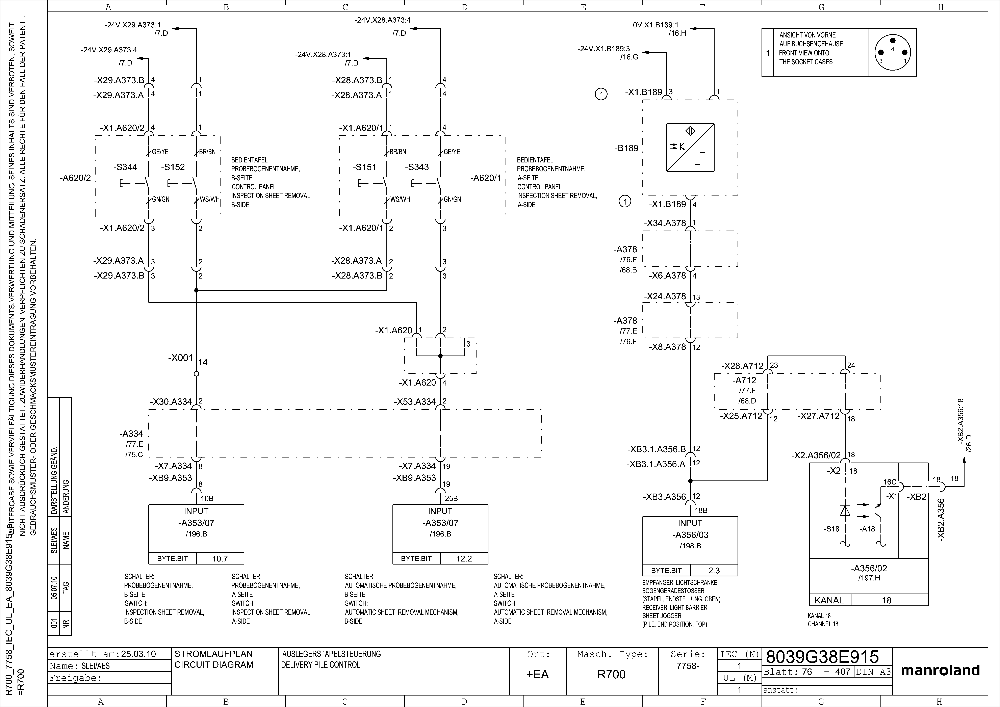

# +EA — Sheet 76 of 407 — AUSLEGERSTAPELSTEUERUNG

**DELIVERY PILE CONTROL**

> Part of the manroland **R700** printing press IEC/UL circuit diagrams.
> Drawing class: **Stromlaufplan / Circuit diagram** (DIN A3).
> Document `+EA` covers the **Printing unit** machine section.

## At a glance

| Field | Value |
|---|---|
| Document | `+EA`  (8039G38E915) |
| Sheet | **76** of 407 |
| Section (DE) | AUSLEGERSTAPELSTEUERUNG |
| Section (EN) | DELIVERY PILE CONTROL |
| Section type | CIRCUIT — Circuit diagram |
| Machine type | `R700` |
| Series | `7758` |
| Created | 25.03.10 |
| Replaces | — |
| Columns used | A, B, C, D, E, F, G, H |
| Path numbers | — |
| Labels on sheet | 219 |
| Cross-refs out | 19 |
| Cross-refs in | 69 |

**Previous:** [+EA sheet 75](SHEET_0075.md) · **Next:** [+EA sheet 77](SHEET_0077.md) · **Document TOC:** [_TOC.md](_TOC.md)  (+EA) · **Master TOC:** [all sheets](../_MASTER_TOC.md)

## Sheet image (300 DPI, exact vector render)



_Rendered directly from the PDF vector layer at 300 DPI (1-bit), no OCR and no resampling. Use it to confirm anything ambiguous in the text below._

## Cross-references on this sheet

Each entry is a wire leaving this sheet. The printed token is `/sheet.column`; the link resolves to that sheet inside the same document.

| Ref | Target sheet | Col | Path | Destination on target | Target section | From col |
|---|---|---|---|---|---|---|
| `/16.H` | [+EA sheet 16](SHEET_0016.md) | H | — | 0V.X1.B189:1 | SPANNUNGSVERSORGUNG: 400V, 24V | F |
| `/7.D` | [+EA sheet 7](SHEET_0007.md) | D | — | 24V.X29.A373:1 | SPANNUNGSVERSORGUNG: 400V, 24V | A |
| `/7.D` | [+EA sheet 7](SHEET_0007.md) | D | — | — | SPANNUNGSVERSORGUNG: 400V, 24V | C |
| `/16.G` | [+EA sheet 16](SHEET_0016.md) | G | — | 24V.X1.B189:3 | SPANNUNGSVERSORGUNG: 400V, 24V | E |
| `/7.D` | [+EA sheet 7](SHEET_0007.md) | D | — | 24V.X28.A373:1 | SPANNUNGSVERSORGUNG: 400V, 24V | B |
| `/7.D` | [+EA sheet 7](SHEET_0007.md) | D | — | 24V.X28.A373:1 | SPANNUNGSVERSORGUNG: 400V, 24V | B |
| `/76.F` | [+EA sheet 76](SHEET_0076.md) | F | — | — | AUSLEGERSTAPELSTEUERUNG | E |
| `/68.B` | [+EA sheet 68](SHEET_0068.md) | B | — | — | LEITSTANDSFUNKTIONEN | E |
| `/77.E` | [+EA sheet 77](SHEET_0077.md) | E | — | — | AUSLEGERSTAPELSTEUERUNG | E |
| `/76.F` | [+EA sheet 76](SHEET_0076.md) | F | — | — | AUSLEGERSTAPELSTEUERUNG | E |
| `/77.F` | [+EA sheet 77](SHEET_0077.md) | F | — | — | AUSLEGERSTAPELSTEUERUNG | F |
| `/68.D` | [+EA sheet 68](SHEET_0068.md) | D | — | — | LEITSTANDSFUNKTIONEN | F |
| `/26.D` | [+EA sheet 26](SHEET_0026.md) | D | — | XB2.A356:18 | BUSVERBINDUNGEN: SICHERHEITSBUS | H |
| `/77.E` | [+EA sheet 77](SHEET_0077.md) | E | — | — | AUSLEGERSTAPELSTEUERUNG | A |
| `/75.C` | [+EA sheet 75](SHEET_0075.md) | C | — | — | AUSLEGERSTAPELSTEUERUNG | A |
| `/196.B` | [+EA sheet 196](SHEET_0196.md) | B | — | — | REFERENZMODUL | B |
| `/196.B` | [+EA sheet 196](SHEET_0196.md) | B | — | — | REFERENZMODUL | D |
| `/198.B` | [+EA sheet 198](SHEET_0198.md) | B | — | — | REFERENZMODUL | F |
| `/197.H` | [+EA sheet 197](SHEET_0197.md) | H | — | — | REFERENZMODUL | G |

### Incoming references (sheets that point here)

Every other sheet that sends a wire to this one. `Back-ref` is the token printed on *that* sheet; `Path` is its line number.

| From sheet | Cols | Back-ref | Path | Refs | What continues there |
|---|---|---|---|---|---|
| [+EA#7](SHEET_0007.md) | D | `/7.D` | — | 4 | 24V.X28.A373:1; 24V.X28.A373:4; 24V.X29.A373:1; 24V.X29.A373:4 |
| [+EA#16](SHEET_0016.md) | G, H | `/16.G`, `/16.H` | — | 2 | 24V.X1.B189:3 |
| [+EA#26](SHEET_0026.md) | D | `/26.D` | — | 1 | XB2.A356:18 |
| [+EA#68](SHEET_0068.md) | B, D | `/68.B`, `/68.D` | — | 2 | — |
| [+EA#75](SHEET_0075.md) | C | `/75.C` | — | 1 | — |
| [+EA#76](SHEET_0076.md) | E | `/76.E` | — | 2 | — |
| [+EA#77](SHEET_0077.md) | E, F | `/77.E`, `/77.F` | — | 3 | A334; A378 |
| [+EA#196](SHEET_0196.md) | B | `/196.B` | — | 2 | — |
| [+EA#197](SHEET_0197.md) | H | `/197.H` | — | 1 | — |
| [+EA#198](SHEET_0198.md) | B | `/198.B` | — | 1 | — |
| [+EA#213](SHEET_0213.md) | E | `/213.E` | — | 12 | — |
| [+EA#216](SHEET_0216.md) | E | `/216.E` | — | 3 | — |
| [+EA#225](SHEET_0225.md) | G | `/225.G` | — | 1 | — |
| [+EA#226](SHEET_0226.md) | F | `/226.F` | — | 1 | — |
| [+EA#234](SHEET_0234.md) | H | `/234.H` | — | 1 | — |
| [+EA#235](SHEET_0235.md) | A, B | `/235.A`, `/235.B` | — | 2 | — |
| [+EA#245](SHEET_0245.md) | F | `/245.F` | — | 1 | — |
| [+EA#246](SHEET_0246.md) | F | `/246.F` | — | 2 | — |
| [+EA#250](SHEET_0250.md) | D | `/250.D` | — | 1 | — |
| [+EA#252](SHEET_0252.md) | C | `/252.C` | — | 2 | — |
| [+EA#266](SHEET_0266.md) | F | `/266.F` | — | 1 | — |
| [+EA#268](SHEET_0268.md) | F | `/268.F` | — | 1 | — |
| [+EA#271](SHEET_0271.md) | H | `/271.H` | — | 1 | — |
| [+EA#272](SHEET_0272.md) | F | `/272.F` | — | 8 | — |
| [+EA#273](SHEET_0273.md) | C | `/273.C` | — | 2 | — |
| [+EA#274](SHEET_0274.md) | A | `/274.A` | — | 8 | — |
| [+EA#275](SHEET_0275.md) | E | `/275.E` | — | 1 | — |
| [+EA#278](SHEET_0278.md) | B | `/278.B` | — | 1 | — |
| [+EA#282](SHEET_0282.md) | H | `/282.H` | — | 1 | — |


## Devices on this sheet

| Tag | Class | Class meaning (IEC) | Col | Sub | Terminal | Sign |
|---|---|---|---|---|---|---|
| `B189` | B | Umformer / transducer, sensor | E | — | — | — |
| `A356/03` | A | Baugruppe / assembly, module, PC board | F | 03 | — | — |
| `A378` | A | Baugruppe / assembly, module, PC board | E | — | — | — |
| `S18` | S | Schalter / switch | G | — | — | — |
| `A18` | A | Baugruppe / assembly, module, PC board | G | — | — | — |
| `X1` | X | Klemme / terminal, plug connector | H | — | — | — |
| `X2` | X | Klemme / terminal, plug connector | G | — | — | — |
| `XB2` | XB |  | H | — | — | — |
| `A356/02` | A | Baugruppe / assembly, module, PC board | G | 02 | — | — |
| `A378` | A | Baugruppe / assembly, module, PC board | E | — | — | — |
| `A712` | A | Baugruppe / assembly, module, PC board | F | — | — | — |
| `S344` | S | Schalter / switch | A | — | — | — |
| `S152` | S | Schalter / switch | B | — | — | — |
| `A620/2` | A | Baugruppe / assembly, module, PC board | A | 2 | — | — |
| `X001` | X | Klemme / terminal, plug connector | B | — | — | — |
| `A334` | A | Baugruppe / assembly, module, PC board | A | — | — | — |
| `A353/07` | A | Baugruppe / assembly, module, PC board | B | 07 | — | — |
| `S343` | S | Schalter / switch | D | — | — | — |
| `S151` | S | Schalter / switch | C | — | — | — |
| `A620/1` | A | Baugruppe / assembly, module, PC board | D | 1 | — | — |
| `A353/07` | A | Baugruppe / assembly, module, PC board | D | 07 | — | — |
| `X1.B189` | — | cross-device reference | F | — | — | — |
| `X1.B189` | — | cross-device reference | F | — | — | — |
| `2.3` | — | cross-device reference | F | — | — | — |
| `XB3.A356` | — | cross-device reference | F | — | — | — |
| `X34.A378` | — | cross-device reference | F | — | — | — |
| `XB2.A356` | — | cross-device reference | H | — | — | — |
| `XB3.1.A356.B` | — | cross-device reference | F | — | — | — |
| `XB3.1.A356.A` | — | cross-device reference | F | — | — | — |
| `X6.A378` | — | cross-device reference | F | — | — | — |
| `X24.A378` | — | cross-device reference | F | — | — | — |
| `X8.A378` | — | cross-device reference | F | — | — | — |
| `X28.A712` | — | cross-device reference | F | — | — | — |
| `X27.A712` | — | cross-device reference | G | — | — | — |
| `X25.A712` | — | cross-device reference | F | — | — | — |
| `X29.A373.B` | — | cross-device reference | A | — | — | — |
| `X29.A373.A` | — | cross-device reference | A | — | — | — |
| `X29.A373.B` | — | cross-device reference | A | — | — | — |
| `X29.A373.A` | — | cross-device reference | A | — | — | — |
| `X7.A334` | — | cross-device reference | B | — | — | — |
| `X30.A334` | — | cross-device reference | B | — | — | — |
| `10.7` | — | cross-device reference | B | — | — | — |
| `XB9.A353` | — | cross-device reference | B | — | — | — |
| `X28.A373.B` | — | cross-device reference | C | — | — | — |
| `X28.A373.A` | — | cross-device reference | C | — | — | — |
| `X28.A373.B` | — | cross-device reference | C | — | — | — |
| `X28.A373.A` | — | cross-device reference | C | — | — | — |
| `X1.A620` | — | cross-device reference | D | — | — | — |
| `X1.A620` | — | cross-device reference | C | — | — | — |
| `12.2` | — | cross-device reference | D | — | — | — |
| `XB9.A353` | — | cross-device reference | D | — | — | — |
| `X7.A334` | — | cross-device reference | D | — | — | — |
| `X53.A334` | — | cross-device reference | D | — | — | — |
| `NR.` | — | cross-device reference | A | — | — | — |
| `05.07.10` | — | cross-device reference | A | — | — | — |
| `XB2.A356:18` | — | cross-device reference | H | — | 18 | — |

## Potentials / nets

| Potential | Count | Columns | Attached devices | Terminals |
|---|---|---|---|---|
| `0V` | 1 | F | `B189`, `X1` | `1` |
| `24V` | 5 | A, C, E | `A373`, `B189`, `X1`, `X28`, `X29` | `1`, `3`, `4` |


A potential such as `L24+/4` or `M24+` is a named supply/return rail; every place it appears on this sheet is electrically common.

## Wire-end annotations (grouped as printed)

A wire that continues elsewhere is annotated with a small cluster: the destination description, the path/line number `#NN`, and the `/sheet.column` cross reference. Each row below is one such cluster exactly as it is grouped on the drawing.

| Col | Y | Path | Cross-ref | Text on the wire |
|---|---|---|---|---|
| C | 20.1 | — | — | `24V.X28.A373:4` |
| A | 25.8 | — | `/7.D` | `24V.X29.A373:1` |
| F | 25.8 | — | `/16.H` | `0V.X1.B189:1` |
| C | 35.7 | — | `/7.D` | — |
| G | 38.9 | — | — | `FRONT VIEW ONTO ANSICHT VON VORNE AUF BUCHSENGEHÄUSE` |
| E | 54.1 | — | `/16.G` | `24V.X1.B189:3` |
| A | 55.5 | — | — | `24V.X29.A373:4` |
| H | 55.5 | — | — | `4` |
| G | 58.4 | — | — | `1 THE SOCKET CASES` |
| B | 61.2 | — | `/7.D`, `/7.D` | `24V.X28.A373:1` |
| H | 69.6 | — | — | `3 1` |
| A | 91.0 | — | — | `X29.A373.B 4` |
| B | 91.0 | — | — | `1` |
| C | 91.0 | — | — | `X28.A373.B 1` |
| D | 91.0 | — | — | `4` |
| F | 105.2 | — | — | `X1.B189 3 1` |
| A | 108.0 | — | — | `X29.A373.A 4` |
| B | 108.0 | — | — | `1` |
| C | 108.0 | — | — | `X28.A373.A 1` |
| D | 108.0 | — | — | `4` |
| E | 108.9 | — | — | `1` |
| A | 147.7 | — | — | `X1.A620/2 4` |
| B | 147.7 | — | — | `1` |
| C | 147.7 | — | — | `X1.A620/1 1` |
| D | 147.7 | — | — | `4` |
| E | 171.8 | — | — | `B189` |
| C | 177.7 | — | — | `GE/YE BR/BN BR/BN GE/YE` |
| B | 187.7 | — | — | `BEDIENTAFEL PROBEBOGENENTNAHME, B SEITE` |
| E | 187.7 | — | — | `BEDIENTAFEL PROBEBOGENENTNAHME,` |
| A | 194.5 | — | — | `A620/2 S344 S152` |
| C | 194.5 | — | — | `S151 S343` |
| D | 207.2 | — | — | `A620/1` |
| E | 208.9 | — | — | `INSPECTION SHEET REMOVAL, CONTROL PANEL A SEITE` |
| B | 219.6 | — | — | `INSPECTION SHEET REMOVAL, B SIDE CONTROL PANEL` |
| B | 234.3 | — | — | `GN/GN WS/WH` |
| D | 234.3 | — | — | `WS/WH GN/GN` |
| E | 236.5 | — | — | `1` |
| F | 238.4 | — | — | `X1.B189 4` |
| E | 240.8 | — | — | `A SIDE` |
| F | 261.1 | — | — | `X34.A378 1` |
| A | 266.8 | — | — | `X1.A620/2 3` |
| C | 266.8 | — | — | `X1.A620/1 2` |
| B | 268.2 | — | — | `2` |
| D | 268.2 | — | — | `3` |
| E | 292.3 | — | — | `A378` |
| E | 305.3 | — | `/76.F`, `/68.B` | — |
| A | 305.8 | — | — | `X29.A373.A 3` |
| C | 305.8 | — | — | `X28.A373.A 2` |
| B | 307.9 | — | — | `2` |
| D | 307.9 | — | — | `3` |
| A | 323.5 | — | — | `X29.A373.B 3` |
| C | 323.5 | — | — | `X28.A373.B 2` |
| F | 323.5 | — | — | `X6.A378 4` |
| B | 324.9 | — | — | `2` |
| D | 324.9 | — | — | `3` |
| F | 348.3 | — | — | `X24.A378 13` |
| E | 377.3 | — | — | `A378` |
| D | 388.7 | — | — | `X1.A620 1 2` |
| E | 390.4 | — | `/77.E`, `/76.F` | — |
| D | 405.7 | — | — | `3` |
| F | 408.5 | — | — | `X8.A378 12` |
| B | 421.0 | — | — | `X001 14` |
| G | 431.2 | — | — | `X28.A712 23 24` |
| F | 448.2 | — | — | `A712` |
| D | 451.0 | — | — | `X1.A620 4` |
| F | 461.2 | — | `/77.F`, `/68.D` | — |
| B | 473.7 | — | — | `X30.A334 2` |
| D | 473.7 | — | — | `X53.A334 2` |
| H | 474.2 | — | `/26.D` | `XB2.A356:18` |
| G | 490.7 | — | — | `X25.A712 12 X27.A712 18` |
| A | 512.0 | — | — | `A334` |
| A | 525.0 | — | `/77.E`, `/75.C` | — |
| F | 530.4 | — | — | `XB3.1.A356.B 12` |
| A | 531.8 | — | — | `001 DARSTELLUNG GEÄND. SLEI/AES 05.07.10` |
| G | 537.5 | — | — | `X2.A356/02 18` |
| F | 547.4 | — | — | `XB3.1.A356.A 12` |
| B | 550.2 | — | — | `X7.A334 8` |
| D | 550.2 | — | — | `X7.A334 19` |
| G | 555.9 | — | — | `X2` |
| H | 557.3 | — | — | `18 18` |
| B | 564.4 | — | — | `XB9.A353 8` |
| D | 564.4 | — | — | `XB9.A353 19` |
| H | 565.8 | — | — | `18` |
| H | 570.1 | — | — | `16C` |
| A | 571.4 | — | — | `NR. NAME TAG ÄNDERUNG` |
| F | 587.1 | — | — | `XB3.A356 12` |
| H | 587.1 | — | — | `X1` |
| H | 587.1 | — | — | `XB2` |
| B | 589.9 | — | — | `10B` |
| D | 589.9 | — | — | `25B` |
| H | 593.3 | — | — | `XB2.A356` |
| F | 604.1 | — | — | `18B` |
| B | 604.4 | — | — | `INPUT` |
| D | 604.4 | — | — | `INPUT` |
| B | 618.3 | — | — | `A353/07` |
| D | 618.3 | — | — | `A353/07` |
| F | 618.6 | — | — | `INPUT` |
| G | 626.0 | — | — | `S18 A18` |
| B | 632.0 | — | `/196.B` | — |
| D | 632.0 | — | `/196.B` | — |
| F | 632.4 | — | — | `A356/03` |
| F | 646.2 | — | `/198.B` | — |
| B | 661.1 | — | — | `BYTE.BIT 10.7` |
| D | 661.1 | — | — | `BYTE.BIT 12.2` |
| G | 672.1 | — | — | `A356/02` |
| F | 675.3 | — | — | `BYTE.BIT 2.3` |
| A | 683.8 | — | — | `PROBEBOGENENTNAHME, B SEITE SCHALTER:` |
| B | 683.8 | — | — | `PROBEBOGENENTNAHME, SCHALTER:` |
| C | 683.8 | — | — | `B SEITE SCHALTER: AUTOMATISCHE PROBEBOGENENTNAHME,` |
| E | 683.8 | — | — | `SCHALTER: SWITCH: AUTOMATISCHE PROBEBOGENENTNAHME, A SEITE AUTOMATIC SHEET REMOVAL MECHANISM, A SIDE` |
| G | 684.5 | — | `/197.H` | — |
| F | 691.0 | — | — | `EMPFÄNGER, LICHTSCHRANKE: BOGENGERADESTOSSER (STAPEL, ENDSTELLUNG, OBEN) RECEIVER, LIGHT BARRIER: (PILE, END POSITION, TOP) SHEET JOGGER` |
| B | 705.0 | — | — | `INSPECTION SHEET REMOVAL, SWITCH: A SEITE` |
| G | 710.4 | — | — | `KANAL 18` |
| A | 715.6 | — | — | `INSPECTION SHEET REMOVAL, B SIDE SWITCH:` |
| C | 715.6 | — | — | `B SIDE SWITCH: AUTOMATIC SHEET REMOVAL MECHANISM,` |
| G | 730.7 | — | — | `KANAL 18 CHANNEL 18` |
| B | 736.9 | — | — | `A SIDE` |


## Reconstructed tables

This sheet carries tabular content (pin map / terminal assignment / index). The grid below was rebuilt from the drawing's own rule lines, so each row is exactly one physical row of the table.

### Table 1 — 2 data rows × 2 columns (at x=177.2, y=345.8)

| X001 X30.A334 X7.A334 XB9.A353 | 14 2 8 8 10B |
|---|---|
| `INPUT` | `A353/07 /196.B` |
| `BYTE.BIT` | `10.7` |


### Table 2 — 2 data rows × 3 columns (at x=467.7, y=345.8)

| X1.A620 X53.A334 XB9.A353 | 1 X1.A620 X7.A334 | 2 3 4 2 19 19 25B |
|---|---|---|
|  | `INPUT` | `A353/07 /196.B` |
| `BYTE.BIT` |  | `12.2` |


### Table 3 — 7 data rows × 3 columns (at x=765.4, y=147.4)

| X34.A378 X24.A378 | X1.B189 X6.A378 X8.A378 | 4 1 4 13 12 |
|---|---|---|
| `XB3.1.A356.B` |  | `12` |
| `XB3.1.A356.A` |  | `12` |
| `XB3.A356` |  | `12 18B` |
|  | `INPUT` | `A356/03 /198.B` |
| `BYTE.BIT` |  | `2.3` |
| `EMPFÄNGER,` | `BOGENGERADESTOSSER` | `LICHTSCHRANKE:` |
| `(STAPEL,` | `ENDSTELLUNG,` | `OBEN)` |


### Table 4 — 6 data rows × 7 columns (at x=878.7, y=147.4)

| X28.A712 A712 /77.F /68.D X25.A712 | 23 12 | X27.A712 X2.A356/02 | 24 18 18 |  |  | XB2.A356:18 |
|---|---|---|---|---|---|---|
|  |  | `X2` | `18` |  |  | `18 18` |
|  |  |  |  | `16C X1` | `XB2` |  |
|  |  | `S18` | `A18` |  |  | `XB2.A356` |
|  |  |  | `A356/02` |  |  |  |
|  |  |  | `/197.H` |  |  |  |
|  |  | `KANAL` |  | `18` |  |  |


## Notes and free text on this sheet

| Text | Col | Y (pt) |
|---|---|---|
| `18B` | F | 604.07 |
| `INPUT` | F | 618.59 |
| `BYTE.BIT` | F | 675.84 |
| `EMPFÄNGER, LICHTSCHRANKE:` | F | 691.02 |
| `BOGENGERADESTOSSER` | F | 700.96 |
| `(STAPEL, ENDSTELLUNG, OBEN)` | F | 710.9 |
| `RECEIVER, LIGHT BARRIER:` | F | 720.87 |
| `SHEET JOGGER` | F | 730.78 |
| `(PILE, END POSITION, TOP)` | F | 740.75 |
| `KANAL 18` | G | 730.71 |
| `CHANNEL 18` | G | 740.65 |
| `16C` | H | 570.09 |
| `KANAL` | G | 710.38 |
| `X2.A356/02` | G | 537.47 |
| `X1.A620/2` | A | 147.72 |
| `BEDIENTAFEL` | B | 187.69 |
| `PROBEBOGENENTNAHME,` | B | 198.34 |
| `B SEITE` | B | 208.91 |
| `CONTROL PANEL` | B | 219.63 |
| `INSPECTION SHEET REMOVAL,` | B | 230.23 |
| `B SIDE` | B | 240.82 |
| `10B` | B | 589.89 |
| `INPUT` | B | 604.42 |
| `BYTE.BIT` | B | 661.67 |
| `SCHALTER:` | A | 683.76 |
| `PROBEBOGENENTNAHME,` | A | 694.41 |
| `B SEITE` | A | 704.97 |
| `SWITCH:` | A | 715.59 |
| `INSPECTION SHEET REMOVAL,` | A | 726.3 |
| `B SIDE` | A | 736.88 |
| `X1.A620/1` | C | 147.72 |
| `BEDIENTAFEL` | E | 187.69 |
| `PROBEBOGENENTNAHME,` | E | 198.34 |
| `A SEITE` | E | 208.94 |
| `CONTROL PANEL` | E | 219.63 |
| `INSPECTION SHEET REMOVAL,` | E | 230.23 |
| `A SIDE` | E | 240.85 |
| `25B` | D | 589.89 |
| `INPUT` | D | 604.42 |
| `BYTE.BIT` | D | 661.67 |
| `SCHALTER:` | C | 683.76 |
| `AUTOMATISCHE PROBEBOGENENTNAHME,` | C | 694.42 |
| `B SEITE` | C | 704.97 |
| `SWITCH:` | C | 715.59 |
| `AUTOMATIC SHEET REMOVAL MECHANISM,` | C | 726.32 |
| `B SIDE` | C | 736.88 |
| `TAG` | A | 692.75 |
| `NAME` | A | 633.34 |
| `ÄNDERUNG` | A | 571.36 |
| `SLEI/AES` | A | 627.9 |
| `DARSTELLUNG GEÄND.` | A | 531.75 |
| `ANSICHT VON VORNE` | G | 38.9 |
| `AUF BUCHSENGEHÄUSE` | G | 49.53 |
| `FRONT VIEW ONTO` | G | 60.13 |
| `THE SOCKET CASES` | G | 70.78 |
| `GN/GN` | A | 234.47 |
| `WS/WH` | B | 234.32 |
| `BR/BN` | B | 177.72 |
| `GE/YE` | A | 177.73 |
| `BR/BN` | C | 177.72 |
| `GE/YE` | D | 177.73 |
| `GN/GN` | D | 234.47 |
| `WS/WH` | C | 234.32 |
| `SCHALTER:` | B | 683.76 |
| `A SEITE` | B | 705 |
| `SWITCH:` | B | 715.59 |
| `A SIDE` | B | 736.91 |
| `SCHALTER:` | D | 683.76 |
| `AUTOMATISCHE PROBEBOGENENTNAHME,` | E | 694.42 |
| `A SEITE` | D | 705 |
| `SWITCH:` | D | 715.59 |
| `AUTOMATIC SHEET REMOVAL MECHANISM,` | E | 726.32 |
| `A SIDE` | D | 736.91 |

## Complete label inventory (exact text from the drawing)

Every text object inside the drawing area of this sheet, in DIN reading order (column A→H, then top→bottom). This is the authoritative list: if a string is not here it is not printed on this sheet.

| Col | Y | X | Dir | Type | Text |
|---|---|---|---|---|---|
| A | 25.8 | 124.7 | → | potential | `24V.X29.A373:1` |
| A | 35.7 | 184.0 | → | cross-reference | `/7.D` |
| A | 55.6 | 96.4 | → | potential | `24V.X29.A373:4` |
| A | 71.1 | 141.4 | → | cross-reference | `/7.D` |
| A | 91.0 | 112.0 | → | device ref | `X29.A373.B` |
| A | 91.0 | 179.7 | → | number | `4` |
| A | 108.0 | 179.7 | → | number | `4` |
| A | 108.7 | 111.1 | → | device ref | `X29.A373.A` |
| A | 147.7 | 119.1 | → | text | `X1.A620/2` |
| A | 147.7 | 179.7 | → | number | `4` |
| A | 177.7 | 181.1 | → | text | `GE/YE` |
| A | 194.5 | 135.2 | → | device tag | `S344` |
| A | 207.2 | 71.1 | → | device tag | `A620/2` |
| A | 234.5 | 181.1 | → | text | `GN/GN` |
| A | 266.8 | 119.1 | → | text | `X1.A620/2` |
| A | 268.2 | 179.7 | → | number | `3` |
| A | 305.7 | 111.1 | → | device ref | `X29.A373.A` |
| A | 307.9 | 179.7 | → | number | `3` |
| A | 323.5 | 112.0 | → | device ref | `X29.A373.B` |
| A | 324.9 | 179.7 | → | number | `3` |
| A | 512.0 | 142.3 | → | device tag | `A334` |
| A | 525.0 | 150.0 | → | cross-reference | `/77.E` |
| A | 531.8 | 61.3 | ↕ | text | `DARSTELLUNG GEÄND.` |
| A | 537.4 | 149.4 | → | cross-reference | `/75.C` |
| A | 571.4 | 75.5 | ↕ | text | `ÄNDERUNG` |
| A | 627.9 | 61.3 | ↕ | text | `SLEI/AES` |
| A | 633.3 | 75.4 | ↕ | text | `NAME` |
| A | 683.8 | 148.5 | → | text | `SCHALTER:` |
| A | 686.6 | 61.3 | ↕ | device ref | `05.07.10` |
| A | 692.7 | 75.5 | ↕ | text | `TAG` |
| A | 694.4 | 148.0 | → | text | `PROBEBOGENENTNAHME,` |
| A | 705.0 | 148.0 | → | text | `B SEITE` |
| A | 715.6 | 148.5 | → | text | `SWITCH:` |
| A | 726.3 | 148.0 | → | text | `INSPECTION SHEET REMOVAL,` |
| A | 735.8 | 61.2 | ↕ | number | `001` |
| A | 736.2 | 75.3 | ↕ | device ref | `NR.` |
| A | 736.9 | 148.0 | → | text | `B SIDE` |
| B | 91.0 | 235.8 | → | number | `1` |
| B | 108.0 | 235.8 | → | number | `1` |
| B | 147.7 | 235.8 | → | number | `1` |
| B | 177.7 | 237.3 | → | text | `BR/BN` |
| B | 187.7 | 275.5 | → | text | `BEDIENTAFEL` |
| B | 194.5 | 191.9 | → | device tag | `S152` |
| B | 198.3 | 275.5 | → | text | `PROBEBOGENENTNAHME,` |
| B | 208.9 | 275.5 | → | text | `B SEITE` |
| B | 219.6 | 276.1 | → | text | `CONTROL PANEL` |
| B | 230.2 | 275.5 | → | text | `INSPECTION SHEET REMOVAL,` |
| B | 234.3 | 238.1 | → | text | `WS/WH` |
| B | 240.8 | 275.5 | → | text | `B SIDE` |
| B | 268.2 | 236.4 | → | number | `2` |
| B | 307.9 | 236.4 | → | number | `2` |
| B | 324.9 | 236.4 | → | number | `2` |
| B | 421.0 | 200.4 | → | device tag | `X001` |
| B | 426.9 | 235.6 | → | number | `14` |
| B | 473.7 | 178.6 | → | device ref | `X30.A334` |
| B | 473.7 | 236.4 | → | number | `2` |
| B | 550.2 | 184.5 | → | device ref | `X7.A334` |
| B | 551.7 | 236.4 | → | number | `8` |
| B | 564.4 | 177.4 | → | device ref | `XB9.A353` |
| B | 572.9 | 236.4 | → | number | `8` |
| B | 589.9 | 238.7 | → | text | `10B` |
| B | 604.4 | 219.0 | → | text | `INPUT` |
| B | 618.3 | 212.5 | → | device tag | `A353/07` |
| B | 632.0 | 221.2 | → | cross-reference | `/196.B` |
| B | 661.1 | 252.4 | → | device ref | `10.7` |
| B | 661.7 | 187.1 | → | text | `BYTE.BIT` |
| B | 683.8 | 276.1 | → | text | `SCHALTER:` |
| B | 694.4 | 275.5 | → | text | `PROBEBOGENENTNAHME,` |
| B | 705.0 | 276.4 | → | text | `A SEITE` |
| B | 715.6 | 276.1 | → | text | `SWITCH:` |
| B | 726.3 | 275.5 | → | text | `INSPECTION SHEET REMOVAL,` |
| B | 736.9 | 276.4 | → | text | `A SIDE` |
| C | 20.1 | 422.4 | → | potential | `24V.X28.A373:4` |
| C | 35.7 | 467.4 | → | cross-reference | `/7.D` |
| C | 61.2 | 351.5 | → | potential | `24V.X28.A373:1` |
| C | 71.1 | 410.7 | → | cross-reference | `/7.D` |
| C | 91.0 | 395.4 | → | device ref | `X28.A373.B` |
| C | 91.0 | 462.6 | → | number | `1` |
| C | 108.0 | 462.6 | → | number | `1` |
| C | 108.7 | 394.6 | → | device ref | `X28.A373.A` |
| C | 147.7 | 403.9 | → | text | `X1.A620/1` |
| C | 147.7 | 462.6 | → | number | `1` |
| C | 177.7 | 464.0 | → | text | `BR/BN` |
| C | 194.5 | 420.1 | → | device tag | `S151` |
| C | 234.3 | 464.9 | → | text | `WS/WH` |
| C | 266.8 | 403.9 | → | text | `X1.A620/1` |
| C | 268.2 | 463.2 | → | number | `2` |
| C | 305.7 | 394.6 | → | device ref | `X28.A373.A` |
| C | 307.9 | 463.2 | → | number | `2` |
| C | 323.5 | 395.4 | → | device ref | `X28.A373.B` |
| C | 324.9 | 463.2 | → | number | `2` |
| C | 388.7 | 446.7 | → | device ref | `X1.A620` |
| C | 683.8 | 410.7 | → | text | `SCHALTER:` |
| C | 694.4 | 411.0 | → | text | `AUTOMATISCHE PROBEBOGENENTNAHME,` |
| C | 705.0 | 410.2 | → | text | `B SEITE` |
| C | 715.6 | 410.7 | → | text | `SWITCH:` |
| C | 726.3 | 411.0 | → | text | `AUTOMATIC SHEET REMOVAL MECHANISM,` |
| C | 736.9 | 410.2 | → | text | `B SIDE` |
| D | 91.0 | 527.0 | → | number | `4` |
| D | 108.0 | 527.0 | → | number | `4` |
| D | 147.7 | 527.0 | → | number | `4` |
| D | 177.7 | 528.4 | → | text | `GE/YE` |
| D | 194.5 | 482.5 | → | device tag | `S343` |
| D | 207.2 | 560.1 | → | device tag | `A620/1` |
| D | 234.5 | 528.4 | → | text | `GN/GN` |
| D | 268.2 | 527.0 | → | number | `3` |
| D | 307.9 | 527.0 | → | number | `3` |
| D | 324.9 | 527.0 | → | number | `3` |
| D | 388.7 | 498.0 | → | number | `1` |
| D | 388.7 | 527.0 | → | number | `2` |
| D | 405.7 | 555.3 | → | number | `3` |
| D | 451.0 | 475.1 | → | device ref | `X1.A620` |
| D | 452.5 | 527.0 | → | number | `4` |
| D | 473.7 | 469.1 | → | device ref | `X53.A334` |
| D | 473.7 | 527.0 | → | number | `2` |
| D | 550.2 | 475.1 | → | device ref | `X7.A334` |
| D | 551.7 | 526.4 | → | number | `19` |
| D | 564.4 | 468.0 | → | device ref | `XB9.A353` |
| D | 572.9 | 526.4 | → | number | `19` |
| D | 589.9 | 529.8 | → | text | `25B` |
| D | 604.4 | 509.5 | → | text | `INPUT` |
| D | 618.3 | 503.0 | → | device tag | `A353/07` |
| D | 632.0 | 511.8 | → | cross-reference | `/196.B` |
| D | 661.1 | 543.0 | → | device ref | `12.2` |
| D | 661.7 | 477.6 | → | text | `BYTE.BIT` |
| D | 683.8 | 587.9 | → | text | `SCHALTER:` |
| D | 705.0 | 588.2 | → | text | `A SEITE` |
| D | 715.6 | 587.9 | → | text | `SWITCH:` |
| D | 736.9 | 588.2 | → | text | `A SIDE` |
| E | 54.1 | 688.0 | → | potential | `24V.X1.B189:3` |
| E | 64.0 | 738.7 | → | cross-reference | `/16.G` |
| E | 108.9 | 714.0 | → | number | `1` |
| E | 171.8 | 731.9 | → | device tag | `B189` |
| E | 187.7 | 615.7 | → | text | `BEDIENTAFEL` |
| E | 198.3 | 615.7 | → | text | `PROBEBOGENENTNAHME,` |
| E | 208.9 | 616.5 | → | text | `A SEITE` |
| E | 219.6 | 616.3 | → | text | `CONTROL PANEL` |
| E | 230.2 | 615.7 | → | text | `INSPECTION SHEET REMOVAL,` |
| E | 236.5 | 742.3 | → | number | `1` |
| E | 240.9 | 616.5 | → | text | `A SIDE` |
| E | 292.3 | 730.5 | → | device tag | `A378` |
| E | 305.3 | 738.4 | → | cross-reference | `/76.F` |
| E | 317.7 | 737.9 | → | cross-reference | `/68.B` |
| E | 377.3 | 730.5 | → | device tag | `A378` |
| E | 390.4 | 738.1 | → | cross-reference | `/77.E` |
| E | 402.8 | 738.4 | → | cross-reference | `/76.F` |
| E | 694.4 | 588.2 | → | text | `AUTOMATISCHE PROBEBOGENENTNAHME,` |
| E | 726.3 | 588.2 | → | text | `AUTOMATIC SHEET REMOVAL MECHANISM,` |
| F | 25.8 | 753.7 | → | potential | `0V.X1.B189:1` |
| F | 35.7 | 796.3 | → | cross-reference | `/16.H` |
| F | 105.2 | 744.4 | → | device ref | `X1.B189` |
| F | 105.2 | 796.3 | → | number | `3` |
| F | 105.2 | 852.4 | → | number | `1` |
| F | 238.4 | 772.7 | → | device ref | `X1.B189` |
| F | 239.9 | 824.6 | → | number | `4` |
| F | 261.1 | 766.8 | → | device ref | `X34.A378` |
| F | 261.1 | 824.0 | → | number | `1` |
| F | 323.5 | 772.7 | → | device ref | `X6.A378` |
| F | 324.9 | 824.6 | → | number | `4` |
| F | 348.3 | 766.8 | → | device ref | `X24.A378` |
| F | 350.4 | 824.0 | → | number | `13` |
| F | 408.5 | 772.7 | → | device ref | `X8.A378` |
| F | 409.9 | 824.0 | → | number | `12` |
| F | 431.2 | 858.9 | → | device ref | `X28.A712` |
| F | 448.2 | 872.2 | → | device tag | `A712` |
| F | 461.2 | 880.2 | → | cross-reference | `/77.F` |
| F | 473.7 | 879.3 | → | cross-reference | `/68.D` |
| F | 490.7 | 857.5 | → | device ref | `X25.A712` |
| F | 530.4 | 746.9 | → | device ref | `XB3.1.A356.B` |
| F | 530.4 | 824.0 | → | number | `12` |
| F | 547.4 | 824.0 | → | number | `12` |
| F | 548.1 | 746.1 | → | device ref | `XB3.1.A356.A` |
| F | 587.1 | 765.6 | → | device ref | `XB3.A356` |
| F | 587.1 | 824.0 | → | number | `12` |
| F | 604.1 | 826.9 | → | text | `18B` |
| F | 618.6 | 807.2 | → | text | `INPUT` |
| F | 632.4 | 800.6 | → | device tag | `A356/03` |
| F | 646.2 | 809.4 | → | cross-reference | `/198.B` |
| F | 675.3 | 843.6 | → | device ref | `2.3` |
| F | 675.8 | 775.3 | → | text | `BYTE.BIT` |
| F | 691.0 | 764.8 | → | text | `EMPFÄNGER, LICHTSCHRANKE:` |
| F | 701.0 | 764.8 | → | text | `BOGENGERADESTOSSER` |
| F | 710.9 | 764.8 | → | text | `(STAPEL, ENDSTELLUNG, OBEN)` |
| F | 720.9 | 764.8 | → | text | `RECEIVER, LIGHT BARRIER:` |
| F | 730.8 | 765.1 | → | text | `SHEET JOGGER` |
| F | 740.7 | 764.8 | → | text | `(PILE, END POSITION, TOP)` |
| G | 38.9 | 928.3 | → | text | `ANSICHT VON VORNE` |
| G | 49.5 | 928.3 | → | text | `AUF BUCHSENGEHÄUSE` |
| G | 58.4 | 911.6 | → | number | `1` |
| G | 60.1 | 927.5 | → | text | `FRONT VIEW ONTO` |
| G | 69.6 | 1046.8 | → | number | `3` |
| G | 70.8 | 928.1 | → | text | `THE SOCKET CASES` |
| G | 431.2 | 916.7 | → | number | `23` |
| G | 431.2 | 1008.9 | → | number | `24` |
| G | 490.7 | 949.6 | → | device ref | `X27.A712` |
| G | 495.0 | 916.2 | → | number | `12` |
| G | 495.0 | 1008.3 | → | number | `18` |
| G | 537.5 | 942.2 | → | text | `X2.A356/02` |
| G | 537.5 | 1008.3 | → | number | `18` |
| G | 555.9 | 984.8 | → | device tag | `X2` |
| G | 557.3 | 1011.1 | → | number | `18` |
| G | 626.1 | 981.1 | → | device tag | `S18` |
| G | 626.1 | 1023.6 | → | device tag | `A18` |
| G | 672.1 | 1013.2 | → | device tag | `A356/02` |
| G | 684.5 | 1022.2 | → | cross-reference | `/197.H` |
| G | 710.4 | 970.0 | → | text | `KANAL` |
| G | 730.7 | 961.8 | → | text | `KANAL 18` |
| G | 740.6 | 962.1 | → | text | `CHANNEL 18` |
| H | 55.5 | 1061.0 | → | number | `4` |
| H | 69.6 | 1075.6 | → | number | `1` |
| H | 474.2 | 1139.8 | ↕ | device ref | `XB2.A356:18` |
| H | 517.6 | 1149.7 | ↕ | cross-reference | `/26.D` |
| H | 565.8 | 1131.6 | → | number | `18` |
| H | 567.3 | 1110.3 | → | number | `18` |
| H | 570.1 | 1051.7 | → | text | `16C` |
| H | 587.1 | 1055.3 | → | device tag | `X1` |
| H | 587.1 | 1079.7 | → | device tag | `XB2` |
| H | 593.3 | 1115.7 | ↕ | device ref | `XB2.A356` |
| H | 710.3 | 1049.7 | → | number | `18` |

## Reading-order text block

The same content as a plain block, grouped by DIN column — convenient to paste or to match against a visual description.

```text
=== Column A ===
  25.8  124.7  net          24V.X29.A373:1
  35.7  184.0  xref         /7.D
  55.6   96.4  net          24V.X29.A373:4
  71.1  141.4  xref         /7.D
  91.0  112.0  devref       X29.A373.B
  91.0  179.7  numeric      4
 108.0  179.7  numeric      4
 108.7  111.1  devref       X29.A373.A
 147.7  119.1  text         X1.A620/2
 147.7  179.7  numeric      4
 177.7  181.1  text         GE/YE
 194.5  135.2  devtag       S344
 207.2   71.1  devtag       A620/2
 234.5  181.1  text         GN/GN
 266.8  119.1  text         X1.A620/2
 268.2  179.7  numeric      3
 305.7  111.1  devref       X29.A373.A
 307.9  179.7  numeric      3
 323.5  112.0  devref       X29.A373.B
 324.9  179.7  numeric      3
 512.0  142.3  devtag       A334
 525.0  150.0  xref         /77.E
 531.8   61.3  text         DARSTELLUNG GEÄND.
 537.4  149.4  xref         /75.C
 571.4   75.5  text         ÄNDERUNG
 627.9   61.3  text         SLEI/AES
 633.3   75.4  text         NAME
 683.8  148.5  text         SCHALTER:
 686.6   61.3  devref       05.07.10
 692.7   75.5  text         TAG
 694.4  148.0  text         PROBEBOGENENTNAHME,
 705.0  148.0  text         B SEITE
 715.6  148.5  text         SWITCH:
 726.3  148.0  text         INSPECTION SHEET REMOVAL,
 735.8   61.2  numeric      001
 736.2   75.3  devref       NR.
 736.9  148.0  text         B SIDE
=== Column B ===
  91.0  235.8  numeric      1
 108.0  235.8  numeric      1
 147.7  235.8  numeric      1
 177.7  237.3  text         BR/BN
 187.7  275.5  text         BEDIENTAFEL
 194.5  191.9  devtag       S152
 198.3  275.5  text         PROBEBOGENENTNAHME,
 208.9  275.5  text         B SEITE
 219.6  276.1  text         CONTROL PANEL
 230.2  275.5  text         INSPECTION SHEET REMOVAL,
 234.3  238.1  text         WS/WH
 240.8  275.5  text         B SIDE
 268.2  236.4  numeric      2
 307.9  236.4  numeric      2
 324.9  236.4  numeric      2
 421.0  200.4  devtag       X001
 426.9  235.6  numeric      14
 473.7  178.6  devref       X30.A334
 473.7  236.4  numeric      2
 550.2  184.5  devref       X7.A334
 551.7  236.4  numeric      8
 564.4  177.4  devref       XB9.A353
 572.9  236.4  numeric      8
 589.9  238.7  text         10B
 604.4  219.0  text         INPUT
 618.3  212.5  devtag       A353/07
 632.0  221.2  xref         /196.B
 661.1  252.4  devref       10.7
 661.7  187.1  text         BYTE.BIT
 683.8  276.1  text         SCHALTER:
 694.4  275.5  text         PROBEBOGENENTNAHME,
 705.0  276.4  text         A SEITE
 715.6  276.1  text         SWITCH:
 726.3  275.5  text         INSPECTION SHEET REMOVAL,
 736.9  276.4  text         A SIDE
=== Column C ===
  20.1  422.4  net          24V.X28.A373:4
  35.7  467.4  xref         /7.D
  61.2  351.5  net          24V.X28.A373:1
  71.1  410.7  xref         /7.D
  91.0  395.4  devref       X28.A373.B
  91.0  462.6  numeric      1
 108.0  462.6  numeric      1
 108.7  394.6  devref       X28.A373.A
 147.7  403.9  text         X1.A620/1
 147.7  462.6  numeric      1
 177.7  464.0  text         BR/BN
 194.5  420.1  devtag       S151
 234.3  464.9  text         WS/WH
 266.8  403.9  text         X1.A620/1
 268.2  463.2  numeric      2
 305.7  394.6  devref       X28.A373.A
 307.9  463.2  numeric      2
 323.5  395.4  devref       X28.A373.B
 324.9  463.2  numeric      2
 388.7  446.7  devref       X1.A620
 683.8  410.7  text         SCHALTER:
 694.4  411.0  text         AUTOMATISCHE PROBEBOGENENTNAHME,
 705.0  410.2  text         B SEITE
 715.6  410.7  text         SWITCH:
 726.3  411.0  text         AUTOMATIC SHEET REMOVAL MECHANISM,
 736.9  410.2  text         B SIDE
=== Column D ===
  91.0  527.0  numeric      4
 108.0  527.0  numeric      4
 147.7  527.0  numeric      4
 177.7  528.4  text         GE/YE
 194.5  482.5  devtag       S343
 207.2  560.1  devtag       A620/1
 234.5  528.4  text         GN/GN
 268.2  527.0  numeric      3
 307.9  527.0  numeric      3
 324.9  527.0  numeric      3
 388.7  498.0  numeric      1
 388.7  527.0  numeric      2
 405.7  555.3  numeric      3
 451.0  475.1  devref       X1.A620
 452.5  527.0  numeric      4
 473.7  469.1  devref       X53.A334
 473.7  527.0  numeric      2
 550.2  475.1  devref       X7.A334
 551.7  526.4  numeric      19
 564.4  468.0  devref       XB9.A353
 572.9  526.4  numeric      19
 589.9  529.8  text         25B
 604.4  509.5  text         INPUT
 618.3  503.0  devtag       A353/07
 632.0  511.8  xref         /196.B
 661.1  543.0  devref       12.2
 661.7  477.6  text         BYTE.BIT
 683.8  587.9  text         SCHALTER:
 705.0  588.2  text         A SEITE
 715.6  587.9  text         SWITCH:
 736.9  588.2  text         A SIDE
=== Column E ===
  54.1  688.0  net          24V.X1.B189:3
  64.0  738.7  xref         /16.G
 108.9  714.0  numeric      1
 171.8  731.9  devtag       B189
 187.7  615.7  text         BEDIENTAFEL
 198.3  615.7  text         PROBEBOGENENTNAHME,
 208.9  616.5  text         A SEITE
 219.6  616.3  text         CONTROL PANEL
 230.2  615.7  text         INSPECTION SHEET REMOVAL,
 236.5  742.3  numeric      1
 240.9  616.5  text         A SIDE
 292.3  730.5  devtag       A378
 305.3  738.4  xref         /76.F
 317.7  737.9  xref         /68.B
 377.3  730.5  devtag       A378
 390.4  738.1  xref         /77.E
 402.8  738.4  xref         /76.F
 694.4  588.2  text         AUTOMATISCHE PROBEBOGENENTNAHME,
 726.3  588.2  text         AUTOMATIC SHEET REMOVAL MECHANISM,
=== Column F ===
  25.8  753.7  net          0V.X1.B189:1
  35.7  796.3  xref         /16.H
 105.2  744.4  devref       X1.B189
 105.2  796.3  numeric      3
 105.2  852.4  numeric      1
 238.4  772.7  devref       X1.B189
 239.9  824.6  numeric      4
 261.1  766.8  devref       X34.A378
 261.1  824.0  numeric      1
 323.5  772.7  devref       X6.A378
 324.9  824.6  numeric      4
 348.3  766.8  devref       X24.A378
 350.4  824.0  numeric      13
 408.5  772.7  devref       X8.A378
 409.9  824.0  numeric      12
 431.2  858.9  devref       X28.A712
 448.2  872.2  devtag       A712
 461.2  880.2  xref         /77.F
 473.7  879.3  xref         /68.D
 490.7  857.5  devref       X25.A712
 530.4  746.9  devref       XB3.1.A356.B
 530.4  824.0  numeric      12
 547.4  824.0  numeric      12
 548.1  746.1  devref       XB3.1.A356.A
 587.1  765.6  devref       XB3.A356
 587.1  824.0  numeric      12
 604.1  826.9  text         18B
 618.6  807.2  text         INPUT
 632.4  800.6  devtag       A356/03
 646.2  809.4  xref         /198.B
 675.3  843.6  devref       2.3
 675.8  775.3  text         BYTE.BIT
 691.0  764.8  text         EMPFÄNGER, LICHTSCHRANKE:
 701.0  764.8  text         BOGENGERADESTOSSER
 710.9  764.8  text         (STAPEL, ENDSTELLUNG, OBEN)
 720.9  764.8  text         RECEIVER, LIGHT BARRIER:
 730.8  765.1  text         SHEET JOGGER
 740.7  764.8  text         (PILE, END POSITION, TOP)
=== Column G ===
  38.9  928.3  text         ANSICHT VON VORNE
  49.5  928.3  text         AUF BUCHSENGEHÄUSE
  58.4  911.6  numeric      1
  60.1  927.5  text         FRONT VIEW ONTO
  69.6 1046.8  numeric      3
  70.8  928.1  text         THE SOCKET CASES
 431.2  916.7  numeric      23
 431.2 1008.9  numeric      24
 490.7  949.6  devref       X27.A712
 495.0  916.2  numeric      12
 495.0 1008.3  numeric      18
 537.5  942.2  text         X2.A356/02
 537.5 1008.3  numeric      18
 555.9  984.8  devtag       X2
 557.3 1011.1  numeric      18
 626.1  981.1  devtag       S18
 626.1 1023.6  devtag       A18
 672.1 1013.2  devtag       A356/02
 684.5 1022.2  xref         /197.H
 710.4  970.0  text         KANAL
 730.7  961.8  text         KANAL 18
 740.6  962.1  text         CHANNEL 18
=== Column H ===
  55.5 1061.0  numeric      4
  69.6 1075.6  numeric      1
 474.2 1139.8  devref       XB2.A356:18
 517.6 1149.7  xref         /26.D
 565.8 1131.6  numeric      18
 567.3 1110.3  numeric      18
 570.1 1051.7  text         16C
 587.1 1055.3  devtag       X1
 587.1 1079.7  devtag       XB2
 593.3 1115.7  devref       XB2.A356
 710.3 1049.7  numeric      18
```

---
_Generated from the PDF vector text layer; no OCR. Source: `R700_7758_IEC_UL_EA_8039G38E915_p`, sheet 76._
