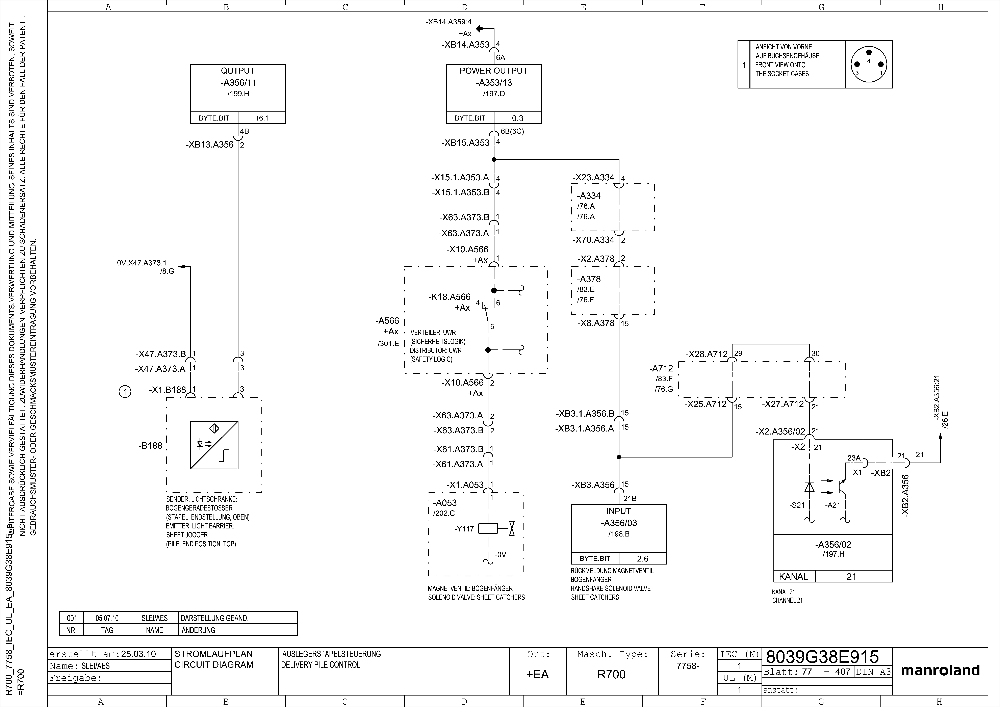

# +EA — Sheet 77 of 407 — AUSLEGERSTAPELSTEUERUNG

**DELIVERY PILE CONTROL**

> Part of the manroland **R700** printing press IEC/UL circuit diagrams.
> Drawing class: **Stromlaufplan / Circuit diagram** (DIN A3).
> Document `+EA` covers the **Printing unit** machine section.

## At a glance

| Field | Value |
|---|---|
| Document | `+EA`  (8039G38E915) |
| Sheet | **77** of 407 |
| Section (DE) | AUSLEGERSTAPELSTEUERUNG |
| Section (EN) | DELIVERY PILE CONTROL |
| Section type | CIRCUIT — Circuit diagram |
| Machine type | `R700` |
| Series | `7758` |
| Created | 25.03.10 |
| Replaces | — |
| Columns used | A, B, C, D, E, F, G, H |
| Path numbers | — |
| Labels on sheet | 159 |
| Cross-refs out | 14 |
| Cross-refs in | 47 |

**Previous:** [+EA sheet 76](SHEET_0076.md) · **Next:** [+EA sheet 78](SHEET_0078.md) · **Document TOC:** [_TOC.md](_TOC.md)  (+EA) · **Master TOC:** [all sheets](../_MASTER_TOC.md)

## Sheet image (300 DPI, exact vector render)



_Rendered directly from the PDF vector layer at 300 DPI (1-bit), no OCR and no resampling. Use it to confirm anything ambiguous in the text below._

## Cross-references on this sheet

Each entry is a wire leaving this sheet. The printed token is `/sheet.column`; the link resolves to that sheet inside the same document.

| Ref | Target sheet | Col | Path | Destination on target | Target section | From col |
|---|---|---|---|---|---|---|
| `/199.H` | [+EA sheet 199](SHEET_0199.md) | H | — | — | REFERENZMODUL | B |
| `/197.D` | [+EA sheet 197](SHEET_0197.md) | D | — | — | REFERENZMODUL | D |
| `/78.A` | [+EA sheet 78](SHEET_0078.md) | A | — | A334 | AUSLEGERSTAPELSTEUERUNG | E |
| `/76.A` | [+EA sheet 76](SHEET_0076.md) | A | — | A334 | AUSLEGERSTAPELSTEUERUNG | E |
| `/8.G` | [+EA sheet 8](SHEET_0008.md) | G | — | 0V.X47.A373:1 | SPANNUNGSVERSORGUNG: 400V, 24V | A |
| `/83.E` | [+EA sheet 83](SHEET_0083.md) | E | — | A378 | AUSLEGERSTAPELSTEUERUNG: PROGRAMMSCHALTWERK | E |
| `/76.F` | [+EA sheet 76](SHEET_0076.md) | F | — | A378 | AUSLEGERSTAPELSTEUERUNG | E |
| `/301.E` | [+EA sheet 301](SHEET_0301.md) | E | — | — | OPTION: ZWISCHENSTAPEL / | C |
| `/26.E` | [+EA sheet 26](SHEET_0026.md) | E | — | XB2.A356:21 | BUSVERBINDUNGEN: SICHERHEITSBUS | H |
| `/83.F` | [+EA sheet 83](SHEET_0083.md) | F | — | — | AUSLEGERSTAPELSTEUERUNG: PROGRAMMSCHALTWERK | F |
| `/76.G` | [+EA sheet 76](SHEET_0076.md) | G | — | — | AUSLEGERSTAPELSTEUERUNG | F |
| `/202.C` | [+EA sheet 202](SHEET_0202.md) | C | — | A053 | REFERENZMODUL | D |
| `/198.B` | [+EA sheet 198](SHEET_0198.md) | B | — | — | REFERENZMODUL | E |
| `/197.H` | [+EA sheet 197](SHEET_0197.md) | H | — | — | REFERENZMODUL | G |

### Incoming references (sheets that point here)

Every other sheet that sends a wire to this one. `Back-ref` is the token printed on *that* sheet; `Path` is its line number.

| From sheet | Cols | Back-ref | Path | Refs | What continues there |
|---|---|---|---|---|---|
| [+EA#8](SHEET_0008.md) | G | `/8.G` | — | 1 | 0V.X47.A373:1 |
| [+EA#26](SHEET_0026.md) | E | `/26.E` | — | 1 | XB2.A356:21 |
| [+EA#76](SHEET_0076.md) | A, E, F | `/76.A`, `/76.E`, `/76.F` | — | 3 | — |
| [+EA#78](SHEET_0078.md) | A | `/78.A` | — | 1 | A334 |
| [+EA#83](SHEET_0083.md) | D, F | `/83.D`, `/83.F` | — | 2 | — |
| [+EA#197](SHEET_0197.md) | D, H | `/197.D`, `/197.H` | — | 2 | — |
| [+EA#198](SHEET_0198.md) | B | `/198.B` | — | 1 | — |
| [+EA#199](SHEET_0199.md) | H | `/199.H` | — | 1 | — |
| [+EA#202](SHEET_0202.md) | C | `/202.C` | — | 1 | — |
| [+EA#206](SHEET_0206.md) | D | `/206.D` | — | 1 | — |
| [+EA#216](SHEET_0216.md) | E | `/216.E` | — | 2 | — |
| [+EA#225](SHEET_0225.md) | G | `/225.G` | — | 1 | — |
| [+EA#226](SHEET_0226.md) | F | `/226.F` | — | 1 | — |
| [+EA#229](SHEET_0229.md) | G | `/229.G` | — | 1 | — |
| [+EA#234](SHEET_0234.md) | H | `/234.H` | — | 1 | — |
| [+EA#235](SHEET_0235.md) | A, B | `/235.A`, `/235.B` | — | 2 | — |
| [+EA#250](SHEET_0250.md) | D | `/250.D` | — | 1 | — |
| [+EA#254](SHEET_0254.md) | G | `/254.G` | — | 2 | — |
| [+EA#258](SHEET_0258.md) | F | `/258.F` | — | 1 | — |
| [+EA#259](SHEET_0259.md) | F | `/259.F` | — | 1 | — |
| [+EA#260](SHEET_0260.md) | F, G, H | `/260.F`, `/260.G`, `/260.H` | — | 3 | — |
| [+EA#265](SHEET_0265.md) | A | `/265.A` | — | 1 | — |
| [+EA#268](SHEET_0268.md) | F | `/268.F` | — | 1 | — |
| [+EA#271](SHEET_0271.md) | H | `/271.H` | — | 1 | — |
| [+EA#273](SHEET_0273.md) | D | `/273.D` | — | 2 | — |
| [+EA#282](SHEET_0282.md) | A | `/282.A` | — | 4 | — |
| [+EA#283](SHEET_0283.md) | G | `/283.G` | — | 2 | — |
| [+EA#284](SHEET_0284.md) | A, B | `/284.A`, `/284.B` | — | 4 | — |
| [+EA#285](SHEET_0285.md) | E | `/285.E` | — | 1 | — |
| [+EA#301](SHEET_0301.md) | E | `/301.E` | — | 1 | — |


## Devices on this sheet

| Tag | Class | Class meaning (IEC) | Col | Sub | Terminal | Sign |
|---|---|---|---|---|---|---|
| `A353/13` | A | Baugruppe / assembly, module, PC board | D | 13 | — | — |
| `Y117` | Y | Magnetventil / solenoid valve, actuator | D | — | — | — |
| `A053` | A | Baugruppe / assembly, module, PC board | D | — | — | — |
| `A566` | A | Baugruppe / assembly, module, PC board | C | — | — | — |
| `A356/03` | A | Baugruppe / assembly, module, PC board | E | 03 | — | — |
| `A334` | A | Baugruppe / assembly, module, PC board | E | — | — | — |
| `A378` | A | Baugruppe / assembly, module, PC board | E | — | — | — |
| `S21` | S | Schalter / switch | G | — | — | — |
| `A21` | A | Baugruppe / assembly, module, PC board | G | — | — | — |
| `X1` | X | Klemme / terminal, plug connector | G | — | — | — |
| `X2` | X | Klemme / terminal, plug connector | G | — | — | — |
| `XB2` | XB |  | G | — | — | — |
| `A356/02` | A | Baugruppe / assembly, module, PC board | G | 02 | — | — |
| `A712` | A | Baugruppe / assembly, module, PC board | F | — | — | — |
| `B188` | B | Umformer / transducer, sensor | A | — | — | — |
| `A356/11` | A | Baugruppe / assembly, module, PC board | B | 11 | — | — |
| `0.3` | — | cross-device reference | D | — | — | — |
| `XB14.A353` | — | cross-device reference | D | — | — | — |
| `XB15.A353` | — | cross-device reference | D | — | — | — |
| `X15.1.A353.B` | — | cross-device reference | D | — | — | — |
| `X15.1.A353.A` | — | cross-device reference | D | — | — | — |
| `X10.A566` | — | cross-device reference | D | — | — | — |
| `K18.A566` | — | cross-device reference | D | — | — | — |
| `X10.A566` | — | cross-device reference | D | — | — | — |
| `X63.A373.A` | — | cross-device reference | D | — | — | — |
| `X63.A373.B` | — | cross-device reference | D | — | — | — |
| `X63.A373.B` | — | cross-device reference | D | — | — | — |
| `X63.A373.A` | — | cross-device reference | D | — | — | — |
| `X61.A373.A` | — | cross-device reference | D | — | — | — |
| `X61.A373.B` | — | cross-device reference | D | — | — | — |
| `X1.A053` | — | cross-device reference | D | — | — | — |
| `XB14.A359:4` | — | cross-device reference | D | — | 4 | — |
| `2.6` | — | cross-device reference | F | — | — | — |
| `XB3.A356` | — | cross-device reference | E | — | — | — |
| `X70.A334` | — | cross-device reference | E | — | — | — |
| `X23.A334` | — | cross-device reference | E | — | — | — |
| `X8.A378` | — | cross-device reference | E | — | — | — |
| `X2.A378` | — | cross-device reference | E | — | — | — |
| `XB2.A356` | — | cross-device reference | H | — | — | — |
| `X28.A712` | — | cross-device reference | F | — | — | — |
| `X27.A712` | — | cross-device reference | G | — | — | — |
| `X25.A712` | — | cross-device reference | F | — | — | — |
| `XB3.1.A356.B` | — | cross-device reference | E | — | — | — |
| `XB3.1.A356.A` | — | cross-device reference | E | — | — | — |
| `16.1` | — | cross-device reference | B | — | — | — |
| `XB13.A356` | — | cross-device reference | B | — | — | — |
| `X47.A373.A` | — | cross-device reference | A | — | — | — |
| `X47.A373.B` | — | cross-device reference | A | — | — | — |
| `X1.B188` | — | cross-device reference | B | — | — | — |
| `NR.` | — | cross-device reference | A | — | — | — |
| `05.07.10` | — | cross-device reference | A | — | — | — |
| `XB2.A356:21` | — | cross-device reference | H | — | 21 | — |

## Potentials / nets

| Potential | Count | Columns | Attached devices | Terminals |
|---|---|---|---|---|
| `0V` | 2 | A, D | `A373`, `X47` | `1` |


A potential such as `L24+/4` or `M24+` is a named supply/return rail; every place it appears on this sheet is electrically common.

## Wire-end annotations (grouped as printed)

A wire that continues elsewhere is annotated with a small cluster: the destination description, the path/line number `#NN`, and the `/sheet.column` cross reference. Each row below is one such cluster exactly as it is grouped on the drawing.

| Col | Y | Path | Cross-ref | Text on the wire |
|---|---|---|---|---|
| D | 22.2 | — | — | `XB14.A359:4` |
| D | 36.5 | — | — | `+Ax` |
| D | 48.5 | — | — | `XB14.A353 4` |
| G | 53.1 | — | — | `FRONT VIEW ONTO ANSICHT VON VORNE AUF BUCHSENGEHÄUSE` |
| D | 64.8 | — | — | `6A` |
| G | 69.6 | — | — | `4` |
| G | 72.5 | — | — | `1 THE SOCKET CASES` |
| D | 79.9 | — | — | `POWER OUTPUT` |
| B | 80.0 | — | — | `QUTPUT` |
| G | 83.8 | — | — | `3 1` |
| B | 93.8 | — | — | `A356/11` |
| D | 93.8 | — | — | `A353/13` |
| B | 107.7 | — | `/199.H` | — |
| D | 107.7 | — | `/197.D` | — |
| D | 136.7 | — | — | `BYTE.BIT 0.3` |
| B | 137.3 | — | — | `BYTE.BIT 16.1` |
| B | 152.6 | — | — | `4B` |
| D | 152.7 | — | — | `6B(6C)` |
| D | 164.7 | — | — | `XB15.A353 4` |
| B | 167.6 | — | — | `XB13.A356 2` |
| D | 206.5 | — | — | `X15.1.A353.A 4` |
| E | 206.5 | — | — | `X23.A334 4` |
| D | 224.2 | — | — | `X15.1.A353.B 4` |
| E | 228.5 | — | `/78.A`, `/76.A` | `A334` |
| D | 254.0 | — | — | `X63.A373.B 1` |
| D | 272.4 | — | — | `X63.A373.A 1` |
| E | 280.9 | — | — | `X70.A334 2` |
| D | 292.3 | — | — | `X10.A566 1` |
| E | 303.6 | — | — | `X2.A378 2` |
| D | 305.1 | — | — | `+Ax` |
| A | 309.2 | — | `/8.G` | `0V.X47.A373:1` |
| E | 327.7 | — | `/83.E`, `/76.F` | `A378` |
| D | 349.0 | — | — | `K18.A566 6` |
| D | 356.8 | — | — | `4` |
| D | 361.8 | — | — | `+Ax` |
| C | 377.3 | — | — | `A566` |
| E | 380.1 | — | — | `X8.A378 15` |
| D | 385.1 | — | — | `5` |
| C | 390.1 | — | — | `+Ax` |
| D | 393.2 | — | — | `DISTRIBUTOR: UWR (SICHERHEITSLOGIK) (SAFETY LOGIC) VERTEILER: UWR` |
| C | 405.3 | — | `/301.E` | — |
| A | 417.0 | — | — | `X47.A373.B 1` |
| B | 417.0 | — | — | `3` |
| F | 417.0 | — | — | `X28.A712 29 30` |
| A | 434.0 | — | — | `X47.A373.A 1` |
| B | 434.0 | — | — | `3` |
| F | 434.0 | — | — | `A712` |
| H | 445.9 | — | `/26.E` | `XB2.A356:21` |
| F | 447.1 | — | `/83.F`, `/76.G` | — |
| D | 451.0 | — | — | `X10.A566 2` |
| B | 459.5 | — | — | `X1.B188 1` |
| B | 459.5 | — | — | `3` |
| A | 463.2 | — | — | `1` |
| D | 463.8 | — | — | `+Ax` |
| F | 476.5 | — | — | `XB3.1.A356.B 15 X25.A712 15 X27.A712 21` |
| D | 490.0 | — | — | `X63.A373.A 2` |
| E | 504.9 | — | — | `XB3.1.A356.A 15` |
| D | 507.7 | — | — | `X63.A373.B 2` |
| G | 509.1 | — | — | `X2.A356/02 21` |
| A | 526.1 | — | — | `B188` |
| G | 527.6 | — | — | `X2` |
| G | 529.0 | — | — | `21 21` |
| D | 530.4 | — | — | `X61.A373.B 1` |
| H | 537.5 | — | — | `21` |
| G | 541.7 | — | — | `23A` |
| D | 547.4 | — | — | `X61.A373.A 1` |
| G | 558.7 | — | — | `X1` |
| G | 558.7 | — | — | `XB2` |
| H | 565.0 | — | — | `XB2.A356` |
| D | 572.9 | — | — | `X1.A053 1` |
| E | 572.9 | — | — | `XB3.A356 15` |
| D | 588.5 | — | — | `1` |
| E | 589.9 | — | — | `21B` |
| B | 591.6 | — | — | `BOGENGERADESTOSSER EMITTER, LIGHT BARRIER: (STAPEL, ENDSTELLUNG, OBEN) SENDER, LICHTSCHRANKE:` |
| D | 594.2 | — | `/202.C` | `A053` |
| G | 597.7 | — | — | `S21 A21` |
| E | 604.4 | — | — | `INPUT` |
| E | 618.3 | — | — | `A356/03` |
| D | 626.0 | — | — | `Y117` |
| E | 632.0 | — | `/198.B` | — |
| B | 634.2 | — | — | `(PILE, END POSITION, TOP) SHEET JOGGER` |
| G | 643.8 | — | — | `A356/02` |
| G | 656.2 | — | `/197.H` | — |
| D | 656.5 | — | — | `0V` |
| E | 661.1 | — | — | `BYTE.BIT 2.6` |
| E | 676.7 | — | — | `RÜCKMELDUNG MAGNETVENTIL BOGENFÄNGER HANDSHAKE SOLENOID VALVE` |
| G | 682.0 | — | — | `KANAL 21` |
| D | 698.0 | — | — | `MAGNETVENTIL: BOGENFÄNGER SOLENOID VALVE: SHEET CATCHERS` |
| G | 702.3 | — | — | `KANAL 21 CHANNEL 21` |
| E | 708.6 | — | — | `SHEET CATCHERS` |
| A | 733.0 | — | — | `001 05.07.10 SLEI/AES DARSTELLUNG GEÄND.` |
| A | 747.1 | — | — | `NR. TAG NAME ÄNDERUNG` |


## Reconstructed tables

This sheet carries tabular content (pin map / terminal assignment / index). The grid below was rebuilt from the drawing's own rule lines, so each row is exactly one physical row of the table.

### Table 1 — 2 data rows × 2 columns (at x=226.8, y=76.5)

| QUTPUT | A356/11 /199.H |
|---|---|
| `BYTE.BIT` | `16.1` |
| `XB13.A356 1 1 1` | `4B 2 3 3 3` |


### Table 2 — 8 data rows × 3 columns (at x=531.5, y=76.5)

| POWER |  | OUTPUT A353/13 /197.D |
|---|---|---|
| `BYTE.BIT` |  | `0.3` |
| `XB15.A353` |  | `6B(6C) 4` |
| `X15.1.A353.A X15.1.A353.B X63.A373.B X63.A373.A X10.A566 +Ax K18.A566 4 +Ax UWR` | `5` | `4 4 1 1 1 6` |
| `UWR X10.A566 +Ax X63.A373.A X63.A373.B` | `2 2 2` |  |
| `X61.A373.B` | `1` |  |
| `X61.A373.A X1.A053` | `1 1 1` |  |
| `Y117` |  |  |
|  |  | `0V` |


### Table 3 — 8 data rows × 9 columns (at x=680.3, y=76.5)

|  |  |  | 1 FRONT THE | VIEW ONTO SOCKET CASES |  | 3 | 1 |  |
|---|---|---|---|---|---|---|---|---|
| `X23.A334 A334 /78.A /76.A X70.A334 X2.A378 A378 /83.E /76.F X8.A378` | `4 2 2 15` |  |  |  |  |  |  |  |
| `XB3.1.A356.B XB3.1.A356.A` | `A712 /83.F /76.G 15 15` | `X28.A712 X25.A712` | `29 15` | `X27.A712 X2.A356/02` | `30 21 21` |  |  | `XB2.A356:21` |
|  |  |  |  | `X2` | `21` |  |  | `21 21` |
| `XB3.A356` | `15 21B` |  |  |  |  | `23A X1` | `XB2` | `XB2.A356` |
| `INPUT` | `A356/03` |  |  | `S21` | `A21` |  |  |  |
|  | `/198.B` |  |  |  | `A356/02` |  |  |  |
| `BYTE.BIT` | `2.6` |  |  |  | `/197.H` |  |  |  |
| `RÜCKMELDUNG BOGENFÄNGER` | `MAGNETVENTIL` |  |  | `KANAL` |  | `21` |  |  |


## Notes and free text on this sheet

| Text | Col | Y (pt) |
|---|---|---|
| `6A` | D | 64.76 |
| `6B(6C)` | D | 152.68 |
| `POWER OUTPUT` | D | 79.93 |
| `BYTE.BIT` | D | 137.26 |
| `+Ax` | D | 305.06 |
| `MAGNETVENTIL: BOGENFÄNGER` | D | 697.95 |
| `SOLENOID VALVE: SHEET CATCHERS` | D | 708.58 |
| `+Ax` | C | 390.1 |
| `VERTEILER: UWR` | D | 393.2 |
| `(SICHERHEITSLOGIK)` | D | 403.86 |
| `DISTRIBUTOR: UWR` | D | 414.46 |
| `(SAFETY LOGIC)` | D | 425.11 |
| `21B` | E | 589.89 |
| `INPUT` | E | 604.42 |
| `BYTE.BIT` | E | 661.67 |
| `RÜCKMELDUNG MAGNETVENTIL` | E | 676.71 |
| `BOGENFÄNGER` | E | 687.32 |
| `HANDSHAKE SOLENOID VALVE` | E | 697.95 |
| `SHEET CATCHERS` | E | 708.58 |
| `KANAL 21` | G | 702.33 |
| `CHANNEL 21` | G | 712.28 |
| `23A` | G | 541.7 |
| `KANAL` | G | 682.03 |
| `X2.A356/02` | G | 509.13 |
| `SENDER, LICHTSCHRANKE:` | B | 591.65 |
| `BOGENGERADESTOSSER` | B | 602.28 |
| `(STAPEL, ENDSTELLUNG, OBEN)` | B | 612.91 |
| `EMITTER, LIGHT BARRIER:` | B | 623.54 |
| `SHEET JOGGER` | B | 634.17 |
| `(PILE, END POSITION, TOP)` | B | 644.8 |
| `4B` | B | 152.63 |
| `QUTPUT` | B | 79.98 |
| `BYTE.BIT` | B | 137.26 |
| `TAG` | A | 747.27 |
| `NAME` | A | 747.25 |
| `ÄNDERUNG` | B | 747.31 |
| `SLEI/AES` | A | 733.13 |
| `DARSTELLUNG GEÄND.` | B | 733.12 |
| `ANSICHT VON VORNE` | G | 53.07 |
| `AUF BUCHSENGEHÄUSE` | G | 63.71 |
| `FRONT VIEW ONTO` | G | 74.3 |
| `THE SOCKET CASES` | G | 84.95 |

## Complete label inventory (exact text from the drawing)

Every text object inside the drawing area of this sheet, in DIN reading order (column A→H, then top→bottom). This is the authoritative list: if a string is not here it is not printed on this sheet.

| Col | Y | X | Dir | Type | Text |
|---|---|---|---|---|---|
| A | 309.2 | 139.5 | → | potential | `0V.X47.A373:1` |
| A | 319.2 | 190.8 | → | cross-reference | `/8.G` |
| A | 417.0 | 161.6 | → | device ref | `X47.A373.B` |
| A | 434.7 | 160.7 | → | device ref | `X47.A373.A` |
| A | 463.2 | 147.1 | → | number | `1` |
| A | 526.1 | 165.0 | → | device tag | `B188` |
| A | 733.0 | 79.8 | → | number | `001` |
| A | 733.1 | 114.0 | → | device ref | `05.07.10` |
| A | 733.1 | 168.7 | → | text | `SLEI/AES` |
| A | 747.1 | 78.9 | → | device ref | `NR.` |
| A | 747.3 | 120.4 | → | text | `TAG` |
| A | 747.3 | 173.8 | → | text | `NAME` |
| B | 80.0 | 263.2 | → | text | `QUTPUT` |
| B | 93.8 | 262.8 | → | device tag | `A356/11` |
| B | 107.7 | 271.0 | → | cross-reference | `/199.H` |
| B | 137.3 | 236.7 | → | text | `BYTE.BIT` |
| B | 137.3 | 304.2 | → | device ref | `16.1` |
| B | 152.6 | 286.0 | → | text | `4B` |
| B | 167.5 | 221.1 | → | device ref | `XB13.A356` |
| B | 169.0 | 286.0 | → | number | `2` |
| B | 417.0 | 228.8 | → | number | `1` |
| B | 417.0 | 286.0 | → | number | `3` |
| B | 434.0 | 228.8 | → | number | `1` |
| B | 434.0 | 286.0 | → | number | `3` |
| B | 459.5 | 177.4 | → | device ref | `X1.B188` |
| B | 459.5 | 228.8 | → | number | `1` |
| B | 459.5 | 286.0 | → | number | `3` |
| B | 591.7 | 198.1 | → | text | `SENDER, LICHTSCHRANKE:` |
| B | 602.3 | 197.6 | → | text | `BOGENGERADESTOSSER` |
| B | 612.9 | 197.9 | → | text | `(STAPEL, ENDSTELLUNG, OBEN)` |
| B | 623.5 | 197.6 | → | text | `EMITTER, LIGHT BARRIER:` |
| B | 634.2 | 198.1 | → | text | `SHEET JOGGER` |
| B | 644.8 | 197.9 | → | text | `(PILE, END POSITION, TOP)` |
| B | 733.1 | 215.3 | → | text | `DARSTELLUNG GEÄND.` |
| B | 747.3 | 216.4 | → | text | `ÄNDERUNG` |
| C | 377.3 | 447.0 | → | device tag | `A566` |
| C | 390.1 | 456.4 | → | text | `+Ax` |
| C | 405.3 | 449.9 | → | cross-reference | `/301.E` |
| D | 22.2 | 506.8 | → | device ref | `XB14.A359:4` |
| D | 36.5 | 546.2 | → | text | `+Ax` |
| D | 48.5 | 525.8 | → | device ref | `XB14.A353` |
| D | 48.5 | 590.7 | → | number | `4` |
| D | 64.8 | 590.7 | → | text | `6A` |
| D | 79.9 | 547.4 | → | text | `POWER OUTPUT` |
| D | 93.8 | 566.8 | → | device tag | `A353/13` |
| D | 107.7 | 575.4 | → | cross-reference | `/197.D` |
| D | 136.7 | 609.7 | → | device ref | `0.3` |
| D | 137.3 | 541.4 | → | text | `BYTE.BIT` |
| D | 152.7 | 596.4 | → | text | `6B(6C)` |
| D | 164.7 | 590.7 | → | number | `4` |
| D | 165.4 | 525.8 | → | device ref | `XB15.A353` |
| D | 206.5 | 513.4 | → | device ref | `X15.1.A353.A` |
| D | 208.7 | 590.7 | → | number | `4` |
| D | 224.3 | 514.2 | → | device ref | `X15.1.A353.B` |
| D | 225.7 | 590.7 | → | number | `4` |
| D | 254.0 | 523.0 | → | device ref | `X63.A373.B` |
| D | 254.0 | 590.2 | → | number | `1` |
| D | 272.5 | 590.2 | → | number | `1` |
| D | 273.1 | 522.1 | → | device ref | `X63.A373.A` |
| D | 292.3 | 531.5 | → | device ref | `X10.A566` |
| D | 303.6 | 590.2 | → | number | `1` |
| D | 305.1 | 562.7 | → | text | `+Ax` |
| D | 349.0 | 510.2 | → | device ref | `K18.A566` |
| D | 356.8 | 566.6 | → | number | `4` |
| D | 356.8 | 590.7 | → | number | `6` |
| D | 361.8 | 541.4 | → | text | `+Ax` |
| D | 385.1 | 583.7 | → | number | `5` |
| D | 393.2 | 489.0 | → | text | `VERTEILER: UWR` |
| D | 403.9 | 488.4 | → | text | `(SICHERHEITSLOGIK)` |
| D | 414.5 | 488.1 | → | text | `DISTRIBUTOR: UWR` |
| D | 425.1 | 488.4 | → | text | `(SAFETY LOGIC)` |
| D | 451.0 | 525.8 | → | device ref | `X10.A566` |
| D | 452.5 | 583.7 | → | number | `2` |
| D | 463.8 | 557.0 | → | text | `+Ax` |
| D | 490.0 | 515.1 | → | device ref | `X63.A373.A` |
| D | 492.1 | 583.7 | → | number | `2` |
| D | 507.7 | 515.9 | → | device ref | `X63.A373.B` |
| D | 509.1 | 583.7 | → | number | `2` |
| D | 530.4 | 515.9 | → | device ref | `X61.A373.B` |
| D | 530.4 | 583.1 | → | number | `1` |
| D | 547.4 | 583.1 | → | number | `1` |
| D | 548.1 | 515.1 | → | device ref | `X61.A373.A` |
| D | 572.9 | 531.8 | → | device ref | `X1.A053` |
| D | 572.9 | 583.1 | → | number | `1` |
| D | 588.5 | 583.1 | → | number | `1` |
| D | 594.2 | 515.6 | → | device tag | `A053` |
| D | 607.3 | 515.9 | → | cross-reference | `/202.C` |
| D | 626.1 | 541.1 | → | device tag | `Y117` |
| D | 656.5 | 589.3 | → | potential | `0V` |
| D | 698.0 | 509.7 | → | text | `MAGNETVENTIL: BOGENFÄNGER` |
| D | 708.6 | 510.0 | → | text | `SOLENOID VALVE: SHEET CATCHERS` |
| E | 206.5 | 681.7 | → | device ref | `X23.A334` |
| E | 208.7 | 739.6 | → | number | `4` |
| E | 228.5 | 687.1 | → | device tag | `A334` |
| E | 241.5 | 687.4 | → | cross-reference | `/78.A` |
| E | 253.9 | 687.4 | → | cross-reference | `/76.A` |
| E | 280.9 | 681.7 | → | device ref | `X70.A334` |
| E | 282.4 | 739.6 | → | number | `2` |
| E | 303.6 | 687.7 | → | device ref | `X2.A378` |
| E | 303.6 | 739.6 | → | number | `2` |
| E | 327.7 | 687.1 | → | device tag | `A378` |
| E | 340.8 | 687.4 | → | cross-reference | `/83.E` |
| E | 353.2 | 687.4 | → | cross-reference | `/76.F` |
| E | 380.2 | 687.7 | → | device ref | `X8.A378` |
| E | 381.6 | 739.0 | → | number | `15` |
| E | 487.9 | 661.9 | → | device ref | `XB3.1.A356.B` |
| E | 487.9 | 739.0 | → | number | `15` |
| E | 504.9 | 739.0 | → | number | `15` |
| E | 505.6 | 661.0 | → | device ref | `XB3.1.A356.A` |
| E | 572.9 | 680.6 | → | device ref | `XB3.A356` |
| E | 572.9 | 739.0 | → | number | `15` |
| E | 589.9 | 742.4 | → | text | `21B` |
| E | 604.4 | 722.1 | → | text | `INPUT` |
| E | 618.3 | 715.6 | → | device tag | `A356/03` |
| E | 632.0 | 724.4 | → | cross-reference | `/198.B` |
| E | 661.7 | 690.2 | → | text | `BYTE.BIT` |
| E | 676.7 | 679.5 | → | text | `RÜCKMELDUNG MAGNETVENTIL` |
| E | 687.3 | 679.5 | → | text | `BOGENFÄNGER` |
| E | 697.9 | 679.5 | → | text | `HANDSHAKE SOLENOID VALVE` |
| E | 708.6 | 680.0 | → | text | `SHEET CATCHERS` |
| F | 72.6 | 883.3 | → | number | `1` |
| F | 417.0 | 816.4 | → | device ref | `X28.A712` |
| F | 417.0 | 874.2 | → | number | `29` |
| F | 434.0 | 773.0 | → | device tag | `A712` |
| F | 447.1 | 780.9 | → | cross-reference | `/83.F` |
| F | 459.5 | 779.8 | → | cross-reference | `/76.G` |
| F | 476.5 | 815.0 | → | device ref | `X25.A712` |
| F | 480.8 | 873.6 | → | number | `15` |
| F | 661.1 | 758.6 | → | device ref | `2.6` |
| G | 53.1 | 900.0 | → | text | `ANSICHT VON VORNE` |
| G | 63.7 | 900.0 | → | text | `AUF BUCHSENGEHÄUSE` |
| G | 69.6 | 1032.7 | → | number | `4` |
| G | 74.3 | 899.1 | → | text | `FRONT VIEW ONTO` |
| G | 83.8 | 1018.5 | → | number | `3` |
| G | 84.9 | 899.7 | → | text | `THE SOCKET CASES` |
| G | 417.0 | 966.3 | → | number | `30` |
| G | 476.5 | 907.1 | → | device ref | `X27.A712` |
| G | 480.8 | 966.3 | → | number | `21` |
| G | 509.1 | 899.7 | → | text | `X2.A356/02` |
| G | 509.1 | 966.3 | → | number | `21` |
| G | 527.6 | 942.2 | → | device tag | `X2` |
| G | 529.0 | 969.2 | → | number | `21` |
| G | 541.7 | 1009.1 | → | text | `23A` |
| G | 558.7 | 1012.8 | → | device tag | `X1` |
| G | 558.7 | 1037.2 | → | device tag | `XB2` |
| G | 597.7 | 940.0 | → | device tag | `S21` |
| G | 597.7 | 982.5 | → | device tag | `A21` |
| G | 643.8 | 970.7 | → | device tag | `A356/02` |
| G | 656.2 | 979.7 | → | cross-reference | `/197.H` |
| G | 682.0 | 927.5 | → | text | `KANAL` |
| G | 682.0 | 1008.3 | → | number | `21` |
| G | 702.3 | 919.3 | → | text | `KANAL 21` |
| G | 712.3 | 919.6 | → | text | `CHANNEL 21` |
| H | 83.8 | 1047.3 | → | number | `1` |
| H | 445.9 | 1111.5 | ↕ | device ref | `XB2.A356:21` |
| H | 489.5 | 1121.4 | ↕ | cross-reference | `/26.E` |
| H | 537.5 | 1090.5 | → | number | `21` |
| H | 538.9 | 1068.4 | → | number | `21` |
| H | 564.9 | 1073.2 | ↕ | device ref | `XB2.A356` |

## Reading-order text block

The same content as a plain block, grouped by DIN column — convenient to paste or to match against a visual description.

```text
=== Column A ===
 309.2  139.5  net          0V.X47.A373:1
 319.2  190.8  xref         /8.G
 417.0  161.6  devref       X47.A373.B
 434.7  160.7  devref       X47.A373.A
 463.2  147.1  numeric      1
 526.1  165.0  devtag       B188
 733.0   79.8  numeric      001
 733.1  114.0  devref       05.07.10
 733.1  168.7  text         SLEI/AES
 747.1   78.9  devref       NR.
 747.3  120.4  text         TAG
 747.3  173.8  text         NAME
=== Column B ===
  80.0  263.2  text         QUTPUT
  93.8  262.8  devtag       A356/11
 107.7  271.0  xref         /199.H
 137.3  236.7  text         BYTE.BIT
 137.3  304.2  devref       16.1
 152.6  286.0  text         4B
 167.5  221.1  devref       XB13.A356
 169.0  286.0  numeric      2
 417.0  228.8  numeric      1
 417.0  286.0  numeric      3
 434.0  228.8  numeric      1
 434.0  286.0  numeric      3
 459.5  177.4  devref       X1.B188
 459.5  228.8  numeric      1
 459.5  286.0  numeric      3
 591.7  198.1  text         SENDER, LICHTSCHRANKE:
 602.3  197.6  text         BOGENGERADESTOSSER
 612.9  197.9  text         (STAPEL, ENDSTELLUNG, OBEN)
 623.5  197.6  text         EMITTER, LIGHT BARRIER:
 634.2  198.1  text         SHEET JOGGER
 644.8  197.9  text         (PILE, END POSITION, TOP)
 733.1  215.3  text         DARSTELLUNG GEÄND.
 747.3  216.4  text         ÄNDERUNG
=== Column C ===
 377.3  447.0  devtag       A566
 390.1  456.4  text         +Ax
 405.3  449.9  xref         /301.E
=== Column D ===
  22.2  506.8  devref       XB14.A359:4
  36.5  546.2  text         +Ax
  48.5  525.8  devref       XB14.A353
  48.5  590.7  numeric      4
  64.8  590.7  text         6A
  79.9  547.4  text         POWER OUTPUT
  93.8  566.8  devtag       A353/13
 107.7  575.4  xref         /197.D
 136.7  609.7  devref       0.3
 137.3  541.4  text         BYTE.BIT
 152.7  596.4  text         6B(6C)
 164.7  590.7  numeric      4
 165.4  525.8  devref       XB15.A353
 206.5  513.4  devref       X15.1.A353.A
 208.7  590.7  numeric      4
 224.3  514.2  devref       X15.1.A353.B
 225.7  590.7  numeric      4
 254.0  523.0  devref       X63.A373.B
 254.0  590.2  numeric      1
 272.5  590.2  numeric      1
 273.1  522.1  devref       X63.A373.A
 292.3  531.5  devref       X10.A566
 303.6  590.2  numeric      1
 305.1  562.7  text         +Ax
 349.0  510.2  devref       K18.A566
 356.8  566.6  numeric      4
 356.8  590.7  numeric      6
 361.8  541.4  text         +Ax
 385.1  583.7  numeric      5
 393.2  489.0  text         VERTEILER: UWR
 403.9  488.4  text         (SICHERHEITSLOGIK)
 414.5  488.1  text         DISTRIBUTOR: UWR
 425.1  488.4  text         (SAFETY LOGIC)
 451.0  525.8  devref       X10.A566
 452.5  583.7  numeric      2
 463.8  557.0  text         +Ax
 490.0  515.1  devref       X63.A373.A
 492.1  583.7  numeric      2
 507.7  515.9  devref       X63.A373.B
 509.1  583.7  numeric      2
 530.4  515.9  devref       X61.A373.B
 530.4  583.1  numeric      1
 547.4  583.1  numeric      1
 548.1  515.1  devref       X61.A373.A
 572.9  531.8  devref       X1.A053
 572.9  583.1  numeric      1
 588.5  583.1  numeric      1
 594.2  515.6  devtag       A053
 607.3  515.9  xref         /202.C
 626.1  541.1  devtag       Y117
 656.5  589.3  net          0V
 698.0  509.7  text         MAGNETVENTIL: BOGENFÄNGER
 708.6  510.0  text         SOLENOID VALVE: SHEET CATCHERS
=== Column E ===
 206.5  681.7  devref       X23.A334
 208.7  739.6  numeric      4
 228.5  687.1  devtag       A334
 241.5  687.4  xref         /78.A
 253.9  687.4  xref         /76.A
 280.9  681.7  devref       X70.A334
 282.4  739.6  numeric      2
 303.6  687.7  devref       X2.A378
 303.6  739.6  numeric      2
 327.7  687.1  devtag       A378
 340.8  687.4  xref         /83.E
 353.2  687.4  xref         /76.F
 380.2  687.7  devref       X8.A378
 381.6  739.0  numeric      15
 487.9  661.9  devref       XB3.1.A356.B
 487.9  739.0  numeric      15
 504.9  739.0  numeric      15
 505.6  661.0  devref       XB3.1.A356.A
 572.9  680.6  devref       XB3.A356
 572.9  739.0  numeric      15
 589.9  742.4  text         21B
 604.4  722.1  text         INPUT
 618.3  715.6  devtag       A356/03
 632.0  724.4  xref         /198.B
 661.7  690.2  text         BYTE.BIT
 676.7  679.5  text         RÜCKMELDUNG MAGNETVENTIL
 687.3  679.5  text         BOGENFÄNGER
 697.9  679.5  text         HANDSHAKE SOLENOID VALVE
 708.6  680.0  text         SHEET CATCHERS
=== Column F ===
  72.6  883.3  numeric      1
 417.0  816.4  devref       X28.A712
 417.0  874.2  numeric      29
 434.0  773.0  devtag       A712
 447.1  780.9  xref         /83.F
 459.5  779.8  xref         /76.G
 476.5  815.0  devref       X25.A712
 480.8  873.6  numeric      15
 661.1  758.6  devref       2.6
=== Column G ===
  53.1  900.0  text         ANSICHT VON VORNE
  63.7  900.0  text         AUF BUCHSENGEHÄUSE
  69.6 1032.7  numeric      4
  74.3  899.1  text         FRONT VIEW ONTO
  83.8 1018.5  numeric      3
  84.9  899.7  text         THE SOCKET CASES
 417.0  966.3  numeric      30
 476.5  907.1  devref       X27.A712
 480.8  966.3  numeric      21
 509.1  899.7  text         X2.A356/02
 509.1  966.3  numeric      21
 527.6  942.2  devtag       X2
 529.0  969.2  numeric      21
 541.7 1009.1  text         23A
 558.7 1012.8  devtag       X1
 558.7 1037.2  devtag       XB2
 597.7  940.0  devtag       S21
 597.7  982.5  devtag       A21
 643.8  970.7  devtag       A356/02
 656.2  979.7  xref         /197.H
 682.0  927.5  text         KANAL
 682.0 1008.3  numeric      21
 702.3  919.3  text         KANAL 21
 712.3  919.6  text         CHANNEL 21
=== Column H ===
  83.8 1047.3  numeric      1
 445.9 1111.5  devref       XB2.A356:21
 489.5 1121.4  xref         /26.E
 537.5 1090.5  numeric      21
 538.9 1068.4  numeric      21
 564.9 1073.2  devref       XB2.A356
```

---
_Generated from the PDF vector text layer; no OCR. Source: `R700_7758_IEC_UL_EA_8039G38E915_p`, sheet 77._
