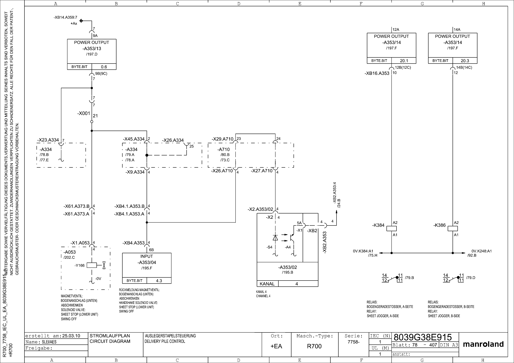

# +EA — Sheet 78 of 407 — AUSLEGERSTAPELSTEUERUNG

**DELIVERY PILE CONTROL**

> Part of the manroland **R700** printing press IEC/UL circuit diagrams.
> Drawing class: **Stromlaufplan / Circuit diagram** (DIN A3).
> Document `+EA` covers the **Printing unit** machine section.

## At a glance

| Field | Value |
|---|---|
| Document | `+EA`  (8039G38E915) |
| Sheet | **78** of 407 |
| Section (DE) | AUSLEGERSTAPELSTEUERUNG |
| Section (EN) | DELIVERY PILE CONTROL |
| Section type | CIRCUIT — Circuit diagram |
| Machine type | `R700` |
| Series | `7758` |
| Created | 25.03.10 |
| Replaces | — |
| Columns used | A, B, C, D, E, F, G, H |
| Path numbers | — |
| Labels on sheet | 137 |
| Cross-refs out | 15 |
| Cross-refs in | 39 |

**Previous:** [+EA sheet 77](SHEET_0077.md) · **Next:** [+EA sheet 79](SHEET_0079.md) · **Document TOC:** [_TOC.md](_TOC.md)  (+EA) · **Master TOC:** [all sheets](../_MASTER_TOC.md)

## Sheet image (300 DPI, exact vector render)



_Rendered directly from the PDF vector layer at 300 DPI (1-bit), no OCR and no resampling. Use it to confirm anything ambiguous in the text below._

## Cross-references on this sheet

Each entry is a wire leaving this sheet. The printed token is `/sheet.column`; the link resolves to that sheet inside the same document.

| Ref | Target sheet | Col | Path | Destination on target | Target section | From col |
|---|---|---|---|---|---|---|
| `/197.F` | [+EA sheet 197](SHEET_0197.md) | F | — | — | REFERENZMODUL | G |
| `/197.F` | [+EA sheet 197](SHEET_0197.md) | F | — | — | REFERENZMODUL | G |
| `/197.D` | [+EA sheet 197](SHEET_0197.md) | D | — | — | REFERENZMODUL | B |
| `/78.B` | [+EA sheet 78](SHEET_0078.md) | B | — | A334 | AUSLEGERSTAPELSTEUERUNG | A |
| `/77.E` | [+EA sheet 77](SHEET_0077.md) | E | — | A334 | AUSLEGERSTAPELSTEUERUNG | A |
| `/79.A` | [+EA sheet 79](SHEET_0079.md) | A | — | A334 | AUSLEGERSTAPELSTEUERUNG | B |
| `/78.A` | [+EA sheet 78](SHEET_0078.md) | A | — | A334 | AUSLEGERSTAPELSTEUERUNG | B |
| `/80.B` | [+EA sheet 80](SHEET_0080.md) | B | — | — | AUSLEGERSTAPELSTEUERUNG: BEDIENKOMMANDOS | D |
| `/73.C` | [+EA sheet 73](SHEET_0073.md) | C | — | — | AUSLEGERSTAPELSTEUERUNG | D |
| `/24.B` | [+EA sheet 24](SHEET_0024.md) | B | — | XB2.A353:4 | BUSVERBINDUNGEN: SICHERHEITSBUS | F |
| `/75.H` | [+EA sheet 75](SHEET_0075.md) | H | — | 0V.K384:A1 0V.K248:A1 | AUSLEGERSTAPELSTEUERUNG | G |
| `/202.C` | [+EA sheet 202](SHEET_0202.md) | C | — | A053 | REFERENZMODUL | A |
| `/92.B` | [+EA sheet 92](SHEET_0092.md) | B | — | — | BLASRAHMEN | H |
| `/195.F` | [+EA sheet 195](SHEET_0195.md) | F | — | — | REFERENZMODUL | B |
| `/195.B` | [+EA sheet 195](SHEET_0195.md) | B | — | — | REFERENZMODUL | E |

### Incoming references (sheets that point here)

Every other sheet that sends a wire to this one. `Back-ref` is the token printed on *that* sheet; `Path` is its line number.

| From sheet | Cols | Back-ref | Path | Refs | What continues there |
|---|---|---|---|---|---|
| [+EA#24](SHEET_0024.md) | B | `/24.B` | — | 1 | XB2.A353:4 |
| [+EA#73](SHEET_0073.md) | C | `/73.C` | — | 1 | — |
| [+EA#75](SHEET_0075.md) | H | `/75.H` | — | 1 | — |
| [+EA#77](SHEET_0077.md) | E | `/77.E` | — | 1 | A334 |
| [+EA#78](SHEET_0078.md) | A, B | `/78.A`, `/78.B` | — | 2 | A334 |
| [+EA#79](SHEET_0079.md) | A, B, D | `/79.A`, `/79.B`, `/79.D` | — | 3 | — |
| [+EA#80](SHEET_0080.md) | B | `/80.B` | — | 1 | — |
| [+EA#92](SHEET_0092.md) | B | `/92.B` | — | 1 | 0V.K248:A1 |
| [+EA#195](SHEET_0195.md) | B, F | `/195.B`, `/195.F` | — | 2 | — |
| [+EA#197](SHEET_0197.md) | D, F | `/197.D`, `/197.F` | — | 3 | — |
| [+EA#202](SHEET_0202.md) | C | `/202.C` | — | 1 | — |
| [+EA#206](SHEET_0206.md) | D | `/206.D` | — | 1 | — |
| [+EA#224](SHEET_0224.md) | G | `/224.G` | — | 1 | — |
| [+EA#225](SHEET_0225.md) | C | `/225.C` | — | 1 | — |
| [+EA#237](SHEET_0237.md) | A, B, C | `/237.A`, `/237.B`, `/237.C` | — | 3 | — |
| [+EA#252](SHEET_0252.md) | A | `/252.A` | — | 1 | — |
| [+EA#259](SHEET_0259.md) | F | `/259.F` | — | 1 | — |
| [+EA#260](SHEET_0260.md) | F, G, H | `/260.F`, `/260.G`, `/260.H` | — | 3 | — |
| [+EA#261](SHEET_0261.md) | G | `/261.G` | — | 2 | — |
| [+EA#265](SHEET_0265.md) | A | `/265.A` | — | 1 | — |
| [+EA#269](SHEET_0269.md) | B | `/269.B` | — | 1 | — |
| [+EA#270](SHEET_0270.md) | C | `/270.C` | — | 1 | — |
| [+EA#271](SHEET_0271.md) | B | `/271.B` | — | 1 | — |
| [+EA#274](SHEET_0274.md) | B | `/274.B` | — | 2 | — |
| [+EA#281](SHEET_0281.md) | G | `/281.G` | — | 1 | — |
| [+EA#283](SHEET_0283.md) | G | `/283.G` | — | 2 | — |


## Devices on this sheet

| Tag | Class | Class meaning (IEC) | Col | Sub | Terminal | Sign |
|---|---|---|---|---|---|---|
| `A353/14` | A | Baugruppe / assembly, module, PC board | G | 14 | — | — |
| `A334` | A | Baugruppe / assembly, module, PC board | B | — | — | — |
| `S4` | S | Schalter / switch | E | — | — | — |
| `A4` | A | Baugruppe / assembly, module, PC board | E | — | — | — |
| `X1` | X | Klemme / terminal, plug connector | E | — | — | — |
| `X2` | X | Klemme / terminal, plug connector | E | — | — | — |
| `XB2` | XB |  | E | — | — | — |
| `A353/02` | A | Baugruppe / assembly, module, PC board | E | 02 | — | — |
| `A710` | A | Baugruppe / assembly, module, PC board | D | — | — | — |
| `A353/04` | A | Baugruppe / assembly, module, PC board | B | 04 | — | — |
| `A353/13` | A | Baugruppe / assembly, module, PC board | B | 13 | — | — |
| `X001` | X | Klemme / terminal, plug connector | A | — | — | — |
| `A334` | A | Baugruppe / assembly, module, PC board | A | — | — | — |
| `Y166` | Y | Magnetventil / solenoid valve, actuator | A | — | — | — |
| `A053` | A | Baugruppe / assembly, module, PC board | A | — | — | — |
| `A2` | A | Baugruppe / assembly, module, PC board | H | — | — | — |
| `A1` | A | Baugruppe / assembly, module, PC board | H | — | — | — |
| `K386` | K | Relais / relay, contactor | G | — | — | — |
| `A353/14` | A | Baugruppe / assembly, module, PC board | G | 14 | — | — |
| `A2` | A | Baugruppe / assembly, module, PC board | G | — | — | — |
| `A1` | A | Baugruppe / assembly, module, PC board | G | — | — | — |
| `K384` | K | Relais / relay, contactor | F | — | — | — |
| `20.3` | — | cross-device reference | H | — | — | — |
| `X45.A334` | — | cross-device reference | B | — | — | — |
| `X9.A334` | — | cross-device reference | B | — | — | — |
| `XB2.A353` | — | cross-device reference | E | — | — | — |
| `X29.A710` | — | cross-device reference | D | — | — | — |
| `X27.A710` | — | cross-device reference | D | — | — | — |
| `X26.A710` | — | cross-device reference | D | — | — | — |
| `XB4.1.A353.B` | — | cross-device reference | B | — | — | — |
| `XB4.1.A353.A` | — | cross-device reference | B | — | — | — |
| `4.3` | — | cross-device reference | C | — | — | — |
| `XB4.A353` | — | cross-device reference | B | — | — | — |
| `0.6` | — | cross-device reference | B | — | — | — |
| `XB14.A359:7` | — | cross-device reference | A | — | 7 | — |
| `X23.A334` | — | cross-device reference | A | — | — | — |
| `X1.A053` | — | cross-device reference | A | — | — | — |
| `X61.A373.A` | — | cross-device reference | A | — | — | — |
| `X61.A373.B` | — | cross-device reference | A | — | — | — |
| `20.1` | — | cross-device reference | G | — | — | — |
| `XB16.A353` | — | cross-device reference | F | — | — | — |
| `XB2.A353:4` | — | cross-device reference | F | — | 4 | — |
| `X26.A334` | — | cross-device reference | C | — | — | — |

## Potentials / nets

| Potential | Count | Columns | Attached devices | Terminals |
|---|---|---|---|---|
| `0V` | 3 | B, F, H | `K248`, `K384` | `A1` |


A potential such as `L24+/4` or `M24+` is a named supply/return rail; every place it appears on this sheet is electrically common.

## Wire-end annotations (grouped as printed)

A wire that continues elsewhere is annotated with a small cluster: the destination description, the path/line number `#NN`, and the `/sheet.column` cross reference. Each row below is one such cluster exactly as it is grouped on the drawing.

| Col | Y | Path | Cross-ref | Text on the wire |
|---|---|---|---|---|
| A | 36.4 | — | — | `XB14.A359:7` |
| A | 50.7 | — | — | `+Ax` |
| B | 62.7 | — | — | `7` |
| G | 64.8 | — | — | `12A` |
| H | 64.8 | — | — | `14A` |
| B | 78.9 | — | — | `9A` |
| F | 79.9 | — | — | `POWER OUTPUT` |
| G | 79.9 | — | — | `POWER OUTPUT` |
| G | 93.8 | — | — | `A353/14` |
| G | 93.8 | — | — | `A353/14` |
| B | 94.1 | — | — | `POWER OUTPUT` |
| G | 107.6 | — | `/197.F` | — |
| G | 107.6 | — | `/197.F` | — |
| B | 108.0 | — | — | `A353/13` |
| B | 121.8 | — | `/197.D` | — |
| F | 136.7 | — | — | `BYTE.BIT 20.1` |
| G | 136.7 | — | — | `BYTE.BIT 20.3` |
| B | 150.8 | — | — | `BYTE.BIT 0.6` |
| G | 152.7 | — | — | `12B(12C)` |
| H | 152.7 | — | — | `14B(14C)` |
| F | 164.7 | — | — | `XB16.A353 10` |
| H | 164.7 | — | — | `12` |
| B | 166.8 | — | — | `9B(9C)` |
| B | 178.9 | — | — | `7` |
| B | 222.8 | — | — | `7` |
| B | 239.8 | — | — | `7` |
| B | 258.0 | — | — | `X001 21` |
| B | 317.8 | — | — | `X45.A334 2` |
| D | 317.8 | — | — | `X29.A710 23 24` |
| A | 319.9 | — | — | `X23.A334 7` |
| C | 320.6 | — | — | `X26.A334` |
| C | 335.5 | — | — | `25` |
| A | 341.9 | — | `/78.B`, `/77.E` | `A334` |
| B | 341.9 | — | `/79.A`, `/78.A` | `A334` |
| D | 341.9 | — | — | `A710` |
| D | 354.9 | — | `/80.B`, `/73.C` | — |
| D | 391.5 | — | — | `X26.A710 4 X27.A710 4` |
| B | 394.3 | — | — | `X9.A334 4` |
| F | 422.4 | — | `/24.B` | `XB2.A353:4` |
| A | 473.7 | — | — | `X61.A373.B 4` |
| B | 473.7 | — | — | `XB4.1.A353.B 4` |
| D | 480.8 | — | — | `X2.A353/02 4` |
| A | 490.7 | — | — | `X61.A373.A 4` |
| B | 490.7 | — | — | `XB4.1.A353.A 4` |
| E | 499.2 | — | — | `X2` |
| E | 500.6 | — | — | `4 4` |
| F | 509.1 | — | — | `4` |
| G | 512.6 | — | — | `A2` |
| H | 512.6 | — | — | `A2` |
| E | 513.3 | — | — | `5A` |
| F | 517.6 | — | — | `K384` |
| G | 517.6 | — | — | `K386` |
| E | 530.4 | — | — | `X1` |
| E | 530.4 | — | — | `XB2` |
| E | 536.6 | — | — | `XB2.A353` |
| G | 541.0 | — | — | `A1` |
| H | 541.0 | — | — | `A1` |
| A | 558.7 | — | — | `X1.A053 4` |
| B | 558.7 | — | — | `XB4.A353 4` |
| E | 569.4 | — | — | `S4 A4` |
| B | 574.3 | — | — | `4` |
| C | 575.7 | — | — | `6B` |
| G | 578.5 | — | `/75.H` | `0V.K384:A1 0V.K248:A1` |
| A | 580.0 | — | `/202.C` | `A053` |
| H | 588.4 | — | `/92.B` | — |
| B | 590.2 | — | — | `INPUT` |
| B | 604.1 | — | — | `A353/04` |
| A | 611.9 | — | — | `Y166` |
| E | 615.4 | — | — | `A353/02` |
| B | 617.9 | — | `/195.F` | — |
| E | 627.8 | — | `/195.B` | — |
| G | 633.8 | — | — | `14 12 11 11 /79.B` |
| H | 633.8 | — | — | `14 12 11 11 /79.D` |
| B | 642.3 | — | — | `0V` |
| B | 646.9 | — | — | `BYTE.BIT 4.3` |
| E | 653.7 | — | — | `KANAL 4` |
| B | 669.8 | — | — | `RÜCKMELDUNG MAGNETVENTIL: BOGENANSCHLAG (UNTEN)` |
| D | 674.0 | — | — | `KANAL 4 CHANNEL 4` |
| A | 683.8 | — | — | `BOGENANSCHLAG (UNTEN) MAGNETVENTIL:` |
| B | 689.6 | — | — | `HANDSHAKE SOLENOID VALVE: SHEET STOP (LOWER UNIT) SWING OFF ABSCHWENKEN` |
| F | 697.9 | — | — | `RELAIS: BOGENGERADESTOSSER, A SEITE RELAY:` |
| G | 697.9 | — | — | `RELAIS: BOGENGERADESTOSSER, B SEITE RELAY:` |
| A | 705.0 | — | — | `SOLENOID VALVE: SHEET STOP (LOWER UNIT) SWING OFF ABSCHWENKEN` |
| F | 729.8 | — | — | `SHEET JOGGER, A SIDE` |
| G | 729.8 | — | — | `SHEET JOGGER, B SIDE` |


## Reconstructed tables

This sheet carries tabular content (pin map / terminal assignment / index). The grid below was rebuilt from the drawing's own rule lines, so each row is exactly one physical row of the table.

### Table 1 — 8 data rows × 3 columns (at x=141.7, y=90.7)

|  | POWER | OUTPUT A353/13 /197.D |
|---|---|---|
|  | `BYTE.BIT` | `0.6` |
|  |  | `9B(9C) 7` |
|  | `X001` | `7 7 21` |
| `7` |  |  |
|  | `X61.A373.B X61.A373.A` | `4 4` |
|  | `X1.A053 A053` | `4 4` |
|  | `/202.C Y166` |  |
|  |  | `0V` |


### Table 2 — 4 data rows × 2 columns (at x=283.5, y=90.7)

| X45.A334 A334 /79.A | 2 |
|---|---|
| `/78.A X9.A334 XB4.1.A353.B XB4.1.A353.A` | `4 4 4` |
| `XB4.A353` | `4 6B` |
| `INPUT` | `A353/04 /195.F` |
| `BYTE.BIT` | `4.3` |


### Table 3 — 8 data rows × 9 columns (at x=545.7, y=76.5)

|  |  |  |  |  |  |  | POWER | OUTPUT A353/14 /197.F |
|---|---|---|---|---|---|---|---|---|
|  |  |  |  |  |  |  | `BYTE.BIT` | `20.1` |
|  |  |  |  |  |  |  | `XB16.A353` | `12B(12C) 10` |
| `23 4` | `X27.A710 X2.A353/02` | `24 4 4` |  |  | `XB2.A353:4` | `/24.B` |  |  |
|  | `X2` | `4` |  |  | `4 4` |  |  |  |
|  | `S4` | `A4` | `5A X1` | `XB2` | `XB2.A353` | `0V.K384:A1` | `K384` | `A2 A1` |
|  |  |  |  |  |  |  | `/75.H` |  |
|  |  | `A353/02 /195.B` |  |  |  |  | `14 12` | `11 /79.B 11` |
|  | `KANAL` |  | `4` |  |  |  |  |  |


### Table 4 — 5 data rows × 2 columns (at x=992.1, y=76.5)

| POWER | OUTPUT A353/14 /197.F |
|---|---|
| `BYTE.BIT` | `20.3` |
|  | `14B(14C) 12` |
| `K386` | `A2 A1` |
|  | `/92.B` |
| `14 12` | `11 /79.D 11` |


## Notes and free text on this sheet

| Text | Col | Y (pt) |
|---|---|---|
| `14A` | H | 64.77 |
| `14B(14C)` | H | 152.68 |
| `POWER OUTPUT` | G | 79.93 |
| `BYTE.BIT` | G | 137.26 |
| `KANAL 4` | D | 674.01 |
| `CHANNEL 4` | D | 683.95 |
| `5A` | E | 513.34 |
| `KANAL` | D | 653.68 |
| `X2.A353/02` | D | 480.78 |
| `6B` | C | 575.7 |
| `INPUT` | B | 590.24 |
| `BYTE.BIT` | B | 647.49 |
| `RÜCKMELDUNG MAGNETVENTIL:` | B | 669.76 |
| `BOGENANSCHLAG (UNTEN)` | B | 679.68 |
| `ABSCHWENKEN` | B | 689.64 |
| `HANDSHAKE SOLENOID VALVE:` | B | 699.61 |
| `SHEET STOP (LOWER UNIT)` | B | 709.5 |
| `SWING OFF` | B | 719.43 |
| `9A` | B | 78.93 |
| `9B(9C)` | B | 166.85 |
| `POWER OUTPUT` | B | 94.1 |
| `BYTE.BIT` | A | 151.43 |
| `+Ax` | A | 50.67 |
| `MAGNETVENTIL:` | A | 683.76 |
| `BOGENANSCHLAG (UNTEN)` | A | 694.42 |
| `ABSCHWENKEN` | A | 705 |
| `SOLENOID VALVE:` | A | 715.65 |
| `SHEET STOP (LOWER UNIT)` | A | 726.29 |
| `SWING OFF` | A | 736.89 |
| `11 /79.D` | H | 640.2 |
| `RELAIS:` | G | 697.88 |
| `BOGENGERADESTOSSER, B SEITE` | G | 708.57 |
| `RELAY:` | G | 719.15 |
| `SHEET JOGGER, B SIDE` | G | 729.83 |
| `12A` | G | 64.77 |
| `12B(12C)` | G | 152.68 |
| `POWER OUTPUT` | F | 79.93 |
| `BYTE.BIT` | F | 137.26 |
| `11 /79.B` | G | 640.17 |
| `RELAIS:` | F | 697.88 |
| `BOGENGERADESTOSSER, A SEITE` | F | 708.57 |
| `RELAY:` | F | 719.15 |
| `SHEET JOGGER, A SIDE` | F | 729.83 |

## Complete label inventory (exact text from the drawing)

Every text object inside the drawing area of this sheet, in DIN reading order (column A→H, then top→bottom). This is the authoritative list: if a string is not here it is not printed on this sheet.

| Col | Y | X | Dir | Type | Text |
|---|---|---|---|---|---|
| A | 36.4 | 124.2 | → | device ref | `XB14.A359:7` |
| A | 50.7 | 163.6 | → | text | `+Ax` |
| A | 151.4 | 165.8 | → | text | `BYTE.BIT` |
| A | 258.0 | 179.1 | → | device tag | `X001` |
| A | 319.9 | 86.5 | → | device ref | `X23.A334` |
| A | 322.1 | 144.3 | → | number | `7` |
| A | 341.9 | 91.8 | → | device tag | `A334` |
| A | 354.9 | 92.1 | → | cross-reference | `/78.B` |
| A | 367.3 | 92.1 | → | cross-reference | `/77.E` |
| A | 473.7 | 147.4 | → | device ref | `X61.A373.B` |
| A | 491.4 | 146.6 | → | device ref | `X61.A373.A` |
| A | 558.7 | 163.3 | → | device ref | `X1.A053` |
| A | 580.0 | 147.1 | → | device tag | `A053` |
| A | 593.1 | 147.4 | → | cross-reference | `/202.C` |
| A | 611.9 | 172.6 | → | device tag | `Y166` |
| A | 683.8 | 141.2 | → | text | `MAGNETVENTIL:` |
| A | 694.4 | 140.9 | → | text | `BOGENANSCHLAG (UNTEN)` |
| A | 705.0 | 141.7 | → | text | `ABSCHWENKEN` |
| A | 715.7 | 141.4 | → | text | `SOLENOID VALVE:` |
| A | 726.3 | 141.4 | → | text | `SHEET STOP (LOWER UNIT)` |
| A | 736.9 | 141.4 | → | text | `SWING OFF` |
| B | 62.7 | 215.1 | → | number | `7` |
| B | 78.9 | 215.1 | → | text | `9A` |
| B | 94.1 | 171.8 | → | text | `POWER OUTPUT` |
| B | 108.0 | 191.2 | → | device tag | `A353/13` |
| B | 121.8 | 199.8 | → | cross-reference | `/197.D` |
| B | 150.9 | 234.1 | → | device ref | `0.6` |
| B | 166.9 | 220.8 | → | text | `9B(9C)` |
| B | 178.9 | 215.1 | → | number | `7` |
| B | 222.8 | 215.1 | → | number | `7` |
| B | 239.9 | 215.1 | → | number | `7` |
| B | 263.9 | 215.1 | → | number | `21` |
| B | 317.8 | 284.9 | → | device ref | `X45.A334` |
| B | 341.9 | 290.3 | → | device tag | `A334` |
| B | 354.9 | 290.6 | → | cross-reference | `/79.A` |
| B | 367.3 | 290.6 | → | cross-reference | `/78.A` |
| B | 394.3 | 290.8 | → | device ref | `X9.A334` |
| B | 473.7 | 215.1 | → | number | `4` |
| B | 473.7 | 265.0 | → | device ref | `XB4.1.A353.B` |
| B | 490.7 | 215.1 | → | number | `4` |
| B | 491.4 | 264.2 | → | device ref | `XB4.1.A353.A` |
| B | 558.7 | 215.1 | → | number | `4` |
| B | 558.7 | 283.7 | → | device ref | `XB4.A353` |
| B | 574.3 | 215.1 | → | number | `4` |
| B | 590.2 | 325.3 | → | text | `INPUT` |
| B | 604.1 | 318.8 | → | device tag | `A353/04` |
| B | 617.9 | 327.8 | → | cross-reference | `/195.F` |
| B | 642.3 | 220.8 | → | potential | `0V` |
| B | 647.5 | 293.4 | → | text | `BYTE.BIT` |
| B | 669.8 | 275.8 | → | text | `RÜCKMELDUNG MAGNETVENTIL:` |
| B | 679.7 | 275.8 | → | text | `BOGENANSCHLAG (UNTEN)` |
| B | 689.6 | 276.7 | → | text | `ABSCHWENKEN` |
| B | 699.6 | 275.8 | → | text | `HANDSHAKE SOLENOID VALVE:` |
| B | 709.5 | 276.1 | → | text | `SHEET STOP (LOWER UNIT)` |
| B | 719.4 | 276.1 | → | text | `SWING OFF` |
| C | 317.8 | 342.7 | → | number | `2` |
| C | 320.6 | 375.6 | → | device ref | `X26.A334` |
| C | 335.5 | 439.1 | → | number | `25` |
| C | 395.8 | 342.7 | → | number | `4` |
| C | 473.7 | 342.7 | → | number | `4` |
| C | 490.7 | 342.7 | → | number | `4` |
| C | 558.7 | 342.7 | → | number | `4` |
| C | 575.7 | 345.5 | → | text | `6B` |
| C | 646.9 | 361.7 | → | device ref | `4.3` |
| D | 317.8 | 490.4 | → | device ref | `X29.A710` |
| D | 317.8 | 548.2 | → | number | `23` |
| D | 341.9 | 503.7 | → | device tag | `A710` |
| D | 354.9 | 511.1 | → | cross-reference | `/80.B` |
| D | 367.4 | 510.8 | → | cross-reference | `/73.C` |
| D | 391.5 | 489.0 | → | device ref | `X26.A710` |
| D | 391.5 | 581.1 | → | device ref | `X27.A710` |
| D | 395.8 | 548.2 | → | number | `4` |
| D | 480.8 | 573.7 | → | text | `X2.A353/02` |
| D | 653.7 | 601.5 | → | text | `KANAL` |
| D | 674.0 | 593.3 | → | text | `KANAL 4` |
| D | 684.0 | 593.6 | → | text | `CHANNEL 4` |
| E | 317.8 | 640.3 | → | number | `24` |
| E | 395.8 | 640.3 | → | number | `4` |
| E | 480.8 | 640.3 | → | number | `4` |
| E | 499.2 | 616.3 | → | device tag | `X2` |
| E | 500.6 | 643.2 | → | number | `4` |
| E | 510.6 | 742.4 | → | number | `4` |
| E | 513.3 | 688.0 | → | text | `5A` |
| E | 530.4 | 686.8 | → | device tag | `X1` |
| E | 530.4 | 711.2 | → | device tag | `XB2` |
| E | 536.6 | 747.2 | ↕ | device ref | `XB2.A353` |
| E | 569.3 | 617.4 | → | device tag | `S4` |
| E | 569.3 | 659.9 | → | device tag | `A4` |
| E | 615.4 | 644.7 | → | device tag | `A353/02` |
| E | 627.8 | 653.5 | → | cross-reference | `/195.B` |
| E | 653.7 | 684.6 | → | number | `4` |
| F | 79.9 | 866.3 | → | text | `POWER OUTPUT` |
| F | 137.3 | 860.3 | → | text | `BYTE.BIT` |
| F | 165.4 | 844.7 | → | device ref | `XB16.A353` |
| F | 422.4 | 771.3 | ↕ | device ref | `XB2.A353:4` |
| F | 461.2 | 781.2 | ↕ | cross-reference | `/24.B` |
| F | 509.1 | 767.9 | → | number | `4` |
| F | 517.6 | 862.3 | → | device tag | `K384` |
| F | 578.5 | 817.8 | → | potential | `0V.K384:A1` |
| F | 588.5 | 852.9 | → | cross-reference | `/75.H` |
| F | 633.8 | 884.4 | → | number | `14` |
| F | 645.2 | 884.4 | → | number | `12` |
| F | 697.9 | 849.5 | → | text | `RELAIS:` |
| F | 708.6 | 849.5 | → | text | `BOGENGERADESTOSSER, A SEITE` |
| F | 719.1 | 849.5 | → | text | `RELAY:` |
| F | 729.8 | 850.1 | → | text | `SHEET JOGGER, A SIDE` |
| G | 64.8 | 909.1 | → | text | `12A` |
| G | 79.9 | 1008.0 | → | text | `POWER OUTPUT` |
| G | 93.8 | 885.7 | → | device tag | `A353/14` |
| G | 93.8 | 1027.4 | → | device tag | `A353/14` |
| G | 107.6 | 894.8 | → | cross-reference | `/197.F` |
| G | 107.6 | 1036.5 | → | cross-reference | `/197.F` |
| G | 136.7 | 926.8 | → | device ref | `20.1` |
| G | 137.3 | 1002.0 | → | text | `BYTE.BIT` |
| G | 152.7 | 914.7 | → | text | `12B(12C)` |
| G | 164.7 | 909.1 | → | number | `10` |
| G | 512.6 | 909.9 | → | device tag | `A2` |
| G | 517.6 | 1004.0 | → | device tag | `K386` |
| G | 541.0 | 909.9 | → | device tag | `A1` |
| G | 633.8 | 921.5 | → | number | `11` |
| G | 633.8 | 1026.1 | → | number | `14` |
| G | 640.2 | 921.5 | → | text | `11 /79.B` |
| G | 645.2 | 1026.1 | → | number | `12` |
| G | 697.9 | 991.3 | → | text | `RELAIS:` |
| G | 708.6 | 991.3 | → | text | `BOGENGERADESTOSSER, B SEITE` |
| G | 719.1 | 991.3 | → | text | `RELAY:` |
| G | 729.8 | 991.8 | → | text | `SHEET JOGGER, B SIDE` |
| H | 64.8 | 1050.8 | → | text | `14A` |
| H | 136.7 | 1067.7 | → | device ref | `20.3` |
| H | 152.7 | 1056.5 | → | text | `14B(14C)` |
| H | 164.7 | 1050.8 | → | number | `12` |
| H | 512.6 | 1051.7 | → | device tag | `A2` |
| H | 541.0 | 1051.7 | → | device tag | `A1` |
| H | 578.5 | 1092.5 | → | potential | `0V.K248:A1` |
| H | 588.4 | 1082.8 | → | cross-reference | `/92.B` |
| H | 633.8 | 1063.3 | → | number | `11` |
| H | 640.2 | 1063.3 | → | text | `11 /79.D` |

## Reading-order text block

The same content as a plain block, grouped by DIN column — convenient to paste or to match against a visual description.

```text
=== Column A ===
  36.4  124.2  devref       XB14.A359:7
  50.7  163.6  text         +Ax
 151.4  165.8  text         BYTE.BIT
 258.0  179.1  devtag       X001
 319.9   86.5  devref       X23.A334
 322.1  144.3  numeric      7
 341.9   91.8  devtag       A334
 354.9   92.1  xref         /78.B
 367.3   92.1  xref         /77.E
 473.7  147.4  devref       X61.A373.B
 491.4  146.6  devref       X61.A373.A
 558.7  163.3  devref       X1.A053
 580.0  147.1  devtag       A053
 593.1  147.4  xref         /202.C
 611.9  172.6  devtag       Y166
 683.8  141.2  text         MAGNETVENTIL:
 694.4  140.9  text         BOGENANSCHLAG (UNTEN)
 705.0  141.7  text         ABSCHWENKEN
 715.7  141.4  text         SOLENOID VALVE:
 726.3  141.4  text         SHEET STOP (LOWER UNIT)
 736.9  141.4  text         SWING OFF
=== Column B ===
  62.7  215.1  numeric      7
  78.9  215.1  text         9A
  94.1  171.8  text         POWER OUTPUT
 108.0  191.2  devtag       A353/13
 121.8  199.8  xref         /197.D
 150.9  234.1  devref       0.6
 166.9  220.8  text         9B(9C)
 178.9  215.1  numeric      7
 222.8  215.1  numeric      7
 239.9  215.1  numeric      7
 263.9  215.1  numeric      21
 317.8  284.9  devref       X45.A334
 341.9  290.3  devtag       A334
 354.9  290.6  xref         /79.A
 367.3  290.6  xref         /78.A
 394.3  290.8  devref       X9.A334
 473.7  215.1  numeric      4
 473.7  265.0  devref       XB4.1.A353.B
 490.7  215.1  numeric      4
 491.4  264.2  devref       XB4.1.A353.A
 558.7  215.1  numeric      4
 558.7  283.7  devref       XB4.A353
 574.3  215.1  numeric      4
 590.2  325.3  text         INPUT
 604.1  318.8  devtag       A353/04
 617.9  327.8  xref         /195.F
 642.3  220.8  net          0V
 647.5  293.4  text         BYTE.BIT
 669.8  275.8  text         RÜCKMELDUNG MAGNETVENTIL:
 679.7  275.8  text         BOGENANSCHLAG (UNTEN)
 689.6  276.7  text         ABSCHWENKEN
 699.6  275.8  text         HANDSHAKE SOLENOID VALVE:
 709.5  276.1  text         SHEET STOP (LOWER UNIT)
 719.4  276.1  text         SWING OFF
=== Column C ===
 317.8  342.7  numeric      2
 320.6  375.6  devref       X26.A334
 335.5  439.1  numeric      25
 395.8  342.7  numeric      4
 473.7  342.7  numeric      4
 490.7  342.7  numeric      4
 558.7  342.7  numeric      4
 575.7  345.5  text         6B
 646.9  361.7  devref       4.3
=== Column D ===
 317.8  490.4  devref       X29.A710
 317.8  548.2  numeric      23
 341.9  503.7  devtag       A710
 354.9  511.1  xref         /80.B
 367.4  510.8  xref         /73.C
 391.5  489.0  devref       X26.A710
 391.5  581.1  devref       X27.A710
 395.8  548.2  numeric      4
 480.8  573.7  text         X2.A353/02
 653.7  601.5  text         KANAL
 674.0  593.3  text         KANAL 4
 684.0  593.6  text         CHANNEL 4
=== Column E ===
 317.8  640.3  numeric      24
 395.8  640.3  numeric      4
 480.8  640.3  numeric      4
 499.2  616.3  devtag       X2
 500.6  643.2  numeric      4
 510.6  742.4  numeric      4
 513.3  688.0  text         5A
 530.4  686.8  devtag       X1
 530.4  711.2  devtag       XB2
 536.6  747.2  devref       XB2.A353
 569.3  617.4  devtag       S4
 569.3  659.9  devtag       A4
 615.4  644.7  devtag       A353/02
 627.8  653.5  xref         /195.B
 653.7  684.6  numeric      4
=== Column F ===
  79.9  866.3  text         POWER OUTPUT
 137.3  860.3  text         BYTE.BIT
 165.4  844.7  devref       XB16.A353
 422.4  771.3  devref       XB2.A353:4
 461.2  781.2  xref         /24.B
 509.1  767.9  numeric      4
 517.6  862.3  devtag       K384
 578.5  817.8  net          0V.K384:A1
 588.5  852.9  xref         /75.H
 633.8  884.4  numeric      14
 645.2  884.4  numeric      12
 697.9  849.5  text         RELAIS:
 708.6  849.5  text         BOGENGERADESTOSSER, A SEITE
 719.1  849.5  text         RELAY:
 729.8  850.1  text         SHEET JOGGER, A SIDE
=== Column G ===
  64.8  909.1  text         12A
  79.9 1008.0  text         POWER OUTPUT
  93.8  885.7  devtag       A353/14
  93.8 1027.4  devtag       A353/14
 107.6  894.8  xref         /197.F
 107.6 1036.5  xref         /197.F
 136.7  926.8  devref       20.1
 137.3 1002.0  text         BYTE.BIT
 152.7  914.7  text         12B(12C)
 164.7  909.1  numeric      10
 512.6  909.9  devtag       A2
 517.6 1004.0  devtag       K386
 541.0  909.9  devtag       A1
 633.8  921.5  numeric      11
 633.8 1026.1  numeric      14
 640.2  921.5  text         11 /79.B
 645.2 1026.1  numeric      12
 697.9  991.3  text         RELAIS:
 708.6  991.3  text         BOGENGERADESTOSSER, B SEITE
 719.1  991.3  text         RELAY:
 729.8  991.8  text         SHEET JOGGER, B SIDE
=== Column H ===
  64.8 1050.8  text         14A
 136.7 1067.7  devref       20.3
 152.7 1056.5  text         14B(14C)
 164.7 1050.8  numeric      12
 512.6 1051.7  devtag       A2
 541.0 1051.7  devtag       A1
 578.5 1092.5  net          0V.K248:A1
 588.4 1082.8  xref         /92.B
 633.8 1063.3  numeric      11
 640.2 1063.3  text         11 /79.D
```

---
_Generated from the PDF vector text layer; no OCR. Source: `R700_7758_IEC_UL_EA_8039G38E915_p`, sheet 78._
