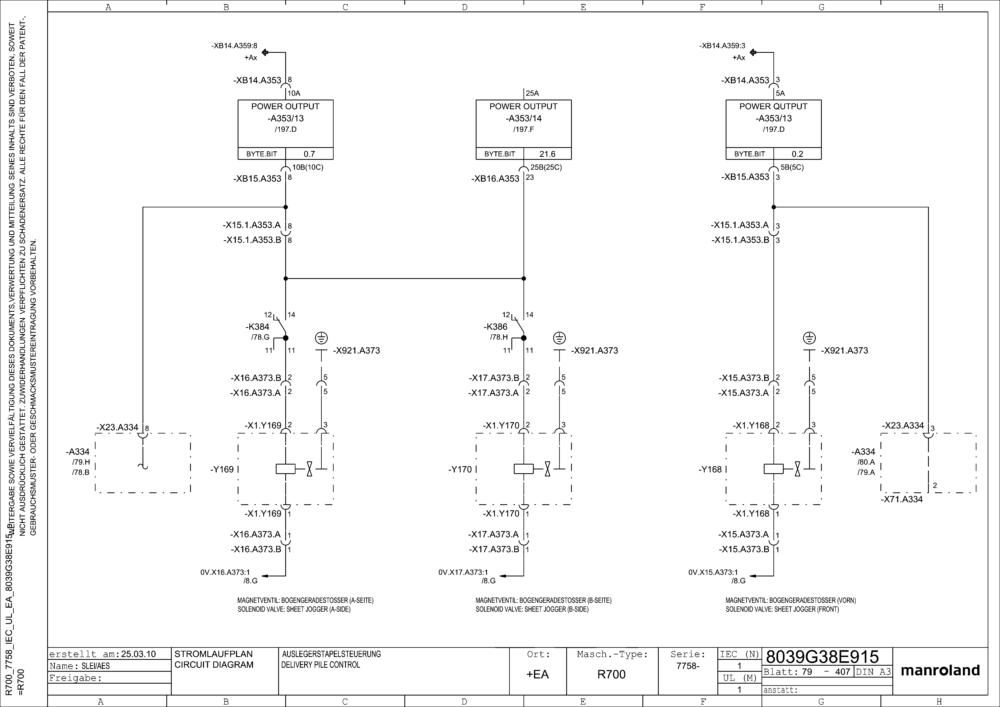

# +EA — Sheet 79 of 407 — AUSLEGERSTAPELSTEUERUNG

**DELIVERY PILE CONTROL**

> Part of the manroland **R700** printing press IEC/UL circuit diagrams.
> Drawing class: **Stromlaufplan / Circuit diagram** (DIN A3).
> Document `+EA` covers the **Printing unit** machine section.

## At a glance

| Field | Value |
|---|---|
| Document | `+EA`  (8039G38E915) |
| Sheet | **79** of 407 |
| Section (DE) | AUSLEGERSTAPELSTEUERUNG |
| Section (EN) | DELIVERY PILE CONTROL |
| Section type | CIRCUIT — Circuit diagram |
| Machine type | `R700` |
| Series | `7758` |
| Created | 25.03.10 |
| Replaces | — |
| Columns used | A, B, C, D, E, F, G, H |
| Path numbers | — |
| Labels on sheet | 130 |
| Cross-refs out | 12 |
| Cross-refs in | 49 |

**Previous:** [+EA sheet 78](SHEET_0078.md) · **Next:** [+EA sheet 80](SHEET_0080.md) · **Document TOC:** [_TOC.md](_TOC.md)  (+EA) · **Master TOC:** [all sheets](../_MASTER_TOC.md)

## Sheet image (300 DPI, exact vector render)



_Rendered directly from the PDF vector layer at 300 DPI (1-bit), no OCR and no resampling. Use it to confirm anything ambiguous in the text below._

## Cross-references on this sheet

Each entry is a wire leaving this sheet. The printed token is `/sheet.column`; the link resolves to that sheet inside the same document.

| Ref | Target sheet | Col | Path | Destination on target | Target section | From col |
|---|---|---|---|---|---|---|
| `/197.F` | [+EA sheet 197](SHEET_0197.md) | F | — | — | REFERENZMODUL | E |
| `/197.D` | [+EA sheet 197](SHEET_0197.md) | D | — | — | REFERENZMODUL | B |
| `/197.D` | [+EA sheet 197](SHEET_0197.md) | D | — | — | REFERENZMODUL | G |
| `/78.G` | [+EA sheet 78](SHEET_0078.md) | G | — | — | AUSLEGERSTAPELSTEUERUNG | B |
| `/78.H` | [+EA sheet 78](SHEET_0078.md) | H | — | — | AUSLEGERSTAPELSTEUERUNG | D |
| `/80.A` | [+EA sheet 80](SHEET_0080.md) | A | — | — | AUSLEGERSTAPELSTEUERUNG: BEDIENKOMMANDOS | G |
| `/79.A` | [+EA sheet 79](SHEET_0079.md) | A | — | — | AUSLEGERSTAPELSTEUERUNG | G |
| `/79.H` | [+EA sheet 79](SHEET_0079.md) | H | — | — | AUSLEGERSTAPELSTEUERUNG | A |
| `/78.B` | [+EA sheet 78](SHEET_0078.md) | B | — | — | AUSLEGERSTAPELSTEUERUNG | A |
| `/8.G` | [+EA sheet 8](SHEET_0008.md) | G | — | 0V.X16.A373:1 0V.X17.A373:1 0V.X15.A373:1 | SPANNUNGSVERSORGUNG: 400V, 24V | D |
| `/8.G` | [+EA sheet 8](SHEET_0008.md) | G | — | 0V.X16.A373:1 0V.X17.A373:1 0V.X15.A373:1 | SPANNUNGSVERSORGUNG: 400V, 24V | D |
| `/8.G` | [+EA sheet 8](SHEET_0008.md) | G | — | 0V.X16.A373:1 0V.X17.A373:1 0V.X15.A373:1 | SPANNUNGSVERSORGUNG: 400V, 24V | D |

### Incoming references (sheets that point here)

Every other sheet that sends a wire to this one. `Back-ref` is the token printed on *that* sheet; `Path` is its line number.

| From sheet | Cols | Back-ref | Path | Refs | What continues there |
|---|---|---|---|---|---|
| [+EA#8](SHEET_0008.md) | G | `/8.G` | — | 3 | 0V.X15.A373:1; 0V.X16.A373:1; 0V.X17.A373:1 |
| [+EA#78](SHEET_0078.md) | B | `/78.B` | — | 1 | A334 |
| [+EA#79](SHEET_0079.md) | A, G | `/79.A`, `/79.G` | — | 2 | — |
| [+EA#80](SHEET_0080.md) | A | `/80.A` | — | 1 | — |
| [+EA#197](SHEET_0197.md) | D, F | `/197.D`, `/197.F` | — | 3 | — |
| [+EA#221](SHEET_0221.md) | H | `/221.H` | — | 9 | — |
| [+EA#259](SHEET_0259.md) | F | `/259.F` | — | 2 | — |
| [+EA#260](SHEET_0260.md) | F, G, H | `/260.F`, `/260.G`, `/260.H` | — | 6 | — |
| [+EA#261](SHEET_0261.md) | B, G | `/261.B`, `/261.G` | — | 7 | — |
| [+EA#262](SHEET_0262.md) | F | `/262.F` | — | 6 | — |
| [+EA#263](SHEET_0263.md) | B | `/263.B` | — | 6 | — |
| [+EA#265](SHEET_0265.md) | A | `/265.A` | — | 2 | — |
| [+EA#285](SHEET_0285.md) | E | `/285.E` | — | 1 | — |


## Devices on this sheet

| Tag | Class | Class meaning (IEC) | Col | Sub | Terminal | Sign |
|---|---|---|---|---|---|---|
| `A353/14` | A | Baugruppe / assembly, module, PC board | E | 14 | — | — |
| `A353/13` | A | Baugruppe / assembly, module, PC board | G | 13 | — | — |
| `A353/13` | A | Baugruppe / assembly, module, PC board | B | 13 | — | — |
| `K386` | K | Relais / relay, contactor | D | — | — | — |
| `Y170` | Y | Magnetventil / solenoid valve, actuator | D | — | — | — |
| `Y168` | Y | Magnetventil / solenoid valve, actuator | F | — | — | — |
| `A334` | A | Baugruppe / assembly, module, PC board | G | — | — | — |
| `A334` | A | Baugruppe / assembly, module, PC board | A | — | — | — |
| `K384` | K | Relais / relay, contactor | B | — | — | — |
| `Y169` | Y | Magnetventil / solenoid valve, actuator | B | — | — | — |
| `21.6` | — | cross-device reference | E | — | — | — |
| `XB16.A353` | — | cross-device reference | D | — | — | — |
| `0.2` | — | cross-device reference | G | — | — | — |
| `XB15.A353` | — | cross-device reference | F | — | — | — |
| `XB14.A353` | — | cross-device reference | F | — | — | — |
| `X15.1.A353.A` | — | cross-device reference | F | — | — | — |
| `X15.1.A353.B` | — | cross-device reference | F | — | — | — |
| `0.7` | — | cross-device reference | C | — | — | — |
| `XB14.A353` | — | cross-device reference | B | — | — | — |
| `XB15.A353` | — | cross-device reference | B | — | — | — |
| `X15.1.A353.A` | — | cross-device reference | B | — | — | — |
| `X15.1.A353.B` | — | cross-device reference | B | — | — | — |
| `XB14.A359:8` | — | cross-device reference | B | — | 8 | — |
| `XB14.A359:3` | — | cross-device reference | F | — | 3 | — |
| `X1.Y170` | — | cross-device reference | D | — | — | — |
| `X1.Y170` | — | cross-device reference | D | — | — | — |
| `X1.Y168` | — | cross-device reference | F | — | — | — |
| `X1.Y168` | — | cross-device reference | F | — | — | — |
| `X17.A373.B` | — | cross-device reference | D | — | — | — |
| `X15.A373.B` | — | cross-device reference | F | — | — | — |
| `X15.A373.A` | — | cross-device reference | F | — | — | — |
| `X17.A373.A` | — | cross-device reference | D | — | — | — |
| `X23.A334` | — | cross-device reference | H | — | — | — |
| `X23.A334` | — | cross-device reference | A | — | — | — |
| `X1.Y169` | — | cross-device reference | B | — | — | — |
| `X1.Y169` | — | cross-device reference | B | — | — | — |
| `X16.A373.B` | — | cross-device reference | B | — | — | — |
| `X16.A373.A` | — | cross-device reference | B | — | — | — |
| `X17.A373.B` | — | cross-device reference | D | — | — | — |
| `X15.A373.B` | — | cross-device reference | F | — | — | — |
| `X17.A373.A` | — | cross-device reference | D | — | — | — |
| `X15.A373.A` | — | cross-device reference | F | — | — | — |
| `X16.A373.B` | — | cross-device reference | B | — | — | — |
| `X16.A373.A` | — | cross-device reference | B | — | — | — |
| `X921.A373` | — | cross-device reference | E | — | — | — |
| `X921.A373` | — | cross-device reference | G | — | — | — |
| `X71.A334` | — | cross-device reference | H | — | — | — |
| `X921.A373` | — | cross-device reference | C | — | — | — |

## Potentials / nets

| Potential | Count | Columns | Attached devices | Terminals |
|---|---|---|---|---|
| `0V` | 3 | B, D, F | `A373`, `X15`, `X16`, `X17` | `1` |


A potential such as `L24+/4` or `M24+` is a named supply/return rail; every place it appears on this sheet is electrically common.

## Wire-end annotations (grouped as printed)

A wire that continues elsewhere is annotated with a small cluster: the destination description, the path/line number `#NN`, and the `/sheet.column` cross reference. Each row below is one such cluster exactly as it is grouped on the drawing.

| Col | Y | Path | Cross-ref | Text on the wire |
|---|---|---|---|---|
| B | 50.6 | — | — | `XB14.A359:8` |
| F | 50.6 | — | — | `XB14.A359:3` |
| B | 64.8 | — | — | `+Ax` |
| F | 64.8 | — | — | `+Ax` |
| B | 91.0 | — | — | `XB14.A353 8` |
| F | 91.0 | — | — | `XB14.A353 3` |
| C | 107.3 | — | — | `10A` |
| E | 107.3 | — | — | `25A` |
| G | 107.3 | — | — | `5A` |
| B | 122.5 | — | — | `POWER OUTPUT` |
| D | 122.5 | — | — | `POWER OUTPUT` |
| G | 122.5 | — | — | `POWER QUTPUT` |
| B | 136.4 | — | — | `A353/13` |
| E | 136.4 | — | — | `A353/14` |
| G | 136.4 | — | — | `A353/13` |
| B | 150.2 | — | `/197.D` | — |
| E | 150.2 | — | `/197.F` | — |
| G | 150.2 | — | `/197.D` | — |
| B | 179.2 | — | — | `BYTE.BIT 0.7` |
| D | 179.2 | — | — | `BYTE.BIT 21.6` |
| G | 179.2 | — | — | `BYTE.BIT 0.2` |
| C | 195.2 | — | — | `10B(10C)` |
| E | 195.2 | — | — | `25B(25C)` |
| G | 195.2 | — | — | `5B(5C)` |
| F | 205.8 | — | — | `XB15.A353 3` |
| B | 207.2 | — | — | `XB15.A353 8` |
| D | 207.2 | — | — | `XB16.A353 23` |
| B | 263.2 | — | — | `X15.1.A353.A 8` |
| F | 263.2 | — | — | `X15.1.A353.A 3` |
| B | 280.9 | — | — | `X15.1.A353.B 8` |
| F | 280.9 | — | — | `X15.1.A353.B 3` |
| B | 370.9 | — | — | `K384 14` |
| B | 370.9 | — | — | `12` |
| D | 370.9 | — | — | `K386 14` |
| D | 370.9 | — | — | `12` |
| B | 397.5 | — | `/78.G` | — |
| D | 397.5 | — | `/78.H` | — |
| C | 412.7 | — | — | `X921.A373` |
| F | 412.7 | — | — | `X921.A373 X921.A373` |
| B | 413.5 | — | — | `11 11` |
| D | 413.5 | — | — | `11 11` |
| B | 445.4 | — | — | `X16.A373.B 2` |
| C | 445.4 | — | — | `5` |
| E | 445.4 | — | — | `X17.A373.B 2 X15.A373.B 2` |
| E | 445.4 | — | — | `5` |
| G | 445.4 | — | — | `5` |
| B | 462.4 | — | — | `X16.A373.A 2` |
| C | 462.4 | — | — | `5` |
| E | 462.4 | — | — | `X17.A373.A 2 X15.A373.A 2` |
| E | 462.4 | — | — | `5` |
| G | 462.4 | — | — | `5` |
| H | 502.0 | — | — | `X23.A334 3` |
| B | 502.1 | — | — | `X1.Y169 2` |
| C | 502.1 | — | — | `3` |
| D | 502.1 | — | — | `X1.Y170 2` |
| E | 502.1 | — | — | `3` |
| F | 502.1 | — | — | `X1.Y168 2` |
| G | 502.1 | — | — | `3` |
| A | 504.2 | — | — | `X23.A334 8` |
| A | 533.2 | — | — | `A334` |
| G | 533.2 | — | — | `A334` |
| A | 546.3 | — | `/79.H`, `/78.B` | — |
| G | 546.3 | — | `/80.A`, `/79.A` | — |
| B | 554.6 | — | — | `Y169` |
| D | 554.6 | — | — | `Y170` |
| F | 554.6 | — | — | `Y168` |
| H | 574.3 | — | — | `2` |
| H | 589.9 | — | — | `X71.A334` |
| B | 607.0 | — | — | `X1.Y169 1` |
| D | 607.0 | — | — | `X1.Y170 1` |
| F | 607.0 | — | — | `X1.Y168 1` |
| B | 631.7 | — | — | `X16.A373.A 1` |
| E | 631.7 | — | — | `X17.A373.A 1 X15.A373.A 1` |
| B | 649.5 | — | — | `X16.A373.B 1` |
| E | 649.5 | — | — | `X17.A373.B 1 X15.A373.B 1` |
| D | 677.8 | — | `/8.G`, `/8.G`, `/8.G` | `0V.X16.A373:1 0V.X17.A373:1 0V.X15.A373:1` |
| C | 712.1 | — | — | `MAGNETVENTIL: BOGENGERADESTOSSER (A SEITE) SOLENOID VALVE: SHEET JOGGER (A SIDE)` |
| E | 712.1 | — | — | `MAGNETVENTIL: BOGENGERADESTOSSER (B SEITE) SOLENOID VALVE: SHEET JOGGER (B SIDE)` |
| G | 712.1 | — | — | `MAGNETVENTIL: BOGENGERADESTOSSER (VORN) SOLENOID VALVE: SHEET JOGGER (FRONT)` |


## Reconstructed tables

This sheet carries tabular content (pin map / terminal assignment / index). The grid below was rebuilt from the drawing's own rule lines, so each row is exactly one physical row of the table.

### Table 1 — 3 data rows × 2 columns (at x=283.5, y=119.1)

| POWER | OUTPUT A353/13 /197.D |
|---|---|
| `BYTE.BIT` | `0.7` |
| `XB15.A353` | `10B(10C) 8` |
| `X15.1.A353.A X15.1.A353.B` | `8 8` |


### Table 2 — 2 data rows × 2 columns (at x=566.9, y=119.1)

| POWER | OUTPUT A353/14 /197.F |
|---|---|
| `BYTE.BIT` | `21.6` |
| `XB16.A353` | `25B(25C) 23` |


### Table 3 — 2 data rows × 2 columns (at x=864.6, y=119.1)

| POWER | QUTPUT A353/13 /197.D |
|---|---|
| `BYTE.BIT` | `0.2` |
| `XB15.A353` | `5B(5C) 3` |


## Notes and free text on this sheet

| Text | Col | Y (pt) |
|---|---|---|
| `25A` | E | 107.29 |
| `25B(25C)` | E | 195.2 |
| `POWER OUTPUT` | D | 122.45 |
| `BYTE.BIT` | D | 179.78 |
| `5A` | G | 107.28 |
| `5B(5C)` | G | 195.2 |
| `POWER QUTPUT` | G | 122.45 |
| `BYTE.BIT` | F | 179.78 |
| `10A` | C | 107.29 |
| `10B(10C)` | C | 195.2 |
| `POWER OUTPUT` | B | 122.45 |
| `BYTE.BIT` | B | 179.78 |
| `+Ax` | B | 64.85 |
| `+Ax` | F | 64.85 |
| `MAGNETVENTIL: BOGENGERADESTOSSER (B SEITE)` | E | 712.12 |
| `SOLENOID VALVE: SHEET JOGGER (B SIDE)` | E | 722.75 |
| `MAGNETVENTIL: BOGENGERADESTOSSER (VORN)` | G | 712.13 |
| `SOLENOID VALVE: SHEET JOGGER (FRONT)` | G | 722.76 |
| `MAGNETVENTIL: BOGENGERADESTOSSER (A SEITE)` | C | 712.12 |
| `SOLENOID VALVE: SHEET JOGGER (A SIDE)` | C | 722.75 |

## Complete label inventory (exact text from the drawing)

Every text object inside the drawing area of this sheet, in DIN reading order (column A→H, then top→bottom). This is the authoritative list: if a string is not here it is not printed on this sheet.

| Col | Y | X | Dir | Type | Text |
|---|---|---|---|---|---|
| A | 504.2 | 114.8 | → | device ref | `X23.A334` |
| A | 506.3 | 172.6 | → | number | `8` |
| A | 533.2 | 78.5 | → | device tag | `A334` |
| A | 546.3 | 86.2 | → | cross-reference | `/79.H` |
| A | 558.7 | 85.9 | → | cross-reference | `/78.B` |
| B | 50.6 | 251.7 | → | device ref | `XB14.A359:8` |
| B | 64.8 | 291.1 | → | text | `+Ax` |
| B | 91.0 | 277.8 | → | device ref | `XB14.A353` |
| B | 122.5 | 299.3 | → | text | `POWER OUTPUT` |
| B | 136.4 | 318.8 | → | device tag | `A353/13` |
| B | 150.2 | 327.4 | → | cross-reference | `/197.D` |
| B | 179.8 | 293.4 | → | text | `BYTE.BIT` |
| B | 207.9 | 277.8 | → | device ref | `XB15.A353` |
| B | 263.2 | 265.3 | → | device ref | `X15.1.A353.A` |
| B | 280.9 | 266.2 | → | device ref | `X15.1.A353.B` |
| B | 371.0 | 314.1 | → | number | `12` |
| B | 384.4 | 292.5 | → | device tag | `K384` |
| B | 397.5 | 299.3 | → | cross-reference | `/78.G` |
| B | 413.5 | 315.2 | → | number | `11` |
| B | 445.4 | 275.0 | → | device ref | `X16.A373.B` |
| B | 463.1 | 274.1 | → | device ref | `X16.A373.A` |
| B | 502.1 | 291.4 | → | device ref | `X1.Y169` |
| B | 554.6 | 250.6 | → | device tag | `Y169` |
| B | 607.0 | 291.4 | → | device ref | `X1.Y169` |
| B | 631.7 | 274.1 | → | device ref | `X16.A373.A` |
| B | 649.4 | 275.0 | → | device ref | `X16.A373.B` |
| B | 677.8 | 238.7 | → | potential | `0V.X16.A373:1` |
| B | 687.7 | 290.0 | → | cross-reference | `/8.G` |
| C | 91.0 | 342.7 | → | number | `8` |
| C | 107.3 | 342.1 | → | text | `10A` |
| C | 179.2 | 361.7 | → | device ref | `0.7` |
| C | 195.2 | 347.8 | → | text | `10B(10C)` |
| C | 207.3 | 342.7 | → | number | `8` |
| C | 265.4 | 342.7 | → | number | `8` |
| C | 282.4 | 342.7 | → | number | `8` |
| C | 371.0 | 342.1 | → | number | `14` |
| C | 412.7 | 396.6 | → | device ref | `X921.A373` |
| C | 413.5 | 342.1 | → | number | `11` |
| C | 445.4 | 342.7 | → | number | `2` |
| C | 445.4 | 385.2 | → | number | `5` |
| C | 462.4 | 342.7 | → | number | `2` |
| C | 462.4 | 385.2 | → | number | `5` |
| C | 502.1 | 342.7 | → | number | `2` |
| C | 502.1 | 385.2 | → | number | `3` |
| C | 608.4 | 342.1 | → | number | `1` |
| C | 633.9 | 342.1 | → | number | `1` |
| C | 650.9 | 342.1 | → | number | `1` |
| C | 712.1 | 282.9 | → | text | `MAGNETVENTIL: BOGENGERADESTOSSER (A SEITE)` |
| C | 722.7 | 283.2 | → | text | `SOLENOID VALVE: SHEET JOGGER (A SIDE)` |
| D | 122.5 | 582.8 | → | text | `POWER OUTPUT` |
| D | 179.8 | 576.9 | → | text | `BYTE.BIT` |
| D | 207.9 | 561.3 | → | device ref | `XB16.A353` |
| D | 371.0 | 597.5 | → | number | `12` |
| D | 384.4 | 576.0 | → | device tag | `K386` |
| D | 397.5 | 583.7 | → | cross-reference | `/78.H` |
| D | 413.5 | 598.7 | → | number | `11` |
| D | 445.4 | 558.4 | → | device ref | `X17.A373.B` |
| D | 463.1 | 557.6 | → | device ref | `X17.A373.A` |
| D | 502.1 | 574.9 | → | device ref | `X1.Y170` |
| D | 554.6 | 534.0 | → | device tag | `Y170` |
| D | 607.0 | 574.9 | → | device ref | `X1.Y170` |
| D | 631.7 | 557.6 | → | device ref | `X17.A373.A` |
| D | 649.4 | 558.4 | → | device ref | `X17.A373.B` |
| D | 677.8 | 522.1 | → | potential | `0V.X17.A373:1` |
| D | 687.7 | 573.4 | → | cross-reference | `/8.G` |
| E | 107.3 | 626.2 | → | text | `25A` |
| E | 136.4 | 602.2 | → | device tag | `A353/14` |
| E | 150.2 | 611.3 | → | cross-reference | `/197.F` |
| E | 179.2 | 642.5 | → | device ref | `21.6` |
| E | 195.2 | 631.8 | → | text | `25B(25C)` |
| E | 207.3 | 626.2 | → | number | `23` |
| E | 371.0 | 625.6 | → | number | `14` |
| E | 412.7 | 680.0 | → | device ref | `X921.A373` |
| E | 413.5 | 625.6 | → | number | `11` |
| E | 445.4 | 626.2 | → | number | `2` |
| E | 445.4 | 668.7 | → | number | `5` |
| E | 462.4 | 626.2 | → | number | `2` |
| E | 462.4 | 668.7 | → | number | `5` |
| E | 502.1 | 626.2 | → | number | `2` |
| E | 502.1 | 668.7 | → | number | `3` |
| E | 608.4 | 625.6 | → | number | `1` |
| E | 633.9 | 625.6 | → | number | `1` |
| E | 650.9 | 625.6 | → | number | `1` |
| E | 712.1 | 566.4 | → | text | `MAGNETVENTIL: BOGENGERADESTOSSER (B SEITE)` |
| E | 722.7 | 566.6 | → | text | `SOLENOID VALVE: SHEET JOGGER (B SIDE)` |
| F | 50.6 | 832.8 | → | device ref | `XB14.A359:3` |
| F | 64.8 | 872.2 | → | text | `+Ax` |
| F | 91.0 | 858.9 | → | device ref | `XB14.A353` |
| F | 179.8 | 874.5 | → | text | `BYTE.BIT` |
| F | 205.8 | 858.9 | → | device ref | `XB15.A353` |
| F | 263.2 | 846.4 | → | device ref | `X15.1.A353.A` |
| F | 280.9 | 847.3 | → | device ref | `X15.1.A353.B` |
| F | 445.4 | 856.1 | → | device ref | `X15.A373.B` |
| F | 463.1 | 855.2 | → | device ref | `X15.A373.A` |
| F | 502.1 | 872.5 | → | device ref | `X1.Y168` |
| F | 554.6 | 831.7 | → | device tag | `Y168` |
| F | 607.0 | 872.5 | → | device ref | `X1.Y168` |
| F | 631.7 | 855.2 | → | device ref | `X15.A373.A` |
| F | 649.4 | 856.1 | → | device ref | `X15.A373.B` |
| F | 677.8 | 819.8 | → | potential | `0V.X15.A373:1` |
| F | 687.7 | 871.1 | → | cross-reference | `/8.G` |
| G | 91.0 | 923.8 | → | number | `3` |
| G | 107.3 | 923.8 | → | text | `5A` |
| G | 122.5 | 880.4 | → | text | `POWER QUTPUT` |
| G | 136.4 | 899.9 | → | device tag | `A353/13` |
| G | 150.2 | 908.5 | → | cross-reference | `/197.D` |
| G | 179.2 | 942.8 | → | device ref | `0.2` |
| G | 195.2 | 929.5 | → | text | `5B(5C)` |
| G | 207.3 | 923.8 | → | number | `3` |
| G | 265.4 | 923.8 | → | number | `3` |
| G | 282.4 | 923.8 | → | number | `3` |
| G | 412.7 | 977.7 | → | device ref | `X921.A373` |
| G | 445.4 | 923.8 | → | number | `2` |
| G | 445.4 | 966.3 | → | number | `5` |
| G | 462.4 | 923.8 | → | number | `2` |
| G | 462.4 | 966.3 | → | number | `5` |
| G | 502.1 | 923.8 | → | number | `2` |
| G | 502.1 | 966.3 | → | number | `3` |
| G | 533.2 | 1014.0 | → | device tag | `A334` |
| G | 546.3 | 1021.0 | → | cross-reference | `/80.A` |
| G | 558.7 | 1021.0 | → | cross-reference | `/79.A` |
| G | 608.4 | 923.2 | → | number | `1` |
| G | 633.9 | 923.2 | → | number | `1` |
| G | 650.9 | 923.2 | → | number | `1` |
| G | 712.1 | 864.0 | → | text | `MAGNETVENTIL: BOGENGERADESTOSSER (VORN)` |
| G | 722.8 | 864.3 | → | text | `SOLENOID VALVE: SHEET JOGGER (FRONT)` |
| H | 502.0 | 1050.2 | → | device ref | `X23.A334` |
| H | 506.3 | 1108.1 | → | number | `3` |
| H | 574.3 | 1110.9 | → | number | `2` |
| H | 589.9 | 1048.8 | → | device ref | `X71.A334` |

## Reading-order text block

The same content as a plain block, grouped by DIN column — convenient to paste or to match against a visual description.

```text
=== Column A ===
 504.2  114.8  devref       X23.A334
 506.3  172.6  numeric      8
 533.2   78.5  devtag       A334
 546.3   86.2  xref         /79.H
 558.7   85.9  xref         /78.B
=== Column B ===
  50.6  251.7  devref       XB14.A359:8
  64.8  291.1  text         +Ax
  91.0  277.8  devref       XB14.A353
 122.5  299.3  text         POWER OUTPUT
 136.4  318.8  devtag       A353/13
 150.2  327.4  xref         /197.D
 179.8  293.4  text         BYTE.BIT
 207.9  277.8  devref       XB15.A353
 263.2  265.3  devref       X15.1.A353.A
 280.9  266.2  devref       X15.1.A353.B
 371.0  314.1  numeric      12
 384.4  292.5  devtag       K384
 397.5  299.3  xref         /78.G
 413.5  315.2  numeric      11
 445.4  275.0  devref       X16.A373.B
 463.1  274.1  devref       X16.A373.A
 502.1  291.4  devref       X1.Y169
 554.6  250.6  devtag       Y169
 607.0  291.4  devref       X1.Y169
 631.7  274.1  devref       X16.A373.A
 649.4  275.0  devref       X16.A373.B
 677.8  238.7  net          0V.X16.A373:1
 687.7  290.0  xref         /8.G
=== Column C ===
  91.0  342.7  numeric      8
 107.3  342.1  text         10A
 179.2  361.7  devref       0.7
 195.2  347.8  text         10B(10C)
 207.3  342.7  numeric      8
 265.4  342.7  numeric      8
 282.4  342.7  numeric      8
 371.0  342.1  numeric      14
 412.7  396.6  devref       X921.A373
 413.5  342.1  numeric      11
 445.4  342.7  numeric      2
 445.4  385.2  numeric      5
 462.4  342.7  numeric      2
 462.4  385.2  numeric      5
 502.1  342.7  numeric      2
 502.1  385.2  numeric      3
 608.4  342.1  numeric      1
 633.9  342.1  numeric      1
 650.9  342.1  numeric      1
 712.1  282.9  text         MAGNETVENTIL: BOGENGERADESTOSSER (A SEITE)
 722.7  283.2  text         SOLENOID VALVE: SHEET JOGGER (A SIDE)
=== Column D ===
 122.5  582.8  text         POWER OUTPUT
 179.8  576.9  text         BYTE.BIT
 207.9  561.3  devref       XB16.A353
 371.0  597.5  numeric      12
 384.4  576.0  devtag       K386
 397.5  583.7  xref         /78.H
 413.5  598.7  numeric      11
 445.4  558.4  devref       X17.A373.B
 463.1  557.6  devref       X17.A373.A
 502.1  574.9  devref       X1.Y170
 554.6  534.0  devtag       Y170
 607.0  574.9  devref       X1.Y170
 631.7  557.6  devref       X17.A373.A
 649.4  558.4  devref       X17.A373.B
 677.8  522.1  net          0V.X17.A373:1
 687.7  573.4  xref         /8.G
=== Column E ===
 107.3  626.2  text         25A
 136.4  602.2  devtag       A353/14
 150.2  611.3  xref         /197.F
 179.2  642.5  devref       21.6
 195.2  631.8  text         25B(25C)
 207.3  626.2  numeric      23
 371.0  625.6  numeric      14
 412.7  680.0  devref       X921.A373
 413.5  625.6  numeric      11
 445.4  626.2  numeric      2
 445.4  668.7  numeric      5
 462.4  626.2  numeric      2
 462.4  668.7  numeric      5
 502.1  626.2  numeric      2
 502.1  668.7  numeric      3
 608.4  625.6  numeric      1
 633.9  625.6  numeric      1
 650.9  625.6  numeric      1
 712.1  566.4  text         MAGNETVENTIL: BOGENGERADESTOSSER (B SEITE)
 722.7  566.6  text         SOLENOID VALVE: SHEET JOGGER (B SIDE)
=== Column F ===
  50.6  832.8  devref       XB14.A359:3
  64.8  872.2  text         +Ax
  91.0  858.9  devref       XB14.A353
 179.8  874.5  text         BYTE.BIT
 205.8  858.9  devref       XB15.A353
 263.2  846.4  devref       X15.1.A353.A
 280.9  847.3  devref       X15.1.A353.B
 445.4  856.1  devref       X15.A373.B
 463.1  855.2  devref       X15.A373.A
 502.1  872.5  devref       X1.Y168
 554.6  831.7  devtag       Y168
 607.0  872.5  devref       X1.Y168
 631.7  855.2  devref       X15.A373.A
 649.4  856.1  devref       X15.A373.B
 677.8  819.8  net          0V.X15.A373:1
 687.7  871.1  xref         /8.G
=== Column G ===
  91.0  923.8  numeric      3
 107.3  923.8  text         5A
 122.5  880.4  text         POWER QUTPUT
 136.4  899.9  devtag       A353/13
 150.2  908.5  xref         /197.D
 179.2  942.8  devref       0.2
 195.2  929.5  text         5B(5C)
 207.3  923.8  numeric      3
 265.4  923.8  numeric      3
 282.4  923.8  numeric      3
 412.7  977.7  devref       X921.A373
 445.4  923.8  numeric      2
 445.4  966.3  numeric      5
 462.4  923.8  numeric      2
 462.4  966.3  numeric      5
 502.1  923.8  numeric      2
 502.1  966.3  numeric      3
 533.2 1014.0  devtag       A334
 546.3 1021.0  xref         /80.A
 558.7 1021.0  xref         /79.A
 608.4  923.2  numeric      1
 633.9  923.2  numeric      1
 650.9  923.2  numeric      1
 712.1  864.0  text         MAGNETVENTIL: BOGENGERADESTOSSER (VORN)
 722.8  864.3  text         SOLENOID VALVE: SHEET JOGGER (FRONT)
=== Column H ===
 502.0 1050.2  devref       X23.A334
 506.3 1108.1  numeric      3
 574.3 1110.9  numeric      2
 589.9 1048.8  devref       X71.A334
```

---
_Generated from the PDF vector text layer; no OCR. Source: `R700_7758_IEC_UL_EA_8039G38E915_p`, sheet 79._
