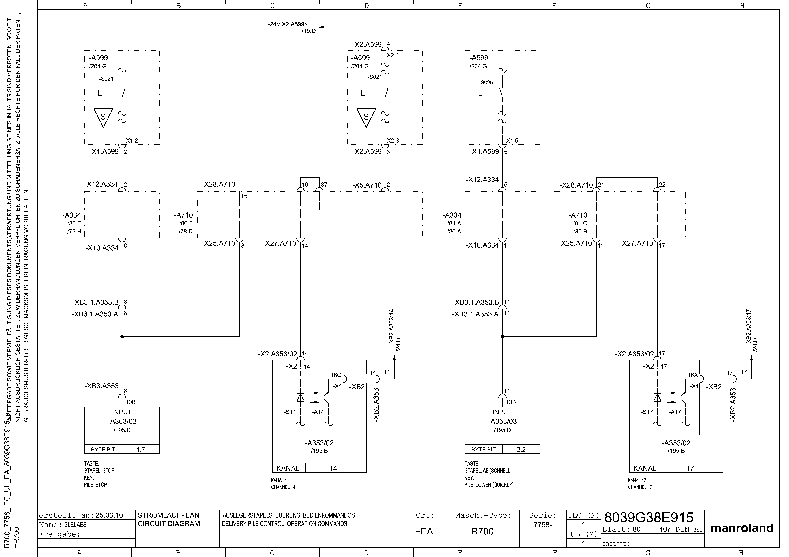

# +EA — Sheet 80 of 407 — AUSLEGERSTAPELSTEUERUNG: BEDIENKOMMANDOS

**DELIVERY PILE CONTROL: OPERATION COMMANDS**

> Part of the manroland **R700** printing press IEC/UL circuit diagrams.
> Drawing class: **Stromlaufplan / Circuit diagram** (DIN A3).
> Document `+EA` covers the **Printing unit** machine section.

## At a glance

| Field | Value |
|---|---|
| Document | `+EA`  (8039G38E915) |
| Sheet | **80** of 407 |
| Section (DE) | AUSLEGERSTAPELSTEUERUNG: BEDIENKOMMANDOS |
| Section (EN) | DELIVERY PILE CONTROL: OPERATION COMMANDS |
| Section type | CIRCUIT — Circuit diagram |
| Machine type | `R700` |
| Series | `7758` |
| Created | 25.03.10 |
| Replaces | — |
| Columns used | A, B, C, D, E, F, G, H |
| Path numbers | — |
| Labels on sheet | 133 |
| Cross-refs out | 18 |
| Cross-refs in | 46 |

**Previous:** [+EA sheet 79](SHEET_0079.md) · **Next:** [+EA sheet 81](SHEET_0081.md) · **Document TOC:** [_TOC.md](_TOC.md)  (+EA) · **Master TOC:** [all sheets](../_MASTER_TOC.md)

## Sheet image (300 DPI, exact vector render)



_Rendered directly from the PDF vector layer at 300 DPI (1-bit), no OCR and no resampling. Use it to confirm anything ambiguous in the text below._

## Cross-references on this sheet

Each entry is a wire leaving this sheet. The printed token is `/sheet.column`; the link resolves to that sheet inside the same document.

| Ref | Target sheet | Col | Path | Destination on target | Target section | From col |
|---|---|---|---|---|---|---|
| `/19.D` | [+EA sheet 19](SHEET_0019.md) | D | — | 24V.X2.A599:4 | SPANNUNGSVERSORGUNG: 400V, 24V | C |
| `/204.G` | [+EA sheet 204](SHEET_0204.md) | G | — | A599 | REFERENZMODUL | A |
| `/204.G` | [+EA sheet 204](SHEET_0204.md) | G | — | A599 | REFERENZMODUL | D |
| `/204.G` | [+EA sheet 204](SHEET_0204.md) | G | — | A599 | REFERENZMODUL | E |
| `/80.E` | [+EA sheet 80](SHEET_0080.md) | E | — | — | AUSLEGERSTAPELSTEUERUNG: BEDIENKOMMANDOS | A |
| `/79.H` | [+EA sheet 79](SHEET_0079.md) | H | — | — | AUSLEGERSTAPELSTEUERUNG | A |
| `/81.A` | [+EA sheet 81](SHEET_0081.md) | A | — | — | AUSLEGERSTAPELSTEUERUNG: BEDIENKOMMANDOS | E |
| `/80.A` | [+EA sheet 80](SHEET_0080.md) | A | — | — | AUSLEGERSTAPELSTEUERUNG: BEDIENKOMMANDOS | E |
| `/80.F` | [+EA sheet 80](SHEET_0080.md) | F | — | — | AUSLEGERSTAPELSTEUERUNG: BEDIENKOMMANDOS | B |
| `/78.D` | [+EA sheet 78](SHEET_0078.md) | D | — | — | AUSLEGERSTAPELSTEUERUNG | B |
| `/81.C` | [+EA sheet 81](SHEET_0081.md) | C | — | — | AUSLEGERSTAPELSTEUERUNG: BEDIENKOMMANDOS | F |
| `/80.B` | [+EA sheet 80](SHEET_0080.md) | B | — | — | AUSLEGERSTAPELSTEUERUNG: BEDIENKOMMANDOS | F |
| `/24.D` | [+EA sheet 24](SHEET_0024.md) | D | — | XB2.A353:14 | BUSVERBINDUNGEN: SICHERHEITSBUS | D |
| `/24.D` | [+EA sheet 24](SHEET_0024.md) | D | — | XB2.A353:17 | BUSVERBINDUNGEN: SICHERHEITSBUS | H |
| `/195.D` | [+EA sheet 195](SHEET_0195.md) | D | — | — | REFERENZMODUL | A |
| `/195.D` | [+EA sheet 195](SHEET_0195.md) | D | — | — | REFERENZMODUL | E |
| `/195.B` | [+EA sheet 195](SHEET_0195.md) | B | — | — | REFERENZMODUL | C |
| `/195.B` | [+EA sheet 195](SHEET_0195.md) | B | — | — | REFERENZMODUL | G |

### Incoming references (sheets that point here)

Every other sheet that sends a wire to this one. `Back-ref` is the token printed on *that* sheet; `Path` is its line number.

| From sheet | Cols | Back-ref | Path | Refs | What continues there |
|---|---|---|---|---|---|
| [+EA#19](SHEET_0019.md) | D | `/19.D` | — | 1 | 24V.X2.A599:4 |
| [+EA#24](SHEET_0024.md) | D | `/24.D` | — | 2 | XB2.A353:14; XB2.A353:17 |
| [+EA#78](SHEET_0078.md) | D | `/78.D` | — | 1 | — |
| [+EA#79](SHEET_0079.md) | G | `/79.G` | — | 1 | — |
| [+EA#80](SHEET_0080.md) | A, B, E, F | `/80.A`, `/80.B`, `/80.E`, `/80.F` | — | 4 | — |
| [+EA#81](SHEET_0081.md) | A, C | `/81.A`, `/81.C` | — | 2 | — |
| [+EA#195](SHEET_0195.md) | B, D | `/195.B`, `/195.D` | — | 4 | — |
| [+EA#204](SHEET_0204.md) | G | `/204.G` | — | 3 | — |
| [+EA#212](SHEET_0212.md) | B | `/212.B` | — | 2 | — |
| [+EA#224](SHEET_0224.md) | G | `/224.G` | — | 2 | — |
| [+EA#225](SHEET_0225.md) | C | `/225.C` | — | 2 | — |
| [+EA#230](SHEET_0230.md) | C | `/230.C` | — | 2 | — |
| [+EA#234](SHEET_0234.md) | C, D, F | `/234.C`, `/234.D`, `/234.F` | — | 6 | — |
| [+EA#243](SHEET_0243.md) | E | `/243.E` | — | 1 | — |
| [+EA#253](SHEET_0253.md) | H | `/253.H` | — | 2 | — |
| [+EA#257](SHEET_0257.md) | A | `/257.A` | — | 2 | — |
| [+EA#268](SHEET_0268.md) | C | `/268.C` | — | 2 | — |
| [+EA#271](SHEET_0271.md) | B | `/271.B` | — | 2 | — |
| [+EA#272](SHEET_0272.md) | G, H | `/272.G`, `/272.H` | — | 5 | — |


## Devices on this sheet

| Tag | Class | Class meaning (IEC) | Col | Sub | Terminal | Sign |
|---|---|---|---|---|---|---|
| `X1:2` | X | Klemme / terminal, plug connector | A | — | 2 | — |
| `S021` | S | Schalter / switch | A | — | — | — |
| `A599` | A | Baugruppe / assembly, module, PC board | A | — | — | — |
| `A353/03` | A | Baugruppe / assembly, module, PC board | A | 03 | — | — |
| `A334` | A | Baugruppe / assembly, module, PC board | A | — | — | — |
| `A710` | A | Baugruppe / assembly, module, PC board | B | — | — | — |
| `X1:5` | X | Klemme / terminal, plug connector | F | — | 5 | — |
| `S026` | S | Schalter / switch | E | — | — | — |
| `A599` | A | Baugruppe / assembly, module, PC board | E | — | — | — |
| `A353/03` | A | Baugruppe / assembly, module, PC board | E | 03 | — | — |
| `A334` | A | Baugruppe / assembly, module, PC board | E | — | — | — |
| `A710` | A | Baugruppe / assembly, module, PC board | F | — | — | — |
| `S14` | S | Schalter / switch | C | — | — | — |
| `A14` | A | Baugruppe / assembly, module, PC board | C | — | — | — |
| `X1` | X | Klemme / terminal, plug connector | D | — | — | — |
| `X2` | X | Klemme / terminal, plug connector | C | — | — | — |
| `XB2` | XB |  | D | — | — | — |
| `A353/02` | A | Baugruppe / assembly, module, PC board | C | 02 | — | — |
| `S17` | S | Schalter / switch | G | — | — | — |
| `A17` | A | Baugruppe / assembly, module, PC board | G | — | — | — |
| `X1` | X | Klemme / terminal, plug connector | G | — | — | — |
| `X2` | X | Klemme / terminal, plug connector | G | — | — | — |
| `XB2` | XB |  | H | — | — | — |
| `A353/02` | A | Baugruppe / assembly, module, PC board | G | 02 | — | — |
| `X2:4` | X | Klemme / terminal, plug connector | D | — | 4 | — |
| `X2:3` | X | Klemme / terminal, plug connector | D | — | 3 | — |
| `S021` | S | Schalter / switch | D | — | — | — |
| `A599` | A | Baugruppe / assembly, module, PC board | D | — | — | — |
| `X1.A599` | — | cross-device reference | A | — | — | — |
| `1.7` | — | cross-device reference | B | — | — | — |
| `XB3.A353` | — | cross-device reference | A | — | — | — |
| `X12.A334` | — | cross-device reference | A | — | — | — |
| `X10.A334` | — | cross-device reference | A | — | — | — |
| `XB3.1.A353.B` | — | cross-device reference | A | — | — | — |
| `XB3.1.A353.A` | — | cross-device reference | A | — | — | — |
| `X5.A710` | — | cross-device reference | D | — | — | — |
| `X27.A710` | — | cross-device reference | C | — | — | — |
| `X25.A710` | — | cross-device reference | B | — | — | — |
| `X1.A599` | — | cross-device reference | E | — | — | — |
| `2.2` | — | cross-device reference | F | — | — | — |
| `X12.A334` | — | cross-device reference | E | — | — | — |
| `X10.A334` | — | cross-device reference | E | — | — | — |
| `XB3.1.A353.B` | — | cross-device reference | E | — | — | — |
| `XB3.1.A353.A` | — | cross-device reference | E | — | — | — |
| `X28.A710` | — | cross-device reference | F | — | — | — |
| `XB2.A353` | — | cross-device reference | D | — | — | — |
| `XB2.A353` | — | cross-device reference | H | — | — | — |
| `X27.A710` | — | cross-device reference | G | — | — | — |
| `X25.A710` | — | cross-device reference | F | — | — | — |
| `X2.A599` | — | cross-device reference | D | — | — | — |
| `X2.A599` | — | cross-device reference | D | — | — | — |
| `XB2.A353:17` | — | cross-device reference | H | — | 17 | — |
| `XB2.A353:14` | — | cross-device reference | D | — | 14 | — |
| `X28.A710` | — | cross-device reference | B | — | — | — |

## Potentials / nets

| Potential | Count | Columns | Attached devices | Terminals |
|---|---|---|---|---|
| `24V` | 1 | C | `A599`, `X2` | `4` |


A potential such as `L24+/4` or `M24+` is a named supply/return rail; every place it appears on this sheet is electrically common.

## Wire-end annotations (grouped as printed)

A wire that continues elsewhere is annotated with a small cluster: the destination description, the path/line number `#NN`, and the `/sheet.column` cross reference. Each row below is one such cluster exactly as it is grouped on the drawing.

| Col | Y | Path | Cross-ref | Text on the wire |
|---|---|---|---|---|
| C | 32.9 | — | `/19.D` | `24V.X2.A599:4` |
| D | 62.7 | — | — | `X2.A599 4` |
| D | 79.6 | — | — | `X2:4` |
| A | 82.5 | — | `/204.G` | `A599` |
| D | 82.5 | — | `/204.G` | `A599` |
| E | 82.5 | — | `/204.G` | `A599` |
| D | 112.7 | — | — | `S021` |
| A | 115.5 | — | — | `S021` |
| E | 121.2 | — | — | `S026` |
| A | 171.2 | — | — | `S` |
| D | 171.2 | — | — | `S` |
| A | 208.6 | — | — | `X1:2` |
| D | 208.6 | — | — | `X2:3` |
| F | 208.6 | — | — | `X1:5` |
| A | 224.2 | — | — | `X1.A599 2` |
| D | 224.2 | — | — | `X2.A599 3` |
| E | 224.2 | — | — | `X1.A599 5` |
| E | 266.8 | — | — | `X12.A334 5` |
| A | 273.9 | — | — | `X12.A334 2` |
| B | 273.9 | — | — | `X28.A710` |
| C | 275.3 | — | — | `16` |
| D | 275.3 | — | — | `37` |
| D | 275.3 | — | — | `X5.A710 2` |
| G | 275.3 | — | — | `X28.A710 21 22` |
| C | 292.3 | — | — | `15` |
| A | 320.6 | — | — | `A334` |
| B | 320.6 | — | — | `A710` |
| E | 320.6 | — | — | `A334` |
| F | 320.6 | — | — | `A710` |
| A | 333.7 | — | `/80.E`, `/79.H` | — |
| B | 333.7 | — | `/80.F`, `/78.D` | — |
| E | 333.7 | — | `/81.A`, `/80.A` | — |
| F | 333.7 | — | `/81.C`, `/80.B` | — |
| C | 363.1 | — | — | `X25.A710 8 X27.A710 14` |
| G | 363.1 | — | — | `X25.A710 11 X27.A710 17` |
| E | 366.0 | — | — | `X10.A334 11` |
| A | 367.4 | — | — | `X10.A334 8` |
| A | 452.4 | — | — | `XB3.1.A353.B 8` |
| E | 452.4 | — | — | `XB3.1.A353.B 11` |
| D | 467.1 | — | `/24.D` | `XB2.A353:14` |
| H | 467.1 | — | `/24.D` | `XB2.A353:17` |
| A | 469.5 | — | — | `XB3.1.A353.A 8` |
| E | 469.5 | — | — | `XB3.1.A353.A 11` |
| C | 530.4 | — | — | `X2.A353/02 14` |
| G | 530.4 | — | — | `X2.A353/02 17` |
| C | 548.8 | — | — | `X2` |
| G | 548.8 | — | — | `X2` |
| D | 550.2 | — | — | `14 14` |
| H | 550.2 | — | — | `17 17` |
| D | 558.8 | — | — | `14` |
| H | 558.8 | — | — | `17` |
| D | 563.0 | — | — | `18C` |
| G | 563.0 | — | — | `16A` |
| A | 578.6 | — | — | `XB3.A353 8` |
| D | 580.0 | — | — | `X1` |
| D | 580.0 | — | — | `XB2` |
| G | 580.0 | — | — | `X1` |
| H | 580.0 | — | — | `XB2` |
| D | 586.2 | — | — | `XB2.A353` |
| H | 586.2 | — | — | `XB2.A353` |
| E | 587.1 | — | — | `11` |
| A | 604.1 | — | — | `10B` |
| F | 604.1 | — | — | `13B` |
| A | 618.6 | — | — | `INPUT` |
| E | 618.6 | — | — | `INPUT` |
| C | 619.0 | — | — | `S14 A14` |
| G | 619.0 | — | — | `S17 A17` |
| A | 632.4 | — | — | `A353/03` |
| E | 632.4 | — | — | `A353/03` |
| A | 646.2 | — | `/195.D` | — |
| E | 646.2 | — | `/195.D` | — |
| C | 665.0 | — | — | `A353/02` |
| G | 665.0 | — | — | `A353/02` |
| A | 675.3 | — | — | `BYTE.BIT 1.7` |
| E | 675.3 | — | — | `BYTE.BIT 2.2` |
| C | 677.4 | — | `/195.B` | — |
| G | 677.4 | — | `/195.B` | — |
| A | 697.9 | — | — | `KEY: PILE, STOP TASTE: STAPEL, STOP` |
| E | 697.9 | — | — | `KEY: PILE, LOWER (QUICKLY) TASTE: STAPEL, AB (SCHNELL)` |
| C | 703.3 | — | — | `KANAL 14` |
| G | 703.3 | — | — | `KANAL 17` |
| C | 723.6 | — | — | `KANAL 14 CHANNEL 14` |
| G | 723.6 | — | — | `KANAL 17 CHANNEL 17` |


## Reconstructed tables

This sheet carries tabular content (pin map / terminal assignment / index). The grid below was rebuilt from the drawing's own rule lines, so each row is exactly one physical row of the table.

### Table 1 — 4 data rows × 2 columns (at x=127.6, y=76.5)

| A599 /204.G S021 S | X1:2 |
|---|---|
| `X1.A599 X12.A334 X10.A334 XB3.1.A353.B XB3.1.A353.A` | `2 2 8 8 8` |
| `XB3.A353` | `8 10B` |
| `INPUT` | `A353/03 /195.D` |
| `BYTE.BIT` | `1.7` |


### Table 2 — 7 data rows × 4 columns (at x=361.4, y=41.1) — **/19.D**

| 15 |  | 16 37 |  |
|---|---|---|---|
| `8` | `X27.A710` | `14` |  |
|  | `X2.A353/02` | `14` |  |
|  | `X2` | `14` | `18C X1` |
|  | `S14` | `A14` |  |
|  |  | `A353/02` |  |
|  |  | `/195.B` |  |
|  | `KANAL` |  | `14` |


### Table 3 — 10 data rows × 14 columns (at x=524.4, y=41.1)

|  | X2.A599 | 4 |  |  |  |  |  |  |  |  |  |  |  |
|---|---|---|---|---|---|---|---|---|---|---|---|---|---|
| `A599 /204.G S` | `S021` | `X2:4 X2:3` |  |  | `A599 /204.G S026` | `X1:5` |  |  |  |  |  |  |  |
|  | `X2.A599` | `3` |  |  | `X1.A599` | `5` |  |  |  |  |  |  |  |
|  | `X5.A710` | `2` |  |  | `X12.A334` | `5` | `X28.A710` | `21` |  | `22` |  |  |  |
|  |  | `XB2.A353:14` |  | `A334 /81.A /80.A` | `X10.A334 XB3.1.A353.B XB3.1.A353.A` | `11 11 11` | `A710 /81.C /80.B X25.A710` | `11` | `X27.A710` | `17` |  |  | `XB2.A353:17` |
|  |  |  | `/24.D` |  |  |  |  |  | `X2.A353/02` | `17` |  |  |  |
| `XB2` | `14 XB2.A353` | `14` |  |  |  | `11 13B` |  |  | `X2` | `17` | `16A X1` | `XB2` | `17 17 XB2.A353` |
|  |  |  |  |  | `INPUT` | `A353/03 /195.D` |  |  | `S17` | `A17` |  |  |  |
|  |  |  |  |  |  |  |  |  |  | `A353/02` |  |  |  |
|  |  |  |  |  | `BYTE.BIT` | `2.2` |  |  |  | `/195.B` |  |  |  |
|  |  |  |  |  | `TASTE: STAPEL, AB (SCHNELL)` |  |  |  | `KANAL` |  | `17` |  |  |


## Notes and free text on this sheet

| Text | Col | Y (pt) |
|---|---|---|
| `10B` | A | 604.07 |
| `INPUT` | A | 618.59 |
| `BYTE.BIT` | A | 675.84 |
| `TASTE:` | A | 697.88 |
| `STAPEL, STOP` | A | 708.55 |
| `KEY:` | A | 719.08 |
| `PILE, STOP` | A | 729.8 |
| `13B` | F | 604.07 |
| `INPUT` | E | 618.59 |
| `BYTE.BIT` | E | 675.84 |
| `TASTE:` | E | 697.88 |
| `STAPEL, AB (SCHNELL)` | E | 708.58 |
| `KEY:` | E | 719.08 |
| `PILE, LOWER (QUICKLY)` | E | 729.82 |
| `KANAL 14` | C | 723.62 |
| `CHANNEL 14` | C | 733.56 |
| `18C` | D | 563.01 |
| `KANAL` | C | 703.29 |
| `X2.A353/02` | C | 530.39 |
| `KANAL 17` | G | 723.62 |
| `CHANNEL 17` | G | 733.56 |
| `16A` | G | 562.96 |
| `KANAL` | G | 703.29 |
| `X2.A353/02` | G | 530.39 |
| `S` | A | 171.17 |
| `S` | D | 171.17 |

## Complete label inventory (exact text from the drawing)

Every text object inside the drawing area of this sheet, in DIN reading order (column A→H, then top→bottom). This is the authoritative list: if a string is not here it is not printed on this sheet.

| Col | Y | X | Dir | Type | Text |
|---|---|---|---|---|---|
| A | 82.5 | 134.4 | → | device tag | `A599` |
| A | 96.3 | 134.6 | → | cross-reference | `/204.G` |
| A | 115.5 | 149.7 | → | device tag | `S021` |
| A | 171.2 | 151.8 | → | text | `S` |
| A | 208.6 | 189.9 | → | device tag | `X1:2` |
| A | 224.2 | 134.9 | → | device ref | `X1.A599` |
| A | 225.7 | 186.8 | → | number | `2` |
| A | 273.8 | 127.6 | → | device ref | `X12.A334` |
| A | 275.3 | 186.8 | → | number | `2` |
| A | 320.6 | 94.1 | → | device tag | `A334` |
| A | 333.7 | 101.8 | → | cross-reference | `/80.E` |
| A | 346.1 | 101.8 | → | cross-reference | `/79.H` |
| A | 367.4 | 186.8 | → | number | `8` |
| A | 370.2 | 129.0 | → | device ref | `X10.A334` |
| A | 452.4 | 109.1 | → | device ref | `XB3.1.A353.B` |
| A | 452.5 | 186.8 | → | number | `8` |
| A | 469.5 | 186.8 | → | number | `8` |
| A | 470.2 | 108.3 | → | device ref | `XB3.1.A353.A` |
| A | 578.6 | 127.8 | → | device ref | `XB3.A353` |
| A | 587.1 | 186.8 | → | number | `8` |
| A | 604.1 | 189.1 | → | text | `10B` |
| A | 618.6 | 169.4 | → | text | `INPUT` |
| A | 632.4 | 162.9 | → | device tag | `A353/03` |
| A | 646.2 | 171.5 | → | cross-reference | `/195.D` |
| A | 675.8 | 137.5 | → | text | `BYTE.BIT` |
| A | 697.9 | 127.3 | → | text | `TASTE:` |
| A | 708.6 | 127.3 | → | text | `STAPEL, STOP` |
| A | 719.1 | 126.7 | → | text | `KEY:` |
| A | 729.8 | 126.7 | → | text | `PILE, STOP` |
| B | 273.8 | 304.7 | → | device ref | `X28.A710` |
| B | 320.6 | 262.8 | → | device tag | `A710` |
| B | 333.7 | 270.7 | → | cross-reference | `/80.F` |
| B | 346.1 | 269.9 | → | cross-reference | `/78.D` |
| B | 363.1 | 304.7 | → | device ref | `X25.A710` |
| B | 675.3 | 205.5 | → | device ref | `1.7` |
| C | 32.9 | 404.5 | → | potential | `24V.X2.A599:4` |
| C | 42.8 | 455.5 | → | cross-reference | `/19.D` |
| C | 275.3 | 455.5 | → | number | `16` |
| C | 292.3 | 363.4 | → | number | `15` |
| C | 363.1 | 396.9 | → | device ref | `X27.A710` |
| C | 367.4 | 364.0 | → | number | `8` |
| C | 367.4 | 455.5 | → | number | `14` |
| C | 530.4 | 389.5 | → | text | `X2.A353/02` |
| C | 530.4 | 455.5 | → | number | `14` |
| C | 548.8 | 432.0 | → | device tag | `X2` |
| C | 550.2 | 458.4 | → | number | `14` |
| C | 619.0 | 428.3 | → | device tag | `S14` |
| C | 619.0 | 470.8 | → | device tag | `A14` |
| C | 665.0 | 460.5 | → | device tag | `A353/02` |
| C | 677.4 | 469.3 | → | cross-reference | `/195.B` |
| C | 703.3 | 417.3 | → | text | `KANAL` |
| C | 723.6 | 409.0 | → | text | `KANAL 14` |
| C | 733.6 | 409.3 | → | text | `CHANNEL 14` |
| D | 62.7 | 531.8 | → | device ref | `X2.A599` |
| D | 62.7 | 583.7 | → | number | `4` |
| D | 79.6 | 583.9 | → | device tag | `X2:4` |
| D | 82.5 | 529.8 | → | device tag | `A599` |
| D | 96.3 | 530.1 | → | cross-reference | `/204.G` |
| D | 112.7 | 555.0 | → | device tag | `S021` |
| D | 171.2 | 548.6 | → | text | `S` |
| D | 208.6 | 583.9 | → | device tag | `X2:3` |
| D | 224.2 | 531.8 | → | device ref | `X2.A599` |
| D | 225.7 | 583.7 | → | number | `3` |
| D | 275.3 | 484.4 | → | number | `37` |
| D | 275.3 | 531.8 | → | device ref | `X5.A710` |
| D | 275.3 | 583.7 | → | number | `2` |
| D | 467.1 | 587.0 | ↕ | device ref | `XB2.A353:14` |
| D | 510.5 | 597.0 | ↕ | cross-reference | `/24.D` |
| D | 558.7 | 578.8 | → | number | `14` |
| D | 560.2 | 557.6 | → | number | `14` |
| D | 563.0 | 498.9 | → | text | `18C` |
| D | 580.0 | 502.6 | → | device tag | `X1` |
| D | 580.0 | 527.0 | → | device tag | `XB2` |
| D | 586.2 | 563.0 | ↕ | device ref | `XB2.A353` |
| D | 703.3 | 496.9 | → | number | `14` |
| E | 82.5 | 708.4 | → | device tag | `A599` |
| E | 96.3 | 708.7 | → | cross-reference | `/204.G` |
| E | 121.2 | 722.6 | → | device tag | `S026` |
| E | 224.2 | 708.9 | → | device ref | `X1.A599` |
| E | 225.7 | 760.8 | → | number | `5` |
| E | 266.8 | 703.0 | → | device ref | `X12.A334` |
| E | 275.3 | 760.8 | → | number | `5` |
| E | 320.6 | 668.1 | → | device tag | `A334` |
| E | 333.7 | 675.2 | → | cross-reference | `/81.A` |
| E | 346.1 | 675.2 | → | cross-reference | `/80.A` |
| E | 366.0 | 703.0 | → | device ref | `X10.A334` |
| E | 367.4 | 760.3 | → | number | `11` |
| E | 452.4 | 683.1 | → | device ref | `XB3.1.A353.B` |
| E | 452.5 | 760.3 | → | number | `11` |
| E | 469.5 | 760.3 | → | number | `11` |
| E | 470.2 | 682.3 | → | device ref | `XB3.1.A353.A` |
| E | 587.1 | 760.3 | → | number | `11` |
| E | 618.6 | 743.4 | → | text | `INPUT` |
| E | 632.4 | 736.9 | → | device tag | `A353/03` |
| E | 646.2 | 745.5 | → | cross-reference | `/195.D` |
| E | 675.8 | 711.5 | → | text | `BYTE.BIT` |
| E | 697.9 | 701.3 | → | text | `TASTE:` |
| E | 708.6 | 701.3 | → | text | `STAPEL, AB (SCHNELL)` |
| E | 719.1 | 700.7 | → | text | `KEY:` |
| E | 729.8 | 700.7 | → | text | `PILE, LOWER (QUICKLY)` |
| F | 208.6 | 763.9 | → | device tag | `X1:5` |
| F | 275.3 | 844.7 | → | device ref | `X28.A710` |
| F | 320.6 | 858.0 | → | device tag | `A710` |
| F | 333.7 | 865.1 | → | cross-reference | `/81.C` |
| F | 346.1 | 865.4 | → | cross-reference | `/80.B` |
| F | 363.1 | 843.3 | → | device ref | `X25.A710` |
| F | 367.4 | 902.0 | → | number | `11` |
| F | 604.1 | 763.1 | → | text | `13B` |
| F | 675.3 | 779.8 | → | device ref | `2.2` |
| G | 275.3 | 902.6 | → | number | `21` |
| G | 275.3 | 994.7 | → | number | `22` |
| G | 363.1 | 935.4 | → | device ref | `X27.A710` |
| G | 367.4 | 994.1 | → | number | `17` |
| G | 530.4 | 928.1 | → | text | `X2.A353/02` |
| G | 530.4 | 994.1 | → | number | `17` |
| G | 548.8 | 970.6 | → | device tag | `X2` |
| G | 550.2 | 996.9 | → | number | `17` |
| G | 563.0 | 1037.5 | → | text | `16A` |
| G | 580.0 | 1041.2 | → | device tag | `X1` |
| G | 619.0 | 966.9 | → | device tag | `S17` |
| G | 619.0 | 1009.4 | → | device tag | `A17` |
| G | 665.0 | 999.1 | → | device tag | `A353/02` |
| G | 677.4 | 1007.9 | → | cross-reference | `/195.B` |
| G | 703.3 | 955.8 | → | text | `KANAL` |
| G | 703.3 | 1035.5 | → | number | `17` |
| G | 723.6 | 947.6 | → | text | `KANAL 17` |
| G | 733.6 | 947.9 | → | text | `CHANNEL 17` |
| H | 467.1 | 1125.6 | ↕ | device ref | `XB2.A353:17` |
| H | 510.5 | 1135.6 | ↕ | cross-reference | `/24.D` |
| H | 558.7 | 1117.4 | → | number | `17` |
| H | 560.2 | 1096.2 | → | number | `17` |
| H | 580.0 | 1065.5 | → | device tag | `XB2` |
| H | 586.2 | 1101.6 | ↕ | device ref | `XB2.A353` |

## Reading-order text block

The same content as a plain block, grouped by DIN column — convenient to paste or to match against a visual description.

```text
=== Column A ===
  82.5  134.4  devtag       A599
  96.3  134.6  xref         /204.G
 115.5  149.7  devtag       S021
 171.2  151.8  text         S
 208.6  189.9  devtag       X1:2
 224.2  134.9  devref       X1.A599
 225.7  186.8  numeric      2
 273.8  127.6  devref       X12.A334
 275.3  186.8  numeric      2
 320.6   94.1  devtag       A334
 333.7  101.8  xref         /80.E
 346.1  101.8  xref         /79.H
 367.4  186.8  numeric      8
 370.2  129.0  devref       X10.A334
 452.4  109.1  devref       XB3.1.A353.B
 452.5  186.8  numeric      8
 469.5  186.8  numeric      8
 470.2  108.3  devref       XB3.1.A353.A
 578.6  127.8  devref       XB3.A353
 587.1  186.8  numeric      8
 604.1  189.1  text         10B
 618.6  169.4  text         INPUT
 632.4  162.9  devtag       A353/03
 646.2  171.5  xref         /195.D
 675.8  137.5  text         BYTE.BIT
 697.9  127.3  text         TASTE:
 708.6  127.3  text         STAPEL, STOP
 719.1  126.7  text         KEY:
 729.8  126.7  text         PILE, STOP
=== Column B ===
 273.8  304.7  devref       X28.A710
 320.6  262.8  devtag       A710
 333.7  270.7  xref         /80.F
 346.1  269.9  xref         /78.D
 363.1  304.7  devref       X25.A710
 675.3  205.5  devref       1.7
=== Column C ===
  32.9  404.5  net          24V.X2.A599:4
  42.8  455.5  xref         /19.D
 275.3  455.5  numeric      16
 292.3  363.4  numeric      15
 363.1  396.9  devref       X27.A710
 367.4  364.0  numeric      8
 367.4  455.5  numeric      14
 530.4  389.5  text         X2.A353/02
 530.4  455.5  numeric      14
 548.8  432.0  devtag       X2
 550.2  458.4  numeric      14
 619.0  428.3  devtag       S14
 619.0  470.8  devtag       A14
 665.0  460.5  devtag       A353/02
 677.4  469.3  xref         /195.B
 703.3  417.3  text         KANAL
 723.6  409.0  text         KANAL 14
 733.6  409.3  text         CHANNEL 14
=== Column D ===
  62.7  531.8  devref       X2.A599
  62.7  583.7  numeric      4
  79.6  583.9  devtag       X2:4
  82.5  529.8  devtag       A599
  96.3  530.1  xref         /204.G
 112.7  555.0  devtag       S021
 171.2  548.6  text         S
 208.6  583.9  devtag       X2:3
 224.2  531.8  devref       X2.A599
 225.7  583.7  numeric      3
 275.3  484.4  numeric      37
 275.3  531.8  devref       X5.A710
 275.3  583.7  numeric      2
 467.1  587.0  devref       XB2.A353:14
 510.5  597.0  xref         /24.D
 558.7  578.8  numeric      14
 560.2  557.6  numeric      14
 563.0  498.9  text         18C
 580.0  502.6  devtag       X1
 580.0  527.0  devtag       XB2
 586.2  563.0  devref       XB2.A353
 703.3  496.9  numeric      14
=== Column E ===
  82.5  708.4  devtag       A599
  96.3  708.7  xref         /204.G
 121.2  722.6  devtag       S026
 224.2  708.9  devref       X1.A599
 225.7  760.8  numeric      5
 266.8  703.0  devref       X12.A334
 275.3  760.8  numeric      5
 320.6  668.1  devtag       A334
 333.7  675.2  xref         /81.A
 346.1  675.2  xref         /80.A
 366.0  703.0  devref       X10.A334
 367.4  760.3  numeric      11
 452.4  683.1  devref       XB3.1.A353.B
 452.5  760.3  numeric      11
 469.5  760.3  numeric      11
 470.2  682.3  devref       XB3.1.A353.A
 587.1  760.3  numeric      11
 618.6  743.4  text         INPUT
 632.4  736.9  devtag       A353/03
 646.2  745.5  xref         /195.D
 675.8  711.5  text         BYTE.BIT
 697.9  701.3  text         TASTE:
 708.6  701.3  text         STAPEL, AB (SCHNELL)
 719.1  700.7  text         KEY:
 729.8  700.7  text         PILE, LOWER (QUICKLY)
=== Column F ===
 208.6  763.9  devtag       X1:5
 275.3  844.7  devref       X28.A710
 320.6  858.0  devtag       A710
 333.7  865.1  xref         /81.C
 346.1  865.4  xref         /80.B
 363.1  843.3  devref       X25.A710
 367.4  902.0  numeric      11
 604.1  763.1  text         13B
 675.3  779.8  devref       2.2
=== Column G ===
 275.3  902.6  numeric      21
 275.3  994.7  numeric      22
 363.1  935.4  devref       X27.A710
 367.4  994.1  numeric      17
 530.4  928.1  text         X2.A353/02
 530.4  994.1  numeric      17
 548.8  970.6  devtag       X2
 550.2  996.9  numeric      17
 563.0 1037.5  text         16A
 580.0 1041.2  devtag       X1
 619.0  966.9  devtag       S17
 619.0 1009.4  devtag       A17
 665.0  999.1  devtag       A353/02
 677.4 1007.9  xref         /195.B
 703.3  955.8  text         KANAL
 703.3 1035.5  numeric      17
 723.6  947.6  text         KANAL 17
 733.6  947.9  text         CHANNEL 17
=== Column H ===
 467.1 1125.6  devref       XB2.A353:17
 510.5 1135.6  xref         /24.D
 558.7 1117.4  numeric      17
 560.2 1096.2  numeric      17
 580.0 1065.5  devtag       XB2
 586.2 1101.6  devref       XB2.A353
```

---
_Generated from the PDF vector text layer; no OCR. Source: `R700_7758_IEC_UL_EA_8039G38E915_p`, sheet 80._
