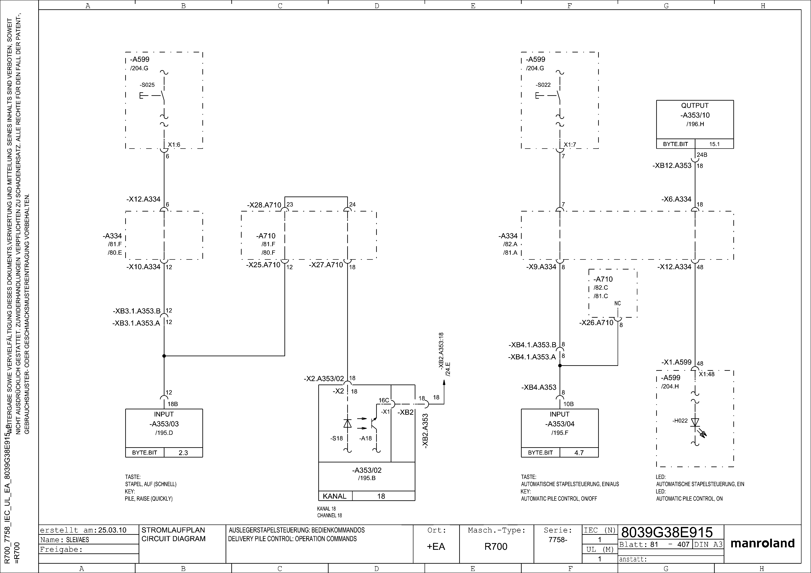

# +EA — Sheet 81 of 407 — AUSLEGERSTAPELSTEUERUNG: BEDIENKOMMANDOS

**DELIVERY PILE CONTROL: OPERATION COMMANDS**

> Part of the manroland **R700** printing press IEC/UL circuit diagrams.
> Drawing class: **Stromlaufplan / Circuit diagram** (DIN A3).
> Document `+EA` covers the **Printing unit** machine section.

## At a glance

| Field | Value |
|---|---|
| Document | `+EA`  (8039G38E915) |
| Sheet | **81** of 407 |
| Section (DE) | AUSLEGERSTAPELSTEUERUNG: BEDIENKOMMANDOS |
| Section (EN) | DELIVERY PILE CONTROL: OPERATION COMMANDS |
| Section type | CIRCUIT — Circuit diagram |
| Machine type | `R700` |
| Series | `7758` |
| Created | 25.03.10 |
| Replaces | — |
| Columns used | A, B, C, D, E, F, G, H |
| Path numbers | — |
| Labels on sheet | 112 |
| Cross-refs out | 16 |
| Cross-refs in | 39 |

**Previous:** [+EA sheet 80](SHEET_0080.md) · **Next:** [+EA sheet 82](SHEET_0082.md) · **Document TOC:** [_TOC.md](_TOC.md)  (+EA) · **Master TOC:** [all sheets](../_MASTER_TOC.md)

## Sheet image (300 DPI, exact vector render)



_Rendered directly from the PDF vector layer at 300 DPI (1-bit), no OCR and no resampling. Use it to confirm anything ambiguous in the text below._

## Cross-references on this sheet

Each entry is a wire leaving this sheet. The printed token is `/sheet.column`; the link resolves to that sheet inside the same document.

| Ref | Target sheet | Col | Path | Destination on target | Target section | From col |
|---|---|---|---|---|---|---|
| `/204.G` | [+EA sheet 204](SHEET_0204.md) | G | — | A599 | REFERENZMODUL | B |
| `/204.G` | [+EA sheet 204](SHEET_0204.md) | G | — | A599 | REFERENZMODUL | F |
| `/196.H` | [+EA sheet 196](SHEET_0196.md) | H | — | — | REFERENZMODUL | G |
| `/82.A` | [+EA sheet 82](SHEET_0082.md) | A | — | — | AUSLEGERSTAPELSTEUERUNG: PROGRAMMSCHALTWERK | E |
| `/81.A` | [+EA sheet 81](SHEET_0081.md) | A | — | — | AUSLEGERSTAPELSTEUERUNG: BEDIENKOMMANDOS | E |
| `/81.F` | [+EA sheet 81](SHEET_0081.md) | F | — | — | AUSLEGERSTAPELSTEUERUNG: BEDIENKOMMANDOS | A |
| `/80.E` | [+EA sheet 80](SHEET_0080.md) | E | — | — | AUSLEGERSTAPELSTEUERUNG: BEDIENKOMMANDOS | A |
| `/81.F` | [+EA sheet 81](SHEET_0081.md) | F | — | — | AUSLEGERSTAPELSTEUERUNG: BEDIENKOMMANDOS | C |
| `/80.F` | [+EA sheet 80](SHEET_0080.md) | F | — | — | AUSLEGERSTAPELSTEUERUNG: BEDIENKOMMANDOS | C |
| `/82.C` | [+EA sheet 82](SHEET_0082.md) | C | — | A710 | AUSLEGERSTAPELSTEUERUNG: PROGRAMMSCHALTWERK | F |
| `/81.C` | [+EA sheet 81](SHEET_0081.md) | C | — | A710 | AUSLEGERSTAPELSTEUERUNG: BEDIENKOMMANDOS | F |
| `/24.E` | [+EA sheet 24](SHEET_0024.md) | E | — | XB2.A353:18 | BUSVERBINDUNGEN: SICHERHEITSBUS | E |
| `/204.H` | [+EA sheet 204](SHEET_0204.md) | H | — | A599 | REFERENZMODUL | G |
| `/195.F` | [+EA sheet 195](SHEET_0195.md) | F | — | — | REFERENZMODUL | F |
| `/195.D` | [+EA sheet 195](SHEET_0195.md) | D | — | — | REFERENZMODUL | B |
| `/195.B` | [+EA sheet 195](SHEET_0195.md) | B | — | — | REFERENZMODUL | D |

### Incoming references (sheets that point here)

Every other sheet that sends a wire to this one. `Back-ref` is the token printed on *that* sheet; `Path` is its line number.

| From sheet | Cols | Back-ref | Path | Refs | What continues there |
|---|---|---|---|---|---|
| [+EA#24](SHEET_0024.md) | E | `/24.E` | — | 1 | XB2.A353:18 |
| [+EA#80](SHEET_0080.md) | E, F | `/80.E`, `/80.F` | — | 2 | — |
| [+EA#81](SHEET_0081.md) | A, C, E, F | `/81.A`, `/81.C`, `/81.E`, `/81.F` | — | 4 | A710 |
| [+EA#82](SHEET_0082.md) | A, C | `/82.A`, `/82.C` | — | 2 | — |
| [+EA#195](SHEET_0195.md) | B, D, F | `/195.B`, `/195.D`, `/195.F` | — | 3 | — |
| [+EA#196](SHEET_0196.md) | H | `/196.H` | — | 1 | — |
| [+EA#204](SHEET_0204.md) | G, H | `/204.G`, `/204.H` | — | 3 | — |
| [+EA#212](SHEET_0212.md) | B, C | `/212.B`, `/212.C` | — | 3 | — |
| [+EA#224](SHEET_0224.md) | H | `/224.H` | — | 1 | — |
| [+EA#225](SHEET_0225.md) | D | `/225.D` | — | 1 | — |
| [+EA#234](SHEET_0234.md) | C, D, F | `/234.C`, `/234.D`, `/234.F` | — | 3 | — |
| [+EA#237](SHEET_0237.md) | A, B, C | `/237.A`, `/237.B`, `/237.C` | — | 3 | — |
| [+EA#244](SHEET_0244.md) | F | `/244.F` | — | 1 | — |
| [+EA#252](SHEET_0252.md) | A | `/252.A` | — | 1 | — |
| [+EA#253](SHEET_0253.md) | H | `/253.H` | — | 1 | — |
| [+EA#257](SHEET_0257.md) | A, B, C | `/257.A`, `/257.B`, `/257.C` | — | 4 | — |
| [+EA#268](SHEET_0268.md) | C | `/268.C` | — | 1 | — |
| [+EA#270](SHEET_0270.md) | C | `/270.C` | — | 1 | — |
| [+EA#271](SHEET_0271.md) | C | `/271.C` | — | 1 | — |
| [+EA#272](SHEET_0272.md) | G | `/272.G` | — | 2 | — |


## Devices on this sheet

| Tag | Class | Class meaning (IEC) | Col | Sub | Terminal | Sign |
|---|---|---|---|---|---|---|
| `X1:6` | X | Klemme / terminal, plug connector | B | — | 6 | — |
| `S025` | S | Schalter / switch | B | — | — | — |
| `A599` | A | Baugruppe / assembly, module, PC board | B | — | — | — |
| `A353/03` | A | Baugruppe / assembly, module, PC board | B | 03 | — | — |
| `A710` | A | Baugruppe / assembly, module, PC board | C | — | — | — |
| `S18` | S | Schalter / switch | D | — | — | — |
| `A18` | A | Baugruppe / assembly, module, PC board | D | — | — | — |
| `X1` | X | Klemme / terminal, plug connector | D | — | — | — |
| `X2` | X | Klemme / terminal, plug connector | D | — | — | — |
| `XB2` | XB |  | D | — | — | — |
| `A353/02` | A | Baugruppe / assembly, module, PC board | D | 02 | — | — |
| `A334` | A | Baugruppe / assembly, module, PC board | A | — | — | — |
| `X1:7` | X | Klemme / terminal, plug connector | F | — | 7 | — |
| `S022` | S | Schalter / switch | F | — | — | — |
| `A599` | A | Baugruppe / assembly, module, PC board | F | — | — | — |
| `A353/04` | A | Baugruppe / assembly, module, PC board | F | 04 | — | — |
| `A353/10` | A | Baugruppe / assembly, module, PC board | G | 10 | — | — |
| `X1:48` | X | Klemme / terminal, plug connector | G | — | 48 | — |
| `A599` | A | Baugruppe / assembly, module, PC board | G | — | — | — |
| `A334` | A | Baugruppe / assembly, module, PC board | E | — | — | — |
| `A710` | A | Baugruppe / assembly, module, PC board | F | — | — | — |
| `2.3` | — | cross-device reference | B | — | — | — |
| `X28.A710` | — | cross-device reference | C | — | — | — |
| `XB2.A353` | — | cross-device reference | E | — | — | — |
| `X27.A710` | — | cross-device reference | C | — | — | — |
| `X25.A710` | — | cross-device reference | C | — | — | — |
| `X12.A334` | — | cross-device reference | B | — | — | — |
| `X10.A334` | — | cross-device reference | B | — | — | — |
| `XB3.1.A353.B` | — | cross-device reference | B | — | — | — |
| `XB3.1.A353.A` | — | cross-device reference | B | — | — | — |
| `4.7` | — | cross-device reference | F | — | — | — |
| `XB4.A353` | — | cross-device reference | F | — | — | — |
| `XB12.A353` | — | cross-device reference | G | — | — | — |
| `15.1` | — | cross-device reference | H | — | — | — |
| `X1.A599` | — | cross-device reference | G | — | — | — |
| `X6.A334` | — | cross-device reference | G | — | — | — |
| `X9.A334` | — | cross-device reference | F | — | — | — |
| `X12.A334` | — | cross-device reference | G | — | — | — |
| `XB4.1.A353.B` | — | cross-device reference | F | — | — | — |
| `XB4.1.A353.A` | — | cross-device reference | F | — | — | — |
| `X26.A710` | — | cross-device reference | F | — | — | — |
| `XB2.A353:18` | — | cross-device reference | E | — | 18 | — |

## Potentials / nets

| Potential | Count | Columns | Attached devices | Terminals |
|---|---|---|---|---|
| `H022` | 1 | G | — | — |


A potential such as `L24+/4` or `M24+` is a named supply/return rail; every place it appears on this sheet is electrically common.

## Wire-end annotations (grouped as printed)

A wire that continues elsewhere is annotated with a small cluster: the destination description, the path/line number `#NN`, and the `/sheet.column` cross reference. Each row below is one such cluster exactly as it is grouped on the drawing.

| Col | Y | Path | Cross-ref | Text on the wire |
|---|---|---|---|---|
| B | 82.5 | — | `/204.G` | `A599` |
| F | 82.5 | — | `/204.G` | `A599` |
| B | 121.2 | — | — | `S025` |
| F | 121.2 | — | — | `S022` |
| G | 150.8 | — | — | `QUTPUT` |
| G | 164.7 | — | — | `A353/10` |
| G | 178.5 | — | `/196.H` | — |
| G | 208.1 | — | — | `BYTE.BIT 15.1` |
| B | 208.6 | — | — | `X1:6` |
| F | 208.6 | — | — | `X1:7` |
| G | 223.5 | — | — | `24B` |
| B | 225.7 | — | — | `6` |
| F | 225.7 | — | — | `7` |
| G | 238.4 | — | — | `XB12.A353 18` |
| B | 288.0 | — | — | `X12.A334 6` |
| G | 288.0 | — | — | `7 X6.A334 18` |
| C | 296.5 | — | — | `X28.A710 23 24` |
| A | 341.9 | — | — | `A334` |
| C | 341.9 | — | — | `A710` |
| E | 341.9 | — | — | `A334` |
| A | 354.9 | — | `/81.F`, `/80.E` | — |
| C | 354.9 | — | `/81.F`, `/80.F` | — |
| E | 354.9 | — | `/82.A`, `/81.A` | — |
| C | 384.4 | — | — | `X25.A710 12 X27.A710 18` |
| B | 387.2 | — | — | `X10.A334 12` |
| F | 387.2 | — | — | `X9.A334 8 X12.A334 48` |
| F | 405.7 | — | `/82.C`, `/81.C` | `A710` |
| F | 442.8 | — | — | `NC` |
| B | 452.4 | — | — | `XB3.1.A353.B 12` |
| F | 469.4 | — | — | `X26.A710 8` |
| B | 469.5 | — | — | `XB3.1.A353.A 12` |
| E | 488.4 | — | `/24.E` | `XB2.A353:18` |
| F | 502.1 | — | — | `XB4.1.A353.B 8` |
| F | 519.1 | — | — | `XB4.1.A353.A 8` |
| G | 527.5 | — | — | `X1.A599 48` |
| G | 546.0 | — | — | `X1:48` |
| G | 550.2 | — | `/204.H` | `A599` |
| D | 551.6 | — | — | `X2.A353/02 18` |
| F | 564.4 | — | — | `XB4.A353 8` |
| D | 570.1 | — | — | `X2` |
| D | 571.5 | — | — | `18 18` |
| B | 572.9 | — | — | `12` |
| E | 580.0 | — | — | `18` |
| D | 584.3 | — | — | `16C` |
| B | 589.9 | — | — | `18B` |
| F | 589.9 | — | — | `10B` |
| D | 601.2 | — | — | `X1` |
| D | 601.3 | — | — | `XB2` |
| B | 604.4 | — | — | `INPUT` |
| F | 604.4 | — | — | `INPUT` |
| E | 607.5 | — | — | `XB2.A353` |
| G | 614.4 | — | — | `H022` |
| B | 618.3 | — | — | `A353/03` |
| F | 618.3 | — | — | `A353/04` |
| F | 632.0 | — | `/195.F` | — |
| B | 632.1 | — | `/195.D` | — |
| D | 640.2 | — | — | `S18 A18` |
| B | 661.1 | — | — | `BYTE.BIT 2.3` |
| F | 661.1 | — | — | `BYTE.BIT 4.7` |
| D | 686.3 | — | — | `A353/02` |
| B | 697.9 | — | — | `KEY: PILE, RAISE (QUICKLY) TASTE: STAPEL, AUF (SCHNELL)` |
| F | 697.9 | — | — | `KEY: TASTE: AUTOMATISCHE STAPELSTEUERUNG, EIN/AUS` |
| G | 697.9 | — | — | `LED:` |
| D | 698.6 | — | `/195.B` | — |
| G | 708.6 | — | — | `LED: AUTOMATISCHE STAPELSTEUERUNG, EIN` |
| D | 724.5 | — | — | `KANAL 18` |
| F | 729.9 | — | — | `AUTOMATIC PILE CONTROL, ON/OFF` |
| G | 729.9 | — | — | `AUTOMATIC PILE CONTROL, ON` |
| D | 744.9 | — | — | `KANAL 18 CHANNEL 18` |


## Reconstructed tables

This sheet carries tabular content (pin map / terminal assignment / index). The grid below was rebuilt from the drawing's own rule lines, so each row is exactly one physical row of the table.

### Table 1 — 4 data rows × 2 columns (at x=184.3, y=76.5)

| A599 /204.G S025 | X1:6 |
|---|---|
| `X12.A334 X10.A334 XB3.1.A353.B XB3.1.A353.A` | `6 6 12 12 12` |
|  | `12 18B` |
| `INPUT` | `A353/03 /195.D` |
| `BYTE.BIT` | `2.3` |


### Table 2 — 4 data rows × 6 columns (at x=418.1, y=289.1)

| 23 12 | X27.A710 | 24 18 |  |  | XB2.A353:18 |
|---|---|---|---|---|---|
|  | `X2.A353/02` | `18` |  |  |  |
|  | `X2 S18` | `18 A18` | `16C X1` | `XB2` | `18 18 XB2.A353` |
|  |  | `A353/02 /195.B` |  |  |  |
|  | `KANAL` |  | `18` |  |  |


### Table 3 — 5 data rows × 6 columns (at x=765.4, y=76.5) — **A599 /204.G S022**

|  |  |  |  | QUTPUT | A353/10 /196.H |
|---|---|---|---|---|---|
|  | `X1:7` |  |  | `BYTE.BIT` | `15.1` |
| `X9.A334 XB4.1.A353.B XB4.1.A353.A` | `7 7 8 X26.A710 8 8` | `A710 /82.C /81.C NC` | `8` | `XB12.A353 X6.A334 X12.A334 X1.A599` | `24B 18 18 48 48` |
| `XB4.A353` | `8 10B` |  |  | `A599 /204.H` | `X1:48` |
| `INPUT` | `A353/04 /195.F` |  |  | `H022` |  |
| `BYTE.BIT` | `4.7` |  |  |  |  |


## Notes and free text on this sheet

| Text | Col | Y (pt) |
|---|---|---|
| `18B` | B | 589.89 |
| `INPUT` | B | 604.42 |
| `BYTE.BIT` | B | 661.67 |
| `TASTE:` | A | 697.88 |
| `STAPEL, AUF (SCHNELL)` | B | 708.58 |
| `KEY:` | A | 719.08 |
| `PILE, RAISE (QUICKLY)` | B | 729.83 |
| `KANAL 18` | C | 744.88 |
| `CHANNEL 18` | D | 754.82 |
| `16C` | D | 584.27 |
| `KANAL` | D | 724.55 |
| `X2.A353/02` | C | 551.65 |
| `10B` | F | 589.89 |
| `INPUT` | F | 604.42 |
| `BYTE.BIT` | F | 661.67 |
| `TASTE:` | F | 697.88 |
| `AUTOMATISCHE STAPELSTEUERUNG, EIN/AUS` | F | 708.58 |
| `KEY:` | F | 719.08 |
| `AUTOMATIC PILE CONTROL, ON/OFF` | F | 729.86 |
| `24B` | G | 223.52 |
| `QUTPUT` | G | 150.85 |
| `BYTE.BIT` | G | 208.12 |
| `LED:` | G | 697.86 |
| `AUTOMATISCHE STAPELSTEUERUNG, EIN` | G | 708.58 |
| `AUTOMATIC PILE CONTROL, ON` | G | 729.86 |
| `NC` | F | 442.79 |

## Complete label inventory (exact text from the drawing)

Every text object inside the drawing area of this sheet, in DIN reading order (column A→H, then top→bottom). This is the authoritative list: if a string is not here it is not printed on this sheet.

| Col | Y | X | Dir | Type | Text |
|---|---|---|---|---|---|
| A | 341.9 | 150.8 | → | device tag | `A334` |
| A | 354.9 | 158.7 | → | cross-reference | `/81.F` |
| A | 367.3 | 158.5 | → | cross-reference | `/80.E` |
| A | 697.9 | 184.0 | → | text | `TASTE:` |
| A | 719.1 | 183.4 | → | text | `KEY:` |
| B | 82.5 | 191.1 | → | device tag | `A599` |
| B | 96.3 | 191.3 | → | cross-reference | `/204.G` |
| B | 121.2 | 205.2 | → | device tag | `S025` |
| B | 208.6 | 246.6 | → | device tag | `X1:6` |
| B | 225.7 | 243.5 | → | number | `6` |
| B | 288.0 | 185.7 | → | device ref | `X12.A334` |
| B | 296.5 | 243.5 | → | number | `6` |
| B | 387.2 | 185.7 | → | device ref | `X10.A334` |
| B | 388.7 | 242.9 | → | number | `12` |
| B | 452.4 | 165.8 | → | device ref | `XB3.1.A353.B` |
| B | 452.5 | 242.9 | → | number | `12` |
| B | 469.5 | 242.9 | → | number | `12` |
| B | 470.2 | 165.0 | → | device ref | `XB3.1.A353.A` |
| B | 572.9 | 242.9 | → | number | `12` |
| B | 589.9 | 245.8 | → | text | `18B` |
| B | 604.4 | 226.1 | → | text | `INPUT` |
| B | 618.3 | 219.5 | → | device tag | `A353/03` |
| B | 632.1 | 228.2 | → | cross-reference | `/195.D` |
| B | 661.1 | 262.5 | → | device ref | `2.3` |
| B | 661.7 | 194.2 | → | text | `BYTE.BIT` |
| B | 708.6 | 184.0 | → | text | `STAPEL, AUF (SCHNELL)` |
| B | 729.8 | 183.4 | → | text | `PILE, RAISE (QUICKLY)` |
| C | 296.5 | 362.8 | → | device ref | `X28.A710` |
| C | 296.5 | 420.7 | → | number | `23` |
| C | 341.9 | 376.2 | → | device tag | `A710` |
| C | 354.9 | 384.1 | → | cross-reference | `/81.F` |
| C | 367.3 | 384.1 | → | cross-reference | `/80.F` |
| C | 384.4 | 361.4 | → | device ref | `X25.A710` |
| C | 384.4 | 453.5 | → | device ref | `X27.A710` |
| C | 388.7 | 420.1 | → | number | `12` |
| C | 551.6 | 446.2 | → | text | `X2.A353/02` |
| C | 744.9 | 465.7 | → | text | `KANAL 18` |
| D | 296.5 | 512.8 | → | number | `24` |
| D | 388.7 | 512.2 | → | number | `18` |
| D | 551.7 | 512.2 | → | number | `18` |
| D | 570.1 | 488.7 | → | device tag | `X2` |
| D | 571.5 | 515.1 | → | number | `18` |
| D | 581.4 | 614.3 | → | number | `18` |
| D | 584.3 | 555.6 | → | text | `16C` |
| D | 601.2 | 559.3 | → | device tag | `X1` |
| D | 601.3 | 583.7 | → | device tag | `XB2` |
| D | 640.2 | 485.0 | → | device tag | `S18` |
| D | 640.2 | 527.5 | → | device tag | `A18` |
| D | 686.3 | 517.2 | → | device tag | `A353/02` |
| D | 698.6 | 526.0 | → | cross-reference | `/195.B` |
| D | 724.5 | 553.6 | → | number | `18` |
| D | 724.6 | 474.0 | → | text | `KANAL` |
| D | 754.8 | 466.0 | → | text | `CHANNEL 18` |
| E | 341.9 | 731.9 | → | device tag | `A334` |
| E | 354.9 | 739.0 | → | cross-reference | `/82.A` |
| E | 367.3 | 739.0 | → | cross-reference | `/81.A` |
| E | 488.4 | 643.7 | ↕ | device ref | `XB2.A353:18` |
| E | 532.1 | 653.6 | ↕ | cross-reference | `/24.E` |
| E | 580.0 | 635.5 | → | number | `18` |
| E | 607.5 | 619.7 | ↕ | device ref | `XB2.A353` |
| F | 82.5 | 772.2 | → | device tag | `A599` |
| F | 96.3 | 772.4 | → | cross-reference | `/204.G` |
| F | 121.2 | 786.6 | → | device tag | `S022` |
| F | 208.6 | 827.7 | → | device tag | `X1:7` |
| F | 225.7 | 824.6 | → | number | `7` |
| F | 296.5 | 824.6 | → | number | `7` |
| F | 387.2 | 772.7 | → | device ref | `X9.A334` |
| F | 388.7 | 824.6 | → | number | `8` |
| F | 405.7 | 871.4 | → | device tag | `A710` |
| F | 418.7 | 871.7 | → | cross-reference | `/82.C` |
| F | 431.1 | 871.7 | → | cross-reference | `/81.C` |
| F | 442.8 | 902.2 | → | text | `NC` |
| F | 469.4 | 850.4 | → | device ref | `X26.A710` |
| F | 502.1 | 746.9 | → | device ref | `XB4.1.A353.B` |
| F | 502.1 | 824.6 | → | number | `8` |
| F | 519.1 | 824.6 | → | number | `8` |
| F | 519.8 | 746.1 | → | device ref | `XB4.1.A353.A` |
| F | 564.4 | 765.6 | → | device ref | `XB4.A353` |
| F | 572.9 | 824.6 | → | number | `8` |
| F | 589.9 | 826.9 | → | text | `10B` |
| F | 604.4 | 807.2 | → | text | `INPUT` |
| F | 618.3 | 800.6 | → | device tag | `A353/04` |
| F | 632.0 | 809.7 | → | cross-reference | `/195.F` |
| F | 661.1 | 843.6 | → | device ref | `4.7` |
| F | 661.7 | 775.3 | → | text | `BYTE.BIT` |
| F | 697.9 | 765.1 | → | text | `TASTE:` |
| F | 708.6 | 765.4 | → | text | `AUTOMATISCHE STAPELSTEUERUNG, EIN/AUS` |
| F | 719.1 | 764.5 | → | text | `KEY:` |
| F | 729.9 | 765.4 | → | text | `AUTOMATIC PILE CONTROL, ON/OFF` |
| G | 150.9 | 1000.2 | → | text | `QUTPUT` |
| G | 164.7 | 999.1 | → | device tag | `A353/10` |
| G | 178.5 | 1008.0 | → | cross-reference | `/196.H` |
| G | 208.1 | 973.7 | → | text | `BYTE.BIT` |
| G | 223.5 | 1023.0 | → | text | `24B` |
| G | 238.4 | 958.1 | → | device ref | `XB12.A353` |
| G | 239.9 | 1022.5 | → | number | `18` |
| G | 288.0 | 971.1 | → | device ref | `X6.A334` |
| G | 296.5 | 1022.5 | → | number | `18` |
| G | 387.2 | 965.2 | → | device ref | `X12.A334` |
| G | 388.7 | 1023.0 | → | number | `48` |
| G | 473.7 | 909.6 | → | number | `8` |
| G | 527.6 | 971.1 | → | device ref | `X1.A599` |
| G | 530.4 | 1023.0 | → | number | `48` |
| G | 545.9 | 1026.1 | → | device tag | `X1:48` |
| G | 550.2 | 970.6 | → | device tag | `A599` |
| G | 564.0 | 970.9 | → | cross-reference | `/204.H` |
| G | 614.4 | 987.3 | → | potential | `H022` |
| G | 697.9 | 962.9 | → | text | `LED:` |
| G | 708.6 | 963.8 | → | text | `AUTOMATISCHE STAPELSTEUERUNG, EIN` |
| G | 719.1 | 962.9 | → | text | `LED:` |
| G | 729.9 | 963.8 | → | text | `AUTOMATIC PILE CONTROL, ON` |
| H | 208.2 | 1041.2 | → | device ref | `15.1` |

## Reading-order text block

The same content as a plain block, grouped by DIN column — convenient to paste or to match against a visual description.

```text
=== Column A ===
 341.9  150.8  devtag       A334
 354.9  158.7  xref         /81.F
 367.3  158.5  xref         /80.E
 697.9  184.0  text         TASTE:
 719.1  183.4  text         KEY:
=== Column B ===
  82.5  191.1  devtag       A599
  96.3  191.3  xref         /204.G
 121.2  205.2  devtag       S025
 208.6  246.6  devtag       X1:6
 225.7  243.5  numeric      6
 288.0  185.7  devref       X12.A334
 296.5  243.5  numeric      6
 387.2  185.7  devref       X10.A334
 388.7  242.9  numeric      12
 452.4  165.8  devref       XB3.1.A353.B
 452.5  242.9  numeric      12
 469.5  242.9  numeric      12
 470.2  165.0  devref       XB3.1.A353.A
 572.9  242.9  numeric      12
 589.9  245.8  text         18B
 604.4  226.1  text         INPUT
 618.3  219.5  devtag       A353/03
 632.1  228.2  xref         /195.D
 661.1  262.5  devref       2.3
 661.7  194.2  text         BYTE.BIT
 708.6  184.0  text         STAPEL, AUF (SCHNELL)
 729.8  183.4  text         PILE, RAISE (QUICKLY)
=== Column C ===
 296.5  362.8  devref       X28.A710
 296.5  420.7  numeric      23
 341.9  376.2  devtag       A710
 354.9  384.1  xref         /81.F
 367.3  384.1  xref         /80.F
 384.4  361.4  devref       X25.A710
 384.4  453.5  devref       X27.A710
 388.7  420.1  numeric      12
 551.6  446.2  text         X2.A353/02
 744.9  465.7  text         KANAL 18
=== Column D ===
 296.5  512.8  numeric      24
 388.7  512.2  numeric      18
 551.7  512.2  numeric      18
 570.1  488.7  devtag       X2
 571.5  515.1  numeric      18
 581.4  614.3  numeric      18
 584.3  555.6  text         16C
 601.2  559.3  devtag       X1
 601.3  583.7  devtag       XB2
 640.2  485.0  devtag       S18
 640.2  527.5  devtag       A18
 686.3  517.2  devtag       A353/02
 698.6  526.0  xref         /195.B
 724.5  553.6  numeric      18
 724.6  474.0  text         KANAL
 754.8  466.0  text         CHANNEL 18
=== Column E ===
 341.9  731.9  devtag       A334
 354.9  739.0  xref         /82.A
 367.3  739.0  xref         /81.A
 488.4  643.7  devref       XB2.A353:18
 532.1  653.6  xref         /24.E
 580.0  635.5  numeric      18
 607.5  619.7  devref       XB2.A353
=== Column F ===
  82.5  772.2  devtag       A599
  96.3  772.4  xref         /204.G
 121.2  786.6  devtag       S022
 208.6  827.7  devtag       X1:7
 225.7  824.6  numeric      7
 296.5  824.6  numeric      7
 387.2  772.7  devref       X9.A334
 388.7  824.6  numeric      8
 405.7  871.4  devtag       A710
 418.7  871.7  xref         /82.C
 431.1  871.7  xref         /81.C
 442.8  902.2  text         NC
 469.4  850.4  devref       X26.A710
 502.1  746.9  devref       XB4.1.A353.B
 502.1  824.6  numeric      8
 519.1  824.6  numeric      8
 519.8  746.1  devref       XB4.1.A353.A
 564.4  765.6  devref       XB4.A353
 572.9  824.6  numeric      8
 589.9  826.9  text         10B
 604.4  807.2  text         INPUT
 618.3  800.6  devtag       A353/04
 632.0  809.7  xref         /195.F
 661.1  843.6  devref       4.7
 661.7  775.3  text         BYTE.BIT
 697.9  765.1  text         TASTE:
 708.6  765.4  text         AUTOMATISCHE STAPELSTEUERUNG, EIN/AUS
 719.1  764.5  text         KEY:
 729.9  765.4  text         AUTOMATIC PILE CONTROL, ON/OFF
=== Column G ===
 150.9 1000.2  text         QUTPUT
 164.7  999.1  devtag       A353/10
 178.5 1008.0  xref         /196.H
 208.1  973.7  text         BYTE.BIT
 223.5 1023.0  text         24B
 238.4  958.1  devref       XB12.A353
 239.9 1022.5  numeric      18
 288.0  971.1  devref       X6.A334
 296.5 1022.5  numeric      18
 387.2  965.2  devref       X12.A334
 388.7 1023.0  numeric      48
 473.7  909.6  numeric      8
 527.6  971.1  devref       X1.A599
 530.4 1023.0  numeric      48
 545.9 1026.1  devtag       X1:48
 550.2  970.6  devtag       A599
 564.0  970.9  xref         /204.H
 614.4  987.3  net          H022
 697.9  962.9  text         LED:
 708.6  963.8  text         AUTOMATISCHE STAPELSTEUERUNG, EIN
 719.1  962.9  text         LED:
 729.9  963.8  text         AUTOMATIC PILE CONTROL, ON
=== Column H ===
 208.2 1041.2  devref       15.1
```

---
_Generated from the PDF vector text layer; no OCR. Source: `R700_7758_IEC_UL_EA_8039G38E915_p`, sheet 81._
