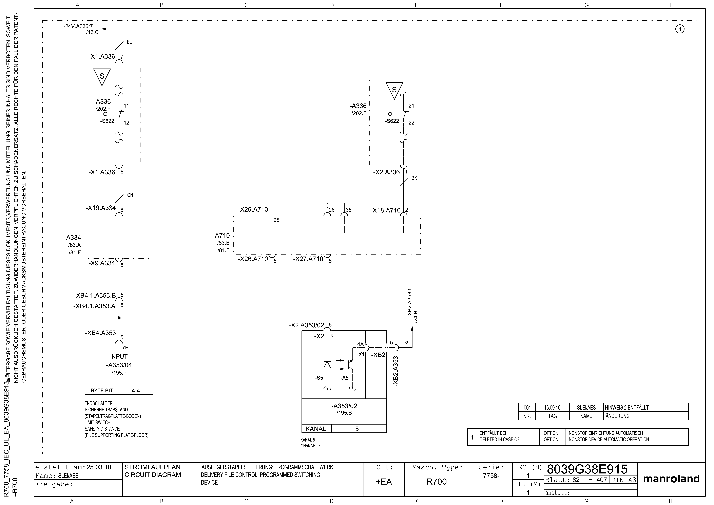

# +EA — Sheet 82 of 407 — AUSLEGERSTAPELSTEUERUNG: PROGRAMMSCHALTWERK

**DELIVERY PILE CONTROL: PROGRAMMED SWITCHING**

> Part of the manroland **R700** printing press IEC/UL circuit diagrams.
> Drawing class: **Stromlaufplan / Circuit diagram** (DIN A3).
> Document `+EA` covers the **Printing unit** machine section.

## At a glance

| Field | Value |
|---|---|
| Document | `+EA`  (8039G38E915) |
| Sheet | **82** of 407 |
| Section (DE) | AUSLEGERSTAPELSTEUERUNG: PROGRAMMSCHALTWERK |
| Section (EN) | DELIVERY PILE CONTROL: PROGRAMMED SWITCHING |
| Section type | CIRCUIT — Circuit diagram |
| Machine type | `R700` |
| Series | `7758` |
| Created | 25.03.10 |
| Replaces | — |
| Columns used | A, B, C, D, E, F, G, H |
| Path numbers | — |
| Labels on sheet | 97 |
| Cross-refs out | 10 |
| Cross-refs in | 26 |

**Previous:** [+EA sheet 81](SHEET_0081.md) · **Next:** [+EA sheet 83](SHEET_0083.md) · **Document TOC:** [_TOC.md](_TOC.md)  (+EA) · **Master TOC:** [all sheets](../_MASTER_TOC.md)

## Sheet image (300 DPI, exact vector render)



_Rendered directly from the PDF vector layer at 300 DPI (1-bit), no OCR and no resampling. Use it to confirm anything ambiguous in the text below._

## Cross-references on this sheet

Each entry is a wire leaving this sheet. The printed token is `/sheet.column`; the link resolves to that sheet inside the same document.

| Ref | Target sheet | Col | Path | Destination on target | Target section | From col |
|---|---|---|---|---|---|---|
| `/13.C` | [+EA sheet 13](SHEET_0013.md) | C | — | 24V.A336:7 | SPANNUNGSVERSORGUNG: 400V, 24V | A |
| `/202.F` | [+EA sheet 202](SHEET_0202.md) | F | — | — | REFERENZMODUL | A |
| `/202.F` | [+EA sheet 202](SHEET_0202.md) | F | — | — | REFERENZMODUL | D |
| `/83.B` | [+EA sheet 83](SHEET_0083.md) | B | — | — | AUSLEGERSTAPELSTEUERUNG: PROGRAMMSCHALTWERK | C |
| `/83.A` | [+EA sheet 83](SHEET_0083.md) | A | — | — | AUSLEGERSTAPELSTEUERUNG: PROGRAMMSCHALTWERK | A |
| `/81.F` | [+EA sheet 81](SHEET_0081.md) | F | — | — | AUSLEGERSTAPELSTEUERUNG: BEDIENKOMMANDOS | C |
| `/81.F` | [+EA sheet 81](SHEET_0081.md) | F | — | — | AUSLEGERSTAPELSTEUERUNG: BEDIENKOMMANDOS | A |
| `/24.B` | [+EA sheet 24](SHEET_0024.md) | B | — | XB2.A353:5 | BUSVERBINDUNGEN: SICHERHEITSBUS | E |
| `/195.F` | [+EA sheet 195](SHEET_0195.md) | F | — | — | REFERENZMODUL | A |
| `/195.B` | [+EA sheet 195](SHEET_0195.md) | B | — | — | REFERENZMODUL | D |

### Incoming references (sheets that point here)

Every other sheet that sends a wire to this one. `Back-ref` is the token printed on *that* sheet; `Path` is its line number.

| From sheet | Cols | Back-ref | Path | Refs | What continues there |
|---|---|---|---|---|---|
| [+EA#13](SHEET_0013.md) | C | `/13.C` | — | 1 | 24V.A336:7 |
| [+EA#24](SHEET_0024.md) | B | `/24.B` | — | 1 | XB2.A353:5 |
| [+EA#81](SHEET_0081.md) | E, F | `/81.E`, `/81.F` | — | 2 | A710 |
| [+EA#83](SHEET_0083.md) | A, B | `/83.A`, `/83.B` | — | 2 | — |
| [+EA#195](SHEET_0195.md) | B, F | `/195.B`, `/195.F` | — | 2 | — |
| [+EA#202](SHEET_0202.md) | F | `/202.F` | — | 2 | — |
| [+EA#208](SHEET_0208.md) | F | `/208.F` | — | 2 | — |
| [+EA#224](SHEET_0224.md) | C, G | `/224.C`, `/224.G` | — | 2 | — |
| [+EA#225](SHEET_0225.md) | C | `/225.C` | — | 1 | — |
| [+EA#237](SHEET_0237.md) | A, B, C | `/237.A`, `/237.B`, `/237.C` | — | 3 | — |
| [+EA#252](SHEET_0252.md) | A | `/252.A` | — | 1 | — |
| [+EA#263](SHEET_0263.md) | F, G | `/263.F`, `/263.G` | — | 2 | — |
| [+EA#270](SHEET_0270.md) | C | `/270.C` | — | 1 | — |
| [+EA#271](SHEET_0271.md) | B | `/271.B` | — | 1 | — |
| [+EA#274](SHEET_0274.md) | B, C | `/274.B`, `/274.C` | — | 3 | — |


## Devices on this sheet

| Tag | Class | Class meaning (IEC) | Col | Sub | Terminal | Sign |
|---|---|---|---|---|---|---|
| `S622` | S | Schalter / switch | A | — | — | — |
| `A336` | A | Baugruppe / assembly, module, PC board | A | — | — | — |
| `A353/04` | A | Baugruppe / assembly, module, PC board | A | 04 | — | — |
| `S5` | S | Schalter / switch | D | — | — | — |
| `A5` | A | Baugruppe / assembly, module, PC board | D | — | — | — |
| `X1` | X | Klemme / terminal, plug connector | D | — | — | — |
| `X2` | X | Klemme / terminal, plug connector | D | — | — | — |
| `XB2` | XB |  | E | — | — | — |
| `A353/02` | A | Baugruppe / assembly, module, PC board | D | 02 | — | — |
| `A710` | A | Baugruppe / assembly, module, PC board | C | — | — | — |
| `A334` | A | Baugruppe / assembly, module, PC board | A | — | — | — |
| `S622` | S | Schalter / switch | E | — | — | — |
| `A336` | A | Baugruppe / assembly, module, PC board | D | — | — | — |
| `X1.A336` | — | cross-device reference | A | — | — | — |
| `X1.A336` | — | cross-device reference | A | — | — | — |
| `4.4` | — | cross-device reference | B | — | — | — |
| `XB4.A353` | — | cross-device reference | A | — | — | — |
| `X9.A334` | — | cross-device reference | A | — | — | — |
| `XB2.A353` | — | cross-device reference | E | — | — | — |
| `X18.A710` | — | cross-device reference | E | — | — | — |
| `X27.A710` | — | cross-device reference | D | — | — | — |
| `X26.A710` | — | cross-device reference | C | — | — | — |
| `XB4.1.A353.B` | — | cross-device reference | A | — | — | — |
| `XB4.1.A353.A` | — | cross-device reference | A | — | — | — |
| `X19.A334` | — | cross-device reference | A | — | — | — |
| `X2.A336` | — | cross-device reference | E | — | — | — |
| `NR.` | — | cross-device reference | F | — | — | — |
| `16.09.10` | — | cross-device reference | G | — | — | — |
| `XB2.A353:5` | — | cross-device reference | E | — | 5 | — |
| `X29.A710` | — | cross-device reference | C | — | — | — |

## Potentials / nets

| Potential | Count | Columns | Attached devices | Terminals |
|---|---|---|---|---|
| `24V` | 1 | A | `A336` | `7` |


A potential such as `L24+/4` or `M24+` is a named supply/return rail; every place it appears on this sheet is electrically common.

## Wire-end annotations (grouped as printed)

A wire that continues elsewhere is annotated with a small cluster: the destination description, the path/line number `#NN`, and the `/sheet.column` cross reference. Each row below is one such cluster exactly as it is grouped on the drawing.

| Col | Y | Path | Cross-ref | Text on the wire |
|---|---|---|---|---|
| A | 40.0 | — | `/13.C` | `24V.A336:7` |
| H | 45.1 | — | — | `1` |
| B | 67.1 | — | — | `BU` |
| A | 89.6 | — | — | `X1.A336 7` |
| A | 121.6 | — | — | `S` |
| E | 144.2 | — | — | `S` |
| A | 164.7 | — | — | `A336` |
| D | 171.8 | — | — | `A336` |
| B | 172.5 | — | — | `11` |
| E | 172.5 | — | — | `21` |
| A | 177.8 | — | `/202.F` | — |
| D | 184.9 | — | `/202.F` | — |
| A | 198.0 | — | — | `S622` |
| E | 198.0 | — | — | `S622` |
| B | 200.9 | — | — | `12` |
| E | 200.9 | — | — | `22` |
| A | 282.4 | — | — | `X1.A336 6` |
| E | 282.4 | — | — | `X2.A336 1` |
| E | 293.9 | — | — | `BK` |
| B | 322.3 | — | — | `GN` |
| A | 341.9 | — | — | `X19.A334 6` |
| C | 344.7 | — | — | `X29.A710` |
| D | 346.1 | — | — | `26` |
| D | 346.1 | — | — | `35` |
| E | 346.1 | — | — | `X18.A710 2` |
| C | 363.2 | — | — | `25` |
| C | 387.9 | — | — | `A710` |
| A | 391.5 | — | — | `A334` |
| C | 401.0 | — | `/83.B` | — |
| A | 404.5 | — | `/83.A` | — |
| C | 413.4 | — | `/81.F` | — |
| A | 416.9 | — | `/81.F` | — |
| C | 426.9 | — | — | `X26.A710 5 X27.A710 5` |
| A | 434.0 | — | — | `X9.A334 5` |
| E | 479.1 | — | `/24.B` | `XB2.A353:5` |
| A | 487.9 | — | — | `XB4.1.A353.B 5` |
| A | 504.9 | — | — | `XB4.1.A353.A 5` |
| D | 537.5 | — | — | `X2.A353/02 5` |
| A | 550.2 | — | — | `XB4.A353 5` |
| D | 555.9 | — | — | `X2` |
| D | 557.3 | — | — | `5 5` |
| E | 565.8 | — | — | `5` |
| D | 570.0 | — | — | `4A` |
| B | 575.7 | — | — | `7B` |
| D | 587.1 | — | — | `X1` |
| E | 587.1 | — | — | `XB2` |
| A | 590.2 | — | — | `INPUT` |
| E | 593.3 | — | — | `XB2.A353` |
| A | 604.1 | — | — | `A353/04` |
| A | 617.9 | — | `/195.F` | — |
| D | 626.0 | — | — | `S5 A5` |
| A | 646.9 | — | — | `BYTE.BIT 4.4` |
| A | 669.6 | — | — | `ENDSCHALTER:` |
| D | 672.1 | — | — | `A353/02` |
| G | 676.3 | — | — | `001 16.09.10 SLEI/AES HINWEIS 2 ENTFÄLLT` |
| A | 680.2 | — | — | `LIMIT SWITCH: (STAPELTRAGPLATTE BODEN) SICHERHEITSABSTAND` |
| D | 684.5 | — | `/195.B` | — |
| G | 690.5 | — | — | `NR. TAG NAME ÄNDERUNG` |
| D | 710.4 | — | — | `KANAL 5` |
| A | 712.1 | — | — | `(PILE SUPPORTING PLATE FLOOR) SAFETY DISTANCE` |
| F | 719.2 | — | — | `1 OPTION OPTION` |
| G | 719.2 | — | — | `ENTFÄLLT BEI DELETED IN CASE OF NONSTOP EINRICHTUNG AUTOMATISCH NONSTOP DEVICE AUTOMATIC OPERATION` |
| D | 730.7 | — | — | `KANAL 5 CHANNEL 5` |


## Reconstructed tables

This sheet carries tabular content (pin map / terminal assignment / index). The grid below was rebuilt from the drawing's own rule lines, so each row is exactly one physical row of the table.

### Table 1 — 2 data rows × 2 columns (at x=141.7, y=530.1)

| XB4.A353 | 5 7B |
|---|---|
| `INPUT` | `A353/04 /195.F` |
| `BYTE.BIT` | `4.4` |


### Table 2 — 4 data rows × 7 columns (at x=453.5, y=388.3)

| 5 | X27.A710 | 5 |  |  |  | XB2.A353:5 |
|---|---|---|---|---|---|---|
|  | `X2.A353/02` | `5` |  |  |  |  |
|  | `X2 S5` | `5 A5` | `4A X1` | `XB2` | `5 XB2.A353` | `5` |
|  |  | `A353/02 /195.B` |  |  |  |  |
|  | `KANAL` |  | `5` |  |  |  |


## Notes and free text on this sheet

| Text | Col | Y (pt) |
|---|---|---|
| `7B` | B | 575.7 |
| `INPUT` | A | 590.24 |
| `BYTE.BIT` | A | 647.49 |
| `ENDSCHALTER:` | A | 669.59 |
| `SICHERHEITSABSTAND` | A | 680.23 |
| `(STAPELTRAGPLATTE BODEN)` | A | 690.87 |
| `LIMIT SWITCH:` | A | 701.44 |
| `SAFETY DISTANCE` | A | 712.12 |
| `(PILE SUPPORTING PLATE FLOOR)` | A | 722.77 |
| `KANAL 5` | D | 730.7 |
| `CHANNEL 5` | D | 740.65 |
| `4A` | D | 570.03 |
| `KANAL` | D | 710.38 |
| `X2.A353/02` | D | 537.47 |
| `TAG` | G | 690.58 |
| `NAME` | G | 690.56 |
| `ÄNDERUNG` | G | 690.62 |
| `SLEI/AES` | G | 676.44 |
| `HINWEIS 2 ENTFÄLLT` | G | 676.42 |
| `S` | A | 121.56 |
| `BU` | B | 67.1 |
| `GN` | B | 322.3 |
| `S` | E | 144.24 |
| `BK` | E | 293.9 |
| `OPTION` | G | 719.18 |
| `NONSTOP EINRICHTUNG AUTOMATISCH` | G | 719.22 |
| `NONSTOP DEVICE AUTOMATIC OPERATION` | G | 729.84 |
| `ENTFÄLLT BEI` | F | 719.17 |
| `DELETED IN CASE OF` | F | 729.83 |

## Complete label inventory (exact text from the drawing)

Every text object inside the drawing area of this sheet, in DIN reading order (column A→H, then top→bottom). This is the authoritative list: if a string is not here it is not printed on this sheet.

| Col | Y | X | Dir | Type | Text |
|---|---|---|---|---|---|
| A | 40.0 | 106.0 | → | potential | `24V.A336:7` |
| A | 49.9 | 143.7 | → | cross-reference | `/13.C` |
| A | 89.6 | 147.7 | → | device ref | `X1.A336` |
| A | 121.6 | 166.0 | → | text | `S` |
| A | 164.7 | 156.5 | → | device tag | `A336` |
| A | 177.8 | 159.6 | → | cross-reference | `/202.F` |
| A | 198.0 | 167.2 | → | device tag | `S622` |
| A | 282.4 | 147.7 | → | device ref | `X1.A336` |
| A | 341.9 | 143.1 | → | device ref | `X19.A334` |
| A | 391.5 | 106.9 | → | device tag | `A334` |
| A | 404.5 | 114.0 | → | cross-reference | `/83.A` |
| A | 417.0 | 114.8 | → | cross-reference | `/81.F` |
| A | 434.0 | 147.7 | → | device ref | `X9.A334` |
| A | 487.9 | 123.3 | → | device ref | `XB4.1.A353.B` |
| A | 505.6 | 122.5 | → | device ref | `XB4.1.A353.A` |
| A | 550.2 | 142.0 | → | device ref | `XB4.A353` |
| A | 590.2 | 183.5 | → | text | `INPUT` |
| A | 604.1 | 177.0 | → | device tag | `A353/04` |
| A | 617.9 | 186.1 | → | cross-reference | `/195.F` |
| A | 647.5 | 151.7 | → | text | `BYTE.BIT` |
| A | 669.6 | 140.9 | → | text | `ENDSCHALTER:` |
| A | 680.2 | 141.4 | → | text | `SICHERHEITSABSTAND` |
| A | 690.9 | 141.2 | → | text | `(STAPELTRAGPLATTE BODEN)` |
| A | 701.4 | 140.9 | → | text | `LIMIT SWITCH:` |
| A | 712.1 | 141.4 | → | text | `SAFETY DISTANCE` |
| A | 722.8 | 141.2 | → | text | `(PILE SUPPORTING PLATE FLOOR)` |
| B | 67.1 | 211.7 | → | text | `BU` |
| B | 91.0 | 201.0 | → | number | `7` |
| B | 172.5 | 206.1 | → | number | `11` |
| B | 200.9 | 206.1 | → | number | `12` |
| B | 282.4 | 201.0 | → | number | `6` |
| B | 322.3 | 212.3 | → | text | `GN` |
| B | 346.2 | 201.0 | → | number | `6` |
| B | 438.3 | 201.0 | → | number | `5` |
| B | 487.9 | 201.0 | → | number | `5` |
| B | 504.9 | 201.0 | → | number | `5` |
| B | 558.7 | 201.0 | → | number | `5` |
| B | 575.7 | 203.8 | → | text | `7B` |
| B | 646.9 | 220.0 | → | device ref | `4.4` |
| C | 344.7 | 396.9 | → | device ref | `X29.A710` |
| C | 363.2 | 456.1 | → | number | `25` |
| C | 387.9 | 354.9 | → | device tag | `A710` |
| C | 401.0 | 362.3 | → | cross-reference | `/83.B` |
| C | 413.4 | 362.8 | → | cross-reference | `/81.F` |
| C | 426.9 | 396.9 | → | device ref | `X26.A710` |
| C | 431.2 | 456.1 | → | number | `5` |
| D | 171.8 | 583.1 | → | device tag | `A336` |
| D | 184.9 | 586.2 | → | cross-reference | `/202.F` |
| D | 346.2 | 548.2 | → | number | `26` |
| D | 346.2 | 576.6 | → | number | `35` |
| D | 426.9 | 489.0 | → | device ref | `X27.A710` |
| D | 431.2 | 548.2 | → | number | `5` |
| D | 537.5 | 481.6 | → | text | `X2.A353/02` |
| D | 537.5 | 548.2 | → | number | `5` |
| D | 555.9 | 524.1 | → | device tag | `X2` |
| D | 557.3 | 551.1 | → | number | `5` |
| D | 570.0 | 595.8 | → | text | `4A` |
| D | 587.1 | 594.7 | → | device tag | `X1` |
| D | 626.0 | 525.3 | → | device tag | `S5` |
| D | 626.0 | 567.8 | → | device tag | `A5` |
| D | 672.1 | 552.6 | → | device tag | `A353/02` |
| D | 684.5 | 561.4 | → | cross-reference | `/195.B` |
| D | 710.3 | 592.3 | → | number | `5` |
| D | 710.4 | 509.4 | → | text | `KANAL` |
| D | 730.7 | 501.2 | → | text | `KANAL 5` |
| D | 740.6 | 501.4 | → | text | `CHANNEL 5` |
| E | 144.2 | 653.5 | → | text | `S` |
| E | 172.5 | 681.4 | → | number | `21` |
| E | 198.0 | 642.0 | → | device tag | `S622` |
| E | 200.9 | 681.4 | → | number | `22` |
| E | 282.4 | 622.5 | → | device ref | `X2.A336` |
| E | 282.4 | 675.2 | → | number | `1` |
| E | 293.9 | 686.6 | → | text | `BK` |
| E | 346.1 | 618.0 | → | device ref | `X18.A710` |
| E | 346.2 | 675.8 | → | number | `2` |
| E | 479.1 | 679.2 | ↕ | device ref | `XB2.A353:5` |
| E | 517.9 | 689.1 | ↕ | cross-reference | `/24.B` |
| E | 565.8 | 675.8 | → | number | `5` |
| E | 567.3 | 650.3 | → | number | `5` |
| E | 587.1 | 619.1 | → | device tag | `XB2` |
| E | 593.3 | 655.1 | ↕ | device ref | `XB2.A353` |
| F | 676.3 | 873.5 | → | number | `001` |
| F | 690.5 | 872.6 | → | device ref | `NR.` |
| F | 719.2 | 799.9 | → | text | `ENTFÄLLT BEI` |
| F | 724.5 | 784.1 | → | number | `1` |
| F | 729.8 | 799.9 | → | text | `DELETED IN CASE OF` |
| G | 676.4 | 907.3 | → | device ref | `16.09.10` |
| G | 676.4 | 962.4 | → | text | `SLEI/AES` |
| G | 676.4 | 1009.0 | → | text | `HINWEIS 2 ENTFÄLLT` |
| G | 690.6 | 914.1 | → | text | `TAG` |
| G | 690.6 | 967.5 | → | text | `NAME` |
| G | 690.6 | 1010.1 | → | text | `ÄNDERUNG` |
| G | 719.2 | 906.8 | → | text | `OPTION` |
| G | 719.2 | 948.8 | → | text | `NONSTOP EINRICHTUNG AUTOMATISCH` |
| G | 729.8 | 906.8 | → | text | `OPTION` |
| G | 729.8 | 948.8 | → | text | `NONSTOP DEVICE AUTOMATIC OPERATION` |
| H | 45.1 | 1132.1 | → | number | `1` |

## Reading-order text block

The same content as a plain block, grouped by DIN column — convenient to paste or to match against a visual description.

```text
=== Column A ===
  40.0  106.0  net          24V.A336:7
  49.9  143.7  xref         /13.C
  89.6  147.7  devref       X1.A336
 121.6  166.0  text         S
 164.7  156.5  devtag       A336
 177.8  159.6  xref         /202.F
 198.0  167.2  devtag       S622
 282.4  147.7  devref       X1.A336
 341.9  143.1  devref       X19.A334
 391.5  106.9  devtag       A334
 404.5  114.0  xref         /83.A
 417.0  114.8  xref         /81.F
 434.0  147.7  devref       X9.A334
 487.9  123.3  devref       XB4.1.A353.B
 505.6  122.5  devref       XB4.1.A353.A
 550.2  142.0  devref       XB4.A353
 590.2  183.5  text         INPUT
 604.1  177.0  devtag       A353/04
 617.9  186.1  xref         /195.F
 647.5  151.7  text         BYTE.BIT
 669.6  140.9  text         ENDSCHALTER:
 680.2  141.4  text         SICHERHEITSABSTAND
 690.9  141.2  text         (STAPELTRAGPLATTE BODEN)
 701.4  140.9  text         LIMIT SWITCH:
 712.1  141.4  text         SAFETY DISTANCE
 722.8  141.2  text         (PILE SUPPORTING PLATE FLOOR)
=== Column B ===
  67.1  211.7  text         BU
  91.0  201.0  numeric      7
 172.5  206.1  numeric      11
 200.9  206.1  numeric      12
 282.4  201.0  numeric      6
 322.3  212.3  text         GN
 346.2  201.0  numeric      6
 438.3  201.0  numeric      5
 487.9  201.0  numeric      5
 504.9  201.0  numeric      5
 558.7  201.0  numeric      5
 575.7  203.8  text         7B
 646.9  220.0  devref       4.4
=== Column C ===
 344.7  396.9  devref       X29.A710
 363.2  456.1  numeric      25
 387.9  354.9  devtag       A710
 401.0  362.3  xref         /83.B
 413.4  362.8  xref         /81.F
 426.9  396.9  devref       X26.A710
 431.2  456.1  numeric      5
=== Column D ===
 171.8  583.1  devtag       A336
 184.9  586.2  xref         /202.F
 346.2  548.2  numeric      26
 346.2  576.6  numeric      35
 426.9  489.0  devref       X27.A710
 431.2  548.2  numeric      5
 537.5  481.6  text         X2.A353/02
 537.5  548.2  numeric      5
 555.9  524.1  devtag       X2
 557.3  551.1  numeric      5
 570.0  595.8  text         4A
 587.1  594.7  devtag       X1
 626.0  525.3  devtag       S5
 626.0  567.8  devtag       A5
 672.1  552.6  devtag       A353/02
 684.5  561.4  xref         /195.B
 710.3  592.3  numeric      5
 710.4  509.4  text         KANAL
 730.7  501.2  text         KANAL 5
 740.6  501.4  text         CHANNEL 5
=== Column E ===
 144.2  653.5  text         S
 172.5  681.4  numeric      21
 198.0  642.0  devtag       S622
 200.9  681.4  numeric      22
 282.4  622.5  devref       X2.A336
 282.4  675.2  numeric      1
 293.9  686.6  text         BK
 346.1  618.0  devref       X18.A710
 346.2  675.8  numeric      2
 479.1  679.2  devref       XB2.A353:5
 517.9  689.1  xref         /24.B
 565.8  675.8  numeric      5
 567.3  650.3  numeric      5
 587.1  619.1  devtag       XB2
 593.3  655.1  devref       XB2.A353
=== Column F ===
 676.3  873.5  numeric      001
 690.5  872.6  devref       NR.
 719.2  799.9  text         ENTFÄLLT BEI
 724.5  784.1  numeric      1
 729.8  799.9  text         DELETED IN CASE OF
=== Column G ===
 676.4  907.3  devref       16.09.10
 676.4  962.4  text         SLEI/AES
 676.4 1009.0  text         HINWEIS 2 ENTFÄLLT
 690.6  914.1  text         TAG
 690.6  967.5  text         NAME
 690.6 1010.1  text         ÄNDERUNG
 719.2  906.8  text         OPTION
 719.2  948.8  text         NONSTOP EINRICHTUNG AUTOMATISCH
 729.8  906.8  text         OPTION
 729.8  948.8  text         NONSTOP DEVICE AUTOMATIC OPERATION
=== Column H ===
  45.1 1132.1  numeric      1
```

---
_Generated from the PDF vector text layer; no OCR. Source: `R700_7758_IEC_UL_EA_8039G38E915_p`, sheet 82._
