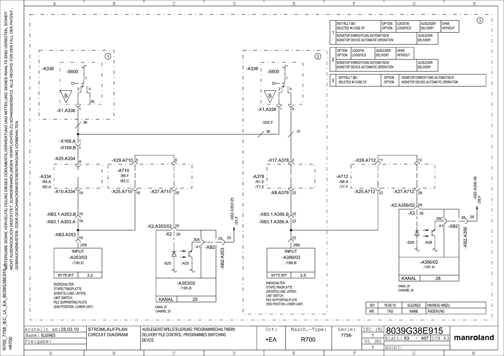

# +EA — Sheet 83 of 407 — AUSLEGERSTAPELSTEUERUNG: PROGRAMMSCHALTWERK

**DELIVERY PILE CONTROL: PROGRAMMED SWITCHING**

> Part of the manroland **R700** printing press IEC/UL circuit diagrams.
> Drawing class: **Stromlaufplan / Circuit diagram** (DIN A3).
> Document `+EA` covers the **Printing unit** machine section.

## At a glance

| Field | Value |
|---|---|
| Document | `+EA`  (8039G38E915) |
| Sheet | **83** of 407 |
| Section (DE) | AUSLEGERSTAPELSTEUERUNG: PROGRAMMSCHALTWERK |
| Section (EN) | DELIVERY PILE CONTROL: PROGRAMMED SWITCHING |
| Section type | CIRCUIT — Circuit diagram |
| Machine type | `R700` |
| Series | `7758` |
| Created | 25.03.10 |
| Replaces | — |
| Columns used | A, B, C, D, E, F, G, H |
| Path numbers | — |
| Labels on sheet | 181 |
| Cross-refs out | 15 |
| Cross-refs in | 41 |

**Previous:** [+EA sheet 82](SHEET_0082.md) · **Next:** [+EA sheet 84](SHEET_0084.md) · **Document TOC:** [_TOC.md](_TOC.md)  (+EA) · **Master TOC:** [all sheets](../_MASTER_TOC.md)

## Sheet image (300 DPI, exact vector render)



_Rendered directly from the PDF vector layer at 300 DPI (1-bit), no OCR and no resampling. Use it to confirm anything ambiguous in the text below._

## Cross-references on this sheet

Each entry is a wire leaving this sheet. The printed token is `/sheet.column`; the link resolves to that sheet inside the same document.

| Ref | Target sheet | Col | Path | Destination on target | Target section | From col |
|---|---|---|---|---|---|---|
| `/202.F` | [+EA sheet 202](SHEET_0202.md) | F | — | — | REFERENZMODUL | E |
| `/88.F` | [+EA sheet 88](SHEET_0088.md) | F | — | — | SAUGWALZE | B |
| `/82.C` | [+EA sheet 82](SHEET_0082.md) | C | — | — | AUSLEGERSTAPELSTEUERUNG: PROGRAMMSCHALTWERK | B |
| `/26.F` | [+EA sheet 26](SHEET_0026.md) | F | — | XB2.A356:28 | BUSVERBINDUNGEN: SICHERHEITSBUS | H |
| `/84.A` | [+EA sheet 84](SHEET_0084.md) | A | — | — | AUSLEGERSTAPELSTEUERUNG: PROGRAMMSCHALTWERK | A |
| `/82.A` | [+EA sheet 82](SHEET_0082.md) | A | — | — | AUSLEGERSTAPELSTEUERUNG: PROGRAMMSCHALTWERK | A |
| `/91.E` | [+EA sheet 91](SHEET_0091.md) | E | — | — | BLASROHRE (BLASRAHMEN) | D |
| `/77.E` | [+EA sheet 77](SHEET_0077.md) | E | — | — | AUSLEGERSTAPELSTEUERUNG | D |
| `/98.B` | [+EA sheet 98](SHEET_0098.md) | B | — | — | BOGENFÜHRUNGSELEMENT | F |
| `/77.F` | [+EA sheet 77](SHEET_0077.md) | F | — | — | AUSLEGERSTAPELSTEUERUNG | F |
| `/24.F` | [+EA sheet 24](SHEET_0024.md) | F | — | XB2.A353:25 | BUSVERBINDUNGEN: SICHERHEITSBUS | D |
| `/198.B` | [+EA sheet 198](SHEET_0198.md) | B | — | — | REFERENZMODUL | E |
| `/195.D` | [+EA sheet 195](SHEET_0195.md) | D | — | — | REFERENZMODUL | A |
| `/197.H` | [+EA sheet 197](SHEET_0197.md) | H | — | — | REFERENZMODUL | G |
| `/195.B` | [+EA sheet 195](SHEET_0195.md) | B | — | — | REFERENZMODUL | C |

### Incoming references (sheets that point here)

Every other sheet that sends a wire to this one. `Back-ref` is the token printed on *that* sheet; `Path` is its line number.

| From sheet | Cols | Back-ref | Path | Refs | What continues there |
|---|---|---|---|---|---|
| [+EA#24](SHEET_0024.md) | F | `/24.F` | — | 1 | XB2.A353:25 |
| [+EA#26](SHEET_0026.md) | F | `/26.F` | — | 1 | XB2.A356:28 |
| [+EA#77](SHEET_0077.md) | E, F | `/77.E`, `/77.F` | — | 2 | A378 |
| [+EA#82](SHEET_0082.md) | A, C | `/82.A`, `/82.C` | — | 2 | — |
| [+EA#84](SHEET_0084.md) | A | `/84.A` | — | 1 | — |
| [+EA#88](SHEET_0088.md) | E | `/88.E` | — | 1 | — |
| [+EA#91](SHEET_0091.md) | E | `/91.E` | — | 1 | — |
| [+EA#98](SHEET_0098.md) | B | `/98.B` | — | 1 | — |
| [+EA#195](SHEET_0195.md) | B, D | `/195.B`, `/195.D` | — | 2 | — |
| [+EA#197](SHEET_0197.md) | H | `/197.H` | — | 1 | — |
| [+EA#198](SHEET_0198.md) | B | `/198.B` | — | 1 | — |
| [+EA#202](SHEET_0202.md) | F | `/202.F` | — | 1 | — |
| [+EA#208](SHEET_0208.md) | F | `/208.F` | — | 2 | — |
| [+EA#224](SHEET_0224.md) | H | `/224.H` | — | 1 | — |
| [+EA#225](SHEET_0225.md) | D, G | `/225.D`, `/225.G` | — | 2 | — |
| [+EA#226](SHEET_0226.md) | F | `/226.F` | — | 1 | — |
| [+EA#234](SHEET_0234.md) | C, D, F, H | `/234.C`, `/234.D`, `/234.F`, `/234.H` | — | 4 | — |
| [+EA#235](SHEET_0235.md) | A, B | `/235.A`, `/235.B` | — | 2 | — |
| [+EA#250](SHEET_0250.md) | D | `/250.D` | — | 1 | — |
| [+EA#253](SHEET_0253.md) | H | `/253.H` | — | 1 | — |
| [+EA#263](SHEET_0263.md) | C | `/263.C` | — | 1 | — |
| [+EA#267](SHEET_0267.md) | B | `/267.B` | — | 1 | — |
| [+EA#268](SHEET_0268.md) | C, F | `/268.C`, `/268.F` | — | 2 | — |
| [+EA#271](SHEET_0271.md) | C, H | `/271.C`, `/271.H` | — | 2 | — |
| [+EA#274](SHEET_0274.md) | B, G | `/274.B`, `/274.G` | — | 4 | — |
| [+EA#285](SHEET_0285.md) | G | `/285.G` | — | 2 | STROMPFAD PIN 1 2 3 |


## Devices on this sheet

| Tag | Class | Class meaning (IEC) | Col | Sub | Terminal | Sign |
|---|---|---|---|---|---|---|
| `A353/03` | A | Baugruppe / assembly, module, PC board | A | 03 | — | — |
| `A334` | A | Baugruppe / assembly, module, PC board | A | — | — | — |
| `A356/03` | A | Baugruppe / assembly, module, PC board | E | 03 | — | — |
| `A378` | A | Baugruppe / assembly, module, PC board | D | — | — | — |
| `S28` | S | Schalter / switch | G | — | — | — |
| `A28` | A | Baugruppe / assembly, module, PC board | G | — | — | — |
| `X1` | X | Klemme / terminal, plug connector | G | — | — | — |
| `X2` | X | Klemme / terminal, plug connector | G | — | — | — |
| `XB2` | XB |  | H | — | — | — |
| `A356/02` | A | Baugruppe / assembly, module, PC board | G | 02 | — | — |
| `A712` | A | Baugruppe / assembly, module, PC board | F | — | — | — |
| `S25` | S | Schalter / switch | C | — | — | — |
| `A25` | A | Baugruppe / assembly, module, PC board | C | — | — | — |
| `X1` | X | Klemme / terminal, plug connector | C | — | — | — |
| `X2` | X | Klemme / terminal, plug connector | C | — | — | — |
| `XB2` | XB |  | D | — | — | — |
| `A353/02` | A | Baugruppe / assembly, module, PC board | C | 02 | — | — |
| `A710` | A | Baugruppe / assembly, module, PC board | B | — | — | — |
| `S600` | S | Schalter / switch | E | — | — | — |
| `A336` | A | Baugruppe / assembly, module, PC board | D | — | — | — |
| `S600` | S | Schalter / switch | A | — | — | — |
| `A336` | A | Baugruppe / assembly, module, PC board | A | — | — | — |
| `X25.A334` | — | cross-device reference | A | — | — | — |
| `X169.B` | — | cross-device reference | A | — | — | — |
| `X169.A` | — | cross-device reference | A | — | — | — |
| `3.2` | — | cross-device reference | B | — | — | — |
| `XB3.A353` | — | cross-device reference | A | — | — | — |
| `XB3.1.A353.B` | — | cross-device reference | A | — | — | — |
| `XB3.1.A353.A` | — | cross-device reference | A | — | — | — |
| `X17.A378` | — | cross-device reference | E | — | — | — |
| `3.5` | — | cross-device reference | E | — | — | — |
| `XB2.A356` | — | cross-device reference | H | — | — | — |
| `X29.A712` | — | cross-device reference | F | — | — | — |
| `XB2.A353` | — | cross-device reference | D | — | — | — |
| `X29.A710` | — | cross-device reference | B | — | — | — |
| `X27.A710` | — | cross-device reference | C | — | — | — |
| `X25.A710` | — | cross-device reference | B | — | — | — |
| `X10.A334` | — | cross-device reference | A | — | — | — |
| `X8.A378` | — | cross-device reference | E | — | — | — |
| `X27.A712` | — | cross-device reference | G | — | — | — |
| `X25.A712` | — | cross-device reference | F | — | — | — |
| `XB3.1.A356.B` | — | cross-device reference | E | — | — | — |
| `XB3.1.A356.A` | — | cross-device reference | E | — | — | — |
| `X1.A336` | — | cross-device reference | E | — | — | — |
| `NR.` | — | cross-device reference | F | — | — | — |
| `16.09.10` | — | cross-device reference | G | — | — | — |
| `XB2.A353:25` | — | cross-device reference | D | — | 25 | — |
| `XB2.A356:28` | — | cross-device reference | H | — | 28 | — |
| `X1.A336` | — | cross-device reference | A | — | — | — |

## Potentials / nets

_No named potentials on this sheet._

## Wire-end annotations (grouped as printed)

A wire that continues elsewhere is annotated with a small cluster: the destination description, the path/line number `#NN`, and the `/sheet.column` cross reference. Each row below is one such cluster exactly as it is grouped on the drawing.

| Col | Y | Path | Cross-ref | Text on the wire |
|---|---|---|---|---|
| H | 45.6 | — | — | `3` |
| F | 53.0 | — | — | `ENTFÄLLT BEI DELETED IN CASE OF` |
| G | 53.0 | — | — | `OPTION OPTION` |
| G | 53.0 | — | — | `LOGISTIK LOGISTICS` |
| G | 53.1 | — | — | `1 OHNE WITHOUT` |
| G | 53.1 | — | — | `DELIVERY AUSLEGER` |
| F | 81.4 | — | — | `NONSTOP EINRICHTUNG AUTOMATISCH NONSTOP DEVICE AUTOMATIC OPERATION` |
| G | 81.4 | — | — | `DELIVERY AUSLEGER` |
| F | 116.8 | — | — | `OPTION OPTION` |
| F | 116.8 | — | — | `LOGISTIK LOGISTICS` |
| F | 116.8 | — | — | `DELIVERY AUSLEGER` |
| G | 116.8 | — | — | `OHNE WITHOUT` |
| B | 130.2 | — | — | `1` |
| E | 130.7 | — | — | `2` |
| F | 136.3 | — | — | `2` |
| F | 145.2 | — | — | `NONSTOP EINRICHTUNG AUTOMATISCH NONSTOP DEVICE AUTOMATIC OPERATION` |
| G | 145.2 | — | — | `DELIVERY AUSLEGER` |
| A | 157.6 | — | — | `A336` |
| D | 157.6 | — | — | `A336 S600` |
| A | 164.7 | — | — | `S600` |
| F | 180.6 | — | — | `3 OPTION OPTION` |
| G | 180.6 | — | — | `ENTFÄLLT BEI DELETED IN CASE OF NONSTOP EINRICHTUNG AUTOMATISCH NONSTOP DEVICE AUTOMATIC OPERATION` |
| B | 181.0 | — | — | `1` |
| E | 181.0 | — | — | `1` |
| A | 206.5 | — | — | `2 4` |
| E | 206.5 | — | — | `2 4` |
| A | 220.8 | — | — | `S` |
| E | 220.8 | — | — | `S` |
| B | 237.3 | — | — | `NC` |
| A | 254.0 | — | — | `1` |
| E | 254.0 | — | — | `X1.A336 1` |
| E | 254.0 | — | — | `9` |
| A | 256.8 | — | — | `X1.A336` |
| E | 285.9 | — | `/202.F` | — |
| B | 286.8 | — | — | `BK` |
| E | 308.1 | — | — | `BK` |
| E | 308.2 | — | — | `GY` |
| A | 329.1 | — | — | `X169.A 1` |
| A | 344.7 | — | — | `X169.B 1` |
| A | 370.2 | — | — | `X25.A334 8` |
| C | 374.5 | — | — | `X29.A710 5 6` |
| E | 374.5 | — | — | `X17.A378 2` |
| G | 374.5 | — | — | `X29.A712 11 12` |
| B | 398.6 | — | — | `A710` |
| B | 411.6 | — | `/88.F`, `/82.C` | — |
| A | 412.7 | — | — | `A334` |
| D | 412.7 | — | — | `A378` |
| F | 412.7 | — | — | `A712` |
| H | 417.5 | — | `/26.F` | `XB2.A356:28` |
| A | 425.8 | — | `/84.A`, `/82.A` | — |
| D | 425.8 | — | `/91.E`, `/77.E` | — |
| F | 425.8 | — | `/98.B` | — |
| F | 438.2 | — | `/77.F` | — |
| D | 448.2 | — | — | `X10.A334 19 X25.A710 19 X27.A710 25 X8.A378 22 X25.A712 22 X27.A712 28` |
| D | 467.1 | — | `/24.F` | `XB2.A353:25` |
| G | 480.8 | — | — | `X2.A356/02 28` |
| G | 499.2 | — | — | `X2` |
| G | 500.6 | — | — | `28 28` |
| A | 502.1 | — | — | `XB3.1.A353.B 19` |
| E | 502.1 | — | — | `XB3.1.A356.B 22` |
| H | 509.1 | — | — | `28` |
| G | 513.4 | — | — | `29C` |
| A | 519.1 | — | — | `XB3.1.A353.A 19` |
| E | 519.1 | — | — | `XB3.1.A356.A 22` |
| C | 530.4 | — | — | `X2.A353/02 25` |
| G | 530.4 | — | — | `X1` |
| H | 530.4 | — | — | `XB2` |
| H | 536.6 | — | — | `XB2.A356` |
| C | 548.8 | — | — | `X2` |
| A | 550.2 | — | — | `XB3.A353 19` |
| C | 550.2 | — | — | `25 25` |
| D | 558.8 | — | — | `25` |
| E | 558.8 | — | — | `22` |
| C | 563.0 | — | — | `30A` |
| G | 569.4 | — | — | `S28 A28` |
| A | 575.7 | — | — | `25B` |
| E | 575.7 | — | — | `28B` |
| C | 580.0 | — | — | `X1` |
| D | 580.0 | — | — | `XB2` |
| D | 586.2 | — | — | `XB2.A353` |
| A | 590.2 | — | — | `INPUT` |
| E | 590.2 | — | — | `INPUT` |
| A | 604.1 | — | — | `A353/03` |
| E | 604.1 | — | — | `A356/03` |
| G | 615.4 | — | — | `A356/02` |
| A | 617.9 | — | `/195.D` | — |
| E | 617.9 | — | `/198.B` | — |
| C | 619.0 | — | — | `S25 A25` |
| G | 627.8 | — | `/197.H` | — |
| A | 646.9 | — | — | `BYTE.BIT 3.2` |
| E | 646.9 | — | — | `BYTE.BIT 3.5` |
| G | 653.7 | — | — | `KANAL 28` |
| C | 665.0 | — | — | `A353/02` |
| E | 666.9 | — | — | `ENDSCHALTER: (ENDSTELLUNG, UNTEN) LIMIT SWITCH: PILE SUPPORTING PLATE (END POSITION, LOWER UNIT) STAPELTRAGPLATTE` |
| A | 669.6 | — | — | `ENDSCHALTER:` |
| G | 674.0 | — | — | `KANAL 28 CHANNEL 28` |
| C | 677.4 | — | `/195.B` | — |
| A | 680.2 | — | — | `LIMIT SWITCH: PILE SUPPORTING PLATE (ENDSTELLUNG, UNTEN) (END POSITION, LOWER UNIT) STAPELTRAGPLATTE` |
| C | 703.3 | — | — | `KANAL 25` |
| G | 718.8 | — | — | `001 16.09.10 SLEI/AES HINWEIS HINZU` |
| C | 723.6 | — | — | `KANAL 25 CHANNEL 25` |
| G | 733.0 | — | — | `NR. TAG NAME ÄNDERUNG` |


## Reconstructed tables

This sheet carries tabular content (pin map / terminal assignment / index). The grid below was rebuilt from the drawing's own rule lines, so each row is exactly one physical row of the table.

### Table 1 — 6 data rows × 13 columns (at x=127.6, y=317.5)

| X169.A X169.B | 1 1 |  |  |  |  |  |  |  |  |  |  |  |
|---|---|---|---|---|---|---|---|---|---|---|---|---|
| `X25.A334 X10.A334 XB3.1.A353.B XB3.1.A353.A` | `8 19 19 19` | `X29.A710 A710 /88.F /82.C X25.A710` | `5 19` | `X27.A710 X2.A353/02` | `6 25 25` |  |  | `XB2.A353:25` | `A378 /91.E /77.E /24.F` | `X17.A378 XB3.1.A356.B XB3.1.A356.A` | `X8.A378` | `2 22 22 22` |
| `XB3.A353` | `19 25B` |  |  | `X2` | `25` | `30A X1` | `XB2` | `25 25` |  |  |  | `22 28B` |
| `INPUT` | `A353/03 /195.D` |  |  | `S25` | `A25` |  |  | `XB2.A353` |  |  | `INPUT` | `A356/03 /198.B` |
| `BYTE.BIT` | `3.2` |  |  |  |  |  |  |  |  | `BYTE.BIT` |  | `3.5` |
| `ENDSCHALTER: STAPELTRAGPLATTE (ENDSTELLUNG,` | `UNTEN)` |  |  |  | `A353/02 /195.B` |  |  |  |  | `ENDSCHALTER: (ENDSTELLUNG,` | `STAPELTRAGPLATTE` | `UNTEN)` |
| `LIMIT SWITCH:` |  |  |  | `KANAL` |  | `25` |  |  |  | `LIMIT SWITCH: PILE` | `SUPPORTING` | `PLATE` |


### Table 2 — 4 data rows × 6 columns (at x=892.9, y=367.1)

| 11 22 | X27.A712 X2.A356/02 | 12 28 28 |  |  | XB2.A356:28 |
|---|---|---|---|---|---|
|  | `X2` | `28` | `29C X1` | `XB2` | `28 28` |
|  | `S28` | `A28` |  |  | `XB2.A356` |
|  |  | `A356/02 /197.H` |  |  |  |
|  | `KANAL` |  | `28` |  |  |


## Notes and free text on this sheet

| Text | Col | Y (pt) |
|---|---|---|
| `25B` | A | 575.72 |
| `INPUT` | A | 590.24 |
| `BYTE.BIT` | A | 647.49 |
| `ENDSCHALTER:` | A | 669.59 |
| `STAPELTRAGPLATTE` | A | 680.22 |
| `(ENDSTELLUNG, UNTEN)` | A | 690.88 |
| `LIMIT SWITCH:` | A | 701.44 |
| `PILE SUPPORTING PLATE` | A | 712.12 |
| `(END POSITION, LOWER UNIT)` | A | 722.75 |
| `28B` | E | 575.72 |
| `INPUT` | E | 590.24 |
| `BYTE.BIT` | E | 647.49 |
| `ENDSCHALTER:` | E | 666.9 |
| `STAPELTRAGPLATTE` | E | 676.83 |
| `(ENDSTELLUNG, UNTEN)` | E | 686.79 |
| `LIMIT SWITCH:` | E | 696.74 |
| `PILE SUPPORTING PLATE` | E | 706.71 |
| `(END POSITION, LOWER UNIT)` | E | 716.63 |
| `KANAL 28` | G | 674.01 |
| `CHANNEL 28` | G | 683.96 |
| `29C` | G | 513.4 |
| `KANAL` | G | 653.68 |
| `X2.A356/02` | G | 480.78 |
| `KANAL 25` | C | 723.62 |
| `CHANNEL 25` | C | 733.56 |
| `30A` | C | 562.96 |
| `KANAL` | C | 703.29 |
| `X2.A353/02` | C | 530.39 |
| `TAG` | G | 733.1 |
| `NAME` | G | 733.08 |
| `ÄNDERUNG` | G | 733.14 |
| `SLEI/AES` | G | 718.96 |
| `HINWEIS HINZU` | G | 718.92 |
| `GY` | E | 308.16 |
| `ENTFÄLLT BEI` | F | 53.03 |
| `DELETED IN CASE OF` | F | 63.69 |
| `NONSTOP EINRICHTUNG AUTOMATISCH` | F | 81.42 |
| `NONSTOP DEVICE AUTOMATIC OPERATION` | F | 92.04 |
| `AUSLEGER` | G | 81.42 |
| `DELIVERY` | G | 92.03 |
| `OPTION` | G | 53.04 |
| `LOGISTIK` | G | 53.04 |
| `LOGISTICS` | G | 63.67 |
| `OHNE` | H | 53.06 |
| `WITHOUT` | H | 63.66 |
| `OPTION` | F | 116.82 |
| `LOGISTIK` | F | 116.82 |
| `LOGISTICS` | F | 127.45 |
| `AUSLEGER` | F | 116.85 |
| `DELIVERY` | F | 127.46 |
| `OHNE` | G | 116.84 |
| `WITHOUT` | G | 127.44 |
| `NONSTOP EINRICHTUNG AUTOMATISCH` | G | 180.64 |
| `NONSTOP DEVICE AUTOMATIC OPERATION` | G | 191.26 |
| `BK` | E | 308.07 |
| `S` | E | 220.77 |
| `NC` | B | 237.28 |
| `S` | A | 220.77 |
| `BK` | B | 286.81 |

## Complete label inventory (exact text from the drawing)

Every text object inside the drawing area of this sheet, in DIN reading order (column A→H, then top→bottom). This is the authoritative list: if a string is not here it is not printed on this sheet.

| Col | Y | X | Dir | Type | Text |
|---|---|---|---|---|---|
| A | 157.6 | 98.9 | → | device tag | `A336` |
| A | 164.7 | 156.5 | → | device tag | `S600` |
| A | 206.5 | 182.8 | → | number | `2` |
| A | 220.8 | 151.8 | → | text | `S` |
| A | 254.0 | 186.2 | → | number | `1` |
| A | 256.8 | 133.5 | → | device ref | `X1.A336` |
| A | 329.1 | 140.0 | → | device ref | `X169.A` |
| A | 329.1 | 186.2 | → | number | `1` |
| A | 344.7 | 140.9 | → | device ref | `X169.B` |
| A | 346.2 | 186.2 | → | number | `1` |
| A | 370.2 | 127.6 | → | device ref | `X25.A334` |
| A | 378.7 | 186.8 | → | number | `8` |
| A | 412.7 | 92.7 | → | device tag | `A334` |
| A | 425.8 | 99.8 | → | cross-reference | `/84.A` |
| A | 438.2 | 99.8 | → | cross-reference | `/82.A` |
| A | 448.2 | 127.6 | → | device ref | `X10.A334` |
| A | 452.5 | 186.2 | → | number | `19` |
| A | 502.1 | 109.1 | → | device ref | `XB3.1.A353.B` |
| A | 502.1 | 186.2 | → | number | `19` |
| A | 519.1 | 186.2 | → | number | `19` |
| A | 519.8 | 108.3 | → | device ref | `XB3.1.A353.A` |
| A | 550.2 | 127.8 | → | device ref | `XB3.A353` |
| A | 558.7 | 186.2 | → | number | `19` |
| A | 575.7 | 189.6 | → | text | `25B` |
| A | 590.2 | 169.4 | → | text | `INPUT` |
| A | 604.1 | 162.9 | → | device tag | `A353/03` |
| A | 617.9 | 171.5 | → | cross-reference | `/195.D` |
| A | 647.5 | 137.5 | → | text | `BYTE.BIT` |
| A | 669.6 | 126.7 | → | text | `ENDSCHALTER:` |
| A | 680.2 | 127.3 | → | text | `STAPELTRAGPLATTE` |
| A | 690.9 | 127.0 | → | text | `(ENDSTELLUNG, UNTEN)` |
| A | 701.4 | 126.7 | → | text | `LIMIT SWITCH:` |
| A | 712.1 | 126.7 | → | text | `PILE SUPPORTING PLATE` |
| A | 722.7 | 127.0 | → | text | `(END POSITION, LOWER UNIT)` |
| B | 130.2 | 253.4 | → | number | `1` |
| B | 181.0 | 200.4 | → | number | `1` |
| B | 206.5 | 209.5 | → | number | `4` |
| B | 237.3 | 214.8 | → | text | `NC` |
| B | 286.8 | 197.6 | → | text | `BK` |
| B | 374.5 | 263.6 | → | device ref | `X29.A710` |
| B | 374.5 | 321.4 | → | number | `5` |
| B | 398.6 | 276.9 | → | device tag | `A710` |
| B | 411.6 | 284.9 | → | cross-reference | `/88.F` |
| B | 424.1 | 284.0 | → | cross-reference | `/82.C` |
| B | 448.2 | 262.2 | → | device ref | `X25.A710` |
| B | 452.5 | 320.9 | → | number | `19` |
| B | 646.9 | 205.8 | → | device ref | `3.2` |
| C | 374.5 | 413.6 | → | number | `6` |
| C | 448.2 | 354.3 | → | device ref | `X27.A710` |
| C | 452.5 | 413.6 | → | number | `25` |
| C | 530.4 | 347.0 | → | text | `X2.A353/02` |
| C | 530.4 | 413.6 | → | number | `25` |
| C | 548.8 | 389.5 | → | device tag | `X2` |
| C | 550.2 | 416.4 | → | number | `25` |
| C | 563.0 | 456.4 | → | text | `30A` |
| C | 580.0 | 460.1 | → | device tag | `X1` |
| C | 619.0 | 385.8 | → | device tag | `S25` |
| C | 619.0 | 428.3 | → | device tag | `A25` |
| C | 665.0 | 418.0 | → | device tag | `A353/02` |
| C | 677.4 | 426.8 | → | cross-reference | `/195.B` |
| C | 703.3 | 374.7 | → | text | `KANAL` |
| C | 703.3 | 454.8 | → | number | `25` |
| C | 723.6 | 366.5 | → | text | `KANAL 25` |
| C | 733.6 | 366.8 | → | text | `CHANNEL 25` |
| D | 157.6 | 581.7 | → | device tag | `A336` |
| D | 412.7 | 595.8 | → | device tag | `A378` |
| D | 425.8 | 603.5 | → | cross-reference | `/91.E` |
| D | 438.2 | 603.5 | → | cross-reference | `/77.E` |
| D | 467.1 | 544.5 | ↕ | device ref | `XB2.A353:25` |
| D | 511.4 | 554.4 | ↕ | cross-reference | `/24.F` |
| D | 558.7 | 536.3 | → | number | `25` |
| D | 560.2 | 515.6 | → | number | `25` |
| D | 580.0 | 484.4 | → | device tag | `XB2` |
| D | 586.2 | 520.5 | ↕ | device ref | `XB2.A353` |
| E | 130.7 | 749.2 | → | number | `2` |
| E | 164.7 | 631.3 | → | device tag | `S600` |
| E | 181.0 | 675.2 | → | number | `1` |
| E | 206.5 | 657.6 | → | number | `2` |
| E | 206.5 | 684.3 | → | number | `4` |
| E | 220.8 | 633.7 | → | text | `S` |
| E | 254.0 | 608.3 | → | device ref | `X1.A336` |
| E | 254.0 | 661.0 | → | number | `1` |
| E | 254.0 | 690.0 | → | number | `9` |
| E | 285.9 | 620.2 | → | cross-reference | `/202.F` |
| E | 308.1 | 629.9 | → | text | `BK` |
| E | 308.2 | 701.3 | → | text | `GY` |
| E | 374.5 | 632.1 | → | device ref | `X17.A378` |
| E | 374.5 | 690.0 | → | number | `2` |
| E | 451.0 | 638.1 | → | device ref | `X8.A378` |
| E | 452.5 | 690.0 | → | number | `22` |
| E | 502.1 | 612.3 | → | device ref | `XB3.1.A356.B` |
| E | 502.1 | 690.0 | → | number | `22` |
| E | 519.1 | 690.0 | → | number | `22` |
| E | 519.8 | 611.4 | → | device ref | `XB3.1.A356.A` |
| E | 558.7 | 690.0 | → | number | `22` |
| E | 575.7 | 692.8 | → | text | `28B` |
| E | 590.2 | 672.5 | → | text | `INPUT` |
| E | 604.1 | 666.0 | → | device tag | `A356/03` |
| E | 617.9 | 674.8 | → | cross-reference | `/198.B` |
| E | 646.9 | 708.9 | → | device ref | `3.5` |
| E | 647.5 | 640.6 | → | text | `BYTE.BIT` |
| E | 666.9 | 628.7 | → | text | `ENDSCHALTER:` |
| E | 676.8 | 629.0 | → | text | `STAPELTRAGPLATTE` |
| E | 686.8 | 628.7 | → | text | `(ENDSTELLUNG, UNTEN)` |
| E | 696.7 | 628.7 | → | text | `LIMIT SWITCH:` |
| E | 706.7 | 628.7 | → | text | `PILE SUPPORTING PLATE` |
| E | 716.6 | 628.7 | → | text | `(END POSITION, LOWER UNIT)` |
| F | 53.0 | 795.7 | → | text | `ENTFÄLLT BEI` |
| F | 63.7 | 795.7 | → | text | `DELETED IN CASE OF` |
| F | 72.6 | 784.1 | → | number | `1` |
| F | 81.4 | 795.7 | → | text | `NONSTOP EINRICHTUNG AUTOMATISCH` |
| F | 92.0 | 795.7 | → | text | `NONSTOP DEVICE AUTOMATIC OPERATION` |
| F | 116.8 | 796.3 | → | text | `OPTION` |
| F | 116.8 | 831.1 | → | text | `LOGISTIK` |
| F | 116.9 | 888.7 | → | text | `AUSLEGER` |
| F | 127.4 | 831.1 | → | text | `LOGISTICS` |
| F | 127.5 | 796.3 | → | text | `OPTION` |
| F | 127.5 | 887.8 | → | text | `DELIVERY` |
| F | 136.3 | 783.8 | → | number | `2` |
| F | 145.2 | 795.7 | → | text | `NONSTOP EINRICHTUNG AUTOMATISCH` |
| F | 155.8 | 795.7 | → | text | `NONSTOP DEVICE AUTOMATIC OPERATION` |
| F | 180.6 | 799.9 | → | text | `ENTFÄLLT BEI` |
| F | 185.9 | 783.6 | → | number | `3` |
| F | 191.2 | 799.9 | → | text | `DELETED IN CASE OF` |
| F | 374.5 | 837.6 | → | device ref | `X29.A712` |
| F | 374.5 | 894.9 | → | number | `11` |
| F | 412.7 | 794.3 | → | device tag | `A712` |
| F | 425.8 | 801.6 | → | cross-reference | `/98.B` |
| F | 438.2 | 802.2 | → | cross-reference | `/77.F` |
| F | 448.2 | 836.2 | → | device ref | `X25.A712` |
| F | 452.5 | 895.5 | → | number | `22` |
| F | 718.8 | 873.5 | → | number | `001` |
| F | 733.0 | 872.6 | → | device ref | `NR.` |
| G | 53.0 | 902.6 | → | text | `OPTION` |
| G | 53.0 | 937.4 | → | text | `LOGISTIK` |
| G | 53.1 | 995.0 | → | text | `AUSLEGER` |
| G | 63.7 | 902.6 | → | text | `OPTION` |
| G | 63.7 | 937.4 | → | text | `LOGISTICS` |
| G | 63.7 | 994.1 | → | text | `DELIVERY` |
| G | 81.4 | 987.9 | → | text | `AUSLEGER` |
| G | 92.0 | 987.0 | → | text | `DELIVERY` |
| G | 116.8 | 938.0 | → | text | `OHNE` |
| G | 127.4 | 938.3 | → | text | `WITHOUT` |
| G | 145.2 | 987.9 | → | text | `AUSLEGER` |
| G | 155.8 | 987.0 | → | text | `DELIVERY` |
| G | 180.6 | 906.8 | → | text | `OPTION` |
| G | 180.6 | 948.8 | → | text | `NONSTOP EINRICHTUNG AUTOMATISCH` |
| G | 191.2 | 906.8 | → | text | `OPTION` |
| G | 191.3 | 948.8 | → | text | `NONSTOP DEVICE AUTOMATIC OPERATION` |
| G | 374.5 | 987.0 | → | number | `12` |
| G | 448.2 | 928.3 | → | device ref | `X27.A712` |
| G | 452.5 | 987.6 | → | number | `28` |
| G | 480.8 | 921.0 | → | text | `X2.A356/02` |
| G | 480.8 | 987.6 | → | number | `28` |
| G | 499.2 | 963.5 | → | device tag | `X2` |
| G | 500.6 | 990.4 | → | number | `28` |
| G | 513.4 | 1030.4 | → | text | `29C` |
| G | 530.4 | 1034.1 | → | device tag | `X1` |
| G | 569.4 | 959.8 | → | device tag | `S28` |
| G | 569.4 | 1002.3 | → | device tag | `A28` |
| G | 615.4 | 992.0 | → | device tag | `A356/02` |
| G | 627.8 | 1000.9 | → | cross-reference | `/197.H` |
| G | 653.7 | 948.8 | → | text | `KANAL` |
| G | 653.7 | 1028.8 | → | number | `28` |
| G | 674.0 | 940.5 | → | text | `KANAL 28` |
| G | 684.0 | 940.8 | → | text | `CHANNEL 28` |
| G | 718.9 | 907.3 | → | device ref | `16.09.10` |
| G | 718.9 | 1009.0 | → | text | `HINWEIS HINZU` |
| G | 719.0 | 962.4 | → | text | `SLEI/AES` |
| G | 733.1 | 914.1 | → | text | `TAG` |
| G | 733.1 | 967.5 | → | text | `NAME` |
| G | 733.1 | 1010.1 | → | text | `ÄNDERUNG` |
| H | 45.6 | 1131.9 | → | number | `3` |
| H | 53.1 | 1044.3 | → | text | `OHNE` |
| H | 63.7 | 1044.6 | → | text | `WITHOUT` |
| H | 417.5 | 1118.5 | ↕ | device ref | `XB2.A356:28` |
| H | 461.8 | 1128.4 | ↕ | cross-reference | `/26.F` |
| H | 509.1 | 1110.3 | → | number | `28` |
| H | 510.6 | 1089.6 | → | number | `28` |
| H | 530.4 | 1058.5 | → | device tag | `XB2` |
| H | 536.6 | 1094.5 | ↕ | device ref | `XB2.A356` |

## Reading-order text block

The same content as a plain block, grouped by DIN column — convenient to paste or to match against a visual description.

```text
=== Column A ===
 157.6   98.9  devtag       A336
 164.7  156.5  devtag       S600
 206.5  182.8  numeric      2
 220.8  151.8  text         S
 254.0  186.2  numeric      1
 256.8  133.5  devref       X1.A336
 329.1  140.0  devref       X169.A
 329.1  186.2  numeric      1
 344.7  140.9  devref       X169.B
 346.2  186.2  numeric      1
 370.2  127.6  devref       X25.A334
 378.7  186.8  numeric      8
 412.7   92.7  devtag       A334
 425.8   99.8  xref         /84.A
 438.2   99.8  xref         /82.A
 448.2  127.6  devref       X10.A334
 452.5  186.2  numeric      19
 502.1  109.1  devref       XB3.1.A353.B
 502.1  186.2  numeric      19
 519.1  186.2  numeric      19
 519.8  108.3  devref       XB3.1.A353.A
 550.2  127.8  devref       XB3.A353
 558.7  186.2  numeric      19
 575.7  189.6  text         25B
 590.2  169.4  text         INPUT
 604.1  162.9  devtag       A353/03
 617.9  171.5  xref         /195.D
 647.5  137.5  text         BYTE.BIT
 669.6  126.7  text         ENDSCHALTER:
 680.2  127.3  text         STAPELTRAGPLATTE
 690.9  127.0  text         (ENDSTELLUNG, UNTEN)
 701.4  126.7  text         LIMIT SWITCH:
 712.1  126.7  text         PILE SUPPORTING PLATE
 722.7  127.0  text         (END POSITION, LOWER UNIT)
=== Column B ===
 130.2  253.4  numeric      1
 181.0  200.4  numeric      1
 206.5  209.5  numeric      4
 237.3  214.8  text         NC
 286.8  197.6  text         BK
 374.5  263.6  devref       X29.A710
 374.5  321.4  numeric      5
 398.6  276.9  devtag       A710
 411.6  284.9  xref         /88.F
 424.1  284.0  xref         /82.C
 448.2  262.2  devref       X25.A710
 452.5  320.9  numeric      19
 646.9  205.8  devref       3.2
=== Column C ===
 374.5  413.6  numeric      6
 448.2  354.3  devref       X27.A710
 452.5  413.6  numeric      25
 530.4  347.0  text         X2.A353/02
 530.4  413.6  numeric      25
 548.8  389.5  devtag       X2
 550.2  416.4  numeric      25
 563.0  456.4  text         30A
 580.0  460.1  devtag       X1
 619.0  385.8  devtag       S25
 619.0  428.3  devtag       A25
 665.0  418.0  devtag       A353/02
 677.4  426.8  xref         /195.B
 703.3  374.7  text         KANAL
 703.3  454.8  numeric      25
 723.6  366.5  text         KANAL 25
 733.6  366.8  text         CHANNEL 25
=== Column D ===
 157.6  581.7  devtag       A336
 412.7  595.8  devtag       A378
 425.8  603.5  xref         /91.E
 438.2  603.5  xref         /77.E
 467.1  544.5  devref       XB2.A353:25
 511.4  554.4  xref         /24.F
 558.7  536.3  numeric      25
 560.2  515.6  numeric      25
 580.0  484.4  devtag       XB2
 586.2  520.5  devref       XB2.A353
=== Column E ===
 130.7  749.2  numeric      2
 164.7  631.3  devtag       S600
 181.0  675.2  numeric      1
 206.5  657.6  numeric      2
 206.5  684.3  numeric      4
 220.8  633.7  text         S
 254.0  608.3  devref       X1.A336
 254.0  661.0  numeric      1
 254.0  690.0  numeric      9
 285.9  620.2  xref         /202.F
 308.1  629.9  text         BK
 308.2  701.3  text         GY
 374.5  632.1  devref       X17.A378
 374.5  690.0  numeric      2
 451.0  638.1  devref       X8.A378
 452.5  690.0  numeric      22
 502.1  612.3  devref       XB3.1.A356.B
 502.1  690.0  numeric      22
 519.1  690.0  numeric      22
 519.8  611.4  devref       XB3.1.A356.A
 558.7  690.0  numeric      22
 575.7  692.8  text         28B
 590.2  672.5  text         INPUT
 604.1  666.0  devtag       A356/03
 617.9  674.8  xref         /198.B
 646.9  708.9  devref       3.5
 647.5  640.6  text         BYTE.BIT
 666.9  628.7  text         ENDSCHALTER:
 676.8  629.0  text         STAPELTRAGPLATTE
 686.8  628.7  text         (ENDSTELLUNG, UNTEN)
 696.7  628.7  text         LIMIT SWITCH:
 706.7  628.7  text         PILE SUPPORTING PLATE
 716.6  628.7  text         (END POSITION, LOWER UNIT)
=== Column F ===
  53.0  795.7  text         ENTFÄLLT BEI
  63.7  795.7  text         DELETED IN CASE OF
  72.6  784.1  numeric      1
  81.4  795.7  text         NONSTOP EINRICHTUNG AUTOMATISCH
  92.0  795.7  text         NONSTOP DEVICE AUTOMATIC OPERATION
 116.8  796.3  text         OPTION
 116.8  831.1  text         LOGISTIK
 116.9  888.7  text         AUSLEGER
 127.4  831.1  text         LOGISTICS
 127.5  796.3  text         OPTION
 127.5  887.8  text         DELIVERY
 136.3  783.8  numeric      2
 145.2  795.7  text         NONSTOP EINRICHTUNG AUTOMATISCH
 155.8  795.7  text         NONSTOP DEVICE AUTOMATIC OPERATION
 180.6  799.9  text         ENTFÄLLT BEI
 185.9  783.6  numeric      3
 191.2  799.9  text         DELETED IN CASE OF
 374.5  837.6  devref       X29.A712
 374.5  894.9  numeric      11
 412.7  794.3  devtag       A712
 425.8  801.6  xref         /98.B
 438.2  802.2  xref         /77.F
 448.2  836.2  devref       X25.A712
 452.5  895.5  numeric      22
 718.8  873.5  numeric      001
 733.0  872.6  devref       NR.
=== Column G ===
  53.0  902.6  text         OPTION
  53.0  937.4  text         LOGISTIK
  53.1  995.0  text         AUSLEGER
  63.7  902.6  text         OPTION
  63.7  937.4  text         LOGISTICS
  63.7  994.1  text         DELIVERY
  81.4  987.9  text         AUSLEGER
  92.0  987.0  text         DELIVERY
 116.8  938.0  text         OHNE
 127.4  938.3  text         WITHOUT
 145.2  987.9  text         AUSLEGER
 155.8  987.0  text         DELIVERY
 180.6  906.8  text         OPTION
 180.6  948.8  text         NONSTOP EINRICHTUNG AUTOMATISCH
 191.2  906.8  text         OPTION
 191.3  948.8  text         NONSTOP DEVICE AUTOMATIC OPERATION
 374.5  987.0  numeric      12
 448.2  928.3  devref       X27.A712
 452.5  987.6  numeric      28
 480.8  921.0  text         X2.A356/02
 480.8  987.6  numeric      28
 499.2  963.5  devtag       X2
 500.6  990.4  numeric      28
 513.4 1030.4  text         29C
 530.4 1034.1  devtag       X1
 569.4  959.8  devtag       S28
 569.4 1002.3  devtag       A28
 615.4  992.0  devtag       A356/02
 627.8 1000.9  xref         /197.H
 653.7  948.8  text         KANAL
 653.7 1028.8  numeric      28
 674.0  940.5  text         KANAL 28
 684.0  940.8  text         CHANNEL 28
 718.9  907.3  devref       16.09.10
 718.9 1009.0  text         HINWEIS HINZU
 719.0  962.4  text         SLEI/AES
 733.1  914.1  text         TAG
 733.1  967.5  text         NAME
 733.1 1010.1  text         ÄNDERUNG
=== Column H ===
  45.6 1131.9  numeric      3
  53.1 1044.3  text         OHNE
  63.7 1044.6  text         WITHOUT
 417.5 1118.5  devref       XB2.A356:28
 461.8 1128.4  xref         /26.F
 509.1 1110.3  numeric      28
 510.6 1089.6  numeric      28
 530.4 1058.5  devtag       XB2
 536.6 1094.5  devref       XB2.A356
```

---
_Generated from the PDF vector text layer; no OCR. Source: `R700_7758_IEC_UL_EA_8039G38E915_p`, sheet 83._
