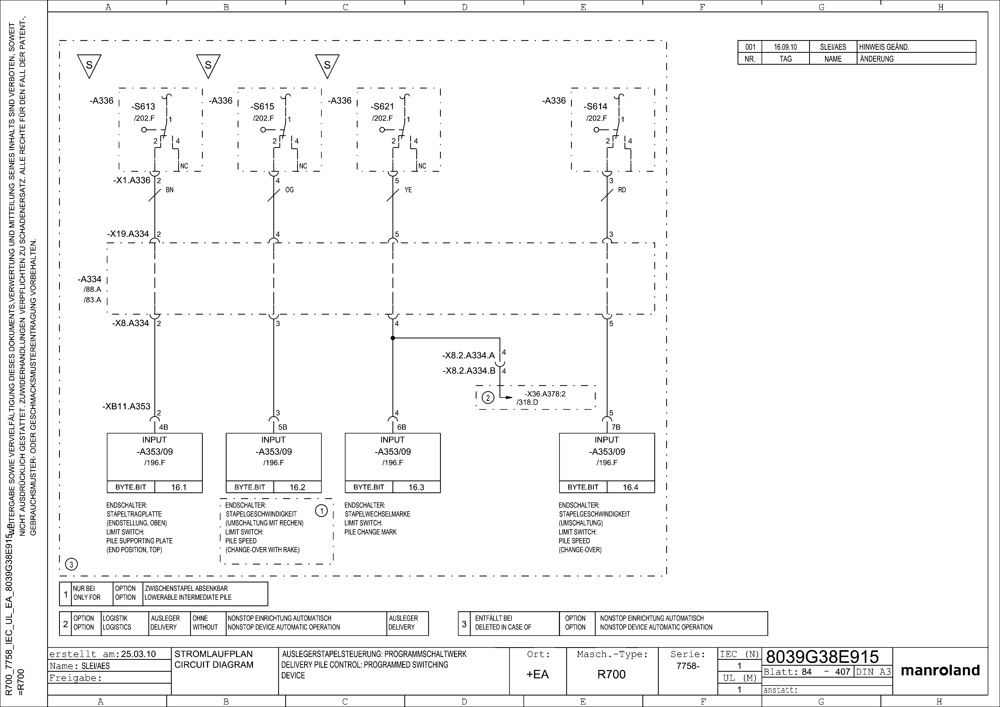

# +EA — Sheet 84 of 407 — AUSLEGERSTAPELSTEUERUNG: PROGRAMMSCHALTWERK

**DELIVERY PILE CONTROL: PROGRAMMED SWITCHING**

> Part of the manroland **R700** printing press IEC/UL circuit diagrams.
> Drawing class: **Stromlaufplan / Circuit diagram** (DIN A3).
> Document `+EA` covers the **Printing unit** machine section.

## At a glance

| Field | Value |
|---|---|
| Document | `+EA`  (8039G38E915) |
| Sheet | **84** of 407 |
| Section (DE) | AUSLEGERSTAPELSTEUERUNG: PROGRAMMSCHALTWERK |
| Section (EN) | DELIVERY PILE CONTROL: PROGRAMMED SWITCHING |
| Section type | CIRCUIT — Circuit diagram |
| Machine type | `R700` |
| Series | `7758` |
| Created | 25.03.10 |
| Replaces | — |
| Columns used | A, B, C, D, E, F, G, H |
| Path numbers | — |
| Labels on sheet | 147 |
| Cross-refs out | 11 |
| Cross-refs in | 29 |

**Previous:** [+EA sheet 83](SHEET_0083.md) · **Next:** [+EA sheet 85](SHEET_0085.md) · **Document TOC:** [_TOC.md](_TOC.md)  (+EA) · **Master TOC:** [all sheets](../_MASTER_TOC.md)

## Sheet image (300 DPI, exact vector render)



_Rendered directly from the PDF vector layer at 300 DPI (1-bit), no OCR and no resampling. Use it to confirm anything ambiguous in the text below._

## Cross-references on this sheet

Each entry is a wire leaving this sheet. The printed token is `/sheet.column`; the link resolves to that sheet inside the same document.

| Ref | Target sheet | Col | Path | Destination on target | Target section | From col |
|---|---|---|---|---|---|---|
| `/202.F` | [+EA sheet 202](SHEET_0202.md) | F | — | 1 | REFERENZMODUL | B |
| `/202.F` | [+EA sheet 202](SHEET_0202.md) | F | — | — | REFERENZMODUL | B |
| `/202.F` | [+EA sheet 202](SHEET_0202.md) | F | — | 1 | REFERENZMODUL | D |
| `/202.F` | [+EA sheet 202](SHEET_0202.md) | F | — | — | REFERENZMODUL | E |
| `/88.A` | [+EA sheet 88](SHEET_0088.md) | A | — | — | SAUGWALZE | A |
| `/83.A` | [+EA sheet 83](SHEET_0083.md) | A | — | — | AUSLEGERSTAPELSTEUERUNG: PROGRAMMSCHALTWERK | A |
| `/318.D` | [+EA sheet 318](SHEET_0318.md) | D | — | — | OPTION: LOGISTIK, AUSLEGER | E |
| `/196.F` | [+EA sheet 196](SHEET_0196.md) | F | — | — | REFERENZMODUL | A |
| `/196.F` | [+EA sheet 196](SHEET_0196.md) | F | — | — | REFERENZMODUL | B |
| `/196.F` | [+EA sheet 196](SHEET_0196.md) | F | — | — | REFERENZMODUL | C |
| `/196.F` | [+EA sheet 196](SHEET_0196.md) | F | — | — | REFERENZMODUL | E |

### Incoming references (sheets that point here)

Every other sheet that sends a wire to this one. `Back-ref` is the token printed on *that* sheet; `Path` is its line number.

| From sheet | Cols | Back-ref | Path | Refs | What continues there |
|---|---|---|---|---|---|
| [+EA#83](SHEET_0083.md) | A | `/83.A` | — | 1 | — |
| [+EA#88](SHEET_0088.md) | A | `/88.A` | — | 1 | — |
| [+EA#196](SHEET_0196.md) | F | `/196.F` | — | 4 | — |
| [+EA#202](SHEET_0202.md) | F | `/202.F` | — | 4 | — |
| [+EA#208](SHEET_0208.md) | F | `/208.F` | — | 4 | — |
| [+EA#249](SHEET_0249.md) | D, G, H | `/249.D`, `/249.G`, `/249.H` | — | 6 | — |
| [+EA#256](SHEET_0256.md) | A | `/256.A` | — | 4 | — |
| [+EA#263](SHEET_0263.md) | G | `/263.G` | — | 4 | — |
| [+EA#318](SHEET_0318.md) | C | `/318.C` | — | 1 | X36.A378:2 |


## Devices on this sheet

| Tag | Class | Class meaning (IEC) | Col | Sub | Terminal | Sign |
|---|---|---|---|---|---|---|
| `A334` | A | Baugruppe / assembly, module, PC board | A | — | — | — |
| `A353/09` | A | Baugruppe / assembly, module, PC board | C | 09 | — | — |
| `A353/09` | A | Baugruppe / assembly, module, PC board | A | 09 | — | — |
| `A353/09` | A | Baugruppe / assembly, module, PC board | B | 09 | — | — |
| `A353/09` | A | Baugruppe / assembly, module, PC board | E | 09 | — | — |
| `S613` | S | Schalter / switch | A | — | — | — |
| `A336` | A | Baugruppe / assembly, module, PC board | A | — | — | — |
| `S621` | S | Schalter / switch | C | — | — | — |
| `A336` | A | Baugruppe / assembly, module, PC board | C | — | — | — |
| `S614` | S | Schalter / switch | E | — | — | — |
| `A336` | A | Baugruppe / assembly, module, PC board | E | — | — | — |
| `S615` | S | Schalter / switch | B | — | — | — |
| `A336` | A | Baugruppe / assembly, module, PC board | B | — | — | — |
| `X1.A336` | — | cross-device reference | A | — | — | — |
| `X8.A334` | — | cross-device reference | A | — | — | — |
| `X19.A334` | — | cross-device reference | A | — | — | — |
| `16.3` | — | cross-device reference | D | — | — | — |
| `16.1` | — | cross-device reference | B | — | — | — |
| `XB11.A353` | — | cross-device reference | A | — | — | — |
| `16.2` | — | cross-device reference | C | — | — | — |
| `X8.2.A334.B` | — | cross-device reference | D | — | — | — |
| `X8.2.A334.A` | — | cross-device reference | D | — | — | — |
| `16.4` | — | cross-device reference | E | — | — | — |
| `NR.` | — | cross-device reference | F | — | — | — |
| `16.09.10` | — | cross-device reference | G | — | — | — |
| `X36.A378:2` | — | cross-device reference | E | — | 2 | — |

## Potentials / nets

_No named potentials on this sheet._

## Wire-end annotations (grouped as printed)

A wire that continues elsewhere is annotated with a small cluster: the destination description, the path/line number `#NN`, and the `/sheet.column` cross reference. Each row below is one such cluster exactly as it is grouped on the drawing.

| Col | Y | Path | Cross-ref | Text on the wire |
|---|---|---|---|---|
| G | 52.7 | — | — | `001 16.09.10 SLEI/AES HINWEIS GEÄND.` |
| G | 66.8 | — | — | `NR. TAG NAME ÄNDERUNG` |
| B | 72.0 | — | — | `S S S` |
| A | 115.1 | — | — | `A336 S613` |
| B | 115.1 | — | — | `A336 S615` |
| C | 115.1 | — | — | `A336 S621` |
| E | 115.1 | — | — | `A336 S614` |
| B | 137.0 | — | `/202.F` | `1` |
| B | 137.0 | — | `/202.F` | — |
| D | 137.0 | — | `/202.F` | `1` |
| E | 137.0 | — | `/202.F` | — |
| B | 138.5 | — | — | `1` |
| C | 138.5 | — | — | `1` |
| A | 164.0 | — | — | `2 4` |
| B | 164.0 | — | — | `2 4` |
| C | 164.0 | — | — | `2 4` |
| E | 164.0 | — | — | `2 4` |
| C | 194.8 | — | — | `NC NC NC` |
| C | 210.1 | — | — | `X1.A336 2 5 3` |
| B | 211.5 | — | — | `4` |
| C | 223.0 | — | — | `BN OG YE RD` |
| A | 273.9 | — | — | `X19.A334 2` |
| B | 275.3 | — | — | `4` |
| C | 275.3 | — | — | `5` |
| E | 275.3 | — | — | `3` |
| A | 327.7 | — | — | `A334` |
| A | 340.8 | — | `/88.A`, `/83.A` | — |
| A | 380.1 | — | — | `X8.A334 2` |
| B | 381.6 | — | — | `3` |
| C | 381.6 | — | — | `4` |
| E | 381.6 | — | — | `5` |
| D | 415.6 | — | — | `X8.2.A334.A 4` |
| D | 436.9 | — | — | `X8.2.A334.B 4` |
| E | 465.2 | — | — | `X36.A378:2` |
| D | 470.8 | — | — | `2` |
| E | 475.1 | — | `/318.D` | — |
| A | 479.4 | — | — | `XB11.A353 2` |
| B | 487.9 | — | — | `3` |
| C | 487.9 | — | — | `4` |
| E | 487.9 | — | — | `5` |
| A | 504.8 | — | — | `4B` |
| B | 504.8 | — | — | `5B` |
| C | 504.8 | — | — | `6B` |
| E | 504.8 | — | — | `7B` |
| A | 519.4 | — | — | `INPUT` |
| B | 519.4 | — | — | `INPUT` |
| C | 519.4 | — | — | `INPUT` |
| E | 519.4 | — | — | `INPUT` |
| A | 533.2 | — | — | `A353/09` |
| B | 533.2 | — | — | `A353/09` |
| C | 533.2 | — | — | `A353/09` |
| E | 533.2 | — | — | `A353/09` |
| A | 547.0 | — | `/196.F` | — |
| B | 547.0 | — | `/196.F` | — |
| C | 547.0 | — | `/196.F` | — |
| E | 547.0 | — | `/196.F` | — |
| A | 576.1 | — | — | `BYTE.BIT 16.1` |
| B | 576.1 | — | — | `BYTE.BIT 16.2` |
| C | 576.1 | — | — | `BYTE.BIT 16.3` |
| E | 576.1 | — | — | `BYTE.BIT 16.4` |
| A | 598.7 | — | — | `ENDSCHALTER:` |
| B | 598.7 | — | — | `ENDSCHALTER:` |
| C | 598.7 | — | — | `ENDSCHALTER:` |
| E | 598.7 | — | — | `ENDSCHALTER:` |
| C | 605.0 | — | — | `1` |
| A | 609.4 | — | — | `LIMIT SWITCH: PILE SUPPORTING PLATE (ENDSTELLUNG, OBEN) (END POSITION, TOP) STAPELTRAGPLATTE` |
| B | 609.4 | — | — | `LIMIT SWITCH: PILE SPEED (UMSCHALTUNG MIT RECHEN) (CHANGE OVER WITH RAKE) STAPELGESCHWINDIGKEIT` |
| C | 609.4 | — | — | `LIMIT SWITCH: PILE CHANGE MARK STAPELWECHSELMARKE` |
| E | 609.4 | — | — | `LIMIT SWITCH: PILE SPEED (UMSCHALTUNG) (CHANGE OVER) STAPELGESCHWINDIGKEIT` |
| A | 669.3 | — | — | `3` |
| A | 697.9 | — | — | `1 NUR BEI` |
| A | 697.9 | — | — | `OPTION OPTION` |
| B | 697.9 | — | — | `LOWERABLE INTERMEDIATE PILE ZWISCHENSTAPEL ABSENKBAR` |
| A | 708.6 | — | — | `ONLY FOR` |
| A | 733.4 | — | — | `2 OPTION OPTION` |
| A | 733.4 | — | — | `LOGISTIK LOGISTICS` |
| A | 733.4 | — | — | `DELIVERY AUSLEGER` |
| B | 733.4 | — | — | `OHNE WITHOUT` |
| B | 733.4 | — | — | `NONSTOP EINRICHTUNG AUTOMATISCH NONSTOP DEVICE AUTOMATIC OPERATION` |
| C | 733.4 | — | — | `DELIVERY AUSLEGER` |
| E | 733.4 | — | — | `3 NONSTOP EINRICHTUNG AUTOMATISCH NONSTOP DEVICE AUTOMATIC OPERATION` |
| E | 733.4 | — | — | `ENTFÄLLT BEI DELETED IN CASE OF OPTION OPTION` |


## Reconstructed tables

This sheet carries tabular content (pin map / terminal assignment / index). The grid below was rebuilt from the drawing's own rule lines, so each row is exactly one physical row of the table.

### Table 1 — 2 data rows × 2 columns (at x=127.6, y=402.5)

| XB11.A353 | 2 4B |
|---|---|
| `INPUT` | `A353/09 /196.F` |
| `BYTE.BIT` | `16.1` |


### Table 2 — 1 data rows × 2 columns (at x=269.3, y=402.5) — **3 5B**

| INPUT | A353/09 /196.F |
|---|---|
| `BYTE.BIT` | `16.2` |


### Table 3 — 2 data rows × 6 columns (at x=411.0, y=402.5)

|  | 4 6B | X8.2.A334.A X8.2.A334.B 2 | 4 4 X36.A378:2 /318.D |  | 5 7B |
|---|---|---|---|---|---|
| `INPUT` | `A353/09 /196.F` |  |  | `INPUT` | `A353/09 /196.F` |
| `BYTE.BIT` | `16.3` |  |  | `BYTE.BIT` | `16.4` |


## Notes and free text on this sheet

| Text | Col | Y (pt) |
|---|---|---|
| `6B` | C | 504.84 |
| `INPUT` | C | 519.38 |
| `BYTE.BIT` | C | 576.63 |
| `ENDSCHALTER:` | C | 598.73 |
| `STAPELWECHSELMARKE` | C | 609.35 |
| `LIMIT SWITCH:` | C | 619.94 |
| `PILE CHANGE MARK` | C | 630.63 |
| `4B` | A | 504.84 |
| `INPUT` | A | 519.38 |
| `BYTE.BIT` | A | 576.63 |
| `ENDSCHALTER:` | A | 598.73 |
| `STAPELTRAGPLATTE` | A | 609.36 |
| `(ENDSTELLUNG, OBEN)` | A | 620.01 |
| `LIMIT SWITCH:` | A | 630.57 |
| `PILE SUPPORTING PLATE` | A | 641.25 |
| `(END POSITION, TOP)` | A | 651.89 |
| `5B` | B | 504.84 |
| `INPUT` | B | 519.38 |
| `BYTE.BIT` | B | 576.63 |
| `ENDSCHALTER:` | B | 598.73 |
| `STAPELGESCHWINDIGKEIT` | B | 609.35 |
| `(UMSCHALTUNG MIT RECHEN)` | B | 620.03 |
| `LIMIT SWITCH:` | B | 630.57 |
| `PILE SPEED` | B | 641.22 |
| `(CHANGE OVER WITH RAKE)` | B | 651.89 |
| `7B` | E | 504.84 |
| `INPUT` | E | 519.38 |
| `BYTE.BIT` | E | 576.63 |
| `ENDSCHALTER:` | E | 598.73 |
| `STAPELGESCHWINDIGKEIT` | E | 609.35 |
| `(UMSCHALTUNG)` | E | 620.03 |
| `LIMIT SWITCH:` | E | 630.57 |
| `PILE SPEED` | E | 641.22 |
| `(CHANGE OVER)` | E | 651.91 |
| `TAG` | G | 66.95 |
| `NAME` | G | 66.94 |
| `ÄNDERUNG` | G | 67 |
| `SLEI/AES` | G | 52.81 |
| `HINWEIS GEÄND.` | H | 52.77 |
| `S` | C | 71.95 |
| `S` | A | 71.95 |
| `S` | B | 71.95 |
| `BN` | B | 223 |
| `OG` | C | 223.1 |
| `YE` | D | 223.06 |
| `RD` | E | 223.1 |
| `NUR BEI` | A | 697.9 |
| `ONLY FOR` | A | 708.59 |
| `OPTION` | A | 697.92 |
| `ZWISCHENSTAPEL ABSENKBAR` | B | 697.93 |
| `LOWERABLE INTERMEDIATE PILE` | B | 708.56 |
| `NC` | C | 194.76 |
| `NC` | B | 194.76 |
| `NC` | D | 194.76 |
| `LOGISTIK` | A | 733.35 |
| `LOGISTICS` | A | 743.98 |
| `AUSLEGER` | A | 733.39 |
| `DELIVERY` | A | 743.99 |
| `OHNE` | B | 733.37 |
| `WITHOUT` | B | 743.97 |
| `NONSTOP EINRICHTUNG AUTOMATISCH` | B | 733.39 |
| `NONSTOP DEVICE AUTOMATIC OPERATION` | B | 744.01 |
| `AUSLEGER` | C | 733.39 |
| `DELIVERY` | C | 743.99 |
| `OPTION` | E | 733.35 |
| `ENTFÄLLT BEI` | D | 733.35 |
| `DELETED IN CASE OF` | D | 744 |
| `NONSTOP EINRICHTUNG AUTOMATISCH` | F | 733.39 |
| `NONSTOP DEVICE AUTOMATIC OPERATION` | F | 744.01 |

## Complete label inventory (exact text from the drawing)

Every text object inside the drawing area of this sheet, in DIN reading order (column A→H, then top→bottom). This is the authoritative list: if a string is not here it is not printed on this sheet.

| Col | Y | X | Dir | Type | Text |
|---|---|---|---|---|---|
| A | 72.0 | 102.2 | → | text | `S` |
| A | 115.1 | 106.9 | → | device tag | `A336` |
| A | 122.2 | 156.5 | → | device tag | `S613` |
| A | 137.0 | 159.6 | → | cross-reference | `/202.F` |
| A | 164.0 | 182.8 | → | number | `2` |
| A | 210.1 | 134.9 | → | device ref | `X1.A336` |
| A | 211.5 | 186.8 | → | number | `2` |
| A | 273.8 | 127.6 | → | device ref | `X19.A334` |
| A | 275.3 | 186.8 | → | number | `2` |
| A | 327.7 | 92.7 | → | device tag | `A334` |
| A | 340.8 | 99.8 | → | cross-reference | `/88.A` |
| A | 353.2 | 99.8 | → | cross-reference | `/83.A` |
| A | 380.2 | 133.5 | → | device ref | `X8.A334` |
| A | 381.6 | 186.8 | → | number | `2` |
| A | 479.4 | 121.9 | → | device ref | `XB11.A353` |
| A | 487.9 | 186.8 | → | number | `2` |
| A | 504.8 | 189.6 | → | text | `4B` |
| A | 519.4 | 169.4 | → | text | `INPUT` |
| A | 533.2 | 162.9 | → | device tag | `A353/09` |
| A | 547.0 | 171.9 | → | cross-reference | `/196.F` |
| A | 576.6 | 137.5 | → | text | `BYTE.BIT` |
| A | 598.7 | 126.7 | → | text | `ENDSCHALTER:` |
| A | 609.4 | 127.3 | → | text | `STAPELTRAGPLATTE` |
| A | 620.0 | 127.0 | → | text | `(ENDSTELLUNG, OBEN)` |
| A | 630.6 | 126.7 | → | text | `LIMIT SWITCH:` |
| A | 641.2 | 126.7 | → | text | `PILE SUPPORTING PLATE` |
| A | 651.9 | 127.0 | → | text | `(END POSITION, TOP)` |
| A | 669.3 | 83.0 | → | number | `3` |
| A | 697.9 | 87.0 | → | text | `NUR BEI` |
| A | 697.9 | 137.2 | → | text | `OPTION` |
| A | 703.3 | 75.4 | → | number | `1` |
| A | 708.6 | 87.6 | → | text | `ONLY FOR` |
| A | 708.6 | 137.2 | → | text | `OPTION` |
| A | 733.4 | 87.6 | → | text | `OPTION` |
| A | 733.4 | 122.5 | → | text | `LOGISTIK` |
| A | 733.4 | 180.0 | → | text | `AUSLEGER` |
| A | 738.7 | 75.1 | → | number | `2` |
| A | 744.0 | 87.6 | → | text | `OPTION` |
| A | 744.0 | 122.5 | → | text | `LOGISTICS` |
| A | 744.0 | 179.1 | → | text | `DELIVERY` |
| B | 72.0 | 243.9 | → | text | `S` |
| B | 115.1 | 248.6 | → | device tag | `A336` |
| B | 122.2 | 298.2 | → | device tag | `S615` |
| B | 137.0 | 301.3 | → | cross-reference | `/202.F` |
| B | 138.5 | 200.4 | → | number | `1` |
| B | 164.0 | 209.5 | → | number | `4` |
| B | 164.0 | 324.6 | → | number | `2` |
| B | 194.8 | 214.8 | → | text | `NC` |
| B | 211.5 | 328.5 | → | number | `4` |
| B | 223.0 | 197.6 | → | text | `BN` |
| B | 275.3 | 328.5 | → | number | `4` |
| B | 381.6 | 328.5 | → | number | `3` |
| B | 487.9 | 328.5 | → | number | `3` |
| B | 504.8 | 331.4 | → | text | `5B` |
| B | 519.4 | 311.1 | → | text | `INPUT` |
| B | 533.2 | 304.6 | → | device tag | `A353/09` |
| B | 547.0 | 313.7 | → | cross-reference | `/196.F` |
| B | 576.1 | 203.7 | → | device ref | `16.1` |
| B | 576.6 | 279.2 | → | text | `BYTE.BIT` |
| B | 598.7 | 268.4 | → | text | `ENDSCHALTER:` |
| B | 609.3 | 269.0 | → | text | `STAPELGESCHWINDIGKEIT` |
| B | 620.0 | 268.7 | → | text | `(UMSCHALTUNG MIT RECHEN)` |
| B | 630.6 | 268.4 | → | text | `LIMIT SWITCH:` |
| B | 641.2 | 268.4 | → | text | `PILE SPEED` |
| B | 651.9 | 268.7 | → | text | `(CHANGE OVER WITH RAKE)` |
| B | 697.9 | 172.9 | → | text | `ZWISCHENSTAPEL ABSENKBAR` |
| B | 708.6 | 172.1 | → | text | `LOWERABLE INTERMEDIATE PILE` |
| B | 733.4 | 229.3 | → | text | `OHNE` |
| B | 733.4 | 271.3 | → | text | `NONSTOP EINRICHTUNG AUTOMATISCH` |
| B | 744.0 | 229.6 | → | text | `WITHOUT` |
| B | 744.0 | 271.3 | → | text | `NONSTOP DEVICE AUTOMATIC OPERATION` |
| C | 72.0 | 385.7 | → | text | `S` |
| C | 115.1 | 390.3 | → | device tag | `A336` |
| C | 122.2 | 441.4 | → | device tag | `S621` |
| C | 137.0 | 443.1 | → | cross-reference | `/202.F` |
| C | 138.5 | 342.1 | → | number | `1` |
| C | 164.0 | 351.2 | → | number | `4` |
| C | 164.0 | 466.3 | → | number | `2` |
| C | 194.8 | 356.5 | → | text | `NC` |
| C | 211.5 | 470.3 | → | number | `5` |
| C | 223.1 | 339.9 | → | text | `OG` |
| C | 275.3 | 470.3 | → | number | `5` |
| C | 381.6 | 470.3 | → | number | `4` |
| C | 487.9 | 470.3 | → | number | `4` |
| C | 504.8 | 473.1 | → | text | `6B` |
| C | 519.4 | 452.8 | → | text | `INPUT` |
| C | 533.2 | 446.3 | → | device tag | `A353/09` |
| C | 547.0 | 455.4 | → | cross-reference | `/196.F` |
| C | 576.1 | 344.6 | → | device ref | `16.2` |
| C | 576.6 | 420.9 | → | text | `BYTE.BIT` |
| C | 598.7 | 410.2 | → | text | `ENDSCHALTER:` |
| C | 605.0 | 380.9 | → | number | `1` |
| C | 609.3 | 410.7 | → | text | `STAPELWECHSELMARKE` |
| C | 619.9 | 410.2 | → | text | `LIMIT SWITCH:` |
| C | 630.6 | 410.2 | → | text | `PILE CHANGE MARK` |
| C | 733.4 | 463.5 | → | text | `AUSLEGER` |
| C | 744.0 | 462.6 | → | text | `DELIVERY` |
| D | 138.5 | 483.9 | → | number | `1` |
| D | 164.0 | 492.9 | → | number | `4` |
| D | 194.8 | 498.3 | → | text | `NC` |
| D | 223.1 | 481.9 | → | text | `YE` |
| D | 415.6 | 597.8 | → | number | `4` |
| D | 418.4 | 526.4 | → | device ref | `X8.2.A334.A` |
| D | 436.9 | 527.2 | → | device ref | `X8.2.A334.B` |
| D | 438.3 | 597.8 | → | number | `4` |
| D | 470.8 | 579.1 | → | number | `2` |
| D | 576.1 | 486.3 | → | device ref | `16.3` |
| D | 733.3 | 566.1 | → | text | `ENTFÄLLT BEI` |
| D | 738.7 | 549.8 | → | number | `3` |
| D | 744.0 | 566.1 | → | text | `DELETED IN CASE OF` |
| E | 115.1 | 645.4 | → | device tag | `A336` |
| E | 122.2 | 695.1 | → | device tag | `S614` |
| E | 137.0 | 698.2 | → | cross-reference | `/202.F` |
| E | 138.5 | 739.0 | → | number | `1` |
| E | 164.0 | 721.4 | → | number | `2` |
| E | 164.0 | 748.1 | → | number | `4` |
| E | 211.5 | 725.4 | → | number | `3` |
| E | 223.1 | 736.2 | → | text | `RD` |
| E | 275.3 | 725.4 | → | number | `3` |
| E | 381.6 | 725.4 | → | number | `5` |
| E | 465.2 | 624.8 | → | device ref | `X36.A378:2` |
| E | 475.1 | 615.1 | → | cross-reference | `/318.D` |
| E | 487.9 | 725.4 | → | number | `5` |
| E | 504.8 | 728.2 | → | text | `7B` |
| E | 519.4 | 708.0 | → | text | `INPUT` |
| E | 533.2 | 701.4 | → | device tag | `A353/09` |
| E | 547.0 | 710.5 | → | cross-reference | `/196.F` |
| E | 576.1 | 741.4 | → | device ref | `16.4` |
| E | 576.6 | 676.1 | → | text | `BYTE.BIT` |
| E | 598.7 | 665.3 | → | text | `ENDSCHALTER:` |
| E | 609.3 | 665.9 | → | text | `STAPELGESCHWINDIGKEIT` |
| E | 620.0 | 665.6 | → | text | `(UMSCHALTUNG)` |
| E | 630.6 | 665.3 | → | text | `LIMIT SWITCH:` |
| E | 641.2 | 665.3 | → | text | `PILE SPEED` |
| E | 651.9 | 665.6 | → | text | `(CHANGE OVER)` |
| E | 733.4 | 672.9 | → | text | `OPTION` |
| E | 744.0 | 672.9 | → | text | `OPTION` |
| F | 52.7 | 887.7 | → | number | `001` |
| F | 66.8 | 886.7 | → | device ref | `NR.` |
| F | 733.4 | 714.9 | → | text | `NONSTOP EINRICHTUNG AUTOMATISCH` |
| F | 744.0 | 714.9 | → | text | `NONSTOP DEVICE AUTOMATIC OPERATION` |
| G | 52.8 | 921.5 | → | device ref | `16.09.10` |
| G | 52.8 | 976.6 | → | text | `SLEI/AES` |
| G | 66.9 | 981.7 | → | text | `NAME` |
| G | 67.0 | 928.3 | → | text | `TAG` |
| G | 67.0 | 1024.3 | → | text | `ÄNDERUNG` |
| H | 52.8 | 1023.2 | → | text | `HINWEIS GEÄND.` |

## Reading-order text block

The same content as a plain block, grouped by DIN column — convenient to paste or to match against a visual description.

```text
=== Column A ===
  72.0  102.2  text         S
 115.1  106.9  devtag       A336
 122.2  156.5  devtag       S613
 137.0  159.6  xref         /202.F
 164.0  182.8  numeric      2
 210.1  134.9  devref       X1.A336
 211.5  186.8  numeric      2
 273.8  127.6  devref       X19.A334
 275.3  186.8  numeric      2
 327.7   92.7  devtag       A334
 340.8   99.8  xref         /88.A
 353.2   99.8  xref         /83.A
 380.2  133.5  devref       X8.A334
 381.6  186.8  numeric      2
 479.4  121.9  devref       XB11.A353
 487.9  186.8  numeric      2
 504.8  189.6  text         4B
 519.4  169.4  text         INPUT
 533.2  162.9  devtag       A353/09
 547.0  171.9  xref         /196.F
 576.6  137.5  text         BYTE.BIT
 598.7  126.7  text         ENDSCHALTER:
 609.4  127.3  text         STAPELTRAGPLATTE
 620.0  127.0  text         (ENDSTELLUNG, OBEN)
 630.6  126.7  text         LIMIT SWITCH:
 641.2  126.7  text         PILE SUPPORTING PLATE
 651.9  127.0  text         (END POSITION, TOP)
 669.3   83.0  numeric      3
 697.9   87.0  text         NUR BEI
 697.9  137.2  text         OPTION
 703.3   75.4  numeric      1
 708.6   87.6  text         ONLY FOR
 708.6  137.2  text         OPTION
 733.4   87.6  text         OPTION
 733.4  122.5  text         LOGISTIK
 733.4  180.0  text         AUSLEGER
 738.7   75.1  numeric      2
 744.0   87.6  text         OPTION
 744.0  122.5  text         LOGISTICS
 744.0  179.1  text         DELIVERY
=== Column B ===
  72.0  243.9  text         S
 115.1  248.6  devtag       A336
 122.2  298.2  devtag       S615
 137.0  301.3  xref         /202.F
 138.5  200.4  numeric      1
 164.0  209.5  numeric      4
 164.0  324.6  numeric      2
 194.8  214.8  text         NC
 211.5  328.5  numeric      4
 223.0  197.6  text         BN
 275.3  328.5  numeric      4
 381.6  328.5  numeric      3
 487.9  328.5  numeric      3
 504.8  331.4  text         5B
 519.4  311.1  text         INPUT
 533.2  304.6  devtag       A353/09
 547.0  313.7  xref         /196.F
 576.1  203.7  devref       16.1
 576.6  279.2  text         BYTE.BIT
 598.7  268.4  text         ENDSCHALTER:
 609.3  269.0  text         STAPELGESCHWINDIGKEIT
 620.0  268.7  text         (UMSCHALTUNG MIT RECHEN)
 630.6  268.4  text         LIMIT SWITCH:
 641.2  268.4  text         PILE SPEED
 651.9  268.7  text         (CHANGE OVER WITH RAKE)
 697.9  172.9  text         ZWISCHENSTAPEL ABSENKBAR
 708.6  172.1  text         LOWERABLE INTERMEDIATE PILE
 733.4  229.3  text         OHNE
 733.4  271.3  text         NONSTOP EINRICHTUNG AUTOMATISCH
 744.0  229.6  text         WITHOUT
 744.0  271.3  text         NONSTOP DEVICE AUTOMATIC OPERATION
=== Column C ===
  72.0  385.7  text         S
 115.1  390.3  devtag       A336
 122.2  441.4  devtag       S621
 137.0  443.1  xref         /202.F
 138.5  342.1  numeric      1
 164.0  351.2  numeric      4
 164.0  466.3  numeric      2
 194.8  356.5  text         NC
 211.5  470.3  numeric      5
 223.1  339.9  text         OG
 275.3  470.3  numeric      5
 381.6  470.3  numeric      4
 487.9  470.3  numeric      4
 504.8  473.1  text         6B
 519.4  452.8  text         INPUT
 533.2  446.3  devtag       A353/09
 547.0  455.4  xref         /196.F
 576.1  344.6  devref       16.2
 576.6  420.9  text         BYTE.BIT
 598.7  410.2  text         ENDSCHALTER:
 605.0  380.9  numeric      1
 609.3  410.7  text         STAPELWECHSELMARKE
 619.9  410.2  text         LIMIT SWITCH:
 630.6  410.2  text         PILE CHANGE MARK
 733.4  463.5  text         AUSLEGER
 744.0  462.6  text         DELIVERY
=== Column D ===
 138.5  483.9  numeric      1
 164.0  492.9  numeric      4
 194.8  498.3  text         NC
 223.1  481.9  text         YE
 415.6  597.8  numeric      4
 418.4  526.4  devref       X8.2.A334.A
 436.9  527.2  devref       X8.2.A334.B
 438.3  597.8  numeric      4
 470.8  579.1  numeric      2
 576.1  486.3  devref       16.3
 733.3  566.1  text         ENTFÄLLT BEI
 738.7  549.8  numeric      3
 744.0  566.1  text         DELETED IN CASE OF
=== Column E ===
 115.1  645.4  devtag       A336
 122.2  695.1  devtag       S614
 137.0  698.2  xref         /202.F
 138.5  739.0  numeric      1
 164.0  721.4  numeric      2
 164.0  748.1  numeric      4
 211.5  725.4  numeric      3
 223.1  736.2  text         RD
 275.3  725.4  numeric      3
 381.6  725.4  numeric      5
 465.2  624.8  devref       X36.A378:2
 475.1  615.1  xref         /318.D
 487.9  725.4  numeric      5
 504.8  728.2  text         7B
 519.4  708.0  text         INPUT
 533.2  701.4  devtag       A353/09
 547.0  710.5  xref         /196.F
 576.1  741.4  devref       16.4
 576.6  676.1  text         BYTE.BIT
 598.7  665.3  text         ENDSCHALTER:
 609.3  665.9  text         STAPELGESCHWINDIGKEIT
 620.0  665.6  text         (UMSCHALTUNG)
 630.6  665.3  text         LIMIT SWITCH:
 641.2  665.3  text         PILE SPEED
 651.9  665.6  text         (CHANGE OVER)
 733.4  672.9  text         OPTION
 744.0  672.9  text         OPTION
=== Column F ===
  52.7  887.7  numeric      001
  66.8  886.7  devref       NR.
 733.4  714.9  text         NONSTOP EINRICHTUNG AUTOMATISCH
 744.0  714.9  text         NONSTOP DEVICE AUTOMATIC OPERATION
=== Column G ===
  52.8  921.5  devref       16.09.10
  52.8  976.6  text         SLEI/AES
  66.9  981.7  text         NAME
  67.0  928.3  text         TAG
  67.0 1024.3  text         ÄNDERUNG
=== Column H ===
  52.8 1023.2  text         HINWEIS GEÄND.
```

---
_Generated from the PDF vector text layer; no OCR. Source: `R700_7758_IEC_UL_EA_8039G38E915_p`, sheet 84._
