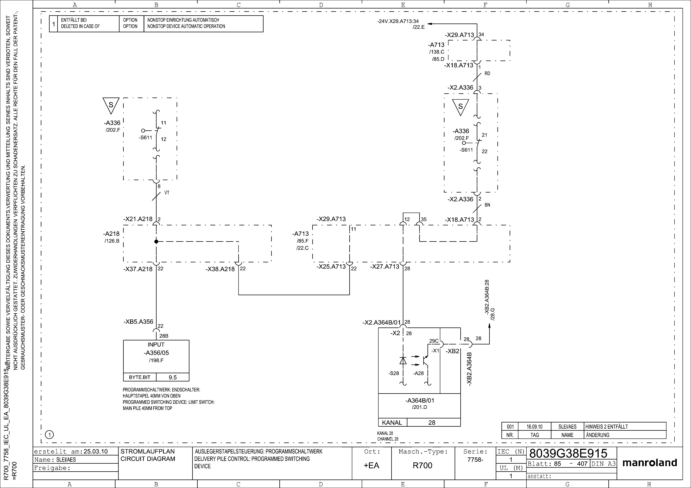

# +EA — Sheet 85 of 407 — AUSLEGERSTAPELSTEUERUNG: PROGRAMMSCHALTWERK

**DELIVERY PILE CONTROL: PROGRAMMED SWITCHING**

> Part of the manroland **R700** printing press IEC/UL circuit diagrams.
> Drawing class: **Stromlaufplan / Circuit diagram** (DIN A3).
> Document `+EA` covers the **Printing unit** machine section.

## At a glance

| Field | Value |
|---|---|
| Document | `+EA`  (8039G38E915) |
| Sheet | **85** of 407 |
| Section (DE) | AUSLEGERSTAPELSTEUERUNG: PROGRAMMSCHALTWERK |
| Section (EN) | DELIVERY PILE CONTROL: PROGRAMMED SWITCHING |
| Section type | CIRCUIT — Circuit diagram |
| Machine type | `R700` |
| Series | `7758` |
| Created | 25.03.10 |
| Replaces | — |
| Columns used | A, B, C, D, E, F, G |
| Path numbers | — |
| Labels on sheet | 98 |
| Cross-refs out | 11 |
| Cross-refs in | 28 |

**Previous:** [+EA sheet 84](SHEET_0084.md) · **Next:** [+EA sheet 86](SHEET_0086.md) · **Document TOC:** [_TOC.md](_TOC.md)  (+EA) · **Master TOC:** [all sheets](../_MASTER_TOC.md)

## Sheet image (300 DPI, exact vector render)



_Rendered directly from the PDF vector layer at 300 DPI (1-bit), no OCR and no resampling. Use it to confirm anything ambiguous in the text below._

## Cross-references on this sheet

Each entry is a wire leaving this sheet. The printed token is `/sheet.column`; the link resolves to that sheet inside the same document.

| Ref | Target sheet | Col | Path | Destination on target | Target section | From col |
|---|---|---|---|---|---|---|
| `/22.E` | [+EA sheet 22](SHEET_0022.md) | E | — | 24V.X29.A713:34 | SPANNUNGSVERSORGUNG: 400V, 24V | E |
| `/138.C` | [+EA sheet 138](SHEET_0138.md) | C | — | — | ZUGANGSABSICHERUNG | E |
| `/85.D` | [+EA sheet 85](SHEET_0085.md) | D | — | — | AUSLEGERSTAPELSTEUERUNG: PROGRAMMSCHALTWERK | E |
| `/202.F` | [+EA sheet 202](SHEET_0202.md) | F | — | — | REFERENZMODUL | A |
| `/202.F` | [+EA sheet 202](SHEET_0202.md) | F | — | — | REFERENZMODUL | F |
| `/126.B` | [+EA sheet 126](SHEET_0126.md) | B | — | — | ZUGANGSABSICHERUNG | A |
| `/85.F` | [+EA sheet 85](SHEET_0085.md) | F | — | — | AUSLEGERSTAPELSTEUERUNG: PROGRAMMSCHALTWERK | D |
| `/22.C` | [+EA sheet 22](SHEET_0022.md) | C | — | — | SPANNUNGSVERSORGUNG: 400V, 24V | D |
| `/28.G` | [+EA sheet 28](SHEET_0028.md) | G | — | XB2.A364B:28 | BUSVERBINDUNGEN: SICHERHEITSBUS | F |
| `/198.F` | [+EA sheet 198](SHEET_0198.md) | F | — | — | REFERENZMODUL | B |
| `/201.D` | [+EA sheet 201](SHEET_0201.md) | D | — | — | REFERENZMODUL | E |

### Incoming references (sheets that point here)

Every other sheet that sends a wire to this one. `Back-ref` is the token printed on *that* sheet; `Path` is its line number.

| From sheet | Cols | Back-ref | Path | Refs | What continues there |
|---|---|---|---|---|---|
| [+EA#22](SHEET_0022.md) | C, E | `/22.C`, `/22.E` | — | 2 | — |
| [+EA#28](SHEET_0028.md) | G | `/28.G` | — | 1 | — |
| [+EA#85](SHEET_0085.md) | D, E | `/85.D`, `/85.E` | — | 2 | — |
| [+EA#126](SHEET_0126.md) | B | `/126.B` | — | 1 | — |
| [+EA#138](SHEET_0138.md) | C | `/138.C` | — | 1 | — |
| [+EA#198](SHEET_0198.md) | F | `/198.F` | — | 1 | — |
| [+EA#201](SHEET_0201.md) | D | `/201.D` | — | 1 | — |
| [+EA#202](SHEET_0202.md) | F | `/202.F` | — | 2 | — |
| [+EA#208](SHEET_0208.md) | F | `/208.F` | — | 1 | — |
| [+EA#224](SHEET_0224.md) | C | `/224.C` | — | 2 | — |
| [+EA#227](SHEET_0227.md) | C, E | `/227.C`, `/227.E` | — | 2 | — |
| [+EA#241](SHEET_0241.md) | H | `/241.H` | — | 1 | — |
| [+EA#263](SHEET_0263.md) | F | `/263.F` | — | 2 | — |
| [+EA#264](SHEET_0264.md) | D | `/264.D` | — | 1 | — |
| [+EA#268](SHEET_0268.md) | G | `/268.G` | — | 1 | — |
| [+EA#272](SHEET_0272.md) | B | `/272.B` | — | 1 | — |
| [+EA#275](SHEET_0275.md) | A, B | `/275.A`, `/275.B` | — | 4 | — |
| [+EA#279](SHEET_0279.md) | E | `/279.E` | — | 1 | — |
| [+EA#280](SHEET_0280.md) | A | `/280.A` | — | 1 | — |


## Devices on this sheet

| Tag | Class | Class meaning (IEC) | Col | Sub | Terminal | Sign |
|---|---|---|---|---|---|---|
| `S611` | S | Schalter / switch | B | — | — | — |
| `A336` | A | Baugruppe / assembly, module, PC board | A | — | — | — |
| `A713` | A | Baugruppe / assembly, module, PC board | E | — | — | — |
| `S611` | S | Schalter / switch | F | — | — | — |
| `A336` | A | Baugruppe / assembly, module, PC board | F | — | — | — |
| `A356/05` | A | Baugruppe / assembly, module, PC board | B | 05 | — | — |
| `S28` | S | Schalter / switch | E | — | — | — |
| `A28` | A | Baugruppe / assembly, module, PC board | E | — | — | — |
| `X1` | X | Klemme / terminal, plug connector | E | — | — | — |
| `X2` | X | Klemme / terminal, plug connector | E | — | — | — |
| `XB2` | XB |  | F | — | — | — |
| `A713` | A | Baugruppe / assembly, module, PC board | D | — | — | — |
| `A218` | A | Baugruppe / assembly, module, PC board | A | — | — | — |
| `X29.A713` | — | cross-device reference | F | — | — | — |
| `X18.A713` | — | cross-device reference | F | — | — | — |
| `X2.A336` | — | cross-device reference | F | — | — | — |
| `X2.A336` | — | cross-device reference | F | — | — | — |
| `9.5` | — | cross-device reference | B | — | — | — |
| `XB5.A356` | — | cross-device reference | B | — | — | — |
| `XB2.A364B` | — | cross-device reference | F | — | — | — |
| `X21.A218` | — | cross-device reference | B | — | — | — |
| `X18.A713` | — | cross-device reference | F | — | — | — |
| `X37.A218` | — | cross-device reference | B | — | — | — |
| `X38.A218` | — | cross-device reference | C | — | — | — |
| `X27.A713` | — | cross-device reference | E | — | — | — |
| `X25.A713` | — | cross-device reference | D | — | — | — |
| `NR.` | — | cross-device reference | F | — | — | — |
| `16.09.10` | — | cross-device reference | G | — | — | — |
| `XB2.A364B:28` | — | cross-device reference | F | — | 28 | — |
| `X29.A713` | — | cross-device reference | D | — | — | — |

## Potentials / nets

| Potential | Count | Columns | Attached devices | Terminals |
|---|---|---|---|---|
| `24V` | 1 | E | `A713`, `X29` | `34` |


A potential such as `L24+/4` or `M24+` is a named supply/return rail; every place it appears on this sheet is electrically common.

## Wire-end annotations (grouped as printed)

A wire that continues elsewhere is annotated with a small cluster: the destination description, the path/line number `#NN`, and the `/sheet.column` cross reference. Each row below is one such cluster exactly as it is grouped on the drawing.

| Col | Y | Path | Cross-ref | Text on the wire |
|---|---|---|---|---|
| B | 31.8 | — | — | `1 NONSTOP EINRICHTUNG AUTOMATISCH NONSTOP DEVICE AUTOMATIC OPERATION` |
| A | 31.8 | — | — | `ENTFÄLLT BEI DELETED IN CASE OF OPTION OPTION` |
| E | 32.9 | — | `/22.E` | `24V.X29.A713:34` |
| F | 55.6 | — | — | `X29.A713 34` |
| E | 72.6 | — | — | `A713` |
| E | 85.7 | — | `/138.C` | — |
| E | 98.1 | — | `/85.D` | — |
| F | 108.0 | — | — | `X18.A713 1` |
| F | 123.9 | — | — | `RD` |
| F | 146.3 | — | — | `X2.A336 3` |
| D | 175.4 | — | — | `S S` |
| A | 207.2 | — | — | `A336` |
| B | 208.0 | — | — | `11` |
| A | 220.3 | — | `/202.F` | — |
| F | 221.4 | — | — | `A336` |
| F | 229.2 | — | — | `21` |
| B | 233.5 | — | — | `S611` |
| F | 234.5 | — | `/202.F` | — |
| B | 236.3 | — | — | `12` |
| F | 254.7 | — | — | `S611` |
| F | 257.6 | — | — | `22` |
| B | 317.8 | — | — | `8` |
| B | 329.4 | — | — | `VT` |
| F | 339.1 | — | — | `X2.A336 2` |
| F | 350.6 | — | — | `BN` |
| C | 373.1 | — | — | `X21.A218 2 12` |
| D | 373.1 | — | — | `X29.A713` |
| E | 374.5 | — | — | `35` |
| F | 374.5 | — | — | `X18.A713 2` |
| D | 391.5 | — | — | `11` |
| A | 398.6 | — | — | `A218` |
| D | 398.6 | — | — | `A713` |
| A | 411.6 | — | `/126.B` | — |
| D | 411.6 | — | `/85.F`, `/22.C` | — |
| C | 455.3 | — | — | `X37.A218 22 X38.A218 22 X25.A713 22 X27.A713 28` |
| F | 482.5 | — | `/28.G` | `XB2.A364B:28` |
| B | 550.2 | — | — | `XB5.A356 22` |
| E | 551.6 | — | — | `X2.A364B/01 28` |
| E | 570.1 | — | — | `X2` |
| E | 571.5 | — | — | `28 28` |
| B | 575.7 | — | — | `28B` |
| F | 580.0 | — | — | `28` |
| E | 584.3 | — | — | `29C` |
| B | 590.2 | — | — | `INPUT` |
| E | 601.2 | — | — | `X1` |
| F | 601.3 | — | — | `XB2` |
| B | 604.1 | — | — | `A356/05` |
| F | 607.5 | — | — | `XB2.A364B` |
| B | 617.9 | — | `/198.F` | — |
| E | 640.2 | — | — | `S28 A28` |
| B | 646.9 | — | — | `BYTE.BIT 9.5` |
| B | 669.6 | — | — | `PROGRAMMSCHALTWERK: ENDSCHALTER: HAUPTSTAPEL 40MM VON OBEN PROGRAMMED SWITCHING DEVICE: LIMIT SWITCH: MAIN PILE 40MM FROM TOP` |
| E | 686.3 | — | — | `A364B/01` |
| E | 698.7 | — | `/201.D` | — |
| E | 724.5 | — | — | `KANAL 28` |
| G | 733.0 | — | — | `001 16.09.10 SLEI/AES HINWEIS 2 ENTFÄLLT` |
| E | 744.9 | — | — | `KANAL 28 CHANNEL 28` |
| A | 746.7 | — | — | `1` |
| G | 747.1 | — | — | `NR. TAG NAME ÄNDERUNG` |


## Reconstructed tables

This sheet carries tabular content (pin map / terminal assignment / index). The grid below was rebuilt from the drawing's own rule lines, so each row is exactly one physical row of the table.

### Table 1 — 3 data rows × 3 columns (at x=212.6, y=416.7)

| X37.A218 | 22 | X38.A218 |
|---|---|---|
| `XB5.A356` | `22 28B` |  |
| `INPUT` | `A356/05 /198.F` |  |
| `BYTE.BIT` | `9.5` |  |


### Table 2 — 5 data rows × 7 columns (at x=602.4, y=41.1)

| 11 |  | /22.E 12 35 | A713 /138.C /85.D | X29.A713 X18.A713 X2.A336 X2.A336 X18.A713 | S A336 /202.F S611 | 34 1 RD 3 21 22 2 BN 2 |
|---|---|---|---|---|---|---|
| `22` | `X27.A713` | `28` |  |  |  |  |
|  | `X2.A364B/01` | `28` |  |  |  | `XB2.A364B:28` |
|  | `X2 S28` | `28 A28` | `29C X1` | `XB2` | `28 XB2.A364B` | `28` |
|  |  | `A364B/01 /201.D` |  |  |  |  |
|  | `KANAL` |  | `28` |  |  |  |


## Notes and free text on this sheet

| Text | Col | Y (pt) |
|---|---|---|
| `28B` | B | 575.72 |
| `INPUT` | B | 590.24 |
| `BYTE.BIT` | B | 647.49 |
| `PROGRAMMSCHALTWERK: ENDSCHALTER:` | B | 669.6 |
| `HAUPTSTAPEL 40MM VON OBEN` | B | 680.23 |
| `PROGRAMMED SWITCHING DEVICE: LIMIT SWITCH:` | B | 690.85 |
| `MAIN PILE 40MM FROM TOP` | B | 701.52 |
| `KANAL 28` | E | 744.88 |
| `CHANNEL 28` | E | 754.82 |
| `29C` | E | 584.27 |
| `KANAL` | E | 724.55 |
| `A364B/01` | E | 686.29 |
| `X2.A364B/01` | E | 551.65 |
| `TAG` | G | 747.27 |
| `NAME` | G | 747.25 |
| `ÄNDERUNG` | G | 747.31 |
| `SLEI/AES` | G | 733.13 |
| `HINWEIS 2 ENTFÄLLT` | G | 733.12 |
| `OPTION` | B | 31.78 |
| `ENTFÄLLT BEI` | A | 31.77 |
| `DELETED IN CASE OF` | A | 42.43 |
| `NONSTOP EINRICHTUNG AUTOMATISCH` | B | 31.82 |
| `NONSTOP DEVICE AUTOMATIC OPERATION` | B | 42.44 |
| `VT` | B | 329.4 |
| `S` | A | 175.42 |
| `S` | F | 178.25 |
| `RD` | F | 123.89 |
| `BN` | F | 350.56 |

## Complete label inventory (exact text from the drawing)

Every text object inside the drawing area of this sheet, in DIN reading order (column A→H, then top→bottom). This is the authoritative list: if a string is not here it is not printed on this sheet.

| Col | Y | X | Dir | Type | Text |
|---|---|---|---|---|---|
| A | 31.8 | 105.4 | → | text | `ENTFÄLLT BEI` |
| A | 37.1 | 89.6 | → | number | `1` |
| A | 42.4 | 105.4 | → | text | `DELETED IN CASE OF` |
| A | 175.4 | 187.2 | → | text | `S` |
| A | 207.2 | 179.1 | → | device tag | `A336` |
| A | 220.3 | 182.3 | → | cross-reference | `/202.F` |
| A | 398.6 | 177.7 | → | device tag | `A218` |
| A | 411.6 | 180.3 | → | cross-reference | `/126.B` |
| A | 746.7 | 83.3 | → | number | `1` |
| B | 31.8 | 212.3 | → | text | `OPTION` |
| B | 31.8 | 254.3 | → | text | `NONSTOP EINRICHTUNG AUTOMATISCH` |
| B | 42.4 | 212.3 | → | text | `OPTION` |
| B | 42.4 | 254.3 | → | text | `NONSTOP DEVICE AUTOMATIC OPERATION` |
| B | 208.0 | 276.9 | → | number | `11` |
| B | 233.5 | 239.2 | → | device tag | `S611` |
| B | 236.3 | 276.9 | → | number | `12` |
| B | 317.8 | 271.8 | → | number | `8` |
| B | 329.4 | 283.5 | → | text | `VT` |
| B | 373.1 | 212.6 | → | device ref | `X21.A218` |
| B | 374.5 | 271.8 | → | number | `2` |
| B | 459.5 | 212.6 | → | device ref | `X37.A218` |
| B | 459.5 | 271.8 | → | number | `22` |
| B | 550.2 | 212.9 | → | device ref | `XB5.A356` |
| B | 558.7 | 271.8 | → | number | `22` |
| B | 575.7 | 274.7 | → | text | `28B` |
| B | 590.2 | 254.4 | → | text | `INPUT` |
| B | 604.1 | 247.9 | → | device tag | `A356/05` |
| B | 617.9 | 257.0 | → | cross-reference | `/198.F` |
| B | 646.9 | 290.8 | → | device ref | `9.5` |
| B | 647.5 | 222.5 | → | text | `BYTE.BIT` |
| B | 669.6 | 211.7 | → | text | `PROGRAMMSCHALTWERK: ENDSCHALTER:` |
| B | 680.2 | 211.7 | → | text | `HAUPTSTAPEL 40MM VON OBEN` |
| B | 690.9 | 211.7 | → | text | `PROGRAMMED SWITCHING DEVICE: LIMIT SWITCH:` |
| B | 701.5 | 212.0 | → | text | `MAIN PILE 40MM FROM TOP` |
| C | 459.5 | 354.3 | → | device ref | `X38.A218` |
| C | 459.5 | 413.6 | → | number | `22` |
| D | 373.1 | 545.7 | → | device ref | `X29.A713` |
| D | 391.5 | 604.3 | → | number | `11` |
| D | 398.6 | 503.7 | → | device tag | `A713` |
| D | 411.6 | 511.7 | → | cross-reference | `/85.F` |
| D | 424.1 | 510.8 | → | cross-reference | `/22.C` |
| D | 455.3 | 545.7 | → | device ref | `X25.A713` |
| D | 459.5 | 604.9 | → | number | `22` |
| E | 32.9 | 650.0 | → | potential | `24V.X29.A713:34` |
| E | 42.8 | 711.2 | → | cross-reference | `/22.E` |
| E | 72.6 | 737.6 | → | device tag | `A713` |
| E | 85.7 | 739.8 | → | cross-reference | `/138.C` |
| E | 98.1 | 744.7 | → | cross-reference | `/85.D` |
| E | 374.5 | 696.5 | → | number | `12` |
| E | 374.5 | 725.4 | → | number | `35` |
| E | 455.3 | 637.8 | → | device ref | `X27.A713` |
| E | 459.5 | 697.0 | → | number | `28` |
| E | 551.6 | 624.8 | → | text | `X2.A364B/01` |
| E | 551.7 | 697.0 | → | number | `28` |
| E | 570.1 | 672.9 | → | device tag | `X2` |
| E | 571.5 | 699.9 | → | number | `28` |
| E | 584.3 | 739.8 | → | text | `29C` |
| E | 601.2 | 743.5 | → | device tag | `X1` |
| E | 640.2 | 669.3 | → | device tag | `S28` |
| E | 640.2 | 711.8 | → | device tag | `A28` |
| E | 686.3 | 698.6 | → | text | `A364B/01` |
| E | 698.7 | 710.1 | → | cross-reference | `/201.D` |
| E | 724.5 | 738.3 | → | number | `28` |
| E | 724.6 | 658.2 | → | text | `KANAL` |
| E | 744.9 | 650.0 | → | text | `KANAL 28` |
| E | 754.8 | 650.3 | → | text | `CHANNEL 28` |
| F | 55.6 | 766.8 | → | device ref | `X29.A713` |
| F | 55.6 | 824.6 | → | number | `34` |
| F | 108.0 | 765.4 | → | device ref | `X18.A713` |
| F | 112.3 | 824.0 | → | number | `1` |
| F | 123.9 | 835.4 | → | text | `RD` |
| F | 146.3 | 771.3 | → | device ref | `X2.A336` |
| F | 147.7 | 824.6 | → | number | `3` |
| F | 178.3 | 789.6 | → | text | `S` |
| F | 221.4 | 780.1 | → | device tag | `A336` |
| F | 229.2 | 830.3 | → | number | `21` |
| F | 234.5 | 783.2 | → | cross-reference | `/202.F` |
| F | 254.7 | 792.0 | → | device tag | `S611` |
| F | 257.6 | 830.3 | → | number | `22` |
| F | 339.0 | 771.3 | → | device ref | `X2.A336` |
| F | 339.1 | 824.6 | → | number | `2` |
| F | 350.6 | 835.4 | → | text | `BN` |
| F | 374.5 | 766.8 | → | device ref | `X18.A713` |
| F | 374.5 | 824.6 | → | number | `2` |
| F | 482.5 | 835.1 | ↕ | device ref | `XB2.A364B:28` |
| F | 531.2 | 845.0 | ↕ | cross-reference | `/28.G` |
| F | 580.0 | 819.8 | → | number | `28` |
| F | 581.4 | 799.1 | → | number | `28` |
| F | 601.3 | 767.9 | → | device tag | `XB2` |
| F | 607.5 | 803.9 | ↕ | device ref | `XB2.A364B` |
| F | 733.0 | 873.5 | → | number | `001` |
| F | 747.1 | 872.6 | → | device ref | `NR.` |
| G | 733.1 | 907.3 | → | device ref | `16.09.10` |
| G | 733.1 | 962.4 | → | text | `SLEI/AES` |
| G | 733.1 | 1009.0 | → | text | `HINWEIS 2 ENTFÄLLT` |
| G | 747.3 | 914.1 | → | text | `TAG` |
| G | 747.3 | 967.5 | → | text | `NAME` |
| G | 747.3 | 1010.1 | → | text | `ÄNDERUNG` |

## Reading-order text block

The same content as a plain block, grouped by DIN column — convenient to paste or to match against a visual description.

```text
=== Column A ===
  31.8  105.4  text         ENTFÄLLT BEI
  37.1   89.6  numeric      1
  42.4  105.4  text         DELETED IN CASE OF
 175.4  187.2  text         S
 207.2  179.1  devtag       A336
 220.3  182.3  xref         /202.F
 398.6  177.7  devtag       A218
 411.6  180.3  xref         /126.B
 746.7   83.3  numeric      1
=== Column B ===
  31.8  212.3  text         OPTION
  31.8  254.3  text         NONSTOP EINRICHTUNG AUTOMATISCH
  42.4  212.3  text         OPTION
  42.4  254.3  text         NONSTOP DEVICE AUTOMATIC OPERATION
 208.0  276.9  numeric      11
 233.5  239.2  devtag       S611
 236.3  276.9  numeric      12
 317.8  271.8  numeric      8
 329.4  283.5  text         VT
 373.1  212.6  devref       X21.A218
 374.5  271.8  numeric      2
 459.5  212.6  devref       X37.A218
 459.5  271.8  numeric      22
 550.2  212.9  devref       XB5.A356
 558.7  271.8  numeric      22
 575.7  274.7  text         28B
 590.2  254.4  text         INPUT
 604.1  247.9  devtag       A356/05
 617.9  257.0  xref         /198.F
 646.9  290.8  devref       9.5
 647.5  222.5  text         BYTE.BIT
 669.6  211.7  text         PROGRAMMSCHALTWERK: ENDSCHALTER:
 680.2  211.7  text         HAUPTSTAPEL 40MM VON OBEN
 690.9  211.7  text         PROGRAMMED SWITCHING DEVICE: LIMIT SWITCH:
 701.5  212.0  text         MAIN PILE 40MM FROM TOP
=== Column C ===
 459.5  354.3  devref       X38.A218
 459.5  413.6  numeric      22
=== Column D ===
 373.1  545.7  devref       X29.A713
 391.5  604.3  numeric      11
 398.6  503.7  devtag       A713
 411.6  511.7  xref         /85.F
 424.1  510.8  xref         /22.C
 455.3  545.7  devref       X25.A713
 459.5  604.9  numeric      22
=== Column E ===
  32.9  650.0  net          24V.X29.A713:34
  42.8  711.2  xref         /22.E
  72.6  737.6  devtag       A713
  85.7  739.8  xref         /138.C
  98.1  744.7  xref         /85.D
 374.5  696.5  numeric      12
 374.5  725.4  numeric      35
 455.3  637.8  devref       X27.A713
 459.5  697.0  numeric      28
 551.6  624.8  text         X2.A364B/01
 551.7  697.0  numeric      28
 570.1  672.9  devtag       X2
 571.5  699.9  numeric      28
 584.3  739.8  text         29C
 601.2  743.5  devtag       X1
 640.2  669.3  devtag       S28
 640.2  711.8  devtag       A28
 686.3  698.6  text         A364B/01
 698.7  710.1  xref         /201.D
 724.5  738.3  numeric      28
 724.6  658.2  text         KANAL
 744.9  650.0  text         KANAL 28
 754.8  650.3  text         CHANNEL 28
=== Column F ===
  55.6  766.8  devref       X29.A713
  55.6  824.6  numeric      34
 108.0  765.4  devref       X18.A713
 112.3  824.0  numeric      1
 123.9  835.4  text         RD
 146.3  771.3  devref       X2.A336
 147.7  824.6  numeric      3
 178.3  789.6  text         S
 221.4  780.1  devtag       A336
 229.2  830.3  numeric      21
 234.5  783.2  xref         /202.F
 254.7  792.0  devtag       S611
 257.6  830.3  numeric      22
 339.0  771.3  devref       X2.A336
 339.1  824.6  numeric      2
 350.6  835.4  text         BN
 374.5  766.8  devref       X18.A713
 374.5  824.6  numeric      2
 482.5  835.1  devref       XB2.A364B:28
 531.2  845.0  xref         /28.G
 580.0  819.8  numeric      28
 581.4  799.1  numeric      28
 601.3  767.9  devtag       XB2
 607.5  803.9  devref       XB2.A364B
 733.0  873.5  numeric      001
 747.1  872.6  devref       NR.
=== Column G ===
 733.1  907.3  devref       16.09.10
 733.1  962.4  text         SLEI/AES
 733.1 1009.0  text         HINWEIS 2 ENTFÄLLT
 747.3  914.1  text         TAG
 747.3  967.5  text         NAME
 747.3 1010.1  text         ÄNDERUNG
```

---
_Generated from the PDF vector text layer; no OCR. Source: `R700_7758_IEC_UL_EA_8039G38E915_p`, sheet 85._
