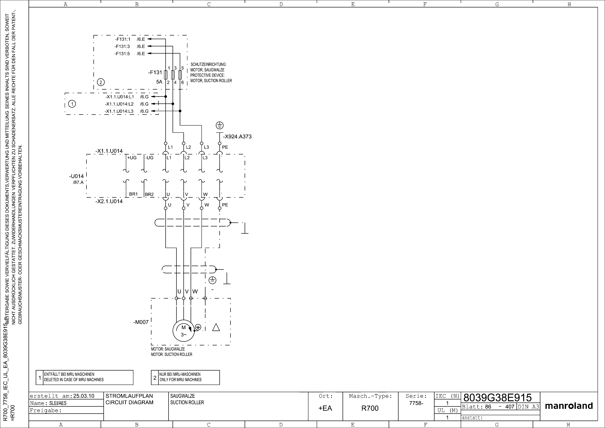

# +EA — Sheet 86 of 407 — SAUGWALZE

**SUCTION ROLLER**

> Part of the manroland **R700** printing press IEC/UL circuit diagrams.
> Drawing class: **Stromlaufplan / Circuit diagram** (DIN A3).
> Document `+EA` covers the **Printing unit** machine section.

## At a glance

| Field | Value |
|---|---|
| Document | `+EA`  (8039G38E915) |
| Sheet | **86** of 407 |
| Section (DE) | SAUGWALZE |
| Section (EN) | SUCTION ROLLER |
| Section type | CIRCUIT — Circuit diagram |
| Machine type | `R700` |
| Series | `7758` |
| Created | 25.03.10 |
| Replaces | — |
| Columns used | A, B, C |
| Path numbers | — |
| Labels on sheet | 63 |
| Cross-refs out | 7 |
| Cross-refs in | 19 |

**Previous:** [+EA sheet 85](SHEET_0085.md) · **Next:** [+EA sheet 87](SHEET_0087.md) · **Document TOC:** [_TOC.md](_TOC.md)  (+EA) · **Master TOC:** [all sheets](../_MASTER_TOC.md)

## Sheet image (300 DPI, exact vector render)



_Rendered directly from the PDF vector layer at 300 DPI (1-bit), no OCR and no resampling. Use it to confirm anything ambiguous in the text below._

## Cross-references on this sheet

Each entry is a wire leaving this sheet. The printed token is `/sheet.column`; the link resolves to that sheet inside the same document.

| Ref | Target sheet | Col | Path | Destination on target | Target section | From col |
|---|---|---|---|---|---|---|
| `/6.E` | [+EA sheet 6](SHEET_0006.md) | E | — | F131:1 | SPANNUNGSVERSORGUNG: 400V,24V | B |
| `/6.E` | [+EA sheet 6](SHEET_0006.md) | E | — | F131:3 | SPANNUNGSVERSORGUNG: 400V,24V | B |
| `/6.E` | [+EA sheet 6](SHEET_0006.md) | E | — | F131:5 | SPANNUNGSVERSORGUNG: 400V,24V | B |
| `/6.G` | [+EA sheet 6](SHEET_0006.md) | G | — | X1.1.U014:L1 | SPANNUNGSVERSORGUNG: 400V,24V | B |
| `/6.G` | [+EA sheet 6](SHEET_0006.md) | G | — | X1.1.U014:L2 | SPANNUNGSVERSORGUNG: 400V,24V | B |
| `/6.G` | [+EA sheet 6](SHEET_0006.md) | G | — | X1.1.U014:L3 | SPANNUNGSVERSORGUNG: 400V,24V | B |
| `/87.A` | [+EA sheet 87](SHEET_0087.md) | A | — | — | SAUGWALZE | A |

### Incoming references (sheets that point here)

Every other sheet that sends a wire to this one. `Back-ref` is the token printed on *that* sheet; `Path` is its line number.

| From sheet | Cols | Back-ref | Path | Refs | What continues there |
|---|---|---|---|---|---|
| [+EA#6](SHEET_0006.md) | E, G | `/6.E`, `/6.G` | — | 6 | F131:1; F131:3; F131:5; X1.1.U014:L1; X1.1.U014:L2; X1.1.U014:L3 |
| [+EA#87](SHEET_0087.md) | B | `/87.B` | — | 1 | FREQUENZUMRICHTER: MOTOR, SAUGWALZE FREQUENCY CONVERTER: MOTOR, SUCTION ROLLER |
| [+EA#221](SHEET_0221.md) | E | `/221.E` | — | 6 | — |
| [+EA#230](SHEET_0230.md) | H | `/230.H` | — | 6 | — |


## Devices on this sheet

| Tag | Class | Class meaning (IEC) | Col | Sub | Terminal | Sign |
|---|---|---|---|---|---|---|
| `U014` | U | Umrichter / frequency converter | A | — | — | — |
| `F131` | F | Schutz / protection device (fuse, circuit breaker) | B | — | — | — |
| `BR2` | BR |  | B | — | — | — |
| `F131:1` | F | Schutz / protection device (fuse, circuit breaker) | B | — | 1 | — |
| `F131:3` | F | Schutz / protection device (fuse, circuit breaker) | B | — | 3 | — |
| `F131:5` | F | Schutz / protection device (fuse, circuit breaker) | B | — | 5 | — |
| `BR1` | BR |  | B | — | — | — |
| `X1.1.U014` | — | cross-device reference | B | — | — | — |
| `X2.1.U014` | — | cross-device reference | B | — | — | — |
| `X1.1.U014:L3` | — | cross-device reference | B | — | L3 | — |
| `X1.1.U014:L2` | — | cross-device reference | B | — | L2 | — |
| `X1.1.U014:L1` | — | cross-device reference | B | — | L1 | — |
| `X924.A373` | — | cross-device reference | C | — | — | — |

## Potentials / nets

| Potential | Count | Columns | Attached devices | Terminals |
|---|---|---|---|---|
| `L1` | 2 | B | — | — |
| `L2` | 2 | C | — | — |
| `L3` | 2 | C | — | — |
| `M007` | 1 | B | — | — |
| `PE` | 2 | C | — | — |


A potential such as `L24+/4` or `M24+` is a named supply/return rail; every place it appears on this sheet is electrically common.

## Wire-end annotations (grouped as printed)

A wire that continues elsewhere is annotated with a small cluster: the destination description, the path/line number `#NN`, and the `/sheet.column` cross reference. Each row below is one such cluster exactly as it is grouped on the drawing.

| Col | Y | Path | Cross-ref | Text on the wire |
|---|---|---|---|---|
| B | 73.2 | — | `/6.E` | `F131:1` |
| B | 87.4 | — | `/6.E` | `F131:3` |
| B | 101.6 | — | `/6.E` | `F131:5` |
| C | 124.0 | — | — | `PROTECTIVE DEVICE: MOTOR, SAUGWALZE MOTOR, SUCTION ROLLER SCHUTZEINRICHTUNG:` |
| C | 130.0 | — | — | `1 3 5` |
| B | 137.8 | — | — | `F131` |
| B | 156.5 | — | — | `5A` |
| C | 158.4 | — | — | `2 4 6` |
| A | 159.0 | — | — | `2` |
| B | 186.6 | — | `/6.G` | `X1.1.U014:L1` |
| B | 200.8 | — | `/6.G` | `X1.1.U014:L2` |
| A | 201.0 | — | — | `1` |
| B | 215.0 | — | `/6.G` | `X1.1.U014:L3` |
| C | 263.9 | — | — | `X924.A373` |
| C | 285.8 | — | — | `PE` |
| B | 285.9 | — | — | `X1.1.U014 L1` |
| C | 285.9 | — | — | `L2` |
| C | 285.9 | — | — | `L3` |
| B | 306.4 | — | — | `+UG L2` |
| B | 306.5 | — | — | `UG` |
| B | 306.5 | — | — | `L1` |
| C | 306.5 | — | — | `L3` |
| C | 306.5 | — | — | `'` |
| A | 341.9 | — | — | `U014` |
| A | 354.9 | — | `/87.A` | — |
| B | 378.0 | — | — | `BR1` |
| C | 378.4 | — | — | `U V W '` |
| B | 378.7 | — | — | `BR2` |
| B | 391.5 | — | — | `X2.1.U014 U W PE` |
| C | 399.2 | — | — | `V` |
| C | 568.4 | — | — | `U V W` |
| B | 628.9 | — | — | `M007` |
| C | 639.8 | — | — | `3~ M` |
| B | 683.8 | — | — | `MOTOR: SAUGWALZE MOTOR: SUCTION ROLLER` |
| B | 733.4 | — | — | `1 ENTFÄLLT BEI MRU MASCHINEN DELETED IN CASE OF MRU MACHINES 2 NUR BEI MRU MASCHINEN` |
| C | 744.0 | — | — | `ONLY FOR MRU MACHINES` |


## Reconstructed tables

This sheet carries tabular content (pin map / terminal assignment / index). The grid below was rebuilt from the drawing's own rule lines, so each row is exactly one physical row of the table.

### Table 1 — 1 data rows × 2 columns (at x=328.8, y=104.9)

| 1 2 | 3 4 |
|---|---|
| `L1 L1 U U` |  |


### Table 2 — 1 data rows × 5 columns (at x=357.2, y=104.9)

| 5 6 |  | MOTOR, PROTECTIVE MOTOR, |  | SCHUTZEINRICHTUNG: SAUGWALZE DEVICE: SUCTION |
|---|---|---|---|---|
|  | `L2 L2 V V` |  | `L3` | `L3 W W` |


## Notes and free text on this sheet

| Text | Col | Y (pt) |
|---|---|---|
| `UG` | B | 306.47 |
| `+UG` | B | 306.45 |
| `5A` | B | 156.48 |
| `SCHUTZEINRICHTUNG:` | C | 123.95 |
| `MOTOR, SAUGWALZE` | C | 134.54 |
| `PROTECTIVE DEVICE:` | C | 145.17 |
| `MOTOR, SUCTION ROLLER` | C | 155.85 |
| `M` | C | 639.8 |
| `U V W` | C | 568.35 |
| `MOTOR: SAUGWALZE` | B | 683.75 |
| `MOTOR: SUCTION ROLLER` | B | 694.43 |
| `V` | C | 399.2 |
| `W` | C | 378.39 |
| `U` | B | 378.76 |
| `ENTFÄLLT BEI MRU MASCHINEN` | A | 733.38 |
| `DELETED IN CASE OF MRU MACHINES` | A | 744.02 |
| `NUR BEI MRU MASCHINEN` | C | 733.4 |
| `ONLY FOR MRU MACHINES` | C | 744.03 |

## Complete label inventory (exact text from the drawing)

Every text object inside the drawing area of this sheet, in DIN reading order (column A→H, then top→bottom). This is the authoritative list: if a string is not here it is not printed on this sheet.

| Col | Y | X | Dir | Type | Text |
|---|---|---|---|---|---|
| A | 159.0 | 196.4 | → | number | `2` |
| A | 201.0 | 140.0 | → | number | `1` |
| A | 341.9 | 136.1 | → | device tag | `U014` |
| A | 354.9 | 143.7 | → | cross-reference | `/87.A` |
| A | 733.4 | 87.0 | → | text | `ENTFÄLLT BEI MRU MASCHINEN` |
| A | 738.7 | 75.4 | → | number | `1` |
| A | 744.0 | 87.0 | → | text | `DELETED IN CASE OF MRU MACHINES` |
| B | 73.2 | 269.6 | → | cross-reference | `/6.E` |
| B | 73.3 | 226.8 | → | device tag | `F131:1` |
| B | 87.4 | 269.6 | → | cross-reference | `/6.E` |
| B | 87.5 | 225.4 | → | device tag | `F131:3` |
| B | 101.6 | 225.4 | → | device tag | `F131:5` |
| B | 101.6 | 269.6 | → | cross-reference | `/6.E` |
| B | 130.0 | 330.0 | → | number | `1` |
| B | 137.8 | 291.7 | → | device tag | `F131` |
| B | 156.5 | 307.6 | → | text | `5A` |
| B | 158.4 | 328.8 | → | number | `2` |
| B | 186.6 | 275.8 | → | cross-reference | `/6.G` |
| B | 186.7 | 207.5 | → | device ref | `X1.1.U014:L1` |
| B | 200.8 | 206.4 | → | device ref | `X1.1.U014:L2` |
| B | 200.8 | 275.8 | → | cross-reference | `/6.G` |
| B | 215.0 | 206.1 | → | device ref | `X1.1.U014:L3` |
| B | 215.0 | 275.8 | → | cross-reference | `/6.G` |
| B | 285.9 | 330.8 | → | potential | `L1` |
| B | 292.3 | 187.9 | → | device ref | `X1.1.U014` |
| B | 306.5 | 250.6 | → | text | `+UG` |
| B | 306.5 | 286.0 | → | text | `UG` |
| B | 306.5 | 328.0 | → | potential | `L1` |
| B | 378.0 | 254.3 | → | device tag | `BR1` |
| B | 378.7 | 285.4 | → | device tag | `BR2` |
| B | 378.8 | 328.0 | → | text | `U` |
| B | 391.5 | 187.9 | → | device ref | `X2.1.U014` |
| B | 399.3 | 330.8 | → | text | `U` |
| B | 628.9 | 262.5 | → | potential | `M007` |
| B | 683.8 | 297.1 | → | text | `MOTOR: SAUGWALZE` |
| B | 694.4 | 297.1 | → | text | `MOTOR: SUCTION ROLLER` |
| B | 738.7 | 301.9 | → | number | `2` |
| C | 123.9 | 375.3 | → | text | `SCHUTZEINRICHTUNG:` |
| C | 130.0 | 342.7 | → | number | `3` |
| C | 130.0 | 356.9 | → | number | `5` |
| C | 134.5 | 375.0 | → | text | `MOTOR, SAUGWALZE` |
| C | 145.2 | 374.7 | → | text | `PROTECTIVE DEVICE:` |
| C | 155.8 | 375.0 | → | text | `MOTOR, SUCTION ROLLER` |
| C | 158.4 | 342.7 | → | number | `4` |
| C | 158.4 | 356.9 | → | number | `6` |
| C | 263.9 | 439.1 | → | device ref | `X924.A373` |
| C | 285.8 | 437.1 | → | potential | `PE` |
| C | 285.9 | 366.2 | → | potential | `L2` |
| C | 285.9 | 401.7 | → | potential | `L3` |
| C | 306.5 | 363.4 | → | potential | `L2` |
| C | 306.5 | 398.8 | → | potential | `L3` |
| C | 306.5 | 434.8 | → | other | `'` |
| C | 378.4 | 399.7 | → | text | `W` |
| C | 378.6 | 364.3 | → | text | `V` |
| C | 378.8 | 434.8 | → | other | `'` |
| C | 398.9 | 402.5 | → | text | `W` |
| C | 399.2 | 367.1 | → | text | `V` |
| C | 399.2 | 437.1 | → | potential | `PE` |
| C | 568.4 | 349.2 | → | text | `U V W` |
| C | 639.8 | 357.3 | → | text | `M` |
| C | 654.0 | 356.0 | → | other | `3~` |
| C | 733.4 | 313.8 | → | text | `NUR BEI MRU MASCHINEN` |
| C | 744.0 | 314.4 | → | text | `ONLY FOR MRU MACHINES` |

## Reading-order text block

The same content as a plain block, grouped by DIN column — convenient to paste or to match against a visual description.

```text
=== Column A ===
 159.0  196.4  numeric      2
 201.0  140.0  numeric      1
 341.9  136.1  devtag       U014
 354.9  143.7  xref         /87.A
 733.4   87.0  text         ENTFÄLLT BEI MRU MASCHINEN
 738.7   75.4  numeric      1
 744.0   87.0  text         DELETED IN CASE OF MRU MACHINES
=== Column B ===
  73.2  269.6  xref         /6.E
  73.3  226.8  devtag       F131:1
  87.4  269.6  xref         /6.E
  87.5  225.4  devtag       F131:3
 101.6  225.4  devtag       F131:5
 101.6  269.6  xref         /6.E
 130.0  330.0  numeric      1
 137.8  291.7  devtag       F131
 156.5  307.6  text         5A
 158.4  328.8  numeric      2
 186.6  275.8  xref         /6.G
 186.7  207.5  devref       X1.1.U014:L1
 200.8  206.4  devref       X1.1.U014:L2
 200.8  275.8  xref         /6.G
 215.0  206.1  devref       X1.1.U014:L3
 215.0  275.8  xref         /6.G
 285.9  330.8  net          L1
 292.3  187.9  devref       X1.1.U014
 306.5  250.6  text         +UG
 306.5  286.0  text         UG
 306.5  328.0  net          L1
 378.0  254.3  devtag       BR1
 378.7  285.4  devtag       BR2
 378.8  328.0  text         U
 391.5  187.9  devref       X2.1.U014
 399.3  330.8  text         U
 628.9  262.5  net          M007
 683.8  297.1  text         MOTOR: SAUGWALZE
 694.4  297.1  text         MOTOR: SUCTION ROLLER
 738.7  301.9  numeric      2
=== Column C ===
 123.9  375.3  text         SCHUTZEINRICHTUNG:
 130.0  342.7  numeric      3
 130.0  356.9  numeric      5
 134.5  375.0  text         MOTOR, SAUGWALZE
 145.2  374.7  text         PROTECTIVE DEVICE:
 155.8  375.0  text         MOTOR, SUCTION ROLLER
 158.4  342.7  numeric      4
 158.4  356.9  numeric      6
 263.9  439.1  devref       X924.A373
 285.8  437.1  net          PE
 285.9  366.2  net          L2
 285.9  401.7  net          L3
 306.5  363.4  net          L2
 306.5  398.8  net          L3
 306.5  434.8  other        `
 378.4  399.7  text         W
 378.6  364.3  text         V
 378.8  434.8  other        `
 398.9  402.5  text         W
 399.2  367.1  text         V
 399.2  437.1  net          PE
 568.4  349.2  text         U V W
 639.8  357.3  text         M
 654.0  356.0  other        3~
 733.4  313.8  text         NUR BEI MRU MASCHINEN
 744.0  314.4  text         ONLY FOR MRU MACHINES
```

---
_Generated from the PDF vector text layer; no OCR. Source: `R700_7758_IEC_UL_EA_8039G38E915_p`, sheet 86._
