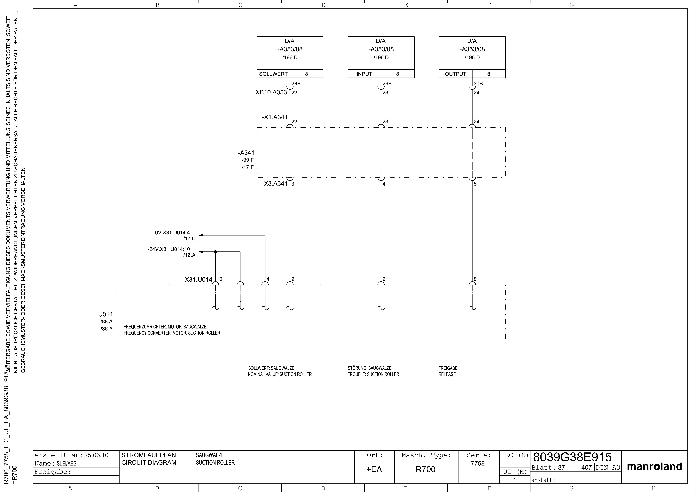

# +EA — Sheet 87 of 407 — SAUGWALZE

**SUCTION ROLLER**

> Part of the manroland **R700** printing press IEC/UL circuit diagrams.
> Drawing class: **Stromlaufplan / Circuit diagram** (DIN A3).
> Document `+EA` covers the **Printing unit** machine section.

## At a glance

| Field | Value |
|---|---|
| Document | `+EA`  (8039G38E915) |
| Sheet | **87** of 407 |
| Section (DE) | SAUGWALZE |
| Section (EN) | SUCTION ROLLER |
| Section type | CIRCUIT — Circuit diagram |
| Machine type | `R700` |
| Series | `7758` |
| Created | 25.03.10 |
| Replaces | — |
| Columns used | A, B, C, D, E, F |
| Path numbers | — |
| Labels on sheet | 55 |
| Cross-refs out | 9 |
| Cross-refs in | 24 |

**Previous:** [+EA sheet 86](SHEET_0086.md) · **Next:** [+EA sheet 88](SHEET_0088.md) · **Document TOC:** [_TOC.md](_TOC.md)  (+EA) · **Master TOC:** [all sheets](../_MASTER_TOC.md)

## Sheet image (300 DPI, exact vector render)



_Rendered directly from the PDF vector layer at 300 DPI (1-bit), no OCR and no resampling. Use it to confirm anything ambiguous in the text below._

## Cross-references on this sheet

Each entry is a wire leaving this sheet. The printed token is `/sheet.column`; the link resolves to that sheet inside the same document.

| Ref | Target sheet | Col | Path | Destination on target | Target section | From col |
|---|---|---|---|---|---|---|
| `/196.D` | [+EA sheet 196](SHEET_0196.md) | D | — | — | REFERENZMODUL | D |
| `/196.D` | [+EA sheet 196](SHEET_0196.md) | D | — | — | REFERENZMODUL | E |
| `/196.D` | [+EA sheet 196](SHEET_0196.md) | D | — | — | REFERENZMODUL | F |
| `/99.F` | [+EA sheet 99](SHEET_0099.md) | F | — | — | BOGENFÜHRUNGSELEMENT | C |
| `/17.F` | [+EA sheet 17](SHEET_0017.md) | F | — | — | SPANNUNGSVERSORGUNG: 400V, 24V | C |
| `/17.D` | [+EA sheet 17](SHEET_0017.md) | D | — | 0V.X31.U014:4 | SPANNUNGSVERSORGUNG: 400V, 24V | B |
| `/16.A` | [+EA sheet 16](SHEET_0016.md) | A | — | 24V.X31.U014:10 | SPANNUNGSVERSORGUNG: 400V, 24V | B |
| `/88.A` | [+EA sheet 88](SHEET_0088.md) | A | — | FREQUENZUMRICHTER: MOTOR, SAUGWALZE FREQUENCY CONVERTER: MOTOR, SUCTION ROLLER | SAUGWALZE | B |
| `/86.A` | [+EA sheet 86](SHEET_0086.md) | A | — | FREQUENZUMRICHTER: MOTOR, SAUGWALZE FREQUENCY CONVERTER: MOTOR, SUCTION ROLLER | SAUGWALZE | B |

### Incoming references (sheets that point here)

Every other sheet that sends a wire to this one. `Back-ref` is the token printed on *that* sheet; `Path` is its line number.

| From sheet | Cols | Back-ref | Path | Refs | What continues there |
|---|---|---|---|---|---|
| [+EA#16](SHEET_0016.md) | A | `/16.A` | — | 1 | 24V.X31.U014:10 |
| [+EA#17](SHEET_0017.md) | D, F | `/17.D`, `/17.F` | — | 2 | 0V.X31.U014:4 |
| [+EA#86](SHEET_0086.md) | A | `/86.A` | — | 1 | — |
| [+EA#88](SHEET_0088.md) | A | `/88.A` | — | 1 | — |
| [+EA#99](SHEET_0099.md) | E | `/99.E` | — | 1 | — |
| [+EA#196](SHEET_0196.md) | D | `/196.D` | — | 3 | — |
| [+EA#209](SHEET_0209.md) | A | `/209.A` | — | 3 | — |
| [+EA#233](SHEET_0233.md) | H | `/233.H` | — | 3 | — |
| [+EA#254](SHEET_0254.md) | C | `/254.C` | — | 3 | — |
| [+EA#276](SHEET_0276.md) | B | `/276.B` | — | 6 | — |


## Devices on this sheet

| Tag | Class | Class meaning (IEC) | Col | Sub | Terminal | Sign |
|---|---|---|---|---|---|---|
| `U014` | U | Umrichter / frequency converter | A | — | — | — |
| `A341` | A | Baugruppe / assembly, module, PC board | C | — | — | — |
| `A353/08` | A | Baugruppe / assembly, module, PC board | D | 08 | — | — |
| `A353/08` | A | Baugruppe / assembly, module, PC board | E | 08 | — | — |
| `A353/08` | A | Baugruppe / assembly, module, PC board | F | 08 | — | — |
| `X31.U014` | — | cross-device reference | B | — | — | — |
| `X1.A341` | — | cross-device reference | C | — | — | — |
| `X3.A341` | — | cross-device reference | C | — | — | — |
| `XB10.A353` | — | cross-device reference | C | — | — | — |

## Potentials / nets

| Potential | Count | Columns | Attached devices | Terminals |
|---|---|---|---|---|
| `0V` | 1 | B | `U014`, `X31` | `4` |
| `24V` | 1 | B | `U014`, `X31` | `10` |


A potential such as `L24+/4` or `M24+` is a named supply/return rail; every place it appears on this sheet is electrically common.

## Wire-end annotations (grouped as printed)

A wire that continues elsewhere is annotated with a small cluster: the destination description, the path/line number `#NN`, and the `/sheet.column` cross reference. Each row below is one such cluster exactly as it is grouped on the drawing.

| Col | Y | Path | Cross-ref | Text on the wire |
|---|---|---|---|---|
| D | 65.8 | — | — | `D/A` |
| E | 65.8 | — | — | `D/A` |
| F | 65.8 | — | — | `D/A` |
| D | 79.7 | — | — | `A353/08` |
| E | 79.7 | — | — | `A353/08` |
| F | 79.7 | — | — | `A353/08` |
| D | 94.5 | — | `/196.D` | — |
| E | 94.5 | — | `/196.D` | — |
| F | 94.5 | — | `/196.D` | — |
| D | 122.8 | — | — | `SOLLWERT 8` |
| E | 122.9 | — | — | `INPUT 8` |
| F | 122.9 | — | — | `OUTPUT 8` |
| D | 139.2 | — | — | `28B` |
| E | 139.2 | — | — | `29B` |
| F | 139.2 | — | — | `30B` |
| C | 153.4 | — | — | `XB10.A353 22` |
| E | 154.8 | — | — | `23` |
| F | 154.8 | — | — | `24` |
| C | 195.9 | — | — | `X1.A341 22` |
| E | 204.4 | — | — | `23` |
| F | 204.4 | — | — | `24` |
| C | 256.8 | — | — | `A341` |
| C | 269.9 | — | `/99.F`, `/17.F` | — |
| C | 309.3 | — | — | `X3.A341 3` |
| E | 310.7 | — | — | `4` |
| F | 310.7 | — | — | `5` |
| B | 394.3 | — | `/17.D` | `0V.X31.U014:4` |
| B | 422.6 | — | `/16.A` | `24V.X31.U014:10` |
| D | 473.7 | — | — | `X31.U014 10 1 4 9 2` |
| F | 473.7 | — | — | `8` |
| A | 533.2 | — | — | `U014` |
| B | 546.3 | — | `/88.A`, `/86.A` | `FREQUENZUMRICHTER: MOTOR, SAUGWALZE FREQUENCY CONVERTER: MOTOR, SUCTION ROLLER` |
| C | 627.0 | — | — | `NOMINAL VALUE: SUCTION ROLLER SOLLWERT: SAUGWALZE` |
| F | 627.0 | — | — | `FREIGABE RELEASE` |
| E | 627.1 | — | — | `STÖRUNG: SAUGWALZE TROUBLE: SUCTION ROLLER` |


## Reconstructed tables

This sheet carries tabular content (pin map / terminal assignment / index). The grid below was rebuilt from the drawing's own rule lines, so each row is exactly one physical row of the table.

### Table 1 — 2 data rows × 2 columns (at x=453.5, y=62.4)

| D/A | A353/08 /196.D |
|---|---|
| `SOLLWERT` | `8` |
| `XB10.A353 X1.A341 X3.A341` | `28B 22 22 3` |


### Table 2 — 2 data rows × 2 columns (at x=595.3, y=62.4)

| D/A | A353/08 /196.D |
|---|---|
| `INPUT` | `8` |
|  | `29B 23 23 4` |


### Table 3 — 2 data rows × 2 columns (at x=751.2, y=62.4)

| D/A | A353/08 /196.D |
|---|---|
| `OUTPUT` | `8` |
|  | `30B 24 24 5` |


## Notes and free text on this sheet

| Text | Col | Y (pt) |
|---|---|---|
| `FREQUENZUMRICHTER: MOTOR, SAUGWALZE` | B | 556.22 |
| `FREQUENCY CONVERTER: MOTOR, SUCTION ROLLER` | B | 566.86 |
| `28B` | D | 139.18 |
| `D/A` | D | 65.78 |
| `SOLLWERT` | C | 122.83 |
| `SOLLWERT: SAUGWALZE` | C | 627.04 |
| `NOMINAL VALUE: SUCTION ROLLER` | C | 637.73 |
| `29B` | E | 139.18 |
| `D/A` | E | 65.78 |
| `INPUT` | D | 122.88 |
| `STÖRUNG: SAUGWALZE` | E | 627.06 |
| `TROUBLE: SUCTION ROLLER` | E | 637.73 |
| `30B` | F | 139.18 |
| `D/A` | F | 65.78 |
| `OUTPUT` | F | 122.89 |
| `FREIGABE` | F | 627.04 |
| `RELEASE` | E | 637.67 |

## Complete label inventory (exact text from the drawing)

Every text object inside the drawing area of this sheet, in DIN reading order (column A→H, then top→bottom). This is the authoritative list: if a string is not here it is not printed on this sheet.

| Col | Y | X | Dir | Type | Text |
|---|---|---|---|---|---|
| A | 533.2 | 164.4 | → | device tag | `U014` |
| A | 546.3 | 172.1 | → | cross-reference | `/88.A` |
| A | 558.7 | 172.1 | → | cross-reference | `/86.A` |
| B | 394.3 | 265.3 | → | potential | `0V.X31.U014:4` |
| B | 404.2 | 313.8 | → | cross-reference | `/17.D` |
| B | 422.7 | 252.9 | → | potential | `24V.X31.U014:10` |
| B | 432.5 | 313.8 | → | cross-reference | `/16.A` |
| B | 473.7 | 312.7 | → | device ref | `X31.U014` |
| B | 556.2 | 211.7 | → | text | `FREQUENZUMRICHTER: MOTOR, SAUGWALZE` |
| B | 566.9 | 211.7 | → | text | `FREQUENCY CONVERTER: MOTOR, SUCTION ROLLER` |
| C | 122.8 | 443.2 | → | text | `SOLLWERT` |
| C | 153.4 | 433.7 | → | device ref | `XB10.A353` |
| C | 195.9 | 448.2 | → | device ref | `X1.A341` |
| C | 256.8 | 407.3 | → | device tag | `A341` |
| C | 269.9 | 413.9 | → | cross-reference | `/99.F` |
| C | 282.3 | 413.9 | → | cross-reference | `/17.F` |
| C | 309.3 | 448.2 | → | device ref | `X3.A341` |
| C | 473.7 | 370.5 | → | number | `10` |
| C | 473.7 | 413.0 | → | number | `1` |
| C | 473.7 | 456.1 | → | number | `4` |
| C | 627.0 | 424.9 | → | text | `SOLLWERT: SAUGWALZE` |
| C | 637.7 | 424.3 | → | text | `NOMINAL VALUE: SUCTION ROLLER` |
| D | 65.8 | 487.3 | → | text | `D/A` |
| D | 79.7 | 474.7 | → | device tag | `A353/08` |
| D | 94.5 | 483.3 | → | cross-reference | `/196.D` |
| D | 122.9 | 522.0 | → | number | `8` |
| D | 122.9 | 610.2 | → | text | `INPUT` |
| D | 139.2 | 498.6 | → | text | `28B` |
| D | 154.8 | 498.6 | → | number | `22` |
| D | 204.4 | 498.6 | → | number | `22` |
| D | 310.7 | 498.6 | → | number | `3` |
| D | 473.7 | 498.6 | → | number | `9` |
| E | 65.8 | 643.2 | → | text | `D/A` |
| E | 79.7 | 630.6 | → | device tag | `A353/08` |
| E | 94.5 | 639.2 | → | cross-reference | `/196.D` |
| E | 122.9 | 677.9 | → | number | `8` |
| E | 139.2 | 654.5 | → | text | `29B` |
| E | 154.8 | 654.5 | → | number | `23` |
| E | 204.4 | 654.5 | → | number | `23` |
| E | 310.7 | 654.5 | → | number | `4` |
| E | 473.7 | 654.5 | → | number | `2` |
| E | 627.1 | 595.0 | → | text | `STÖRUNG: SAUGWALZE` |
| E | 637.7 | 595.0 | → | text | `TROUBLE: SUCTION ROLLER` |
| E | 637.7 | 750.3 | → | text | `RELEASE` |
| F | 65.8 | 799.1 | → | text | `D/A` |
| F | 79.7 | 786.5 | → | device tag | `A353/08` |
| F | 94.5 | 795.1 | → | cross-reference | `/196.D` |
| F | 122.9 | 761.5 | → | text | `OUTPUT` |
| F | 122.9 | 833.8 | → | number | `8` |
| F | 139.2 | 810.4 | → | text | `30B` |
| F | 154.8 | 810.4 | → | number | `24` |
| F | 204.4 | 810.4 | → | number | `24` |
| F | 310.7 | 810.4 | → | number | `5` |
| F | 473.7 | 810.4 | → | number | `8` |
| F | 627.0 | 750.3 | → | text | `FREIGABE` |

## Reading-order text block

The same content as a plain block, grouped by DIN column — convenient to paste or to match against a visual description.

```text
=== Column A ===
 533.2  164.4  devtag       U014
 546.3  172.1  xref         /88.A
 558.7  172.1  xref         /86.A
=== Column B ===
 394.3  265.3  net          0V.X31.U014:4
 404.2  313.8  xref         /17.D
 422.7  252.9  net          24V.X31.U014:10
 432.5  313.8  xref         /16.A
 473.7  312.7  devref       X31.U014
 556.2  211.7  text         FREQUENZUMRICHTER: MOTOR, SAUGWALZE
 566.9  211.7  text         FREQUENCY CONVERTER: MOTOR, SUCTION ROLLER
=== Column C ===
 122.8  443.2  text         SOLLWERT
 153.4  433.7  devref       XB10.A353
 195.9  448.2  devref       X1.A341
 256.8  407.3  devtag       A341
 269.9  413.9  xref         /99.F
 282.3  413.9  xref         /17.F
 309.3  448.2  devref       X3.A341
 473.7  370.5  numeric      10
 473.7  413.0  numeric      1
 473.7  456.1  numeric      4
 627.0  424.9  text         SOLLWERT: SAUGWALZE
 637.7  424.3  text         NOMINAL VALUE: SUCTION ROLLER
=== Column D ===
  65.8  487.3  text         D/A
  79.7  474.7  devtag       A353/08
  94.5  483.3  xref         /196.D
 122.9  522.0  numeric      8
 122.9  610.2  text         INPUT
 139.2  498.6  text         28B
 154.8  498.6  numeric      22
 204.4  498.6  numeric      22
 310.7  498.6  numeric      3
 473.7  498.6  numeric      9
=== Column E ===
  65.8  643.2  text         D/A
  79.7  630.6  devtag       A353/08
  94.5  639.2  xref         /196.D
 122.9  677.9  numeric      8
 139.2  654.5  text         29B
 154.8  654.5  numeric      23
 204.4  654.5  numeric      23
 310.7  654.5  numeric      4
 473.7  654.5  numeric      2
 627.1  595.0  text         STÖRUNG: SAUGWALZE
 637.7  595.0  text         TROUBLE: SUCTION ROLLER
 637.7  750.3  text         RELEASE
=== Column F ===
  65.8  799.1  text         D/A
  79.7  786.5  devtag       A353/08
  94.5  795.1  xref         /196.D
 122.9  761.5  text         OUTPUT
 122.9  833.8  numeric      8
 139.2  810.4  text         30B
 154.8  810.4  numeric      24
 204.4  810.4  numeric      24
 310.7  810.4  numeric      5
 473.7  810.4  numeric      8
 627.0  750.3  text         FREIGABE
```

---
_Generated from the PDF vector text layer; no OCR. Source: `R700_7758_IEC_UL_EA_8039G38E915_p`, sheet 87._
