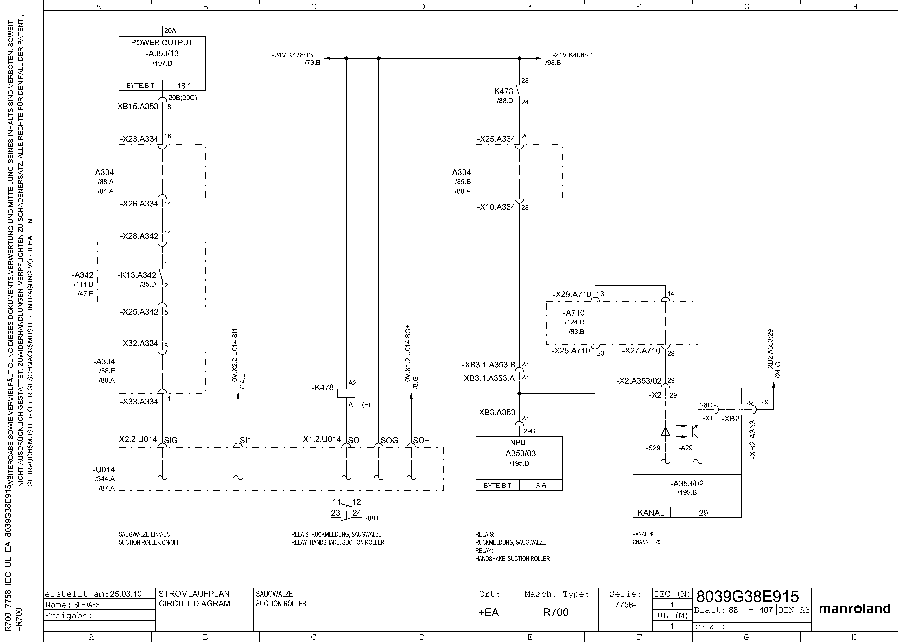

# +EA — Sheet 88 of 407 — SAUGWALZE

**SUCTION ROLLER**

> Part of the manroland **R700** printing press IEC/UL circuit diagrams.
> Drawing class: **Stromlaufplan / Circuit diagram** (DIN A3).
> Document `+EA` covers the **Printing unit** machine section.

## At a glance

| Field | Value |
|---|---|
| Document | `+EA`  (8039G38E915) |
| Sheet | **88** of 407 |
| Section (DE) | SAUGWALZE |
| Section (EN) | SUCTION ROLLER |
| Section type | CIRCUIT — Circuit diagram |
| Machine type | `R700` |
| Series | `7758` |
| Created | 25.03.10 |
| Replaces | — |
| Columns used | A, B, C, D, E, F, G |
| Path numbers | — |
| Labels on sheet | 122 |
| Cross-refs out | 23 |
| Cross-refs in | 41 |

**Previous:** [+EA sheet 87](SHEET_0087.md) · **Next:** [+EA sheet 89](SHEET_0089.md) · **Document TOC:** [_TOC.md](_TOC.md)  (+EA) · **Master TOC:** [all sheets](../_MASTER_TOC.md)

## Sheet image (300 DPI, exact vector render)



_Rendered directly from the PDF vector layer at 300 DPI (1-bit), no OCR and no resampling. Use it to confirm anything ambiguous in the text below._

## Cross-references on this sheet

Each entry is a wire leaving this sheet. The printed token is `/sheet.column`; the link resolves to that sheet inside the same document.

| Ref | Target sheet | Col | Path | Destination on target | Target section | From col |
|---|---|---|---|---|---|---|
| `/73.B` | [+EA sheet 73](SHEET_0073.md) | B | — | 24V.K478:13 24V.K408:21 | AUSLEGERSTAPELSTEUERUNG | D |
| `/98.B` | [+EA sheet 98](SHEET_0098.md) | B | — | — | BOGENFÜHRUNGSELEMENT | E |
| `/197.D` | [+EA sheet 197](SHEET_0197.md) | D | — | — | REFERENZMODUL | B |
| `/88.D` | [+EA sheet 88](SHEET_0088.md) | D | — | — | SAUGWALZE | E |
| `/88.A` | [+EA sheet 88](SHEET_0088.md) | A | — | — | SAUGWALZE | A |
| `/84.A` | [+EA sheet 84](SHEET_0084.md) | A | — | — | AUSLEGERSTAPELSTEUERUNG: PROGRAMMSCHALTWERK | A |
| `/89.B` | [+EA sheet 89](SHEET_0089.md) | B | — | — | BELEUCHTUNG | D |
| `/88.A` | [+EA sheet 88](SHEET_0088.md) | A | — | — | SAUGWALZE | D |
| `/35.D` | [+EA sheet 35](SHEET_0035.md) | D | — | A342 | BUSVERBINDUNGEN: NOT AUS | A |
| `/114.B` | [+EA sheet 114](SHEET_0114.md) | B | — | — | FEHLBOGENKONTROLLE | A |
| `/47.E` | [+EA sheet 47](SHEET_0047.md) | E | — | — | SCHUTZ | A |
| `/124.D` | [+EA sheet 124](SHEET_0124.md) | D | — | — | TROCKENBESTÄUBER | E |
| `/8.G` | [+EA sheet 8](SHEET_0008.md) | G | — | 0V.X1.2.U014:SO+ | SPANNUNGSVERSORGUNG: 400V, 24V | D |
| `/14.E` | [+EA sheet 14](SHEET_0014.md) | E | — | 0V.X2.2.U014:SI1 | SPANNUNGSVERSORGUNG: 400V, 24V | B |
| `/83.B` | [+EA sheet 83](SHEET_0083.md) | B | — | — | AUSLEGERSTAPELSTEUERUNG: PROGRAMMSCHALTWERK | E |
| `/24.G` | [+EA sheet 24](SHEET_0024.md) | G | — | XB2.A353:29 | BUSVERBINDUNGEN: SICHERHEITSBUS | G |
| `/88.E` | [+EA sheet 88](SHEET_0088.md) | E | — | — | SAUGWALZE | A |
| `/88.A` | [+EA sheet 88](SHEET_0088.md) | A | — | — | SAUGWALZE | A |
| `/195.D` | [+EA sheet 195](SHEET_0195.md) | D | — | — | REFERENZMODUL | E |
| `/344.A` | [+EA sheet 344](SHEET_0344.md) | A | — | — | OPTION: TELEPRESENCE | A |
| `/87.A` | [+EA sheet 87](SHEET_0087.md) | A | — | — | SAUGWALZE | A |
| `/195.B` | [+EA sheet 195](SHEET_0195.md) | B | — | — | REFERENZMODUL | F |
| `/88.E` | [+EA sheet 88](SHEET_0088.md) | E | — | — | SAUGWALZE | D |

### Incoming references (sheets that point here)

Every other sheet that sends a wire to this one. `Back-ref` is the token printed on *that* sheet; `Path` is its line number.

| From sheet | Cols | Back-ref | Path | Refs | What continues there |
|---|---|---|---|---|---|
| [+EA#8](SHEET_0008.md) | G | `/8.G` | — | 1 | 0V.X1.2.U014:SO+ |
| [+EA#14](SHEET_0014.md) | E | `/14.E` | — | 1 | 0V.X2.2.U014:SI1 |
| [+EA#24](SHEET_0024.md) | G | `/24.G` | — | 1 | XB2.A353:29 |
| [+EA#35](SHEET_0035.md) | D | `/35.D` | — | 1 | — |
| [+EA#47](SHEET_0047.md) | E | `/47.E` | — | 1 | — |
| [+EA#73](SHEET_0073.md) | C | `/73.C` | — | 1 | — |
| [+EA#83](SHEET_0083.md) | B | `/83.B` | — | 1 | — |
| [+EA#84](SHEET_0084.md) | A | `/84.A` | — | 1 | — |
| [+EA#87](SHEET_0087.md) | B | `/87.B` | — | 1 | FREQUENZUMRICHTER: MOTOR, SAUGWALZE FREQUENCY CONVERTER: MOTOR, SUCTION ROLLER |
| [+EA#88](SHEET_0088.md) | A, D, E | `/88.A`, `/88.D`, `/88.E` | — | 6 | — |
| [+EA#89](SHEET_0089.md) | B | `/89.B` | — | 1 | — |
| [+EA#98](SHEET_0098.md) | B | `/98.B` | — | 1 | 24V.K408:21 |
| [+EA#114](SHEET_0114.md) | B | `/114.B` | — | 1 | — |
| [+EA#124](SHEET_0124.md) | D | `/124.D` | — | 1 | — |
| [+EA#195](SHEET_0195.md) | B, D | `/195.B`, `/195.D` | — | 2 | — |
| [+EA#197](SHEET_0197.md) | D | `/197.D` | — | 1 | — |
| [+EA#224](SHEET_0224.md) | H | `/224.H` | — | 1 | — |
| [+EA#225](SHEET_0225.md) | D | `/225.D` | — | 1 | — |
| [+EA#234](SHEET_0234.md) | C, D, F | `/234.C`, `/234.D`, `/234.F` | — | 3 | — |
| [+EA#253](SHEET_0253.md) | H | `/253.H` | — | 1 | — |
| [+EA#260](SHEET_0260.md) | F | `/260.F` | — | 1 | — |
| [+EA#265](SHEET_0265.md) | A | `/265.A` | — | 1 | — |
| [+EA#267](SHEET_0267.md) | B, F | `/267.B`, `/267.F` | — | 2 | — |
| [+EA#268](SHEET_0268.md) | C | `/268.C` | — | 1 | — |
| [+EA#269](SHEET_0269.md) | B | `/269.B` | — | 1 | — |
| [+EA#271](SHEET_0271.md) | C | `/271.C` | — | 1 | — |
| [+EA#272](SHEET_0272.md) | E | `/272.E` | — | 1 | — |
| [+EA#274](SHEET_0274.md) | B | `/274.B` | — | 2 | — |
| [+EA#276](SHEET_0276.md) | F | `/276.F` | — | 1 | — |
| [+EA#277](SHEET_0277.md) | B | `/277.B` | — | 1 | — |
| [+EA#344](SHEET_0344.md) | A | `/344.A` | — | 1 | — |


## Devices on this sheet

| Tag | Class | Class meaning (IEC) | Col | Sub | Terminal | Sign |
|---|---|---|---|---|---|---|
| `A353/13` | A | Baugruppe / assembly, module, PC board | B | 13 | — | — |
| `A334` | A | Baugruppe / assembly, module, PC board | A | — | — | — |
| `A342` | A | Baugruppe / assembly, module, PC board | A | — | — | — |
| `A334` | A | Baugruppe / assembly, module, PC board | A | — | — | — |
| `SI1` | SI |  | B | — | — | — |
| `K478` | K | Relais / relay, contactor | E | — | — | — |
| `A2` | A | Baugruppe / assembly, module, PC board | C | — | — | — |
| `A1` | A | Baugruppe / assembly, module, PC board | C | — | — | — |
| `K478` | K | Relais / relay, contactor | C | — | — | — |
| `A353/03` | A | Baugruppe / assembly, module, PC board | E | 03 | — | — |
| `A334` | A | Baugruppe / assembly, module, PC board | D | — | — | — |
| `U014` | U | Umrichter / frequency converter | A | — | — | — |
| `A710` | A | Baugruppe / assembly, module, PC board | E | — | — | — |
| `S29` | S | Schalter / switch | F | — | — | — |
| `A29` | A | Baugruppe / assembly, module, PC board | F | — | — | — |
| `X1` | X | Klemme / terminal, plug connector | G | — | — | — |
| `X2` | X | Klemme / terminal, plug connector | F | — | — | — |
| `XB2` | XB |  | G | — | — | — |
| `A353/02` | A | Baugruppe / assembly, module, PC board | F | 02 | — | — |
| `18.1` | — | cross-device reference | B | — | — | — |
| `XB15.A353` | — | cross-device reference | A | — | — | — |
| `X23.A334` | — | cross-device reference | A | — | — | — |
| `X26.A334` | — | cross-device reference | A | — | — | — |
| `X28.A342` | — | cross-device reference | A | — | — | — |
| `K13.A342` | — | cross-device reference | A | — | — | — |
| `X25.A342` | — | cross-device reference | A | — | — | — |
| `X32.A334` | — | cross-device reference | A | — | — | — |
| `X33.A334` | — | cross-device reference | A | — | — | — |
| `X2.2.U014` | — | cross-device reference | A | — | — | — |
| `X25.A334` | — | cross-device reference | E | — | — | — |
| `X10.A334` | — | cross-device reference | E | — | — | — |
| `X1.2.U014` | — | cross-device reference | C | — | — | — |
| `3.6` | — | cross-device reference | E | — | — | — |
| `XB3.A353` | — | cross-device reference | E | — | — | — |
| `X29.A710` | — | cross-device reference | E | — | — | — |
| `X27.A710` | — | cross-device reference | F | — | — | — |
| `X25.A710` | — | cross-device reference | E | — | — | — |
| `XB2.A353` | — | cross-device reference | G | — | — | — |
| `XB3.1.A353.B` | — | cross-device reference | E | — | — | — |
| `XB3.1.A353.A` | — | cross-device reference | E | — | — | — |
| `XB2.A353:29` | — | cross-device reference | G | — | 29 | — |

## Potentials / nets

| Potential | Count | Columns | Attached devices | Terminals |
|---|---|---|---|---|
| `0V` | 1 | B | `2`, `U014`, `X2` | `SI1` |
| `24V` | 2 | C, E | `K408`, `K478` | `13`, `21` |


A potential such as `L24+/4` or `M24+` is a named supply/return rail; every place it appears on this sheet is electrically common.

## Wire-end annotations (grouped as printed)

A wire that continues elsewhere is annotated with a small cluster: the destination description, the path/line number `#NN`, and the `/sheet.column` cross reference. Each row below is one such cluster exactly as it is grouped on the drawing.

| Col | Y | Path | Cross-ref | Text on the wire |
|---|---|---|---|---|
| B | 36.4 | — | — | `20A` |
| B | 51.6 | — | — | `POWER QUTPUT` |
| B | 65.5 | — | — | `A353/13` |
| D | 68.3 | — | `/73.B` | `24V.K478:13 24V.K408:21` |
| E | 78.2 | — | `/98.B` | — |
| B | 79.3 | — | `/197.D` | — |
| E | 101.7 | — | — | `23` |
| B | 108.3 | — | — | `BYTE.BIT 18.1` |
| E | 115.1 | — | — | `K478 24` |
| B | 124.3 | — | — | `20B(20C)` |
| E | 128.2 | — | `/88.D` | — |
| A | 134.9 | — | — | `XB15.A353 18` |
| A | 174.7 | — | — | `X23.A334 18` |
| E | 174.7 | — | — | `X25.A334 20` |
| A | 221.4 | — | — | `A334` |
| D | 221.4 | — | — | `A334` |
| A | 234.5 | — | `/88.A`, `/84.A` | — |
| D | 234.5 | — | `/89.B`, `/88.A` | — |
| A | 262.5 | — | — | `X26.A334 14` |
| E | 266.8 | — | — | `X10.A334 23` |
| A | 302.2 | — | — | `X28.A342 14` |
| B | 342.6 | — | — | `1` |
| A | 356.1 | — | `/35.D` | `A342` |
| A | 356.1 | — | — | `K13.A342 2` |
| A | 369.1 | — | `/114.B` | — |
| A | 381.5 | — | `/47.E` | — |
| F | 381.6 | — | — | `X29.A710 13 14` |
| A | 404.2 | — | — | `X25.A342 5` |
| E | 405.7 | — | — | `A710` |
| E | 418.8 | — | `/124.D` | — |
| D | 425.5 | — | `/8.G` | `0V.X1.2.U014:SO+` |
| B | 430.0 | — | `/14.E` | `0V.X2.2.U014:SI1` |
| E | 431.1 | — | `/83.B` | — |
| G | 431.7 | — | `/24.G` | `XB2.A353:29` |
| A | 445.3 | — | — | `X32.A334 5` |
| F | 455.3 | — | — | `X25.A710 23 X27.A710 29` |
| A | 469.4 | — | — | `A334` |
| E | 473.7 | — | — | `XB3.1.A353.B 23` |
| A | 482.5 | — | `/88.E`, `/88.A` | — |
| E | 490.7 | — | — | `XB3.1.A353.A 23` |
| F | 494.9 | — | — | `X2.A353/02 29` |
| C | 498.5 | — | — | `A2` |
| C | 503.4 | — | — | `K478` |
| F | 513.4 | — | — | `X2` |
| G | 514.8 | — | — | `29 29` |
| A | 519.1 | — | — | `X33.A334 11` |
| G | 523.3 | — | — | `29` |
| C | 526.8 | — | — | `A1` |
| C | 526.9 | — | — | `(+)` |
| G | 527.6 | — | — | `28C` |
| E | 536.1 | — | — | `XB3.A353 23` |
| G | 544.5 | — | — | `X1` |
| G | 544.6 | — | — | `XB2` |
| G | 550.8 | — | — | `XB2.A353` |
| E | 561.5 | — | — | `29B` |
| B | 571.5 | — | — | `X2.2.U014 SIG SI1` |
| C | 571.5 | — | — | `X1.2.U014 SO SOG SO+` |
| E | 576.1 | — | — | `INPUT` |
| F | 583.5 | — | — | `S29 A29` |
| E | 589.9 | — | — | `A353/03` |
| E | 603.7 | — | `/195.D` | — |
| A | 611.2 | — | — | `U014` |
| A | 624.2 | — | `/344.A` | — |
| F | 629.6 | — | — | `A353/02` |
| E | 632.7 | — | — | `BYTE.BIT 3.6` |
| A | 636.6 | — | `/87.A` | — |
| F | 642.0 | — | `/195.B` | — |
| C | 653.7 | — | — | `23 11 12 24` |
| F | 667.8 | — | — | `KANAL 29` |
| D | 675.6 | — | `/88.E` | — |
| A | 697.9 | — | — | `SAUGWALZE EIN/AUS SUCTION ROLLER ON/OFF` |
| C | 697.9 | — | — | `RELAIS: RÜCKMELDUNG, SAUGWALZE RELAY: HANDSHAKE, SUCTION ROLLER` |
| E | 697.9 | — | — | `RELAIS: RÜCKMELDUNG, SAUGWALZE RELAY: HANDSHAKE, SUCTION ROLLER` |
| F | 698.1 | — | — | `KANAL 29 CHANNEL 29` |


## Reconstructed tables

This sheet carries tabular content (pin map / terminal assignment / index). The grid below was rebuilt from the drawing's own rule lines, so each row is exactly one physical row of the table.

### Table 1 — 1 data rows × 2 columns (at x=155.9, y=48.2)

| POWER | QUTPUT A353/13 /197.D |
|---|---|
| `BYTE.BIT` | `18.1` |


### Table 2 — 6 data rows × 12 columns (at x=453.5, y=76.5)

|  |  | A334 /89.B /88.A | K478 /88.D X25.A334 X10.A334 | /98.B 23 24 20 23 |  |  |  |  |  |  |  |
|---|---|---|---|---|---|---|---|---|---|---|---|
| `A2` | `0V.X1.2.U014:SO+` | `/8.G` | `XB3.1.A353.B XB3.1.A353.A` | `23 23` | `X29.A710 A710 /124.D /83.B X25.A710` | `13 23` | `X27.A710 X2.A353/02` | `14 29 29` |  |  | `XB2.A353:29` |
| `A1 (+)` |  |  | `XB3.A353` | `23 29B` |  |  | `X2` | `29` | `28C X1` | `XB2` | `29 29` |
| `SO` | `SOG` | `SO+` | `INPUT` | `A353/03 /195.D` |  |  | `S29` | `A29` |  |  | `XB2.A353` |
|  |  |  | `BYTE.BIT` | `3.6` |  |  |  | `A353/02` |  |  |  |
| `12` |  |  |  |  |  |  |  | `/195.B` |  |  |  |
| `24` |  |  |  |  |  |  | `KANAL` |  | `29` |  |  |


## Notes and free text on this sheet

| Text | Col | Y (pt) |
|---|---|---|
| `20A` | B | 36.43 |
| `20B(20C)` | B | 124.34 |
| `POWER QUTPUT` | B | 51.59 |
| `BYTE.BIT` | A | 108.91 |
| `SIG` | B | 573 |
| `SO` | C | 572.91 |
| `SOG` | D | 572.92 |
| `SO+` | D | 572.9 |
| `RELAIS: RÜCKMELDUNG, SAUGWALZE` | C | 697.94 |
| `RELAY: HANDSHAKE, SUCTION ROLLER` | C | 708.58 |
| `29B` | E | 561.55 |
| `INPUT` | E | 576.07 |
| `BYTE.BIT` | E | 633.32 |
| `RELAIS:` | E | 697.88 |
| `RÜCKMELDUNG, SAUGWALZE` | E | 708.58 |
| `RELAY:` | E | 719.15 |
| `HANDSHAKE, SUCTION ROLLER` | E | 729.85 |
| `KANAL 29` | F | 698.11 |
| `CHANNEL 29` | F | 708.05 |
| `28C` | G | 527.57 |
| `KANAL` | F | 667.86 |
| `X2.A353/02` | F | 494.95 |
| `0V.X1.2.U014:SO+` | D | 425.48 |
| `SAUGWALZE EIN/AUS` | A | 697.91 |
| `SUCTION ROLLER ON/OFF` | A | 708.6 |

## Complete label inventory (exact text from the drawing)

Every text object inside the drawing area of this sheet, in DIN reading order (column A→H, then top→bottom). This is the authoritative list: if a string is not here it is not printed on this sheet.

| Col | Y | X | Dir | Type | Text |
|---|---|---|---|---|---|
| A | 108.9 | 165.8 | → | text | `BYTE.BIT` |
| A | 134.9 | 150.2 | → | device ref | `XB15.A353` |
| A | 177.5 | 157.3 | → | device ref | `X23.A334` |
| A | 221.4 | 121.0 | → | device tag | `A334` |
| A | 234.5 | 128.1 | → | cross-reference | `/88.A` |
| A | 246.9 | 128.1 | → | cross-reference | `/84.A` |
| A | 262.5 | 157.3 | → | device ref | `X26.A334` |
| A | 305.0 | 157.3 | → | device ref | `X28.A342` |
| A | 356.1 | 94.1 | → | device tag | `A342` |
| A | 356.1 | 154.5 | → | device ref | `K13.A342` |
| A | 369.1 | 96.7 | → | cross-reference | `/114.B` |
| A | 369.1 | 183.4 | → | cross-reference | `/35.D` |
| A | 381.5 | 101.8 | → | cross-reference | `/47.E` |
| A | 404.2 | 157.3 | → | device ref | `X25.A342` |
| A | 445.3 | 157.3 | → | device ref | `X32.A334` |
| A | 469.4 | 122.5 | → | device tag | `A334` |
| A | 482.5 | 130.1 | → | cross-reference | `/88.E` |
| A | 494.9 | 129.5 | → | cross-reference | `/88.A` |
| A | 521.9 | 157.3 | → | device ref | `X33.A334` |
| A | 571.5 | 152.5 | → | device ref | `X2.2.U014` |
| A | 611.2 | 121.9 | → | device tag | `U014` |
| A | 624.2 | 124.7 | → | cross-reference | `/344.A` |
| A | 636.6 | 129.5 | → | cross-reference | `/87.A` |
| A | 697.9 | 155.6 | → | text | `SAUGWALZE EIN/AUS` |
| A | 708.6 | 155.6 | → | text | `SUCTION ROLLER ON/OFF` |
| B | 36.4 | 215.1 | → | text | `20A` |
| B | 51.6 | 171.8 | → | text | `POWER QUTPUT` |
| B | 65.5 | 191.2 | → | device tag | `A353/13` |
| B | 79.3 | 199.8 | → | cross-reference | `/197.D` |
| B | 108.3 | 232.0 | → | device ref | `18.1` |
| B | 124.3 | 220.8 | → | text | `20B(20C)` |
| B | 136.4 | 214.6 | → | number | `18` |
| B | 174.7 | 214.6 | → | number | `18` |
| B | 263.9 | 214.6 | → | number | `14` |
| B | 302.2 | 214.6 | → | number | `14` |
| B | 342.6 | 214.6 | → | number | `1` |
| B | 371.0 | 215.1 | → | number | `2` |
| B | 405.7 | 215.1 | → | number | `5` |
| B | 430.0 | 303.6 | ↕ | potential | `0V.X2.2.U014:SI1` |
| B | 449.6 | 215.1 | → | number | `5` |
| B | 489.5 | 313.5 | ↕ | cross-reference | `/14.E` |
| B | 519.1 | 214.6 | → | number | `11` |
| B | 573.0 | 214.9 | → | text | `SIG` |
| B | 573.0 | 314.1 | → | device tag | `SI1` |
| C | 68.3 | 356.3 | → | potential | `24V.K478:13` |
| C | 78.2 | 399.1 | → | cross-reference | `/73.B` |
| C | 498.5 | 456.4 | → | device tag | `A2` |
| C | 503.5 | 408.8 | → | device tag | `K478` |
| C | 526.8 | 456.4 | → | device tag | `A1` |
| C | 526.9 | 474.2 | → | other | `(+)` |
| C | 571.5 | 393.4 | → | device ref | `X1.2.U014` |
| C | 572.9 | 455.8 | → | text | `SO` |
| C | 653.7 | 435.1 | → | number | `11` |
| C | 653.7 | 460.9 | → | number | `12` |
| C | 667.8 | 433.7 | → | number | `23` |
| C | 667.8 | 461.8 | → | number | `24` |
| C | 697.9 | 381.8 | → | text | `RELAIS: RÜCKMELDUNG, SAUGWALZE` |
| C | 708.6 | 381.8 | → | text | `RELAY: HANDSHAKE, SUCTION ROLLER` |
| D | 221.4 | 588.8 | → | device tag | `A334` |
| D | 234.5 | 596.1 | → | cross-reference | `/89.B` |
| D | 246.9 | 595.8 | → | cross-reference | `/88.A` |
| D | 425.5 | 530.4 | ↕ | text | `0V.X1.2.U014:SO+` |
| D | 493.5 | 540.3 | ↕ | cross-reference | `/8.G` |
| D | 572.9 | 498.3 | → | text | `SOG` |
| D | 572.9 | 540.9 | → | text | `SO+` |
| D | 675.6 | 479.1 | → | cross-reference | `/88.E` |
| E | 68.3 | 724.0 | → | potential | `24V.K408:21` |
| E | 78.2 | 714.3 | → | cross-reference | `/98.B` |
| E | 101.7 | 682.9 | → | number | `23` |
| E | 115.1 | 644.0 | → | device tag | `K478` |
| E | 128.2 | 651.1 | → | cross-reference | `/88.D` |
| E | 130.0 | 682.9 | → | number | `24` |
| E | 174.7 | 682.9 | → | number | `20` |
| E | 177.5 | 625.0 | → | device ref | `X25.A334` |
| E | 266.8 | 625.0 | → | device ref | `X10.A334` |
| E | 268.2 | 682.9 | → | number | `23` |
| E | 381.6 | 724.3 | → | device ref | `X29.A710` |
| E | 405.7 | 737.6 | → | device tag | `A710` |
| E | 418.8 | 739.8 | → | cross-reference | `/124.D` |
| E | 431.1 | 744.9 | → | cross-reference | `/83.B` |
| E | 455.3 | 722.8 | → | device ref | `X25.A710` |
| E | 473.7 | 605.2 | → | device ref | `XB3.1.A353.B` |
| E | 473.7 | 682.9 | → | number | `23` |
| E | 490.7 | 682.9 | → | number | `23` |
| E | 491.4 | 604.3 | → | device ref | `XB3.1.A353.A` |
| E | 536.1 | 623.9 | → | device ref | `XB3.A353` |
| E | 544.6 | 682.9 | → | number | `23` |
| E | 561.5 | 685.7 | → | text | `29B` |
| E | 576.1 | 665.4 | → | text | `INPUT` |
| E | 589.9 | 658.9 | → | device tag | `A353/03` |
| E | 603.7 | 667.6 | → | cross-reference | `/195.D` |
| E | 632.7 | 701.9 | → | device ref | `3.6` |
| E | 633.3 | 633.5 | → | text | `BYTE.BIT` |
| E | 697.9 | 622.8 | → | text | `RELAIS:` |
| E | 708.6 | 622.8 | → | text | `RÜCKMELDUNG, SAUGWALZE` |
| E | 719.1 | 622.8 | → | text | `RELAY:` |
| E | 729.9 | 622.8 | → | text | `HANDSHAKE, SUCTION ROLLER` |
| F | 381.6 | 781.5 | → | number | `13` |
| F | 381.6 | 873.6 | → | number | `14` |
| F | 455.3 | 815.0 | → | device ref | `X27.A710` |
| F | 459.5 | 782.1 | → | number | `23` |
| F | 459.5 | 874.2 | → | number | `29` |
| F | 495.0 | 807.6 | → | text | `X2.A353/02` |
| F | 495.0 | 874.2 | → | number | `29` |
| F | 513.4 | 850.1 | → | device tag | `X2` |
| F | 514.8 | 877.0 | → | number | `29` |
| F | 583.5 | 846.4 | → | device tag | `S29` |
| F | 583.5 | 888.9 | → | device tag | `A29` |
| F | 629.6 | 878.6 | → | device tag | `A353/02` |
| F | 642.0 | 887.4 | → | cross-reference | `/195.B` |
| F | 667.9 | 835.4 | → | text | `KANAL` |
| F | 698.1 | 828.6 | → | text | `KANAL 29` |
| F | 708.1 | 828.9 | → | text | `CHANNEL 29` |
| G | 431.7 | 1005.2 | ↕ | device ref | `XB2.A353:29` |
| G | 474.5 | 1015.1 | ↕ | cross-reference | `/24.G` |
| G | 523.3 | 996.9 | → | number | `29` |
| G | 524.7 | 976.3 | → | number | `29` |
| G | 527.6 | 917.0 | → | text | `28C` |
| G | 544.5 | 920.7 | → | device tag | `X1` |
| G | 544.6 | 945.1 | → | device tag | `XB2` |
| G | 550.8 | 981.1 | ↕ | device ref | `XB2.A353` |
| G | 667.8 | 915.4 | → | number | `29` |

## Reading-order text block

The same content as a plain block, grouped by DIN column — convenient to paste or to match against a visual description.

```text
=== Column A ===
 108.9  165.8  text         BYTE.BIT
 134.9  150.2  devref       XB15.A353
 177.5  157.3  devref       X23.A334
 221.4  121.0  devtag       A334
 234.5  128.1  xref         /88.A
 246.9  128.1  xref         /84.A
 262.5  157.3  devref       X26.A334
 305.0  157.3  devref       X28.A342
 356.1   94.1  devtag       A342
 356.1  154.5  devref       K13.A342
 369.1   96.7  xref         /114.B
 369.1  183.4  xref         /35.D
 381.5  101.8  xref         /47.E
 404.2  157.3  devref       X25.A342
 445.3  157.3  devref       X32.A334
 469.4  122.5  devtag       A334
 482.5  130.1  xref         /88.E
 494.9  129.5  xref         /88.A
 521.9  157.3  devref       X33.A334
 571.5  152.5  devref       X2.2.U014
 611.2  121.9  devtag       U014
 624.2  124.7  xref         /344.A
 636.6  129.5  xref         /87.A
 697.9  155.6  text         SAUGWALZE EIN/AUS
 708.6  155.6  text         SUCTION ROLLER ON/OFF
=== Column B ===
  36.4  215.1  text         20A
  51.6  171.8  text         POWER QUTPUT
  65.5  191.2  devtag       A353/13
  79.3  199.8  xref         /197.D
 108.3  232.0  devref       18.1
 124.3  220.8  text         20B(20C)
 136.4  214.6  numeric      18
 174.7  214.6  numeric      18
 263.9  214.6  numeric      14
 302.2  214.6  numeric      14
 342.6  214.6  numeric      1
 371.0  215.1  numeric      2
 405.7  215.1  numeric      5
 430.0  303.6  net          0V.X2.2.U014:SI1
 449.6  215.1  numeric      5
 489.5  313.5  xref         /14.E
 519.1  214.6  numeric      11
 573.0  214.9  text         SIG
 573.0  314.1  devtag       SI1
=== Column C ===
  68.3  356.3  net          24V.K478:13
  78.2  399.1  xref         /73.B
 498.5  456.4  devtag       A2
 503.5  408.8  devtag       K478
 526.8  456.4  devtag       A1
 526.9  474.2  other        (+)
 571.5  393.4  devref       X1.2.U014
 572.9  455.8  text         SO
 653.7  435.1  numeric      11
 653.7  460.9  numeric      12
 667.8  433.7  numeric      23
 667.8  461.8  numeric      24
 697.9  381.8  text         RELAIS: RÜCKMELDUNG, SAUGWALZE
 708.6  381.8  text         RELAY: HANDSHAKE, SUCTION ROLLER
=== Column D ===
 221.4  588.8  devtag       A334
 234.5  596.1  xref         /89.B
 246.9  595.8  xref         /88.A
 425.5  530.4  text         0V.X1.2.U014:SO+
 493.5  540.3  xref         /8.G
 572.9  498.3  text         SOG
 572.9  540.9  text         SO+
 675.6  479.1  xref         /88.E
=== Column E ===
  68.3  724.0  net          24V.K408:21
  78.2  714.3  xref         /98.B
 101.7  682.9  numeric      23
 115.1  644.0  devtag       K478
 128.2  651.1  xref         /88.D
 130.0  682.9  numeric      24
 174.7  682.9  numeric      20
 177.5  625.0  devref       X25.A334
 266.8  625.0  devref       X10.A334
 268.2  682.9  numeric      23
 381.6  724.3  devref       X29.A710
 405.7  737.6  devtag       A710
 418.8  739.8  xref         /124.D
 431.1  744.9  xref         /83.B
 455.3  722.8  devref       X25.A710
 473.7  605.2  devref       XB3.1.A353.B
 473.7  682.9  numeric      23
 490.7  682.9  numeric      23
 491.4  604.3  devref       XB3.1.A353.A
 536.1  623.9  devref       XB3.A353
 544.6  682.9  numeric      23
 561.5  685.7  text         29B
 576.1  665.4  text         INPUT
 589.9  658.9  devtag       A353/03
 603.7  667.6  xref         /195.D
 632.7  701.9  devref       3.6
 633.3  633.5  text         BYTE.BIT
 697.9  622.8  text         RELAIS:
 708.6  622.8  text         RÜCKMELDUNG, SAUGWALZE
 719.1  622.8  text         RELAY:
 729.9  622.8  text         HANDSHAKE, SUCTION ROLLER
=== Column F ===
 381.6  781.5  numeric      13
 381.6  873.6  numeric      14
 455.3  815.0  devref       X27.A710
 459.5  782.1  numeric      23
 459.5  874.2  numeric      29
 495.0  807.6  text         X2.A353/02
 495.0  874.2  numeric      29
 513.4  850.1  devtag       X2
 514.8  877.0  numeric      29
 583.5  846.4  devtag       S29
 583.5  888.9  devtag       A29
 629.6  878.6  devtag       A353/02
 642.0  887.4  xref         /195.B
 667.9  835.4  text         KANAL
 698.1  828.6  text         KANAL 29
 708.1  828.9  text         CHANNEL 29
=== Column G ===
 431.7 1005.2  devref       XB2.A353:29
 474.5 1015.1  xref         /24.G
 523.3  996.9  numeric      29
 524.7  976.3  numeric      29
 527.6  917.0  text         28C
 544.5  920.7  devtag       X1
 544.6  945.1  devtag       XB2
 550.8  981.1  devref       XB2.A353
 667.8  915.4  numeric      29
```

---
_Generated from the PDF vector text layer; no OCR. Source: `R700_7758_IEC_UL_EA_8039G38E915_p`, sheet 88._
