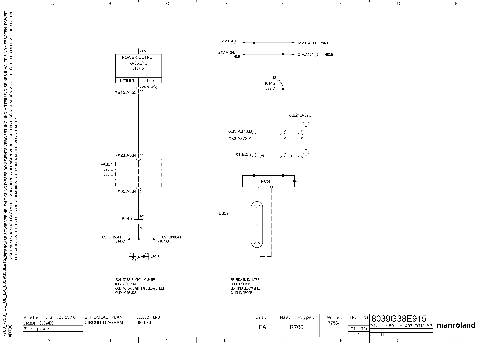

# +EA — Sheet 89 of 407 — BELEUCHTUNG

**LIGHTING**

> Part of the manroland **R700** printing press IEC/UL circuit diagrams.
> Drawing class: **Stromlaufplan / Circuit diagram** (DIN A3).
> Document `+EA` covers the **Printing unit** machine section.

## At a glance

| Field | Value |
|---|---|
| Document | `+EA`  (8039G38E915) |
| Sheet | **89** of 407 |
| Section (DE) | BELEUCHTUNG |
| Section (EN) | LIGHTING |
| Section type | CIRCUIT — Circuit diagram |
| Machine type | `R700` |
| Series | `7758` |
| Created | 25.03.10 |
| Replaces | — |
| Columns used | B, C, D, E, F |
| Path numbers | — |
| Labels on sheet | 65 |
| Cross-refs out | 10 |
| Cross-refs in | 22 |

**Previous:** [+EA sheet 88](SHEET_0088.md) · **Next:** [+EA sheet 90](SHEET_0090.md) · **Document TOC:** [_TOC.md](_TOC.md)  (+EA) · **Master TOC:** [all sheets](../_MASTER_TOC.md)

## Sheet image (300 DPI, exact vector render)



_Rendered directly from the PDF vector layer at 300 DPI (1-bit), no OCR and no resampling. Use it to confirm anything ambiguous in the text below._

## Cross-references on this sheet

Each entry is a wire leaving this sheet. The printed token is `/sheet.column`; the link resolves to that sheet inside the same document.

| Ref | Target sheet | Col | Path | Destination on target | Target section | From col |
|---|---|---|---|---|---|---|
| `/90.B` | [+EA sheet 90](SHEET_0090.md) | B | — | 0V.A124:+ 0V.A124:(+) | BELEUCHTUNG | E |
| `/8.G` | [+EA sheet 8](SHEET_0008.md) | G | — | 0V.A124:+ 0V.A124:(+) | SPANNUNGSVERSORGUNG: 400V, 24V | E |
| `/90.B` | [+EA sheet 90](SHEET_0090.md) | B | — | 24V.A124: 24V.A124:( ) | BELEUCHTUNG | E |
| `/8.E` | [+EA sheet 8](SHEET_0008.md) | E | — | 24V.A124: 24V.A124:( ) | SPANNUNGSVERSORGUNG: 400V, 24V | E |
| `/197.D` | [+EA sheet 197](SHEET_0197.md) | D | — | — | REFERENZMODUL | B |
| `/89.C` | [+EA sheet 89](SHEET_0089.md) | C | — | — | BELEUCHTUNG | E |
| `/98.E` | [+EA sheet 98](SHEET_0098.md) | E | — | — | BOGENFÜHRUNGSELEMENT | B |
| `/88.E` | [+EA sheet 88](SHEET_0088.md) | E | — | — | SAUGWALZE | B |
| `/14.C` | [+EA sheet 14](SHEET_0014.md) | C | — | 0V.K445:A1 0V.K668:A1 | SPANNUNGSVERSORGUNG: 400V, 24V | C |
| `/107.G` | [+EA sheet 107](SHEET_0107.md) | G | — | — | BOGENGLÄTTER | C |

### Incoming references (sheets that point here)

Every other sheet that sends a wire to this one. `Back-ref` is the token printed on *that* sheet; `Path` is its line number.

| From sheet | Cols | Back-ref | Path | Refs | What continues there |
|---|---|---|---|---|---|
| [+EA#8](SHEET_0008.md) | F, G | `/8.F`, `/8.G` | — | 2 | 0V.A124:+; 24V.A124: |
| [+EA#14](SHEET_0014.md) | C | `/14.C` | — | 1 | — |
| [+EA#88](SHEET_0088.md) | D | `/88.D` | — | 1 | — |
| [+EA#89](SHEET_0089.md) | E | `/89.E` | — | 1 | — |
| [+EA#90](SHEET_0090.md) | B | `/90.B` | — | 2 | 0V.A125:+ 0V.A124:(+); 24V.A124:( ) |
| [+EA#98](SHEET_0098.md) | E | `/98.E` | — | 1 | — |
| [+EA#107](SHEET_0107.md) | E | `/107.E` | — | 1 | 0V.K012:A1 0V.K668:A1 |
| [+EA#197](SHEET_0197.md) | D | `/197.D` | — | 1 | — |
| [+EA#218](SHEET_0218.md) | C | `/218.C` | — | 3 | — |
| [+EA#260](SHEET_0260.md) | F | `/260.F` | — | 1 | — |
| [+EA#265](SHEET_0265.md) | A | `/265.A` | — | 1 | — |
| [+EA#277](SHEET_0277.md) | E | `/277.E` | — | 6 | — |
| [+EA#284](SHEET_0284.md) | E | `/284.E` | — | 1 | — |


## Devices on this sheet

| Tag | Class | Class meaning (IEC) | Col | Sub | Terminal | Sign |
|---|---|---|---|---|---|---|
| `K445` | K | Relais / relay, contactor | E | — | — | — |
| `E057` | E | Sonstiges / miscellaneous, lamp | D | — | — | — |
| `A2` | A | Baugruppe / assembly, module, PC board | C | — | — | — |
| `A1` | A | Baugruppe / assembly, module, PC board | C | — | — | — |
| `K445` | K | Relais / relay, contactor | B | — | — | — |
| `A334` | A | Baugruppe / assembly, module, PC board | B | — | — | — |
| `A353/13` | A | Baugruppe / assembly, module, PC board | B | 13 | — | — |
| `X1.E057` | — | cross-device reference | D | — | — | — |
| `X33.A373.B` | — | cross-device reference | D | — | — | — |
| `X33.A373.A` | — | cross-device reference | D | — | — | — |
| `X65.A334` | — | cross-device reference | B | — | — | — |
| `X23.A334` | — | cross-device reference | B | — | — | — |
| `18.5` | — | cross-device reference | C | — | — | — |
| `XB15.A353` | — | cross-device reference | B | — | — | — |
| `X924.A373` | — | cross-device reference | E | — | — | — |

## Potentials / nets

| Potential | Count | Columns | Attached devices | Terminals |
|---|---|---|---|---|
| `0V` | 4 | B, C, D, E | `A124`, `K445`, `K668` | `A1` |
| `24V` | 2 | D, E | `A124` | — |


A potential such as `L24+/4` or `M24+` is a named supply/return rail; every place it appears on this sheet is electrically common.

## Wire-end annotations (grouped as printed)

A wire that continues elsewhere is annotated with a small cluster: the destination description, the path/line number `#NN`, and the `/sheet.column` cross reference. Each row below is one such cluster exactly as it is grouped on the drawing.

| Col | Y | Path | Cross-ref | Text on the wire |
|---|---|---|---|---|
| E | 96.7 | — | `/90.B`, `/8.G` | `0V.A124:+ 0V.A124:(+)` |
| C | 121.5 | — | — | `24A` |
| E | 125.0 | — | `/90.B`, `/8.E` | `24V.A124: 24V.A124:( )` |
| B | 136.6 | — | — | `POWER OUTPUT` |
| B | 150.5 | — | — | `A353/13` |
| B | 164.3 | — | `/197.D` | — |
| E | 186.7 | — | — | `K445 14` |
| E | 186.7 | — | — | `12` |
| B | 193.4 | — | — | `BYTE.BIT 18.5` |
| C | 209.4 | — | — | `24B(24C)` |
| E | 213.2 | — | `/89.C` | — |
| B | 221.4 | — | — | `XB15.A353 22` |
| E | 229.2 | — | — | `11 11` |
| E | 278.1 | — | — | `X924.A373` |
| D | 317.8 | — | — | `X33.A373.B 1` |
| E | 317.8 | — | — | `2` |
| E | 317.8 | — | — | `5` |
| D | 334.8 | — | — | `X33.A373.A 1` |
| E | 334.8 | — | — | `2` |
| E | 334.8 | — | — | `5` |
| E | 374.5 | — | — | `X1.E057 1 2` |
| B | 376.6 | — | — | `X23.A334 22` |
| E | 378.1 | — | — | `(+) ( )` |
| B | 398.6 | — | — | `A334` |
| B | 411.6 | — | `/98.E`, `/88.E` | — |
| E | 441.1 | — | — | `EVG` |
| B | 465.2 | — | — | `X65.A334 2` |
| D | 519.0 | — | — | `E057` |
| C | 526.8 | — | — | `A2` |
| B | 531.8 | — | — | `K445` |
| C | 555.1 | — | — | `A1` |
| C | 578.5 | — | `/14.C` | `0V.K445:A1 0V.K668:A1` |
| C | 588.5 | — | `/107.G` | — |
| C | 619.6 | — | — | `14 12 11 11 /89.E` |
| B | 683.8 | — | — | `BOGENFÜHRUNG SCHÜTZ: BELEUCHTUNG UNTER` |
| D | 683.8 | — | — | `BELEUCHTUNG UNTER BOGENFÜHRUNG LIGHTING BELOW SHEET` |
| C | 705.0 | — | — | `CONTACTOR: LIGHTING BELOW SHEET GUIDING DEVICE` |
| D | 715.7 | — | — | `GUIDING DEVICE` |


## Reconstructed tables

This sheet carries tabular content (pin map / terminal assignment / index). The grid below was rebuilt from the drawing's own rule lines, so each row is exactly one physical row of the table.

### Table 1 — 1 data rows × 2 columns (at x=283.5, y=133.2)

| POWER | OUTPUT A353/13 /197.D |
|---|---|
| `BYTE.BIT` | `18.5` |


## Notes and free text on this sheet

| Text | Col | Y (pt) |
|---|---|---|
| `BELEUCHTUNG UNTER` | D | 683.79 |
| `BOGENFÜHRUNG` | D | 694.42 |
| `LIGHTING BELOW SHEET` | D | 705.01 |
| `GUIDING DEVICE` | D | 715.67 |
| `11 /89.E` | C | 626 |
| `SCHÜTZ: BELEUCHTUNG UNTER` | B | 683.79 |
| `BOGENFÜHRUNG` | B | 694.42 |
| `CONTACTOR: LIGHTING BELOW SHEET` | C | 705.04 |
| `GUIDING DEVICE` | B | 715.67 |
| `24A` | C | 121.47 |
| `24B(24C)` | C | 209.38 |
| `POWER OUTPUT` | B | 136.62 |
| `BYTE.BIT` | B | 193.95 |
| `EVG` | E | 441.1 |

## Complete label inventory (exact text from the drawing)

Every text object inside the drawing area of this sheet, in DIN reading order (column A→H, then top→bottom). This is the authoritative list: if a string is not here it is not printed on this sheet.

| Col | Y | X | Dir | Type | Text |
|---|---|---|---|---|---|
| B | 136.6 | 299.3 | → | text | `POWER OUTPUT` |
| B | 150.5 | 318.8 | → | device tag | `A353/13` |
| B | 164.3 | 327.4 | → | cross-reference | `/197.D` |
| B | 194.0 | 293.4 | → | text | `BYTE.BIT` |
| B | 222.1 | 277.8 | → | device ref | `XB15.A353` |
| B | 376.6 | 284.9 | → | device ref | `X23.A334` |
| B | 398.6 | 248.6 | → | device tag | `A334` |
| B | 411.6 | 256.3 | → | cross-reference | `/98.E` |
| B | 424.0 | 256.3 | → | cross-reference | `/88.E` |
| B | 465.2 | 284.9 | → | device ref | `X65.A334` |
| B | 531.8 | 295.4 | → | device tag | `K445` |
| B | 578.5 | 250.9 | → | potential | `0V.K445:A1` |
| B | 588.5 | 285.4 | → | cross-reference | `/14.C` |
| B | 619.6 | 317.5 | → | number | `14` |
| B | 631.0 | 317.5 | → | number | `12` |
| B | 683.8 | 283.2 | → | text | `SCHÜTZ: BELEUCHTUNG UNTER` |
| B | 694.4 | 282.6 | → | text | `BOGENFÜHRUNG` |
| B | 715.7 | 283.2 | → | text | `GUIDING DEVICE` |
| C | 121.5 | 342.7 | → | text | `24A` |
| C | 193.4 | 358.7 | → | device ref | `18.5` |
| C | 209.4 | 348.4 | → | text | `24B(24C)` |
| C | 221.4 | 342.7 | → | number | `22` |
| C | 378.7 | 342.7 | → | number | `22` |
| C | 466.6 | 342.7 | → | number | `2` |
| C | 526.8 | 343.0 | → | device tag | `A2` |
| C | 555.2 | 343.0 | → | device tag | `A1` |
| C | 578.5 | 398.0 | → | potential | `0V.K668:A1` |
| C | 588.5 | 388.3 | → | cross-reference | `/107.G` |
| C | 619.6 | 354.6 | → | number | `11` |
| C | 626.0 | 354.6 | → | text | `11 /89.E` |
| C | 705.0 | 283.2 | → | text | `CONTACTOR: LIGHTING BELOW SHEET` |
| D | 96.6 | 538.9 | → | potential | `0V.A124:+` |
| D | 106.6 | 573.4 | → | cross-reference | `/8.G` |
| D | 125.0 | 533.2 | → | potential | `24V.A124:` |
| D | 134.9 | 574.3 | → | cross-reference | `/8.E` |
| D | 317.8 | 558.4 | → | device ref | `X33.A373.B` |
| D | 335.5 | 557.6 | → | device ref | `X33.A373.A` |
| D | 374.5 | 574.3 | → | device ref | `X1.E057` |
| D | 519.0 | 533.5 | → | device tag | `E057` |
| D | 683.8 | 566.1 | → | text | `BELEUCHTUNG UNTER` |
| D | 694.4 | 566.1 | → | text | `BOGENFÜHRUNG` |
| D | 705.0 | 566.1 | → | text | `LIGHTING BELOW SHEET` |
| D | 715.7 | 566.6 | → | text | `GUIDING DEVICE` |
| E | 101.6 | 728.2 | → | potential | `0V.A124:(+)` |
| E | 130.0 | 728.2 | → | potential | `24V.A124:( )` |
| E | 186.7 | 668.4 | → | number | `12` |
| E | 186.7 | 696.5 | → | number | `14` |
| E | 200.1 | 646.9 | → | device tag | `K445` |
| E | 213.2 | 654.0 | → | cross-reference | `/89.C` |
| E | 229.2 | 669.5 | → | number | `11` |
| E | 229.2 | 696.5 | → | number | `11` |
| E | 278.1 | 708.4 | → | device ref | `X924.A373` |
| E | 317.8 | 625.6 | → | number | `1` |
| E | 317.8 | 697.0 | → | number | `2` |
| E | 317.8 | 739.6 | → | number | `5` |
| E | 334.8 | 625.6 | → | number | `1` |
| E | 334.8 | 697.0 | → | number | `2` |
| E | 334.8 | 739.6 | → | number | `5` |
| E | 374.5 | 625.6 | → | number | `1` |
| E | 374.5 | 697.0 | → | number | `2` |
| E | 378.1 | 637.2 | → | other | `(+)` |
| E | 378.1 | 708.1 | → | other | `( )` |
| E | 441.1 | 640.6 | → | text | `EVG` |
| F | 101.6 | 788.0 | → | cross-reference | `/90.B` |
| F | 129.9 | 798.0 | → | cross-reference | `/90.B` |

## Reading-order text block

The same content as a plain block, grouped by DIN column — convenient to paste or to match against a visual description.

```text
=== Column B ===
 136.6  299.3  text         POWER OUTPUT
 150.5  318.8  devtag       A353/13
 164.3  327.4  xref         /197.D
 194.0  293.4  text         BYTE.BIT
 222.1  277.8  devref       XB15.A353
 376.6  284.9  devref       X23.A334
 398.6  248.6  devtag       A334
 411.6  256.3  xref         /98.E
 424.0  256.3  xref         /88.E
 465.2  284.9  devref       X65.A334
 531.8  295.4  devtag       K445
 578.5  250.9  net          0V.K445:A1
 588.5  285.4  xref         /14.C
 619.6  317.5  numeric      14
 631.0  317.5  numeric      12
 683.8  283.2  text         SCHÜTZ: BELEUCHTUNG UNTER
 694.4  282.6  text         BOGENFÜHRUNG
 715.7  283.2  text         GUIDING DEVICE
=== Column C ===
 121.5  342.7  text         24A
 193.4  358.7  devref       18.5
 209.4  348.4  text         24B(24C)
 221.4  342.7  numeric      22
 378.7  342.7  numeric      22
 466.6  342.7  numeric      2
 526.8  343.0  devtag       A2
 555.2  343.0  devtag       A1
 578.5  398.0  net          0V.K668:A1
 588.5  388.3  xref         /107.G
 619.6  354.6  numeric      11
 626.0  354.6  text         11 /89.E
 705.0  283.2  text         CONTACTOR: LIGHTING BELOW SHEET
=== Column D ===
  96.6  538.9  net          0V.A124:+
 106.6  573.4  xref         /8.G
 125.0  533.2  net          24V.A124:
 134.9  574.3  xref         /8.E
 317.8  558.4  devref       X33.A373.B
 335.5  557.6  devref       X33.A373.A
 374.5  574.3  devref       X1.E057
 519.0  533.5  devtag       E057
 683.8  566.1  text         BELEUCHTUNG UNTER
 694.4  566.1  text         BOGENFÜHRUNG
 705.0  566.1  text         LIGHTING BELOW SHEET
 715.7  566.6  text         GUIDING DEVICE
=== Column E ===
 101.6  728.2  net          0V.A124:(+)
 130.0  728.2  net          24V.A124:( )
 186.7  668.4  numeric      12
 186.7  696.5  numeric      14
 200.1  646.9  devtag       K445
 213.2  654.0  xref         /89.C
 229.2  669.5  numeric      11
 229.2  696.5  numeric      11
 278.1  708.4  devref       X924.A373
 317.8  625.6  numeric      1
 317.8  697.0  numeric      2
 317.8  739.6  numeric      5
 334.8  625.6  numeric      1
 334.8  697.0  numeric      2
 334.8  739.6  numeric      5
 374.5  625.6  numeric      1
 374.5  697.0  numeric      2
 378.1  637.2  other        (+)
 378.1  708.1  other        ( )
 441.1  640.6  text         EVG
=== Column F ===
 101.6  788.0  xref         /90.B
 129.9  798.0  xref         /90.B
```

---
_Generated from the PDF vector text layer; no OCR. Source: `R700_7758_IEC_UL_EA_8039G38E915_p`, sheet 89._
