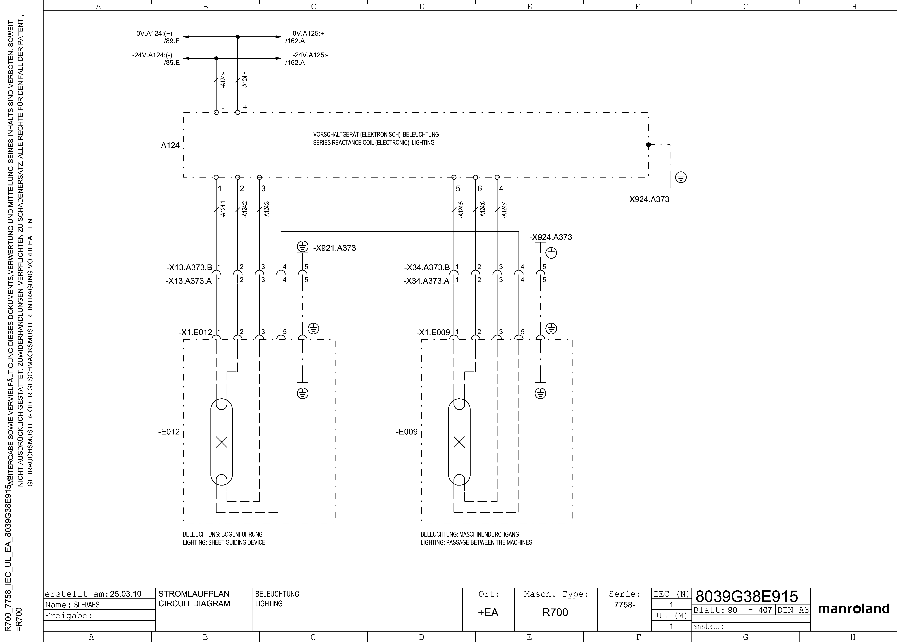

# +EA — Sheet 90 of 407 — BELEUCHTUNG

**LIGHTING**

> Part of the manroland **R700** printing press IEC/UL circuit diagrams.
> Drawing class: **Stromlaufplan / Circuit diagram** (DIN A3).
> Document `+EA` covers the **Printing unit** machine section.

## At a glance

| Field | Value |
|---|---|
| Document | `+EA`  (8039G38E915) |
| Sheet | **90** of 407 |
| Section (DE) | BELEUCHTUNG |
| Section (EN) | LIGHTING |
| Section type | CIRCUIT — Circuit diagram |
| Machine type | `R700` |
| Series | `7758` |
| Created | 25.03.10 |
| Replaces | — |
| Columns used | B, C, D, E, F |
| Path numbers | — |
| Labels on sheet | 69 |
| Cross-refs out | 4 |
| Cross-refs in | 34 |

**Previous:** [+EA sheet 89](SHEET_0089.md) · **Next:** [+EA sheet 91](SHEET_0091.md) · **Document TOC:** [_TOC.md](_TOC.md)  (+EA) · **Master TOC:** [all sheets](../_MASTER_TOC.md)

## Sheet image (300 DPI, exact vector render)



_Rendered directly from the PDF vector layer at 300 DPI (1-bit), no OCR and no resampling. Use it to confirm anything ambiguous in the text below._

## Cross-references on this sheet

Each entry is a wire leaving this sheet. The printed token is `/sheet.column`; the link resolves to that sheet inside the same document.

| Ref | Target sheet | Col | Path | Destination on target | Target section | From col |
|---|---|---|---|---|---|---|
| `/89.E` | [+EA sheet 89](SHEET_0089.md) | E | — | 0V.A125:+ 0V.A124:(+) | BELEUCHTUNG | B |
| `/162.A` | [+EA sheet 162](SHEET_0162.md) | A | — | — | VERLÄNGERUNG 1828,4MM | C |
| `/89.E` | [+EA sheet 89](SHEET_0089.md) | E | — | 24V.A124:( ) | BELEUCHTUNG | B |
| `/162.A` | [+EA sheet 162](SHEET_0162.md) | A | — | — | VERLÄNGERUNG 1828,4MM | C |

### Incoming references (sheets that point here)

Every other sheet that sends a wire to this one. `Back-ref` is the token printed on *that* sheet; `Path` is its line number.

| From sheet | Cols | Back-ref | Path | Refs | What continues there |
|---|---|---|---|---|---|
| [+EA#89](SHEET_0089.md) | E | `/89.E` | — | 2 | 0V.A124:+ 0V.A124:(+); 24V.A124: 24V.A124:( ) |
| [+EA#162](SHEET_0162.md) | A, B | `/162.A`, `/162.B` | — | 2 | 0V.A125:+; 24V.A125: |
| [+EA#218](SHEET_0218.md) | B | `/218.B` | — | 10 | — |
| [+EA#258](SHEET_0258.md) | G | `/258.G` | — | 10 | — |
| [+EA#278](SHEET_0278.md) | A | `/278.A` | — | 10 | — |


## Devices on this sheet

| Tag | Class | Class meaning (IEC) | Col | Sub | Terminal | Sign |
|---|---|---|---|---|---|---|
| `E009` | E | Sonstiges / miscellaneous, lamp | D | — | — | — |
| `E012` | E | Sonstiges / miscellaneous, lamp | B | — | — | — |
| `A124` | A | Baugruppe / assembly, module, PC board | B | — | — | — |
| `A124:1` | A | Baugruppe / assembly, module, PC board | B | — | 1 | — |
| `A124:2` | A | Baugruppe / assembly, module, PC board | B | — | 2 | — |
| `A124:3` | A | Baugruppe / assembly, module, PC board | C | — | 3 | — |
| `A124:5` | A | Baugruppe / assembly, module, PC board | D | — | 5 | — |
| `A124:6` | A | Baugruppe / assembly, module, PC board | E | — | 6 | — |
| `A124:4` | A | Baugruppe / assembly, module, PC board | E | — | 4 | — |
| `X1.E009` | — | cross-device reference | D | — | — | — |
| `X1.E012` | — | cross-device reference | B | — | — | — |
| `X34.A373.B` | — | cross-device reference | D | — | — | — |
| `X34.A373.A` | — | cross-device reference | D | — | — | — |
| `X13.A373.B` | — | cross-device reference | B | — | — | — |
| `X13.A373.A` | — | cross-device reference | B | — | — | — |
| `X924.A373` | — | cross-device reference | F | — | — | — |
| `X924.A373` | — | cross-device reference | E | — | — | — |
| `X921.A373` | — | cross-device reference | C | — | — | — |

## Potentials / nets

| Potential | Count | Columns | Attached devices | Terminals |
|---|---|---|---|---|
| `0V` | 2 | B, C | `A124`, `A125` | — |
| `24V` | 2 | B, C | `A124`, `A125` | — |


A potential such as `L24+/4` or `M24+` is a named supply/return rail; every place it appears on this sheet is electrically common.

## Wire-end annotations (grouped as printed)

A wire that continues elsewhere is annotated with a small cluster: the destination description, the path/line number `#NN`, and the `/sheet.column` cross reference. Each row below is one such cluster exactly as it is grouped on the drawing.

| Col | Y | Path | Cross-ref | Text on the wire |
|---|---|---|---|---|
| B | 40.0 | — | `/89.E` | `0V.A124:(+) 0V.A125:+` |
| C | 49.9 | — | `/162.A` | — |
| B | 68.3 | — | `/89.E` | `24V.A124:( )` |
| C | 68.3 | — | — | `24V.A125:` |
| C | 78.2 | — | `/162.A` | — |
| B | 93.7 | — | — | `A124:+` |
| B | 94.6 | — | — | `A124:` |
| B | 136.3 | — | — | `+` |
| D | 173.6 | — | — | `SERIES REACTANCE COIL (ELECTRONIC): LIGHTING VORSCHALTGERÄT (ELEKTRONISCH): BELEUCHTUNG` |
| B | 186.0 | — | — | `A124` |
| C | 242.6 | — | — | `1 2 3 5 6` |
| E | 242.6 | — | — | `4` |
| F | 256.8 | — | — | `X924.A373` |
| B | 263.1 | — | — | `A124:1` |
| B | 263.8 | — | — | `A124:2` |
| C | 264.0 | — | — | `A124:3` |
| D | 264.0 | — | — | `A124:5` |
| E | 264.0 | — | — | `A124:6` |
| E | 264.0 | — | — | `A124:4` |
| D | 306.4 | — | — | `X921.A373 X924.A373` |
| B | 346.1 | — | — | `X13.A373.B 1 2 3 4 5` |
| D | 346.1 | — | — | `X34.A373.B 1 2` |
| E | 346.1 | — | — | `3 4` |
| E | 346.1 | — | — | `5` |
| B | 363.2 | — | — | `X13.A373.A 1 2 3 4 5` |
| D | 363.2 | — | — | `X34.A373.A 1 2` |
| E | 363.2 | — | — | `3 4` |
| E | 363.2 | — | — | `5` |
| B | 431.2 | — | — | `X1.E012 1 2 3 5` |
| D | 431.2 | — | — | `X1.E009 1 2 3 5` |
| B | 561.6 | — | — | `E012` |
| D | 561.6 | — | — | `E009` |
| B | 698.0 | — | — | `BELEUCHTUNG: BOGENFÜHRUNG LIGHTING: SHEET GUIDING DEVICE` |
| E | 698.0 | — | — | `BELEUCHTUNG: MASCHINENDURCHGANG LIGHTING: PASSAGE BETWEEN THE MACHINES` |


## Reconstructed tables

This sheet carries tabular content (pin map / terminal assignment / index). The grid below was rebuilt from the drawing's own rule lines, so each row is exactly one physical row of the table.

### Table 1 — 2 data rows × 1 columns (at x=283.5, y=48.2)

| C1 |
|---|
| `A124: 1 A124:1` |
| `1 1 1` |


### Table 2 — 1 data rows × 3 columns (at x=311.8, y=48.2) — **/162.A**

| A124:+ + 2 A124:2 | 3 A124:3 | /162.A |
|---|---|---|
| `2 2 2` | `3 3 3` | `4 4 5` |


## Notes and free text on this sheet

| Text | Col | Y (pt) |
|---|---|---|
| `BELEUCHTUNG: MASCHINENDURCHGANG` | D | 697.97 |
| `LIGHTING: PASSAGE BETWEEN THE MACHINES` | E | 708.56 |
| `BELEUCHTUNG: BOGENFÜHRUNG` | B | 697.97 |
| `LIGHTING: SHEET GUIDING DEVICE` | B | 708.58 |
| `VORSCHALTGERÄT (ELEKTRONISCH): BELEUCHTUNG` | D | 173.56 |
| `SERIES REACTANCE COIL (ELECTRONIC): LIGHTING` | D | 184.18 |
| `A124:` | B | 94.64 |
| `A124:+` | B | 93.65 |

## Complete label inventory (exact text from the drawing)

Every text object inside the drawing area of this sheet, in DIN reading order (column A→H, then top→bottom). This is the authoritative list: if a string is not here it is not printed on this sheet.

| Col | Y | X | Dir | Type | Text |
|---|---|---|---|---|---|
| B | 40.0 | 178.9 | → | potential | `0V.A124:(+)` |
| B | 49.9 | 215.1 | → | cross-reference | `/89.E` |
| B | 68.3 | 173.5 | → | potential | `24V.A124:( )` |
| B | 78.2 | 215.1 | → | cross-reference | `/89.E` |
| B | 93.6 | 318.1 | ↕ | text | `A124:+` |
| B | 94.6 | 289.8 | ↕ | text | `A124:` |
| B | 136.3 | 318.3 | → | number | `+` |
| B | 186.0 | 207.5 | → | device tag | `A124` |
| B | 242.6 | 285.2 | → | number | `1` |
| B | 242.6 | 314.4 | → | number | `2` |
| B | 263.1 | 289.7 | ↕ | device tag | `A124:1` |
| B | 263.8 | 318.1 | ↕ | device tag | `A124:2` |
| B | 346.1 | 218.3 | → | device ref | `X13.A373.B` |
| B | 346.2 | 285.4 | → | number | `1` |
| B | 346.2 | 314.4 | → | number | `2` |
| B | 363.2 | 285.4 | → | number | `1` |
| B | 363.2 | 314.4 | → | number | `2` |
| B | 363.9 | 217.4 | → | device ref | `X13.A373.A` |
| B | 431.2 | 234.1 | → | device ref | `X1.E012` |
| B | 431.2 | 285.4 | → | number | `1` |
| B | 431.2 | 314.4 | → | number | `2` |
| B | 561.6 | 207.5 | → | device tag | `E012` |
| B | 698.0 | 240.1 | → | text | `BELEUCHTUNG: BOGENFÜHRUNG` |
| B | 708.6 | 240.1 | → | text | `LIGHTING: SHEET GUIDING DEVICE` |
| C | 40.0 | 383.8 | → | potential | `0V.A125:+` |
| C | 49.9 | 374.2 | → | cross-reference | `/162.A` |
| C | 68.3 | 383.8 | → | potential | `24V.A125:` |
| C | 78.2 | 374.2 | → | cross-reference | `/162.A` |
| C | 242.6 | 342.4 | → | number | `3` |
| C | 264.0 | 346.5 | ↕ | device tag | `A124:3` |
| C | 320.6 | 410.7 | → | device ref | `X921.A373` |
| C | 346.2 | 342.7 | → | number | `3` |
| C | 346.2 | 371.1 | → | number | `4` |
| C | 346.2 | 399.4 | → | number | `5` |
| C | 363.2 | 342.7 | → | number | `3` |
| C | 363.2 | 371.1 | → | number | `4` |
| C | 363.2 | 399.4 | → | number | `5` |
| C | 431.2 | 342.7 | → | number | `3` |
| C | 431.2 | 371.1 | → | number | `5` |
| D | 173.6 | 411.0 | → | text | `VORSCHALTGERÄT (ELEKTRONISCH): BELEUCHTUNG` |
| D | 184.2 | 410.7 | → | text | `SERIES REACTANCE COIL (ELECTRONIC): LIGHTING` |
| D | 242.6 | 597.5 | → | number | `5` |
| D | 264.0 | 601.6 | ↕ | device tag | `A124:5` |
| D | 346.1 | 530.1 | → | device ref | `X34.A373.B` |
| D | 346.2 | 597.3 | → | number | `1` |
| D | 363.2 | 597.3 | → | number | `1` |
| D | 363.9 | 529.2 | → | device ref | `X34.A373.A` |
| D | 431.2 | 546.0 | → | device ref | `X1.E009` |
| D | 431.2 | 597.3 | → | number | `1` |
| D | 561.6 | 519.3 | → | device tag | `E009` |
| D | 698.0 | 551.9 | → | text | `BELEUCHTUNG: MASCHINENDURCHGANG` |
| E | 242.6 | 626.2 | → | number | `6` |
| E | 242.6 | 654.5 | → | number | `4` |
| E | 264.0 | 629.9 | ↕ | device tag | `A124:6` |
| E | 264.0 | 658.3 | ↕ | device tag | `A124:4` |
| E | 306.4 | 694.2 | → | device ref | `X924.A373` |
| E | 346.2 | 626.2 | → | number | `2` |
| E | 346.2 | 654.5 | → | number | `3` |
| E | 346.2 | 682.9 | → | number | `4` |
| E | 346.2 | 711.2 | → | number | `5` |
| E | 363.2 | 626.2 | → | number | `2` |
| E | 363.2 | 654.5 | → | number | `3` |
| E | 363.2 | 682.9 | → | number | `4` |
| E | 363.2 | 711.2 | → | number | `5` |
| E | 431.2 | 626.2 | → | number | `2` |
| E | 431.2 | 654.5 | → | number | `3` |
| E | 431.2 | 682.9 | → | number | `5` |
| E | 708.6 | 551.9 | → | text | `LIGHTING: PASSAGE BETWEEN THE MACHINES` |
| F | 256.8 | 821.8 | → | device ref | `X924.A373` |

## Reading-order text block

The same content as a plain block, grouped by DIN column — convenient to paste or to match against a visual description.

```text
=== Column B ===
  40.0  178.9  net          0V.A124:(+)
  49.9  215.1  xref         /89.E
  68.3  173.5  net          24V.A124:( )
  78.2  215.1  xref         /89.E
  93.6  318.1  text         A124:+
  94.6  289.8  text         A124:
 136.3  318.3  numeric      +
 186.0  207.5  devtag       A124
 242.6  285.2  numeric      1
 242.6  314.4  numeric      2
 263.1  289.7  devtag       A124:1
 263.8  318.1  devtag       A124:2
 346.1  218.3  devref       X13.A373.B
 346.2  285.4  numeric      1
 346.2  314.4  numeric      2
 363.2  285.4  numeric      1
 363.2  314.4  numeric      2
 363.9  217.4  devref       X13.A373.A
 431.2  234.1  devref       X1.E012
 431.2  285.4  numeric      1
 431.2  314.4  numeric      2
 561.6  207.5  devtag       E012
 698.0  240.1  text         BELEUCHTUNG: BOGENFÜHRUNG
 708.6  240.1  text         LIGHTING: SHEET GUIDING DEVICE
=== Column C ===
  40.0  383.8  net          0V.A125:+
  49.9  374.2  xref         /162.A
  68.3  383.8  net          24V.A125:
  78.2  374.2  xref         /162.A
 242.6  342.4  numeric      3
 264.0  346.5  devtag       A124:3
 320.6  410.7  devref       X921.A373
 346.2  342.7  numeric      3
 346.2  371.1  numeric      4
 346.2  399.4  numeric      5
 363.2  342.7  numeric      3
 363.2  371.1  numeric      4
 363.2  399.4  numeric      5
 431.2  342.7  numeric      3
 431.2  371.1  numeric      5
=== Column D ===
 173.6  411.0  text         VORSCHALTGERÄT (ELEKTRONISCH): BELEUCHTUNG
 184.2  410.7  text         SERIES REACTANCE COIL (ELECTRONIC): LIGHTING
 242.6  597.5  numeric      5
 264.0  601.6  devtag       A124:5
 346.1  530.1  devref       X34.A373.B
 346.2  597.3  numeric      1
 363.2  597.3  numeric      1
 363.9  529.2  devref       X34.A373.A
 431.2  546.0  devref       X1.E009
 431.2  597.3  numeric      1
 561.6  519.3  devtag       E009
 698.0  551.9  text         BELEUCHTUNG: MASCHINENDURCHGANG
=== Column E ===
 242.6  626.2  numeric      6
 242.6  654.5  numeric      4
 264.0  629.9  devtag       A124:6
 264.0  658.3  devtag       A124:4
 306.4  694.2  devref       X924.A373
 346.2  626.2  numeric      2
 346.2  654.5  numeric      3
 346.2  682.9  numeric      4
 346.2  711.2  numeric      5
 363.2  626.2  numeric      2
 363.2  654.5  numeric      3
 363.2  682.9  numeric      4
 363.2  711.2  numeric      5
 431.2  626.2  numeric      2
 431.2  654.5  numeric      3
 431.2  682.9  numeric      5
 708.6  551.9  text         LIGHTING: PASSAGE BETWEEN THE MACHINES
=== Column F ===
 256.8  821.8  devref       X924.A373
```

---
_Generated from the PDF vector text layer; no OCR. Source: `R700_7758_IEC_UL_EA_8039G38E915_p`, sheet 90._
