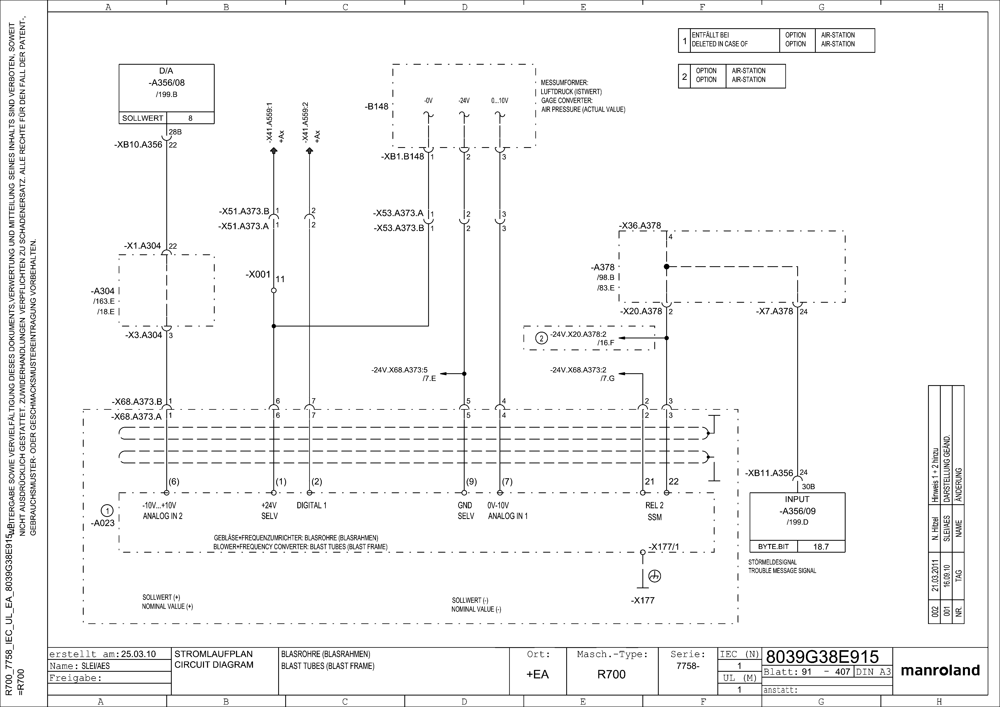

# +EA — Sheet 91 of 407 — BLASROHRE (BLASRAHMEN)

**BLAST TUBES (BLAST FRAME)**

> Part of the manroland **R700** printing press IEC/UL circuit diagrams.
> Drawing class: **Stromlaufplan / Circuit diagram** (DIN A3).
> Document `+EA` covers the **Printing unit** machine section.

## At a glance

| Field | Value |
|---|---|
| Document | `+EA`  (8039G38E915) |
| Sheet | **91** of 407 |
| Section (DE) | BLASROHRE (BLASRAHMEN) |
| Section (EN) | BLAST TUBES (BLAST FRAME) |
| Section type | CIRCUIT — Circuit diagram |
| Machine type | `R700` |
| Series | `7758` |
| Created | 25.03.10 |
| Replaces | — |
| Columns used | A, B, C, D, E, F, G, H |
| Path numbers | — |
| Labels on sheet | 141 |
| Cross-refs out | 9 |
| Cross-refs in | 43 |

**Previous:** [+EA sheet 90](SHEET_0090.md) · **Next:** [+EA sheet 92](SHEET_0092.md) · **Document TOC:** [_TOC.md](_TOC.md)  (+EA) · **Master TOC:** [all sheets](../_MASTER_TOC.md)

## Sheet image (300 DPI, exact vector render)



_Rendered directly from the PDF vector layer at 300 DPI (1-bit), no OCR and no resampling. Use it to confirm anything ambiguous in the text below._

## Cross-references on this sheet

Each entry is a wire leaving this sheet. The printed token is `/sheet.column`; the link resolves to that sheet inside the same document.

| Ref | Target sheet | Col | Path | Destination on target | Target section | From col |
|---|---|---|---|---|---|---|
| `/199.B` | [+EA sheet 199](SHEET_0199.md) | B | — | — | REFERENZMODUL | A |
| `/98.B` | [+EA sheet 98](SHEET_0098.md) | B | — | — | BOGENFÜHRUNGSELEMENT | E |
| `/83.E` | [+EA sheet 83](SHEET_0083.md) | E | — | — | AUSLEGERSTAPELSTEUERUNG: PROGRAMMSCHALTWERK | E |
| `/163.E` | [+EA sheet 163](SHEET_0163.md) | E | — | — | VERLÄNGERUNG 1828,4MM | A |
| `/18.E` | [+EA sheet 18](SHEET_0018.md) | E | — | — | SPANNUNGSVERSORGUNG: 400V, 24V | A |
| `/16.F` | [+EA sheet 16](SHEET_0016.md) | F | — | 24V.X20.A378:2 | SPANNUNGSVERSORGUNG: 400V, 24V | E |
| `/7.E` | [+EA sheet 7](SHEET_0007.md) | E | — | 24V.X68.A373:5 24V.X68.A373:2 | SPANNUNGSVERSORGUNG: 400V, 24V | D |
| `/7.G` | [+EA sheet 7](SHEET_0007.md) | G | — | 24V.X68.A373:5 24V.X68.A373:2 | SPANNUNGSVERSORGUNG: 400V, 24V | D |
| `/199.D` | [+EA sheet 199](SHEET_0199.md) | D | — | — | REFERENZMODUL | G |

### Incoming references (sheets that point here)

Every other sheet that sends a wire to this one. `Back-ref` is the token printed on *that* sheet; `Path` is its line number.

| From sheet | Cols | Back-ref | Path | Refs | What continues there |
|---|---|---|---|---|---|
| [+EA#7](SHEET_0007.md) | F, H | `/7.F`, `/7.H` | — | 2 | 24V.X68.A373:2 |
| [+EA#16](SHEET_0016.md) | F | `/16.F` | — | 1 | 24V.X20.A378:2 |
| [+EA#18](SHEET_0018.md) | E | `/18.E` | — | 1 | — |
| [+EA#83](SHEET_0083.md) | D | `/83.D` | — | 1 | — |
| [+EA#98](SHEET_0098.md) | A | `/98.A` | — | 1 | — |
| [+EA#163](SHEET_0163.md) | D | `/163.D` | — | 1 | — |
| [+EA#199](SHEET_0199.md) | B, D | `/199.B`, `/199.D` | — | 2 | — |
| [+EA#208](SHEET_0208.md) | C | `/208.C` | — | 1 | — |
| [+EA#216](SHEET_0216.md) | C | `/216.C` | — | 3 | — |
| [+EA#233](SHEET_0233.md) | H | `/233.H` | — | 1 | — |
| [+EA#247](SHEET_0247.md) | F | `/247.F` | — | 1 | — |
| [+EA#254](SHEET_0254.md) | E | `/254.E` | — | 1 | — |
| [+EA#256](SHEET_0256.md) | B | `/256.B` | — | 1 | — |
| [+EA#264](SHEET_0264.md) | B | `/264.B` | — | 1 | — |
| [+EA#279](SHEET_0279.md) | D | `/279.D` | — | 1 | — |
| [+EA#282](SHEET_0282.md) | F, H | `/282.F`, `/282.H` | — | 10 | — |
| [+EA#285](SHEET_0285.md) | C | `/285.C` | — | 14 | — |


## Devices on this sheet

| Tag | Class | Class meaning (IEC) | Col | Sub | Terminal | Sign |
|---|---|---|---|---|---|---|
| `A356/08` | A | Baugruppe / assembly, module, PC board | A | 08 | — | — |
| `A304` | A | Baugruppe / assembly, module, PC board | A | — | — | — |
| `X001` | X | Klemme / terminal, plug connector | B | — | — | — |
| `B148` | B | Umformer / transducer, sensor | C | — | — | — |
| `A378` | A | Baugruppe / assembly, module, PC board | E | — | — | — |
| `A356/09` | A | Baugruppe / assembly, module, PC board | G | 09 | — | — |
| `A023` | A | Baugruppe / assembly, module, PC board | A | — | — | — |
| `X177/1` | X | Klemme / terminal, plug connector | F | 1 | — | — |
| `X177` | X | Klemme / terminal, plug connector | F | — | — | — |
| `XB10.A356` | — | cross-device reference | A | — | — | — |
| `X1.A304` | — | cross-device reference | A | — | — | — |
| `X68.A373.B` | — | cross-device reference | A | — | — | — |
| `X68.A373.A` | — | cross-device reference | A | — | — | — |
| `X3.A304` | — | cross-device reference | A | — | — | — |
| `X41.A559:1` | — | cross-device reference | B | — | 1 | — |
| `X51.A373.B` | — | cross-device reference | B | — | — | — |
| `X51.A373.A` | — | cross-device reference | B | — | — | — |
| `X41.A559:2` | — | cross-device reference | C | — | 2 | — |
| `XB1.B148` | — | cross-device reference | C | — | — | — |
| `X53.A373.A` | — | cross-device reference | C | — | — | — |
| `X53.A373.B` | — | cross-device reference | C | — | — | — |
| `X7.A378` | — | cross-device reference | G | — | — | — |
| `X20.A378` | — | cross-device reference | E | — | — | — |
| `18.7` | — | cross-device reference | G | — | — | — |
| `XB11.A356` | — | cross-device reference | G | — | — | — |
| `NR.` | — | cross-device reference | H | — | — | — |
| `16.09.10` | — | cross-device reference | H | — | — | — |
| `21.03.2011` | — | cross-device reference | H | — | — | — |
| `X36.A378` | — | cross-device reference | E | — | — | — |

## Potentials / nets

| Potential | Count | Columns | Attached devices | Terminals |
|---|---|---|---|---|
| `+24V` | 1 | B | — | — |
| `0V` | 1 | D | — | — |
| `24V` | 4 | C, D, E | `A373`, `A378`, `X20`, `X68` | `2`, `5` |


A potential such as `L24+/4` or `M24+` is a named supply/return rail; every place it appears on this sheet is electrically common.

## Wire-end annotations (grouped as printed)

A wire that continues elsewhere is annotated with a small cluster: the destination description, the path/line number `#NN`, and the `/sheet.column` cross reference. Each row below is one such cluster exactly as it is grouped on the drawing.

| Col | Y | Path | Cross-ref | Text on the wire |
|---|---|---|---|---|
| F | 38.9 | — | — | `1 ENTFÄLLT BEI DELETED IN CASE OF OPTION OPTION` |
| G | 38.9 | — | — | `AIR STATION AIR STATION` |
| A | 80.0 | — | — | `D/A` |
| F | 81.4 | — | — | `2 OPTION OPTION` |
| F | 81.4 | — | — | `AIR STATION AIR STATION` |
| A | 93.8 | — | — | `A356/08` |
| E | 95.6 | — | — | `LUFTDRUCK (ISTWERT) MESSUMFORMER:` |
| A | 108.7 | — | `/199.B` | — |
| D | 116.8 | — | — | `0V 24V 0...10V` |
| E | 116.8 | — | — | `GAGE CONVERTER: AIR PRESSURE (ACTUAL VALUE)` |
| B | 121.6 | — | — | `X41.A559:1` |
| C | 121.6 | — | — | `X41.A559:2` |
| C | 122.2 | — | — | `B148` |
| A | 137.0 | — | — | `SOLLWERT 8` |
| B | 153.4 | — | — | `28B` |
| B | 155.3 | — | — | `+Ax` |
| C | 155.3 | — | — | `+Ax` |
| A | 167.6 | — | — | `XB10.A356 22` |
| D | 181.7 | — | — | `XB1.B148 1` |
| D | 183.2 | — | — | `2` |
| D | 183.2 | — | — | `3` |
| B | 246.9 | — | — | `X51.A373.B 1` |
| C | 246.9 | — | — | `2` |
| C | 249.1 | — | — | `X53.A373.A 1` |
| D | 251.2 | — | — | `2` |
| D | 251.2 | — | — | `3` |
| B | 263.9 | — | — | `X51.A373.A 1` |
| C | 263.9 | — | — | `2` |
| E | 263.9 | — | — | `X36.A378` |
| C | 266.8 | — | — | `X53.A373.B 1` |
| D | 268.2 | — | — | `2` |
| D | 268.2 | — | — | `3` |
| F | 278.1 | — | — | `4` |
| A | 288.0 | — | — | `X1.A304 22` |
| E | 313.5 | — | — | `A378` |
| B | 321.8 | — | — | `X001 11` |
| E | 326.6 | — | `/98.B`, `/83.E` | — |
| A | 341.9 | — | — | `A304` |
| A | 354.9 | — | `/163.E` | — |
| F | 366.0 | — | — | `X20.A378 2 X7.A378 24` |
| A | 367.3 | — | `/18.E` | — |
| A | 394.3 | — | — | `X3.A304 3` |
| E | 394.3 | — | `/16.F` | `24V.X20.A378:2` |
| E | 400.0 | — | — | `2` |
| D | 436.8 | — | `/7.E`, `/7.G` | `24V.X68.A373:5 24V.X68.A373:2` |
| A | 473.7 | — | — | `X68.A373.B 1` |
| B | 473.7 | — | — | `6` |
| C | 473.7 | — | — | `7` |
| D | 473.7 | — | — | `5` |
| D | 473.7 | — | — | `4` |
| F | 473.7 | — | — | `2` |
| F | 473.7 | — | — | `3` |
| A | 490.7 | — | — | `X68.A373.A 1` |
| B | 490.7 | — | — | `6` |
| C | 490.7 | — | — | `7` |
| D | 490.7 | — | — | `5` |
| D | 490.7 | — | — | `4` |
| F | 490.7 | — | — | `2` |
| F | 490.7 | — | — | `3` |
| H | 517.6 | — | — | `001 DARSTELLUNG GEÄND. 16.09.10 SLEI/AES` |
| H | 533.6 | — | — | `002 21.03.2011 Hinweis 1 + 2 hinzu N. Hitzel` |
| H | 557.2 | — | — | `NR. NAME TAG ÄNDERUNG` |
| D | 558.7 | — | — | `(6) (1) (2) (9) (7) 21 22 XB11.A356 24` |
| G | 575.7 | — | — | `30B` |
| G | 590.2 | — | — | `INPUT` |
| B | 598.2 | — | — | `+24V SELV` |
| D | 598.2 | — | — | `DIGITAL 1 REL 2` |
| D | 598.2 | — | — | `GND SELV 0V 10V ANALOG IN 1` |
| A | 598.3 | — | — | `10V...+10V` |
| G | 604.1 | — | — | `A356/09` |
| A | 605.0 | — | — | `1` |
| A | 611.0 | — | — | `ANALOG IN 2` |
| F | 612.4 | — | — | `SSM` |
| G | 617.9 | — | `/199.D` | — |
| A | 618.3 | — | — | `A023` |
| C | 637.7 | — | — | `BLOWER+FREQUENCY CONVERTER: BLAST TUBES (BLAST FRAME) GEBLÄSE+FREQUENZUMRICHTER: BLASROHRE (BLASRAHMEN)` |
| F | 646.6 | — | — | `X177/1` |
| G | 646.9 | — | — | `BYTE.BIT 18.7` |
| G | 666.9 | — | — | `STÖRMELDESIGNAL TROUBLE MESSAGE SIGNAL` |
| B | 708.5 | — | — | `NOMINAL VALUE (+) SOLLWERT (+)` |
| F | 710.4 | — | — | `X177` |
| D | 712.1 | — | — | `NOMINAL VALUE ( ) SOLLWERT ( )` |


## Reconstructed tables

This sheet carries tabular content (pin map / terminal assignment / index). The grid below was rebuilt from the drawing's own rule lines, so each row is exactly one physical row of the table.

### Table 1 — 3 data rows × 4 columns (at x=141.7, y=76.5)

| D/A | A356/08 /199.B |  |  |
|---|---|---|---|
| `SOLLWERT` | `8` | `X41.A559:1` | `X41.A559:2` |
| `XB10.A356 X1.A304` | `28B 22 22` | `X51.A373.B X51.A373.A X001` | `+Ax 1 1 11` |
| `X3.A304 X68.A373.B X68.A373.A` | `3 1 1` |  | `6 6` |


### Table 2 — 4 data rows × 4 columns (at x=765.4, y=317.5)

|  | 2 | X7.A378 | 24 |
|---|---|---|---|
| `2 2` | `3 3` |  |  |
| `21` | `22` | `XB11.A356` | `24 30B` |
| `REL 2 SSM` |  | `INPUT` | `A356/09 /199.D` |
| `X177/1` |  | `BYTE.BIT` | `18.7` |


## Notes and free text on this sheet

| Text | Col | Y (pt) |
|---|---|---|
| `28B` | B | 153.36 |
| `D/A` | A | 79.96 |
| `SOLLWERT` | A | 137 |
| `SOLLWERT (+)` | A | 708.55 |
| `NOMINAL VALUE (+)` | B | 719.21 |
| `+Ax` | B | 155.34 |
| `+Ax` | C | 155.34 |
| `MESSUMFORMER:` | E | 95.6 |
| `LUFTDRUCK (ISTWERT)` | E | 106.21 |
| `GAGE CONVERTER:` | E | 116.85 |
| `AIR PRESSURE (ACTUAL VALUE)` | E | 127.49 |
| `30B` | G | 575.72 |
| `INPUT` | G | 590.24 |
| `BYTE.BIT` | G | 647.49 |
| `STÖRMELDESIGNAL` | G | 666.93 |
| `TROUBLE MESSAGE SIGNAL` | G | 676.88 |
| `GEBLÄSE+FREQUENZUMRICHTER: BLASROHRE (BLASRAHMEN)` | C | 637.73 |
| `BLOWER+FREQUENCY CONVERTER: BLAST TUBES (BLAST FRAME)` | C | 648.34 |
| `TAG` | H | 678.58 |
| `NAME` | H | 619.16 |
| `ÄNDERUNG` | H | 557.19 |
| `SLEI/AES` | H | 613.73 |
| `DARSTELLUNG GEÄND.` | H | 517.58 |
| `N. Hitzel` | H | 615.54 |
| `Hinweis 1 + 2 hinzu` | H | 533.56 |
| `0...10V` | D | 116.83 |
| `SOLLWERT ( )` | D | 712.09 |
| `NOMINAL VALUE ( )` | D | 722.76 |
| `10V...+10V` | A | 598.3 |
| `ANALOG IN 2` | A | 611.01 |
| `SELV` | B | 610.94 |
| `DIGITAL 1` | C | 598.27 |
| `REL 2` | F | 598.22 |
| `SSM` | F | 612.38 |
| `0V 10V` | D | 598.26 |
| `ANALOG IN 1` | D | 610.98 |
| `GND` | D | 598.23 |
| `SELV` | D | 610.94 |
| `ENTFÄLLT BEI` | F | 38.86 |
| `DELETED IN CASE OF` | F | 49.51 |
| `OPTION` | G | 38.87 |
| `AIR STATION` | G | 38.88 |
| `OPTION` | F | 81.38 |
| `AIR STATION` | F | 81.4 |

## Complete label inventory (exact text from the drawing)

Every text object inside the drawing area of this sheet, in DIN reading order (column A→H, then top→bottom). This is the authoritative list: if a string is not here it is not printed on this sheet.

| Col | Y | X | Dir | Type | Text |
|---|---|---|---|---|---|
| A | 80.0 | 189.6 | → | text | `D/A` |
| A | 93.8 | 177.0 | → | device tag | `A356/08` |
| A | 108.7 | 185.8 | → | cross-reference | `/199.B` |
| A | 137.0 | 145.6 | → | text | `SOLLWERT` |
| A | 167.5 | 136.1 | → | device ref | `XB10.A356` |
| A | 288.0 | 147.7 | → | device ref | `X1.A304` |
| A | 341.9 | 108.3 | → | device tag | `A304` |
| A | 354.9 | 111.1 | → | cross-reference | `/163.E` |
| A | 367.3 | 115.9 | → | cross-reference | `/18.E` |
| A | 394.3 | 149.1 | → | device ref | `X3.A304` |
| A | 473.7 | 133.2 | → | device ref | `X68.A373.B` |
| A | 491.4 | 132.4 | → | device ref | `X68.A373.A` |
| A | 598.3 | 169.8 | → | text | `10V...+10V` |
| A | 605.0 | 125.8 | → | number | `1` |
| A | 611.0 | 170.4 | → | text | `ANALOG IN 2` |
| A | 618.3 | 108.3 | → | device tag | `A023` |
| A | 708.5 | 169.8 | → | text | `SOLLWERT (+)` |
| B | 121.6 | 317.1 | ↕ | device ref | `X41.A559:1` |
| B | 137.1 | 224.4 | → | number | `8` |
| B | 153.4 | 201.0 | → | text | `28B` |
| B | 155.3 | 331.3 | ↕ | text | `+Ax` |
| B | 169.0 | 201.0 | → | number | `22` |
| B | 246.9 | 260.8 | → | device ref | `X51.A373.B` |
| B | 246.9 | 328.0 | → | number | `1` |
| B | 263.9 | 328.0 | → | number | `1` |
| B | 264.6 | 259.9 | → | device ref | `X51.A373.A` |
| B | 289.5 | 201.0 | → | number | `22` |
| B | 321.8 | 292.5 | → | device tag | `X001` |
| B | 327.7 | 327.7 | → | number | `11` |
| B | 395.8 | 201.0 | → | number | `3` |
| B | 473.7 | 200.4 | → | number | `1` |
| B | 473.7 | 328.5 | → | number | `6` |
| B | 490.7 | 200.4 | → | number | `1` |
| B | 490.7 | 328.5 | → | number | `6` |
| B | 568.7 | 200.7 | → | other | `(6)` |
| B | 568.7 | 328.3 | → | other | `(1)` |
| B | 598.2 | 311.2 | → | potential | `+24V` |
| B | 610.9 | 311.2 | → | text | `SELV` |
| B | 719.2 | 169.2 | → | text | `NOMINAL VALUE (+)` |
| C | 121.6 | 359.6 | ↕ | device ref | `X41.A559:2` |
| C | 122.2 | 434.3 | → | device tag | `B148` |
| C | 155.3 | 373.8 | ↕ | text | `+Ax` |
| C | 181.7 | 453.8 | → | device ref | `XB1.B148` |
| C | 246.9 | 371.1 | → | number | `2` |
| C | 249.1 | 444.2 | → | device ref | `X53.A373.A` |
| C | 263.9 | 371.1 | → | number | `2` |
| C | 266.8 | 445.0 | → | device ref | `X53.A373.B` |
| C | 436.8 | 442.2 | → | potential | `24V.X68.A373:5` |
| C | 473.7 | 371.1 | → | number | `7` |
| C | 490.7 | 371.1 | → | number | `7` |
| C | 568.7 | 370.8 | → | other | `(2)` |
| C | 598.3 | 353.5 | → | text | `DIGITAL 1` |
| C | 637.7 | 254.8 | → | text | `GEBLÄSE+FREQUENZUMRICHTER: BLASROHRE (BLASRAHMEN)` |
| C | 648.3 | 254.3 | → | text | `BLOWER+FREQUENCY CONVERTER: BLAST TUBES (BLAST FRAME)` |
| D | 116.8 | 585.1 | → | text | `0...10V` |
| D | 116.9 | 505.2 | → | potential | `0V` |
| D | 116.9 | 546.0 | → | potential | `24V` |
| D | 183.2 | 512.2 | → | number | `1` |
| D | 183.2 | 555.3 | → | number | `2` |
| D | 183.2 | 597.8 | → | number | `3` |
| D | 251.2 | 512.2 | → | number | `1` |
| D | 251.2 | 555.3 | → | number | `2` |
| D | 251.2 | 597.8 | → | number | `3` |
| D | 268.2 | 512.2 | → | number | `1` |
| D | 268.2 | 555.3 | → | number | `2` |
| D | 268.2 | 597.8 | → | number | `3` |
| D | 446.7 | 503.4 | → | cross-reference | `/7.E` |
| D | 473.7 | 555.3 | → | number | `5` |
| D | 473.7 | 597.8 | → | number | `4` |
| D | 490.7 | 555.3 | → | number | `5` |
| D | 490.7 | 597.8 | → | number | `4` |
| D | 568.7 | 555.0 | → | other | `(9)` |
| D | 568.7 | 597.5 | → | other | `(7)` |
| D | 598.2 | 545.1 | → | text | `GND` |
| D | 598.3 | 580.5 | → | text | `0V 10V` |
| D | 610.9 | 545.1 | → | text | `SELV` |
| D | 611.0 | 581.4 | → | text | `ANALOG IN 1` |
| D | 712.1 | 538.3 | → | text | `SOLLWERT ( )` |
| D | 722.8 | 537.7 | → | text | `NOMINAL VALUE ( )` |
| E | 95.6 | 644.3 | → | text | `MESSUMFORMER:` |
| E | 106.2 | 644.0 | → | text | `LUFTDRUCK (ISTWERT)` |
| E | 116.8 | 644.6 | → | text | `GAGE CONVERTER:` |
| E | 127.5 | 644.9 | → | text | `AIR PRESSURE (ACTUAL VALUE)` |
| E | 263.9 | 737.0 | → | device ref | `X36.A378` |
| E | 313.5 | 703.6 | → | device tag | `A378` |
| E | 326.6 | 710.9 | → | cross-reference | `/98.B` |
| E | 339.0 | 711.2 | → | cross-reference | `/83.E` |
| E | 366.0 | 738.4 | → | device ref | `X20.A378` |
| E | 394.3 | 655.1 | → | potential | `24V.X20.A378:2` |
| E | 400.0 | 642.9 | → | number | `2` |
| E | 404.2 | 711.5 | → | cross-reference | `/16.F` |
| E | 436.8 | 655.1 | → | potential | `24V.X68.A373:2` |
| E | 446.7 | 715.2 | → | cross-reference | `/7.G` |
| F | 38.9 | 824.0 | → | text | `ENTFÄLLT BEI` |
| F | 44.2 | 812.4 | → | number | `1` |
| F | 49.5 | 824.0 | → | text | `DELETED IN CASE OF` |
| F | 81.4 | 828.9 | → | text | `OPTION` |
| F | 81.4 | 871.7 | → | text | `AIR STATION` |
| F | 86.7 | 812.1 | → | number | `2` |
| F | 92.0 | 828.9 | → | text | `OPTION` |
| F | 92.0 | 871.7 | → | text | `AIR STATION` |
| F | 278.1 | 796.3 | → | number | `4` |
| F | 367.4 | 796.3 | → | number | `2` |
| F | 473.7 | 767.9 | → | number | `2` |
| F | 473.7 | 796.3 | → | number | `3` |
| F | 490.7 | 767.9 | → | number | `2` |
| F | 490.7 | 796.3 | → | number | `3` |
| F | 568.6 | 767.9 | → | number | `21` |
| F | 568.6 | 796.3 | → | number | `22` |
| F | 598.2 | 768.7 | → | text | `REL 2` |
| F | 612.4 | 771.3 | → | text | `SSM` |
| F | 646.6 | 772.2 | → | device tag | `X177/1` |
| F | 710.4 | 751.3 | → | device tag | `X177` |
| G | 38.9 | 935.1 | → | text | `OPTION` |
| G | 38.9 | 978.0 | → | text | `AIR STATION` |
| G | 49.5 | 935.1 | → | text | `OPTION` |
| G | 49.5 | 978.0 | → | text | `AIR STATION` |
| G | 366.0 | 900.3 | → | device ref | `X7.A378` |
| G | 367.4 | 952.2 | → | number | `24` |
| G | 558.7 | 887.2 | → | device ref | `XB11.A356` |
| G | 558.7 | 952.2 | → | number | `24` |
| G | 575.7 | 955.0 | → | text | `30B` |
| G | 590.2 | 934.7 | → | text | `INPUT` |
| G | 604.1 | 928.2 | → | device tag | `A356/09` |
| G | 617.9 | 936.9 | → | cross-reference | `/199.D` |
| G | 646.9 | 968.2 | → | device ref | `18.7` |
| G | 647.5 | 902.8 | → | text | `BYTE.BIT` |
| G | 666.9 | 891.2 | → | text | `STÖRMELDESIGNAL` |
| G | 676.9 | 891.2 | → | text | `TROUBLE MESSAGE SIGNAL` |
| H | 517.6 | 1124.3 | ↕ | text | `DARSTELLUNG GEÄND.` |
| H | 533.6 | 1110.0 | ↕ | text | `Hinweis 1 + 2 hinzu` |
| H | 557.2 | 1138.5 | ↕ | text | `ÄNDERUNG` |
| H | 613.7 | 1124.3 | ↕ | text | `SLEI/AES` |
| H | 615.5 | 1110.0 | ↕ | text | `N. Hitzel` |
| H | 619.2 | 1138.4 | ↕ | text | `NAME` |
| H | 665.9 | 1109.9 | ↕ | device ref | `21.03.2011` |
| H | 672.6 | 1124.3 | ↕ | device ref | `16.09.10` |
| H | 678.6 | 1138.4 | ↕ | text | `TAG` |
| H | 721.6 | 1124.2 | ↕ | number | `001` |
| H | 722.0 | 1109.8 | ↕ | number | `002` |
| H | 722.0 | 1138.3 | ↕ | device ref | `NR.` |

## Reading-order text block

The same content as a plain block, grouped by DIN column — convenient to paste or to match against a visual description.

```text
=== Column A ===
  80.0  189.6  text         D/A
  93.8  177.0  devtag       A356/08
 108.7  185.8  xref         /199.B
 137.0  145.6  text         SOLLWERT
 167.5  136.1  devref       XB10.A356
 288.0  147.7  devref       X1.A304
 341.9  108.3  devtag       A304
 354.9  111.1  xref         /163.E
 367.3  115.9  xref         /18.E
 394.3  149.1  devref       X3.A304
 473.7  133.2  devref       X68.A373.B
 491.4  132.4  devref       X68.A373.A
 598.3  169.8  text         10V...+10V
 605.0  125.8  numeric      1
 611.0  170.4  text         ANALOG IN 2
 618.3  108.3  devtag       A023
 708.5  169.8  text         SOLLWERT (+)
=== Column B ===
 121.6  317.1  devref       X41.A559:1
 137.1  224.4  numeric      8
 153.4  201.0  text         28B
 155.3  331.3  text         +Ax
 169.0  201.0  numeric      22
 246.9  260.8  devref       X51.A373.B
 246.9  328.0  numeric      1
 263.9  328.0  numeric      1
 264.6  259.9  devref       X51.A373.A
 289.5  201.0  numeric      22
 321.8  292.5  devtag       X001
 327.7  327.7  numeric      11
 395.8  201.0  numeric      3
 473.7  200.4  numeric      1
 473.7  328.5  numeric      6
 490.7  200.4  numeric      1
 490.7  328.5  numeric      6
 568.7  200.7  other        (6)
 568.7  328.3  other        (1)
 598.2  311.2  net          +24V
 610.9  311.2  text         SELV
 719.2  169.2  text         NOMINAL VALUE (+)
=== Column C ===
 121.6  359.6  devref       X41.A559:2
 122.2  434.3  devtag       B148
 155.3  373.8  text         +Ax
 181.7  453.8  devref       XB1.B148
 246.9  371.1  numeric      2
 249.1  444.2  devref       X53.A373.A
 263.9  371.1  numeric      2
 266.8  445.0  devref       X53.A373.B
 436.8  442.2  net          24V.X68.A373:5
 473.7  371.1  numeric      7
 490.7  371.1  numeric      7
 568.7  370.8  other        (2)
 598.3  353.5  text         DIGITAL 1
 637.7  254.8  text         GEBLÄSE+FREQUENZUMRICHTER: BLASROHRE (BLASRAHMEN)
 648.3  254.3  text         BLOWER+FREQUENCY CONVERTER: BLAST TUBES (BLAST FRAME)
=== Column D ===
 116.8  585.1  text         0...10V
 116.9  505.2  net          0V
 116.9  546.0  net          24V
 183.2  512.2  numeric      1
 183.2  555.3  numeric      2
 183.2  597.8  numeric      3
 251.2  512.2  numeric      1
 251.2  555.3  numeric      2
 251.2  597.8  numeric      3
 268.2  512.2  numeric      1
 268.2  555.3  numeric      2
 268.2  597.8  numeric      3
 446.7  503.4  xref         /7.E
 473.7  555.3  numeric      5
 473.7  597.8  numeric      4
 490.7  555.3  numeric      5
 490.7  597.8  numeric      4
 568.7  555.0  other        (9)
 568.7  597.5  other        (7)
 598.2  545.1  text         GND
 598.3  580.5  text         0V 10V
 610.9  545.1  text         SELV
 611.0  581.4  text         ANALOG IN 1
 712.1  538.3  text         SOLLWERT ( )
 722.8  537.7  text         NOMINAL VALUE ( )
=== Column E ===
  95.6  644.3  text         MESSUMFORMER:
 106.2  644.0  text         LUFTDRUCK (ISTWERT)
 116.8  644.6  text         GAGE CONVERTER:
 127.5  644.9  text         AIR PRESSURE (ACTUAL VALUE)
 263.9  737.0  devref       X36.A378
 313.5  703.6  devtag       A378
 326.6  710.9  xref         /98.B
 339.0  711.2  xref         /83.E
 366.0  738.4  devref       X20.A378
 394.3  655.1  net          24V.X20.A378:2
 400.0  642.9  numeric      2
 404.2  711.5  xref         /16.F
 436.8  655.1  net          24V.X68.A373:2
 446.7  715.2  xref         /7.G
=== Column F ===
  38.9  824.0  text         ENTFÄLLT BEI
  44.2  812.4  numeric      1
  49.5  824.0  text         DELETED IN CASE OF
  81.4  828.9  text         OPTION
  81.4  871.7  text         AIR STATION
  86.7  812.1  numeric      2
  92.0  828.9  text         OPTION
  92.0  871.7  text         AIR STATION
 278.1  796.3  numeric      4
 367.4  796.3  numeric      2
 473.7  767.9  numeric      2
 473.7  796.3  numeric      3
 490.7  767.9  numeric      2
 490.7  796.3  numeric      3
 568.6  767.9  numeric      21
 568.6  796.3  numeric      22
 598.2  768.7  text         REL 2
 612.4  771.3  text         SSM
 646.6  772.2  devtag       X177/1
 710.4  751.3  devtag       X177
=== Column G ===
  38.9  935.1  text         OPTION
  38.9  978.0  text         AIR STATION
  49.5  935.1  text         OPTION
  49.5  978.0  text         AIR STATION
 366.0  900.3  devref       X7.A378
 367.4  952.2  numeric      24
 558.7  887.2  devref       XB11.A356
 558.7  952.2  numeric      24
 575.7  955.0  text         30B
 590.2  934.7  text         INPUT
 604.1  928.2  devtag       A356/09
 617.9  936.9  xref         /199.D
 646.9  968.2  devref       18.7
 647.5  902.8  text         BYTE.BIT
 666.9  891.2  text         STÖRMELDESIGNAL
 676.9  891.2  text         TROUBLE MESSAGE SIGNAL
=== Column H ===
 517.6 1124.3  text         DARSTELLUNG GEÄND.
 533.6 1110.0  text         Hinweis 1 + 2 hinzu
 557.2 1138.5  text         ÄNDERUNG
 613.7 1124.3  text         SLEI/AES
 615.5 1110.0  text         N. Hitzel
 619.2 1138.4  text         NAME
 665.9 1109.9  devref       21.03.2011
 672.6 1124.3  devref       16.09.10
 678.6 1138.4  text         TAG
 721.6 1124.2  numeric      001
 722.0 1109.8  numeric      002
 722.0 1138.3  devref       NR.
```

---
_Generated from the PDF vector text layer; no OCR. Source: `R700_7758_IEC_UL_EA_8039G38E915_p`, sheet 91._
