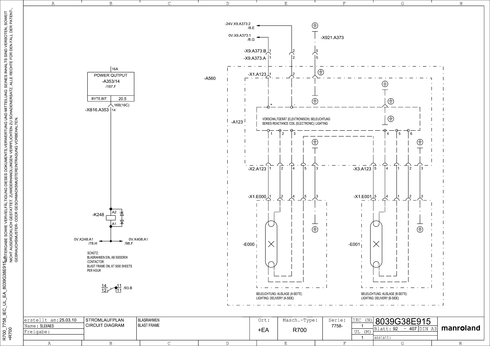

# +EA — Sheet 92 of 407 — BLASRAHMEN

**BLAST FRAME**

> Part of the manroland **R700** printing press IEC/UL circuit diagrams.
> Drawing class: **Stromlaufplan / Circuit diagram** (DIN A3).
> Document `+EA` covers the **Printing unit** machine section.

## At a glance

| Field | Value |
|---|---|
| Document | `+EA`  (8039G38E915) |
| Sheet | **92** of 407 |
| Section (DE) | BLASRAHMEN |
| Section (EN) | BLAST FRAME |
| Section type | CIRCUIT — Circuit diagram |
| Machine type | `R700` |
| Series | `7758` |
| Created | 25.03.10 |
| Replaces | — |
| Columns used | B, D, E, F, G |
| Path numbers | — |
| Labels on sheet | 82 |
| Cross-refs out | 5 |
| Cross-refs in | 36 |

**Previous:** [+EA sheet 91](SHEET_0091.md) · **Next:** [+EA sheet 93](SHEET_0093.md) · **Document TOC:** [_TOC.md](_TOC.md)  (+EA) · **Master TOC:** [all sheets](../_MASTER_TOC.md)

## Sheet image (300 DPI, exact vector render)



_Rendered directly from the PDF vector layer at 300 DPI (1-bit), no OCR and no resampling. Use it to confirm anything ambiguous in the text below._

## Cross-references on this sheet

Each entry is a wire leaving this sheet. The printed token is `/sheet.column`; the link resolves to that sheet inside the same document.

| Ref | Target sheet | Col | Path | Destination on target | Target section | From col |
|---|---|---|---|---|---|---|
| `/8.E` | [+EA sheet 8](SHEET_0008.md) | E | — | 24V.X9.A373:2 | SPANNUNGSVERSORGUNG: 400V, 24V | D |
| `/8.G` | [+EA sheet 8](SHEET_0008.md) | G | — | 0V.X9.A373:1 | SPANNUNGSVERSORGUNG: 400V, 24V | D |
| `/197.F` | [+EA sheet 197](SHEET_0197.md) | F | — | — | REFERENZMODUL | B |
| `/98.F` | [+EA sheet 98](SHEET_0098.md) | F | — | 0V.K248:A1 | BOGENFÜHRUNGSELEMENT | B |
| `/78.H` | [+EA sheet 78](SHEET_0078.md) | H | — | 0V.K248:A1 | AUSLEGERSTAPELSTEUERUNG | B |

### Incoming references (sheets that point here)

Every other sheet that sends a wire to this one. `Back-ref` is the token printed on *that* sheet; `Path` is its line number.

| From sheet | Cols | Back-ref | Path | Refs | What continues there |
|---|---|---|---|---|---|
| [+EA#8](SHEET_0008.md) | F, G | `/8.F`, `/8.G` | — | 2 | 0V.X9.A373:1; 24V.X9.A373:2 |
| [+EA#78](SHEET_0078.md) | H | `/78.H` | — | 1 | — |
| [+EA#93](SHEET_0093.md) | B | `/93.B` | — | 1 | — |
| [+EA#98](SHEET_0098.md) | F | `/98.F` | — | 1 | 0V.K408:A1 |
| [+EA#197](SHEET_0197.md) | F | `/197.F` | — | 1 | — |
| [+EA#206](SHEET_0206.md) | E | `/206.E` | — | 3 | — |
| [+EA#218](SHEET_0218.md) | A | `/218.A` | — | 10 | — |
| [+EA#223](SHEET_0223.md) | A | `/223.A` | — | 5 | — |
| [+EA#231](SHEET_0231.md) | A | `/231.A` | — | 5 | — |
| [+EA#252](SHEET_0252.md) | G | `/252.G` | — | 6 | — |
| [+EA#261](SHEET_0261.md) | G | `/261.G` | — | 1 | — |


## Devices on this sheet

| Tag | Class | Class meaning (IEC) | Col | Sub | Terminal | Sign |
|---|---|---|---|---|---|---|
| `A123` | A | Baugruppe / assembly, module, PC board | D | — | — | — |
| `E000` | E | Sonstiges / miscellaneous, lamp | D | — | — | — |
| `E001` | E | Sonstiges / miscellaneous, lamp | F | — | — | — |
| `A2` | A | Baugruppe / assembly, module, PC board | B | — | — | — |
| `A1` | A | Baugruppe / assembly, module, PC board | B | — | — | — |
| `K248` | K | Relais / relay, contactor | B | — | — | — |
| `A353/14` | A | Baugruppe / assembly, module, PC board | B | 14 | — | — |
| `A560` | A | Baugruppe / assembly, module, PC board | D | — | — | — |
| `X9.A373.B` | — | cross-device reference | D | — | — | — |
| `X9.A373.A` | — | cross-device reference | D | — | — | — |
| `X1.A123` | — | cross-device reference | E | — | — | — |
| `X1.E000` | — | cross-device reference | E | — | — | — |
| `X2.A123` | — | cross-device reference | E | — | — | — |
| `X1.E001` | — | cross-device reference | F | — | — | — |
| `X3.A123` | — | cross-device reference | F | — | — | — |
| `20.5` | — | cross-device reference | B | — | — | — |
| `XB16.A353` | — | cross-device reference | B | — | — | — |
| `X921.A373` | — | cross-device reference | F | — | — | — |

## Potentials / nets

| Potential | Count | Columns | Attached devices | Terminals |
|---|---|---|---|---|
| `0V` | 3 | B, D | `A373`, `K248`, `K408`, `X9` | `1`, `A1` |
| `24V` | 1 | D | `A373`, `X9` | `2` |


A potential such as `L24+/4` or `M24+` is a named supply/return rail; every place it appears on this sheet is electrically common.

## Wire-end annotations (grouped as printed)

A wire that continues elsewhere is annotated with a small cluster: the destination description, the path/line number `#NN`, and the `/sheet.column` cross reference. Each row below is one such cluster exactly as it is grouped on the drawing.

| Col | Y | Path | Cross-ref | Text on the wire |
|---|---|---|---|---|
| D | 54.1 | — | `/8.E` | `24V.X9.A373:2` |
| D | 82.5 | — | `/8.G` | `0V.X9.A373:1` |
| F | 86.8 | — | — | `X921.A373` |
| E | 119.4 | — | — | `X9.A373.B 1 2` |
| F | 119.4 | — | — | `5` |
| E | 136.4 | — | — | `X9.A373.A 1 2` |
| F | 136.4 | — | — | `5` |
| B | 164.0 | — | — | `16A` |
| E | 176.1 | — | — | `X1.A123 1 2` |
| B | 179.1 | — | — | `POWER QUTPUT` |
| D | 186.0 | — | — | `A560` |
| B | 193.1 | — | — | `A353/14` |
| B | 206.8 | — | `/197.F` | — |
| B | 235.9 | — | — | `BYTE.BIT 20.5` |
| E | 250.4 | — | — | `+` |
| B | 251.9 | — | — | `16B(16C)` |
| B | 262.5 | — | — | `XB16.A353 14` |
| E | 286.9 | — | — | `SERIES REACTANCE COIL (ELECTRONIC): LIGHTING VORSCHALTGERÄT (ELEKTRONISCH): BELEUCHTUNG` |
| D | 292.3 | — | — | `A123` |
| F | 321.4 | — | — | `1 2 3 4 5 6` |
| E | 405.7 | — | — | `X2.A123 1 2` |
| E | 405.7 | — | — | `4 5 3` |
| G | 405.7 | — | — | `X3.A123 5 4 1 2 3` |
| E | 473.7 | — | — | `X1.E000 1 2 4 5` |
| F | 473.7 | — | — | `3` |
| G | 473.7 | — | — | `X1.E001 5 4 1 2` |
| G | 473.7 | — | — | `3` |
| B | 512.6 | — | — | `A2` |
| B | 517.6 | — | — | `K248` |
| B | 541.0 | — | — | `A1` |
| B | 578.5 | — | `/98.F`, `/78.H` | `0V.K248:A1` |
| B | 578.5 | — | — | `0V.K408:A1` |
| D | 589.9 | — | — | `E000` |
| F | 589.9 | — | — | `E001` |
| B | 612.9 | — | — | `BLASRAHMEN EIN, AB 5000DR/H SCHÜTZ:` |
| B | 634.2 | — | — | `BLAST FRAME ON, AT 5000 SHEETS PER HOUR CONTACTOR:` |
| B | 690.5 | — | — | `14 12 11 11 /93.B` |
| E | 712.1 | — | — | `BELEUCHTUNG: AUSLAGE (A SEITE) LIGHTING: DELIVERY (A SIDE)` |
| G | 712.1 | — | — | `BELEUCHTUNG: AUSLAGE (B SEITE) LIGHTING: DELIVERY (B SIDE)` |


## Reconstructed tables

This sheet carries tabular content (pin map / terminal assignment / index). The grid below was rebuilt from the drawing's own rule lines, so each row is exactly one physical row of the table.

### Table 1 — 1 data rows × 3 columns (at x=212.6, y=175.7)

| POWER | QUTPUT A353/14 /197.F |  |
|---|---|---|
| `BYTE.BIT` |  | `20.5` |


### Table 2 — 1 data rows × 2 columns (at x=644.9, y=62.4)

| SERIES | 1 1 1 + VORSCHALTGERÄT 1 |
|---|---|
|  | `1 1` |


### Table 3 — 1 data rows × 3 columns (at x=680.3, y=62.4)

| REACTANCE 2 | 2 2 2 (ELEKTRONISCH): COIL 3 | (ELECTRONIC): |
|---|---|---|
| `2 2` | `4 4` | `5 5` |


## Notes and free text on this sheet

| Text | Col | Y (pt) |
|---|---|---|
| `VORSCHALTGERÄT (ELEKTRONISCH): BELEUCHTUNG` | E | 286.94 |
| `SERIES REACTANCE COIL (ELECTRONIC): LIGHTING` | E | 297.57 |
| `BELEUCHTUNG: AUSLAGE (A SEITE)` | E | 712.12 |
| `LIGHTING: DELIVERY (A SIDE)` | E | 722.75 |
| `BELEUCHTUNG: AUSLAGE (B SEITE)` | G | 712.12 |
| `LIGHTING: DELIVERY (B SIDE)` | G | 722.75 |
| `11 /93.B` | B | 696.86 |
| `SCHÜTZ:` | B | 612.9 |
| `BLASRAHMEN EIN, AB 5000DR/H` | B | 623.54 |
| `CONTACTOR:` | B | 634.18 |
| `BLAST FRAME ON, AT 5000 SHEETS` | B | 644.8 |
| `PER HOUR` | B | 655.44 |
| `16A` | B | 163.99 |
| `16B(16C)` | B | 251.89 |
| `POWER QUTPUT` | B | 179.14 |
| `BYTE.BIT` | B | 236.47 |

## Complete label inventory (exact text from the drawing)

Every text object inside the drawing area of this sheet, in DIN reading order (column A→H, then top→bottom). This is the authoritative list: if a string is not here it is not printed on this sheet.

| Col | Y | X | Dir | Type | Text |
|---|---|---|---|---|---|
| B | 164.0 | 271.3 | → | text | `16A` |
| B | 179.1 | 228.5 | → | text | `POWER QUTPUT` |
| B | 193.1 | 247.9 | → | device tag | `A353/14` |
| B | 206.8 | 257.0 | → | cross-reference | `/197.F` |
| B | 235.9 | 288.1 | → | device ref | `20.5` |
| B | 236.5 | 222.5 | → | text | `BYTE.BIT` |
| B | 251.9 | 276.9 | → | text | `16B(16C)` |
| B | 262.5 | 206.9 | → | device ref | `XB16.A353` |
| B | 263.9 | 271.3 | → | number | `14` |
| B | 512.6 | 272.1 | → | device tag | `A2` |
| B | 517.6 | 224.5 | → | device tag | `K248` |
| B | 541.0 | 272.1 | → | device tag | `A1` |
| B | 578.5 | 180.0 | → | potential | `0V.K248:A1` |
| B | 578.5 | 312.9 | → | potential | `0V.K408:A1` |
| B | 588.4 | 303.3 | → | cross-reference | `/98.F` |
| B | 588.5 | 215.1 | → | cross-reference | `/78.H` |
| B | 612.9 | 212.3 | → | text | `SCHÜTZ:` |
| B | 623.5 | 211.7 | → | text | `BLASRAHMEN EIN, AB 5000DR/H` |
| B | 634.2 | 212.3 | → | text | `CONTACTOR:` |
| B | 644.8 | 211.7 | → | text | `BLAST FRAME ON, AT 5000 SHEETS` |
| B | 655.4 | 211.7 | → | text | `PER HOUR` |
| B | 690.5 | 246.6 | → | number | `14` |
| B | 690.5 | 283.7 | → | number | `11` |
| B | 696.9 | 283.7 | → | text | `11 /93.B` |
| B | 701.8 | 246.6 | → | number | `12` |
| D | 54.1 | 546.5 | → | potential | `24V.X9.A373:2` |
| D | 64.0 | 602.6 | → | cross-reference | `/8.E` |
| D | 82.5 | 555.3 | → | potential | `0V.X9.A373:1` |
| D | 92.4 | 601.8 | → | cross-reference | `/8.G` |
| D | 119.4 | 592.7 | → | device ref | `X9.A373.B` |
| D | 137.1 | 591.9 | → | device ref | `X9.A373.A` |
| D | 186.0 | 495.8 | → | device tag | `A560` |
| D | 292.3 | 561.8 | → | device tag | `A123` |
| D | 589.9 | 590.2 | → | device tag | `E000` |
| E | 119.4 | 654.0 | → | number | `1` |
| E | 119.4 | 711.2 | → | number | `2` |
| E | 136.4 | 654.0 | → | number | `1` |
| E | 136.4 | 711.2 | → | number | `2` |
| E | 176.1 | 602.6 | → | device ref | `X1.A123` |
| E | 176.1 | 654.0 | → | number | `1` |
| E | 176.1 | 711.2 | → | number | `2` |
| E | 250.5 | 656.6 | → | number | `+` |
| E | 286.9 | 637.8 | → | text | `VORSCHALTGERÄT (ELEKTRONISCH): BELEUCHTUNG` |
| E | 297.6 | 637.5 | → | text | `SERIES REACTANCE COIL (ELECTRONIC): LIGHTING` |
| E | 321.3 | 657.1 | → | number | `1` |
| E | 321.3 | 685.1 | → | number | `2` |
| E | 321.3 | 713.3 | → | number | `3` |
| E | 405.7 | 654.0 | → | number | `1` |
| E | 405.7 | 682.9 | → | number | `2` |
| E | 405.7 | 711.2 | → | number | `4` |
| E | 405.7 | 739.6 | → | number | `5` |
| E | 406.4 | 602.6 | → | device ref | `X2.A123` |
| E | 473.7 | 602.6 | → | device ref | `X1.E000` |
| E | 473.7 | 654.0 | → | number | `1` |
| E | 473.7 | 682.9 | → | number | `2` |
| E | 473.7 | 711.2 | → | number | `4` |
| E | 473.7 | 739.6 | → | number | `5` |
| E | 712.1 | 622.8 | → | text | `BELEUCHTUNG: AUSLAGE (A SEITE)` |
| E | 722.7 | 622.8 | → | text | `LIGHTING: DELIVERY (A SIDE)` |
| F | 86.8 | 779.2 | → | device ref | `X921.A373` |
| F | 119.4 | 767.9 | → | number | `5` |
| F | 136.4 | 767.9 | → | number | `5` |
| F | 405.7 | 767.9 | → | number | `3` |
| F | 406.4 | 857.8 | → | device ref | `X3.A123` |
| F | 473.7 | 767.9 | → | number | `3` |
| F | 473.7 | 859.2 | → | device ref | `X1.E001` |
| F | 589.9 | 846.7 | → | device tag | `E001` |
| G | 321.3 | 940.1 | → | number | `4` |
| G | 321.3 | 968.5 | → | number | `5` |
| G | 321.3 | 996.8 | → | number | `6` |
| G | 405.7 | 909.6 | → | number | `5` |
| G | 405.7 | 938.0 | → | number | `4` |
| G | 405.7 | 965.8 | → | number | `1` |
| G | 405.7 | 994.7 | → | number | `2` |
| G | 405.7 | 1023.0 | → | number | `3` |
| G | 473.7 | 909.6 | → | number | `5` |
| G | 473.7 | 938.0 | → | number | `4` |
| G | 473.7 | 965.8 | → | number | `1` |
| G | 473.7 | 994.7 | → | number | `2` |
| G | 473.7 | 1023.0 | → | number | `3` |
| G | 712.1 | 877.9 | → | text | `BELEUCHTUNG: AUSLAGE (B SEITE)` |
| G | 722.7 | 877.9 | → | text | `LIGHTING: DELIVERY (B SIDE)` |

## Reading-order text block

The same content as a plain block, grouped by DIN column — convenient to paste or to match against a visual description.

```text
=== Column B ===
 164.0  271.3  text         16A
 179.1  228.5  text         POWER QUTPUT
 193.1  247.9  devtag       A353/14
 206.8  257.0  xref         /197.F
 235.9  288.1  devref       20.5
 236.5  222.5  text         BYTE.BIT
 251.9  276.9  text         16B(16C)
 262.5  206.9  devref       XB16.A353
 263.9  271.3  numeric      14
 512.6  272.1  devtag       A2
 517.6  224.5  devtag       K248
 541.0  272.1  devtag       A1
 578.5  180.0  net          0V.K248:A1
 578.5  312.9  net          0V.K408:A1
 588.4  303.3  xref         /98.F
 588.5  215.1  xref         /78.H
 612.9  212.3  text         SCHÜTZ:
 623.5  211.7  text         BLASRAHMEN EIN, AB 5000DR/H
 634.2  212.3  text         CONTACTOR:
 644.8  211.7  text         BLAST FRAME ON, AT 5000 SHEETS
 655.4  211.7  text         PER HOUR
 690.5  246.6  numeric      14
 690.5  283.7  numeric      11
 696.9  283.7  text         11 /93.B
 701.8  246.6  numeric      12
=== Column D ===
  54.1  546.5  net          24V.X9.A373:2
  64.0  602.6  xref         /8.E
  82.5  555.3  net          0V.X9.A373:1
  92.4  601.8  xref         /8.G
 119.4  592.7  devref       X9.A373.B
 137.1  591.9  devref       X9.A373.A
 186.0  495.8  devtag       A560
 292.3  561.8  devtag       A123
 589.9  590.2  devtag       E000
=== Column E ===
 119.4  654.0  numeric      1
 119.4  711.2  numeric      2
 136.4  654.0  numeric      1
 136.4  711.2  numeric      2
 176.1  602.6  devref       X1.A123
 176.1  654.0  numeric      1
 176.1  711.2  numeric      2
 250.5  656.6  numeric      +
 286.9  637.8  text         VORSCHALTGERÄT (ELEKTRONISCH): BELEUCHTUNG
 297.6  637.5  text         SERIES REACTANCE COIL (ELECTRONIC): LIGHTING
 321.3  657.1  numeric      1
 321.3  685.1  numeric      2
 321.3  713.3  numeric      3
 405.7  654.0  numeric      1
 405.7  682.9  numeric      2
 405.7  711.2  numeric      4
 405.7  739.6  numeric      5
 406.4  602.6  devref       X2.A123
 473.7  602.6  devref       X1.E000
 473.7  654.0  numeric      1
 473.7  682.9  numeric      2
 473.7  711.2  numeric      4
 473.7  739.6  numeric      5
 712.1  622.8  text         BELEUCHTUNG: AUSLAGE (A SEITE)
 722.7  622.8  text         LIGHTING: DELIVERY (A SIDE)
=== Column F ===
  86.8  779.2  devref       X921.A373
 119.4  767.9  numeric      5
 136.4  767.9  numeric      5
 405.7  767.9  numeric      3
 406.4  857.8  devref       X3.A123
 473.7  767.9  numeric      3
 473.7  859.2  devref       X1.E001
 589.9  846.7  devtag       E001
=== Column G ===
 321.3  940.1  numeric      4
 321.3  968.5  numeric      5
 321.3  996.8  numeric      6
 405.7  909.6  numeric      5
 405.7  938.0  numeric      4
 405.7  965.8  numeric      1
 405.7  994.7  numeric      2
 405.7 1023.0  numeric      3
 473.7  909.6  numeric      5
 473.7  938.0  numeric      4
 473.7  965.8  numeric      1
 473.7  994.7  numeric      2
 473.7 1023.0  numeric      3
 712.1  877.9  text         BELEUCHTUNG: AUSLAGE (B SEITE)
 722.7  877.9  text         LIGHTING: DELIVERY (B SIDE)
```

---
_Generated from the PDF vector text layer; no OCR. Source: `R700_7758_IEC_UL_EA_8039G38E915_p`, sheet 92._
