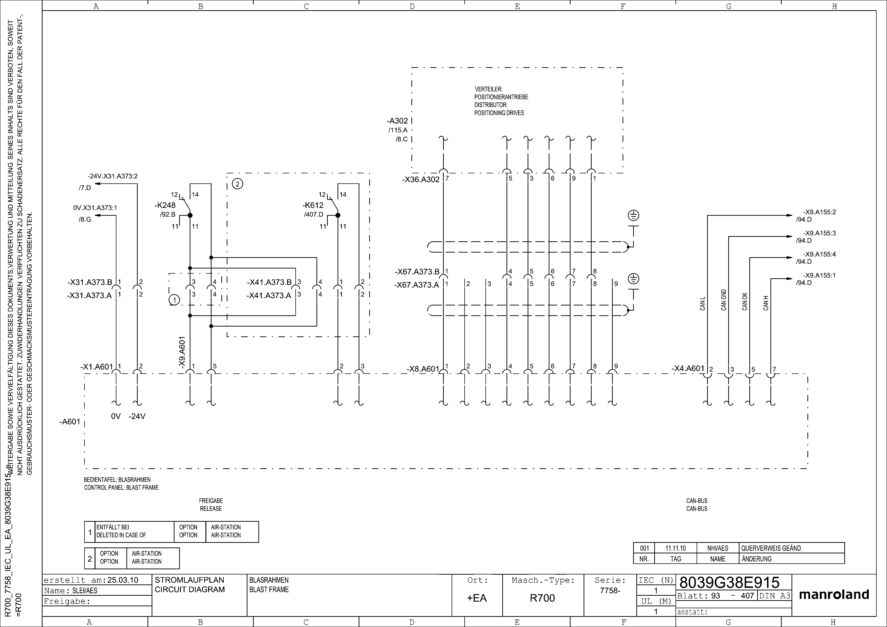

# +EA — Sheet 93 of 407 — BLASRAHMEN

**BLAST FRAME**

> Part of the manroland **R700** printing press IEC/UL circuit diagrams.
> Drawing class: **Stromlaufplan / Circuit diagram** (DIN A3).
> Document `+EA` covers the **Printing unit** machine section.

## At a glance

| Field | Value |
|---|---|
| Document | `+EA`  (8039G38E915) |
| Sheet | **93** of 407 |
| Section (DE) | BLASRAHMEN |
| Section (EN) | BLAST FRAME |
| Section type | CIRCUIT — Circuit diagram |
| Machine type | `R700` |
| Series | `7758` |
| Created | 25.03.10 |
| Replaces | — |
| Columns used | A, B, C, D, E, F, G, H |
| Path numbers | — |
| Labels on sheet | 133 |
| Cross-refs out | 10 |
| Cross-refs in | 56 |

**Previous:** [+EA sheet 92](SHEET_0092.md) · **Next:** [+EA sheet 94](SHEET_0094.md) · **Document TOC:** [_TOC.md](_TOC.md)  (+EA) · **Master TOC:** [all sheets](../_MASTER_TOC.md)

## Sheet image (300 DPI, exact vector render)



_Rendered directly from the PDF vector layer at 300 DPI (1-bit), no OCR and no resampling. Use it to confirm anything ambiguous in the text below._

## Cross-references on this sheet

Each entry is a wire leaving this sheet. The printed token is `/sheet.column`; the link resolves to that sheet inside the same document.

| Ref | Target sheet | Col | Path | Destination on target | Target section | From col |
|---|---|---|---|---|---|---|
| `/115.A` | [+EA sheet 115](SHEET_0115.md) | A | — | — | FORMATEINSTELLUNG: SAUGWALZE | D |
| `/8.C` | [+EA sheet 8](SHEET_0008.md) | C | — | — | SPANNUNGSVERSORGUNG: 400V, 24V | D |
| `/7.D` | [+EA sheet 7](SHEET_0007.md) | D | — | — | SPANNUNGSVERSORGUNG: 400V, 24V | A |
| `/92.B` | [+EA sheet 92](SHEET_0092.md) | B | — | — | BLASRAHMEN | B |
| `/407.D` | [+EA sheet 407](SHEET_0407.md) | D | — | — | OPTION: AIR STATION | C |
| `/8.G` | [+EA sheet 8](SHEET_0008.md) | G | — | — | SPANNUNGSVERSORGUNG: 400V, 24V | A |
| `/94.D` | [+EA sheet 94](SHEET_0094.md) | D | — | — | BLASRAHMEN | H |
| `/94.D` | [+EA sheet 94](SHEET_0094.md) | D | — | — | BLASRAHMEN | H |
| `/94.D` | [+EA sheet 94](SHEET_0094.md) | D | — | — | BLASRAHMEN | H |
| `/94.D` | [+EA sheet 94](SHEET_0094.md) | D | — | — | BLASRAHMEN | H |

### Incoming references (sheets that point here)

Every other sheet that sends a wire to this one. `Back-ref` is the token printed on *that* sheet; `Path` is its line number.

| From sheet | Cols | Back-ref | Path | Refs | What continues there |
|---|---|---|---|---|---|
| [+EA#7](SHEET_0007.md) | D | `/7.D` | — | 1 | 24V.X31.A373:2 |
| [+EA#8](SHEET_0008.md) | C, G | `/8.C`, `/8.G` | — | 2 | 0V.X31.A373:1 |
| [+EA#94](SHEET_0094.md) | C, E | `/94.C`, `/94.E` | — | 4 | 0V.X11.A373:2 X9.A155:2; X9.A155:1; X9.A155:3; X9.A155:4 X9.A156:1 |
| [+EA#115](SHEET_0115.md) | A | `/115.A` | — | 1 | — |
| [+EA#213](SHEET_0213.md) | C | `/213.C` | — | 2 | — |
| [+EA#238](SHEET_0238.md) | D | `/238.D` | — | 4 | — |
| [+EA#250](SHEET_0250.md) | H | `/250.H` | — | 1 | STROMPFAD PIN 1 2 3 4 5 6 7 8 9 |
| [+EA#253](SHEET_0253.md) | B | `/253.B` | — | 4 | — |
| [+EA#276](SHEET_0276.md) | A | `/276.A` | — | 8 | — |
| [+EA#279](SHEET_0279.md) | A | `/279.A` | — | 6 | — |
| [+EA#281](SHEET_0281.md) | A, E | `/281.A`, `/281.E` | — | 7 | X46.A373.B |
| [+EA#283](SHEET_0283.md) | A | `/283.A` | — | 1 | — |
| [+EA#285](SHEET_0285.md) | A | `/285.A` | — | 15 | — |


## Devices on this sheet

| Tag | Class | Class meaning (IEC) | Col | Sub | Terminal | Sign |
|---|---|---|---|---|---|---|
| `A601` | A | Baugruppe / assembly, module, PC board | A | — | — | — |
| `K248` | K | Relais / relay, contactor | B | — | — | — |
| `K612` | K | Relais / relay, contactor | C | — | — | — |
| `A302` | A | Baugruppe / assembly, module, PC board | D | — | — | — |
| `X31.A373.A` | — | cross-device reference | A | — | — | — |
| `X31.A373.B` | — | cross-device reference | A | — | — | — |
| `X1.A601` | — | cross-device reference | A | — | — | — |
| `X9.A601` | — | cross-device reference | B | — | — | — |
| `X41.A373.B` | — | cross-device reference | C | — | — | — |
| `X41.A373.A` | — | cross-device reference | C | — | — | — |
| `X36.A302` | — | cross-device reference | D | — | — | — |
| `X67.A373.B` | — | cross-device reference | D | — | — | — |
| `X67.A373.A` | — | cross-device reference | D | — | — | — |
| `X8.A601` | — | cross-device reference | D | — | — | — |
| `X4.A601` | — | cross-device reference | G | — | — | — |
| `NR.` | — | cross-device reference | F | — | — | — |
| `11.11.10` | — | cross-device reference | F | — | — | — |
| `X9.A155:2` | — | cross-device reference | H | — | 2 | — |
| `X9.A155:1` | — | cross-device reference | H | — | 1 | — |
| `X9.A155:3` | — | cross-device reference | H | — | 3 | — |
| `X9.A155:4` | — | cross-device reference | H | — | 4 | — |

## Potentials / nets

| Potential | Count | Columns | Attached devices | Terminals |
|---|---|---|---|---|
| `0V` | 2 | A | `A373`, `X31` | `1` |
| `24V` | 2 | A | `A373`, `X31` | `2` |


A potential such as `L24+/4` or `M24+` is a named supply/return rail; every place it appears on this sheet is electrically common.

## Wire-end annotations (grouped as printed)

A wire that continues elsewhere is annotated with a small cluster: the destination description, the path/line number `#NN`, and the `/sheet.column` cross reference. Each row below is one such cluster exactly as it is grouped on the drawing.

| Col | Y | Path | Cross-ref | Text on the wire |
|---|---|---|---|---|
| E | 116.8 | — | — | `POSITIONIERANTRIEBE DISTRIBUTOR: POSITIONING DRIVES VERTEILER:` |
| D | 157.6 | — | — | `A302` |
| D | 170.7 | — | `/115.A` | — |
| D | 183.1 | — | `/8.C` | — |
| A | 232.7 | — | — | `24V.X31.A373:2` |
| E | 235.6 | — | — | `X36.A302 7 5 3 6 9 1` |
| B | 244.1 | — | — | `2` |
| A | 248.3 | — | `/7.D` | — |
| B | 257.6 | — | — | `K248 14` |
| B | 257.6 | — | — | `12` |
| C | 257.6 | — | — | `K612 14` |
| C | 257.6 | — | — | `12` |
| A | 275.2 | — | — | `0V.X31.A373:1` |
| H | 280.9 | — | — | `X9.A155:2` |
| B | 284.1 | — | `/92.B` | — |
| C | 284.1 | — | `/407.D` | — |
| A | 290.8 | — | `/8.G` | — |
| H | 290.8 | — | `/94.D` | — |
| B | 300.1 | — | — | `11 11` |
| C | 300.1 | — | — | `11 11` |
| H | 309.3 | — | — | `X9.A155:3` |
| H | 319.2 | — | `/94.D` | — |
| H | 337.6 | — | — | `X9.A155:4` |
| H | 347.5 | — | `/94.D` | — |
| D | 360.3 | — | — | `X67.A373.B 1` |
| E | 360.3 | — | — | `4` |
| E | 360.3 | — | — | `5` |
| E | 360.3 | — | — | `6` |
| F | 360.3 | — | — | `7` |
| F | 360.3 | — | — | `8` |
| H | 365.9 | — | — | `X9.A155:1` |
| A | 374.5 | — | — | `X31.A373.B 1 2` |
| B | 374.5 | — | — | `3 4` |
| C | 374.5 | — | — | `X41.A373.B 3` |
| C | 374.5 | — | — | `4` |
| C | 374.5 | — | — | `1` |
| D | 374.5 | — | — | `2` |
| H | 375.9 | — | `/94.D` | — |
| D | 377.3 | — | — | `X67.A373.A 1 2 3` |
| E | 377.3 | — | — | `4` |
| E | 377.3 | — | — | `5` |
| E | 377.3 | — | — | `6` |
| F | 377.3 | — | — | `7` |
| F | 377.3 | — | — | `8 9` |
| G | 388.2 | — | — | `CAN GND` |
| A | 391.5 | — | — | `X31.A373.A 1 2` |
| B | 391.5 | — | — | `3 4` |
| C | 391.5 | — | — | `X41.A373.A 3` |
| C | 391.5 | — | — | `4` |
| C | 391.5 | — | — | `1` |
| D | 391.5 | — | — | `2` |
| G | 392.9 | — | — | `CAN OK` |
| G | 397.3 | — | — | `CAN H` |
| G | 398.5 | — | — | `CAN L` |
| B | 399.5 | — | — | `1` |
| B | 450.7 | — | — | `X9.A601` |
| A | 487.9 | — | — | `X1.A601 1 2` |
| B | 487.9 | — | — | `1` |
| B | 487.9 | — | — | `5` |
| C | 487.9 | — | — | `2 3` |
| F | 487.9 | — | — | `X8.A601 1 2 3 4 5 6 7 8 9 X4.A601 2 3 5 7` |
| A | 554.5 | — | — | `0V 24V` |
| A | 561.6 | — | — | `A601` |
| A | 641.2 | — | — | `BEDIENTAFEL: BLASRAHMEN` |
| A | 651.9 | — | — | `CONTROL PANEL: BLAST FRAME` |
| B | 669.6 | — | — | `FREIGABE` |
| G | 669.6 | — | — | `CAN BUS CAN BUS` |
| B | 680.2 | — | — | `RELEASE` |
| A | 705.0 | — | — | `1 ENTFÄLLT BEI DELETED IN CASE OF` |
| B | 705.0 | — | — | `OPTION OPTION` |
| B | 705.0 | — | — | `AIR STATION AIR STATION` |
| G | 733.0 | — | — | `001 11.11.10 NHI/AES QUERVERWEIS GEÄND.` |
| A | 740.4 | — | — | `2 OPTION OPTION` |
| A | 740.5 | — | — | `AIR STATION AIR STATION` |
| G | 747.1 | — | — | `NR. TAG NAME ÄNDERUNG` |


## Reconstructed tables

This sheet carries tabular content (pin map / terminal assignment / index). The grid below was rebuilt from the drawing's own rule lines, so each row is exactly one physical row of the table.

### Table 1 — 1 data rows × 3 columns (at x=155.9, y=246.6)

|  | 12 K248 /92.B 11 | 14 11 |
|---|---|---|
| `1 1` | `2 2 1` | `3 3` |


## Notes and free text on this sheet

| Text | Col | Y (pt) |
|---|---|---|
| `BEDIENTAFEL: BLASRAHMEN` | A | 641.25 |
| `CONTROL PANEL: BLAST FRAME` | A | 651.89 |
| `VERTEILER:` | E | 116.82 |
| `POSITIONIERANTRIEBE` | E | 127.46 |
| `DISTRIBUTOR:` | E | 138.09 |
| `POSITIONING DRIVES` | E | 148.73 |
| `TAG` | G | 747.27 |
| `NAME` | G | 747.25 |
| `ÄNDERUNG` | G | 747.31 |
| `NHI/AES` | G | 733.11 |
| `QUERVERWEIS GEÄND.` | G | 733.1 |
| `FREIGABE` | B | 669.56 |
| `RELEASE` | B | 680.19 |
| `CAN BUS` | G | 669.6 |
| `CAN L` | G | 398.5 |
| `CAN GND` | G | 388.23 |
| `CAN OK` | G | 392.94 |
| `CAN H` | G | 397.33 |
| `ENTFÄLLT BEI` | A | 705 |
| `DELETED IN CASE OF` | A | 715.65 |
| `OPTION` | A | 740.44 |
| `AIR STATION` | A | 740.46 |
| `OPTION` | B | 705.01 |
| `AIR STATION` | B | 705.02 |

## Complete label inventory (exact text from the drawing)

Every text object inside the drawing area of this sheet, in DIN reading order (column A→H, then top→bottom). This is the authoritative list: if a string is not here it is not printed on this sheet.

| Col | Y | X | Dir | Type | Text |
|---|---|---|---|---|---|
| A | 232.7 | 117.9 | → | potential | `24V.X31.A373:2` |
| A | 248.3 | 106.0 | → | cross-reference | `/7.D` |
| A | 275.2 | 98.4 | → | potential | `0V.X31.A373:1` |
| A | 290.8 | 105.7 | → | cross-reference | `/8.G` |
| A | 374.5 | 90.7 | → | device ref | `X31.A373.B` |
| A | 374.5 | 157.9 | → | number | `1` |
| A | 374.5 | 186.8 | → | number | `2` |
| A | 391.5 | 157.9 | → | number | `1` |
| A | 391.5 | 186.8 | → | number | `2` |
| A | 392.2 | 89.9 | → | device ref | `X31.A373.A` |
| A | 487.9 | 108.0 | → | device ref | `X1.A601` |
| A | 487.9 | 157.9 | → | number | `1` |
| A | 487.9 | 186.8 | → | number | `2` |
| A | 554.5 | 149.1 | → | potential | `0V` |
| A | 554.5 | 172.9 | → | potential | `24V` |
| A | 561.6 | 79.9 | → | device tag | `A601` |
| A | 641.2 | 112.5 | → | text | `BEDIENTAFEL: BLASRAHMEN` |
| A | 651.9 | 113.1 | → | text | `CONTROL PANEL: BLAST FRAME` |
| A | 705.0 | 129.5 | → | text | `ENTFÄLLT BEI` |
| A | 710.3 | 117.9 | → | number | `1` |
| A | 715.7 | 129.5 | → | text | `DELETED IN CASE OF` |
| A | 740.4 | 134.4 | → | text | `OPTION` |
| A | 740.5 | 177.2 | → | text | `AIR STATION` |
| A | 745.8 | 117.6 | → | number | `2` |
| A | 751.1 | 134.4 | → | text | `OPTION` |
| A | 751.1 | 177.2 | → | text | `AIR STATION` |
| B | 244.1 | 316.9 | → | number | `2` |
| B | 257.6 | 229.0 | → | number | `12` |
| B | 257.6 | 257.1 | → | number | `14` |
| B | 271.0 | 207.5 | → | device tag | `K248` |
| B | 284.1 | 214.9 | → | cross-reference | `/92.B` |
| B | 300.1 | 230.2 | → | number | `11` |
| B | 300.1 | 257.1 | → | number | `11` |
| B | 374.5 | 257.7 | → | number | `3` |
| B | 374.5 | 286.0 | → | number | `4` |
| B | 391.5 | 257.7 | → | number | `3` |
| B | 391.5 | 286.0 | → | number | `4` |
| B | 399.5 | 232.1 | → | number | `1` |
| B | 450.7 | 239.8 | ↕ | device ref | `X9.A601` |
| B | 487.9 | 257.1 | → | number | `1` |
| B | 487.9 | 286.0 | → | number | `5` |
| B | 669.6 | 267.2 | → | text | `FREIGABE` |
| B | 680.2 | 268.6 | → | text | `RELEASE` |
| B | 705.0 | 240.7 | → | text | `OPTION` |
| B | 705.0 | 283.5 | → | text | `AIR STATION` |
| B | 715.6 | 240.7 | → | text | `OPTION` |
| B | 715.7 | 283.5 | → | text | `AIR STATION` |
| C | 257.6 | 427.5 | → | number | `12` |
| C | 257.6 | 455.5 | → | number | `14` |
| C | 271.0 | 405.9 | → | device tag | `K612` |
| C | 284.1 | 408.2 | → | cross-reference | `/407.D` |
| C | 300.1 | 428.6 | → | number | `11` |
| C | 300.1 | 455.5 | → | number | `11` |
| C | 374.5 | 331.7 | → | device ref | `X41.A373.B` |
| C | 374.5 | 399.4 | → | number | `3` |
| C | 374.5 | 427.7 | → | number | `4` |
| C | 374.5 | 455.5 | → | number | `1` |
| C | 391.5 | 399.4 | → | number | `3` |
| C | 391.5 | 427.7 | → | number | `4` |
| C | 391.5 | 455.5 | → | number | `1` |
| C | 392.2 | 330.8 | → | device ref | `X41.A373.A` |
| C | 487.9 | 456.1 | → | number | `2` |
| D | 157.6 | 519.3 | → | device tag | `A302` |
| D | 170.7 | 521.6 | → | cross-reference | `/115.A` |
| D | 183.1 | 531.2 | → | cross-reference | `/8.C` |
| D | 235.6 | 597.8 | → | number | `7` |
| D | 236.3 | 540.0 | → | device ref | `X36.A302` |
| D | 360.3 | 530.1 | → | device ref | `X67.A373.B` |
| D | 360.3 | 597.3 | → | number | `1` |
| D | 374.5 | 484.4 | → | number | `2` |
| D | 377.3 | 597.3 | → | number | `1` |
| D | 378.0 | 529.2 | → | device ref | `X67.A373.A` |
| D | 391.5 | 484.4 | → | number | `2` |
| D | 487.9 | 484.4 | → | number | `3` |
| D | 487.9 | 597.3 | → | number | `1` |
| D | 490.7 | 546.0 | → | device ref | `X8.A601` |
| E | 116.8 | 637.8 | → | text | `VERTEILER:` |
| E | 127.5 | 636.9 | → | text | `POSITIONIERANTRIEBE` |
| E | 138.1 | 636.9 | → | text | `DISTRIBUTOR:` |
| E | 148.7 | 636.9 | → | text | `POSITIONING DRIVES` |
| E | 235.6 | 682.9 | → | number | `5` |
| E | 235.6 | 711.2 | → | number | `3` |
| E | 235.6 | 739.6 | → | number | `6` |
| E | 360.3 | 682.9 | → | number | `4` |
| E | 360.3 | 711.2 | → | number | `5` |
| E | 360.3 | 739.6 | → | number | `6` |
| E | 377.3 | 626.2 | → | number | `2` |
| E | 377.3 | 654.5 | → | number | `3` |
| E | 377.3 | 682.9 | → | number | `4` |
| E | 377.3 | 711.2 | → | number | `5` |
| E | 377.3 | 739.6 | → | number | `6` |
| E | 487.9 | 626.2 | → | number | `2` |
| E | 487.9 | 654.5 | → | number | `3` |
| E | 487.9 | 682.9 | → | number | `4` |
| E | 487.9 | 711.2 | → | number | `5` |
| E | 487.9 | 739.6 | → | number | `6` |
| F | 235.6 | 767.9 | → | number | `9` |
| F | 235.6 | 795.7 | → | number | `1` |
| F | 360.3 | 767.9 | → | number | `7` |
| F | 360.3 | 796.3 | → | number | `8` |
| F | 377.3 | 767.9 | → | number | `7` |
| F | 377.3 | 796.3 | → | number | `8` |
| F | 377.3 | 824.6 | → | number | `9` |
| F | 487.9 | 767.9 | → | number | `7` |
| F | 487.9 | 796.3 | → | number | `8` |
| F | 487.9 | 824.6 | → | number | `9` |
| F | 733.0 | 859.4 | → | number | `001` |
| F | 733.1 | 893.2 | → | device ref | `11.11.10` |
| F | 747.1 | 858.4 | → | device ref | `NR.` |
| G | 388.2 | 968.7 | ↕ | text | `CAN GND` |
| G | 392.9 | 997.0 | ↕ | text | `CAN OK` |
| G | 397.3 | 1025.3 | ↕ | text | `CAN H` |
| G | 398.5 | 940.3 | ↕ | text | `CAN L` |
| G | 490.0 | 901.7 | → | device ref | `X4.A601` |
| G | 492.1 | 952.2 | → | number | `2` |
| G | 492.1 | 980.5 | → | number | `3` |
| G | 492.1 | 1008.9 | → | number | `5` |
| G | 492.1 | 1037.2 | → | number | `7` |
| G | 669.6 | 921.5 | → | text | `CAN BUS` |
| G | 680.2 | 921.5 | → | text | `CAN BUS` |
| G | 733.1 | 949.5 | → | text | `NHI/AES` |
| G | 733.1 | 995.1 | → | text | `QUERVERWEIS GEÄND.` |
| G | 747.3 | 900.0 | → | text | `TAG` |
| G | 747.3 | 953.4 | → | text | `NAME` |
| G | 747.3 | 996.0 | → | text | `ÄNDERUNG` |
| H | 280.9 | 1078.3 | → | device ref | `X9.A155:2` |
| H | 290.8 | 1068.7 | → | cross-reference | `/94.D` |
| H | 309.3 | 1078.3 | → | device ref | `X9.A155:3` |
| H | 319.2 | 1068.7 | → | cross-reference | `/94.D` |
| H | 337.6 | 1078.3 | → | device ref | `X9.A155:4` |
| H | 347.5 | 1068.7 | → | cross-reference | `/94.D` |
| H | 365.9 | 1078.3 | → | device ref | `X9.A155:1` |
| H | 375.9 | 1068.7 | → | cross-reference | `/94.D` |

## Reading-order text block

The same content as a plain block, grouped by DIN column — convenient to paste or to match against a visual description.

```text
=== Column A ===
 232.7  117.9  net          24V.X31.A373:2
 248.3  106.0  xref         /7.D
 275.2   98.4  net          0V.X31.A373:1
 290.8  105.7  xref         /8.G
 374.5   90.7  devref       X31.A373.B
 374.5  157.9  numeric      1
 374.5  186.8  numeric      2
 391.5  157.9  numeric      1
 391.5  186.8  numeric      2
 392.2   89.9  devref       X31.A373.A
 487.9  108.0  devref       X1.A601
 487.9  157.9  numeric      1
 487.9  186.8  numeric      2
 554.5  149.1  net          0V
 554.5  172.9  net          24V
 561.6   79.9  devtag       A601
 641.2  112.5  text         BEDIENTAFEL: BLASRAHMEN
 651.9  113.1  text         CONTROL PANEL: BLAST FRAME
 705.0  129.5  text         ENTFÄLLT BEI
 710.3  117.9  numeric      1
 715.7  129.5  text         DELETED IN CASE OF
 740.4  134.4  text         OPTION
 740.5  177.2  text         AIR STATION
 745.8  117.6  numeric      2
 751.1  134.4  text         OPTION
 751.1  177.2  text         AIR STATION
=== Column B ===
 244.1  316.9  numeric      2
 257.6  229.0  numeric      12
 257.6  257.1  numeric      14
 271.0  207.5  devtag       K248
 284.1  214.9  xref         /92.B
 300.1  230.2  numeric      11
 300.1  257.1  numeric      11
 374.5  257.7  numeric      3
 374.5  286.0  numeric      4
 391.5  257.7  numeric      3
 391.5  286.0  numeric      4
 399.5  232.1  numeric      1
 450.7  239.8  devref       X9.A601
 487.9  257.1  numeric      1
 487.9  286.0  numeric      5
 669.6  267.2  text         FREIGABE
 680.2  268.6  text         RELEASE
 705.0  240.7  text         OPTION
 705.0  283.5  text         AIR STATION
 715.6  240.7  text         OPTION
 715.7  283.5  text         AIR STATION
=== Column C ===
 257.6  427.5  numeric      12
 257.6  455.5  numeric      14
 271.0  405.9  devtag       K612
 284.1  408.2  xref         /407.D
 300.1  428.6  numeric      11
 300.1  455.5  numeric      11
 374.5  331.7  devref       X41.A373.B
 374.5  399.4  numeric      3
 374.5  427.7  numeric      4
 374.5  455.5  numeric      1
 391.5  399.4  numeric      3
 391.5  427.7  numeric      4
 391.5  455.5  numeric      1
 392.2  330.8  devref       X41.A373.A
 487.9  456.1  numeric      2
=== Column D ===
 157.6  519.3  devtag       A302
 170.7  521.6  xref         /115.A
 183.1  531.2  xref         /8.C
 235.6  597.8  numeric      7
 236.3  540.0  devref       X36.A302
 360.3  530.1  devref       X67.A373.B
 360.3  597.3  numeric      1
 374.5  484.4  numeric      2
 377.3  597.3  numeric      1
 378.0  529.2  devref       X67.A373.A
 391.5  484.4  numeric      2
 487.9  484.4  numeric      3
 487.9  597.3  numeric      1
 490.7  546.0  devref       X8.A601
=== Column E ===
 116.8  637.8  text         VERTEILER:
 127.5  636.9  text         POSITIONIERANTRIEBE
 138.1  636.9  text         DISTRIBUTOR:
 148.7  636.9  text         POSITIONING DRIVES
 235.6  682.9  numeric      5
 235.6  711.2  numeric      3
 235.6  739.6  numeric      6
 360.3  682.9  numeric      4
 360.3  711.2  numeric      5
 360.3  739.6  numeric      6
 377.3  626.2  numeric      2
 377.3  654.5  numeric      3
 377.3  682.9  numeric      4
 377.3  711.2  numeric      5
 377.3  739.6  numeric      6
 487.9  626.2  numeric      2
 487.9  654.5  numeric      3
 487.9  682.9  numeric      4
 487.9  711.2  numeric      5
 487.9  739.6  numeric      6
=== Column F ===
 235.6  767.9  numeric      9
 235.6  795.7  numeric      1
 360.3  767.9  numeric      7
 360.3  796.3  numeric      8
 377.3  767.9  numeric      7
 377.3  796.3  numeric      8
 377.3  824.6  numeric      9
 487.9  767.9  numeric      7
 487.9  796.3  numeric      8
 487.9  824.6  numeric      9
 733.0  859.4  numeric      001
 733.1  893.2  devref       11.11.10
 747.1  858.4  devref       NR.
=== Column G ===
 388.2  968.7  text         CAN GND
 392.9  997.0  text         CAN OK
 397.3 1025.3  text         CAN H
 398.5  940.3  text         CAN L
 490.0  901.7  devref       X4.A601
 492.1  952.2  numeric      2
 492.1  980.5  numeric      3
 492.1 1008.9  numeric      5
 492.1 1037.2  numeric      7
 669.6  921.5  text         CAN BUS
 680.2  921.5  text         CAN BUS
 733.1  949.5  text         NHI/AES
 733.1  995.1  text         QUERVERWEIS GEÄND.
 747.3  900.0  text         TAG
 747.3  953.4  text         NAME
 747.3  996.0  text         ÄNDERUNG
=== Column H ===
 280.9 1078.3  devref       X9.A155:2
 290.8 1068.7  xref         /94.D
 309.3 1078.3  devref       X9.A155:3
 319.2 1068.7  xref         /94.D
 337.6 1078.3  devref       X9.A155:4
 347.5 1068.7  xref         /94.D
 365.9 1078.3  devref       X9.A155:1
 375.9 1068.7  xref         /94.D
```

---
_Generated from the PDF vector text layer; no OCR. Source: `R700_7758_IEC_UL_EA_8039G38E915_p`, sheet 93._
