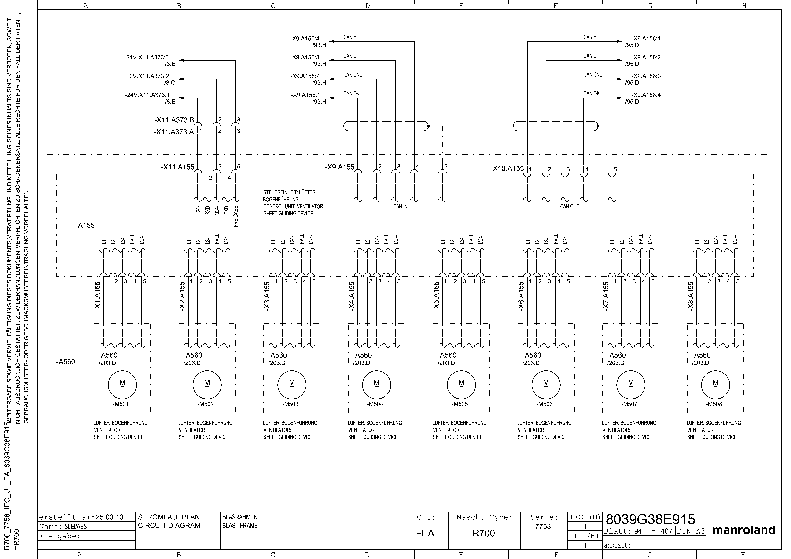

# +EA — Sheet 94 of 407 — BLASRAHMEN

**BLAST FRAME**

> Part of the manroland **R700** printing press IEC/UL circuit diagrams.
> Drawing class: **Stromlaufplan / Circuit diagram** (DIN A3).
> Document `+EA` covers the **Printing unit** machine section.

## At a glance

| Field | Value |
|---|---|
| Document | `+EA`  (8039G38E915) |
| Sheet | **94** of 407 |
| Section (DE) | BLASRAHMEN |
| Section (EN) | BLAST FRAME |
| Section type | CIRCUIT — Circuit diagram |
| Machine type | `R700` |
| Series | `7758` |
| Created | 25.03.10 |
| Replaces | — |
| Columns used | A, B, C, D, E, F, G, H |
| Path numbers | — |
| Labels on sheet | 213 |
| Cross-refs out | 19 |
| Cross-refs in | 78 |

**Previous:** [+EA sheet 93](SHEET_0093.md) · **Next:** [+EA sheet 95](SHEET_0095.md) · **Document TOC:** [_TOC.md](_TOC.md)  (+EA) · **Master TOC:** [all sheets](../_MASTER_TOC.md)

## Sheet image (300 DPI, exact vector render)



_Rendered directly from the PDF vector layer at 300 DPI (1-bit), no OCR and no resampling. Use it to confirm anything ambiguous in the text below._

## Cross-references on this sheet

Each entry is a wire leaving this sheet. The printed token is `/sheet.column`; the link resolves to that sheet inside the same document.

| Ref | Target sheet | Col | Path | Destination on target | Target section | From col |
|---|---|---|---|---|---|---|
| `/93.H` | [+EA sheet 93](SHEET_0093.md) | H | — | X9.A155:4 X9.A156:1 | BLASRAHMEN | E |
| `/95.D` | [+EA sheet 95](SHEET_0095.md) | D | — | — | BLASRAHMEN | G |
| `/8.E` | [+EA sheet 8](SHEET_0008.md) | E | — | 24V.X11.A373:3 | SPANNUNGSVERSORGUNG: 400V, 24V | B |
| `/93.H` | [+EA sheet 93](SHEET_0093.md) | H | — | X9.A155:3 | BLASRAHMEN | C |
| `/95.D` | [+EA sheet 95](SHEET_0095.md) | D | — | — | BLASRAHMEN | G |
| `/8.G` | [+EA sheet 8](SHEET_0008.md) | G | — | 0V.X11.A373:2 X9.A155:2 | SPANNUNGSVERSORGUNG: 400V, 24V | C |
| `/93.H` | [+EA sheet 93](SHEET_0093.md) | H | — | 0V.X11.A373:2 X9.A155:2 | BLASRAHMEN | C |
| `/95.D` | [+EA sheet 95](SHEET_0095.md) | D | — | — | BLASRAHMEN | G |
| `/8.E` | [+EA sheet 8](SHEET_0008.md) | E | — | 24V.X11.A373:1 | SPANNUNGSVERSORGUNG: 400V, 24V | B |
| `/93.H` | [+EA sheet 93](SHEET_0093.md) | H | — | X9.A155:1 | BLASRAHMEN | C |
| `/95.D` | [+EA sheet 95](SHEET_0095.md) | D | — | — | BLASRAHMEN | G |
| `/203.D` | [+EA sheet 203](SHEET_0203.md) | D | — | A560 | REFERENZMODUL | A |
| `/203.D` | [+EA sheet 203](SHEET_0203.md) | D | — | A560 | REFERENZMODUL | B |
| `/203.D` | [+EA sheet 203](SHEET_0203.md) | D | — | A560 | REFERENZMODUL | C |
| `/203.D` | [+EA sheet 203](SHEET_0203.md) | D | — | A560 | REFERENZMODUL | D |
| `/203.D` | [+EA sheet 203](SHEET_0203.md) | D | — | A560 | REFERENZMODUL | E |
| `/203.D` | [+EA sheet 203](SHEET_0203.md) | D | — | A560 | REFERENZMODUL | F |
| `/203.D` | [+EA sheet 203](SHEET_0203.md) | D | — | A560 | REFERENZMODUL | G |
| `/203.D` | [+EA sheet 203](SHEET_0203.md) | D | — | A560 | REFERENZMODUL | H |

### Incoming references (sheets that point here)

Every other sheet that sends a wire to this one. `Back-ref` is the token printed on *that* sheet; `Path` is its line number.

| From sheet | Cols | Back-ref | Path | Refs | What continues there |
|---|---|---|---|---|---|
| [+EA#8](SHEET_0008.md) | E, G | `/8.E`, `/8.G` | — | 3 | 0V.X11.A373:2; 24V.X11.A373:1; 24V.X11.A373:3 |
| [+EA#93](SHEET_0093.md) | H | `/93.H` | — | 4 | — |
| [+EA#95](SHEET_0095.md) | C | `/95.C` | — | 4 | X9.A156:1; X9.A156:2; X9.A156:3; X9.A156:4 |
| [+EA#203](SHEET_0203.md) | D | `/203.D` | — | 8 | — |
| [+EA#206](SHEET_0206.md) | E | `/206.E` | — | 5 | — |
| [+EA#223](SHEET_0223.md) | A | `/223.A` | — | 5 | — |
| [+EA#231](SHEET_0231.md) | B | `/231.B` | — | 5 | — |
| [+EA#236](SHEET_0236.md) | A | `/236.A` | — | 5 | — |
| [+EA#238](SHEET_0238.md) | H | `/238.H` | — | 5 | — |
| [+EA#243](SHEET_0243.md) | F | `/243.F` | — | 5 | — |
| [+EA#246](SHEET_0246.md) | A | `/246.A` | — | 5 | — |
| [+EA#248](SHEET_0248.md) | A | `/248.A` | — | 5 | — |
| [+EA#251](SHEET_0251.md) | A | `/251.A` | — | 5 | — |
| [+EA#253](SHEET_0253.md) | E | `/253.E` | — | 5 | — |
| [+EA#255](SHEET_0255.md) | B | `/255.B` | — | 3 | — |
| [+EA#256](SHEET_0256.md) | D | `/256.D` | — | 6 | — |


## Devices on this sheet

| Tag | Class | Class meaning (IEC) | Col | Sub | Terminal | Sign |
|---|---|---|---|---|---|---|
| `A155` | A | Baugruppe / assembly, module, PC board | A | — | — | — |
| `A560` | A | Baugruppe / assembly, module, PC board | A | — | — | — |
| `A560` | A | Baugruppe / assembly, module, PC board | B | — | — | — |
| `A560` | A | Baugruppe / assembly, module, PC board | C | — | — | — |
| `A560` | A | Baugruppe / assembly, module, PC board | D | — | — | — |
| `A560` | A | Baugruppe / assembly, module, PC board | E | — | — | — |
| `A560` | A | Baugruppe / assembly, module, PC board | F | — | — | — |
| `A560` | A | Baugruppe / assembly, module, PC board | G | — | — | — |
| `A560` | A | Baugruppe / assembly, module, PC board | H | — | — | — |
| `A560` | A | Baugruppe / assembly, module, PC board | A | — | — | — |
| `X11.A155` | — | cross-device reference | B | — | — | — |
| `X9.A155` | — | cross-device reference | D | — | — | — |
| `X1.A155` | — | cross-device reference | A | — | — | — |
| `X2.A155` | — | cross-device reference | B | — | — | — |
| `X3.A155` | — | cross-device reference | C | — | — | — |
| `X4.A155` | — | cross-device reference | D | — | — | — |
| `X5.A155` | — | cross-device reference | E | — | — | — |
| `X6.A155` | — | cross-device reference | F | — | — | — |
| `X7.A155` | — | cross-device reference | G | — | — | — |
| `X8.A155` | — | cross-device reference | G | — | — | — |
| `X10.A155` | — | cross-device reference | E | — | — | — |
| `X11.A373.A` | — | cross-device reference | B | — | — | — |
| `X11.A373.B` | — | cross-device reference | B | — | — | — |
| `X9.A155:2` | — | cross-device reference | C | — | 2 | — |
| `X9.A155:1` | — | cross-device reference | C | — | 1 | — |
| `X9.A155:3` | — | cross-device reference | C | — | 3 | — |
| `X9.A156:3` | — | cross-device reference | G | — | 3 | — |
| `X9.A156:2` | — | cross-device reference | G | — | 2 | — |
| `X9.A156:1` | — | cross-device reference | G | — | 1 | — |
| `X9.A155:4` | — | cross-device reference | C | — | 4 | — |
| `X9.A156:4` | — | cross-device reference | G | — | 4 | — |

## Potentials / nets

| Potential | Count | Columns | Attached devices | Terminals |
|---|---|---|---|---|
| `0V` | 1 | B | `A373`, `X11` | `2` |
| `24V` | 2 | B | `A373`, `X11` | `1`, `3` |
| `L1` | 8 | A, B, C, D, E, F, G, H | — | — |
| `L2` | 8 | A, B, C, D, E, F, G, H | — | — |
| `L24` | 9 | A, B, C, D, E, F, G, H | — | — |
| `M24` | 9 | B, C, D, E, F, G, H | — | — |
| `M501` | 1 | A | — | — |
| `M502` | 1 | B | — | — |
| `M503` | 1 | C | — | — |
| `M504` | 1 | D | — | — |
| `M505` | 1 | E | — | — |
| `M506` | 1 | F | — | — |
| `M507` | 1 | G | — | — |
| `M508` | 1 | H | — | — |


A potential such as `L24+/4` or `M24+` is a named supply/return rail; every place it appears on this sheet is electrically common.

## Wire-end annotations (grouped as printed)

A wire that continues elsewhere is annotated with a small cluster: the destination description, the path/line number `#NN`, and the `/sheet.column` cross reference. Each row below is one such cluster exactly as it is grouped on the drawing.

| Col | Y | Path | Cross-ref | Text on the wire |
|---|---|---|---|---|
| D | 53.0 | — | — | `CAN H` |
| F | 53.0 | — | — | `CAN H` |
| E | 54.1 | — | `/93.H` | `X9.A155:4 X9.A156:1` |
| G | 64.1 | — | `/95.D` | — |
| D | 81.4 | — | — | `CAN L` |
| F | 81.4 | — | — | `CAN L` |
| B | 82.5 | — | `/8.E` | `24V.X11.A373:3` |
| C | 82.5 | — | `/93.H` | `X9.A155:3` |
| G | 82.5 | — | — | `X9.A156:2` |
| G | 92.4 | — | `/95.D` | — |
| D | 109.8 | — | — | `CAN GND` |
| F | 109.8 | — | — | `CAN GND` |
| C | 110.8 | — | `/8.G`, `/93.H` | `0V.X11.A373:2 X9.A155:2` |
| G | 110.8 | — | — | `X9.A156:3` |
| G | 120.8 | — | `/95.D` | — |
| D | 138.1 | — | — | `CAN OK` |
| F | 138.1 | — | — | `CAN OK` |
| B | 139.2 | — | `/8.E` | `24V.X11.A373:1` |
| C | 139.2 | — | `/93.H` | `X9.A155:1` |
| G | 139.2 | — | — | `X9.A156:4` |
| G | 149.1 | — | `/95.D` | — |
| B | 176.1 | — | — | `X11.A373.B 1 2 3` |
| B | 193.1 | — | — | `X11.A373.A 1 2 3` |
| B | 246.9 | — | — | `X11.A155 1` |
| C | 246.9 | — | — | `3 5` |
| D | 246.9 | — | — | `X9.A155 1 2 3 4 5` |
| F | 249.0 | — | — | `X10.A155 1 2 3 4 5` |
| B | 263.9 | — | — | `2` |
| C | 263.9 | — | — | `4` |
| C | 286.9 | — | — | `BOGENFÜHRUNG STEUEREINHEIT: LÜFTER,` |
| C | 308.2 | — | — | `CONTROL UNIT: VENTILATOR, SHEET GUIDING DEVICE` |
| D | 308.2 | — | — | `CAN IN` |
| F | 308.2 | — | — | `CAN OUT` |
| C | 309.8 | — | — | `FREIGABE` |
| B | 310.1 | — | — | `L24` |
| B | 310.1 | — | — | `RXD` |
| B | 310.1 | — | — | `M24` |
| C | 310.1 | — | — | `TXD` |
| A | 334.8 | — | — | `A155` |
| B | 352.1 | — | — | `HALL` |
| B | 352.1 | — | — | `HALL` |
| C | 352.1 | — | — | `HALL` |
| D | 352.1 | — | — | `HALL` |
| E | 352.1 | — | — | `HALL` |
| F | 352.1 | — | — | `HALL` |
| G | 352.1 | — | — | `HALL` |
| H | 352.1 | — | — | `HALL` |
| B | 353.5 | — | — | `M24` |
| C | 353.5 | — | — | `M24` |
| C | 353.5 | — | — | `M24` |
| D | 353.5 | — | — | `M24` |
| E | 353.5 | — | — | `M24` |
| F | 353.5 | — | — | `M24` |
| G | 353.5 | — | — | `M24` |
| H | 353.5 | — | — | `M24` |
| A | 355.3 | — | — | `L24` |
| B | 355.3 | — | — | `L24` |
| C | 355.3 | — | — | `L24` |
| D | 355.3 | — | — | `L24` |
| E | 355.3 | — | — | `L24` |
| F | 355.3 | — | — | `L24` |
| G | 355.3 | — | — | `L24` |
| H | 355.3 | — | — | `L24` |
| A | 360.4 | — | — | `L1` |
| B | 360.4 | — | — | `L1` |
| C | 360.4 | — | — | `L1` |
| D | 360.4 | — | — | `L1` |
| E | 360.4 | — | — | `L1` |
| F | 360.4 | — | — | `L1` |
| G | 360.4 | — | — | `L1` |
| H | 360.4 | — | — | `L1` |
| A | 360.7 | — | — | `L2` |
| B | 360.7 | — | — | `L2` |
| C | 360.7 | — | — | `L2` |
| D | 360.7 | — | — | `L2` |
| E | 360.7 | — | — | `L2` |
| F | 360.7 | — | — | `L2` |
| G | 360.7 | — | — | `L2` |
| H | 360.7 | — | — | `L2` |
| A | 419.9 | — | — | `1` |
| A | 419.9 | — | — | `2 3 4 5` |
| B | 419.9 | — | — | `1` |
| B | 419.9 | — | — | `2 3 4 5` |
| C | 419.9 | — | — | `1` |
| C | 419.9 | — | — | `2 3 4 5` |
| D | 419.9 | — | — | `1` |
| D | 419.9 | — | — | `2 3 4 5` |
| E | 419.9 | — | — | `1` |
| E | 419.9 | — | — | `2 3 4 5` |
| F | 419.9 | — | — | `1` |
| F | 419.9 | — | — | `2 3 4 5` |
| G | 419.9 | — | — | `1` |
| G | 419.9 | — | — | `2 3 4 5` |
| H | 419.9 | — | — | `1` |
| H | 419.9 | — | — | `2 3 4 5` |
| A | 423.9 | — | — | `X1.A155` |
| B | 423.9 | — | — | `X2.A155` |
| C | 423.9 | — | — | `X3.A155` |
| D | 423.9 | — | — | `X4.A155` |
| E | 423.9 | — | — | `X5.A155` |
| F | 423.9 | — | — | `X6.A155` |
| G | 423.9 | — | — | `X7.A155` |
| G | 423.9 | — | — | `X8.A155` |
| A | 530.4 | — | `/203.D` | `A560` |
| B | 530.4 | — | `/203.D` | `A560` |
| C | 530.4 | — | `/203.D` | `A560` |
| D | 530.4 | — | `/203.D` | `A560` |
| E | 530.4 | — | `/203.D` | `A560` |
| F | 530.4 | — | `/203.D` | `A560` |
| G | 530.4 | — | `/203.D` | `A560` |
| H | 530.4 | — | `/203.D` | `A560` |
| A | 540.3 | — | — | `A560` |
| A | 571.5 | — | — | `M` |
| B | 571.5 | — | — | `M` |
| C | 571.5 | — | — | `M` |
| D | 571.5 | — | — | `M` |
| E | 571.5 | — | — | `M` |
| F | 571.5 | — | — | `M` |
| G | 571.5 | — | — | `M` |
| H | 571.5 | — | — | `M` |
| A | 604.8 | — | — | `M501` |
| B | 604.8 | — | — | `M502` |
| C | 604.8 | — | — | `M503` |
| D | 604.8 | — | — | `M504` |
| E | 604.8 | — | — | `M505` |
| F | 604.8 | — | — | `M506` |
| G | 604.8 | — | — | `M507` |
| H | 604.8 | — | — | `M508` |
| A | 634.2 | — | — | `LÜFTER: BOGENFÜHRUNG` |
| B | 634.2 | — | — | `LÜFTER: BOGENFÜHRUNG` |
| C | 634.2 | — | — | `LÜFTER: BOGENFÜHRUNG` |
| D | 634.2 | — | — | `LÜFTER: BOGENFÜHRUNG` |
| E | 634.2 | — | — | `LÜFTER: BOGENFÜHRUNG` |
| F | 634.2 | — | — | `LÜFTER: BOGENFÜHRUNG` |
| G | 634.2 | — | — | `LÜFTER: BOGENFÜHRUNG` |
| H | 634.2 | — | — | `LÜFTER: BOGENFÜHRUNG` |
| A | 644.8 | — | — | `SHEET GUIDING DEVICE VENTILATOR:` |
| B | 644.8 | — | — | `SHEET GUIDING DEVICE VENTILATOR:` |
| C | 644.8 | — | — | `SHEET GUIDING DEVICE VENTILATOR:` |
| D | 644.8 | — | — | `SHEET GUIDING DEVICE VENTILATOR:` |
| E | 644.8 | — | — | `SHEET GUIDING DEVICE VENTILATOR:` |
| F | 644.8 | — | — | `SHEET GUIDING DEVICE VENTILATOR:` |
| G | 644.8 | — | — | `SHEET GUIDING DEVICE VENTILATOR:` |
| H | 644.8 | — | — | `SHEET GUIDING DEVICE VENTILATOR:` |


## Reconstructed tables

This sheet carries tabular content (pin map / terminal assignment / index). The grid below was rebuilt from the drawing's own rule lines, so each row is exactly one physical row of the table.

### Table 1 — 5 data rows × 50 columns (at x=141.7, y=62.4)

|  |  |  |  |  | 24V.X11.A373:3 |  |  |  |  |  |  |  |  |  |  |  |  | X9.A155:3 | /93.H | CAN | L |  |  |  |  |  |  |  |  |  |  |  |  |  |  |  |  |  |  |  |  |  | CAN L |  |  |  | /95.D | X9.A156:2 |  |
|---|---|---|---|---|---|---|---|---|---|---|---|---|---|---|---|---|---|---|---|---|---|---|---|---|---|---|---|---|---|---|---|---|---|---|---|---|---|---|---|---|---|---|---|---|---|---|---|---|---|
|  |  |  |  |  | `0V.X11.A373:2` | `/8.E` |  |  |  |  |  |  |  |  |  |  |  | `X9.A155:2` | `/93.H` | `CAN` |  | `GND` |  |  |  |  |  |  |  |  |  |  |  |  |  |  |  |  |  |  |  |  | `CAN GND` |  |  |  | `/95.D` | `X9.A156:3` |  |
|  |  |  |  |  | `24V.X11.A373:1` | `/8.G` |  |  |  |  |  |  |  |  |  |  |  | `X9.A155:1` | `/93.H` | `CAN` | `OK` |  |  |  |  |  |  |  |  |  |  |  |  |  |  |  |  |  |  |  |  |  | `CAN OK` |  |  |  | `/95.D` | `X9.A156:4` |  |
|  |  |  |  |  |  | `/8.E X11.A373.B` |  |  | `1` |  | `2` |  | `3` |  |  |  |  |  | `/93.H` |  |  |  |  |  |  |  |  |  |  |  |  |  |  |  |  |  |  |  |  |  |  |  |  |  |  |  | `/95.D` |  |  |
| `X1.A155` | `L1 1` | `L2 2` | `L24 3` | `HALL 4` | `M24 5` | `X11.A373.A X11.A155` | `X2.A155` | `L1 1` | `1 1 L24 L2 2` | `2 RXD L24 3` | `2 3 M24 HALL 4` | `4 TXD M24 5` | `3 5 FREIGABE` | `SHEET X3.A155` | `STEUEREINHEIT: BOGENFÜHRUNG CONTROL L1 1` | `UNIT: GUIDING L2 2` | `L24 3` | `LÜFTER, VENTILATOR, DEVICE HALL 4` | `M24 5` | `X9.A155` | `X4.A155` | `1 L1 1` | `L2 2` | `2 L24 3` | `HALL 4` | `3 CAN M24 5` | `IN` | `4` | `X5.A155` | `5 L1 1` | `L2 2` | `L24 3` | `HALL 4` | `M24 5` | `X10.A155` | `X6.A155` | `1 L1 1` | `L2 2` | `2 L24 3` | `CAN HALL 4` | `3 M24 5` | `OUT` | `4` | `X7.A155` | `5 L1 1` | `L2 2` | `L24 3` | `HALL 4` | `M24 5` |
|  | `A560 /203.D` | `M M501` |  |  |  |  |  | `A560 /203.D` | `M502` | `M` |  |  |  |  | `A560 /203.D` | `M M503` |  |  |  |  |  | `A560 /203.D` | `M504` | `M` |  |  |  |  |  | `A560 /203.D` | `M M505` |  |  |  |  |  | `A560 /203.D` | `M506` | `M` |  |  |  |  |  | `A560 /203.D` | `M507` | `M` |  |  |


### Table 2 — 1 data rows × 6 columns (at x=1034.6, y=62.4)

| X8.A155 | L1 1 | L2 2 | L24 3 | HALL 4 | M24 5 |
|---|---|---|---|---|---|
|  | `A560 /203.D` | `M M508` |  |  |  |


## Notes and free text on this sheet

| Text | Col | Y (pt) |
|---|---|---|
| `STEUEREINHEIT: LÜFTER,` | C | 286.92 |
| `BOGENFÜHRUNG` | C | 297.57 |
| `CONTROL UNIT: VENTILATOR,` | C | 308.19 |
| `SHEET GUIDING DEVICE` | C | 318.82 |
| `M` | A | 571.51 |
| `LÜFTER: BOGENFÜHRUNG` | A | 634.18 |
| `VENTILATOR:` | A | 644.79 |
| `SHEET GUIDING DEVICE` | A | 655.43 |
| `M` | B | 571.51 |
| `LÜFTER: BOGENFÜHRUNG` | B | 634.18 |
| `VENTILATOR:` | B | 644.79 |
| `SHEET GUIDING DEVICE` | B | 655.43 |
| `M` | C | 571.51 |
| `LÜFTER: BOGENFÜHRUNG` | C | 634.18 |
| `VENTILATOR:` | C | 644.79 |
| `M` | D | 571.51 |
| `LÜFTER: BOGENFÜHRUNG` | D | 634.18 |
| `VENTILATOR:` | D | 644.79 |
| `SHEET GUIDING DEVICE` | D | 655.43 |
| `M` | E | 571.51 |
| `LÜFTER: BOGENFÜHRUNG` | E | 634.18 |
| `VENTILATOR:` | E | 644.79 |
| `SHEET GUIDING DEVICE` | E | 655.43 |
| `M` | F | 571.51 |
| `LÜFTER: BOGENFÜHRUNG` | F | 634.18 |
| `VENTILATOR:` | F | 644.79 |
| `SHEET GUIDING DEVICE` | F | 655.43 |
| `M` | G | 571.51 |
| `LÜFTER: BOGENFÜHRUNG` | G | 634.18 |
| `VENTILATOR:` | G | 644.79 |
| `SHEET GUIDING DEVICE` | G | 655.43 |
| `M` | H | 571.51 |
| `LÜFTER: BOGENFÜHRUNG` | H | 634.18 |
| `VENTILATOR:` | H | 644.79 |
| `SHEET GUIDING DEVICE` | H | 655.43 |
| `CAN OUT` | F | 308.19 |
| `FREIGABE` | C | 309.83 |
| `RXD` | B | 310.11 |
| `TXD` | C | 310.11 |
| `CAN IN` | D | 308.16 |
| `HALL` | B | 352.11 |
| `HALL` | C | 352.11 |
| `HALL` | D | 352.11 |
| `HALL` | E | 352.11 |
| `HALL` | F | 352.11 |
| `HALL` | G | 352.11 |
| `HALL` | H | 352.11 |
| `CAN H` | F | 53.05 |
| `CAN L` | F | 81.41 |
| `CAN GND` | F | 109.78 |
| `CAN OK` | F | 138.11 |
| `CAN H` | D | 53.05 |
| `CAN L` | D | 81.41 |
| `CAN GND` | D | 109.78 |
| `CAN OK` | D | 138.11 |

## Complete label inventory (exact text from the drawing)

Every text object inside the drawing area of this sheet, in DIN reading order (column A→H, then top→bottom). This is the authoritative list: if a string is not here it is not printed on this sheet.

| Col | Y | X | Dir | Type | Text |
|---|---|---|---|---|---|
| A | 334.8 | 114.0 | → | device tag | `A155` |
| A | 355.3 | 182.0 | ↕ | potential | `L24` |
| A | 360.4 | 153.5 | ↕ | potential | `L1` |
| A | 360.7 | 167.8 | ↕ | potential | `L2` |
| A | 419.9 | 157.9 | → | number | `1` |
| A | 419.9 | 172.6 | → | number | `2` |
| A | 419.9 | 186.8 | → | number | `3` |
| A | 423.9 | 142.0 | ↕ | device ref | `X1.A155` |
| A | 530.4 | 148.5 | → | device tag | `A560` |
| A | 540.3 | 84.8 | → | device tag | `A560` |
| A | 542.8 | 148.8 | → | cross-reference | `/203.D` |
| A | 571.5 | 179.9 | → | text | `M` |
| A | 604.8 | 169.8 | → | potential | `M501` |
| A | 634.2 | 140.9 | → | text | `LÜFTER: BOGENFÜHRUNG` |
| A | 644.8 | 141.7 | → | text | `VENTILATOR:` |
| A | 655.4 | 141.4 | → | text | `SHEET GUIDING DEVICE` |
| B | 82.5 | 187.1 | → | potential | `24V.X11.A373:3` |
| B | 92.4 | 248.3 | → | cross-reference | `/8.E` |
| B | 110.8 | 195.0 | → | potential | `0V.X11.A373:2` |
| B | 120.7 | 247.5 | → | cross-reference | `/8.G` |
| B | 139.2 | 188.5 | → | potential | `24V.X11.A373:1` |
| B | 149.0 | 248.3 | → | cross-reference | `/8.E` |
| B | 176.1 | 232.4 | → | device ref | `X11.A373.B` |
| B | 176.1 | 299.6 | → | number | `1` |
| B | 176.1 | 328.5 | → | number | `2` |
| B | 193.1 | 299.6 | → | number | `1` |
| B | 193.1 | 328.5 | → | number | `2` |
| B | 193.8 | 231.6 | → | device ref | `X11.A373.A` |
| B | 246.9 | 242.4 | → | device ref | `X11.A155` |
| B | 246.9 | 299.6 | → | number | `1` |
| B | 246.9 | 328.5 | → | number | `3` |
| B | 263.9 | 314.4 | → | number | `2` |
| B | 310.1 | 295.4 | ↕ | potential | `L24` |
| B | 310.1 | 309.6 | ↕ | text | `RXD` |
| B | 310.1 | 323.8 | ↕ | potential | `M24` |
| B | 352.1 | 196.2 | ↕ | text | `HALL` |
| B | 352.1 | 323.7 | ↕ | text | `HALL` |
| B | 353.5 | 210.4 | ↕ | potential | `M24` |
| B | 355.3 | 309.6 | ↕ | potential | `L24` |
| B | 360.4 | 281.0 | ↕ | potential | `L1` |
| B | 360.7 | 295.3 | ↕ | potential | `L2` |
| B | 419.9 | 201.0 | → | number | `4` |
| B | 419.9 | 215.1 | → | number | `5` |
| B | 419.9 | 285.4 | → | number | `1` |
| B | 419.9 | 300.2 | → | number | `2` |
| B | 419.9 | 314.4 | → | number | `3` |
| B | 419.9 | 328.5 | → | number | `4` |
| B | 423.9 | 269.6 | ↕ | device ref | `X2.A155` |
| B | 530.4 | 276.1 | → | device tag | `A560` |
| B | 542.8 | 276.4 | → | cross-reference | `/203.D` |
| B | 571.5 | 307.4 | → | text | `M` |
| B | 604.8 | 297.4 | → | potential | `M502` |
| B | 634.2 | 268.4 | → | text | `LÜFTER: BOGENFÜHRUNG` |
| B | 644.8 | 269.3 | → | text | `VENTILATOR:` |
| B | 655.4 | 269.0 | → | text | `SHEET GUIDING DEVICE` |
| C | 54.1 | 436.8 | → | device ref | `X9.A155:4` |
| C | 64.1 | 470.3 | → | cross-reference | `/93.H` |
| C | 82.5 | 436.8 | → | device ref | `X9.A155:3` |
| C | 92.4 | 470.3 | → | cross-reference | `/93.H` |
| C | 110.8 | 437.1 | → | device ref | `X9.A155:2` |
| C | 120.8 | 470.3 | → | cross-reference | `/93.H` |
| C | 139.2 | 438.2 | → | device ref | `X9.A155:1` |
| C | 149.1 | 470.3 | → | cross-reference | `/93.H` |
| C | 176.1 | 356.9 | → | number | `3` |
| C | 193.1 | 356.9 | → | number | `3` |
| C | 246.9 | 356.9 | → | number | `5` |
| C | 263.9 | 342.7 | → | number | `4` |
| C | 286.9 | 396.6 | → | text | `STEUEREINHEIT: LÜFTER,` |
| C | 297.6 | 396.0 | → | text | `BOGENFÜHRUNG` |
| C | 308.2 | 396.6 | → | text | `CONTROL UNIT: VENTILATOR,` |
| C | 309.8 | 352.1 | ↕ | text | `FREIGABE` |
| C | 310.1 | 337.9 | ↕ | text | `TXD` |
| C | 318.8 | 396.6 | → | text | `SHEET GUIDING DEVICE` |
| C | 352.1 | 451.3 | ↕ | text | `HALL` |
| C | 353.5 | 338.0 | ↕ | potential | `M24` |
| C | 353.5 | 465.5 | ↕ | potential | `M24` |
| C | 355.3 | 437.1 | ↕ | potential | `L24` |
| C | 360.4 | 408.6 | ↕ | potential | `L1` |
| C | 360.7 | 422.9 | ↕ | potential | `L2` |
| C | 419.9 | 342.7 | → | number | `5` |
| C | 419.9 | 413.0 | → | number | `1` |
| C | 419.9 | 427.7 | → | number | `2` |
| C | 419.9 | 441.9 | → | number | `3` |
| C | 419.9 | 456.1 | → | number | `4` |
| C | 419.9 | 470.3 | → | number | `5` |
| C | 423.9 | 397.2 | ↕ | device ref | `X3.A155` |
| C | 530.4 | 403.7 | → | device tag | `A560` |
| C | 542.8 | 403.9 | → | cross-reference | `/203.D` |
| C | 571.5 | 435.0 | → | text | `M` |
| C | 604.8 | 424.9 | → | potential | `M503` |
| C | 634.2 | 396.0 | → | text | `LÜFTER: BOGENFÜHRUNG` |
| C | 644.8 | 396.9 | → | text | `VENTILATOR:` |
| C | 655.4 | 396.6 | → | text | `SHEET GUIDING DEVICE` |
| D | 53.0 | 517.0 | → | text | `CAN H` |
| D | 81.4 | 517.0 | → | text | `CAN L` |
| D | 109.8 | 517.0 | → | text | `CAN GND` |
| D | 138.1 | 517.0 | → | text | `CAN OK` |
| D | 246.9 | 489.3 | → | device ref | `X9.A155` |
| D | 246.9 | 540.6 | → | number | `1` |
| D | 246.9 | 569.5 | → | number | `2` |
| D | 246.9 | 597.8 | → | number | `3` |
| D | 308.2 | 591.9 | → | text | `CAN IN` |
| D | 352.1 | 578.9 | ↕ | text | `HALL` |
| D | 353.5 | 593.1 | ↕ | potential | `M24` |
| D | 355.3 | 564.7 | ↕ | potential | `L24` |
| D | 360.4 | 536.1 | ↕ | potential | `L1` |
| D | 360.7 | 550.4 | ↕ | potential | `L2` |
| D | 419.9 | 540.6 | → | number | `1` |
| D | 419.9 | 555.3 | → | number | `2` |
| D | 419.9 | 569.5 | → | number | `3` |
| D | 419.9 | 583.7 | → | number | `4` |
| D | 419.9 | 597.8 | → | number | `5` |
| D | 423.9 | 524.7 | ↕ | device ref | `X4.A155` |
| D | 530.4 | 531.2 | → | device tag | `A560` |
| D | 542.8 | 531.5 | → | cross-reference | `/203.D` |
| D | 571.5 | 562.5 | → | text | `M` |
| D | 604.8 | 552.5 | → | potential | `M504` |
| D | 634.2 | 523.6 | → | text | `LÜFTER: BOGENFÜHRUNG` |
| D | 644.8 | 524.4 | → | text | `VENTILATOR:` |
| D | 655.4 | 524.1 | → | text | `SHEET GUIDING DEVICE` |
| E | 246.9 | 626.2 | → | number | `4` |
| E | 246.9 | 668.7 | → | number | `5` |
| E | 249.0 | 738.4 | → | device ref | `X10.A155` |
| E | 352.1 | 706.4 | ↕ | text | `HALL` |
| E | 353.5 | 720.7 | ↕ | potential | `M24` |
| E | 355.3 | 692.3 | ↕ | potential | `L24` |
| E | 360.4 | 663.7 | ↕ | potential | `L1` |
| E | 360.7 | 678.0 | ↕ | potential | `L2` |
| E | 419.9 | 668.1 | → | number | `1` |
| E | 419.9 | 682.9 | → | number | `2` |
| E | 419.9 | 697.0 | → | number | `3` |
| E | 419.9 | 711.2 | → | number | `4` |
| E | 419.9 | 725.4 | → | number | `5` |
| E | 423.9 | 652.3 | ↕ | device ref | `X5.A155` |
| E | 530.4 | 658.8 | → | device tag | `A560` |
| E | 542.8 | 659.1 | → | cross-reference | `/203.D` |
| E | 571.5 | 690.1 | → | text | `M` |
| E | 604.8 | 680.0 | → | potential | `M505` |
| E | 634.2 | 651.1 | → | text | `LÜFTER: BOGENFÜHRUNG` |
| E | 644.8 | 652.0 | → | text | `VENTILATOR:` |
| E | 655.4 | 651.7 | → | text | `SHEET GUIDING DEVICE` |
| F | 53.0 | 878.5 | → | text | `CAN H` |
| F | 81.4 | 878.5 | → | text | `CAN L` |
| F | 109.8 | 878.5 | → | text | `CAN GND` |
| F | 138.1 | 878.5 | → | text | `CAN OK` |
| F | 251.2 | 795.7 | → | number | `1` |
| F | 251.2 | 824.6 | → | number | `2` |
| F | 251.2 | 852.9 | → | number | `3` |
| F | 251.2 | 881.3 | → | number | `4` |
| F | 308.2 | 843.4 | → | text | `CAN OUT` |
| F | 352.1 | 834.0 | ↕ | text | `HALL` |
| F | 353.5 | 848.2 | ↕ | potential | `M24` |
| F | 355.3 | 819.8 | ↕ | potential | `L24` |
| F | 360.4 | 791.2 | ↕ | potential | `L1` |
| F | 360.7 | 805.6 | ↕ | potential | `L2` |
| F | 419.9 | 795.7 | → | number | `1` |
| F | 419.9 | 810.4 | → | number | `2` |
| F | 419.9 | 824.6 | → | number | `3` |
| F | 419.9 | 838.8 | → | number | `4` |
| F | 419.9 | 852.9 | → | number | `5` |
| F | 423.9 | 779.8 | ↕ | device ref | `X6.A155` |
| F | 530.4 | 786.3 | → | device tag | `A560` |
| F | 542.8 | 786.6 | → | cross-reference | `/203.D` |
| F | 571.5 | 817.7 | → | text | `M` |
| F | 604.8 | 807.6 | → | potential | `M506` |
| F | 634.2 | 778.7 | → | text | `LÜFTER: BOGENFÜHRUNG` |
| F | 644.8 | 779.5 | → | text | `VENTILATOR:` |
| F | 655.4 | 779.2 | → | text | `SHEET GUIDING DEVICE` |
| G | 54.1 | 950.7 | → | device ref | `X9.A156:1` |
| G | 64.1 | 941.1 | → | cross-reference | `/95.D` |
| G | 82.5 | 950.7 | → | device ref | `X9.A156:2` |
| G | 92.4 | 941.1 | → | cross-reference | `/95.D` |
| G | 110.8 | 950.7 | → | device ref | `X9.A156:3` |
| G | 120.8 | 941.1 | → | cross-reference | `/95.D` |
| G | 139.2 | 950.7 | → | device ref | `X9.A156:4` |
| G | 149.1 | 941.1 | → | cross-reference | `/95.D` |
| G | 251.2 | 923.8 | → | number | `5` |
| G | 352.1 | 961.5 | ↕ | text | `HALL` |
| G | 353.5 | 975.8 | ↕ | potential | `M24` |
| G | 355.3 | 947.4 | ↕ | potential | `L24` |
| G | 360.4 | 918.8 | ↕ | potential | `L1` |
| G | 360.7 | 933.1 | ↕ | potential | `L2` |
| G | 419.9 | 923.2 | → | number | `1` |
| G | 419.9 | 938.0 | → | number | `2` |
| G | 419.9 | 952.2 | → | number | `3` |
| G | 419.9 | 966.3 | → | number | `4` |
| G | 419.9 | 980.5 | → | number | `5` |
| G | 423.9 | 907.4 | ↕ | device ref | `X7.A155` |
| G | 423.9 | 1035.0 | ↕ | device ref | `X8.A155` |
| G | 530.4 | 913.9 | → | device tag | `A560` |
| G | 542.8 | 914.2 | → | cross-reference | `/203.D` |
| G | 571.5 | 945.2 | → | text | `M` |
| G | 604.8 | 935.1 | → | potential | `M507` |
| G | 634.2 | 906.2 | → | text | `LÜFTER: BOGENFÜHRUNG` |
| G | 644.8 | 907.1 | → | text | `VENTILATOR:` |
| G | 655.4 | 906.8 | → | text | `SHEET GUIDING DEVICE` |
| H | 352.1 | 1089.1 | ↕ | text | `HALL` |
| H | 353.5 | 1103.3 | ↕ | potential | `M24` |
| H | 355.3 | 1074.9 | ↕ | potential | `L24` |
| H | 360.4 | 1046.4 | ↕ | potential | `L1` |
| H | 360.7 | 1060.7 | ↕ | potential | `L2` |
| H | 419.9 | 1050.8 | → | number | `1` |
| H | 419.9 | 1065.5 | → | number | `2` |
| H | 419.9 | 1079.7 | → | number | `3` |
| H | 419.9 | 1093.9 | → | number | `4` |
| H | 419.9 | 1108.1 | → | number | `5` |
| H | 530.4 | 1041.4 | → | device tag | `A560` |
| H | 542.8 | 1041.7 | → | cross-reference | `/203.D` |
| H | 571.5 | 1072.8 | → | text | `M` |
| H | 604.8 | 1062.7 | → | potential | `M508` |
| H | 634.2 | 1033.8 | → | text | `LÜFTER: BOGENFÜHRUNG` |
| H | 644.8 | 1034.6 | → | text | `VENTILATOR:` |
| H | 655.4 | 1034.4 | → | text | `SHEET GUIDING DEVICE` |

## Reading-order text block

The same content as a plain block, grouped by DIN column — convenient to paste or to match against a visual description.

```text
=== Column A ===
 334.8  114.0  devtag       A155
 355.3  182.0  net          L24
 360.4  153.5  net          L1
 360.7  167.8  net          L2
 419.9  157.9  numeric      1
 419.9  172.6  numeric      2
 419.9  186.8  numeric      3
 423.9  142.0  devref       X1.A155
 530.4  148.5  devtag       A560
 540.3   84.8  devtag       A560
 542.8  148.8  xref         /203.D
 571.5  179.9  text         M
 604.8  169.8  net          M501
 634.2  140.9  text         LÜFTER: BOGENFÜHRUNG
 644.8  141.7  text         VENTILATOR:
 655.4  141.4  text         SHEET GUIDING DEVICE
=== Column B ===
  82.5  187.1  net          24V.X11.A373:3
  92.4  248.3  xref         /8.E
 110.8  195.0  net          0V.X11.A373:2
 120.7  247.5  xref         /8.G
 139.2  188.5  net          24V.X11.A373:1
 149.0  248.3  xref         /8.E
 176.1  232.4  devref       X11.A373.B
 176.1  299.6  numeric      1
 176.1  328.5  numeric      2
 193.1  299.6  numeric      1
 193.1  328.5  numeric      2
 193.8  231.6  devref       X11.A373.A
 246.9  242.4  devref       X11.A155
 246.9  299.6  numeric      1
 246.9  328.5  numeric      3
 263.9  314.4  numeric      2
 310.1  295.4  net          L24
 310.1  309.6  text         RXD
 310.1  323.8  net          M24
 352.1  196.2  text         HALL
 352.1  323.7  text         HALL
 353.5  210.4  net          M24
 355.3  309.6  net          L24
 360.4  281.0  net          L1
 360.7  295.3  net          L2
 419.9  201.0  numeric      4
 419.9  215.1  numeric      5
 419.9  285.4  numeric      1
 419.9  300.2  numeric      2
 419.9  314.4  numeric      3
 419.9  328.5  numeric      4
 423.9  269.6  devref       X2.A155
 530.4  276.1  devtag       A560
 542.8  276.4  xref         /203.D
 571.5  307.4  text         M
 604.8  297.4  net          M502
 634.2  268.4  text         LÜFTER: BOGENFÜHRUNG
 644.8  269.3  text         VENTILATOR:
 655.4  269.0  text         SHEET GUIDING DEVICE
=== Column C ===
  54.1  436.8  devref       X9.A155:4
  64.1  470.3  xref         /93.H
  82.5  436.8  devref       X9.A155:3
  92.4  470.3  xref         /93.H
 110.8  437.1  devref       X9.A155:2
 120.8  470.3  xref         /93.H
 139.2  438.2  devref       X9.A155:1
 149.1  470.3  xref         /93.H
 176.1  356.9  numeric      3
 193.1  356.9  numeric      3
 246.9  356.9  numeric      5
 263.9  342.7  numeric      4
 286.9  396.6  text         STEUEREINHEIT: LÜFTER,
 297.6  396.0  text         BOGENFÜHRUNG
 308.2  396.6  text         CONTROL UNIT: VENTILATOR,
 309.8  352.1  text         FREIGABE
 310.1  337.9  text         TXD
 318.8  396.6  text         SHEET GUIDING DEVICE
 352.1  451.3  text         HALL
 353.5  338.0  net          M24
 353.5  465.5  net          M24
 355.3  437.1  net          L24
 360.4  408.6  net          L1
 360.7  422.9  net          L2
 419.9  342.7  numeric      5
 419.9  413.0  numeric      1
 419.9  427.7  numeric      2
 419.9  441.9  numeric      3
 419.9  456.1  numeric      4
 419.9  470.3  numeric      5
 423.9  397.2  devref       X3.A155
 530.4  403.7  devtag       A560
 542.8  403.9  xref         /203.D
 571.5  435.0  text         M
 604.8  424.9  net          M503
 634.2  396.0  text         LÜFTER: BOGENFÜHRUNG
 644.8  396.9  text         VENTILATOR:
 655.4  396.6  text         SHEET GUIDING DEVICE
=== Column D ===
  53.0  517.0  text         CAN H
  81.4  517.0  text         CAN L
 109.8  517.0  text         CAN GND
 138.1  517.0  text         CAN OK
 246.9  489.3  devref       X9.A155
 246.9  540.6  numeric      1
 246.9  569.5  numeric      2
 246.9  597.8  numeric      3
 308.2  591.9  text         CAN IN
 352.1  578.9  text         HALL
 353.5  593.1  net          M24
 355.3  564.7  net          L24
 360.4  536.1  net          L1
 360.7  550.4  net          L2
 419.9  540.6  numeric      1
 419.9  555.3  numeric      2
 419.9  569.5  numeric      3
 419.9  583.7  numeric      4
 419.9  597.8  numeric      5
 423.9  524.7  devref       X4.A155
 530.4  531.2  devtag       A560
 542.8  531.5  xref         /203.D
 571.5  562.5  text         M
 604.8  552.5  net          M504
 634.2  523.6  text         LÜFTER: BOGENFÜHRUNG
 644.8  524.4  text         VENTILATOR:
 655.4  524.1  text         SHEET GUIDING DEVICE
=== Column E ===
 246.9  626.2  numeric      4
 246.9  668.7  numeric      5
 249.0  738.4  devref       X10.A155
 352.1  706.4  text         HALL
 353.5  720.7  net          M24
 355.3  692.3  net          L24
 360.4  663.7  net          L1
 360.7  678.0  net          L2
 419.9  668.1  numeric      1
 419.9  682.9  numeric      2
 419.9  697.0  numeric      3
 419.9  711.2  numeric      4
 419.9  725.4  numeric      5
 423.9  652.3  devref       X5.A155
 530.4  658.8  devtag       A560
 542.8  659.1  xref         /203.D
 571.5  690.1  text         M
 604.8  680.0  net          M505
 634.2  651.1  text         LÜFTER: BOGENFÜHRUNG
 644.8  652.0  text         VENTILATOR:
 655.4  651.7  text         SHEET GUIDING DEVICE
=== Column F ===
  53.0  878.5  text         CAN H
  81.4  878.5  text         CAN L
 109.8  878.5  text         CAN GND
 138.1  878.5  text         CAN OK
 251.2  795.7  numeric      1
 251.2  824.6  numeric      2
 251.2  852.9  numeric      3
 251.2  881.3  numeric      4
 308.2  843.4  text         CAN OUT
 352.1  834.0  text         HALL
 353.5  848.2  net          M24
 355.3  819.8  net          L24
 360.4  791.2  net          L1
 360.7  805.6  net          L2
 419.9  795.7  numeric      1
 419.9  810.4  numeric      2
 419.9  824.6  numeric      3
 419.9  838.8  numeric      4
 419.9  852.9  numeric      5
 423.9  779.8  devref       X6.A155
 530.4  786.3  devtag       A560
 542.8  786.6  xref         /203.D
 571.5  817.7  text         M
 604.8  807.6  net          M506
 634.2  778.7  text         LÜFTER: BOGENFÜHRUNG
 644.8  779.5  text         VENTILATOR:
 655.4  779.2  text         SHEET GUIDING DEVICE
=== Column G ===
  54.1  950.7  devref       X9.A156:1
  64.1  941.1  xref         /95.D
  82.5  950.7  devref       X9.A156:2
  92.4  941.1  xref         /95.D
 110.8  950.7  devref       X9.A156:3
 120.8  941.1  xref         /95.D
 139.2  950.7  devref       X9.A156:4
 149.1  941.1  xref         /95.D
 251.2  923.8  numeric      5
 352.1  961.5  text         HALL
 353.5  975.8  net          M24
 355.3  947.4  net          L24
 360.4  918.8  net          L1
 360.7  933.1  net          L2
 419.9  923.2  numeric      1
 419.9  938.0  numeric      2
 419.9  952.2  numeric      3
 419.9  966.3  numeric      4
 419.9  980.5  numeric      5
 423.9  907.4  devref       X7.A155
 423.9 1035.0  devref       X8.A155
 530.4  913.9  devtag       A560
 542.8  914.2  xref         /203.D
 571.5  945.2  text         M
 604.8  935.1  net          M507
 634.2  906.2  text         LÜFTER: BOGENFÜHRUNG
 644.8  907.1  text         VENTILATOR:
 655.4  906.8  text         SHEET GUIDING DEVICE
=== Column H ===
 352.1 1089.1  text         HALL
 353.5 1103.3  net          M24
 355.3 1074.9  net          L24
 360.4 1046.4  net          L1
 360.7 1060.7  net          L2
 419.9 1050.8  numeric      1
 419.9 1065.5  numeric      2
 419.9 1079.7  numeric      3
 419.9 1093.9  numeric      4
 419.9 1108.1  numeric      5
 530.4 1041.4  devtag       A560
 542.8 1041.7  xref         /203.D
 571.5 1072.8  text         M
 604.8 1062.7  net          M508
 634.2 1033.8  text         LÜFTER: BOGENFÜHRUNG
 644.8 1034.6  text         VENTILATOR:
 655.4 1034.4  text         SHEET GUIDING DEVICE
```

---
_Generated from the PDF vector text layer; no OCR. Source: `R700_7758_IEC_UL_EA_8039G38E915_p`, sheet 94._
