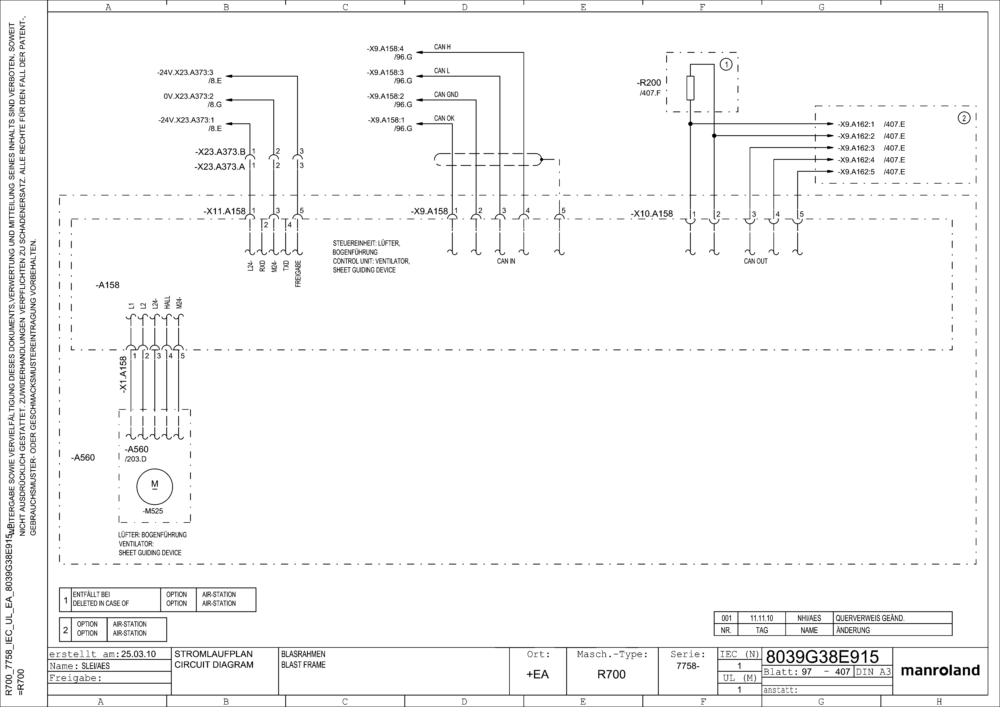

# +EA — Sheet 97 of 407 — BLASRAHMEN

**BLAST FRAME**

> Part of the manroland **R700** printing press IEC/UL circuit diagrams.
> Drawing class: **Stromlaufplan / Circuit diagram** (DIN A3).
> Document `+EA` covers the **Printing unit** machine section.

## At a glance

| Field | Value |
|---|---|
| Document | `+EA`  (8039G38E915) |
| Sheet | **97** of 407 |
| Section (DE) | BLASRAHMEN |
| Section (EN) | BLAST FRAME |
| Section type | CIRCUIT — Circuit diagram |
| Machine type | `R700` |
| Series | `7758` |
| Created | 25.03.10 |
| Replaces | — |
| Columns used | A, B, C, D, E, F, G, H |
| Path numbers | — |
| Labels on sheet | 109 |
| Cross-refs out | 14 |
| Cross-refs in | 38 |

**Previous:** [+EA sheet 96](SHEET_0096.md) · **Next:** [+EA sheet 98](SHEET_0098.md) · **Document TOC:** [_TOC.md](_TOC.md)  (+EA) · **Master TOC:** [all sheets](../_MASTER_TOC.md)

## Sheet image (300 DPI, exact vector render)



_Rendered directly from the PDF vector layer at 300 DPI (1-bit), no OCR and no resampling. Use it to confirm anything ambiguous in the text below._

## Cross-references on this sheet

Each entry is a wire leaving this sheet. The printed token is `/sheet.column`; the link resolves to that sheet inside the same document.

| Ref | Target sheet | Col | Path | Destination on target | Target section | From col |
|---|---|---|---|---|---|---|
| `/96.G` | [+EA sheet 96](SHEET_0096.md) | G | — | X9.A158:4 | BLASRAHMEN | C |
| `/8.E` | [+EA sheet 8](SHEET_0008.md) | E | — | 24V.X23.A373:3 | SPANNUNGSVERSORGUNG: 400V, 24V | B |
| `/96.G` | [+EA sheet 96](SHEET_0096.md) | G | — | X9.A158:3 | BLASRAHMEN | C |
| `/407.F` | [+EA sheet 407](SHEET_0407.md) | F | — | — | OPTION: AIR STATION | F |
| `/8.G` | [+EA sheet 8](SHEET_0008.md) | G | — | 0V.X23.A373:2 | SPANNUNGSVERSORGUNG: 400V, 24V | B |
| `/96.G` | [+EA sheet 96](SHEET_0096.md) | G | — | X9.A158:2 | BLASRAHMEN | C |
| `/8.E` | [+EA sheet 8](SHEET_0008.md) | E | — | 24V.X23.A373:1 | SPANNUNGSVERSORGUNG: 400V, 24V | B |
| `/407.E` | [+EA sheet 407](SHEET_0407.md) | E | — | X9.A158:1 X9.A162:1 X9.A162:2 | OPTION: AIR STATION | E |
| `/96.G` | [+EA sheet 96](SHEET_0096.md) | G | — | X9.A158:1 X9.A162:1 X9.A162:2 | BLASRAHMEN | E |
| `/407.E` | [+EA sheet 407](SHEET_0407.md) | E | — | X9.A158:1 X9.A162:1 X9.A162:2 | OPTION: AIR STATION | E |
| `/407.E` | [+EA sheet 407](SHEET_0407.md) | E | — | X9.A162:3 | OPTION: AIR STATION | G |
| `/407.E` | [+EA sheet 407](SHEET_0407.md) | E | — | X9.A162:4 | OPTION: AIR STATION | G |
| `/407.E` | [+EA sheet 407](SHEET_0407.md) | E | — | X9.A162:5 | OPTION: AIR STATION | G |
| `/203.D` | [+EA sheet 203](SHEET_0203.md) | D | — | A560 | REFERENZMODUL | A |

### Incoming references (sheets that point here)

Every other sheet that sends a wire to this one. `Back-ref` is the token printed on *that* sheet; `Path` is its line number.

| From sheet | Cols | Back-ref | Path | Refs | What continues there |
|---|---|---|---|---|---|
| [+EA#8](SHEET_0008.md) | E, G | `/8.E`, `/8.G` | — | 3 | 0V.X23.A373:2; 24V.X23.A373:1; 24V.X23.A373:3 |
| [+EA#96](SHEET_0096.md) | G | `/96.G` | — | 4 | — |
| [+EA#203](SHEET_0203.md) | D | `/203.D` | — | 1 | — |
| [+EA#206](SHEET_0206.md) | F | `/206.F` | — | 5 | — |
| [+EA#251](SHEET_0251.md) | B | `/251.B` | — | 5 | — |
| [+EA#253](SHEET_0253.md) | F | `/253.F` | — | 5 | — |
| [+EA#255](SHEET_0255.md) | D | `/255.D` | — | 3 | — |
| [+EA#265](SHEET_0265.md) | E | `/265.E` | — | 6 | — |
| [+EA#407](SHEET_0407.md) | E, F | `/407.E`, `/407.F` | — | 6 | X9.A162:1; X9.A162:2; X9.A162:3; X9.A162:4; X9.A162:5 |


## Devices on this sheet

| Tag | Class | Class meaning (IEC) | Col | Sub | Terminal | Sign |
|---|---|---|---|---|---|---|
| `A158` | A | Baugruppe / assembly, module, PC board | A | — | — | — |
| `A560` | A | Baugruppe / assembly, module, PC board | A | — | — | — |
| `R200` | R | Widerstand / resistor | F | — | — | — |
| `A560` | A | Baugruppe / assembly, module, PC board | A | — | — | — |
| `X11.A158` | — | cross-device reference | B | — | — | — |
| `X9.A158` | — | cross-device reference | D | — | — | — |
| `X1.A158` | — | cross-device reference | A | — | — | — |
| `X23.A373.A` | — | cross-device reference | B | — | — | — |
| `X23.A373.B` | — | cross-device reference | B | — | — | — |
| `X10.A158` | — | cross-device reference | F | — | — | — |
| `NR.` | — | cross-device reference | F | — | — | — |
| `11.11.10` | — | cross-device reference | F | — | — | — |
| `X9.A162:5` | — | cross-device reference | G | — | 5 | — |
| `X9.A162:4` | — | cross-device reference | G | — | 4 | — |
| `X9.A162:3` | — | cross-device reference | G | — | 3 | — |
| `X9.A162:2` | — | cross-device reference | G | — | 2 | — |
| `X9.A158:1` | — | cross-device reference | C | — | 1 | — |
| `X9.A162:1` | — | cross-device reference | G | — | 1 | — |
| `X9.A158:4` | — | cross-device reference | C | — | 4 | — |
| `X9.A158:3` | — | cross-device reference | C | — | 3 | — |
| `X9.A158:2` | — | cross-device reference | C | — | 2 | — |

## Potentials / nets

| Potential | Count | Columns | Attached devices | Terminals |
|---|---|---|---|---|
| `0V` | 1 | B | `A373`, `X23` | `2` |
| `24V` | 2 | B | `A373`, `X23` | `1`, `3` |
| `L1` | 1 | A | — | — |
| `L2` | 1 | A | — | — |
| `L24` | 2 | A, B | — | — |
| `M24` | 2 | B | — | — |
| `M525` | 1 | A | — | — |


A potential such as `L24+/4` or `M24+` is a named supply/return rail; every place it appears on this sheet is electrically common.

## Wire-end annotations (grouped as printed)

A wire that continues elsewhere is annotated with a small cluster: the destination description, the path/line number `#NN`, and the `/sheet.column` cross reference. Each row below is one such cluster exactly as it is grouped on the drawing.

| Col | Y | Path | Cross-ref | Text on the wire |
|---|---|---|---|---|
| D | 53.0 | — | — | `CAN H` |
| C | 54.1 | — | `/96.G` | `X9.A158:4` |
| F | 73.5 | — | — | `1` |
| D | 81.4 | — | — | `CAN L` |
| B | 82.5 | — | `/8.E` | `24V.X23.A373:3` |
| C | 82.5 | — | `/96.G` | `X9.A158:3` |
| F | 93.8 | — | — | `R200` |
| F | 106.9 | — | `/407.F` | — |
| D | 109.8 | — | — | `CAN GND` |
| B | 110.8 | — | `/8.G` | `0V.X23.A373:2` |
| C | 110.8 | — | `/96.G` | `X9.A158:2` |
| H | 137.8 | — | — | `2` |
| D | 138.1 | — | — | `CAN OK` |
| B | 139.2 | — | `/8.E` | `24V.X23.A373:1` |
| E | 139.2 | — | `/407.E`, `/96.G`, `/407.E` | `X9.A158:1 X9.A162:1 X9.A162:2` |
| G | 172.5 | — | `/407.E` | `X9.A162:3` |
| B | 176.1 | — | — | `X23.A373.B 1 2 3` |
| G | 186.6 | — | `/407.E` | `X9.A162:4` |
| B | 193.1 | — | — | `X23.A373.A 1 2 3` |
| G | 200.8 | — | `/407.E` | `X9.A162:5` |
| B | 246.9 | — | — | `X11.A158 1` |
| C | 246.9 | — | — | `3 5` |
| D | 246.9 | — | — | `X9.A158 1 2 3 4 5` |
| F | 249.8 | — | — | `X10.A158 1` |
| F | 251.2 | — | — | `2 3 4 5` |
| B | 263.9 | — | — | `2` |
| C | 263.9 | — | — | `4` |
| C | 286.9 | — | — | `BOGENFÜHRUNG STEUEREINHEIT: LÜFTER,` |
| C | 308.2 | — | — | `CONTROL UNIT: VENTILATOR, SHEET GUIDING DEVICE` |
| D | 308.2 | — | — | `CAN IN` |
| F | 308.2 | — | — | `CAN OUT` |
| C | 309.8 | — | — | `FREIGABE` |
| B | 310.1 | — | — | `L24` |
| B | 310.1 | — | — | `RXD` |
| B | 310.1 | — | — | `M24` |
| C | 310.1 | — | — | `TXD` |
| A | 334.8 | — | — | `A158` |
| B | 352.1 | — | — | `HALL` |
| B | 353.5 | — | — | `M24` |
| A | 355.3 | — | — | `L24` |
| A | 360.4 | — | — | `L1` |
| A | 360.7 | — | — | `L2` |
| A | 419.9 | — | — | `1` |
| A | 419.9 | — | — | `2 3 4 5` |
| A | 423.9 | — | — | `X1.A158` |
| A | 530.4 | — | `/203.D` | `A560` |
| A | 540.3 | — | — | `A560` |
| A | 571.5 | — | — | `M` |
| A | 604.8 | — | — | `M525` |
| A | 634.2 | — | — | `LÜFTER: BOGENFÜHRUNG` |
| A | 644.8 | — | — | `SHEET GUIDING DEVICE VENTILATOR:` |
| A | 705.0 | — | — | `1 ENTFÄLLT BEI DELETED IN CASE OF` |
| B | 705.0 | — | — | `OPTION OPTION` |
| B | 705.0 | — | — | `AIR STATION AIR STATION` |
| G | 733.0 | — | — | `001 11.11.10 NHI/AES QUERVERWEIS GEÄND.` |
| A | 740.4 | — | — | `2 OPTION OPTION` |
| A | 740.5 | — | — | `AIR STATION AIR STATION` |
| G | 747.1 | — | — | `NR. TAG NAME ÄNDERUNG` |


## Reconstructed tables

This sheet carries tabular content (pin map / terminal assignment / index). The grid below was rebuilt from the drawing's own rule lines, so each row is exactly one physical row of the table.

### Table 1 — 2 data rows × 9 columns (at x=141.7, y=90.7)

|  |  |  |  |  | 0V.X23.A373:2 | /8.E |  |  |
|---|---|---|---|---|---|---|---|---|
| `X1.A158` | `L1 1` | `L2 2` | `L24 3` | `HALL 4` | `24V.X23.A373:1 M24 5` | `/8.G /8.E X23.A373.B X23.A373.A X11.A158` | `1 1 1 2 L24 RXD` | `2 2 3 4 TXD M24` |
|  | `A560 /203.D` | `M M525` |  |  |  |  |  |  |


## Notes and free text on this sheet

| Text | Col | Y (pt) |
|---|---|---|
| `STEUEREINHEIT: LÜFTER,` | C | 286.92 |
| `BOGENFÜHRUNG` | C | 297.57 |
| `CONTROL UNIT: VENTILATOR,` | C | 308.19 |
| `SHEET GUIDING DEVICE` | C | 318.82 |
| `M` | A | 571.51 |
| `LÜFTER: BOGENFÜHRUNG` | A | 634.18 |
| `VENTILATOR:` | A | 644.79 |
| `SHEET GUIDING DEVICE` | A | 655.43 |
| `TAG` | G | 747.27 |
| `NAME` | G | 747.25 |
| `ÄNDERUNG` | G | 747.31 |
| `NHI/AES` | G | 733.11 |
| `QUERVERWEIS GEÄND.` | G | 733.1 |
| `FREIGABE` | C | 309.83 |
| `RXD` | B | 310.11 |
| `TXD` | C | 310.11 |
| `CAN IN` | D | 308.16 |
| `HALL` | B | 352.11 |
| `CAN H` | D | 53.05 |
| `CAN L` | D | 81.41 |
| `CAN GND` | D | 109.78 |
| `CAN OK` | D | 138.11 |
| `CAN OUT` | F | 308.19 |
| `ENTFÄLLT BEI` | A | 705 |
| `DELETED IN CASE OF` | A | 715.65 |
| `OPTION` | A | 740.44 |
| `AIR STATION` | A | 740.46 |
| `OPTION` | B | 705.01 |
| `AIR STATION` | B | 705.02 |

## Complete label inventory (exact text from the drawing)

Every text object inside the drawing area of this sheet, in DIN reading order (column A→H, then top→bottom). This is the authoritative list: if a string is not here it is not printed on this sheet.

| Col | Y | X | Dir | Type | Text |
|---|---|---|---|---|---|
| A | 334.8 | 114.0 | → | device tag | `A158` |
| A | 355.3 | 182.0 | ↕ | potential | `L24` |
| A | 360.4 | 153.5 | ↕ | potential | `L1` |
| A | 360.7 | 167.8 | ↕ | potential | `L2` |
| A | 419.9 | 157.9 | → | number | `1` |
| A | 419.9 | 172.6 | → | number | `2` |
| A | 419.9 | 186.8 | → | number | `3` |
| A | 423.9 | 142.0 | ↕ | device ref | `X1.A158` |
| A | 530.4 | 148.5 | → | device tag | `A560` |
| A | 540.3 | 84.8 | → | device tag | `A560` |
| A | 542.8 | 148.8 | → | cross-reference | `/203.D` |
| A | 571.5 | 179.9 | → | text | `M` |
| A | 604.8 | 169.8 | → | potential | `M525` |
| A | 634.2 | 140.9 | → | text | `LÜFTER: BOGENFÜHRUNG` |
| A | 644.8 | 141.7 | → | text | `VENTILATOR:` |
| A | 655.4 | 141.4 | → | text | `SHEET GUIDING DEVICE` |
| A | 705.0 | 87.0 | → | text | `ENTFÄLLT BEI` |
| A | 710.3 | 75.4 | → | number | `1` |
| A | 715.7 | 87.0 | → | text | `DELETED IN CASE OF` |
| A | 740.4 | 91.8 | → | text | `OPTION` |
| A | 740.5 | 134.6 | → | text | `AIR STATION` |
| A | 745.8 | 75.1 | → | number | `2` |
| A | 751.1 | 91.8 | → | text | `OPTION` |
| A | 751.1 | 134.6 | → | text | `AIR STATION` |
| B | 82.5 | 187.1 | → | potential | `24V.X23.A373:3` |
| B | 92.4 | 248.3 | → | cross-reference | `/8.E` |
| B | 110.8 | 195.0 | → | potential | `0V.X23.A373:2` |
| B | 120.7 | 247.5 | → | cross-reference | `/8.G` |
| B | 139.2 | 188.5 | → | potential | `24V.X23.A373:1` |
| B | 149.0 | 248.3 | → | cross-reference | `/8.E` |
| B | 176.1 | 232.4 | → | device ref | `X23.A373.B` |
| B | 176.1 | 299.6 | → | number | `1` |
| B | 176.1 | 328.5 | → | number | `2` |
| B | 193.1 | 299.6 | → | number | `1` |
| B | 193.1 | 328.5 | → | number | `2` |
| B | 193.8 | 231.6 | → | device ref | `X23.A373.A` |
| B | 246.9 | 242.4 | → | device ref | `X11.A158` |
| B | 246.9 | 299.6 | → | number | `1` |
| B | 246.9 | 328.5 | → | number | `3` |
| B | 263.9 | 314.4 | → | number | `2` |
| B | 310.1 | 295.4 | ↕ | potential | `L24` |
| B | 310.1 | 309.6 | ↕ | text | `RXD` |
| B | 310.1 | 323.8 | ↕ | potential | `M24` |
| B | 352.1 | 196.2 | ↕ | text | `HALL` |
| B | 353.5 | 210.4 | ↕ | potential | `M24` |
| B | 419.9 | 201.0 | → | number | `4` |
| B | 419.9 | 215.1 | → | number | `5` |
| B | 705.0 | 198.1 | → | text | `OPTION` |
| B | 705.0 | 240.9 | → | text | `AIR STATION` |
| B | 715.6 | 198.1 | → | text | `OPTION` |
| B | 715.7 | 240.9 | → | text | `AIR STATION` |
| C | 54.1 | 436.8 | → | device ref | `X9.A158:4` |
| C | 64.0 | 469.4 | → | cross-reference | `/96.G` |
| C | 82.5 | 436.8 | → | device ref | `X9.A158:3` |
| C | 92.4 | 469.4 | → | cross-reference | `/96.G` |
| C | 110.8 | 437.1 | → | device ref | `X9.A158:2` |
| C | 120.7 | 469.4 | → | cross-reference | `/96.G` |
| C | 139.2 | 438.2 | → | device ref | `X9.A158:1` |
| C | 149.1 | 469.4 | → | cross-reference | `/96.G` |
| C | 176.1 | 356.9 | → | number | `3` |
| C | 193.1 | 356.9 | → | number | `3` |
| C | 246.9 | 356.9 | → | number | `5` |
| C | 263.9 | 342.7 | → | number | `4` |
| C | 286.9 | 396.6 | → | text | `STEUEREINHEIT: LÜFTER,` |
| C | 297.6 | 396.0 | → | text | `BOGENFÜHRUNG` |
| C | 308.2 | 396.6 | → | text | `CONTROL UNIT: VENTILATOR,` |
| C | 309.8 | 352.1 | ↕ | text | `FREIGABE` |
| C | 310.1 | 337.9 | ↕ | text | `TXD` |
| C | 318.8 | 396.6 | → | text | `SHEET GUIDING DEVICE` |
| D | 53.0 | 517.0 | → | text | `CAN H` |
| D | 81.4 | 517.0 | → | text | `CAN L` |
| D | 109.8 | 517.0 | → | text | `CAN GND` |
| D | 138.1 | 517.0 | → | text | `CAN OK` |
| D | 246.9 | 489.3 | → | device ref | `X9.A158` |
| D | 246.9 | 540.6 | → | number | `1` |
| D | 246.9 | 569.5 | → | number | `2` |
| D | 246.9 | 597.8 | → | number | `3` |
| D | 308.2 | 591.9 | → | text | `CAN IN` |
| E | 246.9 | 626.2 | → | number | `4` |
| E | 246.9 | 668.7 | → | number | `5` |
| F | 73.5 | 862.8 | → | number | `1` |
| F | 93.8 | 758.3 | → | device tag | `R200` |
| F | 106.9 | 762.0 | → | cross-reference | `/407.F` |
| F | 249.8 | 751.2 | → | device ref | `X10.A158` |
| F | 251.2 | 824.0 | → | number | `1` |
| F | 251.2 | 852.9 | → | number | `2` |
| F | 251.2 | 895.5 | → | number | `3` |
| F | 308.2 | 885.9 | → | text | `CAN OUT` |
| F | 733.0 | 859.4 | → | number | `001` |
| F | 733.1 | 893.2 | → | device ref | `11.11.10` |
| F | 747.1 | 858.4 | → | device ref | `NR.` |
| G | 144.1 | 997.5 | → | device ref | `X9.A162:1` |
| G | 158.3 | 997.5 | → | device ref | `X9.A162:2` |
| G | 172.5 | 997.5 | → | device ref | `X9.A162:3` |
| G | 186.7 | 997.5 | → | device ref | `X9.A162:4` |
| G | 200.8 | 997.5 | → | device ref | `X9.A162:5` |
| G | 251.2 | 923.8 | → | number | `4` |
| G | 251.2 | 952.2 | → | number | `5` |
| G | 733.1 | 949.5 | → | text | `NHI/AES` |
| G | 733.1 | 995.1 | → | text | `QUERVERWEIS GEÄND.` |
| G | 747.3 | 900.0 | → | text | `TAG` |
| G | 747.3 | 953.4 | → | text | `NAME` |
| G | 747.3 | 996.0 | → | text | `ÄNDERUNG` |
| H | 137.8 | 1146.0 | → | number | `2` |
| H | 144.1 | 1052.4 | → | cross-reference | `/407.E` |
| H | 158.3 | 1052.4 | → | cross-reference | `/407.E` |
| H | 172.5 | 1052.4 | → | cross-reference | `/407.E` |
| H | 186.6 | 1052.4 | → | cross-reference | `/407.E` |
| H | 200.8 | 1052.4 | → | cross-reference | `/407.E` |

## Reading-order text block

The same content as a plain block, grouped by DIN column — convenient to paste or to match against a visual description.

```text
=== Column A ===
 334.8  114.0  devtag       A158
 355.3  182.0  net          L24
 360.4  153.5  net          L1
 360.7  167.8  net          L2
 419.9  157.9  numeric      1
 419.9  172.6  numeric      2
 419.9  186.8  numeric      3
 423.9  142.0  devref       X1.A158
 530.4  148.5  devtag       A560
 540.3   84.8  devtag       A560
 542.8  148.8  xref         /203.D
 571.5  179.9  text         M
 604.8  169.8  net          M525
 634.2  140.9  text         LÜFTER: BOGENFÜHRUNG
 644.8  141.7  text         VENTILATOR:
 655.4  141.4  text         SHEET GUIDING DEVICE
 705.0   87.0  text         ENTFÄLLT BEI
 710.3   75.4  numeric      1
 715.7   87.0  text         DELETED IN CASE OF
 740.4   91.8  text         OPTION
 740.5  134.6  text         AIR STATION
 745.8   75.1  numeric      2
 751.1   91.8  text         OPTION
 751.1  134.6  text         AIR STATION
=== Column B ===
  82.5  187.1  net          24V.X23.A373:3
  92.4  248.3  xref         /8.E
 110.8  195.0  net          0V.X23.A373:2
 120.7  247.5  xref         /8.G
 139.2  188.5  net          24V.X23.A373:1
 149.0  248.3  xref         /8.E
 176.1  232.4  devref       X23.A373.B
 176.1  299.6  numeric      1
 176.1  328.5  numeric      2
 193.1  299.6  numeric      1
 193.1  328.5  numeric      2
 193.8  231.6  devref       X23.A373.A
 246.9  242.4  devref       X11.A158
 246.9  299.6  numeric      1
 246.9  328.5  numeric      3
 263.9  314.4  numeric      2
 310.1  295.4  net          L24
 310.1  309.6  text         RXD
 310.1  323.8  net          M24
 352.1  196.2  text         HALL
 353.5  210.4  net          M24
 419.9  201.0  numeric      4
 419.9  215.1  numeric      5
 705.0  198.1  text         OPTION
 705.0  240.9  text         AIR STATION
 715.6  198.1  text         OPTION
 715.7  240.9  text         AIR STATION
=== Column C ===
  54.1  436.8  devref       X9.A158:4
  64.0  469.4  xref         /96.G
  82.5  436.8  devref       X9.A158:3
  92.4  469.4  xref         /96.G
 110.8  437.1  devref       X9.A158:2
 120.7  469.4  xref         /96.G
 139.2  438.2  devref       X9.A158:1
 149.1  469.4  xref         /96.G
 176.1  356.9  numeric      3
 193.1  356.9  numeric      3
 246.9  356.9  numeric      5
 263.9  342.7  numeric      4
 286.9  396.6  text         STEUEREINHEIT: LÜFTER,
 297.6  396.0  text         BOGENFÜHRUNG
 308.2  396.6  text         CONTROL UNIT: VENTILATOR,
 309.8  352.1  text         FREIGABE
 310.1  337.9  text         TXD
 318.8  396.6  text         SHEET GUIDING DEVICE
=== Column D ===
  53.0  517.0  text         CAN H
  81.4  517.0  text         CAN L
 109.8  517.0  text         CAN GND
 138.1  517.0  text         CAN OK
 246.9  489.3  devref       X9.A158
 246.9  540.6  numeric      1
 246.9  569.5  numeric      2
 246.9  597.8  numeric      3
 308.2  591.9  text         CAN IN
=== Column E ===
 246.9  626.2  numeric      4
 246.9  668.7  numeric      5
=== Column F ===
  73.5  862.8  numeric      1
  93.8  758.3  devtag       R200
 106.9  762.0  xref         /407.F
 249.8  751.2  devref       X10.A158
 251.2  824.0  numeric      1
 251.2  852.9  numeric      2
 251.2  895.5  numeric      3
 308.2  885.9  text         CAN OUT
 733.0  859.4  numeric      001
 733.1  893.2  devref       11.11.10
 747.1  858.4  devref       NR.
=== Column G ===
 144.1  997.5  devref       X9.A162:1
 158.3  997.5  devref       X9.A162:2
 172.5  997.5  devref       X9.A162:3
 186.7  997.5  devref       X9.A162:4
 200.8  997.5  devref       X9.A162:5
 251.2  923.8  numeric      4
 251.2  952.2  numeric      5
 733.1  949.5  text         NHI/AES
 733.1  995.1  text         QUERVERWEIS GEÄND.
 747.3  900.0  text         TAG
 747.3  953.4  text         NAME
 747.3  996.0  text         ÄNDERUNG
=== Column H ===
 137.8 1146.0  numeric      2
 144.1 1052.4  xref         /407.E
 158.3 1052.4  xref         /407.E
 172.5 1052.4  xref         /407.E
 186.6 1052.4  xref         /407.E
 200.8 1052.4  xref         /407.E
```

---
_Generated from the PDF vector text layer; no OCR. Source: `R700_7758_IEC_UL_EA_8039G38E915_p`, sheet 97._
