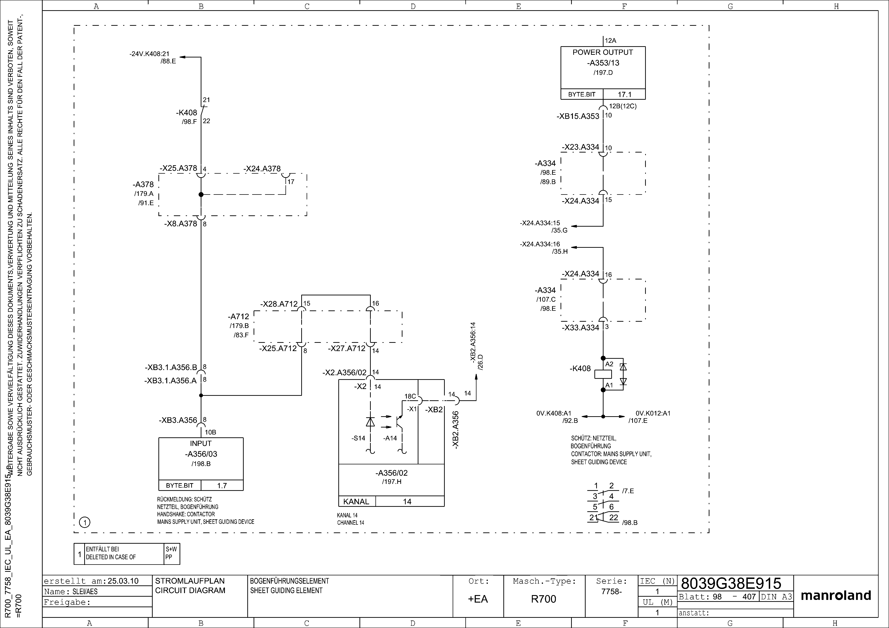

# +EA — Sheet 98 of 407 — BOGENFÜHRUNGSELEMENT

**SHEET GUIDING ELEMENT**

> Part of the manroland **R700** printing press IEC/UL circuit diagrams.
> Drawing class: **Stromlaufplan / Circuit diagram** (DIN A3).
> Document `+EA` covers the **Printing unit** machine section.

## At a glance

| Field | Value |
|---|---|
| Document | `+EA`  (8039G38E915) |
| Sheet | **98** of 407 |
| Section (DE) | BOGENFÜHRUNGSELEMENT |
| Section (EN) | SHEET GUIDING ELEMENT |
| Section type | CIRCUIT — Circuit diagram |
| Machine type | `R700` |
| Series | `7758` |
| Created | 25.03.10 |
| Replaces | — |
| Columns used | A, B, C, D, E, F |
| Path numbers | — |
| Labels on sheet | 115 |
| Cross-refs out | 20 |
| Cross-refs in | 37 |

**Previous:** [+EA sheet 97](SHEET_0097.md) · **Next:** [+EA sheet 99](SHEET_0099.md) · **Document TOC:** [_TOC.md](_TOC.md)  (+EA) · **Master TOC:** [all sheets](../_MASTER_TOC.md)

## Sheet image (300 DPI, exact vector render)



_Rendered directly from the PDF vector layer at 300 DPI (1-bit), no OCR and no resampling. Use it to confirm anything ambiguous in the text below._

## Cross-references on this sheet

Each entry is a wire leaving this sheet. The printed token is `/sheet.column`; the link resolves to that sheet inside the same document.

| Ref | Target sheet | Col | Path | Destination on target | Target section | From col |
|---|---|---|---|---|---|---|
| `/88.E` | [+EA sheet 88](SHEET_0088.md) | E | — | 24V.K408:21 | SAUGWALZE | B |
| `/197.D` | [+EA sheet 197](SHEET_0197.md) | D | — | — | REFERENZMODUL | F |
| `/98.F` | [+EA sheet 98](SHEET_0098.md) | F | — | — | BOGENFÜHRUNGSELEMENT | B |
| `/98.E` | [+EA sheet 98](SHEET_0098.md) | E | — | — | BOGENFÜHRUNGSELEMENT | E |
| `/89.B` | [+EA sheet 89](SHEET_0089.md) | B | — | — | BELEUCHTUNG | E |
| `/179.A` | [+EA sheet 179](SHEET_0179.md) | A | — | — | RESERVE | A |
| `/91.E` | [+EA sheet 91](SHEET_0091.md) | E | — | — | BLASROHRE (BLASRAHMEN) | A |
| `/35.G` | [+EA sheet 35](SHEET_0035.md) | G | — | X24.A334:15 | BUSVERBINDUNGEN: NOT AUS | E |
| `/35.H` | [+EA sheet 35](SHEET_0035.md) | H | — | X24.A334:16 | BUSVERBINDUNGEN: NOT AUS | E |
| `/107.C` | [+EA sheet 107](SHEET_0107.md) | C | — | — | BOGENGLÄTTER | E |
| `/98.E` | [+EA sheet 98](SHEET_0098.md) | E | — | — | BOGENFÜHRUNGSELEMENT | E |
| `/26.D` | [+EA sheet 26](SHEET_0026.md) | D | — | XB2.A356:14 | BUSVERBINDUNGEN: SICHERHEITSBUS | E |
| `/179.B` | [+EA sheet 179](SHEET_0179.md) | B | — | — | RESERVE | B |
| `/83.F` | [+EA sheet 83](SHEET_0083.md) | F | — | — | AUSLEGERSTAPELSTEUERUNG: PROGRAMMSCHALTWERK | B |
| `/92.B` | [+EA sheet 92](SHEET_0092.md) | B | — | 0V.K408:A1 | BLASRAHMEN | F |
| `/107.E` | [+EA sheet 107](SHEET_0107.md) | E | — | 0V.K408:A1 | BOGENGLÄTTER | F |
| `/198.B` | [+EA sheet 198](SHEET_0198.md) | B | — | — | REFERENZMODUL | B |
| `/197.H` | [+EA sheet 197](SHEET_0197.md) | H | — | — | REFERENZMODUL | D |
| `/7.E` | [+EA sheet 7](SHEET_0007.md) | E | — | — | SPANNUNGSVERSORGUNG: 400V, 24V | F |
| `/98.B` | [+EA sheet 98](SHEET_0098.md) | B | — | — | BOGENFÜHRUNGSELEMENT | F |

### Incoming references (sheets that point here)

Every other sheet that sends a wire to this one. `Back-ref` is the token printed on *that* sheet; `Path` is its line number.

| From sheet | Cols | Back-ref | Path | Refs | What continues there |
|---|---|---|---|---|---|
| [+EA#7](SHEET_0007.md) | E | `/7.E` | — | 1 | — |
| [+EA#26](SHEET_0026.md) | D | `/26.D` | — | 1 | XB2.A356:14 |
| [+EA#35](SHEET_0035.md) | G | `/35.G` | — | 2 | — |
| [+EA#83](SHEET_0083.md) | F | `/83.F` | — | 1 | — |
| [+EA#88](SHEET_0088.md) | E | `/88.E` | — | 1 | — |
| [+EA#89](SHEET_0089.md) | B | `/89.B` | — | 1 | — |
| [+EA#91](SHEET_0091.md) | E | `/91.E` | — | 1 | — |
| [+EA#92](SHEET_0092.md) | B | `/92.B` | — | 1 | 0V.K248:A1 |
| [+EA#98](SHEET_0098.md) | B, E, F | `/98.B`, `/98.E`, `/98.F` | — | 4 | — |
| [+EA#107](SHEET_0107.md) | C, E | `/107.C`, `/107.E` | — | 2 | 0V.K012:A1 0V.K668:A1 |
| [+EA#179](SHEET_0179.md) | A, B | `/179.A`, `/179.B` | — | 2 | — |
| [+EA#197](SHEET_0197.md) | D, H | `/197.D`, `/197.H` | — | 2 | — |
| [+EA#198](SHEET_0198.md) | B | `/198.B` | — | 1 | — |
| [+EA#225](SHEET_0225.md) | F | `/225.F` | — | 1 | — |
| [+EA#226](SHEET_0226.md) | E | `/226.E` | — | 1 | — |
| [+EA#234](SHEET_0234.md) | H | `/234.H` | — | 1 | — |
| [+EA#235](SHEET_0235.md) | A, B | `/235.A`, `/235.B` | — | 2 | — |
| [+EA#250](SHEET_0250.md) | D | `/250.D` | — | 1 | — |
| [+EA#260](SHEET_0260.md) | F | `/260.F` | — | 1 | — |
| [+EA#265](SHEET_0265.md) | A, F | `/265.A`, `/265.F` | — | 3 | — |
| [+EA#266](SHEET_0266.md) | F | `/266.F` | — | 1 | — |
| [+EA#268](SHEET_0268.md) | A, F | `/268.A`, `/268.F` | — | 2 | — |
| [+EA#271](SHEET_0271.md) | G | `/271.G` | — | 1 | — |
| [+EA#273](SHEET_0273.md) | C | `/273.C` | — | 2 | — |
| [+EA#277](SHEET_0277.md) | B | `/277.B` | — | 1 | — |


## Devices on this sheet

| Tag | Class | Class meaning (IEC) | Col | Sub | Terminal | Sign |
|---|---|---|---|---|---|---|
| `A356/03` | A | Baugruppe / assembly, module, PC board | B | 03 | — | — |
| `A378` | A | Baugruppe / assembly, module, PC board | A | — | — | — |
| `K408` | K | Relais / relay, contactor | B | — | — | — |
| `A353/13` | A | Baugruppe / assembly, module, PC board | F | 13 | — | — |
| `A334` | A | Baugruppe / assembly, module, PC board | E | — | — | — |
| `A334` | A | Baugruppe / assembly, module, PC board | E | — | — | — |
| `A2` | A | Baugruppe / assembly, module, PC board | F | — | — | — |
| `A1` | A | Baugruppe / assembly, module, PC board | F | — | — | — |
| `K408` | K | Relais / relay, contactor | F | — | — | — |
| `S14` | S | Schalter / switch | C | — | — | — |
| `A14` | A | Baugruppe / assembly, module, PC board | D | — | — | — |
| `X1` | X | Klemme / terminal, plug connector | D | — | — | — |
| `X2` | X | Klemme / terminal, plug connector | D | — | — | — |
| `XB2` | XB |  | D | — | — | — |
| `A356/02` | A | Baugruppe / assembly, module, PC board | D | 02 | — | — |
| `A712` | A | Baugruppe / assembly, module, PC board | B | — | — | — |
| `XB3.A356` | — | cross-device reference | B | — | — | — |
| `1.7` | — | cross-device reference | B | — | — | — |
| `X25.A378` | — | cross-device reference | B | — | — | — |
| `X8.A378` | — | cross-device reference | B | — | — | — |
| `17.1` | — | cross-device reference | F | — | — | — |
| `XB15.A353` | — | cross-device reference | F | — | — | — |
| `X23.A334` | — | cross-device reference | F | — | — | — |
| `X24.A334` | — | cross-device reference | F | — | — | — |
| `X24.A334` | — | cross-device reference | F | — | — | — |
| `X33.A334` | — | cross-device reference | F | — | — | — |
| `XB3.1.A356.B` | — | cross-device reference | B | — | — | — |
| `XB3.1.A356.A` | — | cross-device reference | B | — | — | — |
| `XB2.A356` | — | cross-device reference | D | — | — | — |
| `X28.A712` | — | cross-device reference | C | — | — | — |
| `X27.A712` | — | cross-device reference | C | — | — | — |
| `X25.A712` | — | cross-device reference | C | — | — | — |
| `XB2.A356:14` | — | cross-device reference | E | — | 14 | — |
| `X24.A334:15` | — | cross-device reference | E | — | 15 | — |
| `X24.A334:16` | — | cross-device reference | E | — | 16 | — |
| `X24.A378` | — | cross-device reference | C | — | — | — |

## Potentials / nets

| Potential | Count | Columns | Attached devices | Terminals |
|---|---|---|---|---|
| `0V` | 2 | E, F | `K012`, `K408` | `A1` |
| `24V` | 1 | B | `K408` | `21` |


A potential such as `L24+/4` or `M24+` is a named supply/return rail; every place it appears on this sheet is electrically common.

## Wire-end annotations (grouped as printed)

A wire that continues elsewhere is annotated with a small cluster: the destination description, the path/line number `#NN`, and the `/sheet.column` cross reference. Each row below is one such cluster exactly as it is grouped on the drawing.

| Col | Y | Path | Cross-ref | Text on the wire |
|---|---|---|---|---|
| F | 50.6 | — | — | `12A` |
| F | 65.8 | — | — | `POWER OUTPUT` |
| B | 68.3 | — | `/88.E` | `24V.K408:21` |
| F | 79.7 | — | — | `A353/13` |
| F | 93.5 | — | `/197.D` | — |
| F | 122.5 | — | — | `BYTE.BIT 17.1` |
| B | 130.0 | — | — | `21` |
| F | 138.5 | — | — | `12B(12C)` |
| B | 146.3 | — | — | `K408 22` |
| F | 150.6 | — | — | `XB15.A353 10` |
| B | 159.4 | — | `/98.F` | — |
| F | 192.3 | — | — | `X23.A334 10` |
| E | 214.3 | — | — | `A334` |
| B | 220.7 | — | — | `X25.A378 4` |
| C | 221.4 | — | — | `X24.A378` |
| E | 227.4 | — | `/98.E`, `/89.B` | — |
| B | 239.8 | — | — | `A378 17` |
| A | 255.7 | — | `/179.A` | — |
| F | 263.9 | — | — | `X24.A334 15` |
| A | 268.1 | — | `/91.E` | — |
| B | 295.1 | — | — | `X8.A378 8` |
| E | 295.1 | — | `/35.G` | `X24.A334:15` |
| E | 323.4 | — | `/35.H` | `X24.A334:16` |
| F | 362.4 | — | — | `X24.A334 16` |
| E | 384.4 | — | — | `A334` |
| E | 397.5 | — | `/107.C` | — |
| C | 402.8 | — | — | `X28.A712 15 16` |
| E | 409.9 | — | `/98.E` | — |
| B | 419.8 | — | — | `A712` |
| E | 431.7 | — | `/26.D` | `XB2.A356:14` |
| B | 432.9 | — | `/179.B` | — |
| F | 434.0 | — | — | `X33.A334 3` |
| B | 445.3 | — | `/83.F` | — |
| C | 462.4 | — | — | `X25.A712 8 X27.A712 14` |
| F | 484.3 | — | — | `A2` |
| B | 487.9 | — | — | `XB3.1.A356.B 8` |
| F | 489.3 | — | — | `K408` |
| C | 494.9 | — | — | `X2.A356/02 14` |
| B | 504.9 | — | — | `XB3.1.A356.A 8` |
| F | 512.6 | — | — | `A1` |
| D | 513.4 | — | — | `X2` |
| D | 514.8 | — | — | `14 14` |
| E | 523.3 | — | — | `14` |
| D | 527.6 | — | — | `18C` |
| D | 544.5 | — | — | `X1` |
| D | 544.6 | — | — | `XB2` |
| F | 550.2 | — | `/92.B`, `/107.E` | `0V.K408:A1` |
| F | 550.2 | — | — | `0V.K012:A1` |
| D | 550.8 | — | — | `XB2.A356` |
| B | 558.7 | — | — | `XB3.A356 8` |
| B | 575.7 | — | — | `10B` |
| D | 583.5 | — | — | `S14 A14` |
| F | 584.5 | — | — | `BOGENFÜHRUNG SCHÜTZ: NETZTEIL,` |
| B | 590.2 | — | — | `INPUT` |
| B | 604.1 | — | — | `A356/03` |
| F | 605.8 | — | — | `CONTACTOR: MAINS SUPPLY UNIT, SHEET GUIDING DEVICE` |
| B | 617.9 | — | `/198.B` | — |
| D | 629.6 | — | — | `A356/02` |
| D | 642.0 | — | `/197.H` | — |
| F | 646.6 | — | — | `21 3 5 1` |
| F | 646.6 | — | — | `2 4 6 22` |
| B | 646.9 | — | — | `BYTE.BIT 1.7` |
| F | 654.3 | — | `/7.E` | — |
| B | 666.9 | — | — | `RÜCKMELDUNG: SCHÜTZ NETZTEIL, BOGENFÜHRUNG HANDSHAKE: CONTACTOR MAINS SUPPLY UNIT, SHEET GUIDING DEVICE` |
| D | 667.8 | — | — | `KANAL 14` |
| C | 688.2 | — | — | `KANAL 14 CHANNEL 14` |
| F | 696.9 | — | `/98.B` | — |
| A | 697.1 | — | — | `1` |
| A | 733.2 | — | — | `1 PP S+W` |
| A | 733.4 | — | — | `ENTFÄLLT BEI DELETED IN CASE OF` |


## Reconstructed tables

This sheet carries tabular content (pin map / terminal assignment / index). The grid below was rebuilt from the drawing's own rule lines, so each row is exactly one physical row of the table.

### Table 1 — 7 data rows × 9 columns (at x=212.6, y=260.8)

| X8.A378 | 8 |  |  |  |  |  |  |  |
|---|---|---|---|---|---|---|---|---|
| `XB3.1.A356.B` | `A712 /179.B /83.F 8` | `X28.A712 X25.A712` | `15 8` | `X27.A712 X2.A356/02` | `16 14 14` |  |  | `XB2.A356:14` |
| `XB3.1.A356.A` | `8` |  |  | `X2` | `14` |  |  | `14 14` |
| `XB3.A356` | `8 10B` |  |  |  |  | `18C X1` | `XB2` | `XB2.A356` |
| `INPUT` | `A356/03` |  |  | `S14` | `A14` |  |  |  |
|  | `/198.B` |  |  |  | `A356/02` |  |  |  |
| `BYTE.BIT` | `1.7` |  |  |  | `/197.H` |  |  |  |
| `RÜCKMELDUNG:` | `SCHÜTZ` |  |  | `KANAL` |  | `14` |  |  |


### Table 2 — 1 data rows × 3 columns (at x=751.2, y=62.4)

| POWER | OUTPUT A353/13 /197.D |  |
|---|---|---|
| `BYTE.BIT` |  | `17.1` |


## Notes and free text on this sheet

| Text | Col | Y (pt) |
|---|---|---|
| `10B` | B | 575.72 |
| `INPUT` | B | 590.24 |
| `BYTE.BIT` | B | 647.49 |
| `RÜCKMELDUNG: SCHÜTZ` | B | 666.91 |
| `NETZTEIL, BOGENFÜHRUNG` | B | 676.84 |
| `HANDSHAKE: CONTACTOR` | B | 686.8 |
| `MAINS SUPPLY UNIT, SHEET GUIDING DEVICE` | B | 696.79 |
| `12A` | F | 50.6 |
| `12B(12C)` | F | 138.51 |
| `POWER OUTPUT` | F | 65.76 |
| `BYTE.BIT` | F | 123.08 |
| `SCHÜTZ: NETZTEIL,` | F | 584.55 |
| `BOGENFÜHRUNG` | F | 595.21 |
| `CONTACTOR: MAINS SUPPLY UNIT,` | F | 605.83 |
| `SHEET GUIDING DEVICE` | F | 616.46 |
| `KANAL 14` | C | 688.19 |
| `CHANNEL 14` | C | 698.13 |
| `18C` | D | 527.57 |
| `KANAL` | C | 667.86 |
| `X2.A356/02` | C | 494.95 |
| `ENTFÄLLT BEI` | A | 733.35 |
| `DELETED IN CASE OF` | A | 744 |
| `S+W` | B | 733.24 |
| `PP` | B | 743.87 |

## Complete label inventory (exact text from the drawing)

Every text object inside the drawing area of this sheet, in DIN reading order (column A→H, then top→bottom). This is the authoritative list: if a string is not here it is not printed on this sheet.

| Col | Y | X | Dir | Type | Text |
|---|---|---|---|---|---|
| A | 242.7 | 177.7 | → | device tag | `A378` |
| A | 255.7 | 180.0 | → | cross-reference | `/179.A` |
| A | 268.1 | 185.4 | → | cross-reference | `/91.E` |
| A | 697.1 | 111.6 | → | number | `1` |
| A | 733.3 | 115.4 | → | text | `ENTFÄLLT BEI` |
| A | 738.7 | 103.7 | → | number | `1` |
| A | 744.0 | 115.4 | → | text | `DELETED IN CASE OF` |
| B | 68.3 | 173.5 | → | potential | `24V.K408:21` |
| B | 78.2 | 215.1 | → | cross-reference | `/88.E` |
| B | 130.0 | 271.8 | → | number | `21` |
| B | 146.3 | 235.8 | → | device tag | `K408` |
| B | 158.4 | 271.8 | → | number | `22` |
| B | 159.4 | 243.8 | → | cross-reference | `/98.F` |
| B | 220.7 | 214.0 | → | device ref | `X25.A378` |
| B | 222.8 | 271.8 | → | number | `4` |
| B | 295.1 | 220.0 | → | device ref | `X8.A378` |
| B | 296.5 | 271.8 | → | number | `8` |
| B | 419.8 | 305.3 | → | device tag | `A712` |
| B | 432.9 | 307.8 | → | cross-reference | `/179.B` |
| B | 445.3 | 313.2 | → | cross-reference | `/83.F` |
| B | 487.9 | 194.2 | → | device ref | `XB3.1.A356.B` |
| B | 487.9 | 271.8 | → | number | `8` |
| B | 504.9 | 271.8 | → | number | `8` |
| B | 505.6 | 193.3 | → | device ref | `XB3.1.A356.A` |
| B | 558.7 | 212.9 | → | device ref | `XB3.A356` |
| B | 558.7 | 271.8 | → | number | `8` |
| B | 575.7 | 274.1 | → | text | `10B` |
| B | 590.2 | 254.4 | → | text | `INPUT` |
| B | 604.1 | 247.9 | → | device tag | `A356/03` |
| B | 617.9 | 256.7 | → | cross-reference | `/198.B` |
| B | 646.9 | 290.6 | → | device ref | `1.7` |
| B | 647.5 | 222.5 | → | text | `BYTE.BIT` |
| B | 666.9 | 210.6 | → | text | `RÜCKMELDUNG: SCHÜTZ` |
| B | 676.8 | 210.6 | → | text | `NETZTEIL, BOGENFÜHRUNG` |
| B | 686.8 | 210.6 | → | text | `HANDSHAKE: CONTACTOR` |
| B | 696.8 | 210.9 | → | text | `MAINS SUPPLY UNIT, SHEET GUIDING DEVICE` |
| B | 733.2 | 222.2 | → | text | `S+W` |
| B | 743.9 | 221.7 | → | text | `PP` |
| C | 221.4 | 326.0 | → | device ref | `X24.A378` |
| C | 239.9 | 384.7 | → | number | `17` |
| C | 402.8 | 348.7 | → | device ref | `X28.A712` |
| C | 402.8 | 405.9 | → | number | `15` |
| C | 462.4 | 347.2 | → | device ref | `X25.A712` |
| C | 462.4 | 439.4 | → | device ref | `X27.A712` |
| C | 466.6 | 406.5 | → | number | `8` |
| C | 495.0 | 432.0 | → | text | `X2.A356/02` |
| C | 583.5 | 470.8 | → | device tag | `S14` |
| C | 667.9 | 459.8 | → | text | `KANAL` |
| C | 688.2 | 451.6 | → | text | `KANAL 14` |
| C | 698.1 | 451.8 | → | text | `CHANNEL 14` |
| D | 402.8 | 498.0 | → | number | `16` |
| D | 466.6 | 498.0 | → | number | `14` |
| D | 495.0 | 498.0 | → | number | `14` |
| D | 513.4 | 474.5 | → | device tag | `X2` |
| D | 514.8 | 500.9 | → | number | `14` |
| D | 524.7 | 600.1 | → | number | `14` |
| D | 527.6 | 541.4 | → | text | `18C` |
| D | 544.5 | 545.1 | → | device tag | `X1` |
| D | 544.6 | 569.5 | → | device tag | `XB2` |
| D | 550.8 | 605.5 | ↕ | device ref | `XB2.A356` |
| D | 583.5 | 513.4 | → | device tag | `A14` |
| D | 629.6 | 503.0 | → | device tag | `A356/02` |
| D | 642.0 | 511.9 | → | cross-reference | `/197.H` |
| D | 667.8 | 539.4 | → | number | `14` |
| E | 214.3 | 716.3 | → | device tag | `A334` |
| E | 227.4 | 724.0 | → | cross-reference | `/98.E` |
| E | 239.8 | 723.7 | → | cross-reference | `/89.B` |
| E | 295.1 | 696.5 | → | device ref | `X24.A334:15` |
| E | 305.0 | 738.7 | → | cross-reference | `/35.G` |
| E | 323.4 | 696.5 | → | device ref | `X24.A334:16` |
| E | 333.4 | 739.6 | → | cross-reference | `/35.H` |
| E | 384.4 | 716.3 | → | device tag | `A334` |
| E | 397.5 | 718.6 | → | cross-reference | `/107.C` |
| E | 409.9 | 724.0 | → | cross-reference | `/98.E` |
| E | 431.7 | 629.6 | ↕ | device ref | `XB2.A356:14` |
| E | 475.1 | 639.5 | ↕ | cross-reference | `/26.D` |
| E | 523.3 | 621.4 | → | number | `14` |
| E | 550.2 | 718.6 | → | potential | `0V.K408:A1` |
| E | 560.1 | 753.4 | → | cross-reference | `/92.B` |
| F | 50.6 | 809.9 | → | text | `12A` |
| F | 65.8 | 767.1 | → | text | `POWER OUTPUT` |
| F | 79.7 | 786.5 | → | device tag | `A353/13` |
| F | 93.5 | 795.1 | → | cross-reference | `/197.D` |
| F | 122.5 | 827.3 | → | device ref | `17.1` |
| F | 123.1 | 761.1 | → | text | `BYTE.BIT` |
| F | 138.5 | 815.5 | → | text | `12B(12C)` |
| F | 150.6 | 809.9 | → | number | `10` |
| F | 151.2 | 745.5 | → | device ref | `XB15.A353` |
| F | 192.4 | 752.6 | → | device ref | `X23.A334` |
| F | 194.5 | 809.9 | → | number | `10` |
| F | 263.9 | 809.9 | → | number | `15` |
| F | 264.6 | 752.6 | → | device ref | `X24.A334` |
| F | 362.4 | 752.6 | → | device ref | `X24.A334` |
| F | 364.6 | 809.9 | → | number | `16` |
| F | 434.0 | 810.4 | → | number | `3` |
| F | 434.7 | 752.6 | → | device ref | `X33.A334` |
| F | 484.3 | 810.7 | → | device tag | `A2` |
| F | 489.3 | 763.1 | → | device tag | `K408` |
| F | 512.6 | 810.7 | → | device tag | `A1` |
| F | 550.2 | 851.5 | → | potential | `0V.K012:A1` |
| F | 560.1 | 841.9 | → | cross-reference | `/107.E` |
| F | 584.6 | 765.1 | → | text | `SCHÜTZ: NETZTEIL,` |
| F | 595.2 | 764.5 | → | text | `BOGENFÜHRUNG` |
| F | 605.8 | 765.1 | → | text | `CONTACTOR: MAINS SUPPLY UNIT,` |
| F | 616.5 | 765.1 | → | text | `SHEET GUIDING DEVICE` |
| F | 646.6 | 795.4 | → | number | `1` |
| F | 646.6 | 816.1 | → | number | `2` |
| F | 654.3 | 833.4 | → | cross-reference | `/7.E` |
| F | 660.7 | 794.0 | → | number | `3` |
| F | 660.7 | 816.1 | → | number | `4` |
| F | 674.9 | 794.0 | → | number | `5` |
| F | 674.9 | 816.1 | → | number | `6` |
| F | 689.1 | 789.4 | → | number | `21` |
| F | 689.1 | 816.1 | → | number | `22` |
| F | 696.9 | 833.4 | → | cross-reference | `/98.B` |

## Reading-order text block

The same content as a plain block, grouped by DIN column — convenient to paste or to match against a visual description.

```text
=== Column A ===
 242.7  177.7  devtag       A378
 255.7  180.0  xref         /179.A
 268.1  185.4  xref         /91.E
 697.1  111.6  numeric      1
 733.3  115.4  text         ENTFÄLLT BEI
 738.7  103.7  numeric      1
 744.0  115.4  text         DELETED IN CASE OF
=== Column B ===
  68.3  173.5  net          24V.K408:21
  78.2  215.1  xref         /88.E
 130.0  271.8  numeric      21
 146.3  235.8  devtag       K408
 158.4  271.8  numeric      22
 159.4  243.8  xref         /98.F
 220.7  214.0  devref       X25.A378
 222.8  271.8  numeric      4
 295.1  220.0  devref       X8.A378
 296.5  271.8  numeric      8
 419.8  305.3  devtag       A712
 432.9  307.8  xref         /179.B
 445.3  313.2  xref         /83.F
 487.9  194.2  devref       XB3.1.A356.B
 487.9  271.8  numeric      8
 504.9  271.8  numeric      8
 505.6  193.3  devref       XB3.1.A356.A
 558.7  212.9  devref       XB3.A356
 558.7  271.8  numeric      8
 575.7  274.1  text         10B
 590.2  254.4  text         INPUT
 604.1  247.9  devtag       A356/03
 617.9  256.7  xref         /198.B
 646.9  290.6  devref       1.7
 647.5  222.5  text         BYTE.BIT
 666.9  210.6  text         RÜCKMELDUNG: SCHÜTZ
 676.8  210.6  text         NETZTEIL, BOGENFÜHRUNG
 686.8  210.6  text         HANDSHAKE: CONTACTOR
 696.8  210.9  text         MAINS SUPPLY UNIT, SHEET GUIDING DEVICE
 733.2  222.2  text         S+W
 743.9  221.7  text         PP
=== Column C ===
 221.4  326.0  devref       X24.A378
 239.9  384.7  numeric      17
 402.8  348.7  devref       X28.A712
 402.8  405.9  numeric      15
 462.4  347.2  devref       X25.A712
 462.4  439.4  devref       X27.A712
 466.6  406.5  numeric      8
 495.0  432.0  text         X2.A356/02
 583.5  470.8  devtag       S14
 667.9  459.8  text         KANAL
 688.2  451.6  text         KANAL 14
 698.1  451.8  text         CHANNEL 14
=== Column D ===
 402.8  498.0  numeric      16
 466.6  498.0  numeric      14
 495.0  498.0  numeric      14
 513.4  474.5  devtag       X2
 514.8  500.9  numeric      14
 524.7  600.1  numeric      14
 527.6  541.4  text         18C
 544.5  545.1  devtag       X1
 544.6  569.5  devtag       XB2
 550.8  605.5  devref       XB2.A356
 583.5  513.4  devtag       A14
 629.6  503.0  devtag       A356/02
 642.0  511.9  xref         /197.H
 667.8  539.4  numeric      14
=== Column E ===
 214.3  716.3  devtag       A334
 227.4  724.0  xref         /98.E
 239.8  723.7  xref         /89.B
 295.1  696.5  devref       X24.A334:15
 305.0  738.7  xref         /35.G
 323.4  696.5  devref       X24.A334:16
 333.4  739.6  xref         /35.H
 384.4  716.3  devtag       A334
 397.5  718.6  xref         /107.C
 409.9  724.0  xref         /98.E
 431.7  629.6  devref       XB2.A356:14
 475.1  639.5  xref         /26.D
 523.3  621.4  numeric      14
 550.2  718.6  net          0V.K408:A1
 560.1  753.4  xref         /92.B
=== Column F ===
  50.6  809.9  text         12A
  65.8  767.1  text         POWER OUTPUT
  79.7  786.5  devtag       A353/13
  93.5  795.1  xref         /197.D
 122.5  827.3  devref       17.1
 123.1  761.1  text         BYTE.BIT
 138.5  815.5  text         12B(12C)
 150.6  809.9  numeric      10
 151.2  745.5  devref       XB15.A353
 192.4  752.6  devref       X23.A334
 194.5  809.9  numeric      10
 263.9  809.9  numeric      15
 264.6  752.6  devref       X24.A334
 362.4  752.6  devref       X24.A334
 364.6  809.9  numeric      16
 434.0  810.4  numeric      3
 434.7  752.6  devref       X33.A334
 484.3  810.7  devtag       A2
 489.3  763.1  devtag       K408
 512.6  810.7  devtag       A1
 550.2  851.5  net          0V.K012:A1
 560.1  841.9  xref         /107.E
 584.6  765.1  text         SCHÜTZ: NETZTEIL,
 595.2  764.5  text         BOGENFÜHRUNG
 605.8  765.1  text         CONTACTOR: MAINS SUPPLY UNIT,
 616.5  765.1  text         SHEET GUIDING DEVICE
 646.6  795.4  numeric      1
 646.6  816.1  numeric      2
 654.3  833.4  xref         /7.E
 660.7  794.0  numeric      3
 660.7  816.1  numeric      4
 674.9  794.0  numeric      5
 674.9  816.1  numeric      6
 689.1  789.4  numeric      21
 689.1  816.1  numeric      22
 696.9  833.4  xref         /98.B
```

---
_Generated from the PDF vector text layer; no OCR. Source: `R700_7758_IEC_UL_EA_8039G38E915_p`, sheet 98._
