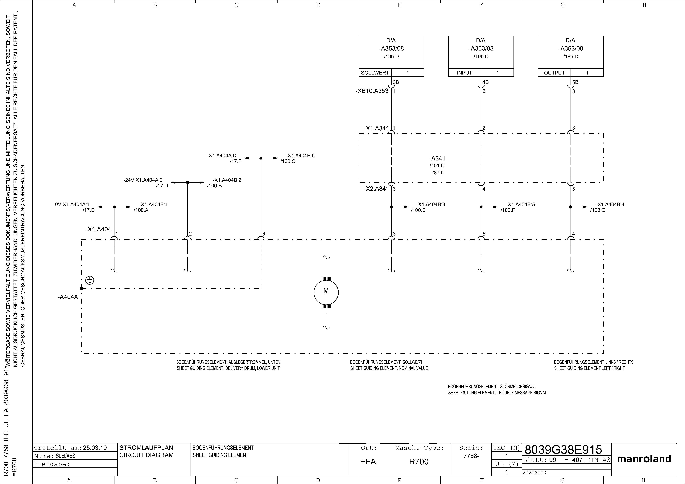

# +EA — Sheet 99 of 407 — BOGENFÜHRUNGSELEMENT

**SHEET GUIDING ELEMENT**

> Part of the manroland **R700** printing press IEC/UL circuit diagrams.
> Drawing class: **Stromlaufplan / Circuit diagram** (DIN A3).
> Document `+EA` covers the **Printing unit** machine section.

## At a glance

| Field | Value |
|---|---|
| Document | `+EA`  (8039G38E915) |
| Sheet | **99** of 407 |
| Section (DE) | BOGENFÜHRUNGSELEMENT |
| Section (EN) | SHEET GUIDING ELEMENT |
| Section type | CIRCUIT — Circuit diagram |
| Machine type | `R700` |
| Series | `7758` |
| Created | 25.03.10 |
| Replaces | — |
| Columns used | A, B, C, D, E, F, G, H |
| Path numbers | — |
| Labels on sheet | 68 |
| Cross-refs out | 14 |
| Cross-refs in | 29 |

**Previous:** [+EA sheet 98](SHEET_0098.md) · **Next:** [+EA sheet 100](SHEET_0100.md) · **Document TOC:** [_TOC.md](_TOC.md)  (+EA) · **Master TOC:** [all sheets](../_MASTER_TOC.md)

## Sheet image (300 DPI, exact vector render)



_Rendered directly from the PDF vector layer at 300 DPI (1-bit), no OCR and no resampling. Use it to confirm anything ambiguous in the text below._

## Cross-references on this sheet

Each entry is a wire leaving this sheet. The printed token is `/sheet.column`; the link resolves to that sheet inside the same document.

| Ref | Target sheet | Col | Path | Destination on target | Target section | From col |
|---|---|---|---|---|---|---|
| `/196.D` | [+EA sheet 196](SHEET_0196.md) | D | — | — | REFERENZMODUL | E |
| `/196.D` | [+EA sheet 196](SHEET_0196.md) | D | — | — | REFERENZMODUL | F |
| `/196.D` | [+EA sheet 196](SHEET_0196.md) | D | — | — | REFERENZMODUL | G |
| `/17.F` | [+EA sheet 17](SHEET_0017.md) | F | — | X1.A404A:6 | SPANNUNGSVERSORGUNG: 400V, 24V | C |
| `/100.C` | [+EA sheet 100](SHEET_0100.md) | C | — | — | BOGENFÜHRUNGSELEMENT | D |
| `/101.C` | [+EA sheet 101](SHEET_0101.md) | C | — | — | BOGENFÜHRUNGSELEMENT | E |
| `/87.C` | [+EA sheet 87](SHEET_0087.md) | C | — | — | SAUGWALZE | E |
| `/17.D` | [+EA sheet 17](SHEET_0017.md) | D | — | 24V.X1.A404A:2 | SPANNUNGSVERSORGUNG: 400V, 24V | B |
| `/100.B` | [+EA sheet 100](SHEET_0100.md) | B | — | — | BOGENFÜHRUNGSELEMENT | C |
| `/17.D` | [+EA sheet 17](SHEET_0017.md) | D | — | 0V.X1.A404A:1 | SPANNUNGSVERSORGUNG: 400V, 24V | A |
| `/100.E` | [+EA sheet 100](SHEET_0100.md) | E | — | X1.A404B:4 | BOGENFÜHRUNGSELEMENT | F |
| `/100.A` | [+EA sheet 100](SHEET_0100.md) | A | — | — | BOGENFÜHRUNGSELEMENT | B |
| `/100.F` | [+EA sheet 100](SHEET_0100.md) | F | — | — | BOGENFÜHRUNGSELEMENT | F |
| `/100.G` | [+EA sheet 100](SHEET_0100.md) | G | — | — | BOGENFÜHRUNGSELEMENT | G |

### Incoming references (sheets that point here)

Every other sheet that sends a wire to this one. `Back-ref` is the token printed on *that* sheet; `Path` is its line number.

| From sheet | Cols | Back-ref | Path | Refs | What continues there |
|---|---|---|---|---|---|
| [+EA#17](SHEET_0017.md) | D, F | `/17.D`, `/17.F` | — | 3 | 0V.X1.A404A:1 |
| [+EA#87](SHEET_0087.md) | C | `/87.C` | — | 1 | — |
| [+EA#100](SHEET_0100.md) | A, E | `/100.A`, `/100.E` | — | 6 | X1.A404B:1; X1.A404B:2 X1.A404B:3 X1.A404B:4; X1.A404B:6 X1.A404B:5 |
| [+EA#101](SHEET_0101.md) | B | `/101.B` | — | 1 | — |
| [+EA#196](SHEET_0196.md) | D | `/196.D` | — | 3 | — |
| [+EA#209](SHEET_0209.md) | A, H | `/209.A`, `/209.H` | — | 9 | — |
| [+EA#224](SHEET_0224.md) | C | `/224.C` | — | 3 | — |
| [+EA#254](SHEET_0254.md) | C | `/254.C` | — | 3 | — |


## Devices on this sheet

| Tag | Class | Class meaning (IEC) | Col | Sub | Terminal | Sign |
|---|---|---|---|---|---|---|
| `A341` | A | Baugruppe / assembly, module, PC board | E | — | — | — |
| `A353/08` | A | Baugruppe / assembly, module, PC board | E | 08 | — | — |
| `A353/08` | A | Baugruppe / assembly, module, PC board | F | 08 | — | — |
| `A353/08` | A | Baugruppe / assembly, module, PC board | G | 08 | — | — |
| `X1.A404` | — | cross-device reference | A | — | — | — |
| `X1.A341` | — | cross-device reference | E | — | — | — |
| `X2.A341` | — | cross-device reference | E | — | — | — |
| `XB10.A353` | — | cross-device reference | E | — | — | — |
| `X1.A404A:6` | — | cross-device reference | C | — | 6 | — |
| `X1.A404B:1` | — | cross-device reference | B | — | 1 | — |
| `X1.A404B:4` | — | cross-device reference | H | — | 4 | — |
| `X1.A404B:3` | — | cross-device reference | E | — | 3 | — |
| `X1.A404B:2` | — | cross-device reference | C | — | 2 | — |
| `X1.A404B:5` | — | cross-device reference | F | — | 5 | — |
| `X1.A404B:6` | — | cross-device reference | D | — | 6 | — |

## Potentials / nets

| Potential | Count | Columns | Attached devices | Terminals |
|---|---|---|---|---|
| `0V` | 1 | A | `A404A`, `X1` | `1` |
| `24V` | 1 | B | `A404A`, `X1` | `2` |


A potential such as `L24+/4` or `M24+` is a named supply/return rail; every place it appears on this sheet is electrically common.

## Wire-end annotations (grouped as printed)

A wire that continues elsewhere is annotated with a small cluster: the destination description, the path/line number `#NN`, and the `/sheet.column` cross reference. Each row below is one such cluster exactly as it is grouped on the drawing.

| Col | Y | Path | Cross-ref | Text on the wire |
|---|---|---|---|---|
| E | 65.8 | — | — | `D/A` |
| F | 65.8 | — | — | `D/A` |
| G | 65.8 | — | — | `D/A` |
| E | 79.7 | — | — | `A353/08` |
| F | 79.7 | — | — | `A353/08` |
| G | 79.7 | — | — | `A353/08` |
| E | 94.5 | — | `/196.D` | — |
| F | 94.5 | — | `/196.D` | — |
| G | 94.5 | — | `/196.D` | — |
| E | 122.8 | — | — | `SOLLWERT 1` |
| F | 122.9 | — | — | `INPUT 1` |
| G | 122.9 | — | — | `OUTPUT 1` |
| E | 139.2 | — | — | `3B` |
| F | 139.2 | — | — | `4B` |
| G | 139.2 | — | — | `5B` |
| E | 153.4 | — | — | `XB10.A353 1` |
| F | 154.8 | — | — | `2` |
| G | 154.8 | — | — | `3` |
| E | 218.6 | — | — | `X1.A341 1` |
| F | 218.6 | — | — | `2` |
| G | 218.6 | — | — | `3` |
| C | 266.7 | — | `/17.F` | `X1.A404A:6` |
| D | 266.7 | — | — | `X1.A404B:6` |
| E | 271.0 | — | — | `A341` |
| D | 276.7 | — | `/100.C` | — |
| E | 284.1 | — | `/101.C` | — |
| E | 296.5 | — | `/87.C` | — |
| B | 309.2 | — | `/17.D` | `24V.X1.A404A:2` |
| C | 309.2 | — | — | `X1.A404B:2` |
| C | 319.2 | — | `/100.B` | — |
| E | 323.5 | — | — | `X2.A341 3` |
| F | 324.9 | — | — | `4` |
| G | 324.9 | — | — | `5` |
| A | 351.8 | — | `/17.D` | `0V.X1.A404A:1` |
| B | 351.8 | — | — | `X1.A404B:1` |
| F | 351.8 | — | `/100.E` | `X1.A404B:4` |
| E | 351.8 | — | — | `X1.A404B:3` |
| F | 351.8 | — | — | `X1.A404B:5` |
| B | 361.7 | — | `/100.A` | — |
| F | 361.7 | — | `/100.F` | — |
| G | 361.7 | — | `/100.G` | — |
| A | 394.3 | — | — | `X1.A404 1` |
| C | 402.8 | — | — | `2 6` |
| E | 402.8 | — | — | `3` |
| F | 402.8 | — | — | `5` |
| G | 402.8 | — | — | `4` |
| D | 500.4 | — | — | `M` |
| A | 512.0 | — | — | `A404A` |
| C | 627.1 | — | — | `BOGENFÜHRUNGSELEMENT: AUSLEGERTROMMEL, UNTEN` |
| E | 627.1 | — | — | `BOGENFÜHRUNGSELEMENT, SOLLWERT` |
| G | 627.1 | — | — | `BOGENFÜHRUNGSELEMENT LINKS / RECHTS` |
| C | 637.7 | — | — | `SHEET GUIDING ELEMENT: DELIVERY DRUM, LOWER UNIT` |
| E | 637.7 | — | — | `SHEET GUIDING ELEMENT, NOMINAL VALUE` |
| G | 637.7 | — | — | `SHEET GUIDING ELEMENT LEFT / RIGHT` |
| F | 669.6 | — | — | `BOGENFÜHRUNGSELEMENT, STÖRMELDESIGNAL` |
| F | 680.2 | — | — | `SHEET GUIDING ELEMENT, TROUBLE MESSAGE SIGNAL` |


## Reconstructed tables

This sheet carries tabular content (pin map / terminal assignment / index). The grid below was rebuilt from the drawing's own rule lines, so each row is exactly one physical row of the table.

### Table 1 — 1 data rows × 2 columns (at x=623.6, y=62.4)

| D/A | A353/08 /196.D |
|---|---|
| `SOLLWERT` | `1` |


### Table 2 — 1 data rows × 2 columns (at x=779.5, y=62.4)

| D/A | A353/08 /196.D |
|---|---|
| `INPUT` | `1` |


### Table 3 — 1 data rows × 2 columns (at x=935.4, y=62.4)

| D/A | A353/08 /196.D |
|---|---|
| `OUTPUT` | `1` |


## Notes and free text on this sheet

| Text | Col | Y (pt) |
|---|---|---|
| `A404A` | A | 511.96 |
| `BOGENFÜHRUNGSELEMENT: AUSLEGERTROMMEL, UNTEN` | C | 627.1 |
| `SHEET GUIDING ELEMENT: DELIVERY DRUM, LOWER UNIT` | C | 637.72 |
| `M` | D | 500.4 |
| `3B` | E | 139.17 |
| `D/A` | E | 65.78 |
| `SOLLWERT` | E | 122.83 |
| `BOGENFÜHRUNGSELEMENT, SOLLWERT` | E | 627.08 |
| `SHEET GUIDING ELEMENT, NOMINAL VALUE` | E | 637.72 |
| `4B` | F | 139.17 |
| `D/A` | F | 65.78 |
| `INPUT` | F | 122.88 |
| `BOGENFÜHRUNGSELEMENT, STÖRMELDESIGNAL` | F | 669.62 |
| `SHEET GUIDING ELEMENT, TROUBLE MESSAGE SIGNAL` | F | 680.24 |
| `5B` | G | 139.17 |
| `D/A` | G | 65.78 |
| `OUTPUT` | G | 122.89 |
| `BOGENFÜHRUNGSELEMENT LINKS / RECHTS` | G | 627.09 |
| `SHEET GUIDING ELEMENT LEFT / RIGHT` | G | 637.72 |

## Complete label inventory (exact text from the drawing)

Every text object inside the drawing area of this sheet, in DIN reading order (column A→H, then top→bottom). This is the authoritative list: if a string is not here it is not printed on this sheet.

| Col | Y | X | Dir | Type | Text |
|---|---|---|---|---|---|
| A | 351.8 | 95.8 | → | potential | `0V.X1.A404A:1` |
| A | 361.7 | 143.7 | → | cross-reference | `/17.D` |
| A | 394.3 | 149.1 | → | device ref | `X1.A404` |
| A | 512.0 | 100.3 | → | text | `A404A` |
| B | 309.2 | 214.6 | → | potential | `24V.X1.A404A:2` |
| B | 319.2 | 271.3 | → | cross-reference | `/17.D` |
| B | 351.8 | 242.1 | → | device ref | `X1.A404B:1` |
| B | 361.7 | 232.4 | → | cross-reference | `/100.A` |
| B | 402.8 | 200.4 | → | number | `1` |
| B | 402.8 | 328.5 | → | number | `2` |
| C | 266.7 | 360.0 | → | device ref | `X1.A404A:6` |
| C | 276.6 | 399.7 | → | cross-reference | `/17.F` |
| C | 309.2 | 369.6 | → | device ref | `X1.A404B:2` |
| C | 319.2 | 360.0 | → | cross-reference | `/100.B` |
| C | 402.8 | 456.1 | → | number | `6` |
| C | 627.1 | 306.4 | → | text | `BOGENFÜHRUNGSELEMENT: AUSLEGERTROMMEL, UNTEN` |
| C | 637.7 | 307.5 | → | text | `SHEET GUIDING ELEMENT: DELIVERY DRUM, LOWER UNIT` |
| D | 266.7 | 497.2 | → | device ref | `X1.A404B:6` |
| D | 276.7 | 487.6 | → | cross-reference | `/100.C` |
| D | 500.4 | 562.3 | → | text | `M` |
| E | 65.8 | 671.5 | → | text | `D/A` |
| E | 79.7 | 658.9 | → | device tag | `A353/08` |
| E | 94.5 | 667.6 | → | cross-reference | `/196.D` |
| E | 122.8 | 627.4 | → | text | `SOLLWERT` |
| E | 122.9 | 706.7 | → | number | `1` |
| E | 139.2 | 682.9 | → | text | `3B` |
| E | 153.4 | 618.0 | → | device ref | `XB10.A353` |
| E | 154.8 | 682.3 | → | number | `1` |
| E | 218.6 | 632.4 | → | device ref | `X1.A341` |
| E | 218.6 | 682.3 | → | number | `1` |
| E | 271.0 | 746.1 | → | device tag | `A341` |
| E | 284.1 | 746.9 | → | cross-reference | `/101.C` |
| E | 296.5 | 751.7 | → | cross-reference | `/87.C` |
| E | 323.5 | 632.4 | → | device ref | `X2.A341` |
| E | 324.9 | 682.9 | → | number | `3` |
| E | 351.8 | 724.0 | → | device ref | `X1.A404B:3` |
| E | 361.7 | 714.3 | → | cross-reference | `/100.E` |
| E | 402.8 | 682.9 | → | number | `3` |
| E | 627.1 | 608.6 | → | text | `BOGENFÜHRUNGSELEMENT, SOLLWERT` |
| E | 637.7 | 609.2 | → | text | `SHEET GUIDING ELEMENT, NOMINAL VALUE` |
| F | 65.8 | 827.4 | → | text | `D/A` |
| F | 79.7 | 814.8 | → | device tag | `A353/08` |
| F | 94.5 | 823.5 | → | cross-reference | `/196.D` |
| F | 122.9 | 794.4 | → | text | `INPUT` |
| F | 122.9 | 862.6 | → | number | `1` |
| F | 139.2 | 838.8 | → | text | `4B` |
| F | 154.8 | 838.8 | → | number | `2` |
| F | 218.6 | 838.8 | → | number | `2` |
| F | 324.9 | 838.8 | → | number | `4` |
| F | 351.8 | 879.9 | → | device ref | `X1.A404B:5` |
| F | 361.7 | 870.2 | → | cross-reference | `/100.F` |
| F | 402.8 | 838.8 | → | number | `5` |
| F | 669.6 | 778.7 | → | text | `BOGENFÜHRUNGSELEMENT, STÖRMELDESIGNAL` |
| F | 680.2 | 779.2 | → | text | `SHEET GUIDING ELEMENT, TROUBLE MESSAGE SIGNAL` |
| G | 65.8 | 983.3 | → | text | `D/A` |
| G | 79.7 | 970.7 | → | device tag | `A353/08` |
| G | 94.5 | 979.4 | → | cross-reference | `/196.D` |
| G | 122.9 | 945.8 | → | text | `OUTPUT` |
| G | 122.9 | 1018.5 | → | number | `1` |
| G | 139.2 | 994.7 | → | text | `5B` |
| G | 154.8 | 994.7 | → | number | `3` |
| G | 218.6 | 994.7 | → | number | `3` |
| G | 324.9 | 994.7 | → | number | `5` |
| G | 361.7 | 1026.1 | → | cross-reference | `/100.G` |
| G | 402.8 | 994.7 | → | number | `4` |
| G | 627.1 | 962.9 | → | text | `BOGENFÜHRUNGSELEMENT LINKS / RECHTS` |
| G | 637.7 | 963.5 | → | text | `SHEET GUIDING ELEMENT LEFT / RIGHT` |
| H | 351.8 | 1035.8 | → | device ref | `X1.A404B:4` |

## Reading-order text block

The same content as a plain block, grouped by DIN column — convenient to paste or to match against a visual description.

```text
=== Column A ===
 351.8   95.8  net          0V.X1.A404A:1
 361.7  143.7  xref         /17.D
 394.3  149.1  devref       X1.A404
 512.0  100.3  text         A404A
=== Column B ===
 309.2  214.6  net          24V.X1.A404A:2
 319.2  271.3  xref         /17.D
 351.8  242.1  devref       X1.A404B:1
 361.7  232.4  xref         /100.A
 402.8  200.4  numeric      1
 402.8  328.5  numeric      2
=== Column C ===
 266.7  360.0  devref       X1.A404A:6
 276.6  399.7  xref         /17.F
 309.2  369.6  devref       X1.A404B:2
 319.2  360.0  xref         /100.B
 402.8  456.1  numeric      6
 627.1  306.4  text         BOGENFÜHRUNGSELEMENT: AUSLEGERTROMMEL, UNTEN
 637.7  307.5  text         SHEET GUIDING ELEMENT: DELIVERY DRUM, LOWER UNIT
=== Column D ===
 266.7  497.2  devref       X1.A404B:6
 276.7  487.6  xref         /100.C
 500.4  562.3  text         M
=== Column E ===
  65.8  671.5  text         D/A
  79.7  658.9  devtag       A353/08
  94.5  667.6  xref         /196.D
 122.8  627.4  text         SOLLWERT
 122.9  706.7  numeric      1
 139.2  682.9  text         3B
 153.4  618.0  devref       XB10.A353
 154.8  682.3  numeric      1
 218.6  632.4  devref       X1.A341
 218.6  682.3  numeric      1
 271.0  746.1  devtag       A341
 284.1  746.9  xref         /101.C
 296.5  751.7  xref         /87.C
 323.5  632.4  devref       X2.A341
 324.9  682.9  numeric      3
 351.8  724.0  devref       X1.A404B:3
 361.7  714.3  xref         /100.E
 402.8  682.9  numeric      3
 627.1  608.6  text         BOGENFÜHRUNGSELEMENT, SOLLWERT
 637.7  609.2  text         SHEET GUIDING ELEMENT, NOMINAL VALUE
=== Column F ===
  65.8  827.4  text         D/A
  79.7  814.8  devtag       A353/08
  94.5  823.5  xref         /196.D
 122.9  794.4  text         INPUT
 122.9  862.6  numeric      1
 139.2  838.8  text         4B
 154.8  838.8  numeric      2
 218.6  838.8  numeric      2
 324.9  838.8  numeric      4
 351.8  879.9  devref       X1.A404B:5
 361.7  870.2  xref         /100.F
 402.8  838.8  numeric      5
 669.6  778.7  text         BOGENFÜHRUNGSELEMENT, STÖRMELDESIGNAL
 680.2  779.2  text         SHEET GUIDING ELEMENT, TROUBLE MESSAGE SIGNAL
=== Column G ===
  65.8  983.3  text         D/A
  79.7  970.7  devtag       A353/08
  94.5  979.4  xref         /196.D
 122.9  945.8  text         OUTPUT
 122.9 1018.5  numeric      1
 139.2  994.7  text         5B
 154.8  994.7  numeric      3
 218.6  994.7  numeric      3
 324.9  994.7  numeric      5
 361.7 1026.1  xref         /100.G
 402.8  994.7  numeric      4
 627.1  962.9  text         BOGENFÜHRUNGSELEMENT LINKS / RECHTS
 637.7  963.5  text         SHEET GUIDING ELEMENT LEFT / RIGHT
=== Column H ===
 351.8 1035.8  devref       X1.A404B:4
```

---
_Generated from the PDF vector text layer; no OCR. Source: `R700_7758_IEC_UL_EA_8039G38E915_p`, sheet 99._
