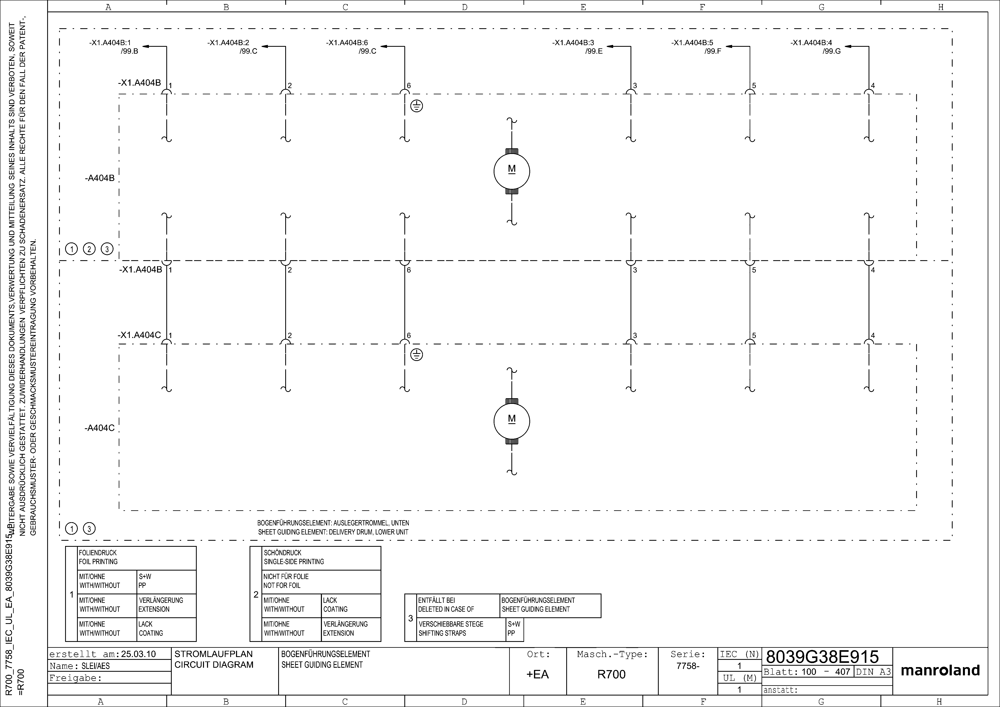

# +EA — Sheet 100 of 407 — BOGENFÜHRUNGSELEMENT

**SHEET GUIDING ELEMENT**

> Part of the manroland **R700** printing press IEC/UL circuit diagrams.
> Drawing class: **Stromlaufplan / Circuit diagram** (DIN A3).
> Document `+EA` covers the **Printing unit** machine section.

## At a glance

| Field | Value |
|---|---|
| Document | `+EA`  (8039G38E915) |
| Sheet | **100** of 407 |
| Section (DE) | BOGENFÜHRUNGSELEMENT |
| Section (EN) | SHEET GUIDING ELEMENT |
| Section type | CIRCUIT — Circuit diagram |
| Machine type | `R700` |
| Series | `7758` |
| Created | 25.03.10 |
| Replaces | — |
| Columns used | A, B, C, D, E, F, G |
| Path numbers | — |
| Labels on sheet | 81 |
| Cross-refs out | 6 |
| Cross-refs in | 18 |

**Previous:** [+EA sheet 99](SHEET_0099.md) · **Next:** [+EA sheet 101](SHEET_0101.md) · **Document TOC:** [_TOC.md](_TOC.md)  (+EA) · **Master TOC:** [all sheets](../_MASTER_TOC.md)

## Sheet image (300 DPI, exact vector render)



_Rendered directly from the PDF vector layer at 300 DPI (1-bit), no OCR and no resampling. Use it to confirm anything ambiguous in the text below._

## Cross-references on this sheet

Each entry is a wire leaving this sheet. The printed token is `/sheet.column`; the link resolves to that sheet inside the same document.

| Ref | Target sheet | Col | Path | Destination on target | Target section | From col |
|---|---|---|---|---|---|---|
| `/99.B` | [+EA sheet 99](SHEET_0099.md) | B | — | X1.A404B:1 | BOGENFÜHRUNGSELEMENT | A |
| `/99.E` | [+EA sheet 99](SHEET_0099.md) | E | — | X1.A404B:2 X1.A404B:3 X1.A404B:4 | BOGENFÜHRUNGSELEMENT | E |
| `/99.G` | [+EA sheet 99](SHEET_0099.md) | G | — | X1.A404B:2 X1.A404B:3 X1.A404B:4 | BOGENFÜHRUNGSELEMENT | E |
| `/99.C` | [+EA sheet 99](SHEET_0099.md) | C | — | X1.A404B:2 X1.A404B:3 X1.A404B:4 | BOGENFÜHRUNGSELEMENT | E |
| `/99.F` | [+EA sheet 99](SHEET_0099.md) | F | — | X1.A404B:6 X1.A404B:5 | BOGENFÜHRUNGSELEMENT | E |
| `/99.C` | [+EA sheet 99](SHEET_0099.md) | C | — | X1.A404B:6 X1.A404B:5 | BOGENFÜHRUNGSELEMENT | E |

### Incoming references (sheets that point here)

Every other sheet that sends a wire to this one. `Back-ref` is the token printed on *that* sheet; `Path` is its line number.

| From sheet | Cols | Back-ref | Path | Refs | What continues there |
|---|---|---|---|---|---|
| [+EA#99](SHEET_0099.md) | B, C, D, F, G | `/99.B`, `/99.C`, `/99.D`, `/99.F`, `/99.G` | — | 6 | X1.A404B:4 |
| [+EA#210](SHEET_0210.md) | A | `/210.A` | — | 12 | — |


## Devices on this sheet

| Tag | Class | Class meaning (IEC) | Col | Sub | Terminal | Sign |
|---|---|---|---|---|---|---|
| `X1.A404B` | — | cross-device reference | A | — | — | — |
| `X1.A404C` | — | cross-device reference | A | — | — | — |
| `X1.A404B:1` | — | cross-device reference | A | — | 1 | — |
| `X1.A404B:4` | — | cross-device reference | G | — | 4 | — |
| `X1.A404B:3` | — | cross-device reference | E | — | 3 | — |
| `X1.A404B:2` | — | cross-device reference | B | — | 2 | — |
| `X1.A404B:5` | — | cross-device reference | F | — | 5 | — |
| `X1.A404B:6` | — | cross-device reference | C | — | 6 | — |
| `X1.A404B` | — | cross-device reference | A | — | — | — |

## Potentials / nets

_No named potentials on this sheet._

## Wire-end annotations (grouped as printed)

A wire that continues elsewhere is annotated with a small cluster: the destination description, the path/line number `#NN`, and the `/sheet.column` cross reference. Each row below is one such cluster exactly as it is grouped on the drawing.

| Col | Y | Path | Cross-ref | Text on the wire |
|---|---|---|---|---|
| A | 47.0 | — | `/99.B` | `X1.A404B:1` |
| E | 47.0 | — | `/99.E`, `/99.G`, `/99.C` | `X1.A404B:2 X1.A404B:3 X1.A404B:4` |
| E | 47.0 | — | `/99.F`, `/99.C` | `X1.A404B:6 X1.A404B:5` |
| A | 93.8 | — | — | `X1.A404B` |
| B | 98.1 | — | — | `1 2` |
| E | 98.1 | — | — | `6 3 5 4` |
| D | 195.7 | — | — | `M` |
| A | 207.2 | — | — | `A404B` |
| A | 293.2 | — | — | `1 2 3` |
| D | 316.4 | — | — | `X1.A404B 1 2 6 3 5 4` |
| B | 394.3 | — | — | `X1.A404C 1 2` |
| E | 395.8 | — | — | `6 3 5 4` |
| D | 493.3 | — | — | `M` |
| A | 504.9 | — | — | `A404C` |
| C | 620.0 | — | — | `BOGENFÜHRUNGSELEMENT: AUSLEGERTROMMEL, UNTEN` |
| A | 626.2 | — | — | `1 3` |
| C | 630.6 | — | — | `SHEET GUIDING ELEMENT: DELIVERY DRUM, LOWER UNIT` |
| A | 655.4 | — | — | `FOLIENDRUCK FOIL PRINTING` |
| C | 655.5 | — | — | `SCHÖNDRUCK SINGLE SIDE PRINTING` |
| A | 683.6 | — | — | `PP S+W` |
| A | 683.8 | — | — | `MIT/OHNE` |
| C | 683.8 | — | — | `NICHT FÜR FOLIE NOT FOR FOIL` |
| A | 694.4 | — | — | `WITH/WITHOUT` |
| B | 703.3 | — | — | `1 ENTFÄLLT BEI DELETED IN CASE OF` |
| B | 703.3 | — | — | `2` |
| A | 712.1 | — | — | `MIT/OHNE` |
| A | 712.1 | — | — | `EXTENSION VERLÄNGERUNG` |
| B | 712.1 | — | — | `MIT/OHNE` |
| C | 712.1 | — | — | `LACK` |
| E | 712.1 | — | — | `BOGENFÜHRUNGSELEMENT` |
| A | 722.7 | — | — | `WITH/WITHOUT` |
| B | 722.7 | — | — | `WITH/WITHOUT` |
| C | 722.8 | — | — | `COATING` |
| E | 722.8 | — | — | `SHEET GUIDING ELEMENT` |
| D | 731.6 | — | — | `3 PP S+W` |
| A | 740.4 | — | — | `LACK` |
| A | 740.5 | — | — | `MIT/OHNE` |
| B | 740.5 | — | — | `MIT/OHNE` |
| C | 740.5 | — | — | `EXTENSION VERLÄNGERUNG` |
| D | 740.5 | — | — | `SHIFTING STRAPS VERSCHIEBBARE STEGE` |
| A | 751.0 | — | — | `WITH/WITHOUT` |
| B | 751.0 | — | — | `WITH/WITHOUT` |
| A | 751.1 | — | — | `COATING` |


## Reconstructed tables

This sheet carries tabular content (pin map / terminal assignment / index). The grid below was rebuilt from the drawing's own rule lines, so each row is exactly one physical row of the table.

### Table 1 — 5 data rows × 13 columns (at x=198.4, y=0.0) — **1 1 1 X1.A404B:2 /99.C SHEET NICHT NOT 2 MIT/OHNE MIT/OHNE SCHÖNDRUCK SINGLE SIDE FOR WITH/WITHOUT WITH/WITHOUT X1.A404B:6 /99.C 2 2 2 BOGENFÜHRUNGSELEMENT: AUSLEGERTROMMEL, UNTEN GUIDING ELEMENT: DELIVERY DRUM, LOWER UNIT PRINTING FÜR FOLIE FOIL LACK COATING VERLÄNGERUNG EXTENSION 6 6 6 ENTFÄLLT BEI DELETED IN CASE OF 3 VERSCHIEBBARE STEGE SHIFTING STRAPS M M BOGENFÜHRUNGSELEMENT SHEET GUIDING ELEMENT S+W PP X1.A404B:3 /99.E 3 3 3 X1.A404B:5 /99.F 5 5 5 X1.A404B:4 /99.G 4 4 4**

|  | STROMLAUFPLAN |  | BOGENFÜHRUNGSELEMENT |  | Ort: | Masch. Type: |  | Serie: | IEC | (N) | 8039G38E915 |  |
|---|---|---|---|---|---|---|---|---|---|---|---|---|
|  | `CIRCUIT DIAGRAM` |  |  |  |  |  |  |  |  |  |  |  |
|  |  |  | `SHEET GUIDING ELEMENT` |  |  |  |  | `7758` | `1` |  |  |  |
|  |  |  |  |  | `+EA` | `R700` |  |  |  |  | `Blatt: DIN 100 407` | `A3` |
|  |  |  |  |  |  |  |  |  | `UL (M)` |  |  |  |
|  |  |  |  |  |  |  |  |  | `1` |  | `anstatt:` |  |


## Notes and free text on this sheet

| Text | Col | Y (pt) |
|---|---|---|
| `M` | D | 195.67 |
| `A404C` | A | 504.87 |
| `BOGENFÜHRUNGSELEMENT: AUSLEGERTROMMEL, UNTEN` | C | 620.01 |
| `SHEET GUIDING ELEMENT: DELIVERY DRUM, LOWER UNIT` | C | 630.63 |
| `A404B` | A | 207.23 |
| `MIT/OHNE` | A | 712.12 |
| `WITH/WITHOUT` | A | 722.7 |
| `FOLIENDRUCK` | A | 655.44 |
| `FOIL PRINTING` | A | 666.05 |
| `ENTFÄLLT BEI` | D | 712.09 |
| `DELETED IN CASE OF` | D | 722.74 |
| `BOGENFÜHRUNGSELEMENT` | E | 712.14 |
| `SHEET GUIDING ELEMENT` | E | 722.76 |
| `VERSCHIEBBARE STEGE` | D | 740.46 |
| `SHIFTING STRAPS` | D | 751.09 |
| `S+W` | D | 740.33 |
| `PP` | D | 750.96 |
| `NICHT FÜR FOLIE` | C | 683.77 |
| `NOT FOR FOIL` | B | 694.4 |
| `MIT/OHNE` | B | 712.12 |
| `WITH/WITHOUT` | B | 722.7 |
| `LACK` | C | 712.09 |
| `COATING` | C | 722.75 |
| `VERLÄNGERUNG` | C | 740.49 |
| `EXTENSION` | C | 751.06 |
| `SCHÖNDRUCK` | B | 655.47 |
| `SINGLE SIDE PRINTING` | C | 666.06 |
| `S+W` | A | 683.63 |
| `PP` | A | 694.27 |
| `VERLÄNGERUNG` | A | 712.14 |
| `EXTENSION` | A | 722.72 |
| `LACK` | A | 740.44 |
| `COATING` | A | 751.1 |

## Complete label inventory (exact text from the drawing)

Every text object inside the drawing area of this sheet, in DIN reading order (column A→H, then top→bottom). This is the authoritative list: if a string is not here it is not printed on this sheet.

| Col | Y | X | Dir | Type | Text |
|---|---|---|---|---|---|
| A | 47.0 | 106.3 | → | device ref | `X1.A404B:1` |
| A | 56.9 | 144.0 | → | cross-reference | `/99.B` |
| A | 93.9 | 140.6 | → | device ref | `X1.A404B` |
| A | 207.2 | 101.2 | → | text | `A404B` |
| A | 293.2 | 83.3 | → | number | `1` |
| A | 293.7 | 104.3 | → | number | `2` |
| A | 293.7 | 125.6 | → | number | `3` |
| A | 316.4 | 142.0 | → | device ref | `X1.A404B` |
| A | 394.3 | 140.0 | → | device ref | `X1.A404C` |
| A | 504.9 | 100.6 | → | text | `A404C` |
| A | 626.2 | 83.3 | → | number | `1` |
| A | 626.7 | 104.3 | → | number | `3` |
| A | 655.4 | 94.1 | → | text | `FOLIENDRUCK` |
| A | 666.0 | 94.1 | → | text | `FOIL PRINTING` |
| A | 683.6 | 165.5 | → | text | `S+W` |
| A | 683.8 | 94.4 | → | text | `MIT/OHNE` |
| A | 694.3 | 165.0 | → | text | `PP` |
| A | 694.4 | 95.0 | → | text | `WITH/WITHOUT` |
| A | 703.3 | 82.5 | → | number | `1` |
| A | 712.1 | 94.4 | → | text | `MIT/OHNE` |
| A | 712.1 | 165.8 | → | text | `VERLÄNGERUNG` |
| A | 722.7 | 95.0 | → | text | `WITH/WITHOUT` |
| A | 722.7 | 165.0 | → | text | `EXTENSION` |
| A | 740.4 | 165.0 | → | text | `LACK` |
| A | 740.5 | 94.4 | → | text | `MIT/OHNE` |
| A | 751.0 | 95.0 | → | text | `WITH/WITHOUT` |
| A | 751.1 | 165.5 | → | text | `COATING` |
| B | 47.0 | 246.9 | → | device ref | `X1.A404B:2` |
| B | 57.0 | 285.4 | → | cross-reference | `/99.C` |
| B | 98.1 | 200.4 | → | number | `1` |
| B | 317.8 | 200.4 | → | number | `1` |
| B | 395.8 | 200.4 | → | number | `1` |
| B | 655.5 | 314.4 | → | text | `SCHÖNDRUCK` |
| B | 694.4 | 313.8 | → | text | `NOT FOR FOIL` |
| B | 703.3 | 301.9 | → | number | `2` |
| B | 712.1 | 314.1 | → | text | `MIT/OHNE` |
| B | 722.7 | 314.6 | → | text | `WITH/WITHOUT` |
| B | 740.5 | 314.1 | → | text | `MIT/OHNE` |
| B | 751.0 | 314.6 | → | text | `WITH/WITHOUT` |
| C | 47.0 | 388.3 | → | device ref | `X1.A404B:6` |
| C | 57.0 | 427.2 | → | cross-reference | `/99.C` |
| C | 98.1 | 342.7 | → | number | `2` |
| C | 317.8 | 342.7 | → | number | `2` |
| C | 395.8 | 342.7 | → | number | `2` |
| C | 620.0 | 306.4 | → | text | `BOGENFÜHRUNGSELEMENT: AUSLEGERTROMMEL, UNTEN` |
| C | 630.6 | 307.5 | → | text | `SHEET GUIDING ELEMENT: DELIVERY DRUM, LOWER UNIT` |
| C | 666.1 | 314.4 | → | text | `SINGLE SIDE PRINTING` |
| C | 683.8 | 313.8 | → | text | `NICHT FÜR FOLIE` |
| C | 712.1 | 384.7 | → | text | `LACK` |
| C | 722.7 | 385.2 | → | text | `COATING` |
| C | 740.5 | 385.5 | → | text | `VERLÄNGERUNG` |
| C | 751.1 | 384.7 | → | text | `EXTENSION` |
| D | 98.1 | 484.4 | → | number | `6` |
| D | 195.7 | 604.8 | → | text | `M` |
| D | 317.8 | 484.4 | → | number | `6` |
| D | 395.8 | 484.4 | → | number | `6` |
| D | 493.3 | 604.8 | → | text | `M` |
| D | 712.1 | 498.0 | → | text | `ENTFÄLLT BEI` |
| D | 722.7 | 498.0 | → | text | `DELETED IN CASE OF` |
| D | 731.6 | 486.0 | → | number | `3` |
| D | 740.3 | 604.9 | → | text | `S+W` |
| D | 740.5 | 498.9 | → | text | `VERSCHIEBBARE STEGE` |
| D | 751.0 | 604.3 | → | text | `PP` |
| D | 751.1 | 498.6 | → | text | `SHIFTING STRAPS` |
| E | 47.0 | 657.6 | → | device ref | `X1.A404B:3` |
| E | 56.9 | 697.0 | → | cross-reference | `/99.E` |
| E | 98.1 | 753.7 | → | number | `3` |
| E | 317.8 | 753.7 | → | number | `3` |
| E | 395.8 | 753.7 | → | number | `3` |
| E | 712.1 | 597.3 | → | text | `BOGENFÜHRUNGSELEMENT` |
| E | 722.8 | 597.8 | → | text | `SHEET GUIDING ELEMENT` |
| F | 47.0 | 799.4 | → | device ref | `X1.A404B:5` |
| F | 57.0 | 839.1 | → | cross-reference | `/99.F` |
| F | 98.1 | 895.5 | → | number | `5` |
| F | 317.8 | 895.5 | → | number | `5` |
| F | 395.8 | 895.5 | → | number | `5` |
| G | 47.0 | 941.1 | → | device ref | `X1.A404B:4` |
| G | 57.0 | 979.7 | → | cross-reference | `/99.G` |
| G | 98.1 | 1037.2 | → | number | `4` |
| G | 317.8 | 1037.2 | → | number | `4` |
| G | 395.8 | 1037.2 | → | number | `4` |

## Reading-order text block

The same content as a plain block, grouped by DIN column — convenient to paste or to match against a visual description.

```text
=== Column A ===
  47.0  106.3  devref       X1.A404B:1
  56.9  144.0  xref         /99.B
  93.9  140.6  devref       X1.A404B
 207.2  101.2  text         A404B
 293.2   83.3  numeric      1
 293.7  104.3  numeric      2
 293.7  125.6  numeric      3
 316.4  142.0  devref       X1.A404B
 394.3  140.0  devref       X1.A404C
 504.9  100.6  text         A404C
 626.2   83.3  numeric      1
 626.7  104.3  numeric      3
 655.4   94.1  text         FOLIENDRUCK
 666.0   94.1  text         FOIL PRINTING
 683.6  165.5  text         S+W
 683.8   94.4  text         MIT/OHNE
 694.3  165.0  text         PP
 694.4   95.0  text         WITH/WITHOUT
 703.3   82.5  numeric      1
 712.1   94.4  text         MIT/OHNE
 712.1  165.8  text         VERLÄNGERUNG
 722.7   95.0  text         WITH/WITHOUT
 722.7  165.0  text         EXTENSION
 740.4  165.0  text         LACK
 740.5   94.4  text         MIT/OHNE
 751.0   95.0  text         WITH/WITHOUT
 751.1  165.5  text         COATING
=== Column B ===
  47.0  246.9  devref       X1.A404B:2
  57.0  285.4  xref         /99.C
  98.1  200.4  numeric      1
 317.8  200.4  numeric      1
 395.8  200.4  numeric      1
 655.5  314.4  text         SCHÖNDRUCK
 694.4  313.8  text         NOT FOR FOIL
 703.3  301.9  numeric      2
 712.1  314.1  text         MIT/OHNE
 722.7  314.6  text         WITH/WITHOUT
 740.5  314.1  text         MIT/OHNE
 751.0  314.6  text         WITH/WITHOUT
=== Column C ===
  47.0  388.3  devref       X1.A404B:6
  57.0  427.2  xref         /99.C
  98.1  342.7  numeric      2
 317.8  342.7  numeric      2
 395.8  342.7  numeric      2
 620.0  306.4  text         BOGENFÜHRUNGSELEMENT: AUSLEGERTROMMEL, UNTEN
 630.6  307.5  text         SHEET GUIDING ELEMENT: DELIVERY DRUM, LOWER UNIT
 666.1  314.4  text         SINGLE SIDE PRINTING
 683.8  313.8  text         NICHT FÜR FOLIE
 712.1  384.7  text         LACK
 722.7  385.2  text         COATING
 740.5  385.5  text         VERLÄNGERUNG
 751.1  384.7  text         EXTENSION
=== Column D ===
  98.1  484.4  numeric      6
 195.7  604.8  text         M
 317.8  484.4  numeric      6
 395.8  484.4  numeric      6
 493.3  604.8  text         M
 712.1  498.0  text         ENTFÄLLT BEI
 722.7  498.0  text         DELETED IN CASE OF
 731.6  486.0  numeric      3
 740.3  604.9  text         S+W
 740.5  498.9  text         VERSCHIEBBARE STEGE
 751.0  604.3  text         PP
 751.1  498.6  text         SHIFTING STRAPS
=== Column E ===
  47.0  657.6  devref       X1.A404B:3
  56.9  697.0  xref         /99.E
  98.1  753.7  numeric      3
 317.8  753.7  numeric      3
 395.8  753.7  numeric      3
 712.1  597.3  text         BOGENFÜHRUNGSELEMENT
 722.8  597.8  text         SHEET GUIDING ELEMENT
=== Column F ===
  47.0  799.4  devref       X1.A404B:5
  57.0  839.1  xref         /99.F
  98.1  895.5  numeric      5
 317.8  895.5  numeric      5
 395.8  895.5  numeric      5
=== Column G ===
  47.0  941.1  devref       X1.A404B:4
  57.0  979.7  xref         /99.G
  98.1 1037.2  numeric      4
 317.8 1037.2  numeric      4
 395.8 1037.2  numeric      4
```

---
_Generated from the PDF vector text layer; no OCR. Source: `R700_7758_IEC_UL_EA_8039G38E915_p`, sheet 100._
