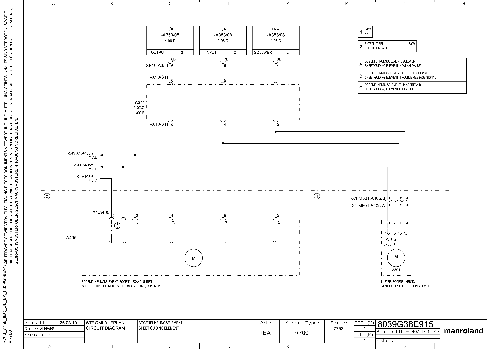

# +EA — Sheet 101 of 407 — BOGENFÜHRUNGSELEMENT

**SHEET GUIDING ELEMENT**

> Part of the manroland **R700** printing press IEC/UL circuit diagrams.
> Drawing class: **Stromlaufplan / Circuit diagram** (DIN A3).
> Document `+EA` covers the **Printing unit** machine section.

## At a glance

| Field | Value |
|---|---|
| Document | `+EA`  (8039G38E915) |
| Sheet | **101** of 407 |
| Section (DE) | BOGENFÜHRUNGSELEMENT |
| Section (EN) | SHEET GUIDING ELEMENT |
| Section type | CIRCUIT — Circuit diagram |
| Machine type | `R700` |
| Series | `7758` |
| Created | 25.03.10 |
| Replaces | — |
| Columns used | A, B, C, D, E, F, G |
| Path numbers | — |
| Labels on sheet | 92 |
| Cross-refs out | 9 |
| Cross-refs in | 32 |

**Previous:** [+EA sheet 100](SHEET_0100.md) · **Next:** [+EA sheet 102](SHEET_0102.md) · **Document TOC:** [_TOC.md](_TOC.md)  (+EA) · **Master TOC:** [all sheets](../_MASTER_TOC.md)

## Sheet image (300 DPI, exact vector render)



_Rendered directly from the PDF vector layer at 300 DPI (1-bit), no OCR and no resampling. Use it to confirm anything ambiguous in the text below._

## Cross-references on this sheet

Each entry is a wire leaving this sheet. The printed token is `/sheet.column`; the link resolves to that sheet inside the same document.

| Ref | Target sheet | Col | Path | Destination on target | Target section | From col |
|---|---|---|---|---|---|---|
| `/196.D` | [+EA sheet 196](SHEET_0196.md) | D | — | — | REFERENZMODUL | C |
| `/196.D` | [+EA sheet 196](SHEET_0196.md) | D | — | — | REFERENZMODUL | D |
| `/196.D` | [+EA sheet 196](SHEET_0196.md) | D | — | — | REFERENZMODUL | E |
| `/102.C` | [+EA sheet 102](SHEET_0102.md) | C | — | — | BOGENFÜHRUNGSELEMENT | B |
| `/99.F` | [+EA sheet 99](SHEET_0099.md) | F | — | — | BOGENFÜHRUNGSELEMENT | B |
| `/17.D` | [+EA sheet 17](SHEET_0017.md) | D | — | 24V.X1.A405:2 | SPANNUNGSVERSORGUNG: 400V, 24V | B |
| `/17.D` | [+EA sheet 17](SHEET_0017.md) | D | — | 0V.X1.A405:1 | SPANNUNGSVERSORGUNG: 400V, 24V | B |
| `/17.G` | [+EA sheet 17](SHEET_0017.md) | G | — | X1.A405:6 | SPANNUNGSVERSORGUNG: 400V, 24V | B |
| `/203.B` | [+EA sheet 203](SHEET_0203.md) | B | — | A405 | REFERENZMODUL | G |

### Incoming references (sheets that point here)

Every other sheet that sends a wire to this one. `Back-ref` is the token printed on *that* sheet; `Path` is its line number.

| From sheet | Cols | Back-ref | Path | Refs | What continues there |
|---|---|---|---|---|---|
| [+EA#17](SHEET_0017.md) | D, G | `/17.D`, `/17.G` | — | 3 | 0V.X1.A405:1 |
| [+EA#99](SHEET_0099.md) | E | `/99.E` | — | 1 | — |
| [+EA#102](SHEET_0102.md) | B | `/102.B` | — | 1 | — |
| [+EA#196](SHEET_0196.md) | D | `/196.D` | — | 3 | — |
| [+EA#203](SHEET_0203.md) | B | `/203.B` | — | 1 | — |
| [+EA#209](SHEET_0209.md) | A | `/209.A` | — | 3 | — |
| [+EA#210](SHEET_0210.md) | B | `/210.B` | — | 6 | — |
| [+EA#219](SHEET_0219.md) | A | `/219.A` | — | 8 | — |
| [+EA#236](SHEET_0236.md) | F | `/236.F` | — | 3 | — |
| [+EA#254](SHEET_0254.md) | C | `/254.C` | — | 3 | — |


## Devices on this sheet

| Tag | Class | Class meaning (IEC) | Col | Sub | Terminal | Sign |
|---|---|---|---|---|---|---|
| `A341` | A | Baugruppe / assembly, module, PC board | B | — | — | — |
| `A353/08` | A | Baugruppe / assembly, module, PC board | D | 08 | — | — |
| `A353/08` | A | Baugruppe / assembly, module, PC board | C | 08 | — | — |
| `A353/08` | A | Baugruppe / assembly, module, PC board | E | 08 | — | — |
| `A405` | A | Baugruppe / assembly, module, PC board | G | — | — | — |
| `A405` | A | Baugruppe / assembly, module, PC board | A | — | — | — |
| `X4.A341` | — | cross-device reference | C | — | — | — |
| `X1.A341` | — | cross-device reference | C | — | — | — |
| `XB10.A353` | — | cross-device reference | C | — | — | — |
| `X1.A405` | — | cross-device reference | B | — | — | — |
| `X1.M501.A405.B` | — | cross-device reference | F | — | — | — |
| `X1.M501.A405.A` | — | cross-device reference | F | — | — | — |
| `X1.A405:6` | — | cross-device reference | B | — | 6 | — |

## Potentials / nets

| Potential | Count | Columns | Attached devices | Terminals |
|---|---|---|---|---|
| `0V` | 1 | B | `A405`, `X1` | `1` |
| `24V` | 1 | A | `A405`, `X1` | `2` |
| `M501` | 1 | G | — | — |


A potential such as `L24+/4` or `M24+` is a named supply/return rail; every place it appears on this sheet is electrically common.

## Wire-end annotations (grouped as printed)

A wire that continues elsewhere is annotated with a small cluster: the destination description, the path/line number `#NN`, and the `/sheet.column` cross reference. Each row below is one such cluster exactly as it is grouped on the drawing.

| Col | Y | Path | Cross-ref | Text on the wire |
|---|---|---|---|---|
| C | 65.8 | — | — | `D/A` |
| D | 65.8 | — | — | `D/A` |
| E | 65.8 | — | — | `D/A` |
| F | 67.1 | — | — | `1 PP S+W` |
| C | 79.7 | — | — | `A353/08` |
| D | 79.7 | — | — | `A353/08` |
| E | 79.7 | — | — | `A353/08` |
| C | 94.5 | — | `/196.D` | — |
| D | 94.5 | — | `/196.D` | — |
| E | 94.5 | — | `/196.D` | — |
| G | 102.5 | — | — | `PP S+W` |
| G | 102.6 | — | — | `ENTFÄLLT BEI DELETED IN CASE OF` |
| F | 108.0 | — | — | `2` |
| E | 122.8 | — | — | `SOLLWERT 2` |
| C | 122.9 | — | — | `OUTPUT 2` |
| D | 122.9 | — | — | `INPUT 2` |
| C | 139.2 | — | — | `8B` |
| D | 139.2 | — | — | `7B` |
| E | 139.2 | — | — | `6B` |
| G | 145.2 | — | — | `BOGENFÜHRUNGSELEMENT, SOLLWERT` |
| G | 150.5 | — | — | `A SHEET GUIDING ELEMENT, NOMINAL VALUE` |
| C | 153.4 | — | — | `XB10.A353 6` |
| D | 154.8 | — | — | `5` |
| E | 154.8 | — | — | `4` |
| G | 173.6 | — | — | `BOGENFÜHRUNGSELEMENT, STÖRMELDESIGNAL` |
| G | 178.9 | — | — | `B SHEET GUIDING ELEMENT, TROUBLE MESSAGE SIGNAL` |
| C | 181.7 | — | — | `X1.A341 6` |
| D | 190.2 | — | — | `5` |
| E | 190.2 | — | — | `4` |
| G | 201.9 | — | — | `BOGENFÜHRUNGSELEMENT LINKS / RECHTS` |
| G | 207.2 | — | — | `C SHEET GUIDING ELEMENT LEFT / RIGHT` |
| B | 242.7 | — | — | `A341` |
| B | 255.8 | — | `/102.C` | — |
| B | 268.1 | — | `/99.F` | — |
| C | 295.1 | — | — | `X4.A341 5` |
| D | 296.5 | — | — | `4` |
| E | 296.5 | — | — | `3` |
| B | 365.9 | — | `/17.D` | `24V.X1.A405:2` |
| B | 394.3 | — | `/17.D` | `0V.X1.A405:1` |
| B | 422.6 | — | `/17.G` | `X1.A405:6` |
| F | 470.3 | — | — | `1` |
| A | 470.8 | — | — | `2` |
| F | 473.7 | — | — | `X1.M501.A405.B 1` |
| G | 473.7 | — | — | `2` |
| G | 473.7 | — | — | `5` |
| G | 473.7 | — | — | `3` |
| F | 490.7 | — | — | `X1.M501.A405.A 1` |
| G | 490.7 | — | — | `2` |
| G | 490.7 | — | — | `5` |
| G | 490.7 | — | — | `3` |
| C | 507.7 | — | — | `X1.A405 6 1 2 4 5 3` |
| D | 533.2 | — | — | `+ C B A` |
| G | 534.6 | — | — | `+ B A` |
| A | 568.6 | — | — | `A405` |
| G | 572.9 | — | `/203.B` | `A405` |
| G | 614.0 | — | — | `M` |
| C | 618.5 | — | — | `M` |
| G | 647.4 | — | — | `M501` |
| B | 676.7 | — | — | `BOGENFÜHRUNGSELEMENT: BOGENAUFGANG, UNTEN` |
| G | 676.7 | — | — | `LÜFTER: BOGENFÜHRUNG` |
| B | 687.3 | — | — | `SHEET GUIDING ELEMENT: SHEET ASCENT RAMP, LOWER UNIT` |
| G | 687.3 | — | — | `VENTILATOR: SHEET GUIDING DEVICE` |


## Reconstructed tables

This sheet carries tabular content (pin map / terminal assignment / index). The grid below was rebuilt from the drawing's own rule lines, so each row is exactly one physical row of the table.

### Table 1 — 2 data rows × 3 columns (at x=326.0, y=62.4)

|  | D/A | A353/08 /196.D |
|---|---|---|
|  | `OUTPUT` | `2` |
| `A341 /102.C /99.F` | `XB10.A353 X1.A341 X4.A341` | `8B 6 6 5` |


### Table 2 — 2 data rows × 2 columns (at x=481.9, y=62.4)

| D/A | A353/08 /196.D |
|---|---|
| `INPUT` | `2` |
|  | `7B 5 5 4` |


### Table 3 — 2 data rows × 2 columns (at x=609.4, y=62.4)

| D/A | A353/08 /196.D |
|---|---|
| `SOLLWERT` | `2` |
|  | `6B 4 4 3` |


### Table 4 — 1 data rows × 4 columns (at x=935.4, y=317.5)

| 1 1 | 2 2 | 5 5 | 3 3 |
|---|---|---|---|
| `+ A405 /203.B` | `M M501` | `B` | `A` |


## Notes and free text on this sheet

| Text | Col | Y (pt) |
|---|---|---|
| `7B` | D | 139.17 |
| `D/A` | D | 65.78 |
| `INPUT` | D | 122.88 |
| `8B` | C | 139.17 |
| `D/A` | C | 65.78 |
| `OUTPUT` | C | 122.89 |
| `6B` | E | 139.17 |
| `D/A` | E | 65.78 |
| `SOLLWERT` | E | 122.83 |
| `M` | G | 614.03 |
| `LÜFTER: BOGENFÜHRUNG` | G | 676.7 |
| `VENTILATOR: SHEET GUIDING DEVICE` | G | 687.32 |
| `B` | G | 534.56 |
| `A` | G | 534.56 |
| `S+W` | F | 67.1 |
| `PP` | F | 77.73 |
| `ENTFÄLLT BEI` | F | 102.64 |
| `DELETED IN CASE OF` | G | 113.29 |
| `S+W` | G | 102.53 |
| `PP` | G | 113.16 |
| `C` | C | 533.22 |
| `B` | D | 533.22 |
| `A` | E | 533.22 |
| `BOGENFÜHRUNGSELEMENT: BOGENAUFGANG, UNTEN` | B | 676.7 |
| `SHEET GUIDING ELEMENT: SHEET ASCENT RAMP, LOWER UNIT` | B | 687.32 |
| `M` | C | 618.54 |
| `BOGENFÜHRUNGSELEMENT, SOLLWERT` | G | 145.19 |
| `SHEET GUIDING ELEMENT, NOMINAL VALUE` | G | 155.83 |
| `A` | F | 150.54 |
| `BOGENFÜHRUNGSELEMENT, STÖRMELDESIGNAL` | G | 173.55 |
| `SHEET GUIDING ELEMENT, TROUBLE MESSAGE SIGNAL` | G | 184.18 |
| `B` | F | 178.88 |
| `BOGENFÜHRUNGSELEMENT LINKS / RECHTS` | G | 201.89 |
| `SHEET GUIDING ELEMENT LEFT / RIGHT` | G | 212.52 |
| `C` | F | 207.24 |

## Complete label inventory (exact text from the drawing)

Every text object inside the drawing area of this sheet, in DIN reading order (column A→H, then top→bottom). This is the authoritative list: if a string is not here it is not printed on this sheet.

| Col | Y | X | Dir | Type | Text |
|---|---|---|---|---|---|
| A | 365.9 | 163.8 | → | potential | `24V.X1.A405:2` |
| A | 470.8 | 111.4 | → | number | `2` |
| A | 568.6 | 156.5 | → | device tag | `A405` |
| B | 242.7 | 322.3 | → | device tag | `A341` |
| B | 255.8 | 323.1 | → | cross-reference | `/102.C` |
| B | 268.1 | 328.8 | → | cross-reference | `/99.F` |
| B | 375.9 | 214.6 | → | cross-reference | `/17.D` |
| B | 394.3 | 172.6 | → | potential | `0V.X1.A405:1` |
| B | 404.2 | 214.6 | → | cross-reference | `/17.D` |
| B | 422.6 | 181.7 | → | device ref | `X1.A405:6` |
| B | 432.6 | 214.3 | → | cross-reference | `/17.G` |
| B | 507.7 | 220.0 | → | device ref | `X1.A405` |
| B | 516.2 | 271.8 | → | number | `6` |
| B | 516.2 | 299.6 | → | number | `1` |
| B | 516.2 | 328.5 | → | number | `2` |
| B | 533.2 | 301.7 | → | number | `+` |
| B | 676.7 | 197.6 | → | text | `BOGENFÜHRUNGSELEMENT: BOGENAUFGANG, UNTEN` |
| B | 687.3 | 198.1 | → | text | `SHEET GUIDING ELEMENT: SHEET ASCENT RAMP, LOWER UNIT` |
| C | 65.8 | 402.2 | → | text | `D/A` |
| C | 79.7 | 389.6 | → | device tag | `A353/08` |
| C | 94.5 | 398.3 | → | cross-reference | `/196.D` |
| C | 122.9 | 364.7 | → | text | `OUTPUT` |
| C | 122.9 | 437.1 | → | number | `2` |
| C | 139.2 | 413.6 | → | text | `8B` |
| C | 153.4 | 348.7 | → | device ref | `XB10.A353` |
| C | 154.8 | 413.6 | → | number | `6` |
| C | 181.7 | 363.1 | → | device ref | `X1.A341` |
| C | 190.2 | 413.6 | → | number | `6` |
| C | 295.1 | 363.1 | → | device ref | `X4.A341` |
| C | 296.5 | 413.6 | → | number | `5` |
| C | 516.2 | 413.6 | → | number | `4` |
| C | 533.2 | 414.3 | → | text | `C` |
| C | 618.5 | 463.6 | → | text | `M` |
| D | 65.8 | 529.8 | → | text | `D/A` |
| D | 79.7 | 517.2 | → | device tag | `A353/08` |
| D | 94.5 | 525.8 | → | cross-reference | `/196.D` |
| D | 122.9 | 496.8 | → | text | `INPUT` |
| D | 122.9 | 564.7 | → | number | `2` |
| D | 139.2 | 541.1 | → | text | `7B` |
| D | 154.8 | 541.1 | → | number | `5` |
| D | 190.2 | 541.1 | → | number | `5` |
| D | 296.5 | 541.1 | → | number | `4` |
| D | 516.2 | 541.1 | → | number | `5` |
| D | 533.2 | 542.0 | → | text | `B` |
| E | 65.8 | 657.4 | → | text | `D/A` |
| E | 79.7 | 644.7 | → | device tag | `A353/08` |
| E | 94.5 | 653.4 | → | cross-reference | `/196.D` |
| E | 122.8 | 613.3 | → | text | `SOLLWERT` |
| E | 122.9 | 692.2 | → | number | `2` |
| E | 139.2 | 668.7 | → | text | `6B` |
| E | 154.8 | 668.7 | → | number | `4` |
| E | 190.2 | 668.7 | → | number | `4` |
| E | 296.5 | 668.7 | → | number | `3` |
| E | 516.2 | 668.7 | → | number | `3` |
| E | 533.2 | 669.7 | → | text | `A` |
| F | 67.1 | 881.3 | → | text | `S+W` |
| F | 72.6 | 869.1 | → | number | `1` |
| F | 77.7 | 880.7 | → | text | `PP` |
| F | 102.6 | 880.7 | → | text | `ENTFÄLLT BEI` |
| F | 108.0 | 868.8 | → | number | `2` |
| F | 150.5 | 868.1 | → | text | `A` |
| F | 178.9 | 868.0 | → | text | `B` |
| F | 207.2 | 867.8 | → | text | `C` |
| F | 470.3 | 763.6 | → | number | `1` |
| F | 473.7 | 846.7 | → | device ref | `X1.M501.A405.B` |
| F | 491.4 | 845.9 | → | device ref | `X1.M501.A405.A` |
| G | 102.5 | 987.6 | → | text | `S+W` |
| G | 113.2 | 987.0 | → | text | `PP` |
| G | 113.3 | 880.7 | → | text | `DELETED IN CASE OF` |
| G | 145.2 | 880.7 | → | text | `BOGENFÜHRUNGSELEMENT, SOLLWERT` |
| G | 155.8 | 881.3 | → | text | `SHEET GUIDING ELEMENT, NOMINAL VALUE` |
| G | 173.6 | 880.7 | → | text | `BOGENFÜHRUNGSELEMENT, STÖRMELDESIGNAL` |
| G | 184.2 | 881.3 | → | text | `SHEET GUIDING ELEMENT, TROUBLE MESSAGE SIGNAL` |
| G | 201.9 | 880.7 | → | text | `BOGENFÜHRUNGSELEMENT LINKS / RECHTS` |
| G | 212.5 | 881.3 | → | text | `SHEET GUIDING ELEMENT LEFT / RIGHT` |
| G | 473.7 | 937.4 | → | number | `1` |
| G | 473.7 | 952.2 | → | number | `2` |
| G | 473.7 | 966.3 | → | number | `5` |
| G | 473.7 | 980.5 | → | number | `3` |
| G | 490.7 | 937.4 | → | number | `1` |
| G | 490.7 | 952.2 | → | number | `2` |
| G | 490.7 | 966.3 | → | number | `5` |
| G | 490.7 | 980.5 | → | number | `3` |
| G | 534.6 | 938.0 | → | number | `+` |
| G | 534.6 | 965.8 | → | text | `B` |
| G | 534.6 | 980.8 | → | text | `A` |
| G | 572.9 | 928.1 | → | device tag | `A405` |
| G | 585.3 | 928.3 | → | cross-reference | `/203.B` |
| G | 614.0 | 952.3 | → | text | `M` |
| G | 647.4 | 942.2 | → | potential | `M501` |
| G | 676.7 | 920.4 | → | text | `LÜFTER: BOGENFÜHRUNG` |
| G | 687.3 | 921.3 | → | text | `VENTILATOR: SHEET GUIDING DEVICE` |

## Reading-order text block

The same content as a plain block, grouped by DIN column — convenient to paste or to match against a visual description.

```text
=== Column A ===
 365.9  163.8  net          24V.X1.A405:2
 470.8  111.4  numeric      2
 568.6  156.5  devtag       A405
=== Column B ===
 242.7  322.3  devtag       A341
 255.8  323.1  xref         /102.C
 268.1  328.8  xref         /99.F
 375.9  214.6  xref         /17.D
 394.3  172.6  net          0V.X1.A405:1
 404.2  214.6  xref         /17.D
 422.6  181.7  devref       X1.A405:6
 432.6  214.3  xref         /17.G
 507.7  220.0  devref       X1.A405
 516.2  271.8  numeric      6
 516.2  299.6  numeric      1
 516.2  328.5  numeric      2
 533.2  301.7  numeric      +
 676.7  197.6  text         BOGENFÜHRUNGSELEMENT: BOGENAUFGANG, UNTEN
 687.3  198.1  text         SHEET GUIDING ELEMENT: SHEET ASCENT RAMP, LOWER UNIT
=== Column C ===
  65.8  402.2  text         D/A
  79.7  389.6  devtag       A353/08
  94.5  398.3  xref         /196.D
 122.9  364.7  text         OUTPUT
 122.9  437.1  numeric      2
 139.2  413.6  text         8B
 153.4  348.7  devref       XB10.A353
 154.8  413.6  numeric      6
 181.7  363.1  devref       X1.A341
 190.2  413.6  numeric      6
 295.1  363.1  devref       X4.A341
 296.5  413.6  numeric      5
 516.2  413.6  numeric      4
 533.2  414.3  text         C
 618.5  463.6  text         M
=== Column D ===
  65.8  529.8  text         D/A
  79.7  517.2  devtag       A353/08
  94.5  525.8  xref         /196.D
 122.9  496.8  text         INPUT
 122.9  564.7  numeric      2
 139.2  541.1  text         7B
 154.8  541.1  numeric      5
 190.2  541.1  numeric      5
 296.5  541.1  numeric      4
 516.2  541.1  numeric      5
 533.2  542.0  text         B
=== Column E ===
  65.8  657.4  text         D/A
  79.7  644.7  devtag       A353/08
  94.5  653.4  xref         /196.D
 122.8  613.3  text         SOLLWERT
 122.9  692.2  numeric      2
 139.2  668.7  text         6B
 154.8  668.7  numeric      4
 190.2  668.7  numeric      4
 296.5  668.7  numeric      3
 516.2  668.7  numeric      3
 533.2  669.7  text         A
=== Column F ===
  67.1  881.3  text         S+W
  72.6  869.1  numeric      1
  77.7  880.7  text         PP
 102.6  880.7  text         ENTFÄLLT BEI
 108.0  868.8  numeric      2
 150.5  868.1  text         A
 178.9  868.0  text         B
 207.2  867.8  text         C
 470.3  763.6  numeric      1
 473.7  846.7  devref       X1.M501.A405.B
 491.4  845.9  devref       X1.M501.A405.A
=== Column G ===
 102.5  987.6  text         S+W
 113.2  987.0  text         PP
 113.3  880.7  text         DELETED IN CASE OF
 145.2  880.7  text         BOGENFÜHRUNGSELEMENT, SOLLWERT
 155.8  881.3  text         SHEET GUIDING ELEMENT, NOMINAL VALUE
 173.6  880.7  text         BOGENFÜHRUNGSELEMENT, STÖRMELDESIGNAL
 184.2  881.3  text         SHEET GUIDING ELEMENT, TROUBLE MESSAGE SIGNAL
 201.9  880.7  text         BOGENFÜHRUNGSELEMENT LINKS / RECHTS
 212.5  881.3  text         SHEET GUIDING ELEMENT LEFT / RIGHT
 473.7  937.4  numeric      1
 473.7  952.2  numeric      2
 473.7  966.3  numeric      5
 473.7  980.5  numeric      3
 490.7  937.4  numeric      1
 490.7  952.2  numeric      2
 490.7  966.3  numeric      5
 490.7  980.5  numeric      3
 534.6  938.0  numeric      +
 534.6  965.8  text         B
 534.6  980.8  text         A
 572.9  928.1  devtag       A405
 585.3  928.3  xref         /203.B
 614.0  952.3  text         M
 647.4  942.2  net          M501
 676.7  920.4  text         LÜFTER: BOGENFÜHRUNG
 687.3  921.3  text         VENTILATOR: SHEET GUIDING DEVICE
```

---
_Generated from the PDF vector text layer; no OCR. Source: `R700_7758_IEC_UL_EA_8039G38E915_p`, sheet 101._
