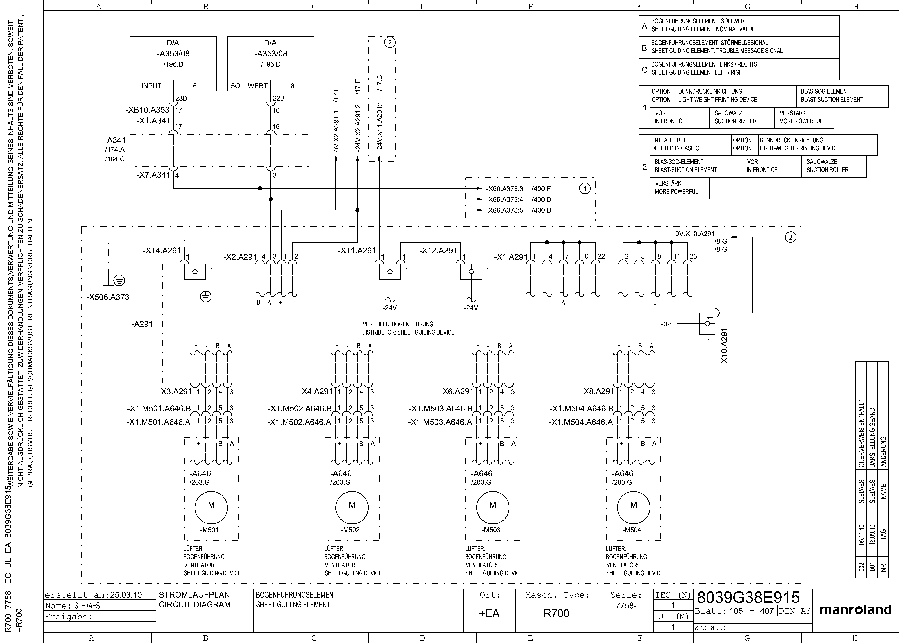

# +EA — Sheet 105 of 407 — BOGENFÜHRUNGSELEMENT

**SHEET GUIDING ELEMENT**

> Part of the manroland **R700** printing press IEC/UL circuit diagrams.
> Drawing class: **Stromlaufplan / Circuit diagram** (DIN A3).
> Document `+EA` covers the **Printing unit** machine section.

## At a glance

| Field | Value |
|---|---|
| Document | `+EA`  (8039G38E915) |
| Sheet | **105** of 407 |
| Section (DE) | BOGENFÜHRUNGSELEMENT |
| Section (EN) | SHEET GUIDING ELEMENT |
| Section type | CIRCUIT — Circuit diagram |
| Machine type | `R700` |
| Series | `7758` |
| Created | 25.03.10 |
| Replaces | — |
| Columns used | A, B, C, D, E, F, G, H |
| Path numbers | — |
| Labels on sheet | 248 |
| Cross-refs out | 16 |
| Cross-refs in | 84 |

**Previous:** [+EA sheet 104](SHEET_0104.md) · **Next:** [+EA sheet 106](SHEET_0106.md) · **Document TOC:** [_TOC.md](_TOC.md)  (+EA) · **Master TOC:** [all sheets](../_MASTER_TOC.md)

## Sheet image (300 DPI, exact vector render)



_Rendered directly from the PDF vector layer at 300 DPI (1-bit), no OCR and no resampling. Use it to confirm anything ambiguous in the text below._

## Cross-references on this sheet

Each entry is a wire leaving this sheet. The printed token is `/sheet.column`; the link resolves to that sheet inside the same document.

| Ref | Target sheet | Col | Path | Destination on target | Target section | From col |
|---|---|---|---|---|---|---|
| `/196.D` | [+EA sheet 196](SHEET_0196.md) | D | — | — | REFERENZMODUL | B |
| `/196.D` | [+EA sheet 196](SHEET_0196.md) | D | — | — | REFERENZMODUL | C |
| `/17.C` | [+EA sheet 17](SHEET_0017.md) | C | — | 24V.X11.A291:1 | SPANNUNGSVERSORGUNG: 400V, 24V | D |
| `/17.E` | [+EA sheet 17](SHEET_0017.md) | E | — | 24V.X2.A291:2 | SPANNUNGSVERSORGUNG: 400V, 24V | C |
| `/17.E` | [+EA sheet 17](SHEET_0017.md) | E | — | 0V.X2.A291:1 | SPANNUNGSVERSORGUNG: 400V, 24V | C |
| `/174.A` | [+EA sheet 174](SHEET_0174.md) | A | — | — | RESERVE | A |
| `/104.C` | [+EA sheet 104](SHEET_0104.md) | C | — | — | BOGENFÜHRUNGSELEMENT | A |
| `/400.F` | [+EA sheet 400](SHEET_0400.md) | F | — | X66.A373:3 | OPTION: DÜNNDRUCKEINRICHTUNG | E |
| `/400.D` | [+EA sheet 400](SHEET_0400.md) | D | — | X66.A373:4 | OPTION: DÜNNDRUCKEINRICHTUNG | E |
| `/400.D` | [+EA sheet 400](SHEET_0400.md) | D | — | X66.A373:5 | OPTION: DÜNNDRUCKEINRICHTUNG | E |
| `/8.G` | [+EA sheet 8](SHEET_0008.md) | G | — | — | SPANNUNGSVERSORGUNG: 400V, 24V | G |
| `/8.G` | [+EA sheet 8](SHEET_0008.md) | G | — | — | SPANNUNGSVERSORGUNG: 400V, 24V | G |
| `/203.G` | [+EA sheet 203](SHEET_0203.md) | G | — | A646 | REFERENZMODUL | B |
| `/203.G` | [+EA sheet 203](SHEET_0203.md) | G | — | A646 | REFERENZMODUL | C |
| `/203.G` | [+EA sheet 203](SHEET_0203.md) | G | — | A646 | REFERENZMODUL | E |
| `/203.G` | [+EA sheet 203](SHEET_0203.md) | G | — | A646 | REFERENZMODUL | F |

### Incoming references (sheets that point here)

Every other sheet that sends a wire to this one. `Back-ref` is the token printed on *that* sheet; `Path` is its line number.

| From sheet | Cols | Back-ref | Path | Refs | What continues there |
|---|---|---|---|---|---|
| [+EA#8](SHEET_0008.md) | G | `/8.G` | — | 2 | 0V.X10.A291:1 |
| [+EA#17](SHEET_0017.md) | C, E | `/17.C`, `/17.E` | — | 3 | 0V.X2.A291:1 |
| [+EA#104](SHEET_0104.md) | B | `/104.B` | — | 1 | — |
| [+EA#174](SHEET_0174.md) | A | `/174.A` | — | 1 | — |
| [+EA#196](SHEET_0196.md) | D | `/196.D` | — | 2 | — |
| [+EA#203](SHEET_0203.md) | G | `/203.G` | — | 4 | — |
| [+EA#208](SHEET_0208.md) | A | `/208.A` | — | 10 | — |
| [+EA#209](SHEET_0209.md) | A | `/209.A` | — | 2 | — |
| [+EA#220](SHEET_0220.md) | C | `/220.C` | — | 8 | — |
| [+EA#221](SHEET_0221.md) | A, B | `/221.A`, `/221.B` | — | 24 | — |
| [+EA#224](SHEET_0224.md) | A | `/224.A` | — | 4 | — |
| [+EA#233](SHEET_0233.md) | G | `/233.G` | — | 4 | — |
| [+EA#236](SHEET_0236.md) | C | `/236.C` | — | 4 | — |
| [+EA#244](SHEET_0244.md) | B | `/244.B` | — | 4 | — |
| [+EA#247](SHEET_0247.md) | C | `/247.C` | — | 2 | — |
| [+EA#249](SHEET_0249.md) | A | `/249.A` | — | 4 | — |
| [+EA#254](SHEET_0254.md) | C | `/254.C` | — | 2 | — |
| [+EA#400](SHEET_0400.md) | D, E | `/400.D`, `/400.E` | — | 3 | X66.A373:3; X66.A373:4; X66.A373:5 |


## Devices on this sheet

| Tag | Class | Class meaning (IEC) | Col | Sub | Terminal | Sign |
|---|---|---|---|---|---|---|
| `A646` | A | Baugruppe / assembly, module, PC board | B | — | — | — |
| `A646` | A | Baugruppe / assembly, module, PC board | C | — | — | — |
| `A646` | A | Baugruppe / assembly, module, PC board | E | — | — | — |
| `A646` | A | Baugruppe / assembly, module, PC board | F | — | — | — |
| `A353/08` | A | Baugruppe / assembly, module, PC board | B | 08 | — | — |
| `A353/08` | A | Baugruppe / assembly, module, PC board | C | 08 | — | — |
| `A341` | A | Baugruppe / assembly, module, PC board | A | — | — | — |
| `A291` | A | Baugruppe / assembly, module, PC board | A | — | — | — |
| `X1.M502.A646.B` | — | cross-device reference | C | — | — | — |
| `X1.M502.A646.A` | — | cross-device reference | C | — | — | — |
| `X1.M501.A646.B` | — | cross-device reference | B | — | — | — |
| `X1.M501.A646.A` | — | cross-device reference | B | — | — | — |
| `X1.M503.A646.B` | — | cross-device reference | D | — | — | — |
| `X1.M503.A646.A` | — | cross-device reference | D | — | — | — |
| `X1.M504.A646.B` | — | cross-device reference | E | — | — | — |
| `X1.M504.A646.A` | — | cross-device reference | E | — | — | — |
| `XB10.A353` | — | cross-device reference | A | — | — | — |
| `X1.A341` | — | cross-device reference | B | — | — | — |
| `X3.A291` | — | cross-device reference | B | — | — | — |
| `X8.A291` | — | cross-device reference | F | — | — | — |
| `X6.A291` | — | cross-device reference | D | — | — | — |
| `X4.A291` | — | cross-device reference | C | — | — | — |
| `X2.A291` | — | cross-device reference | B | — | — | — |
| `X11.A291` | — | cross-device reference | C | — | — | — |
| `X12.A291` | — | cross-device reference | D | — | — | — |
| `X1.A291` | — | cross-device reference | E | — | — | — |
| `X10.A291` | — | cross-device reference | G | — | — | — |
| `X7.A341` | — | cross-device reference | B | — | — | — |
| `NR.` | — | cross-device reference | H | — | — | — |
| `16.09.10` | — | cross-device reference | H | — | — | — |
| `05.11.10` | — | cross-device reference | H | — | — | — |
| `X14.A291` | — | cross-device reference | B | — | — | — |
| `X66.A373:5` | — | cross-device reference | E | — | 5 | — |
| `X66.A373:4` | — | cross-device reference | E | — | 4 | — |
| `X66.A373:3` | — | cross-device reference | E | — | 3 | — |
| `X506.A373` | — | cross-device reference | A | — | — | — |

## Potentials / nets

| Potential | Count | Columns | Attached devices | Terminals |
|---|---|---|---|---|
| `0V` | 3 | C, F, G | `A291`, `X10`, `X2` | `1` |
| `24V` | 4 | C, D | `A291`, `X11`, `X2` | `1`, `2` |
| `M501` | 1 | B | — | — |
| `M502` | 1 | C | — | — |
| `M503` | 1 | E | — | — |
| `M504` | 1 | F | — | — |


A potential such as `L24+/4` or `M24+` is a named supply/return rail; every place it appears on this sheet is electrically common.

## Wire-end annotations (grouped as printed)

A wire that continues elsewhere is annotated with a small cluster: the destination description, the path/line number `#NN`, and the `/sheet.column` cross reference. Each row below is one such cluster exactly as it is grouped on the drawing.

| Col | Y | Path | Cross-ref | Text on the wire |
|---|---|---|---|---|
| G | 24.7 | — | — | `BOGENFÜHRUNGSELEMENT, SOLLWERT` |
| G | 30.1 | — | — | `A SHEET GUIDING ELEMENT, NOMINAL VALUE` |
| B | 51.6 | — | — | `D/A` |
| C | 51.6 | — | — | `D/A` |
| D | 52.7 | — | — | `2` |
| G | 53.1 | — | — | `BOGENFÜHRUNGSELEMENT, STÖRMELDESIGNAL` |
| G | 58.4 | — | — | `B SHEET GUIDING ELEMENT, TROUBLE MESSAGE SIGNAL` |
| B | 65.5 | — | — | `A353/08` |
| C | 65.5 | — | — | `A353/08` |
| B | 80.4 | — | `/196.D` | — |
| C | 80.4 | — | `/196.D` | — |
| G | 81.4 | — | — | `BOGENFÜHRUNGSELEMENT LINKS / RECHTS` |
| G | 86.8 | — | — | `C SHEET GUIDING ELEMENT LEFT / RIGHT` |
| D | 98.1 | — | `/17.C` | `24V.X11.A291:1` |
| C | 103.3 | — | `/17.E` | `24V.X2.A291:2` |
| B | 108.7 | — | — | `INPUT 6` |
| C | 108.7 | — | — | `SOLLWERT 6` |
| C | 113.2 | — | `/17.E` | `0V.X2.A291:1` |
| F | 116.8 | — | — | `OPTION OPTION` |
| H | 116.8 | — | — | `BLAS SOG ELEMENT BLAST SUCTION ELEMENT` |
| G | 116.9 | — | — | `DÜNNDRUCKEINRICHTUNG LIGHT WEIGHT PRINTING DEVICE` |
| B | 125.0 | — | — | `23B` |
| C | 125.0 | — | — | `22B` |
| F | 136.3 | — | — | `1` |
| B | 139.2 | — | — | `XB10.A353 17 16` |
| G | 145.1 | — | — | `SAUGWALZE SUCTION ROLLER` |
| F | 145.2 | — | — | `IN FRONT OF VOR` |
| G | 145.2 | — | — | `MORE POWERFUL VERSTÄRKT` |
| B | 153.4 | — | — | `X1.A341 17` |
| C | 161.9 | — | — | `16` |
| A | 178.9 | — | — | `A341` |
| F | 180.6 | — | — | `ENTFÄLLT BEI DELETED IN CASE OF` |
| G | 180.6 | — | — | `OPTION OPTION` |
| G | 180.7 | — | — | `DÜNNDRUCKEINRICHTUNG LIGHT WEIGHT PRINTING DEVICE` |
| A | 192.0 | — | `/174.A`, `/104.C` | — |
| H | 208.9 | — | — | `SAUGWALZE SUCTION ROLLER` |
| G | 209.0 | — | — | `2 IN FRONT OF VOR` |
| F | 209.0 | — | — | `BLAS SOG ELEMENT BLAST SUCTION ELEMENT` |
| B | 224.2 | — | — | `X7.A341 4 3` |
| F | 237.3 | — | — | `MORE POWERFUL VERSTÄRKT` |
| E | 243.3 | — | `/400.F` | `X66.A373:3` |
| F | 243.6 | — | — | `1` |
| E | 257.5 | — | `/400.D` | `X66.A373:4` |
| E | 271.7 | — | `/400.D` | `X66.A373:5` |
| G | 302.2 | — | — | `0V.X10.A291:1` |
| G | 307.9 | — | — | `2` |
| G | 312.1 | — | `/8.G`, `/8.G` | — |
| B | 323.4 | — | — | `X14.A291 1` |
| C | 323.4 | — | — | `X11.A291 1` |
| D | 323.4 | — | — | `1 X12.A291 1` |
| C | 332.0 | — | — | `X2.A291 4 3 1 2` |
| F | 332.0 | — | — | `X1.A291 1 4 7 10 22 2 5 8 11 23` |
| C | 349.7 | — | — | `1 1 1` |
| A | 384.4 | — | — | `X506.A373` |
| C | 393.0 | — | — | `B A +` |
| F | 393.0 | — | — | `A B` |
| D | 399.3 | — | — | `24V 24V` |
| G | 413.3 | — | — | `1` |
| C | 419.8 | — | — | `A291 DISTRIBUTOR: SHEET GUIDING DEVICE VERTEILER: BOGENFÜHRUNG` |
| F | 420.5 | — | — | `0V` |
| G | 428.9 | — | — | `X10.A291` |
| G | 442.2 | — | — | `1` |
| D | 449.7 | — | — | `+ B A + B A + B A + B A` |
| D | 507.7 | — | — | `X3.A291 1 2 4 3 X4.A291 1 2 4 3 X6.A291 1 2 4 3 X8.A291 1 2 4 3` |
| H | 522.5 | — | — | `QUERVERWEIS ENTFÄLLT SLEI/AES 002 05.11.10` |
| B | 530.4 | — | — | `X1.M501.A646.B 1` |
| B | 530.4 | — | — | `2` |
| B | 530.4 | — | — | `5` |
| B | 530.4 | — | — | `3` |
| C | 530.4 | — | — | `X1.M502.A646.B 1` |
| C | 530.4 | — | — | `2` |
| C | 530.4 | — | — | `5` |
| D | 530.4 | — | — | `3` |
| D | 530.4 | — | — | `X1.M503.A646.B 1` |
| E | 530.4 | — | — | `2` |
| E | 530.4 | — | — | `5` |
| E | 530.4 | — | — | `3` |
| F | 530.4 | — | — | `X1.M504.A646.B 1` |
| F | 530.4 | — | — | `2` |
| F | 530.4 | — | — | `5` |
| F | 530.4 | — | — | `3` |
| H | 531.8 | — | — | `001 DARSTELLUNG GEÄND. 16.09.10 SLEI/AES` |
| B | 547.4 | — | — | `X1.M501.A646.A 1` |
| B | 547.4 | — | — | `2` |
| B | 547.4 | — | — | `5` |
| B | 547.4 | — | — | `3` |
| C | 547.4 | — | — | `X1.M502.A646.A 1` |
| C | 547.4 | — | — | `2` |
| C | 547.4 | — | — | `5` |
| D | 547.4 | — | — | `3` |
| D | 547.4 | — | — | `X1.M503.A646.A 1` |
| E | 547.4 | — | — | `2` |
| E | 547.4 | — | — | `5` |
| E | 547.4 | — | — | `3` |
| F | 547.4 | — | — | `X1.M504.A646.A 1` |
| F | 547.4 | — | — | `2` |
| F | 547.4 | — | — | `5` |
| F | 547.4 | — | — | `3` |
| H | 571.4 | — | — | `NR. NAME TAG ÄNDERUNG` |
| B | 577.1 | — | — | `+ B A` |
| C | 577.1 | — | — | `+ B A` |
| E | 577.1 | — | — | `+ B A` |
| F | 577.1 | — | — | `+ B A` |
| B | 615.4 | — | `/203.G` | `A646` |
| C | 615.4 | — | `/203.G` | `A646` |
| E | 615.4 | — | `/203.G` | `A646` |
| F | 615.4 | — | `/203.G` | `A646` |
| B | 656.5 | — | — | `M` |
| C | 656.5 | — | — | `M` |
| E | 656.5 | — | — | `M` |
| F | 656.5 | — | — | `M` |
| B | 689.9 | — | — | `M501` |
| C | 689.9 | — | — | `M502` |
| E | 689.9 | — | — | `M503` |
| F | 689.9 | — | — | `M504` |
| B | 715.6 | — | — | `LÜFTER: BOGENFÜHRUNG` |
| C | 715.6 | — | — | `LÜFTER: BOGENFÜHRUNG` |
| E | 715.6 | — | — | `LÜFTER: BOGENFÜHRUNG` |
| F | 715.6 | — | — | `LÜFTER: BOGENFÜHRUNG` |
| B | 736.9 | — | — | `SHEET GUIDING DEVICE VENTILATOR:` |
| C | 736.9 | — | — | `SHEET GUIDING DEVICE VENTILATOR:` |
| E | 736.9 | — | — | `SHEET GUIDING DEVICE VENTILATOR:` |
| F | 736.9 | — | — | `SHEET GUIDING DEVICE VENTILATOR:` |


## Reconstructed tables

This sheet carries tabular content (pin map / terminal assignment / index). The grid below was rebuilt from the drawing's own rule lines, so each row is exactly one physical row of the table.

### Table 1 — 4 data rows × 12 columns (at x=141.7, y=48.2)

|  | D/A A353/08 /196.D |  |  |  |  |  |  | D/A | A353/08 /196.D |  |  |
|---|---|---|---|---|---|---|---|---|---|---|---|
|  | `INPUT` |  | `6` |  |  |  | `SOLLWERT` |  |  | `6` |  |
| `A341 /174.A /104.C` | `23B XB10.A353 17 X1.A341 17 X7.A341 4` |  |  |  |  |  |  |  | `22B 16 16 3` |  |  |
|  | `X14.A291 A291 X3.A291 X1.M501.A646.B X1.M501.A646.A` | `1` | `+ 1 1 1` | `1 2 2 2` | `B 4 5 5` | `A 3 3 3` | `X2.A291 B` | `4 A` | `3 +` | `1 2 X1.M502.A646.B X1.M502.A646.A` | `X4.A291` |
|  |  |  | `+ A646 /203.G` | `M M501` | `B` | `A` |  |  |  |  |  |


### Table 2 — 3 data rows × 7 columns (at x=439.4, y=48.2) — **2**

|  |  | /17.E |  | /17.C |  |  |
|---|---|---|---|---|---|---|
| `/17.E 0V.X2.A291:1` |  | `24V.X2.A291:2` |  | `24V.X11.A291:1` |  |  |
| `+ 1 1 1` | `X11.A291 2 2 2` | `B 4 5 5` | `VERTEILER: A 3 3 3` | `1 24V DISTRIBUTOR:` | `X12.A291 1 1 1 BOGENFÜHRUNG SHEET GUIDING DEVICE X6.A291 X1.M503.A646.B X1.M503.A646.A` | `24V` |
| `+ A646 /203.G` | `M M502` | `B` | `A` |  |  |  |


### Table 3 — 1 data rows × 4 columns (at x=623.6, y=48.2) — **X66.A373:3 X66.A373:4 X66.A373:5**

| + 1 1 1 | 1 2 2 2 | B 4 5 5 | X1.A291 A 3 3 3 |
|---|---|---|---|
| `+ A646 /203.G` | `M M503` | `B` | `A` |


## Notes and free text on this sheet

| Text | Col | Y (pt) |
|---|---|---|
| `M` | B | 656.55 |
| `LÜFTER:` | B | 715.63 |
| `BOGENFÜHRUNG` | B | 726.31 |
| `VENTILATOR:` | B | 736.92 |
| `SHEET GUIDING DEVICE` | B | 747.56 |
| `B` | B | 577.07 |
| `A` | B | 577.07 |
| `M` | C | 656.55 |
| `LÜFTER:` | C | 715.63 |
| `BOGENFÜHRUNG` | C | 726.31 |
| `VENTILATOR:` | C | 736.92 |
| `SHEET GUIDING DEVICE` | C | 747.56 |
| `B` | C | 577.07 |
| `A` | D | 577.07 |
| `M` | E | 656.55 |
| `LÜFTER:` | D | 715.63 |
| `BOGENFÜHRUNG` | E | 726.31 |
| `VENTILATOR:` | E | 736.92 |
| `SHEET GUIDING DEVICE` | E | 747.56 |
| `B` | E | 577.07 |
| `A` | E | 577.07 |
| `M` | F | 656.55 |
| `LÜFTER:` | F | 715.63 |
| `BOGENFÜHRUNG` | F | 726.31 |
| `VENTILATOR:` | F | 736.92 |
| `SHEET GUIDING DEVICE` | F | 747.56 |
| `B` | F | 577.07 |
| `A` | F | 577.07 |
| `23B` | B | 125.01 |
| `D/A` | B | 51.61 |
| `INPUT` | A | 108.7 |
| `22B` | C | 125.01 |
| `D/A` | C | 51.61 |
| `SOLLWERT` | B | 108.65 |
| `VERTEILER: BOGENFÜHRUNG` | D | 421.58 |
| `DISTRIBUTOR: SHEET GUIDING DEVICE` | D | 432.2 |
| `TAG` | H | 692.75 |
| `NAME` | H | 633.34 |
| `ÄNDERUNG` | H | 571.36 |
| `SLEI/AES` | H | 627.9 |
| `DARSTELLUNG GEÄND.` | H | 531.75 |
| `QUERVERWEIS ENTFÄLLT` | H | 522.54 |
| `A` | C | 393.19 |
| `BOGENFÜHRUNGSELEMENT, SOLLWERT` | G | 24.72 |
| `SHEET GUIDING ELEMENT, NOMINAL VALUE` | G | 35.36 |
| `BOGENFÜHRUNGSELEMENT, STÖRMELDESIGNAL` | G | 53.08 |
| `SHEET GUIDING ELEMENT, TROUBLE MESSAGE SIGNAL` | G | 63.7 |
| `BOGENFÜHRUNGSELEMENT LINKS / RECHTS` | G | 81.42 |
| `SHEET GUIDING ELEMENT LEFT / RIGHT` | G | 92.05 |
| `C` | F | 86.77 |
| `VOR` | F | 145.2 |
| `IN FRONT OF` | F | 155.82 |
| `SAUGWALZE` | G | 145.14 |
| `SUCTION ROLLER` | G | 155.84 |
| `VERSTÄRKT` | G | 145.19 |
| `MORE POWERFUL` | G | 155.81 |
| `OPTION` | F | 116.82 |
| `DÜNNDRUCKEINRICHTUNG` | G | 116.87 |
| `LIGHT WEIGHT PRINTING DEVICE` | G | 127.46 |
| `BLAS SOG ELEMENT` | H | 116.85 |
| `BLAST SUCTION ELEMENT` | H | 127.48 |
| `ENTFÄLLT BEI` | F | 180.59 |
| `DELETED IN CASE OF` | F | 191.24 |
| `OPTION` | G | 180.6 |
| `BLAS SOG ELEMENT` | F | 208.97 |
| `BLAST SUCTION ELEMENT` | F | 219.61 |
| `VERSTÄRKT` | F | 237.31 |
| `MORE POWERFUL` | F | 247.94 |
| `VOR` | G | 208.98 |
| `IN FRONT OF` | G | 219.6 |
| `SAUGWALZE` | H | 208.92 |
| `SUCTION ROLLER` | H | 219.62 |

## Complete label inventory (exact text from the drawing)

Every text object inside the drawing area of this sheet, in DIN reading order (column A→H, then top→bottom). This is the authoritative list: if a string is not here it is not printed on this sheet.

| Col | Y | X | Dir | Type | Text |
|---|---|---|---|---|---|
| A | 108.7 | 185.0 | → | text | `INPUT` |
| A | 139.2 | 164.4 | → | device ref | `XB10.A353` |
| A | 178.9 | 136.6 | → | device tag | `A341` |
| A | 192.0 | 137.5 | → | cross-reference | `/174.A` |
| A | 204.4 | 137.5 | → | cross-reference | `/104.C` |
| A | 384.4 | 113.1 | → | device ref | `X506.A373` |
| A | 419.8 | 172.1 | → | device tag | `A291` |
| B | 51.6 | 218.0 | → | text | `D/A` |
| B | 65.5 | 205.4 | → | device tag | `A353/08` |
| B | 80.4 | 214.0 | → | cross-reference | `/196.D` |
| B | 108.7 | 252.7 | → | number | `6` |
| B | 108.7 | 301.5 | → | text | `SOLLWERT` |
| B | 125.0 | 229.3 | → | text | `23B` |
| B | 140.6 | 228.8 | → | number | `17` |
| B | 153.4 | 178.9 | → | device ref | `X1.A341` |
| B | 161.9 | 228.8 | → | number | `17` |
| B | 224.2 | 178.9 | → | device ref | `X7.A341` |
| B | 225.7 | 229.3 | → | number | `4` |
| B | 323.5 | 187.1 | → | device ref | `X14.A291` |
| B | 331.9 | 242.6 | → | number | `1` |
| B | 332.0 | 292.3 | → | device ref | `X2.A291` |
| B | 349.7 | 274.4 | → | number | `1` |
| B | 393.0 | 335.9 | → | text | `B` |
| B | 449.7 | 282.6 | → | text | `B` |
| B | 449.8 | 254.8 | → | number | `+` |
| B | 449.9 | 297.6 | → | text | `A` |
| B | 507.7 | 207.2 | → | device ref | `X3.A291` |
| B | 509.1 | 257.1 | → | number | `1` |
| B | 509.1 | 271.8 | → | number | `2` |
| B | 509.1 | 286.0 | → | number | `4` |
| B | 509.1 | 300.2 | → | number | `3` |
| B | 530.4 | 166.4 | → | device ref | `X1.M501.A646.B` |
| B | 530.4 | 257.1 | → | number | `1` |
| B | 530.4 | 271.8 | → | number | `2` |
| B | 530.4 | 286.0 | → | number | `5` |
| B | 530.4 | 300.2 | → | number | `3` |
| B | 547.4 | 257.1 | → | number | `1` |
| B | 547.4 | 271.8 | → | number | `2` |
| B | 547.4 | 286.0 | → | number | `5` |
| B | 547.4 | 300.2 | → | number | `3` |
| B | 548.1 | 165.5 | → | device ref | `X1.M501.A646.A` |
| B | 577.1 | 257.7 | → | number | `+` |
| B | 577.1 | 285.4 | → | text | `B` |
| B | 577.1 | 300.5 | → | text | `A` |
| B | 615.4 | 247.7 | → | device tag | `A646` |
| B | 627.8 | 248.0 | → | cross-reference | `/203.G` |
| B | 656.6 | 272.0 | → | text | `M` |
| B | 689.9 | 261.9 | → | potential | `M501` |
| B | 715.6 | 240.1 | → | text | `LÜFTER:` |
| B | 726.3 | 240.1 | → | text | `BOGENFÜHRUNG` |
| B | 736.9 | 240.9 | → | text | `VENTILATOR:` |
| B | 747.6 | 240.7 | → | text | `SHEET GUIDING DEVICE` |
| C | 51.6 | 345.5 | → | text | `D/A` |
| C | 65.5 | 332.9 | → | device tag | `A353/08` |
| C | 80.4 | 341.6 | → | cross-reference | `/196.D` |
| C | 103.3 | 464.4 | ↕ | cross-reference | `/17.E` |
| C | 108.7 | 380.3 | → | number | `6` |
| C | 113.2 | 436.1 | ↕ | cross-reference | `/17.E` |
| C | 125.0 | 356.9 | → | text | `22B` |
| C | 136.6 | 464.4 | ↕ | potential | `24V.X2.A291:2` |
| C | 140.6 | 356.3 | → | number | `16` |
| C | 144.3 | 436.1 | ↕ | potential | `0V.X2.A291:1` |
| C | 161.9 | 356.3 | → | number | `16` |
| C | 225.7 | 356.9 | → | number | `3` |
| C | 323.5 | 442.2 | → | device ref | `X11.A291` |
| C | 332.0 | 342.7 | → | number | `4` |
| C | 332.0 | 356.9 | → | number | `3` |
| C | 332.0 | 370.5 | → | number | `1` |
| C | 332.0 | 385.2 | → | number | `2` |
| C | 393.1 | 365.2 | → | number | `+` |
| C | 393.2 | 350.1 | → | text | `A` |
| C | 449.7 | 466.9 | → | text | `B` |
| C | 449.8 | 439.1 | → | number | `+` |
| C | 507.7 | 391.5 | → | device ref | `X4.A291` |
| C | 509.1 | 441.4 | → | number | `1` |
| C | 509.1 | 456.1 | → | number | `2` |
| C | 509.1 | 470.3 | → | number | `4` |
| C | 530.4 | 350.6 | → | device ref | `X1.M502.A646.B` |
| C | 530.4 | 441.4 | → | number | `1` |
| C | 530.4 | 456.1 | → | number | `2` |
| C | 530.4 | 470.3 | → | number | `5` |
| C | 547.4 | 441.4 | → | number | `1` |
| C | 547.4 | 456.1 | → | number | `2` |
| C | 547.4 | 470.3 | → | number | `5` |
| C | 548.1 | 349.8 | → | device ref | `X1.M502.A646.A` |
| C | 577.1 | 441.9 | → | number | `+` |
| C | 577.1 | 469.7 | → | text | `B` |
| C | 615.4 | 432.0 | → | device tag | `A646` |
| C | 627.8 | 432.3 | → | cross-reference | `/203.G` |
| C | 656.6 | 456.2 | → | text | `M` |
| C | 689.9 | 446.2 | → | potential | `M502` |
| C | 715.6 | 424.3 | → | text | `LÜFTER:` |
| C | 726.3 | 424.3 | → | text | `BOGENFÜHRUNG` |
| C | 736.9 | 425.2 | → | text | `VENTILATOR:` |
| C | 747.6 | 424.9 | → | text | `SHEET GUIDING DEVICE` |
| D | 52.7 | 508.2 | → | number | `2` |
| D | 98.1 | 492.8 | ↕ | cross-reference | `/17.C` |
| D | 131.8 | 492.8 | ↕ | potential | `24V.X11.A291:1` |
| D | 323.5 | 548.5 | → | device ref | `X12.A291` |
| D | 331.9 | 497.8 | → | number | `1` |
| D | 331.9 | 526.1 | → | number | `1` |
| D | 331.9 | 604.1 | → | number | `1` |
| D | 349.7 | 529.5 | → | number | `1` |
| D | 399.3 | 500.9 | → | potential | `24V` |
| D | 399.3 | 607.2 | → | potential | `24V` |
| D | 421.6 | 474.8 | → | text | `VERTEILER: BOGENFÜHRUNG` |
| D | 432.2 | 474.0 | → | text | `DISTRIBUTOR: SHEET GUIDING DEVICE` |
| D | 449.9 | 481.9 | → | text | `A` |
| D | 507.7 | 575.7 | → | device ref | `X6.A291` |
| D | 509.1 | 484.4 | → | number | `3` |
| D | 530.4 | 484.4 | → | number | `3` |
| D | 530.4 | 534.9 | → | device ref | `X1.M503.A646.B` |
| D | 547.4 | 484.4 | → | number | `3` |
| D | 548.1 | 534.0 | → | device ref | `X1.M503.A646.A` |
| D | 577.1 | 484.7 | → | text | `A` |
| D | 715.6 | 608.6 | → | text | `LÜFTER:` |
| E | 243.3 | 695.9 | → | cross-reference | `/400.F` |
| E | 243.4 | 636.1 | → | device ref | `X66.A373:3` |
| E | 257.5 | 636.1 | → | device ref | `X66.A373:4` |
| E | 257.5 | 695.9 | → | cross-reference | `/400.D` |
| E | 271.7 | 636.1 | → | device ref | `X66.A373:5` |
| E | 271.7 | 695.9 | → | cross-reference | `/400.D` |
| E | 332.0 | 646.6 | → | device ref | `X1.A291` |
| E | 332.0 | 696.5 | → | number | `1` |
| E | 332.0 | 718.3 | → | number | `4` |
| E | 332.0 | 739.6 | → | number | `7` |
| E | 332.0 | 760.3 | → | number | `10` |
| E | 349.7 | 635.8 | → | number | `1` |
| E | 393.2 | 734.9 | → | text | `A` |
| E | 449.7 | 651.1 | → | text | `B` |
| E | 449.8 | 623.3 | → | number | `+` |
| E | 449.9 | 666.1 | → | text | `A` |
| E | 509.1 | 625.6 | → | number | `1` |
| E | 509.1 | 640.3 | → | number | `2` |
| E | 509.1 | 654.5 | → | number | `4` |
| E | 509.1 | 668.7 | → | number | `3` |
| E | 530.4 | 625.6 | → | number | `1` |
| E | 530.4 | 640.3 | → | number | `2` |
| E | 530.4 | 654.5 | → | number | `5` |
| E | 530.4 | 668.7 | → | number | `3` |
| E | 530.4 | 719.1 | → | device ref | `X1.M504.A646.B` |
| E | 547.4 | 625.6 | → | number | `1` |
| E | 547.4 | 640.3 | → | number | `2` |
| E | 547.4 | 654.5 | → | number | `5` |
| E | 547.4 | 668.7 | → | number | `3` |
| E | 548.1 | 718.3 | → | device ref | `X1.M504.A646.A` |
| E | 577.1 | 626.2 | → | number | `+` |
| E | 577.1 | 654.0 | → | text | `B` |
| E | 577.1 | 669.0 | → | text | `A` |
| E | 615.4 | 616.3 | → | device tag | `A646` |
| E | 627.8 | 616.5 | → | cross-reference | `/203.G` |
| E | 656.6 | 640.5 | → | text | `M` |
| E | 689.9 | 630.4 | → | potential | `M503` |
| E | 726.3 | 608.6 | → | text | `BOGENFÜHRUNG` |
| E | 736.9 | 609.4 | → | text | `VENTILATOR:` |
| E | 747.6 | 609.2 | → | text | `SHEET GUIDING DEVICE` |
| F | 30.1 | 839.8 | → | text | `A` |
| F | 58.4 | 839.6 | → | text | `B` |
| F | 86.8 | 839.5 | → | text | `C` |
| F | 116.8 | 852.9 | → | text | `OPTION` |
| F | 127.5 | 852.9 | → | text | `OPTION` |
| F | 136.3 | 840.8 | → | number | `1` |
| F | 145.2 | 857.5 | → | text | `VOR` |
| F | 155.8 | 856.6 | → | text | `IN FRONT OF` |
| F | 180.6 | 852.4 | → | text | `ENTFÄLLT BEI` |
| F | 191.2 | 852.4 | → | text | `DELETED IN CASE OF` |
| F | 209.0 | 856.6 | → | text | `BLAS SOG ELEMENT` |
| F | 214.3 | 840.5 | → | number | `2` |
| F | 219.6 | 856.6 | → | text | `BLAST SUCTION ELEMENT` |
| F | 237.3 | 857.5 | → | text | `VERSTÄRKT` |
| F | 243.6 | 763.6 | → | number | `1` |
| F | 247.9 | 856.9 | → | text | `MORE POWERFUL` |
| F | 332.0 | 782.1 | → | number | `22` |
| F | 332.0 | 817.5 | → | number | `2` |
| F | 332.0 | 838.8 | → | number | `5` |
| F | 332.0 | 860.0 | → | number | `8` |
| F | 332.0 | 880.7 | → | number | `11` |
| F | 393.0 | 854.9 | → | text | `B` |
| F | 420.5 | 865.1 | → | potential | `0V` |
| F | 449.7 | 835.4 | → | text | `B` |
| F | 449.8 | 807.6 | → | number | `+` |
| F | 449.9 | 850.4 | → | text | `A` |
| F | 507.7 | 760.0 | → | device ref | `X8.A291` |
| F | 509.1 | 809.9 | → | number | `1` |
| F | 509.1 | 824.6 | → | number | `2` |
| F | 509.1 | 838.8 | → | number | `4` |
| F | 509.1 | 852.9 | → | number | `3` |
| F | 530.4 | 809.9 | → | number | `1` |
| F | 530.4 | 824.6 | → | number | `2` |
| F | 530.4 | 838.8 | → | number | `5` |
| F | 530.4 | 852.9 | → | number | `3` |
| F | 547.4 | 809.9 | → | number | `1` |
| F | 547.4 | 824.6 | → | number | `2` |
| F | 547.4 | 838.8 | → | number | `5` |
| F | 547.4 | 852.9 | → | number | `3` |
| F | 577.1 | 810.4 | → | number | `+` |
| F | 577.1 | 838.2 | → | text | `B` |
| F | 577.1 | 853.2 | → | text | `A` |
| F | 615.4 | 800.5 | → | device tag | `A646` |
| F | 627.8 | 800.8 | → | cross-reference | `/203.G` |
| F | 656.6 | 824.7 | → | text | `M` |
| F | 689.9 | 814.7 | → | potential | `M504` |
| F | 715.6 | 792.9 | → | text | `LÜFTER:` |
| F | 726.3 | 792.9 | → | text | `BOGENFÜHRUNG` |
| F | 736.9 | 793.7 | → | text | `VENTILATOR:` |
| F | 747.6 | 793.4 | → | text | `SHEET GUIDING DEVICE` |
| G | 24.7 | 852.4 | → | text | `BOGENFÜHRUNGSELEMENT, SOLLWERT` |
| G | 35.4 | 852.9 | → | text | `SHEET GUIDING ELEMENT, NOMINAL VALUE` |
| G | 53.1 | 852.4 | → | text | `BOGENFÜHRUNGSELEMENT, STÖRMELDESIGNAL` |
| G | 63.7 | 852.9 | → | text | `SHEET GUIDING ELEMENT, TROUBLE MESSAGE SIGNAL` |
| G | 81.4 | 852.4 | → | text | `BOGENFÜHRUNGSELEMENT LINKS / RECHTS` |
| G | 92.0 | 852.9 | → | text | `SHEET GUIDING ELEMENT LEFT / RIGHT` |
| G | 116.9 | 887.8 | → | text | `DÜNNDRUCKEINRICHTUNG` |
| G | 127.5 | 887.8 | → | text | `LIGHT WEIGHT PRINTING DEVICE` |
| G | 145.1 | 935.1 | → | text | `SAUGWALZE` |
| G | 145.2 | 1020.5 | → | text | `VERSTÄRKT` |
| G | 155.8 | 935.1 | → | text | `SUCTION ROLLER` |
| G | 155.8 | 1019.9 | → | text | `MORE POWERFUL` |
| G | 180.6 | 959.2 | → | text | `OPTION` |
| G | 180.7 | 994.1 | → | text | `DÜNNDRUCKEINRICHTUNG` |
| G | 191.2 | 959.2 | → | text | `OPTION` |
| G | 191.2 | 994.1 | → | text | `LIGHT WEIGHT PRINTING DEVICE` |
| G | 209.0 | 978.0 | → | text | `VOR` |
| G | 219.6 | 977.1 | → | text | `IN FRONT OF` |
| G | 302.2 | 883.6 | → | potential | `0V.X10.A291:1` |
| G | 307.9 | 1032.7 | → | number | `2` |
| G | 312.1 | 934.9 | → | cross-reference | `/8.G` |
| G | 322.7 | 934.9 | → | cross-reference | `/8.G` |
| G | 332.0 | 902.6 | → | number | `23` |
| G | 413.3 | 924.4 | ↕ | number | `1` |
| G | 428.9 | 942.8 | ↕ | device ref | `X10.A291` |
| G | 442.2 | 925.1 | ↕ | number | `1` |
| H | 116.8 | 1048.0 | → | text | `BLAS SOG ELEMENT` |
| H | 127.5 | 1048.0 | → | text | `BLAST SUCTION ELEMENT` |
| H | 208.9 | 1055.6 | → | text | `SAUGWALZE` |
| H | 219.6 | 1055.6 | → | text | `SUCTION ROLLER` |
| H | 522.5 | 1124.3 | ↕ | text | `QUERVERWEIS ENTFÄLLT` |
| H | 531.8 | 1138.5 | ↕ | text | `DARSTELLUNG GEÄND.` |
| H | 571.4 | 1152.7 | ↕ | text | `ÄNDERUNG` |
| H | 627.9 | 1124.3 | ↕ | text | `SLEI/AES` |
| H | 627.9 | 1138.5 | ↕ | text | `SLEI/AES` |
| H | 633.3 | 1152.6 | ↕ | text | `NAME` |
| H | 686.6 | 1124.3 | ↕ | device ref | `05.11.10` |
| H | 686.8 | 1138.5 | ↕ | device ref | `16.09.10` |
| H | 692.7 | 1152.6 | ↕ | text | `TAG` |
| H | 735.8 | 1138.4 | ↕ | number | `001` |
| H | 736.2 | 1152.5 | ↕ | device ref | `NR.` |
| H | 736.9 | 1124.3 | ↕ | number | `002` |

## Reading-order text block

The same content as a plain block, grouped by DIN column — convenient to paste or to match against a visual description.

```text
=== Column A ===
 108.7  185.0  text         INPUT
 139.2  164.4  devref       XB10.A353
 178.9  136.6  devtag       A341
 192.0  137.5  xref         /174.A
 204.4  137.5  xref         /104.C
 384.4  113.1  devref       X506.A373
 419.8  172.1  devtag       A291
=== Column B ===
  51.6  218.0  text         D/A
  65.5  205.4  devtag       A353/08
  80.4  214.0  xref         /196.D
 108.7  252.7  numeric      6
 108.7  301.5  text         SOLLWERT
 125.0  229.3  text         23B
 140.6  228.8  numeric      17
 153.4  178.9  devref       X1.A341
 161.9  228.8  numeric      17
 224.2  178.9  devref       X7.A341
 225.7  229.3  numeric      4
 323.5  187.1  devref       X14.A291
 331.9  242.6  numeric      1
 332.0  292.3  devref       X2.A291
 349.7  274.4  numeric      1
 393.0  335.9  text         B
 449.7  282.6  text         B
 449.8  254.8  numeric      +
 449.9  297.6  text         A
 507.7  207.2  devref       X3.A291
 509.1  257.1  numeric      1
 509.1  271.8  numeric      2
 509.1  286.0  numeric      4
 509.1  300.2  numeric      3
 530.4  166.4  devref       X1.M501.A646.B
 530.4  257.1  numeric      1
 530.4  271.8  numeric      2
 530.4  286.0  numeric      5
 530.4  300.2  numeric      3
 547.4  257.1  numeric      1
 547.4  271.8  numeric      2
 547.4  286.0  numeric      5
 547.4  300.2  numeric      3
 548.1  165.5  devref       X1.M501.A646.A
 577.1  257.7  numeric      +
 577.1  285.4  text         B
 577.1  300.5  text         A
 615.4  247.7  devtag       A646
 627.8  248.0  xref         /203.G
 656.6  272.0  text         M
 689.9  261.9  net          M501
 715.6  240.1  text         LÜFTER:
 726.3  240.1  text         BOGENFÜHRUNG
 736.9  240.9  text         VENTILATOR:
 747.6  240.7  text         SHEET GUIDING DEVICE
=== Column C ===
  51.6  345.5  text         D/A
  65.5  332.9  devtag       A353/08
  80.4  341.6  xref         /196.D
 103.3  464.4  xref         /17.E
 108.7  380.3  numeric      6
 113.2  436.1  xref         /17.E
 125.0  356.9  text         22B
 136.6  464.4  net          24V.X2.A291:2
 140.6  356.3  numeric      16
 144.3  436.1  net          0V.X2.A291:1
 161.9  356.3  numeric      16
 225.7  356.9  numeric      3
 323.5  442.2  devref       X11.A291
 332.0  342.7  numeric      4
 332.0  356.9  numeric      3
 332.0  370.5  numeric      1
 332.0  385.2  numeric      2
 393.1  365.2  numeric      +
 393.2  350.1  text         A
 449.7  466.9  text         B
 449.8  439.1  numeric      +
 507.7  391.5  devref       X4.A291
 509.1  441.4  numeric      1
 509.1  456.1  numeric      2
 509.1  470.3  numeric      4
 530.4  350.6  devref       X1.M502.A646.B
 530.4  441.4  numeric      1
 530.4  456.1  numeric      2
 530.4  470.3  numeric      5
 547.4  441.4  numeric      1
 547.4  456.1  numeric      2
 547.4  470.3  numeric      5
 548.1  349.8  devref       X1.M502.A646.A
 577.1  441.9  numeric      +
 577.1  469.7  text         B
 615.4  432.0  devtag       A646
 627.8  432.3  xref         /203.G
 656.6  456.2  text         M
 689.9  446.2  net          M502
 715.6  424.3  text         LÜFTER:
 726.3  424.3  text         BOGENFÜHRUNG
 736.9  425.2  text         VENTILATOR:
 747.6  424.9  text         SHEET GUIDING DEVICE
=== Column D ===
  52.7  508.2  numeric      2
  98.1  492.8  xref         /17.C
 131.8  492.8  net          24V.X11.A291:1
 323.5  548.5  devref       X12.A291
 331.9  497.8  numeric      1
 331.9  526.1  numeric      1
 331.9  604.1  numeric      1
 349.7  529.5  numeric      1
 399.3  500.9  net          24V
 399.3  607.2  net          24V
 421.6  474.8  text         VERTEILER: BOGENFÜHRUNG
 432.2  474.0  text         DISTRIBUTOR: SHEET GUIDING DEVICE
 449.9  481.9  text         A
 507.7  575.7  devref       X6.A291
 509.1  484.4  numeric      3
 530.4  484.4  numeric      3
 530.4  534.9  devref       X1.M503.A646.B
 547.4  484.4  numeric      3
 548.1  534.0  devref       X1.M503.A646.A
 577.1  484.7  text         A
 715.6  608.6  text         LÜFTER:
=== Column E ===
 243.3  695.9  xref         /400.F
 243.4  636.1  devref       X66.A373:3
 257.5  636.1  devref       X66.A373:4
 257.5  695.9  xref         /400.D
 271.7  636.1  devref       X66.A373:5
 271.7  695.9  xref         /400.D
 332.0  646.6  devref       X1.A291
 332.0  696.5  numeric      1
 332.0  718.3  numeric      4
 332.0  739.6  numeric      7
 332.0  760.3  numeric      10
 349.7  635.8  numeric      1
 393.2  734.9  text         A
 449.7  651.1  text         B
 449.8  623.3  numeric      +
 449.9  666.1  text         A
 509.1  625.6  numeric      1
 509.1  640.3  numeric      2
 509.1  654.5  numeric      4
 509.1  668.7  numeric      3
 530.4  625.6  numeric      1
 530.4  640.3  numeric      2
 530.4  654.5  numeric      5
 530.4  668.7  numeric      3
 530.4  719.1  devref       X1.M504.A646.B
 547.4  625.6  numeric      1
 547.4  640.3  numeric      2
 547.4  654.5  numeric      5
 547.4  668.7  numeric      3
 548.1  718.3  devref       X1.M504.A646.A
 577.1  626.2  numeric      +
 577.1  654.0  text         B
 577.1  669.0  text         A
 615.4  616.3  devtag       A646
 627.8  616.5  xref         /203.G
 656.6  640.5  text         M
 689.9  630.4  net          M503
 726.3  608.6  text         BOGENFÜHRUNG
 736.9  609.4  text         VENTILATOR:
 747.6  609.2  text         SHEET GUIDING DEVICE
=== Column F ===
  30.1  839.8  text         A
  58.4  839.6  text         B
  86.8  839.5  text         C
 116.8  852.9  text         OPTION
 127.5  852.9  text         OPTION
 136.3  840.8  numeric      1
 145.2  857.5  text         VOR
 155.8  856.6  text         IN FRONT OF
 180.6  852.4  text         ENTFÄLLT BEI
 191.2  852.4  text         DELETED IN CASE OF
 209.0  856.6  text         BLAS SOG ELEMENT
 214.3  840.5  numeric      2
 219.6  856.6  text         BLAST SUCTION ELEMENT
 237.3  857.5  text         VERSTÄRKT
 243.6  763.6  numeric      1
 247.9  856.9  text         MORE POWERFUL
 332.0  782.1  numeric      22
 332.0  817.5  numeric      2
 332.0  838.8  numeric      5
 332.0  860.0  numeric      8
 332.0  880.7  numeric      11
 393.0  854.9  text         B
 420.5  865.1  net          0V
 449.7  835.4  text         B
 449.8  807.6  numeric      +
 449.9  850.4  text         A
 507.7  760.0  devref       X8.A291
 509.1  809.9  numeric      1
 509.1  824.6  numeric      2
 509.1  838.8  numeric      4
 509.1  852.9  numeric      3
 530.4  809.9  numeric      1
 530.4  824.6  numeric      2
 530.4  838.8  numeric      5
 530.4  852.9  numeric      3
 547.4  809.9  numeric      1
 547.4  824.6  numeric      2
 547.4  838.8  numeric      5
 547.4  852.9  numeric      3
 577.1  810.4  numeric      +
 577.1  838.2  text         B
 577.1  853.2  text         A
 615.4  800.5  devtag       A646
 627.8  800.8  xref         /203.G
 656.6  824.7  text         M
 689.9  814.7  net          M504
 715.6  792.9  text         LÜFTER:
 726.3  792.9  text         BOGENFÜHRUNG
 736.9  793.7  text         VENTILATOR:
 747.6  793.4  text         SHEET GUIDING DEVICE
=== Column G ===
  24.7  852.4  text         BOGENFÜHRUNGSELEMENT, SOLLWERT
  35.4  852.9  text         SHEET GUIDING ELEMENT, NOMINAL VALUE
  53.1  852.4  text         BOGENFÜHRUNGSELEMENT, STÖRMELDESIGNAL
  63.7  852.9  text         SHEET GUIDING ELEMENT, TROUBLE MESSAGE SIGNAL
  81.4  852.4  text         BOGENFÜHRUNGSELEMENT LINKS / RECHTS
  92.0  852.9  text         SHEET GUIDING ELEMENT LEFT / RIGHT
 116.9  887.8  text         DÜNNDRUCKEINRICHTUNG
 127.5  887.8  text         LIGHT WEIGHT PRINTING DEVICE
 145.1  935.1  text         SAUGWALZE
 145.2 1020.5  text         VERSTÄRKT
 155.8  935.1  text         SUCTION ROLLER
 155.8 1019.9  text         MORE POWERFUL
 180.6  959.2  text         OPTION
 180.7  994.1  text         DÜNNDRUCKEINRICHTUNG
 191.2  959.2  text         OPTION
 191.2  994.1  text         LIGHT WEIGHT PRINTING DEVICE
 209.0  978.0  text         VOR
 219.6  977.1  text         IN FRONT OF
 302.2  883.6  net          0V.X10.A291:1
 307.9 1032.7  numeric      2
 312.1  934.9  xref         /8.G
 322.7  934.9  xref         /8.G
 332.0  902.6  numeric      23
 413.3  924.4  numeric      1
 428.9  942.8  devref       X10.A291
 442.2  925.1  numeric      1
=== Column H ===
 116.8 1048.0  text         BLAS SOG ELEMENT
 127.5 1048.0  text         BLAST SUCTION ELEMENT
 208.9 1055.6  text         SAUGWALZE
 219.6 1055.6  text         SUCTION ROLLER
 522.5 1124.3  text         QUERVERWEIS ENTFÄLLT
 531.8 1138.5  text         DARSTELLUNG GEÄND.
 571.4 1152.7  text         ÄNDERUNG
 627.9 1124.3  text         SLEI/AES
 627.9 1138.5  text         SLEI/AES
 633.3 1152.6  text         NAME
 686.6 1124.3  devref       05.11.10
 686.8 1138.5  devref       16.09.10
 692.7 1152.6  text         TAG
 735.8 1138.4  numeric      001
 736.2 1152.5  devref       NR.
 736.9 1124.3  numeric      002
```

---
_Generated from the PDF vector text layer; no OCR. Source: `R700_7758_IEC_UL_EA_8039G38E915_p`, sheet 105._
