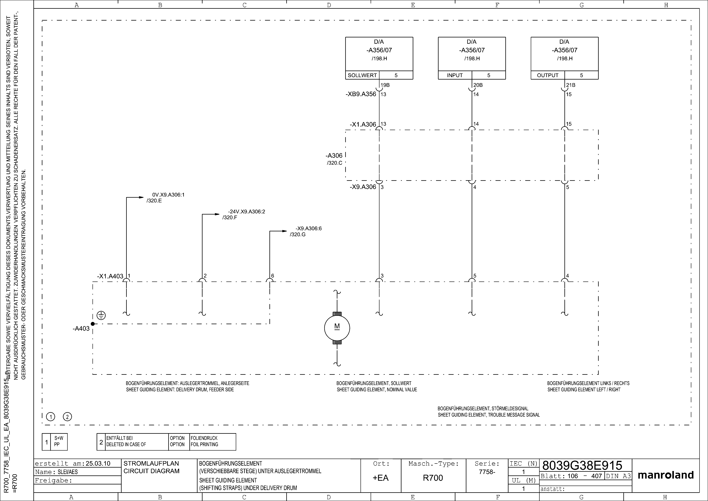

# +EA — Sheet 106 of 407 — BOGENFÜHRUNGSELEMENT

**(VERSCHIEBBARE STEGE) UNTER AUSLEGERTROMMEL**

> Part of the manroland **R700** printing press IEC/UL circuit diagrams.
> Drawing class: **Stromlaufplan / Circuit diagram** (DIN A3).
> Document `+EA` covers the **Printing unit** machine section.

## At a glance

| Field | Value |
|---|---|
| Document | `+EA`  (8039G38E915) |
| Sheet | **106** of 407 |
| Section (DE) | BOGENFÜHRUNGSELEMENT |
| Section (EN) | (VERSCHIEBBARE STEGE) UNTER AUSLEGERTROMMEL |
| Section type | CIRCUIT — Circuit diagram |
| Machine type | `R700` |
| Series | `7758` |
| Created | 25.03.10 |
| Replaces | — |
| Columns used | A, B, C, D, E, F, G |
| Path numbers | — |
| Labels on sheet | 67 |
| Cross-refs out | 7 |
| Cross-refs in | 22 |

**Previous:** [+EA sheet 105](SHEET_0105.md) · **Next:** [+EA sheet 107](SHEET_0107.md) · **Document TOC:** [_TOC.md](_TOC.md)  (+EA) · **Master TOC:** [all sheets](../_MASTER_TOC.md)

## Sheet image (300 DPI, exact vector render)



_Rendered directly from the PDF vector layer at 300 DPI (1-bit), no OCR and no resampling. Use it to confirm anything ambiguous in the text below._

## Cross-references on this sheet

Each entry is a wire leaving this sheet. The printed token is `/sheet.column`; the link resolves to that sheet inside the same document.

| Ref | Target sheet | Col | Path | Destination on target | Target section | From col |
|---|---|---|---|---|---|---|
| `/198.H` | [+EA sheet 198](SHEET_0198.md) | H | — | — | REFERENZMODUL | E |
| `/198.H` | [+EA sheet 198](SHEET_0198.md) | H | — | — | REFERENZMODUL | F |
| `/198.H` | [+EA sheet 198](SHEET_0198.md) | H | — | — | REFERENZMODUL | G |
| `/320.C` | [+EA sheet 320](SHEET_0320.md) | C | — | — | OPTION: VERLÄNGERUNG 3656,8MM | D |
| `/320.E` | [+EA sheet 320](SHEET_0320.md) | E | — | — | OPTION: VERLÄNGERUNG 3656,8MM | B |
| `/320.F` | [+EA sheet 320](SHEET_0320.md) | F | — | — | OPTION: VERLÄNGERUNG 3656,8MM | C |
| `/320.G` | [+EA sheet 320](SHEET_0320.md) | G | — | — | OPTION: VERLÄNGERUNG 3656,8MM | D |

### Incoming references (sheets that point here)

Every other sheet that sends a wire to this one. `Back-ref` is the token printed on *that* sheet; `Path` is its line number.

| From sheet | Cols | Back-ref | Path | Refs | What continues there |
|---|---|---|---|---|---|
| [+EA#198](SHEET_0198.md) | H | `/198.H` | — | 3 | — |
| [+EA#208](SHEET_0208.md) | E | `/208.E` | — | 3 | — |
| [+EA#209](SHEET_0209.md) | H | `/209.H` | — | 6 | — |
| [+EA#251](SHEET_0251.md) | F | `/251.F` | — | 3 | — |
| [+EA#252](SHEET_0252.md) | E | `/252.E` | — | 3 | — |
| [+EA#320](SHEET_0320.md) | C, E, F, G | `/320.C`, `/320.E`, `/320.F`, `/320.G` | — | 4 | 0V.X9.A306:1; X9.A306:6 |


## Devices on this sheet

| Tag | Class | Class meaning (IEC) | Col | Sub | Terminal | Sign |
|---|---|---|---|---|---|---|
| `A403` | A | Baugruppe / assembly, module, PC board | A | — | — | — |
| `A356/07` | A | Baugruppe / assembly, module, PC board | E | 07 | — | — |
| `A356/07` | A | Baugruppe / assembly, module, PC board | G | 07 | — | — |
| `A356/07` | A | Baugruppe / assembly, module, PC board | F | 07 | — | — |
| `A306` | A | Baugruppe / assembly, module, PC board | D | — | — | — |
| `X1.A403` | — | cross-device reference | A | — | — | — |
| `XB9.A356` | — | cross-device reference | D | — | — | — |
| `X1.A306` | — | cross-device reference | D | — | — | — |
| `X9.A306` | — | cross-device reference | D | — | — | — |
| `X9.A306:6` | — | cross-device reference | D | — | 6 | — |

## Potentials / nets

| Potential | Count | Columns | Attached devices | Terminals |
|---|---|---|---|---|
| `0V` | 1 | B | `A306`, `X9` | `1` |
| `24V` | 1 | C | `A306`, `X9` | `2` |


A potential such as `L24+/4` or `M24+` is a named supply/return rail; every place it appears on this sheet is electrically common.

## Wire-end annotations (grouped as printed)

A wire that continues elsewhere is annotated with a small cluster: the destination description, the path/line number `#NN`, and the `/sheet.column` cross reference. Each row below is one such cluster exactly as it is grouped on the drawing.

| Col | Y | Path | Cross-ref | Text on the wire |
|---|---|---|---|---|
| E | 65.8 | — | — | `D/A` |
| F | 65.8 | — | — | `D/A` |
| G | 65.8 | — | — | `D/A` |
| E | 79.7 | — | — | `A356/07` |
| F | 79.7 | — | — | `A356/07` |
| G | 79.7 | — | — | `A356/07` |
| E | 94.5 | — | `/198.H` | — |
| F | 94.5 | — | `/198.H` | — |
| G | 94.5 | — | `/198.H` | — |
| E | 122.8 | — | — | `SOLLWERT 5` |
| F | 122.9 | — | — | `INPUT 5` |
| G | 122.9 | — | — | `OUTPUT 5` |
| E | 139.2 | — | — | `19B` |
| F | 139.2 | — | — | `20B` |
| G | 139.2 | — | — | `21B` |
| D | 153.4 | — | — | `XB9.A356 13` |
| F | 154.8 | — | — | `14` |
| G | 154.8 | — | — | `15` |
| D | 204.4 | — | — | `X1.A306 13` |
| F | 204.4 | — | — | `14` |
| G | 204.4 | — | — | `15` |
| D | 256.8 | — | — | `A306` |
| D | 269.9 | — | `/320.C` | — |
| D | 309.3 | — | — | `X9.A306 3` |
| F | 310.7 | — | — | `4` |
| G | 310.7 | — | — | `5` |
| B | 323.4 | — | — | `0V.X9.A306:1` |
| B | 333.3 | — | `/320.E` | — |
| C | 351.8 | — | — | `24V.X9.A306:2` |
| C | 361.7 | — | `/320.F` | — |
| D | 380.1 | — | — | `X9.A306:6` |
| D | 390.0 | — | `/320.G` | — |
| B | 459.5 | — | — | `X1.A403 1 2 6` |
| F | 459.5 | — | — | `3 5 4` |
| C | 542.9 | — | — | `A403 M` |
| B | 641.3 | — | — | `BOGENFÜHRUNGSELEMENT: AUSLEGERTROMMEL, ANLEGERSEITE` |
| E | 641.3 | — | — | `BOGENFÜHRUNGSELEMENT, SOLLWERT` |
| G | 641.3 | — | — | `BOGENFÜHRUNGSELEMENT LINKS / RECHTS` |
| B | 651.9 | — | — | `SHEET GUIDING ELEMENT: DELIVERY DRUM, FEEDER SIDE` |
| E | 651.9 | — | — | `SHEET GUIDING ELEMENT, NOMINAL VALUE` |
| G | 651.9 | — | — | `SHEET GUIDING ELEMENT LEFT / RIGHT` |
| F | 683.8 | — | — | `BOGENFÜHRUNGSELEMENT, STÖRMELDESIGNAL` |
| F | 694.4 | — | — | `SHEET GUIDING ELEMENT, TROUBLE MESSAGE SIGNAL` |
| A | 697.1 | — | — | `1 2` |
| A | 733.2 | — | — | `1 PP S+W` |
| B | 733.4 | — | — | `2 ENTFÄLLT BEI DELETED IN CASE OF OPTION OPTION` |
| C | 733.4 | — | — | `FOLIENDRUCK FOIL PRINTING` |


## Reconstructed tables

This sheet carries tabular content (pin map / terminal assignment / index). The grid below was rebuilt from the drawing's own rule lines, so each row is exactly one physical row of the table.

### Table 1 — 1 data rows × 2 columns (at x=581.1, y=62.4)

| D/A | A356/07 /198.H |
|---|---|
| `SOLLWERT` | `5` |


### Table 2 — 1 data rows × 2 columns (at x=737.0, y=62.4)

| D/A | A356/07 /198.H |
|---|---|
| `INPUT` | `5` |


### Table 3 — 1 data rows × 2 columns (at x=892.9, y=62.4)

| D/A | A356/07 /198.H |
|---|---|
| `OUTPUT` | `5` |


## Notes and free text on this sheet

| Text | Col | Y (pt) |
|---|---|---|
| `M` | D | 542.92 |
| `BOGENFÜHRUNGSELEMENT: AUSLEGERTROMMEL, ANLEGERSEITE` | B | 641.27 |
| `SHEET GUIDING ELEMENT: DELIVERY DRUM, FEEDER SIDE` | B | 651.89 |
| `19B` | E | 139.18 |
| `D/A` | E | 65.78 |
| `SOLLWERT` | D | 122.83 |
| `BOGENFÜHRUNGSELEMENT, SOLLWERT` | E | 641.26 |
| `SHEET GUIDING ELEMENT, NOMINAL VALUE` | E | 651.9 |
| `21B` | G | 139.18 |
| `D/A` | G | 65.78 |
| `OUTPUT` | G | 122.89 |
| `BOGENFÜHRUNGSELEMENT LINKS / RECHTS` | G | 641.26 |
| `SHEET GUIDING ELEMENT LEFT / RIGHT` | G | 651.89 |
| `20B` | F | 139.18 |
| `D/A` | F | 65.78 |
| `INPUT` | E | 122.88 |
| `BOGENFÜHRUNGSELEMENT, STÖRMELDESIGNAL` | F | 683.79 |
| `SHEET GUIDING ELEMENT, TROUBLE MESSAGE SIGNAL` | F | 694.41 |
| `S+W` | A | 733.24 |
| `PP` | A | 743.87 |
| `ENTFÄLLT BEI` | B | 733.35 |
| `DELETED IN CASE OF` | B | 744 |
| `OPTION` | B | 733.35 |
| `FOLIENDRUCK` | C | 733.4 |
| `FOIL PRINTING` | C | 744 |

## Complete label inventory (exact text from the drawing)

Every text object inside the drawing area of this sheet, in DIN reading order (column A→H, then top→bottom). This is the authoritative list: if a string is not here it is not printed on this sheet.

| Col | Y | X | Dir | Type | Text |
|---|---|---|---|---|---|
| A | 459.5 | 163.3 | → | device ref | `X1.A403` |
| A | 547.4 | 122.5 | → | device tag | `A403` |
| A | 697.1 | 83.3 | → | number | `1` |
| A | 697.6 | 111.4 | → | number | `2` |
| A | 733.2 | 91.8 | → | text | `S+W` |
| A | 738.7 | 75.4 | → | number | `1` |
| A | 738.7 | 167.2 | → | number | `2` |
| A | 743.9 | 91.3 | → | text | `PP` |
| B | 323.4 | 256.3 | → | potential | `0V.X9.A306:1` |
| B | 333.3 | 246.6 | → | cross-reference | `/320.E` |
| B | 459.5 | 214.6 | → | number | `1` |
| B | 641.3 | 211.7 | → | text | `BOGENFÜHRUNGSELEMENT: AUSLEGERTROMMEL, ANLEGERSEITE` |
| B | 651.9 | 212.3 | → | text | `SHEET GUIDING ELEMENT: DELIVERY DRUM, FEEDER SIDE` |
| B | 733.3 | 179.1 | → | text | `ENTFÄLLT BEI` |
| B | 733.4 | 286.0 | → | text | `OPTION` |
| B | 744.0 | 179.1 | → | text | `DELETED IN CASE OF` |
| B | 744.0 | 286.0 | → | text | `OPTION` |
| C | 351.8 | 383.8 | → | potential | `24V.X9.A306:2` |
| C | 361.7 | 374.2 | → | cross-reference | `/320.F` |
| C | 459.5 | 342.7 | → | number | `2` |
| C | 459.5 | 456.1 | → | number | `6` |
| C | 733.4 | 320.9 | → | text | `FOLIENDRUCK` |
| C | 744.0 | 320.9 | → | text | `FOIL PRINTING` |
| D | 122.8 | 584.9 | → | text | `SOLLWERT` |
| D | 153.4 | 581.4 | → | device ref | `XB9.A356` |
| D | 204.4 | 588.5 | → | device ref | `X1.A306` |
| D | 256.8 | 547.7 | → | device tag | `A306` |
| D | 269.9 | 549.9 | → | cross-reference | `/320.C` |
| D | 309.3 | 588.5 | → | device ref | `X9.A306` |
| D | 380.1 | 497.2 | → | device ref | `X9.A306:6` |
| D | 390.0 | 487.6 | → | cross-reference | `/320.G` |
| D | 542.9 | 562.3 | → | text | `M` |
| E | 65.8 | 629.0 | → | text | `D/A` |
| E | 79.7 | 616.4 | → | device tag | `A356/07` |
| E | 94.5 | 625.3 | → | cross-reference | `/198.H` |
| E | 122.9 | 663.7 | → | number | `5` |
| E | 122.9 | 751.9 | → | text | `INPUT` |
| E | 139.2 | 639.8 | → | text | `19B` |
| E | 154.8 | 639.8 | → | number | `13` |
| E | 204.4 | 639.8 | → | number | `13` |
| E | 310.7 | 640.3 | → | number | `3` |
| E | 459.5 | 640.3 | → | number | `3` |
| E | 641.3 | 566.1 | → | text | `BOGENFÜHRUNGSELEMENT, SOLLWERT` |
| E | 651.9 | 566.6 | → | text | `SHEET GUIDING ELEMENT, NOMINAL VALUE` |
| F | 65.8 | 784.9 | → | text | `D/A` |
| F | 79.7 | 772.3 | → | device tag | `A356/07` |
| F | 94.5 | 781.2 | → | cross-reference | `/198.H` |
| F | 122.9 | 819.6 | → | number | `5` |
| F | 139.2 | 796.3 | → | text | `20B` |
| F | 154.8 | 795.7 | → | number | `14` |
| F | 204.4 | 795.7 | → | number | `14` |
| F | 310.7 | 796.3 | → | number | `4` |
| F | 459.5 | 796.3 | → | number | `5` |
| F | 683.8 | 736.2 | → | text | `BOGENFÜHRUNGSELEMENT, STÖRMELDESIGNAL` |
| F | 694.4 | 736.7 | → | text | `SHEET GUIDING ELEMENT, TROUBLE MESSAGE SIGNAL` |
| G | 65.8 | 940.8 | → | text | `D/A` |
| G | 79.7 | 928.2 | → | device tag | `A356/07` |
| G | 94.5 | 937.1 | → | cross-reference | `/198.H` |
| G | 122.9 | 903.3 | → | text | `OUTPUT` |
| G | 122.9 | 975.5 | → | number | `5` |
| G | 139.2 | 952.2 | → | text | `21B` |
| G | 154.8 | 951.6 | → | number | `15` |
| G | 204.4 | 951.6 | → | number | `15` |
| G | 310.7 | 952.2 | → | number | `5` |
| G | 459.5 | 952.2 | → | number | `4` |
| G | 641.3 | 920.4 | → | text | `BOGENFÜHRUNGSELEMENT LINKS / RECHTS` |
| G | 651.9 | 921.0 | → | text | `SHEET GUIDING ELEMENT LEFT / RIGHT` |

## Reading-order text block

The same content as a plain block, grouped by DIN column — convenient to paste or to match against a visual description.

```text
=== Column A ===
 459.5  163.3  devref       X1.A403
 547.4  122.5  devtag       A403
 697.1   83.3  numeric      1
 697.6  111.4  numeric      2
 733.2   91.8  text         S+W
 738.7   75.4  numeric      1
 738.7  167.2  numeric      2
 743.9   91.3  text         PP
=== Column B ===
 323.4  256.3  net          0V.X9.A306:1
 333.3  246.6  xref         /320.E
 459.5  214.6  numeric      1
 641.3  211.7  text         BOGENFÜHRUNGSELEMENT: AUSLEGERTROMMEL, ANLEGERSEITE
 651.9  212.3  text         SHEET GUIDING ELEMENT: DELIVERY DRUM, FEEDER SIDE
 733.3  179.1  text         ENTFÄLLT BEI
 733.4  286.0  text         OPTION
 744.0  179.1  text         DELETED IN CASE OF
 744.0  286.0  text         OPTION
=== Column C ===
 351.8  383.8  net          24V.X9.A306:2
 361.7  374.2  xref         /320.F
 459.5  342.7  numeric      2
 459.5  456.1  numeric      6
 733.4  320.9  text         FOLIENDRUCK
 744.0  320.9  text         FOIL PRINTING
=== Column D ===
 122.8  584.9  text         SOLLWERT
 153.4  581.4  devref       XB9.A356
 204.4  588.5  devref       X1.A306
 256.8  547.7  devtag       A306
 269.9  549.9  xref         /320.C
 309.3  588.5  devref       X9.A306
 380.1  497.2  devref       X9.A306:6
 390.0  487.6  xref         /320.G
 542.9  562.3  text         M
=== Column E ===
  65.8  629.0  text         D/A
  79.7  616.4  devtag       A356/07
  94.5  625.3  xref         /198.H
 122.9  663.7  numeric      5
 122.9  751.9  text         INPUT
 139.2  639.8  text         19B
 154.8  639.8  numeric      13
 204.4  639.8  numeric      13
 310.7  640.3  numeric      3
 459.5  640.3  numeric      3
 641.3  566.1  text         BOGENFÜHRUNGSELEMENT, SOLLWERT
 651.9  566.6  text         SHEET GUIDING ELEMENT, NOMINAL VALUE
=== Column F ===
  65.8  784.9  text         D/A
  79.7  772.3  devtag       A356/07
  94.5  781.2  xref         /198.H
 122.9  819.6  numeric      5
 139.2  796.3  text         20B
 154.8  795.7  numeric      14
 204.4  795.7  numeric      14
 310.7  796.3  numeric      4
 459.5  796.3  numeric      5
 683.8  736.2  text         BOGENFÜHRUNGSELEMENT, STÖRMELDESIGNAL
 694.4  736.7  text         SHEET GUIDING ELEMENT, TROUBLE MESSAGE SIGNAL
=== Column G ===
  65.8  940.8  text         D/A
  79.7  928.2  devtag       A356/07
  94.5  937.1  xref         /198.H
 122.9  903.3  text         OUTPUT
 122.9  975.5  numeric      5
 139.2  952.2  text         21B
 154.8  951.6  numeric      15
 204.4  951.6  numeric      15
 310.7  952.2  numeric      5
 459.5  952.2  numeric      4
 641.3  920.4  text         BOGENFÜHRUNGSELEMENT LINKS / RECHTS
 651.9  921.0  text         SHEET GUIDING ELEMENT LEFT / RIGHT
```

---
_Generated from the PDF vector text layer; no OCR. Source: `R700_7758_IEC_UL_EA_8039G38E915_p`, sheet 106._
